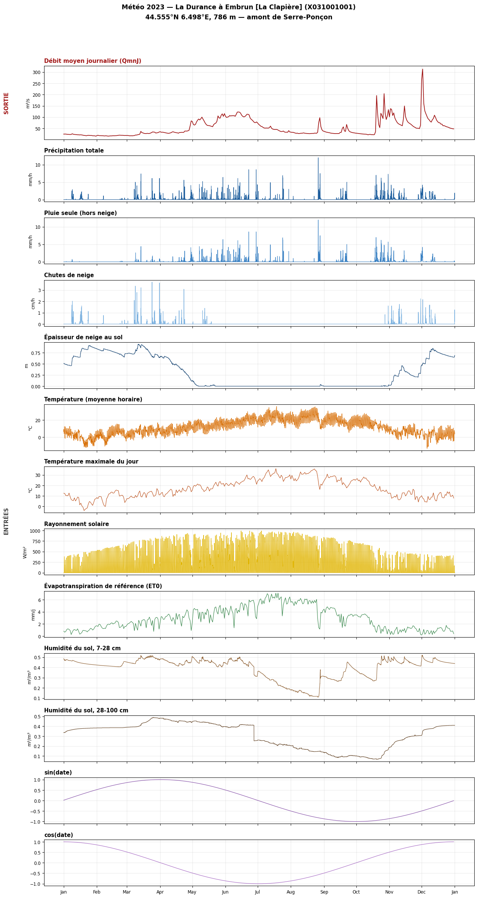
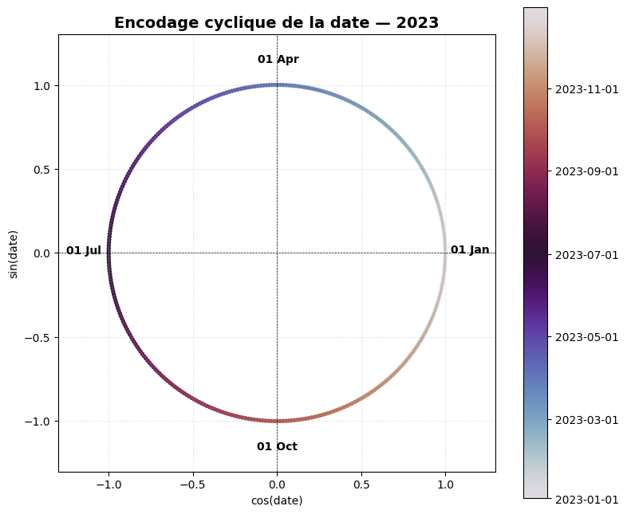

# 1.1 — Une rivière et ses données

Station : **La Durance à Embrun [La Clapière]** (X031001001), 44,555°N 6,498°E, 786 m.
Période : **2023**.

## 1. Station

Source : API Hub'Eau (référentiel des stations).

    La Durance à Embrun [La Clapière] (X031001001)
    44.555356405°N, 6.498009964°E, 786.0 m

## 2. Téléchargement Open-Meteo (2023)

Archive API, variables horaires + journalières en un appel. Retry sur 429/5xx (cf. `river.py::fetch_weather_data_multi`).

    Téléchargé en 1.1s | altitude utilisée par Open-Meteo : 788.0 m (altitude officielle de la station : 786.0 m)

    horaire   : (8760, 9) lignes/colonnes
    journalier: (365, 3) lignes/colonnes
    
    valeurs manquantes (horaire)  : {'precipitation': 0, 'temperature_2m': 0, 'snow_depth': 0, 'shortwave_radiation': 0, 'rain': 0, 'soil_moisture_7_to_28cm': 0, 'snowfall': 0, 'soil_moisture_28_to_100cm': 0, 'date': 0}
    valeurs manquantes (journalier): {'temperature_2m_max': 0, 'et0_fao_evapotranspiration': 0, 'date': 0}

## 3. Débit (Hub'Eau)

`QmnJ`, même station/année. L/s → m³/s.

    débit : (365, 3) lignes/colonnes | valeurs manquantes : 0
    min 15.7 m³/s, moyen 53.1 m³/s, max 313.2 m³/s

## 4. Encodage cyclique de la date

`sin`/`cos(2π · jour_de_l'année / 365,25)` — cf. `river.py::encode_cyclical_date`.

<table border="1" class="dataframe">
  <thead>
    <tr style="text-align: right;">
      <th></th>
      <th>date</th>
      <th>sin_date</th>
      <th>cos_date</th>
    </tr>
  </thead>
  <tbody>
    <tr>
      <th>0</th>
      <td>2023-01-01</td>
      <td>0.017202</td>
      <td>0.999852</td>
    </tr>
    <tr>
      <th>90</th>
      <td>2023-04-01</td>
      <td>0.999986</td>
      <td>0.005376</td>
    </tr>
    <tr>
      <th>181</th>
      <td>2023-07-01</td>
      <td>0.010751</td>
      <td>-0.999942</td>
    </tr>
    <tr>
      <th>273</th>
      <td>2023-10-01</td>
      <td>-0.999999</td>
      <td>0.001075</td>
    </tr>
    <tr>
      <th>364</th>
      <td>2023-12-31</td>
      <td>-0.004301</td>
      <td>0.999991</td>
    </tr>
  </tbody>
</table>

## 5. Débit et variables météo

    

    

## 6. Encodage cyclique — représentation circulaire

    

    

## 7. Observations

- Débit : ~25 m³/s (hiver), pic ~120 m³/s (fonte, avr.-juin), pics ponctuels jusqu'à 313 m³/s (pluie, automne).
- Neige au sol : 0,5→0,9 m (hiver), fonte avr.-juin, remontée mi-nov.
- Pluie ≈ précipitation totale sauf hiver (écart = neige).
- Humidité sol surface : 0,45→0,12 m³/m³ (été) ; couche profonde plus lissée et en retard.
- Température/rayonnement : cycle saisonnier standard.
