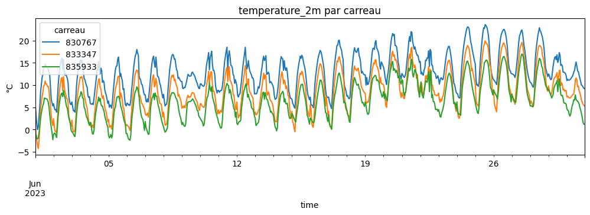
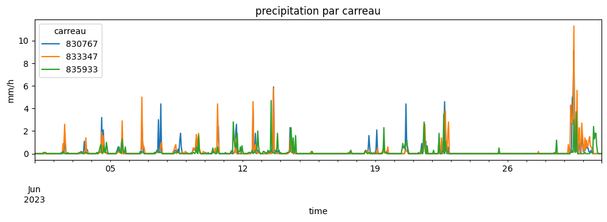

# 1.2 — La météo : archive, coûts, cache

Téléchargement Open-Meteo (archive) par carreau, avec compteur d'appels et cache (`src/meteo.py`).

## 1. Abonnement et quota

Abonnement lu dans `config.ABONNEMENT_OPEN_METEO`. Quota d'après le journal des appels (`data/cache/meteo/journal_appels.csv`).

    abonnement : gratuit

<table border="1" class="dataframe">
  <thead>
    <tr style="text-align: right;">
      <th></th>
      <th>utilise</th>
      <th>limite</th>
      <th>reste</th>
    </tr>
    <tr>
      <th>fenetre</th>
      <th></th>
      <th></th>
      <th></th>
    </tr>
  </thead>
  <tbody>
    <tr>
      <th>minute</th>
      <td>0.0</td>
      <td>600</td>
      <td>600.0</td>
    </tr>
    <tr>
      <th>heure</th>
      <td>0.0</td>
      <td>5000</td>
      <td>5000.0</td>
    </tr>
    <tr>
      <th>jour</th>
      <td>522.9</td>
      <td>10000</td>
      <td>9477.1</td>
    </tr>
    <tr>
      <th>mois</th>
      <td>29669.6</td>
      <td>300000</td>
      <td>270330.4</td>
    </tr>
  </tbody>
</table>

## 2. Coût d'une requête

Règle mesurée le 2026-10-06 : 1 appel = 10 variables × 14 jours pour 1 point, minimum 1 par point.

<table border="1" class="dataframe">
  <thead>
    <tr style="text-align: right;">
      <th></th>
      <th>requête</th>
      <th>points</th>
      <th>variables</th>
      <th>jours</th>
      <th>mesuré</th>
      <th>calculé</th>
    </tr>
  </thead>
  <tbody>
    <tr>
      <th>0</th>
      <td>1 point, 1 variable, 1 an</td>
      <td>1</td>
      <td>1</td>
      <td>365</td>
      <td>2.6</td>
      <td>2.6</td>
    </tr>
    <tr>
      <th>1</th>
      <td>5 points, 1 variable, 1 an</td>
      <td>5</td>
      <td>1</td>
      <td>365</td>
      <td>13.0</td>
      <td>13.0</td>
    </tr>
    <tr>
      <th>2</th>
      <td>1 point, 10 variables, 1 an</td>
      <td>1</td>
      <td>10</td>
      <td>365</td>
      <td>26.0</td>
      <td>26.1</td>
    </tr>
    <tr>
      <th>3</th>
      <td>1 point, 20 variables, 1 an</td>
      <td>1</td>
      <td>20</td>
      <td>365</td>
      <td>52.0</td>
      <td>52.1</td>
    </tr>
    <tr>
      <th>4</th>
      <td>1 point, 20 variables, 1 jour</td>
      <td>1</td>
      <td>20</td>
      <td>1</td>
      <td>2.0</td>
      <td>2.0</td>
    </tr>
    <tr>
      <th>5</th>
      <td>1 point, 10 variables, 14 jours</td>
      <td>1</td>
      <td>10</td>
      <td>14</td>
      <td>1.0</td>
      <td>1.0</td>
    </tr>
  </tbody>
</table>

## 3. Carreaux d'un bassin

Amont d'Espinasses (Durance, aval de Serre-Ponçon).

    61 carreaux

<table border="1" class="dataframe">
  <thead>
    <tr style="text-align: right;">
      <th></th>
      <th>carreau</th>
      <th>lon_centre</th>
      <th>lat_centre</th>
      <th>surface_km2</th>
      <th>pourcentage</th>
    </tr>
  </thead>
  <tbody>
    <tr>
      <th>0</th>
      <td>830767</td>
      <td>6.558140</td>
      <td>44.956062</td>
      <td>86.012142</td>
      <td>2.400657</td>
    </tr>
    <tr>
      <th>1</th>
      <td>833347</td>
      <td>6.547988</td>
      <td>44.885763</td>
      <td>85.991154</td>
      <td>2.400071</td>
    </tr>
    <tr>
      <th>2</th>
      <td>835933</td>
      <td>6.816074</td>
      <td>44.815465</td>
      <td>85.966729</td>
      <td>2.399389</td>
    </tr>
    <tr>
      <th>3</th>
      <td>835932</td>
      <td>6.676971</td>
      <td>44.815465</td>
      <td>85.957155</td>
      <td>2.399122</td>
    </tr>
    <tr>
      <th>4</th>
      <td>835931</td>
      <td>6.537867</td>
      <td>44.815465</td>
      <td>85.945852</td>
      <td>2.398807</td>
    </tr>
  </tbody>
</table>

## 4. Coût prévu, sans rien télécharger

Tous les carreaux, 10 variables, 25 ans.

    {'appels': 20551.7,
     'requetes': 41,
     'carreaux_a_telecharger': 38,
     'carreaux_complets_en_cache': 23}

## 5. Téléchargement

3 carreaux, 10 variables, juin 2023.

    prévu : {'appels': 0, 'requetes': 0, 'carreaux_a_telecharger': 0, 'carreaux_complets_en_cache': 3}
    {'horaire': (720, 27), 'journalier': (30, 3)}

    

    

    

    

## 6. Cache

La même demande ne coûte plus rien ; contenu du cache ; quota après.

    même demande, prévu : {'appels': 0, 'requetes': 0, 'carreaux_a_telecharger': 0, 'carreaux_complets_en_cache': 3}

<table border="1" class="dataframe">
  <thead>
    <tr style="text-align: right;">
      <th></th>
      <th>carreau</th>
      <th>variable</th>
      <th>resolution</th>
      <th>debut</th>
      <th>fin</th>
      <th>mo_carreau</th>
    </tr>
  </thead>
  <tbody>
    <tr>
      <th>0</th>
      <td>825618</td>
      <td>et0_fao_evapotranspiration</td>
      <td>horaire</td>
      <td>2000-01-01</td>
      <td>2009-01-06</td>
      <td>1.084</td>
    </tr>
    <tr>
      <th>1</th>
      <td>825618</td>
      <td>precipitation</td>
      <td>horaire</td>
      <td>2000-01-01</td>
      <td>2009-01-06</td>
      <td>1.084</td>
    </tr>
    <tr>
      <th>2</th>
      <td>825618</td>
      <td>rain</td>
      <td>horaire</td>
      <td>2000-01-01</td>
      <td>2009-01-06</td>
      <td>1.084</td>
    </tr>
    <tr>
      <th>3</th>
      <td>825618</td>
      <td>shortwave_radiation</td>
      <td>horaire</td>
      <td>2000-01-01</td>
      <td>2009-01-06</td>
      <td>1.084</td>
    </tr>
    <tr>
      <th>4</th>
      <td>825618</td>
      <td>snow_depth</td>
      <td>horaire</td>
      <td>2000-01-01</td>
      <td>2009-01-06</td>
      <td>1.084</td>
    </tr>
    <tr>
      <th>...</th>
      <td>...</td>
      <td>...</td>
      <td>...</td>
      <td>...</td>
      <td>...</td>
      <td>...</td>
    </tr>
    <tr>
      <th>405</th>
      <td>848912</td>
      <td>snowfall</td>
      <td>horaire</td>
      <td>2000-01-01</td>
      <td>2009-01-06</td>
      <td>1.058</td>
    </tr>
    <tr>
      <th>406</th>
      <td>848912</td>
      <td>soil_moisture_28_to_100cm</td>
      <td>horaire</td>
      <td>2000-01-01</td>
      <td>2009-01-06</td>
      <td>1.058</td>
    </tr>
    <tr>
      <th>407</th>
      <td>848912</td>
      <td>soil_moisture_7_to_28cm</td>
      <td>horaire</td>
      <td>2000-01-01</td>
      <td>2009-01-06</td>
      <td>1.058</td>
    </tr>
    <tr>
      <th>408</th>
      <td>848912</td>
      <td>temperature_2m</td>
      <td>horaire</td>
      <td>2000-01-01</td>
      <td>2009-01-06</td>
      <td>1.058</td>
    </tr>
    <tr>
      <th>409</th>
      <td>848912</td>
      <td>temperature_2m_max</td>
      <td>journalier</td>
      <td>2000-01-01</td>
      <td>2009-01-06</td>
      <td>1.058</td>
    </tr>
  </tbody>
</table>

410 rows × 6 columns

<table border="1" class="dataframe">
  <thead>
    <tr style="text-align: right;">
      <th></th>
      <th>utilise</th>
      <th>limite</th>
      <th>reste</th>
    </tr>
    <tr>
      <th>fenetre</th>
      <th></th>
      <th></th>
      <th></th>
    </tr>
  </thead>
  <tbody>
    <tr>
      <th>minute</th>
      <td>0.0</td>
      <td>600</td>
      <td>600.0</td>
    </tr>
    <tr>
      <th>heure</th>
      <td>0.0</td>
      <td>5000</td>
      <td>5000.0</td>
    </tr>
    <tr>
      <th>jour</th>
      <td>9804.0</td>
      <td>10000</td>
      <td>196.0</td>
    </tr>
    <tr>
      <th>mois</th>
      <td>19762.6</td>
      <td>300000</td>
      <td>280237.4</td>
    </tr>
  </tbody>
</table>

## 7. `vider_cache`

Sur un cache temporaire (1 carreau, 1 jour, 1 appel), pour ne pas toucher au vrai cache.

    avant : 1 ligne(s)
    après : 0 ligne(s)

