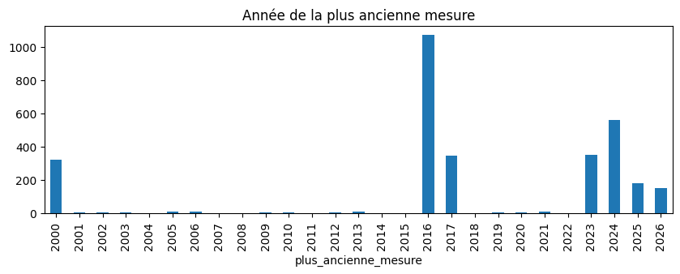
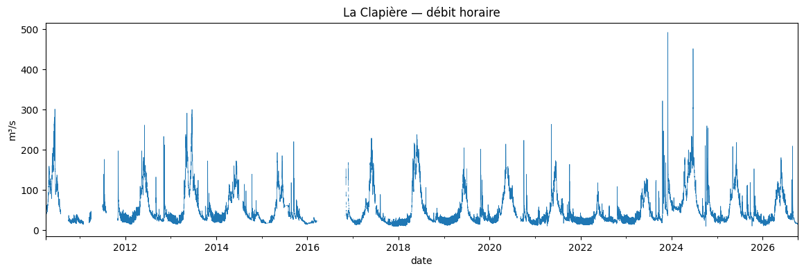
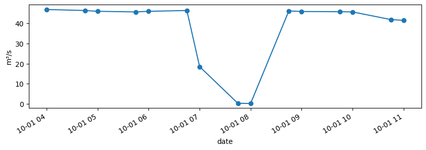
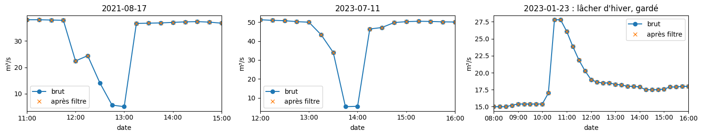
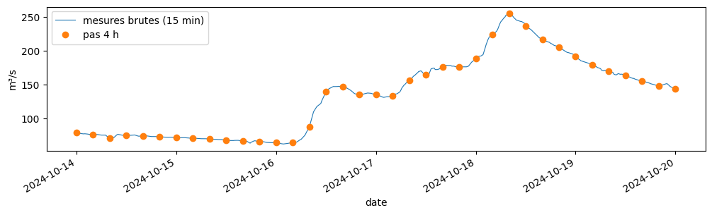

# 1.3 — Les débits RiverApp

Stations et mesures via une API partenaire privée (`src/hydro.py`). Identifiants dans `.env`. Une station se désigne par son **identifiant RiverApp** (valable pour tous les pays) ; le code Hub'Eau sert seulement à le retrouver.

## 1. Mode d'emploi

Toutes les fonctions de `RiverApp`, en bref. Identifiants lus dans `.env`.

    La Clapière : 52a0c9cee4b03f58295e6f8a

<table border="1" class="dataframe">
  <thead>
    <tr style="text-align: right;">
      <th></th>
      <th>lat</th>
      <th>lon</th>
      <th>nom</th>
      <th>cours_eau</th>
      <th>plus_ancienne_mesure</th>
      <th>code</th>
    </tr>
    <tr>
      <th>id</th>
      <th></th>
      <th></th>
      <th></th>
      <th></th>
      <th></th>
      <th></th>
    </tr>
  </thead>
  <tbody>
    <tr>
      <th>52a0c9bee4b03f58295e6ec2</th>
      <td>43.056603</td>
      <td>2.216628</td>
      <td>Limoux [Pont-de-Fer]</td>
      <td>Aude</td>
      <td>2002-11-29 00:00:00+00:00</td>
      <td>Y115201001</td>
    </tr>
    <tr>
      <th>52a0c9bfe4b03f58295e6ec6</th>
      <td>42.877783</td>
      <td>2.184991</td>
      <td>Quillan [Pont RD118]</td>
      <td>Aude</td>
      <td>2013-11-19 00:00:00+00:00</td>
      <td>Y111201002</td>
    </tr>
    <tr>
      <th>52a0c9c0e4b03f58295e6ece</th>
      <td>43.210373</td>
      <td>2.358244</td>
      <td>Carcassonne [Pont-Vieux]</td>
      <td>Aude</td>
      <td>2000-01-01 00:00:00+00:00</td>
      <td>Y123201001</td>
    </tr>
  </tbody>
</table>

<table border="1" class="dataframe">
  <thead>
    <tr style="text-align: right;">
      <th></th>
      <th>flow</th>
      <th>level</th>
    </tr>
    <tr>
      <th>date</th>
      <th></th>
      <th></th>
    </tr>
  </thead>
  <tbody>
    <tr>
      <th>2024-10-01 00:00:00+00:00</th>
      <td>47.700001</td>
      <td>0.570</td>
    </tr>
    <tr>
      <th>2024-10-01 00:45:00+00:00</th>
      <td>47.400002</td>
      <td>0.570</td>
    </tr>
    <tr>
      <th>2024-10-01 01:00:00+00:00</th>
      <td>47.299999</td>
      <td>0.570</td>
    </tr>
    <tr>
      <th>2024-10-01 01:45:00+00:00</th>
      <td>46.799999</td>
      <td>0.563</td>
    </tr>
    <tr>
      <th>2024-10-01 02:00:00+00:00</th>
      <td>46.799999</td>
      <td>0.560</td>
    </tr>
  </tbody>
</table>

<table border="1" class="dataframe">
  <thead>
    <tr style="text-align: right;">
      <th></th>
      <th>flow</th>
      <th>level</th>
    </tr>
    <tr>
      <th>date</th>
      <th></th>
      <th></th>
    </tr>
  </thead>
  <tbody>
    <tr>
      <th>2024-10-01 00:00:00+00:00</th>
      <td>47.700001</td>
      <td>0.57</td>
    </tr>
    <tr>
      <th>2024-10-01 04:00:00+00:00</th>
      <td>46.900002</td>
      <td>0.56</td>
    </tr>
    <tr>
      <th>2024-10-01 08:00:00+00:00</th>
      <td>0.200000</td>
      <td>-0.04</td>
    </tr>
    <tr>
      <th>2024-10-01 12:00:00+00:00</th>
      <td>41.400002</td>
      <td>0.52</td>
    </tr>
    <tr>
      <th>2024-10-01 16:00:00+00:00</th>
      <td>45.400002</td>
      <td>0.55</td>
    </tr>
    <tr>
      <th>2024-10-01 20:00:00+00:00</th>
      <td>45.299999</td>
      <td>0.55</td>
    </tr>
    <tr>
      <th>2024-10-02 00:00:00+00:00</th>
      <td>47.299999</td>
      <td>0.57</td>
    </tr>
  </tbody>
</table>

<table border="1" class="dataframe">
  <thead>
    <tr style="text-align: right;">
      <th></th>
      <th>trou_max=3h</th>
      <th>trou_max=24h</th>
    </tr>
    <tr>
      <th>date</th>
      <th></th>
      <th></th>
    </tr>
  </thead>
  <tbody>
    <tr>
      <th>2016-05-01 00:00:00+00:00</th>
      <td>NaN</td>
      <td>57.037498</td>
    </tr>
    <tr>
      <th>2016-05-01 04:00:00+00:00</th>
      <td>NaN</td>
      <td>55.754166</td>
    </tr>
    <tr>
      <th>2016-05-01 08:00:00+00:00</th>
      <td>NaN</td>
      <td>54.470833</td>
    </tr>
    <tr>
      <th>2016-05-01 12:00:00+00:00</th>
      <td>NaN</td>
      <td>53.837502</td>
    </tr>
    <tr>
      <th>2016-05-01 16:00:00+00:00</th>
      <td>NaN</td>
      <td>53.420834</td>
    </tr>
    <tr>
      <th>2016-05-01 20:00:00+00:00</th>
      <td>NaN</td>
      <td>53.004169</td>
    </tr>
    <tr>
      <th>2016-05-02 00:00:00+00:00</th>
      <td>NaN</td>
      <td>52.275002</td>
    </tr>
  </tbody>
</table>

<table border="1" class="dataframe">
  <thead>
    <tr style="text-align: right;">
      <th></th>
      <th>brut</th>
      <th>filtré</th>
    </tr>
    <tr>
      <th>date</th>
      <th></th>
      <th></th>
    </tr>
  </thead>
  <tbody>
    <tr>
      <th>2024-10-01 06:00:00+00:00</th>
      <td>46.000000</td>
      <td>46.000000</td>
    </tr>
    <tr>
      <th>2024-10-01 07:00:00+00:00</th>
      <td>18.500000</td>
      <td>18.500000</td>
    </tr>
    <tr>
      <th>2024-10-01 08:00:00+00:00</th>
      <td>0.200000</td>
      <td>34.328571</td>
    </tr>
    <tr>
      <th>2024-10-01 09:00:00+00:00</th>
      <td>45.900002</td>
      <td>45.900002</td>
    </tr>
    <tr>
      <th>2024-10-01 10:00:00+00:00</th>
      <td>45.700001</td>
      <td>45.700001</td>
    </tr>
  </tbody>
</table>

<table border="1" class="dataframe">
  <thead>
    <tr style="text-align: right;">
      <th></th>
      <th>id</th>
      <th>code</th>
      <th>debut</th>
      <th>fin</th>
      <th>mesures</th>
      <th>mo</th>
    </tr>
  </thead>
  <tbody>
    <tr>
      <th>0</th>
      <td>52a0c9cee4b03f58295e6f8a</td>
      <td>X031001001</td>
      <td>2010-04-02 00:00:00+00:00</td>
      <td>2026-10-07 02:16:00+00:00</td>
      <td>362170</td>
      <td>3.55</td>
    </tr>
  </tbody>
</table>

## 2. Stations Hub'Eau

    3096 stations

    

    

<table border="1" class="dataframe">
  <thead>
    <tr style="text-align: right;">
      <th></th>
      <th>lat</th>
      <th>lon</th>
      <th>nom</th>
      <th>cours_eau</th>
      <th>plus_ancienne_mesure</th>
      <th>code</th>
    </tr>
    <tr>
      <th>id</th>
      <th></th>
      <th></th>
      <th></th>
      <th></th>
      <th></th>
      <th></th>
    </tr>
  </thead>
  <tbody>
    <tr>
      <th>52a0c9cee4b03f58295e6f8a</th>
      <td>44.55536</td>
      <td>6.498014</td>
      <td>Embrun [La Clapière]</td>
      <td>Durance</td>
      <td>2010-04-02 00:00:00+00:00</td>
      <td>X031001001</td>
    </tr>
  </tbody>
</table>

Un même code Hub'Eau peut correspondre à deux stations RiverApp (ici Langon) : d'où l'identifiant RiverApp comme clé.

<table border="1" class="dataframe">
  <thead>
    <tr style="text-align: right;">
      <th></th>
      <th>lat</th>
      <th>lon</th>
      <th>nom</th>
      <th>cours_eau</th>
      <th>plus_ancienne_mesure</th>
      <th>code</th>
    </tr>
    <tr>
      <th>id</th>
      <th></th>
      <th></th>
      <th></th>
      <th></th>
      <th></th>
      <th></th>
    </tr>
  </thead>
  <tbody>
    <tr>
      <th>5a2e6c085782af5a46319138</th>
      <td>44.557767</td>
      <td>-0.238005</td>
      <td>Langon [AIRBUS]</td>
      <td>Garonne [La Gironde]</td>
      <td>2017-12-08 00:00:00+00:00</td>
      <td>O945001001</td>
    </tr>
    <tr>
      <th>67f4f509a12554570cb5b949</th>
      <td>44.556325</td>
      <td>-0.246908</td>
      <td>Langon</td>
      <td>Garonne</td>
      <td>2025-04-06 00:00:00+00:00</td>
      <td>O945001001</td>
    </tr>
  </tbody>
</table>

## 3. Mesures de La Clapière

Tout l'historique, par tranches de 32 jours ; seul ce qui manque au cache est téléchargé.

    362,170 mesures, 2010-04-02 01:00:00+00:00 → 2026-10-07 02:00:00+00:00 (0.0 s)

<table border="1" class="dataframe">
  <thead>
    <tr style="text-align: right;">
      <th></th>
      <th>flow</th>
      <th>level</th>
    </tr>
    <tr>
      <th>date</th>
      <th></th>
      <th></th>
    </tr>
  </thead>
  <tbody>
    <tr>
      <th>2026-10-06 23:45:00+00:00</th>
      <td>15.3</td>
      <td>0.233</td>
    </tr>
    <tr>
      <th>2026-10-07 00:00:00+00:00</th>
      <td>15.4</td>
      <td>0.234</td>
    </tr>
    <tr>
      <th>2026-10-07 00:15:00+00:00</th>
      <td>15.4</td>
      <td>0.234</td>
    </tr>
    <tr>
      <th>2026-10-07 00:30:00+00:00</th>
      <td>15.4</td>
      <td>0.234</td>
    </tr>
    <tr>
      <th>2026-10-07 02:00:00+00:00</th>
      <td>15.3</td>
      <td>0.230</td>
    </tr>
  </tbody>
</table>

## 4. Nature des données par année

Avant le 29/03/2016 : débit horaire seul. Après : débit + hauteur toutes les 15 min. Avril-octobre 2016 : ~2 mesures par jour.

<table border="1" class="dataframe">
  <thead>
    <tr style="text-align: right;">
      <th></th>
      <th>mesures</th>
      <th>debit</th>
      <th>hauteur</th>
      <th>pas_median_min</th>
    </tr>
    <tr>
      <th>date</th>
      <th></th>
      <th></th>
      <th></th>
      <th></th>
    </tr>
  </thead>
  <tbody>
    <tr>
      <th>2010</th>
      <td>5110</td>
      <td>1.0</td>
      <td>0.00</td>
      <td>60.0</td>
    </tr>
    <tr>
      <th>2011</th>
      <td>3298</td>
      <td>1.0</td>
      <td>0.00</td>
      <td>60.0</td>
    </tr>
    <tr>
      <th>2012</th>
      <td>8784</td>
      <td>1.0</td>
      <td>0.00</td>
      <td>60.0</td>
    </tr>
    <tr>
      <th>2013</th>
      <td>8760</td>
      <td>1.0</td>
      <td>0.00</td>
      <td>60.0</td>
    </tr>
    <tr>
      <th>2014</th>
      <td>8015</td>
      <td>1.0</td>
      <td>0.00</td>
      <td>60.0</td>
    </tr>
    <tr>
      <th>2015</th>
      <td>8760</td>
      <td>1.0</td>
      <td>0.00</td>
      <td>60.0</td>
    </tr>
    <tr>
      <th>2016</th>
      <td>4966</td>
      <td>1.0</td>
      <td>0.64</td>
      <td>15.0</td>
    </tr>
    <tr>
      <th>2017</th>
      <td>31884</td>
      <td>1.0</td>
      <td>1.00</td>
      <td>15.0</td>
    </tr>
    <tr>
      <th>2018</th>
      <td>34871</td>
      <td>1.0</td>
      <td>1.00</td>
      <td>15.0</td>
    </tr>
    <tr>
      <th>2019</th>
      <td>34454</td>
      <td>1.0</td>
      <td>1.00</td>
      <td>15.0</td>
    </tr>
    <tr>
      <th>2020</th>
      <td>30808</td>
      <td>1.0</td>
      <td>1.00</td>
      <td>15.0</td>
    </tr>
    <tr>
      <th>2021</th>
      <td>34502</td>
      <td>1.0</td>
      <td>1.00</td>
      <td>15.0</td>
    </tr>
    <tr>
      <th>2022</th>
      <td>35005</td>
      <td>1.0</td>
      <td>1.00</td>
      <td>15.0</td>
    </tr>
    <tr>
      <th>2023</th>
      <td>35032</td>
      <td>1.0</td>
      <td>1.00</td>
      <td>15.0</td>
    </tr>
    <tr>
      <th>2024</th>
      <td>27804</td>
      <td>1.0</td>
      <td>1.00</td>
      <td>15.0</td>
    </tr>
    <tr>
      <th>2025</th>
      <td>23855</td>
      <td>1.0</td>
      <td>1.00</td>
      <td>15.0</td>
    </tr>
    <tr>
      <th>2026</th>
      <td>26262</td>
      <td>1.0</td>
      <td>1.00</td>
      <td>15.0</td>
    </tr>
  </tbody>
</table>

## 5. Débit horaire

    

    

    heures sans débit (%) : {2010: 22.3, 2011: 62.4, 2012: 0.0, 2013: 0.0, 2014: 8.5, 2015: 0.0, 2016: 65.2, 2017: 7.9, 2018: 0.5, 2019: 1.2, 2020: 11.7, 2021: 1.5, 2022: 0.0, 2023: 0.0, 2024: 0.2, 2025: 1.1, 2026: 0.6}

## 6. Valeurs suspectes et filtre

`filtre=True` vide une mesure qui s'écarte de plus de 50 % à la fois de la médiane de l'heure et demie d'avant et de celle d'après, dans le même sens. Le bord d'une vraie montée (lâcher, crue) ressemble à l'un des deux côtés : il est gardé. À 30 %, les lâchers d'hiver (13 → 27 m³/s) étaient retirés à tort.

    6 mesures, jours : [datetime.date(2024, 10, 1), datetime.date(2025, 10, 7), datetime.date(2026, 8, 25)]

    

    

    17 mesures retirées sur 362,164

<table border="1" class="dataframe">
  <thead>
    <tr style="text-align: right;">
      <th></th>
      <th>flow</th>
      <th>level</th>
    </tr>
    <tr>
      <th>date</th>
      <th></th>
      <th></th>
    </tr>
  </thead>
  <tbody>
    <tr>
      <th>2020-05-27 11:00:00+00:00</th>
      <td>56.700001</td>
      <td>0.770</td>
    </tr>
    <tr>
      <th>2021-01-26 21:15:00+00:00</th>
      <td>41.799999</td>
      <td>0.610</td>
    </tr>
    <tr>
      <th>2021-04-08 09:15:00+00:00</th>
      <td>19.100000</td>
      <td>0.340</td>
    </tr>
    <tr>
      <th>2021-08-17 12:30:00+00:00</th>
      <td>14.100000</td>
      <td>0.200</td>
    </tr>
    <tr>
      <th>2021-08-17 12:45:00+00:00</th>
      <td>5.700000</td>
      <td>-0.020</td>
    </tr>
    <tr>
      <th>2021-08-17 13:00:00+00:00</th>
      <td>5.100000</td>
      <td>-0.040</td>
    </tr>
    <tr>
      <th>2022-10-12 12:00:00+00:00</th>
      <td>5.800000</td>
      <td>-0.010</td>
    </tr>
    <tr>
      <th>2023-07-11 13:45:00+00:00</th>
      <td>5.300000</td>
      <td>-0.030</td>
    </tr>
    <tr>
      <th>2023-07-11 14:00:00+00:00</th>
      <td>5.500000</td>
      <td>-0.030</td>
    </tr>
    <tr>
      <th>2024-10-01 07:45:00+00:00</th>
      <td>0.300000</td>
      <td>-0.030</td>
    </tr>
    <tr>
      <th>2024-10-01 08:00:00+00:00</th>
      <td>0.200000</td>
      <td>-0.040</td>
    </tr>
    <tr>
      <th>2025-10-07 07:15:00+00:00</th>
      <td>0.200000</td>
      <td>-0.049</td>
    </tr>
    <tr>
      <th>2025-10-07 07:30:00+00:00</th>
      <td>11.700000</td>
      <td>0.198</td>
    </tr>
    <tr>
      <th>2025-10-07 07:45:00+00:00</th>
      <td>0.200000</td>
      <td>-0.049</td>
    </tr>
    <tr>
      <th>2026-08-25 10:45:00+00:00</th>
      <td>1.400000</td>
      <td>0.020</td>
    </tr>
    <tr>
      <th>2026-08-25 11:00:00+00:00</th>
      <td>0.200000</td>
      <td>-0.050</td>
    </tr>
    <tr>
      <th>2026-08-25 11:45:00+00:00</th>
      <td>13.600000</td>
      <td>0.209</td>
    </tr>
  </tbody>
</table>

    

    

## 7. Pas régulier

`pas` : grille calée sur minuit UTC, interpolation linéaire dans le temps, vide si les deux mesures qui encadrent l'instant sont à plus de `trou_max` (3 h par défaut).

    

    

<table border="1" class="dataframe">
  <thead>
    <tr style="text-align: right;">
      <th></th>
      <th>flow</th>
      <th>level</th>
    </tr>
    <tr>
      <th>date</th>
      <th></th>
      <th></th>
    </tr>
  </thead>
  <tbody>
    <tr>
      <th>2024-10-14 00:00:00+00:00</th>
      <td>78.900002</td>
      <td>0.79</td>
    </tr>
    <tr>
      <th>2024-10-14 04:00:00+00:00</th>
      <td>76.199997</td>
      <td>0.77</td>
    </tr>
    <tr>
      <th>2024-10-14 08:00:00+00:00</th>
      <td>70.599998</td>
      <td>0.74</td>
    </tr>
    <tr>
      <th>2024-10-14 12:00:00+00:00</th>
      <td>75.000000</td>
      <td>0.77</td>
    </tr>
    <tr>
      <th>2024-10-14 16:00:00+00:00</th>
      <td>74.099998</td>
      <td>0.76</td>
    </tr>
  </tbody>
</table>

    avril-septembre 2016 (≈ 2 mesures/jour), trou_max=3h : 0% de valeurs
    avril-septembre 2016 (≈ 2 mesures/jour), trou_max=24h : 100% de valeurs

## 8. Cache

<table border="1" class="dataframe">
  <thead>
    <tr style="text-align: right;">
      <th></th>
      <th>id</th>
      <th>code</th>
      <th>debut</th>
      <th>fin</th>
      <th>mesures</th>
      <th>mo</th>
    </tr>
  </thead>
  <tbody>
    <tr>
      <th>0</th>
      <td>52a0c9cee4b03f58295e6f8a</td>
      <td>X031001001</td>
      <td>2010-04-02 00:00:00+00:00</td>
      <td>2026-10-07 02:16:00+00:00</td>
      <td>362170</td>
      <td>3.55</td>
    </tr>
  </tbody>
</table>

`vider_cache`, sur un cache temporaire (2 jours de mesures) pour ne pas toucher au vrai.

    avant : 1 station(s)
    après : 0 station(s)

