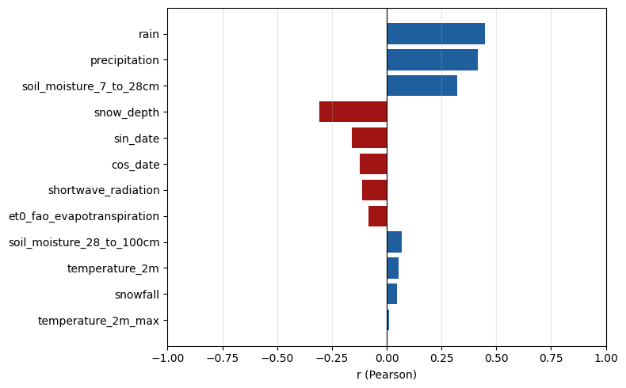
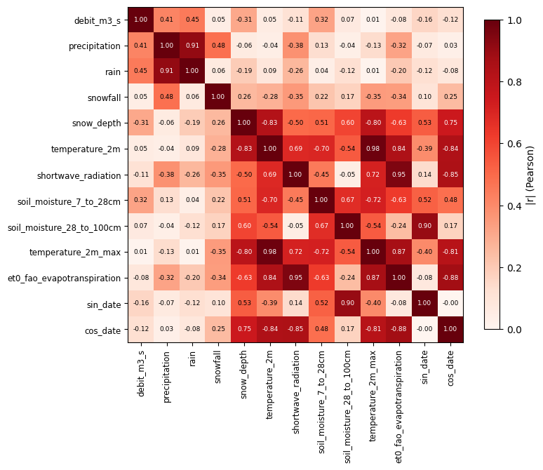
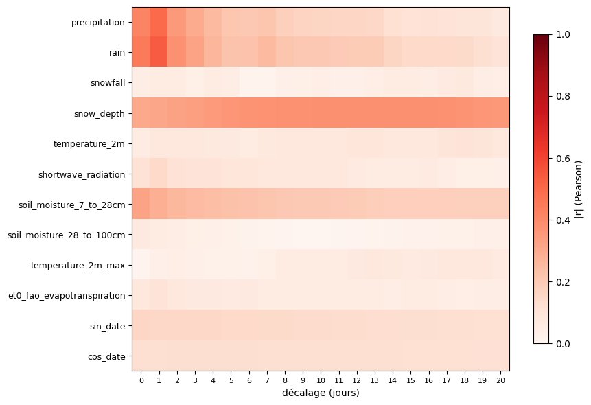
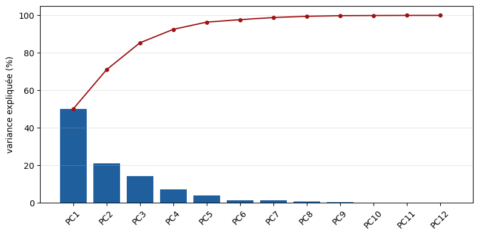
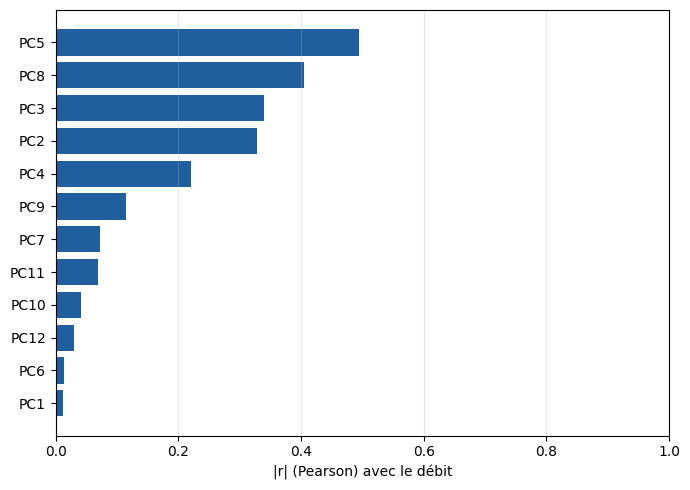
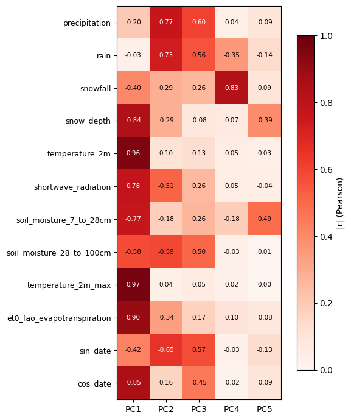

# 2.1 — Corrélations et ACP des variables

Station : **La Durance à Embrun [La Clapière]** (X031001001), 44,555°N 6,498°E, 786 m. Période : **2023**. Les mêmes données qu'au notebook 1.1, rechargées ci-dessous : comment le débit varie avec chaque variable météo, avec quel retard, et combien de directions indépendantes contiennent ces variables.

## Les données (comme au notebook 1.1)

    La Durance à Embrun [La Clapière] (X031001001)
    44.555356405°N, 6.498009964°E, 786.0 m

    Téléchargé en 1.1s | altitude utilisée par Open-Meteo : 788.0 m (altitude officielle de la station : 786.0 m)

    horaire   : (8760, 9) lignes/colonnes
    journalier: (365, 3) lignes/colonnes
    
    valeurs manquantes (horaire)  : {'precipitation': 0, 'temperature_2m': 0, 'snow_depth': 0, 'shortwave_radiation': 0, 'rain': 0, 'soil_moisture_7_to_28cm': 0, 'snowfall': 0, 'soil_moisture_28_to_100cm': 0, 'date': 0}
    valeurs manquantes (journalier): {'temperature_2m_max': 0, 'et0_fao_evapotranspiration': 0, 'date': 0}

    débit : (365, 3) lignes/colonnes | valeurs manquantes : 0
    min 15.7 m³/s, moyen 53.1 m³/s, max 313.2 m³/s

<table border="1" class="dataframe">
  <thead>
    <tr style="text-align: right;">
      <th></th>
      <th>date</th>
      <th>sin_date</th>
      <th>cos_date</th>
    </tr>
  </thead>
  <tbody>
    <tr>
      <th>0</th>
      <td>2023-01-01</td>
      <td>0.017202</td>
      <td>0.999852</td>
    </tr>
    <tr>
      <th>90</th>
      <td>2023-04-01</td>
      <td>0.999986</td>
      <td>0.005376</td>
    </tr>
    <tr>
      <th>181</th>
      <td>2023-07-01</td>
      <td>0.010751</td>
      <td>-0.999942</td>
    </tr>
    <tr>
      <th>273</th>
      <td>2023-10-01</td>
      <td>-0.999999</td>
      <td>0.001075</td>
    </tr>
    <tr>
      <th>364</th>
      <td>2023-12-31</td>
      <td>-0.004301</td>
      <td>0.999991</td>
    </tr>
  </tbody>
</table>

## 1. Corrélation débit ↔ variables

**Coefficient de corrélation de Pearson :**

$$r_{X,Y} = \frac{\mathrm{cov}(X,Y)}{\sigma_X\,\sigma_Y}
= \frac{\sum_i (x_i-\bar x)(y_i-\bar y)}{\sqrt{\sum_i(x_i-\bar x)^2}\sqrt{\sum_i(y_i-\bar y)^2}}$$

**Propriétés :**
- $r \in [-1, 1]$ ; $|r| = 1$ ⇔ relation linéaire exacte, $r = 0$ ⇔ pas de relation LINÉAIRE (n'exclut pas une relation non linéaire).
- Symétrique : $r(X,Y) = r(Y,X)$.
- Invariante par transformation affine de $X$ ou $Y$ (au signe près selon le signe de la pente).
- Sensible aux valeurs aberrantes (non robuste).
- Ne mesure ni la causalité ni un effet décalé dans le temps (un lien retardé, ex. fonte de neige, peut donner un $r$ instantané faible).

    valeurs manquantes après fusion : 0

<table border="1" class="dataframe">
  <thead>
    <tr style="text-align: right;">
      <th></th>
      <th>r (Pearson)</th>
    </tr>
  </thead>
  <tbody>
    <tr>
      <th>rain</th>
      <td>0.448662</td>
    </tr>
    <tr>
      <th>precipitation</th>
      <td>0.414177</td>
    </tr>
    <tr>
      <th>soil_moisture_7_to_28cm</th>
      <td>0.323311</td>
    </tr>
    <tr>
      <th>snow_depth</th>
      <td>-0.306077</td>
    </tr>
    <tr>
      <th>sin_date</th>
      <td>-0.157596</td>
    </tr>
    <tr>
      <th>cos_date</th>
      <td>-0.124574</td>
    </tr>
    <tr>
      <th>shortwave_radiation</th>
      <td>-0.113058</td>
    </tr>
    <tr>
      <th>et0_fao_evapotranspiration</th>
      <td>-0.084287</td>
    </tr>
    <tr>
      <th>soil_moisture_28_to_100cm</th>
      <td>0.067491</td>
    </tr>
    <tr>
      <th>temperature_2m</th>
      <td>0.052893</td>
    </tr>
    <tr>
      <th>snowfall</th>
      <td>0.046442</td>
    </tr>
    <tr>
      <th>temperature_2m_max</th>
      <td>0.011089</td>
    </tr>
  </tbody>
</table>

    

    

## 2. Matrice de corrélation

    

    

## 3. Corrélation par décalage temporel

$r$ entre débit($t$) et variable($t-\ell$), $\ell = 0$ à $20$ jours — répond à la
limite « pas de délai » du §1 (cf. `river.py::selection_correlation_neige`, même idée).

    

    

<table border="1" class="dataframe">
  <thead>
    <tr style="text-align: right;">
      <th></th>
      <th>lag_optimal_j</th>
      <th>r_lag_optimal</th>
      <th>r_lag_0</th>
    </tr>
  </thead>
  <tbody>
    <tr>
      <th>rain</th>
      <td>1</td>
      <td>0.537693</td>
      <td>0.448662</td>
    </tr>
    <tr>
      <th>precipitation</th>
      <td>1</td>
      <td>0.496534</td>
      <td>0.414177</td>
    </tr>
    <tr>
      <th>snow_depth</th>
      <td>13</td>
      <td>-0.382426</td>
      <td>-0.306077</td>
    </tr>
    <tr>
      <th>soil_moisture_7_to_28cm</th>
      <td>0</td>
      <td>0.323311</td>
      <td>0.323311</td>
    </tr>
    <tr>
      <th>sin_date</th>
      <td>0</td>
      <td>-0.157596</td>
      <td>-0.157596</td>
    </tr>
    <tr>
      <th>shortwave_radiation</th>
      <td>1</td>
      <td>-0.145340</td>
      <td>-0.113058</td>
    </tr>
    <tr>
      <th>cos_date</th>
      <td>4</td>
      <td>-0.125199</td>
      <td>-0.124574</td>
    </tr>
    <tr>
      <th>et0_fao_evapotranspiration</th>
      <td>1</td>
      <td>-0.099999</td>
      <td>-0.084287</td>
    </tr>
    <tr>
      <th>temperature_2m</th>
      <td>18</td>
      <td>0.098888</td>
      <td>0.052893</td>
    </tr>
    <tr>
      <th>temperature_2m_max</th>
      <td>18</td>
      <td>0.085650</td>
      <td>0.011089</td>
    </tr>
    <tr>
      <th>snowfall</th>
      <td>18</td>
      <td>-0.070377</td>
      <td>0.046442</td>
    </tr>
    <tr>
      <th>soil_moisture_28_to_100cm</th>
      <td>0</td>
      <td>0.067491</td>
      <td>0.067491</td>
    </tr>
  </tbody>
</table>

## 4. ACP (PCA / POD) des variables d'entrée

Combinaisons linéaires orthogonales des entrées standardisées (mêmes maths que la POD).
Deux quantités distinctes : la **variance expliquée** (part de la variabilité des
entrées captée par chaque axe, propriété du PCA seul) et la **corrélation au débit**
(si cet axe est lié à la sortie, quelle que soit sa part de variance). Le signe d'une
composante est arbitraire : seule $|r|$ a un sens.

    

    

    

    

    

    

