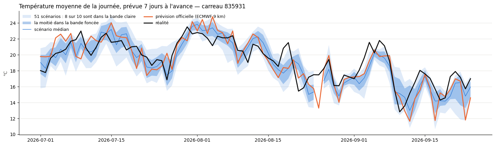
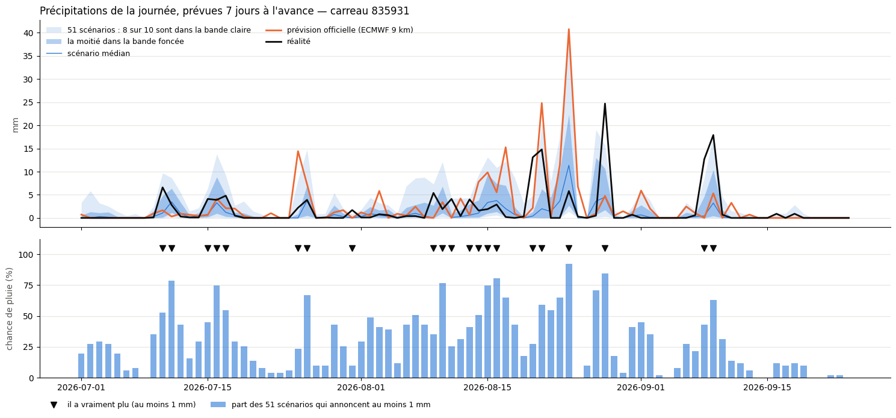

# 2.2 — Les 51 scénarios ECMWF contre la prévision officielle

Chaque jour à 0 h UTC, l'ECMWF publie une prévision en 51 scénarios. Que valent-ils 7 jours à l'avance, comparés à la prévision officielle et à ce qui est arrivé ?

## L'accès à la météo et les carreaux (comme au notebook 1.2)

    abonnement : gratuit

<table border="1" class="dataframe">
  <thead>
    <tr style="text-align: right;">
      <th></th>
      <th>utilise</th>
      <th>limite</th>
      <th>reste</th>
    </tr>
    <tr>
      <th>fenetre</th>
      <th></th>
      <th></th>
      <th></th>
    </tr>
  </thead>
  <tbody>
    <tr>
      <th>minute</th>
      <td>0.0</td>
      <td>600</td>
      <td>600.0</td>
    </tr>
    <tr>
      <th>heure</th>
      <td>0.0</td>
      <td>5000</td>
      <td>5000.0</td>
    </tr>
    <tr>
      <th>jour</th>
      <td>522.9</td>
      <td>10000</td>
      <td>9477.1</td>
    </tr>
    <tr>
      <th>mois</th>
      <td>29669.6</td>
      <td>300000</td>
      <td>270330.4</td>
    </tr>
  </tbody>
</table>

    61 carreaux

<table border="1" class="dataframe">
  <thead>
    <tr style="text-align: right;">
      <th></th>
      <th>carreau</th>
      <th>lon_centre</th>
      <th>lat_centre</th>
      <th>surface_km2</th>
      <th>pourcentage</th>
    </tr>
  </thead>
  <tbody>
    <tr>
      <th>0</th>
      <td>830767</td>
      <td>6.558140</td>
      <td>44.956062</td>
      <td>86.012142</td>
      <td>2.400657</td>
    </tr>
    <tr>
      <th>1</th>
      <td>833347</td>
      <td>6.547988</td>
      <td>44.885763</td>
      <td>85.991154</td>
      <td>2.400071</td>
    </tr>
    <tr>
      <th>2</th>
      <td>835933</td>
      <td>6.816074</td>
      <td>44.815465</td>
      <td>85.966729</td>
      <td>2.399389</td>
    </tr>
    <tr>
      <th>3</th>
      <td>835932</td>
      <td>6.676971</td>
      <td>44.815465</td>
      <td>85.957155</td>
      <td>2.399122</td>
    </tr>
    <tr>
      <th>4</th>
      <td>835931</td>
      <td>6.537867</td>
      <td>44.815465</td>
      <td>85.945852</td>
      <td>2.398807</td>
    </tr>
  </tbody>
</table>

## Les 51 scénarios ECMWF à J+7, contre la prévision officielle et la réalité

Chaque jour à 0 h UTC, l'ECMWF publie une prévision en **51 scénarios** (1 de contrôle, sans perturbation, et 50 légèrement perturbés), à 9 km, sur la grille de nos carreaux (`ecmwf_ifs_europe_ensemble`, cache des prévisions archivées, voir `scripts/telecharger_ensemble_clapiere.py`). On regarde ce que chacun annonçait **7 jours à l'avance** : pour une prévision émise le jour $D$, **J+7** est la journée $D + 7$ (de 0 h à 23 h UTC) :

- précipitations : total de la journée (mm) ;
- température : moyenne de la journée (°C).

On compare à :
- l'**officielle** : la prévision ECMWF unique à 9 km (`ecmwf_ifs`) qu'on utilise jusqu'ici, émise le même jour à 0 h UTC ;
- la **réalité** : la météo « observée » de l'archive Open-Meteo (depuis 2017 : l'analyse ECMWF 9 km, voir section 8), même carreau, même journée.

**Lecture des graphiques.** Les 51 scénarios sont résumés en bandes bleues : 8 scénarios sur 10 tombent dans la bande claire, la moitié dans la bande foncée, le trait bleu fin est le scénario du milieu. Une bande large = l'ECMWF hésite ; étroite = il est sûr de lui. Si la prévision est honnête, la réalité (noir) sort de la bande claire environ 2 jours sur 10. Pour les précipitations, le second graphique donne la **chance de pluie** : la part des 51 scénarios qui annoncent au moins 1 mm, avec un triangle noir les jours où il a vraiment plu.

Un seul carreau, `CARREAU`, à changer à volonté (835931 : le premier des 7 carreaux choisis pour La Clapière). Aucun appel : tout est lu dans les caches.

    carreau 835931 : 86 prévisions en 51 scénarios, du 24/06/2026 au 17/09/2026
    coût de la réalité : 0 appel(s)

    

    

    

    

