# 2.3 — Les lois des erreurs de prévision

Vraies prévisions ECMWF passées (API Single Runs, une par jour à 0 h UTC, heure par heure sur 10 jours) face à la météo observée (ERA5-Land), sur les carreaux de La Clapière. But : voir à quoi ressemblent les erreurs avant de choisir comment abîmer la météo future à l'entraînement.

## Cadre : notations, hypothèses, objectifs

**Notations**
- $r$ : instant d'émission d'une prévision (une par jour, 0 h UTC) ; $t$ : échéance (heures ou jours après $r$) ; $\Delta$ : pas du cumul (durée).
- $O$ : la « vérité » (ERA5-Land) ; $P$ : la prévision (ECMWF IFS 9 km, archive Open-Meteo). Pour la pluie : cumuls sur $]r+t-\Delta,\; r+t]$ (mm) ; pour la température : moyennes sur la même fenêtre (°C).
- « Sec » : moins de $0{,}1$ mm. $p_0$ : probabilité de sec ; $\mu$, $k$, $\theta = \mu/k$ : moyenne, forme et échelle de la gamma de la partie non sèche ; $\ell = \ln o$.
- $\varepsilon = T_P - T_O$ : erreur de température ; $\sigma$ : son écart-type.
- $X$ : le tableau d'entrées du modèle de débit (`Features.X`), dont la météo future est faite de cumuls par pas.

**Hypothèses**
1. ERA5-Land est la vérité de la météo passée : le modèle de débit apprend dessus.
2. **On fait confiance à Open-Meteo : la prévision est l'espérance de la vérité.** Pour toute variable $V$, toute échéance $t$ et toute valeur prévue $p$ :
$$
\forall V,\;\; \forall t,\;\; \forall p : \qquad \mathbb{E}\big[\,V_O \;\big|\; V_P = p,\; t\,\big] = p .
$$
Aucune correction de biais propre à notre bassin (un seul bassin ne permet pas de les estimer de façon générale). Conséquences : la vérité s'écrit $V_O = V_P + \eta$ avec $\mathbb{E}[\eta \mid V_P] = 0$ ; dans l'autre sens, $\mathbb{E}[V_P \mid V_O]$ n'est **pas** $V_O$ (régression vers la moyenne), elle s'obtient par la formule de Bayes. Pour la température, l'erreur est très petite devant ses variations, si bien que $T_P \approx T_O + \varepsilon$ avec $\mathbb{E}[\varepsilon] \approx 0$ (pente mesurée 1,00).
   Exception : une prévision de pluie « sèche » ($p < 0{,}1$ mm, valeur arrondie) ne peut pas imposer $\mathbb{E}[O] = 0$ : il y a de vraies pluies ratées. Pour elle, la loi de $O$ est laissée libre (fonction de $t$ seulement).
3. Les lois d'erreur ne dépendent que de l'échéance (et de la saison pour la température), pas du lieu : elles doivent valoir partout.
4. Pas de 24 h pour la pluie et la température futures dans $X$.
5. Neige au sol et humidité du sol : seulement à l'instant de la prévision dans $X$, sans futur et sans perturbation pour l'instant. Évapotranspiration future : à tester sans.
6. Une seule prévision par jour (0 h UTC) ; la latence de publication est ignorée pour l'instant.

**Objectifs**
1. Pour chaque variable, une loi de $P$ sachant $O$ et l'échéance, pour fabriquer à partir d'ERA5 des prévisions aussi imparfaites que les vraies, et entraîner le modèle de débit dessus.
2. Des lois simples, avec peu de paramètres, valables ailleurs qu'à La Clapière.
3. Vérifiées sur une année jamais vue : histogrammes, calibration (PIT), fiabilité de la probabilité de sec.
4. Ensuite : la corrélation des erreurs entre carreaux voisins et d'un jour à l'autre.

    The autoreload extension is already loaded. To reload it, use:
      %reload_ext autoreload

## 1. Charger prévisions et observations

`prev` : une ligne par (carreau, prévision émise à `run`, heure prévue `time`), avec `echeance` = heures entre l'émission et l'heure prévue. `obs` : la météo observée des mêmes carreaux, heure par heure. Pour l'instant : la pluie seulement.

    41 carreaux, 928 prévisions, 6,135,005 heures prévues comparables

<table border="1" class="dataframe">
  <thead>
    <tr style="text-align: right;">
      <th></th>
      <th>carreau</th>
      <th>run</th>
      <th>time</th>
      <th>precipitation</th>
      <th>echeance</th>
      <th>precipitation_obs</th>
    </tr>
  </thead>
  <tbody>
    <tr>
      <th>1</th>
      <td>830767</td>
      <td>2024-03-14 00:00:00+00:00</td>
      <td>2024-03-14 01:00:00+00:00</td>
      <td>0.0</td>
      <td>1</td>
      <td>0.0</td>
    </tr>
    <tr>
      <th>2</th>
      <td>830767</td>
      <td>2024-03-14 00:00:00+00:00</td>
      <td>2024-03-14 02:00:00+00:00</td>
      <td>0.0</td>
      <td>2</td>
      <td>0.0</td>
    </tr>
    <tr>
      <th>3</th>
      <td>830767</td>
      <td>2024-03-14 00:00:00+00:00</td>
      <td>2024-03-14 03:00:00+00:00</td>
      <td>0.0</td>
      <td>3</td>
      <td>0.0</td>
    </tr>
    <tr>
      <th>4</th>
      <td>830767</td>
      <td>2024-03-14 00:00:00+00:00</td>
      <td>2024-03-14 04:00:00+00:00</td>
      <td>0.0</td>
      <td>4</td>
      <td>0.0</td>
    </tr>
    <tr>
      <th>5</th>
      <td>830767</td>
      <td>2024-03-14 00:00:00+00:00</td>
      <td>2024-03-14 05:00:00+00:00</td>
      <td>0.0</td>
      <td>5</td>
      <td>0.0</td>
    </tr>
  </tbody>
</table>

## 2. Pluie prévue 3 jours avant, contre pluie tombée (heure par heure)

Une heure d'un carreau = un point : la pluie de l'heure qui finit `ECHEANCE` heures après l'émission, prévue (abscisse) et tombée (ordonnée). Diagonale = prévision parfaite. « Sec » = moins de 0,1 mm.

    
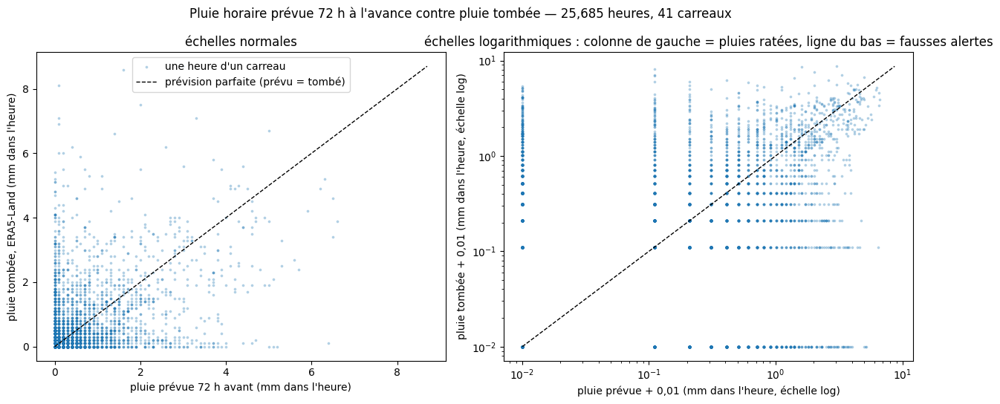
    

    corrélation : 0.550   |   moyenne prévue 0.096, tombée 0.106 mm/h

<table border="1" class="dataframe">
  <thead>
    <tr style="text-align: right;">
      <th>réalité</th>
      <th>tombé pluie</th>
      <th>tombé sec</th>
    </tr>
    <tr>
      <th>prévision</th>
      <th></th>
      <th></th>
    </tr>
  </thead>
  <tbody>
    <tr>
      <th>prévu pluie</th>
      <td>0.094</td>
      <td>0.040</td>
    </tr>
    <tr>
      <th>prévu sec</th>
      <td>0.057</td>
      <td>0.808</td>
    </tr>
  </tbody>
</table>

Même chose en densité : couleur = nombre d'heures par case (échelle log). Les bandes vides à droite viennent de l'arrondi à 0,1 mm.

    
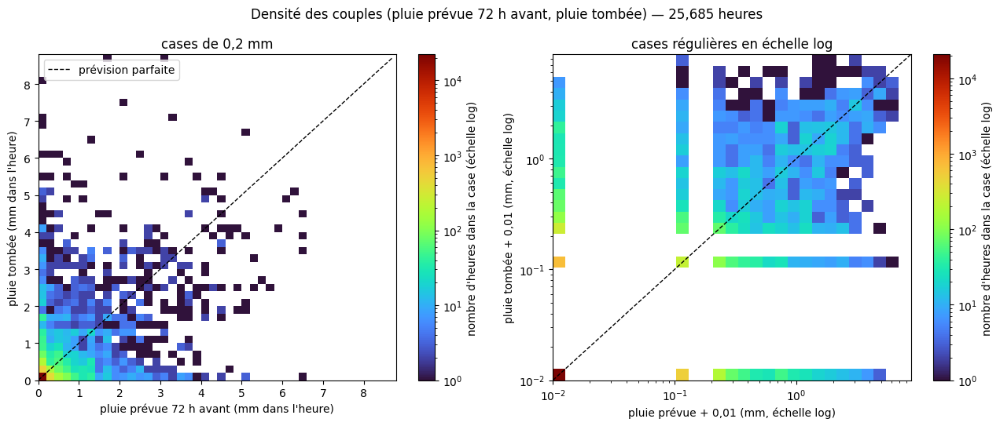
    

## 3. Lois conditionnelles, cumuls de 24 h

On fixe une classe de la **condition** et on regarde la loi de l'autre variable. `CONDITION = "tombe"` : loi de la prévision $P$ sachant la pluie tombée $O$ — c'est celle qui sert à fabriquer des prévisions à partir d'ERA5 ; `"prevu"` : l'inverse.

La loi a deux morceaux, estimés sur tous les cas de la classe :
$$
\mathbb{P}(Y \le y \mid c) = p_0(c) + \big(1-p_0(c)\big)\,F_\Gamma\big(y\,;k(c),\theta(c)\big)
$$
- $p_0(c)$ = part des cas secs (« % secs » dans les titres) ;
- $k, \theta$ = gamma ajustée sur les cas non secs, par maximum de vraisemblance : $\hat\theta = \bar x/\hat k$ et $\ln \hat k - \psi(\hat k) = \ln \bar x - \overline{\ln x}$ (`scipy.stats.gamma.fit(x, floc=0)`). Une gamma ne peut pas valoir 0, d'où la séparation des cas secs.

Dans le tableau, `moyenne` et `ecart_type` sont ceux des **cas non secs** ($k\theta$ et $\sqrt{k}\,\theta$) ; `moyenne_totale` compte les cas secs : $\big(1-p_0\big)\,k\theta$.

    25,685 cumuls de 24 h finissant 72 h après l'émission

    
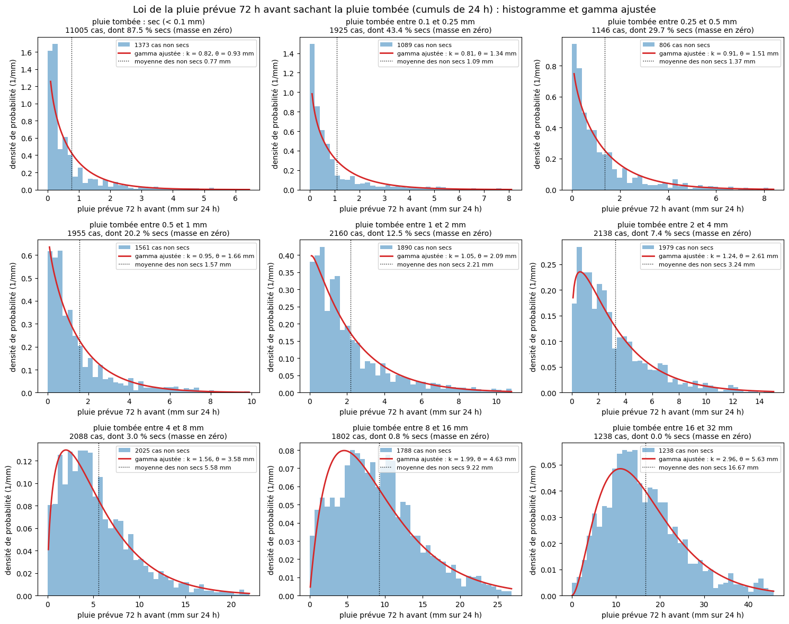
    

<table border="1" class="dataframe">
  <thead>
    <tr style="text-align: right;">
      <th></th>
      <th>seche</th>
      <th>cas</th>
      <th>part_sec</th>
      <th>moyenne</th>
      <th>ecart_type</th>
      <th>moyenne_totale</th>
      <th>k</th>
      <th>theta</th>
    </tr>
    <tr>
      <th>classe (mm)</th>
      <th></th>
      <th></th>
      <th></th>
      <th></th>
      <th></th>
      <th></th>
      <th></th>
      <th></th>
    </tr>
  </thead>
  <tbody>
    <tr>
      <th>sec</th>
      <td>True</td>
      <td>11005</td>
      <td>0.875</td>
      <td>0.767000</td>
      <td>1.309</td>
      <td>0.096000</td>
      <td>0.821</td>
      <td>0.934</td>
    </tr>
    <tr>
      <th>0.1–0.25</th>
      <td>False</td>
      <td>1925</td>
      <td>0.434</td>
      <td>1.087000</td>
      <td>1.710</td>
      <td>0.615000</td>
      <td>0.808</td>
      <td>1.345</td>
    </tr>
    <tr>
      <th>0.25–0.5</th>
      <td>False</td>
      <td>1146</td>
      <td>0.297</td>
      <td>1.372000</td>
      <td>1.849</td>
      <td>0.965000</td>
      <td>0.909</td>
      <td>1.511</td>
    </tr>
    <tr>
      <th>0.5–1</th>
      <td>False</td>
      <td>1955</td>
      <td>0.202</td>
      <td>1.574000</td>
      <td>1.986</td>
      <td>1.257000</td>
      <td>0.949</td>
      <td>1.659</td>
    </tr>
    <tr>
      <th>1–2</th>
      <td>False</td>
      <td>2160</td>
      <td>0.125</td>
      <td>2.207000</td>
      <td>2.393</td>
      <td>1.931000</td>
      <td>1.054</td>
      <td>2.094</td>
    </tr>
    <tr>
      <th>2–4</th>
      <td>False</td>
      <td>2138</td>
      <td>0.074</td>
      <td>3.236000</td>
      <td>3.074</td>
      <td>2.996000</td>
      <td>1.242</td>
      <td>2.606</td>
    </tr>
    <tr>
      <th>4–8</th>
      <td>False</td>
      <td>2088</td>
      <td>0.030</td>
      <td>5.584000</td>
      <td>4.535</td>
      <td>5.415000</td>
      <td>1.562</td>
      <td>3.576</td>
    </tr>
    <tr>
      <th>8–16</th>
      <td>False</td>
      <td>1802</td>
      <td>0.008</td>
      <td>9.223000</td>
      <td>5.911</td>
      <td>9.151000</td>
      <td>1.993</td>
      <td>4.628</td>
    </tr>
    <tr>
      <th>16–32</th>
      <td>False</td>
      <td>1238</td>
      <td>0.000</td>
      <td>16.674999</td>
      <td>9.354</td>
      <td>16.674999</td>
      <td>2.960</td>
      <td>5.633</td>
    </tr>
  </tbody>
</table>

**Dispersion.** Avec $\mu = k\theta$ et $\sigma = \sqrt{k}\,\theta$ : pente 1 en log-log ⟺ $k$ constant ; pente 1/2 ⟺ $\theta$ constant. La droite $\sigma = A\mu^p$ donne $k(\mu) = \mu^{2-2p}/A^2$ et $\theta(\mu) = A^2\mu^{2p-1}$.

    
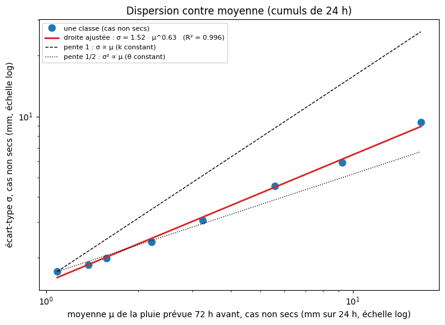
    

    σ(μ) = 1.516 · μ^0.630   →   k(μ) = μ^0.741 / 2.298,   θ(μ) = 2.298 · μ^0.259

**Biais conditionnel.** Peut-on centrer la loi sur la valeur de la condition, $\mathbb{E}[\text{autre} \mid c] = c$ ? Si les points suivent la diagonale, oui ; sinon on garde l'ajustement $a\,c^{\,b}$. Les moyennes comptent les cas secs.

    
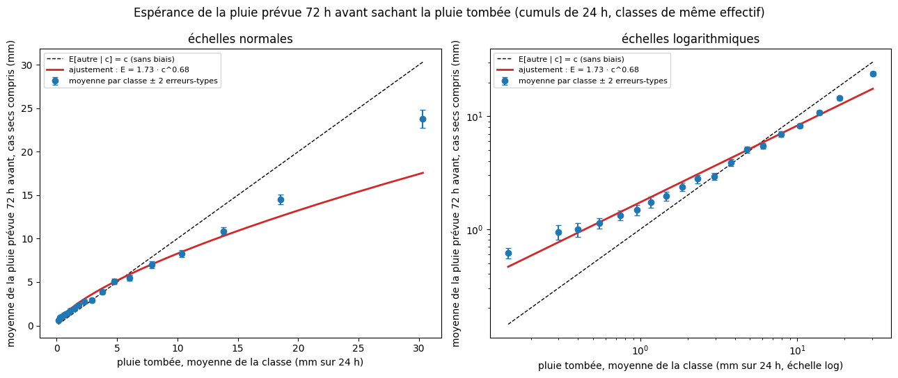
    

    E[prevu | tombe = c] ≈ 1.734 · c^0.679   |   moyennes globales : pluie tombée 3.080, pluie prévue 72 h avant 2.811 mm

<table border="1" class="dataframe">
  <thead>
    <tr style="text-align: right;">
      <th></th>
      <th>condition</th>
      <th>moyenne</th>
      <th>erreur</th>
      <th>cas</th>
    </tr>
    <tr>
      <th>tombe</th>
      <th></th>
      <th></th>
      <th></th>
      <th></th>
    </tr>
  </thead>
  <tbody>
    <tr>
      <th>(0.099, 0.2]</th>
      <td>0.140000</td>
      <td>0.620000</td>
      <td>0.06</td>
      <td>1925</td>
    </tr>
    <tr>
      <th>(0.2, 0.3]</th>
      <td>0.300000</td>
      <td>0.940000</td>
      <td>0.14</td>
      <td>631</td>
    </tr>
    <tr>
      <th>(0.3, 0.4]</th>
      <td>0.400000</td>
      <td>0.990000</td>
      <td>0.14</td>
      <td>515</td>
    </tr>
    <tr>
      <th>(0.4, 0.6]</th>
      <td>0.550000</td>
      <td>1.130000</td>
      <td>0.12</td>
      <td>842</td>
    </tr>
    <tr>
      <th>(0.6, 0.8]</th>
      <td>0.750000</td>
      <td>1.330000</td>
      <td>0.13</td>
      <td>785</td>
    </tr>
    <tr>
      <th>(0.8, 1.0]</th>
      <td>0.950000</td>
      <td>1.480000</td>
      <td>0.16</td>
      <td>625</td>
    </tr>
    <tr>
      <th>(1.0, 1.3]</th>
      <td>1.170000</td>
      <td>1.740000</td>
      <td>0.19</td>
      <td>604</td>
    </tr>
    <tr>
      <th>(1.3, 1.6]</th>
      <td>1.460000</td>
      <td>1.960000</td>
      <td>0.18</td>
      <td>754</td>
    </tr>
    <tr>
      <th>(1.6, 2.0]</th>
      <td>1.850000</td>
      <td>2.370000</td>
      <td>0.20</td>
      <td>662</td>
    </tr>
    <tr>
      <th>(2.0, 2.6]</th>
      <td>2.310000</td>
      <td>2.790000</td>
      <td>0.23</td>
      <td>758</td>
    </tr>
    <tr>
      <th>(2.6, 3.3]</th>
      <td>2.950000</td>
      <td>2.930000</td>
      <td>0.21</td>
      <td>748</td>
    </tr>
    <tr>
      <th>(3.3, 4.2]</th>
      <td>3.770000</td>
      <td>3.880000</td>
      <td>0.27</td>
      <td>703</td>
    </tr>
    <tr>
      <th>(4.2, 5.3]</th>
      <td>4.780000</td>
      <td>5.080000</td>
      <td>0.32</td>
      <td>753</td>
    </tr>
    <tr>
      <th>(5.3, 6.8]</th>
      <td>6.060000</td>
      <td>5.460000</td>
      <td>0.33</td>
      <td>722</td>
    </tr>
    <tr>
      <th>(6.8, 9.1]</th>
      <td>7.900000</td>
      <td>6.970000</td>
      <td>0.40</td>
      <td>717</td>
    </tr>
    <tr>
      <th>(9.1, 11.9]</th>
      <td>10.380000</td>
      <td>8.250000</td>
      <td>0.40</td>
      <td>744</td>
    </tr>
    <tr>
      <th>(11.9, 15.9]</th>
      <td>13.800000</td>
      <td>10.860000</td>
      <td>0.47</td>
      <td>726</td>
    </tr>
    <tr>
      <th>(15.9, 21.9]</th>
      <td>18.549999</td>
      <td>14.480000</td>
      <td>0.55</td>
      <td>736</td>
    </tr>
    <tr>
      <th>(21.9, 71.4]</th>
      <td>30.309999</td>
      <td>23.799999</td>
      <td>1.04</td>
      <td>730</td>
    </tr>
  </tbody>
</table>

## 4. Même chose heure par heure

La pluie de l'heure qui finit pile à l'échéance. L'écart avec les cumuls de 24 h mesure l'erreur de **timing** : une averse décalée de deux heures est une double erreur à l'heure, aucune sur 24 h.

    25,685 cumuls de 1 h finissant 72 h après l'émission

    
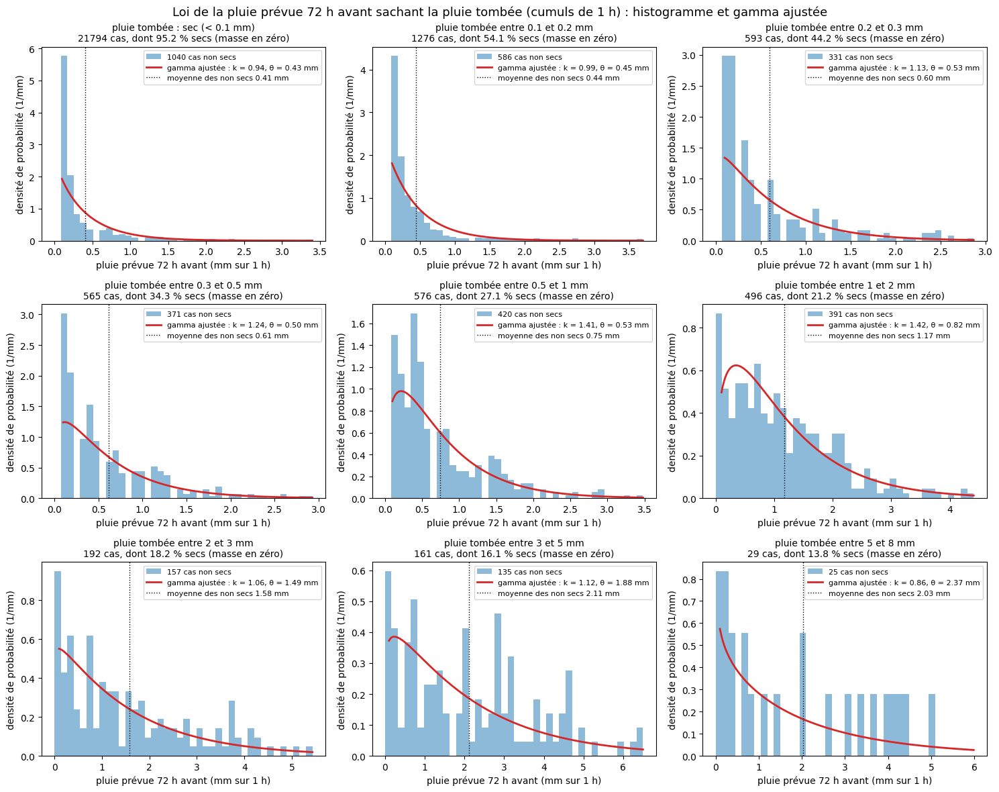
    

<table border="1" class="dataframe">
  <thead>
    <tr style="text-align: right;">
      <th></th>
      <th>seche</th>
      <th>cas</th>
      <th>part_sec</th>
      <th>moyenne</th>
      <th>ecart_type</th>
      <th>moyenne_totale</th>
      <th>k</th>
      <th>theta</th>
    </tr>
    <tr>
      <th>classe (mm)</th>
      <th></th>
      <th></th>
      <th></th>
      <th></th>
      <th></th>
      <th></th>
      <th></th>
      <th></th>
    </tr>
  </thead>
  <tbody>
    <tr>
      <th>sec</th>
      <td>True</td>
      <td>21794</td>
      <td>0.952</td>
      <td>0.407</td>
      <td>0.641</td>
      <td>0.019</td>
      <td>0.945</td>
      <td>0.431</td>
    </tr>
    <tr>
      <th>0.1–0.2</th>
      <td>False</td>
      <td>1276</td>
      <td>0.541</td>
      <td>0.442</td>
      <td>0.694</td>
      <td>0.203</td>
      <td>0.989</td>
      <td>0.447</td>
    </tr>
    <tr>
      <th>0.2–0.3</th>
      <td>False</td>
      <td>593</td>
      <td>0.442</td>
      <td>0.600</td>
      <td>0.679</td>
      <td>0.335</td>
      <td>1.127</td>
      <td>0.532</td>
    </tr>
    <tr>
      <th>0.3–0.5</th>
      <td>False</td>
      <td>565</td>
      <td>0.343</td>
      <td>0.614</td>
      <td>0.616</td>
      <td>0.403</td>
      <td>1.239</td>
      <td>0.495</td>
    </tr>
    <tr>
      <th>0.5–1</th>
      <td>False</td>
      <td>576</td>
      <td>0.271</td>
      <td>0.747</td>
      <td>0.693</td>
      <td>0.545</td>
      <td>1.411</td>
      <td>0.529</td>
    </tr>
    <tr>
      <th>1–2</th>
      <td>False</td>
      <td>496</td>
      <td>0.212</td>
      <td>1.171</td>
      <td>0.940</td>
      <td>0.923</td>
      <td>1.424</td>
      <td>0.822</td>
    </tr>
    <tr>
      <th>2–3</th>
      <td>False</td>
      <td>192</td>
      <td>0.182</td>
      <td>1.578</td>
      <td>1.388</td>
      <td>1.290</td>
      <td>1.061</td>
      <td>1.487</td>
    </tr>
    <tr>
      <th>3–5</th>
      <td>False</td>
      <td>161</td>
      <td>0.161</td>
      <td>2.112</td>
      <td>1.672</td>
      <td>1.771</td>
      <td>1.124</td>
      <td>1.879</td>
    </tr>
    <tr>
      <th>5–8</th>
      <td>False</td>
      <td>29</td>
      <td>0.138</td>
      <td>2.032</td>
      <td>1.879</td>
      <td>1.752</td>
      <td>0.858</td>
      <td>2.368</td>
    </tr>
  </tbody>
</table>

    
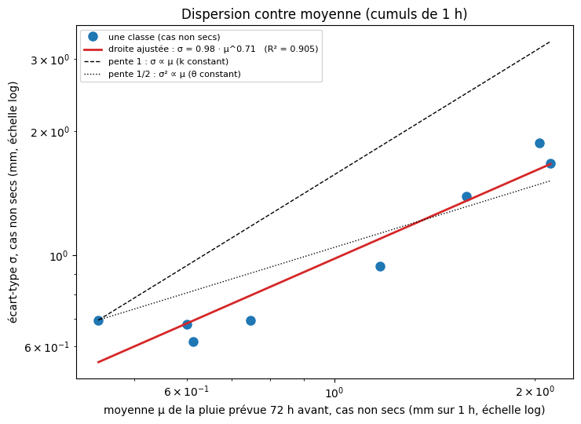
    

    σ(μ) = 0.979 · μ^0.711   →   k(μ) = μ^0.578 / 0.959,   θ(μ) = 0.959 · μ^0.422

    
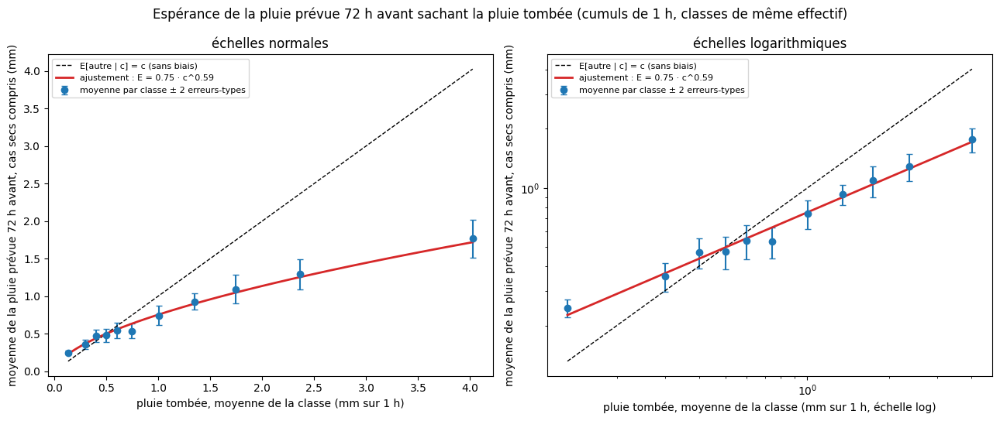
    

    E[prevu | tombe = c] ≈ 0.752 · c^0.593   |   moyennes globales : pluie tombée 0.106, pluie prévue 72 h avant 0.096 mm

<table border="1" class="dataframe">
  <thead>
    <tr style="text-align: right;">
      <th></th>
      <th>condition</th>
      <th>moyenne</th>
      <th>erreur</th>
      <th>cas</th>
    </tr>
    <tr>
      <th>tombe</th>
      <th></th>
      <th></th>
      <th></th>
      <th></th>
    </tr>
  </thead>
  <tbody>
    <tr>
      <th>(0.099, 0.2]</th>
      <td>0.13</td>
      <td>0.24</td>
      <td>0.03</td>
      <td>1869</td>
    </tr>
    <tr>
      <th>(0.2, 0.3]</th>
      <td>0.30</td>
      <td>0.36</td>
      <td>0.06</td>
      <td>336</td>
    </tr>
    <tr>
      <th>(0.3, 0.4]</th>
      <td>0.40</td>
      <td>0.47</td>
      <td>0.08</td>
      <td>229</td>
    </tr>
    <tr>
      <th>(0.4, 0.5]</th>
      <td>0.50</td>
      <td>0.48</td>
      <td>0.09</td>
      <td>186</td>
    </tr>
    <tr>
      <th>(0.5, 0.6]</th>
      <td>0.60</td>
      <td>0.54</td>
      <td>0.11</td>
      <td>137</td>
    </tr>
    <tr>
      <th>(0.6, 0.8]</th>
      <td>0.74</td>
      <td>0.53</td>
      <td>0.09</td>
      <td>194</td>
    </tr>
    <tr>
      <th>(0.8, 1.1]</th>
      <td>1.00</td>
      <td>0.74</td>
      <td>0.12</td>
      <td>189</td>
    </tr>
    <tr>
      <th>(1.1, 1.5]</th>
      <td>1.35</td>
      <td>0.93</td>
      <td>0.11</td>
      <td>209</td>
    </tr>
    <tr>
      <th>(1.5, 1.9]</th>
      <td>1.74</td>
      <td>1.09</td>
      <td>0.19</td>
      <td>157</td>
    </tr>
    <tr>
      <th>(1.9, 2.9]</th>
      <td>2.37</td>
      <td>1.29</td>
      <td>0.20</td>
      <td>192</td>
    </tr>
    <tr>
      <th>(2.9, 8.7]</th>
      <td>4.02</td>
      <td>1.76</td>
      <td>0.25</td>
      <td>193</td>
    </tr>
  </tbody>
</table>

## 5. Erreurs de timing : corrélation décalée

Pour une échéance $h$, corrélation entre la pluie horaire **prévue** à $r+h$ et la pluie **tombée** à $r+h+j$, pour $j$ de −24 h à +24 h (tous carreaux) :
$$
C_h(j) = \operatorname{corr}\big(P_{r+h},\, O_{r+h+j}\big).
$$
Référence « prévision parfaite » : $\operatorname{corr}(O_t, O_{t+j})$ — une averse dure plusieurs heures, donc même parfaite la courbe est une cloche. L'erreur de timing est ce qui dépasse la référence : pic plus bas, cloche plus large. Un pic décalé de $j=0$ serait un retard ou une avance systématique.

    
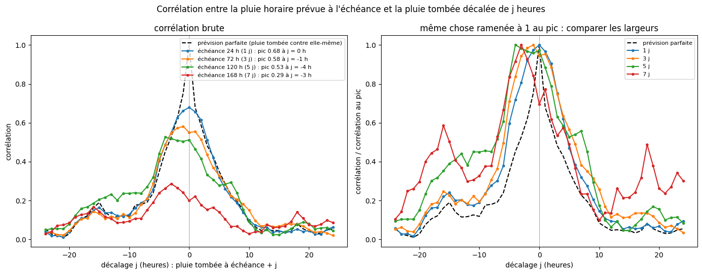
    

    24          10
    72          11
    120         15
    168         14
    parfaite     6
    Name: largeur à mi-hauteur (h), dtype: int64

## 6. Conclusion (pluie, prévision à 3 jours, La Clapière, mars 2024 – octobre 2026)

**Sur 24 h, la prévision sachant la pluie tombée $o$ se décrit bien par deux morceaux :**
1. **sec** avec une probabilité $p_0(o)$ qui décroît avec $o$ : 89 % si rien n'est tombé (11 % de fausses alertes, petites : 0,8 mm en moyenne), 22 % pour 0,5–1 mm, 3 % pour 4–8 mm, 0 % au-delà de 16 mm ;
2. sinon une **gamma** dont la forme et l'échelle grandissent avec la pluie ($k$ de 0,8 à 3 : presque exponentielle pour les petites pluies, en bosse pour les fortes), avec $\sigma \approx 1{,}56\,\mu^{0{,}61}$ entre écart-type et moyenne.

**La pluie tombée n'est pas la bonne espérance** : $\mathbb{E}[P \mid O = o] \approx 1{,}67\,o^{0{,}70}$. La prévision surestime les petites pluies (0,6 mm prévu pour 0,14 mm tombé), est juste vers 4–5 mm, et **sous-estime les fortes** (24 mm prévus pour 30 mm tombés) — ce qui compte pour les crues.

**Ce qu'on prendra donc pour fabriquer une prévision de pluie à partir d'ERA5** (cumul $o$ sur le pas) :
$$
P = \begin{cases} 0 & \text{avec la probabilité } p_0(o) \\ \Gamma\big(k(m), \theta(m)\big) & \text{sinon, avec } m = \dfrac{\mathbb{E}[P \mid O=o]}{1-p_0(o)},\; k = \dfrac{m^{2-2p}}{A^2},\; \theta = A^2 m^{2p-1} \end{cases}
$$
et **pas** une perturbation centrée sur $o$.

**Heure par heure, c'est bien pire** : même quand il est tombé 3 à 5 mm dans l'heure, la prévision disait sec 13 % du temps, et elle ne donne en moyenne que la moitié des fortes pluies horaires ($\mathbb{E}[P \mid O=o] \approx 0{,}78\,o^{0{,}60}$). C'est l'erreur de **timing** : l'averse est prévue, mais pas à la bonne heure. Il faut donc perturber les **cumuls sur le pas** de X (6 à 12 h), pas les heures une à une.

**À faire ensuite :** refaire ces mesures au pas de X (12 h) et pour plusieurs échéances (1 à 9 jours) ; vérifier que l'erreur est la même pour les carreaux voisins (un même épisode) ; passer aux autres variables (température, neige).

## 7. Toutes les échéances : la dépendance en $t$

Même pas de temps qu'en partie 3 : **cumuls de 24 h** (c'est le pas prévu pour la pluie future dans le tableau d'entrées du modèle). On prend les fenêtres $]t-24\text{ h}, t]$ pour $t$ = 1, 2, … 9 jours, tous les carreaux. On garde la dernière année (prévisions émises à partir du 1er octobre 2025) pour la **vérification** de la partie 9 : le modèle ne la voit pas.

    230,997 cumuls de 24 h ; 10.4% gardés pour la vérification

## 8. Le modèle : $p_0(o,t)$, $\mu(o,t)$, $k(o,t)$

Pour une pluie tombée $o$ (mm sur 24 h) et une échéance $t$ (en jours), la prévision $P$ vaut 0 (« sec ») avec la probabilité $p_0$, sinon suit une gamma de moyenne $\mu$ et de forme $k$ ($\theta = \mu/k$). Avec $\ell = \ln o$ :

**si $o \ge 0{,}1$ mm**
$$
\operatorname{logit} p_0 = \alpha \cdot z, \qquad \ln \mu = \beta \cdot z, \qquad \ln k = \gamma \cdot z, \qquad z = (1,\; \ell,\; \ell^2,\; t,\; t\,\ell,\; t^2)
$$
**si $o < 0{,}1$ mm** (rien n'est tombé) : mêmes formes avec $z = (1,\; t,\; t^2)$.

Les formes viennent de ce qu'on a vu : lois de puissance en $o$ (droites en log-log), avec un terme $\ell^2$ pour la courbure des fortes pluies, et des paramètres qui varient régulièrement avec $t$. Choix fait sur la vraisemblance de l'année de vérification : sans $\ell^2$ −25 254, avec −25 065 ; ajouter $t\,\ell^2$ ou des termes en $\ln t$ ne gagne que 7 à 13. Ajustement par **maximum de vraisemblance** sur les années d'apprentissage : régression logistique pour $p_0$ ; pour $(\beta, \gamma)$, on minimise
$$
-\sum_{i \,:\, P_i \ge 0{,}1} \ln f\!\left(P_i\,;\,k_i,\; \mu_i / k_i\right)
$$
(densité gamma, `scipy.optimize.minimize`). Les deux ajustements sont indépendants car la vraisemblance se sépare en « sec ou non » et « combien ».

    pluie : 119,818 cas, gamma ajustée sur 94,461 (convergé : True)
    sec   : 87,191 cas, gamma ajustée sur 19,062 (convergé : True)

**Le modèle reproduit-il la dépendance en $t$ ?** Pour quatre classes de pluie tombée, on compare, échéance par échéance et sur les années d'apprentissage, la part de secs, la moyenne et l'écart-type de la partie non sèche, mesurés (points) et donnés par le modèle (traits ; moyenne sur les mêmes cas des $\mu_i$, et écart-type du mélange des gammas).

    
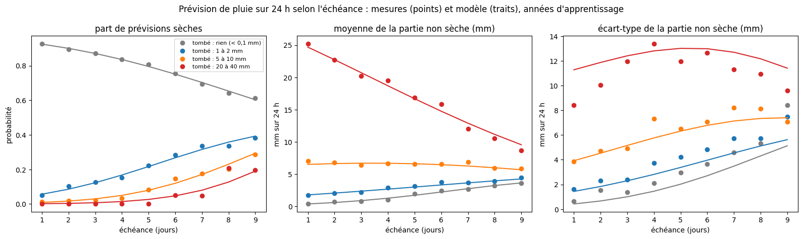
    

## 9. Vérification sur la dernière année (jamais vue par le modèle)

**Histogrammes.** Échéances 1, 3 et 6 jours (lignes) × classes de pluie tombée (colonnes) : histogramme des vraies prévisions non sèches, et densité du modèle (moyenne, sur les mêmes cas, de leurs densités gamma). Le titre compare la part de secs mesurée et prévue par le modèle.

    
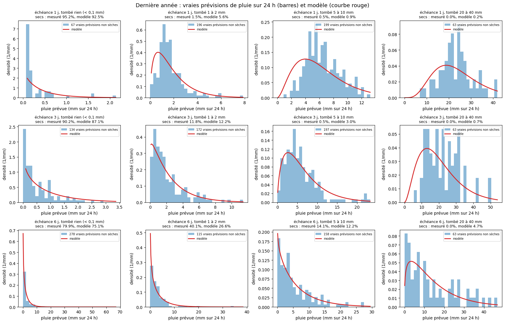
    

**Calibration : PIT.** Pour chaque cas, $u = F(P_{\text{vrai}})$ où $F$ est la fonction de répartition du modèle,
$$
F(y) = p_0 + (1-p_0)\,F_\Gamma(y\,;k, \mu/k) \quad (y \ge 0,1), \qquad u \sim \mathcal{U}(0, p_0) \;\text{ si } P_{\text{vrai}} < 0{,}1 .
$$
Si le modèle est juste, $u$ est **uniforme** entre 0 et 1 : histogramme plat à 1. Bosse au milieu = modèle trop large ; creux au milieu (bords hauts) = trop étroit ; pente = biais. À droite : $p_0$ prévu par le modèle contre la part de secs vraiment observée (diagramme de fiabilité) ; sur la diagonale = juste.

    
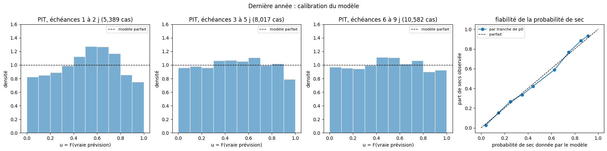
    

## 10. Bilan du modèle d'erreur de la pluie (cumuls de 24 h, échéances 1 à 9 jours)

Pour une pluie tombée $o$ et une échéance $t$, la prévision vaut 0 avec la probabilité $p_0(o,t)$, sinon suit une gamma de moyenne $\mu(o,t)$ et de forme $k(o,t)$ ; $\operatorname{logit} p_0$, $\ln \mu$, $\ln k$ sont des fonctions simples de $(\ln o, (\ln o)^2, t, t \ln o, t^2)$, ajustées par maximum de vraisemblance.

**Vérifié sur l'année jamais vue (octobre 2025 – octobre 2026) :**
- **probabilité de sec** : fiable à toutes les échéances (diagramme de fiabilité sur la diagonale, écarts ≤ 0,04) ;
- **calibration** : PIT plat de 3 à 9 jours (barres entre 0,89 et 1,15) ; à 1–2 jours, petite bosse au milieu (0,82 à 1,26) : le modèle y est **un peu trop large**, surtout pour les fortes pluies (écart-type 11,5 mm au lieu de 8,6 pour 20–40 mm tombés à 1 jour) ;
- **moyennes** : justes, y compris pour les fortes pluies grâce au terme $(\ln o)^2$ (25,0 mm pour 24,9 à 1 jour).

**Limites :** une seule année de vérification, sur les 7 carreaux complets ; chaque cumul est traité seul : rien encore sur le fait qu'une erreur touche **tous les carreaux d'un même épisode** et **plusieurs jours de suite** — indispensable avant d'abîmer la météo d'entraînement.

## 11. Les lois, explicitement

Pluie tombée $o$ en mm sur 24 h, échéance $t$ en jours (de 1 à 9), $\ell = \ln o$. La prévision $P$ (mm sur 24 h) est fabriquée ainsi :
$$
P = \begin{cases} 0 & \text{avec la probabilité } p_0 \\[2pt] \sim \Gamma\!\left(k,\; \theta = \mu / k\right) & \text{sinon} \end{cases}
\qquad\text{avec}\qquad p_0 = \frac{1}{1 + e^{-\lambda}} .
$$

**Si $o \ge 0{,}1$ mm :**
$$
\begin{aligned}
\lambda &= -2{,}724 \;-\; 1{,}181\,\ell \;-\; 0{,}0677\,\ell^2 \;+\; 0{,}426\,t \;+\; 0{,}114\,t\,\ell \;-\; 0{,}0180\,t^2 \\
\ln \mu &= \;\;\,0{,}173 \;+\; 0{,}707\,\ell \;+\; 0{,}0749\,\ell^2 \;+\; 0{,}177\,t \;-\; 0{,}0784\,t\,\ell \;-\; 0{,}0033\,t^2 \\
\ln k &= \;\;\,0{,}564 \;+\; 0{,}363\,\ell \;+\; 0{,}0380\,\ell^2 \;-\; 0{,}224\,t \;-\; 0{,}0476\,t\,\ell \;+\; 0{,}0111\,t^2
\end{aligned}
$$

**Si $o < 0{,}1$ mm (rien n'est tombé) :**
$$
\begin{aligned}
\lambda &= \;\;\,2{,}872 \;-\; 0{,}287\,t \;+\; 0{,}0016\,t^2 \\
\ln \mu &= -1{,}463 \;+\; 0{,}559\,t \;-\; 0{,}0293\,t^2 \\
\ln k &= -0{,}146 \;-\; 0{,}0192\,t \;-\; 0{,}0041\,t^2
\end{aligned}
$$

Exemple : $o = 5$ mm, $t = 3$ jours $\Rightarrow$ $p_0 = 4{,}2\,\%$, $\mu = 5{,}09$ mm, $k = 1{,}56$, $\theta = 3{,}26$ mm.

Valable pour : cumuls de 24 h, échéances de 1 à 9 jours, prévisions ECMWF IFS 9 km émises à 0 h UTC, La Clapière ; ajusté sur mars 2024 – septembre 2025. Les nombres ci-dessus sont ceux de cet ajustement ; la cellule suivante les recalcule à partir de `MODELE` (ils changent si on réajuste).

<table border="1" class="dataframe">
  <thead>
    <tr style="text-align: right;">
      <th></th>
      <th></th>
      <th>λ (logit p0)</th>
      <th>ln μ</th>
      <th>ln k</th>
    </tr>
  </thead>
  <tbody>
    <tr>
      <th rowspan="6" valign="top">o ≥ 0,1 mm</th>
      <th>1</th>
      <td>-2.9689</td>
      <td>0.1893</td>
      <td>0.5961</td>
    </tr>
    <tr>
      <th>ℓ</th>
      <td>-1.1607</td>
      <td>0.6995</td>
      <td>0.3570</td>
    </tr>
    <tr>
      <th>ℓ²</th>
      <td>-0.0542</td>
      <td>0.0727</td>
      <td>0.0381</td>
    </tr>
    <tr>
      <th>t</th>
      <td>0.4829</td>
      <td>0.1864</td>
      <td>-0.2310</td>
    </tr>
    <tr>
      <th>t·ℓ</th>
      <td>0.1123</td>
      <td>-0.0765</td>
      <td>-0.0471</td>
    </tr>
    <tr>
      <th>t²</th>
      <td>-0.0217</td>
      <td>-0.0053</td>
      <td>0.0117</td>
    </tr>
    <tr>
      <th rowspan="3" valign="top">o &lt; 0,1 mm</th>
      <th>1</th>
      <td>2.8280</td>
      <td>-1.4111</td>
      <td>-0.1245</td>
    </tr>
    <tr>
      <th>t</th>
      <td>-0.3262</td>
      <td>0.5075</td>
      <td>-0.0030</td>
    </tr>
    <tr>
      <th>t²</th>
      <td>0.0065</td>
      <td>-0.0230</td>
      <td>-0.0065</td>
    </tr>
  </tbody>
</table>

## 12. Température : moyennes sur 24 h

Même découpage que pour la pluie : pour chaque carreau, prévision émise à $r$ et échéance $t$ (1 à 9 jours), la **moyenne** de la température prévue et de la température ERA5-Land sur les 24 h qui finissent à $r+t$. On fait confiance à Open-Meteo : pas de correction de biais, seulement une erreur aléatoire autour de la température observée,
$$
T_{\text{prévue}} = T_{\text{obs}} + \varepsilon, \qquad \sigma = \operatorname{sd}(\varepsilon) \text{ fonction de l'échéance et de la saison.}
$$

    230,955 moyennes de 24 h

    
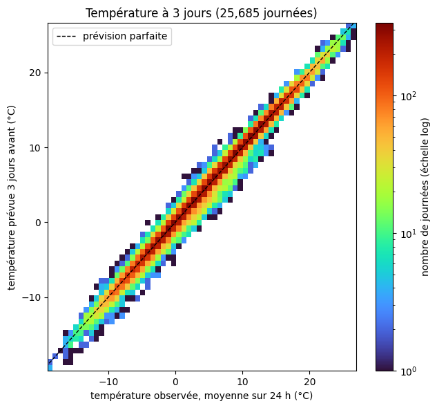
    

    biais moyen -0.08 °C   écart-type de l'erreur 0.89 °C   corrélation 0.994

**Selon l'échéance.** $\varepsilon = T_{\text{prévue}} - T_{\text{obs}}$ : sa moyenne (pour vérifier qu'elle est proche de 0) et son écart-type $\sigma$.

    
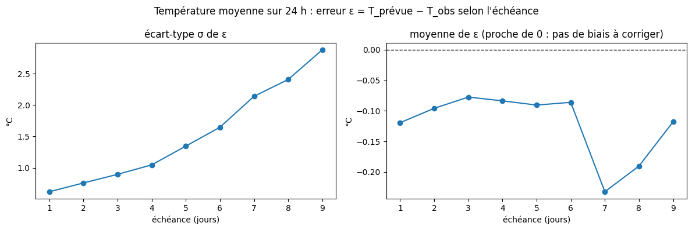
    

<table border="1" class="dataframe">
  <thead>
    <tr style="text-align: right;">
      <th></th>
      <th>moyenne</th>
      <th>sigma</th>
      <th>asymetrie</th>
      <th>aplatissement</th>
    </tr>
    <tr>
      <th>jours</th>
      <th></th>
      <th></th>
      <th></th>
      <th></th>
    </tr>
  </thead>
  <tbody>
    <tr>
      <th>1.0</th>
      <td>-0.119</td>
      <td>0.617</td>
      <td>-2.441</td>
      <td>11.362</td>
    </tr>
    <tr>
      <th>2.0</th>
      <td>-0.096</td>
      <td>0.757</td>
      <td>-1.327</td>
      <td>5.474</td>
    </tr>
    <tr>
      <th>3.0</th>
      <td>-0.077</td>
      <td>0.895</td>
      <td>-0.810</td>
      <td>3.032</td>
    </tr>
    <tr>
      <th>4.0</th>
      <td>-0.084</td>
      <td>1.046</td>
      <td>-0.621</td>
      <td>2.076</td>
    </tr>
    <tr>
      <th>5.0</th>
      <td>-0.091</td>
      <td>1.345</td>
      <td>-0.046</td>
      <td>2.519</td>
    </tr>
    <tr>
      <th>6.0</th>
      <td>-0.086</td>
      <td>1.646</td>
      <td>-0.267</td>
      <td>3.133</td>
    </tr>
    <tr>
      <th>7.0</th>
      <td>-0.232</td>
      <td>2.141</td>
      <td>-0.519</td>
      <td>3.019</td>
    </tr>
    <tr>
      <th>8.0</th>
      <td>-0.190</td>
      <td>2.409</td>
      <td>-0.341</td>
      <td>2.015</td>
    </tr>
    <tr>
      <th>9.0</th>
      <td>-0.118</td>
      <td>2.883</td>
      <td>-0.278</td>
      <td>2.081</td>
    </tr>
  </tbody>
</table>

**L'erreur est-elle gaussienne ?** Histogramme de $\varepsilon$ avec la gaussienne de même écart-type, et graphique quantile-quantile (points sur la diagonale = gaussienne). Asymétrie et aplatissement en excès valent 0 pour une gaussienne.

    
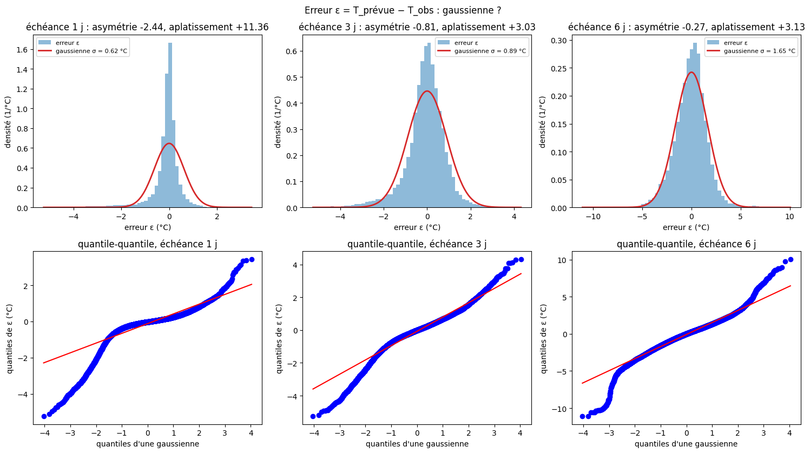
    

**Selon la saison** (à 3 jours) : moyenne et écart-type de $\varepsilon$ par mois de l'heure prévue.

    
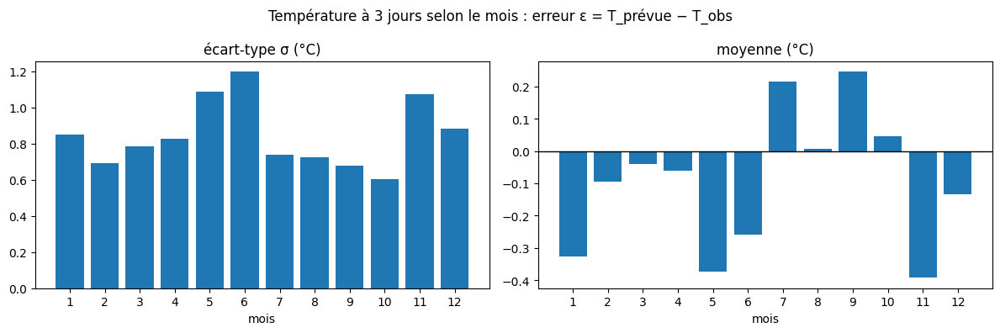
    

<table border="1" class="dataframe">
  <thead>
    <tr style="text-align: right;">
      <th></th>
      <th>moyenne</th>
      <th>sigma</th>
      <th>cas</th>
    </tr>
    <tr>
      <th>mois</th>
      <th></th>
      <th></th>
      <th></th>
    </tr>
  </thead>
  <tbody>
    <tr>
      <th>1</th>
      <td>-0.326</td>
      <td>0.852</td>
      <td>1488</td>
    </tr>
    <tr>
      <th>2</th>
      <td>-0.094</td>
      <td>0.694</td>
      <td>1344</td>
    </tr>
    <tr>
      <th>3</th>
      <td>-0.040</td>
      <td>0.783</td>
      <td>2103</td>
    </tr>
    <tr>
      <th>4</th>
      <td>-0.061</td>
      <td>0.826</td>
      <td>2670</td>
    </tr>
    <tr>
      <th>5</th>
      <td>-0.372</td>
      <td>1.089</td>
      <td>2759</td>
    </tr>
    <tr>
      <th>6</th>
      <td>-0.259</td>
      <td>1.197</td>
      <td>2663</td>
    </tr>
    <tr>
      <th>7</th>
      <td>0.214</td>
      <td>0.736</td>
      <td>2759</td>
    </tr>
    <tr>
      <th>8</th>
      <td>0.008</td>
      <td>0.724</td>
      <td>2554</td>
    </tr>
    <tr>
      <th>9</th>
      <td>0.246</td>
      <td>0.678</td>
      <td>2670</td>
    </tr>
    <tr>
      <th>10</th>
      <td>0.046</td>
      <td>0.601</td>
      <td>1747</td>
    </tr>
    <tr>
      <th>11</th>
      <td>-0.392</td>
      <td>1.076</td>
      <td>1440</td>
    </tr>
    <tr>
      <th>12</th>
      <td>-0.134</td>
      <td>0.881</td>
      <td>1488</td>
    </tr>
  </tbody>
</table>

**Ce qu'on voit (température moyenne sur 24 h).**
- **Pas de biais à corriger** : la moyenne de $\varepsilon$ reste entre −0,24 et −0,08 °C à toutes les échéances.
- **La dispersion grandit avec l'échéance** : $\sigma$ = 0,6 °C à 1 jour, 0,9 à 3 jours, 1,3 à 5 jours, 2,1 à 7 jours, 2,9 à 9 jours.
- **L'erreur n'est pas gaussienne aux courtes échéances** : pic pointu et longue queue du côté froid à 1 jour ; elle s'en rapproche vers 5–6 jours, sauf aux extrémités. Une loi à queues plus lourdes (Student) conviendra mieux à courte échéance.
- **La saison compte** : $\sigma$ plus faible de juillet à octobre qu'au printemps.

**À faire ensuite :** écrire $\sigma(t, \text{mois})$, choisir la loi des queues, puis mesurer si l'erreur est la même sur tous les carreaux et plusieurs jours de suite.

## Annexe : page interactive

La même analyse que la partie 3, en direct dans un navigateur : sens, pas du cumul, début du cumul (heures après l'émission), fourchette de la condition (début + taille) ou condition sèche. Avec le modèle de la partie 8, la page trace aussi sa densité (tirets verts), à comparer à la gamma ajustée sur les cas affichés. Page autonome, à ouvrir dans Safari (pas dans l'aperçu de VS Code).

    page écrite : ../data/outputs/erreurs_pluie.html (12.7 Mo) — à ouvrir dans un navigateur

    PosixPath('../data/outputs/erreurs_pluie.html')

