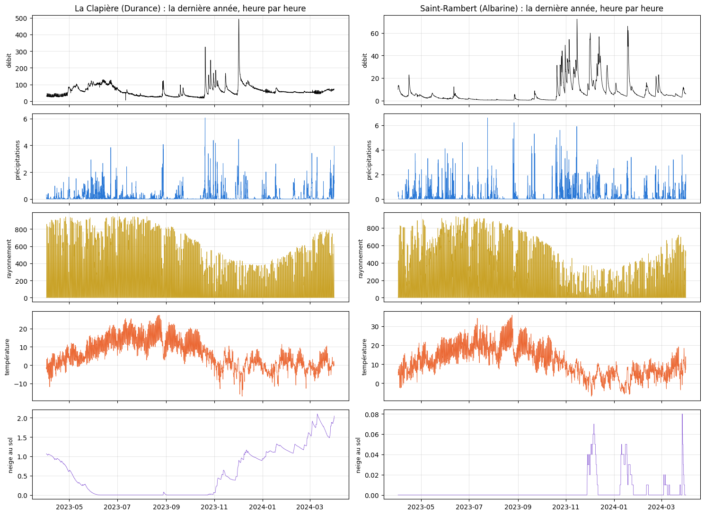
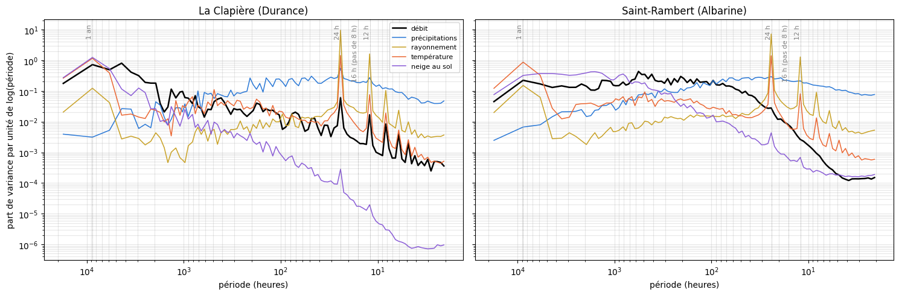
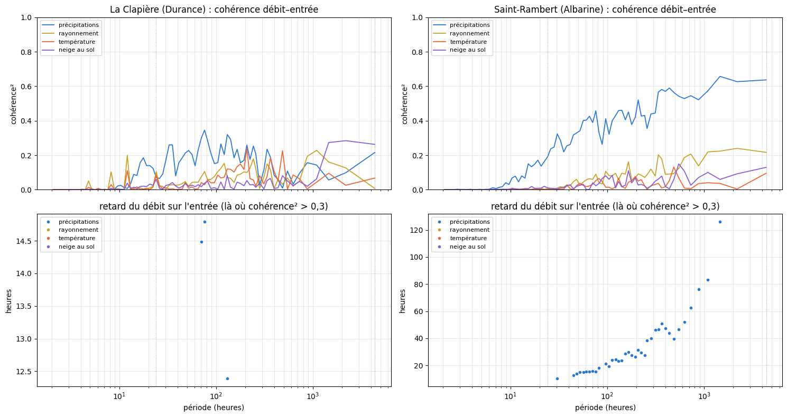

# 2.5 — Le débit et la météo en fréquences

À quelles échelles de temps varient le débit et ce qu'on donne au modèle — précipitations, rayonnement, température, neige au sol —, et
à quelles échelles le débit suit chacune de ces entrées ?

**Deux rivières qui contrastent** : La Clapière (Durance, alpine, régime de neige) et l'Albarine à Saint-Rambert-en-Bugey (petit bassin
karstique du Jura, régime de pluie). Pour chacune, les séries **horaires** de la météo moyenne du bassin (ERA5 25 km, les carreaux de
son GB par défaut pondérés par leur surface dans le bassin) et du débit mesuré, sur l'apprentissage (2010 → mars 2024).

**Trois analyses** :

1. **Le spectre** (densité spectrale de puissance, méthode de Welch, fenêtres de 2 ans) : où se trouve la variabilité de chaque série,
   en fonction de la période (de 2 h à 2 ans).
2. **La variance par bande** : la part de la variance de chaque série dans quatre bandes de périodes — moins d'un jour, 1 à 10 jours
   (passages de perturbations), 10 à 100 jours, plus de 100 jours (saisons).
3. **La cohérence** débit–entrée : à chaque période, la part des variations du débit qui suit linéairement l'entrée (0 = rien, 1 =
   tout), et le retard du débit sur l'entrée.

**Trous de débit** : comblés par interpolation quand ils durent au plus 3 jours ; les spectres sont ensuite calculés sur chaque morceau
continu d'au moins 2 ans et moyennés (pondérés par leur longueur). Les courbes sont lissées : moyenne par tranches de 1/30 de décade
de période.

## Les séries horaires

    La Clapière (Durance) : 7 carreau(x) ; 3 morceau(x) continu(s) d'au moins 2 ans, 8.5 ans en tout (2011-11 → 2014-07, 2017-07 → 2020-05, 2021-04 → 2024-03)

    Saint-Rambert (Albarine) : 1 carreau(x) ; 1 morceau(x) continu(s) d'au moins 2 ans, 14.3 ans en tout (2010-01 → 2024-03)

    

    

## 1. Le spectre

Chaque série est réduite (moyenne 0, écart-type 1) pour que les courbes soient comparables ; l'aire sous une courbe entre deux périodes
est la part de variance de la série entre ces périodes. Repères : 1 an, 24 h, 12 h, et 16 h — la plus courte période qu'un modèle au pas
de 8 h puisse représenter.

    

    

## 2. La variance par bande

<table border="1" class="dataframe">
  <thead>
    <tr style="text-align: right;">
      <th></th>
      <th></th>
      <th>≤ 1,5 jour (cycle journalier compris)</th>
      <th>1,5 à 10 jours</th>
      <th>10 à 100 jours</th>
      <th>&gt; 100 jours</th>
    </tr>
  </thead>
  <tbody>
    <tr>
      <th rowspan="5" valign="top">La Clapière (Durance)</th>
      <th>débit</th>
      <td>1%</td>
      <td>2%</td>
      <td>11%</td>
      <td>85%</td>
    </tr>
    <tr>
      <th>précipitations</th>
      <td>46%</td>
      <td>40%</td>
      <td>12%</td>
      <td>2%</td>
    </tr>
    <tr>
      <th>rayonnement</th>
      <td>88%</td>
      <td>2%</td>
      <td>1%</td>
      <td>9%</td>
    </tr>
    <tr>
      <th>température</th>
      <td>11%</td>
      <td>3%</td>
      <td>7%</td>
      <td>79%</td>
    </tr>
    <tr>
      <th>neige au sol</th>
      <td>0%</td>
      <td>0%</td>
      <td>2%</td>
      <td>97%</td>
    </tr>
    <tr>
      <th rowspan="5" valign="top">Saint-Rambert (Albarine)</th>
      <th>débit</th>
      <td>2%</td>
      <td>28%</td>
      <td>42%</td>
      <td>28%</td>
    </tr>
    <tr>
      <th>précipitations</th>
      <td>49%</td>
      <td>36%</td>
      <td>13%</td>
      <td>2%</td>
    </tr>
    <tr>
      <th>rayonnement</th>
      <td>81%</td>
      <td>3%</td>
      <td>2%</td>
      <td>13%</td>
    </tr>
    <tr>
      <th>température</th>
      <td>14%</td>
      <td>6%</td>
      <td>11%</td>
      <td>69%</td>
    </tr>
    <tr>
      <th>neige au sol</th>
      <td>0%</td>
      <td>2%</td>
      <td>45%</td>
      <td>52%</td>
    </tr>
  </tbody>
</table>

## 3. La cohérence entre le débit et chaque entrée

La cohérence au carré, à chaque période : 1 si le débit y suit exactement (linéairement) l'entrée, 0 s'il n'a rien à voir. Le retard
vient de la phase entre les deux séries ; il n'a de sens que là où la cohérence est nette (> 0,3) et pour des périodes assez courtes (≤ 2 000 h, ~3 mois) ; on ne le
montre que là.

    

    

