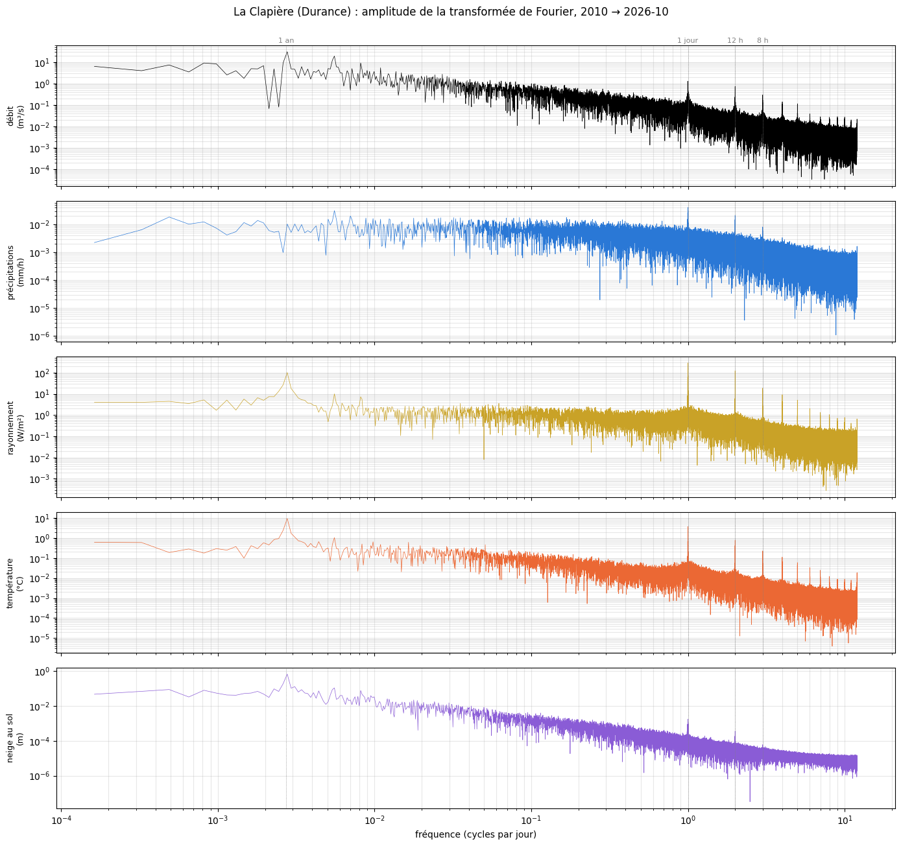
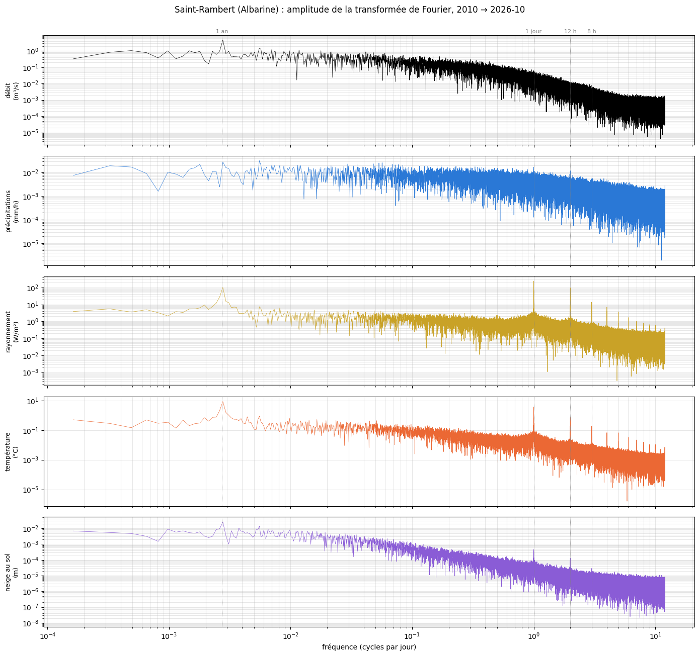
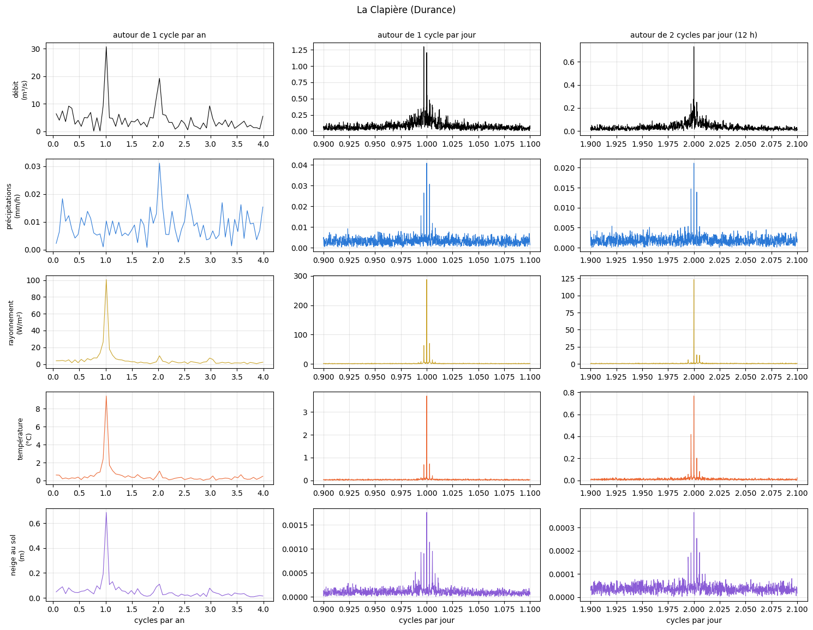
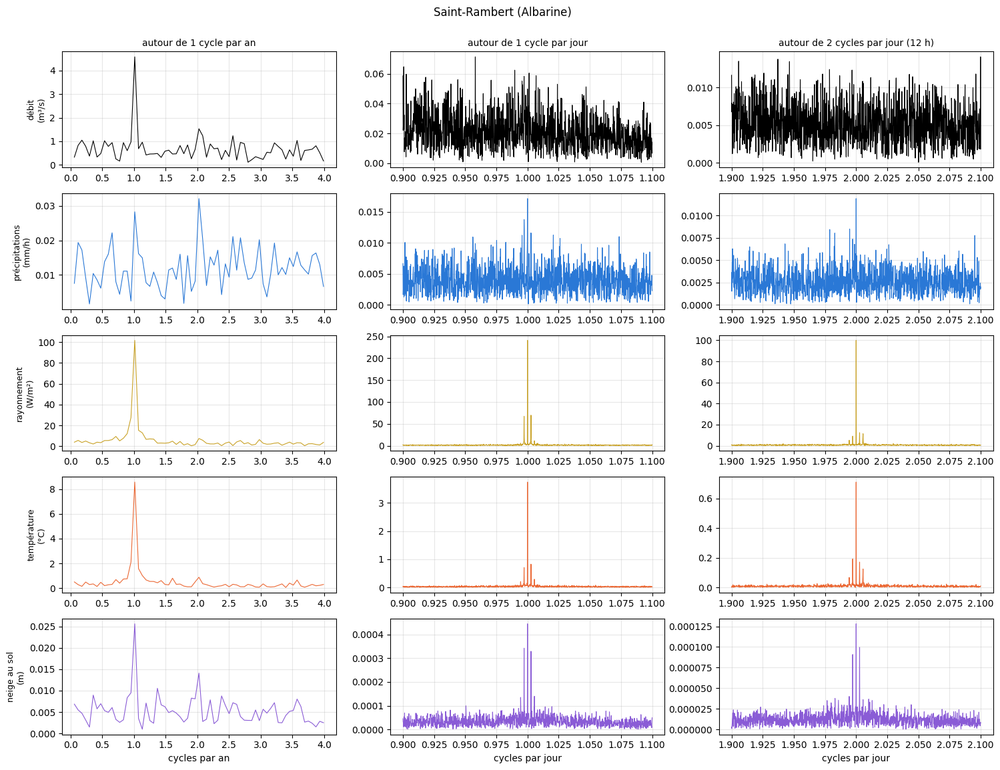

# 2.6 — La transformée de Fourier

Pour La Clapière (Durance) et l'Albarine (Saint-Rambert-en-Bugey) : la **transformée de Fourier discrète exacte** (FFT) de chaque série
horaire complète, du 1ᵉʳ janvier 2010 à la dernière semaine — débit mesuré, et météo moyenne du bassin telle que le modèle la reçoit
(ERA5 25 km, les carreaux du GB par défaut pondérés par leur surface dans le bassin) : précipitations, rayonnement, température, neige
au sol. Aucun découpage, aucun lissage.

**Ce qui est tracé** : l'amplitude de chaque fréquence, 2 |X(f)| / N, dans l'unité de la variable : une sinusoïde d'amplitude A dans la
série donne un pic de hauteur A. La moyenne est retirée avant le calcul.

**Trous** : la FFT demande une série complète. Les trous de débit de 3 jours au plus sont interpolés ; les plus longs sont remplis par la
moyenne de la série (après retrait de la moyenne : des zéros, qui n'ajoutent aucune fréquence mais diminuent un peu toutes les
amplitudes). La part remplie est donnée pour chaque série.

## Les séries horaires

    La Clapière (Durance) : 7 carreau(x), 147168 heures (16.8 ans), du 2010-01-01 au 2026-10-15

<table border="1" class="dataframe">
  <thead>
    <tr style="text-align: right;">
      <th></th>
      <th>précipitations</th>
      <th>rayonnement</th>
      <th>température</th>
      <th>neige au sol</th>
      <th>débit</th>
    </tr>
  </thead>
  <tbody>
    <tr>
      <th>manquant</th>
      <td>0.0%</td>
      <td>0.0%</td>
      <td>0.0%</td>
      <td>0.0%</td>
      <td>12.2%</td>
    </tr>
    <tr>
      <th>rempli par la moyenne (trous &gt; 3 jours)</th>
      <td>0.0%</td>
      <td>0.0%</td>
      <td>0.0%</td>
      <td>0.0%</td>
      <td>7.2%</td>
    </tr>
  </tbody>
</table>

    Saint-Rambert (Albarine) : 1 carreau(x), 147168 heures (16.8 ans), du 2010-01-01 au 2026-10-15

<table border="1" class="dataframe">
  <thead>
    <tr style="text-align: right;">
      <th></th>
      <th>précipitations</th>
      <th>rayonnement</th>
      <th>température</th>
      <th>neige au sol</th>
      <th>débit</th>
    </tr>
  </thead>
  <tbody>
    <tr>
      <th>manquant</th>
      <td>0.0%</td>
      <td>0.0%</td>
      <td>0.0%</td>
      <td>0.0%</td>
      <td>1.3%</td>
    </tr>
    <tr>
      <th>rempli par la moyenne (trous &gt; 3 jours)</th>
      <td>0.0%</td>
      <td>0.0%</td>
      <td>0.0%</td>
      <td>0.0%</td>
      <td>0.0%</td>
    </tr>
  </tbody>
</table>

## Les transformées de Fourier

Fréquence en cycles par jour (en haut : la période correspondante). Repères : 1 an, 1 jour, 12 h, et 8 h (le pas de nos échéances ; la
plus courte période qu'un pas de 8 h peut représenter est 16 h, soit 1,5 cycle par jour).

    

    

    

    

## Zoom sur le cycle annuel et le cycle journalier

En fréquence linéaire, autour d'un cycle par an et d'un cycle par jour (et de son harmonique à 12 h).

    

    

    

    

## Les pics principaux

Pour chaque série : l'amplitude au pic le plus proche d'un cycle par an, d'un cycle par jour et de deux cycles par jour (dans l'unité de la
variable), et les cinq fréquences d'amplitude la plus forte.

<table border="1" class="dataframe">
  <thead>
    <tr style="text-align: right;">
      <th></th>
      <th></th>
      <th>1 an</th>
      <th>1 jour</th>
      <th>12 h</th>
      <th>5 plus fortes (période)</th>
    </tr>
    <tr>
      <th>station</th>
      <th>série</th>
      <th></th>
      <th></th>
      <th></th>
      <th></th>
    </tr>
  </thead>
  <tbody>
    <tr>
      <th rowspan="5" valign="top">La Clapière (Durance)</th>
      <th>débit (m³/s)</th>
      <td>30.744</td>
      <td>1.298</td>
      <td>0.730</td>
      <td>361 j, 180 j, 186 j, 383 j, 123 j</td>
    </tr>
    <tr>
      <th>précipitations (mm/h)</th>
      <td>0.011</td>
      <td>0.041</td>
      <td>0.021</td>
      <td>24 h, 180 j, 24 h, 24 h, 12 h</td>
    </tr>
    <tr>
      <th>rayonnement (W/m²)</th>
      <td>100.772</td>
      <td>287.481</td>
      <td>123.352</td>
      <td>24 h, 12 h, 361 j, 24 h, 24 h</td>
    </tr>
    <tr>
      <th>température (°C)</th>
      <td>9.434</td>
      <td>3.706</td>
      <td>0.767</td>
      <td>361 j, 24 h, 383 j, 341 j, 323 j</td>
    </tr>
    <tr>
      <th>neige au sol (m)</th>
      <td>0.688</td>
      <td>0.002</td>
      <td>0.000</td>
      <td>361 j, 383 j, 323 j, 180 j, 341 j</td>
    </tr>
    <tr>
      <th rowspan="5" valign="top">Saint-Rambert (Albarine)</th>
      <th>débit (m³/s)</th>
      <td>4.581</td>
      <td>0.060</td>
      <td>0.012</td>
      <td>361 j, 180 j, 143 j, 175 j, 85 j</td>
    </tr>
    <tr>
      <th>précipitations (mm/h)</th>
      <td>0.028</td>
      <td>0.017</td>
      <td>0.012</td>
      <td>180 j, 361 j, 18 j, 19 j, 21 j</td>
    </tr>
    <tr>
      <th>rayonnement (W/m²)</th>
      <td>101.703</td>
      <td>241.021</td>
      <td>99.977</td>
      <td>24 h, 361 j, 12 h, 24 h, 24 h</td>
    </tr>
    <tr>
      <th>température (°C)</th>
      <td>8.571</td>
      <td>3.735</td>
      <td>0.711</td>
      <td>361 j, 24 h, 383 j, 341 j, 323 j</td>
    </tr>
    <tr>
      <th>neige au sol (m)</th>
      <td>0.026</td>
      <td>0.000</td>
      <td>0.000</td>
      <td>361 j, 180 j, 267 j, 383 j, 1022 j</td>
    </tr>
  </tbody>
</table>

