# 2.7 — Les pics du spectre et la partie périodique

Pour La Clapière et l'Albarine, les mêmes séries horaires que le notebook 2.6 (depuis 2010 : débit, et précipitations, rayonnement,
température, neige au sol moyennés sur le bassin). Pour chacune :

1. **Le fond du spectre** : la médiane de l'amplitude de la transformée de Fourier sur ±0,1 décade autour de chaque fréquence — ce que
   donnerait une série sans aucun cycle de même allure.
2. **Les pics retenus** : les maxima locaux qui dépassent **5 fois le fond**. Pour un bruit sans cycle, l'amplitude d'une fréquence suit
   une loi de Rayleigh : la probabilité de dépasser 5 fois sa médiane est d'environ 3 sur 100 millions ; sur les ~73 000 fréquences, on
   n'attend donc aucun faux pic. Avec chaque pic, ses deux fréquences voisines (un cycle ne tombe jamais pile sur une fréquence de la
   FFT : son énergie déborde un peu).
3. **Le retour au temps** : la transformée inverse avec seulement ces pics donne la **partie périodique** de la série (cycles annuel,
   journalier, leurs harmoniques, la modulation du cycle journalier par les saisons) ; la série moins cette partie est le **reste** :
   averses, crues, perturbations.

On regarde ensuite trois sections : une année, dix jours d'été, la plus forte crue mesurée.

## Les séries horaires

    La Clapière (Durance) : 7 carreau(x), 147168 heures (16.8 ans), du 2010-01-01 au 2026-10-15

<table border="1" class="dataframe">
  <thead>
    <tr style="text-align: right;">
      <th></th>
      <th>précipitations</th>
      <th>rayonnement</th>
      <th>température</th>
      <th>neige au sol</th>
      <th>débit</th>
    </tr>
  </thead>
  <tbody>
    <tr>
      <th>manquant</th>
      <td>0.0%</td>
      <td>0.0%</td>
      <td>0.0%</td>
      <td>0.0%</td>
      <td>12.2%</td>
    </tr>
    <tr>
      <th>rempli par la moyenne (trous &gt; 3 jours)</th>
      <td>0.0%</td>
      <td>0.0%</td>
      <td>0.0%</td>
      <td>0.0%</td>
      <td>7.2%</td>
    </tr>
  </tbody>
</table>

    Saint-Rambert (Albarine) : 1 carreau(x), 147168 heures (16.8 ans), du 2010-01-01 au 2026-10-15

<table border="1" class="dataframe">
  <thead>
    <tr style="text-align: right;">
      <th></th>
      <th>précipitations</th>
      <th>rayonnement</th>
      <th>température</th>
      <th>neige au sol</th>
      <th>débit</th>
    </tr>
  </thead>
  <tbody>
    <tr>
      <th>manquant</th>
      <td>0.0%</td>
      <td>0.0%</td>
      <td>0.0%</td>
      <td>0.0%</td>
      <td>1.3%</td>
    </tr>
    <tr>
      <th>rempli par la moyenne (trous &gt; 3 jours)</th>
      <td>0.0%</td>
      <td>0.0%</td>
      <td>0.0%</td>
      <td>0.0%</td>
      <td>0.0%</td>
    </tr>
  </tbody>
</table>

## Le fond, les pics, la partie périodique

<table border="1" class="dataframe">
  <thead>
    <tr style="text-align: right;">
      <th></th>
      <th></th>
      <th>pics retenus</th>
      <th>part de variance de la partie périodique</th>
      <th>principaux pics (période : amplitude, × fond)</th>
    </tr>
    <tr>
      <th>station</th>
      <th>série</th>
      <th></th>
      <th></th>
      <th></th>
    </tr>
  </thead>
  <tbody>
    <tr>
      <th rowspan="5" valign="top">La Clapière (Durance)</th>
      <th>débit (m³/s)</th>
      <td>255</td>
      <td>50%</td>
      <td>0.99 an : 30.7, ×6 ; 180 j : 19.2, ×6 ; 24.1 h : 1.3, ×25 ; 24.0 h : 1.21, ×24 ; 12.0 h : 0.73, ×41 ; 24.0 h : 0.554, ×11 ; 23.9 h : 0.481, ×9 ; 23.9 h : 0.422, ×8</td>
    </tr>
    <tr>
      <th>précipitations (mm/h)</th>
      <td>9</td>
      <td>2%</td>
      <td>24.0 h : 0.0408, ×15 ; 23.9 h : 0.0306, ×11 ; 24.1 h : 0.0264, ×10 ; 12.0 h : 0.0212, ×14 ; 24.1 h : 0.0155, ×6 ; 12.0 h : 0.0147, ×10 ; 12.0 h : 0.0139, ×9 ; 8.0 h : 0.00811, ×8</td>
    </tr>
    <tr>
      <th>rayonnement (W/m²)</th>
      <td>70</td>
      <td>91%</td>
      <td>24.0 h : 287, ×345 ; 12.0 h : 123, ×332 ; 0.99 an : 101, ×11 ; 23.9 h : 70, ×84 ; 24.1 h : 62.9, ×76 ; 8.0 h : 18.6, ×97 ; 8.0 h : 15.2, ×79 ; 8.0 h : 14.5, ×76</td>
    </tr>
    <tr>
      <th>température (°C)</th>
      <td>102</td>
      <td>78%</td>
      <td>0.99 an : 9.43, ×11 ; 24.0 h : 3.71, ×186 ; 12.0 h : 0.767, ×124 ; 23.9 h : 0.724, ×36 ; 24.1 h : 0.69, ×35 ; 12.0 h : 0.418, ×67 ; 8.0 h : 0.227, ×70 ; 8.0 h : 0.217, ×66</td>
    </tr>
    <tr>
      <th>neige au sol (m)</th>
      <td>13</td>
      <td>75%</td>
      <td>0.99 an : 0.688, ×7 ; 24.0 h : 0.00176, ×21 ; 23.9 h : 0.00114, ×14 ; 23.9 h : 0.000951, ×11 ; 24.1 h : 0.000931, ×11 ; 24.1 h : 0.000904, ×11 ; 24.3 h : 0.000518, ×6 ; 23.8 h : 0.000485, ×6</td>
    </tr>
    <tr>
      <th rowspan="5" valign="top">Saint-Rambert (Albarine)</th>
      <th>débit (m³/s)</th>
      <td>1</td>
      <td>14%</td>
      <td>0.99 an : 4.58, ×7</td>
    </tr>
    <tr>
      <th>précipitations (mm/h)</th>
      <td>1</td>
      <td>0%</td>
      <td>12.0 h : 0.0119, ×5</td>
    </tr>
    <tr>
      <th>rayonnement (W/m²)</th>
      <td>57</td>
      <td>85%</td>
      <td>24.0 h : 241, ×234 ; 0.99 an : 102, ×10 ; 12.0 h : 100, ×226 ; 23.9 h : 69.8, ×68 ; 24.1 h : 67.3, ×65 ; 8.0 h : 13.6, ×56 ; 12.0 h : 12.4, ×28 ; 8.0 h : 11.7, ×49</td>
    </tr>
    <tr>
      <th>température (°C)</th>
      <td>70</td>
      <td>74%</td>
      <td>0.99 an : 8.57, ×11 ; 24.0 h : 3.74, ×168 ; 23.9 h : 0.826, ×37 ; 12.0 h : 0.711, ×115 ; 24.1 h : 0.708, ×32 ; 23.9 h : 0.292, ×13 ; 24.1 h : 0.21, ×9 ; 12.0 h : 0.193, ×31</td>
    </tr>
    <tr>
      <th>neige au sol (m)</th>
      <td>9</td>
      <td>16%</td>
      <td>0.99 an : 0.0256, ×8 ; 24.0 h : 0.000445, ×17 ; 24.1 h : 0.000342, ×13 ; 23.9 h : 0.000329, ×13 ; 23.9 h : 0.00014, ×5 ; 24.1 h : 0.000135, ×5 ; 12.0 h : 0.000128, ×14 ; 12.0 h : 9.96e-05, ×11</td>
    </tr>
  </tbody>
</table>

## Les spectres, leur fond et les pics retenus

    
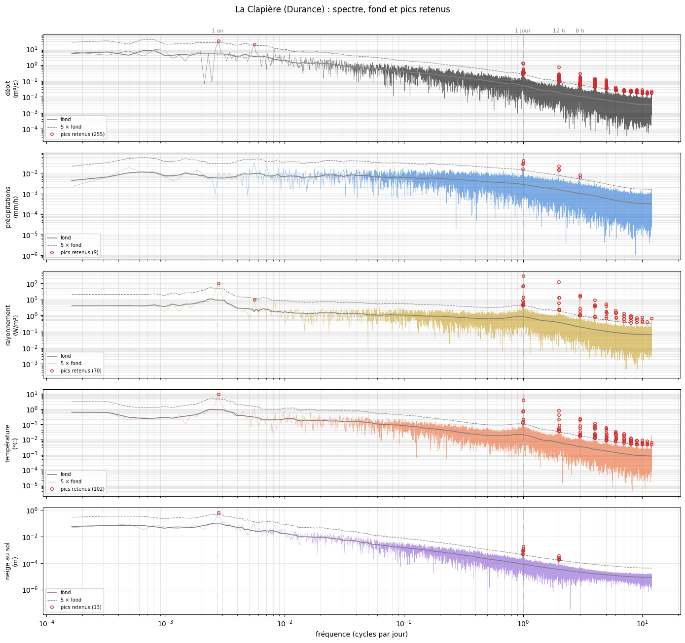
    

    
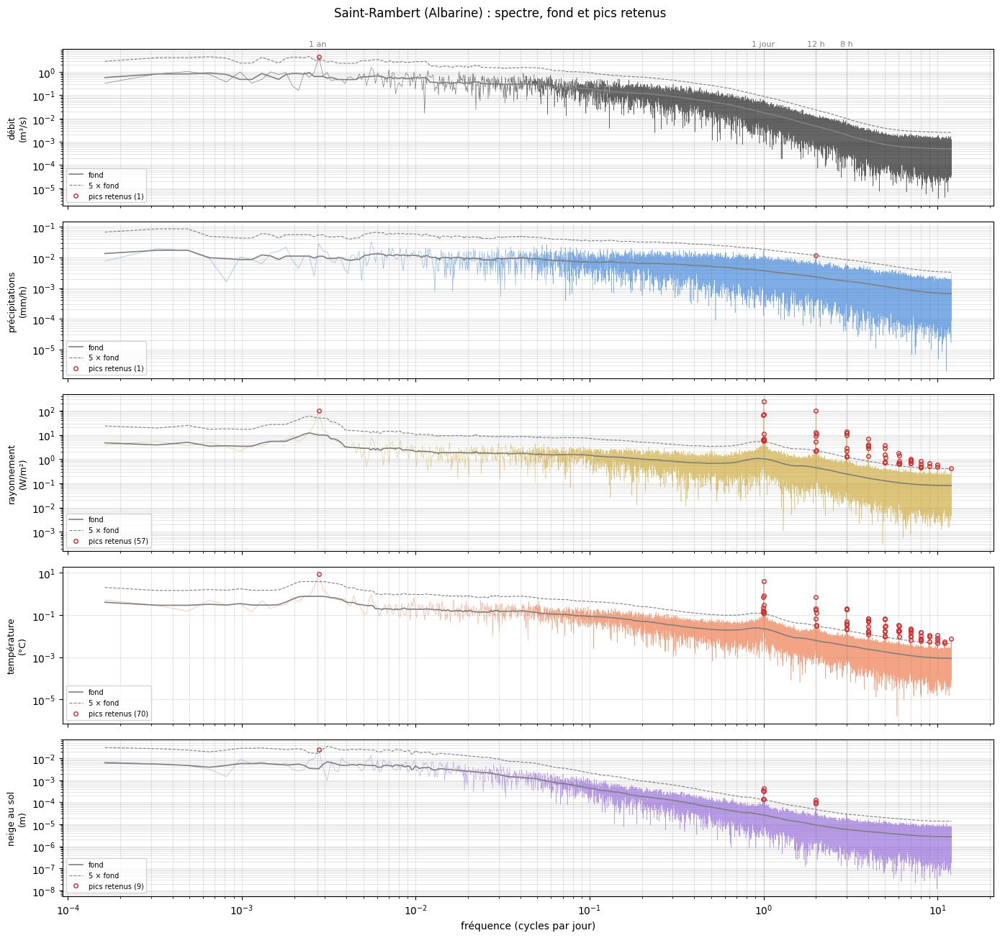
    

## Dans le temps : la série, sa partie périodique et le reste

Trois sections : **une année** (moyennes journalières), **dix jours d'été** (heure par heure : le cycle journalier), et **la plus forte crue
mesurée** de la période (heure par heure, ±6 jours ; le reste, en gris, est ce que la partie périodique n'explique pas).

    
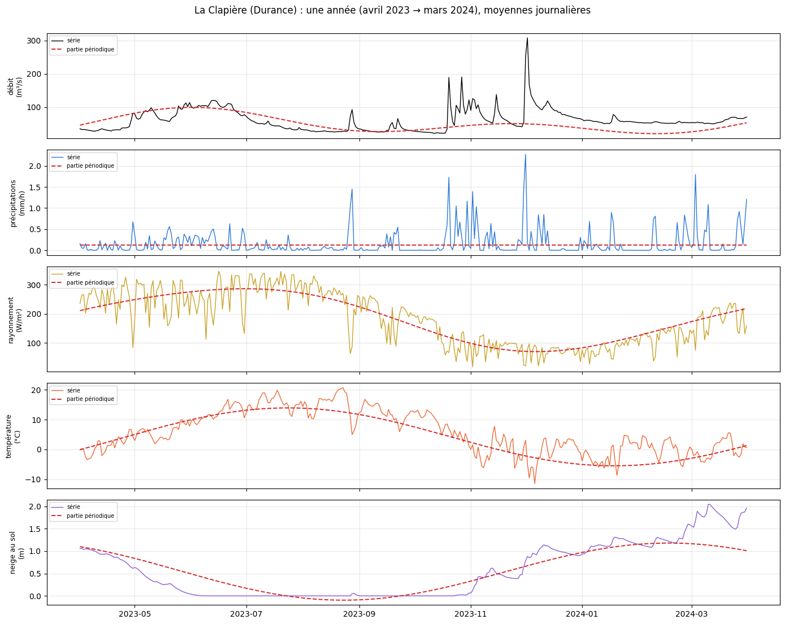
    

    
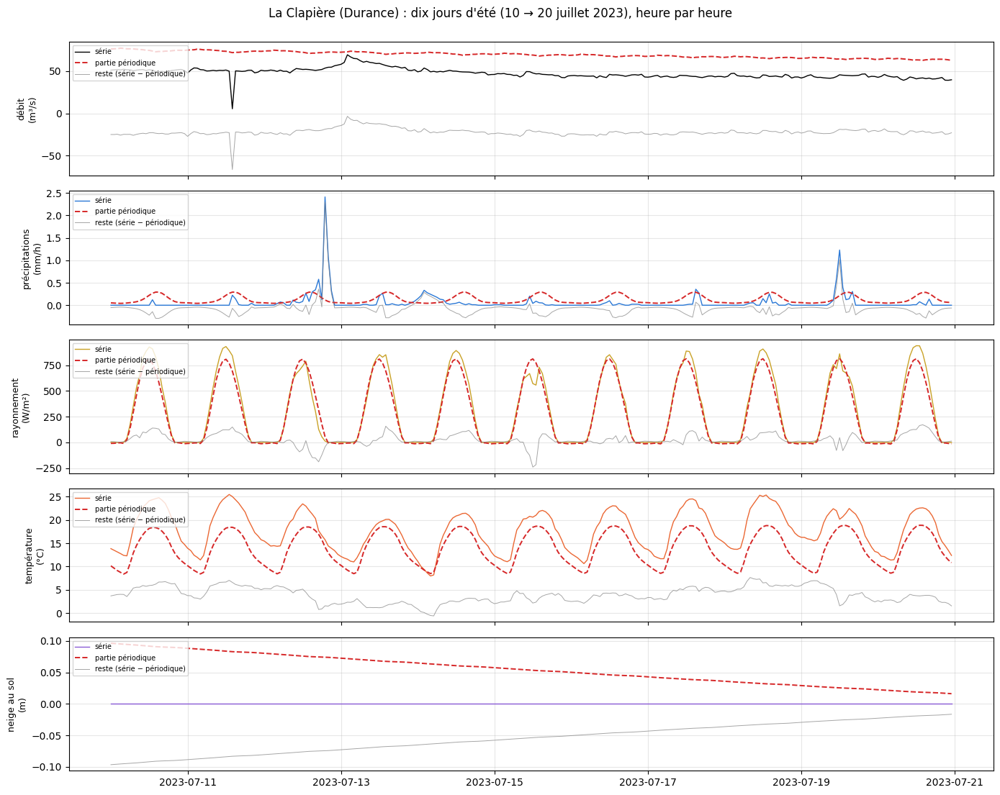
    

    
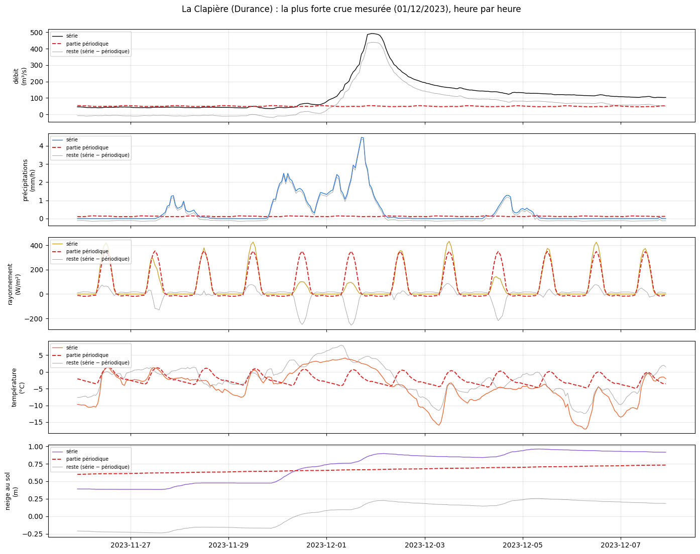
    

    
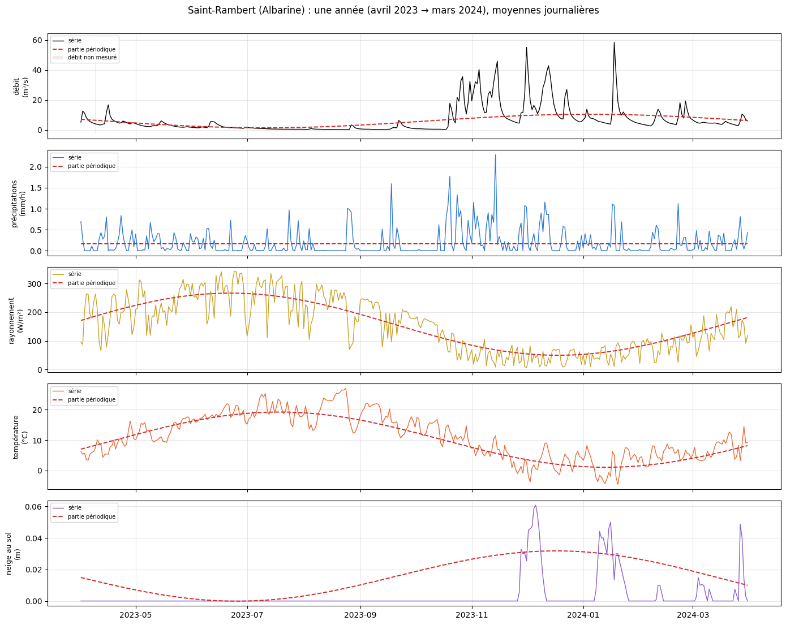
    

    
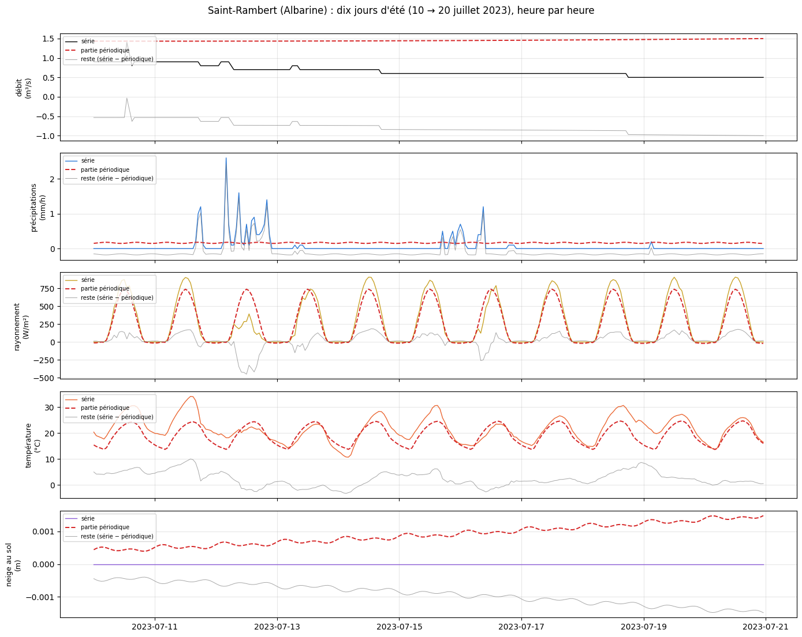
    

    
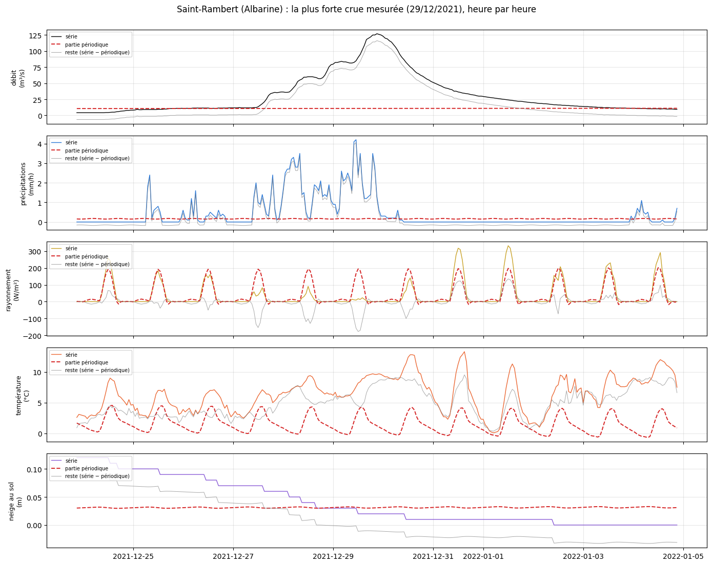
    

## Les fréquences gardées : rayonnement, débit, température

Chaque fréquence gardée s'écrit presque toujours **n cycles par jour + m cycles par an** : n = 0 donne le cycle annuel et ses harmoniques
(m = 1 : 1 an, m = 2 : 6 mois…) ; n = 1, 2, 3… le cycle journalier et ses harmoniques (24 h, 12 h, 8 h…) ; m ≠ 0 avec n ≥ 1, les
« bandes latérales » : le cycle journalier qui change de force ou de forme avec les saisons. D'abord le regroupement par famille
(amplitude de la famille = racine de la somme des carrés des amplitudes de ses fréquences), puis la liste complète.

    
    La Clapière (Durance) — débit (m³/s) : 255 fréquences en 103 familles

<table border="1" class="dataframe">
  <thead>
    <tr style="text-align: right;">
      <th></th>
      <th>fréquences</th>
      <th>amplitude</th>
    </tr>
    <tr>
      <th>famille</th>
      <th></th>
      <th></th>
    </tr>
  </thead>
  <tbody>
    <tr>
      <th>1 an</th>
      <td>1</td>
      <td>30.7440</td>
    </tr>
    <tr>
      <th>2 cycles/an (183 j)</th>
      <td>1</td>
      <td>19.2382</td>
    </tr>
    <tr>
      <th>24 h</th>
      <td>5</td>
      <td>1.4414</td>
    </tr>
    <tr>
      <th>24 h − 1/an</th>
      <td>3</td>
      <td>1.3827</td>
    </tr>
    <tr>
      <th>12 h (2/jour)</th>
      <td>7</td>
      <td>0.8774</td>
    </tr>
    <tr>
      <th>24 h + 1/an</th>
      <td>2</td>
      <td>0.6398</td>
    </tr>
    <tr>
      <th>24 h + 2/an</th>
      <td>2</td>
      <td>0.5434</td>
    </tr>
    <tr>
      <th>24 h − 2/an</th>
      <td>3</td>
      <td>0.5350</td>
    </tr>
    <tr>
      <th>12 h (2/jour) − 1/an</th>
      <td>5</td>
      <td>0.3912</td>
    </tr>
    <tr>
      <th>24 h − 4/an</th>
      <td>2</td>
      <td>0.3772</td>
    </tr>
    <tr>
      <th>8 h (3/jour)</th>
      <td>4</td>
      <td>0.3585</td>
    </tr>
    <tr>
      <th>24 h − 3/an</th>
      <td>1</td>
      <td>0.3369</td>
    </tr>
    <tr>
      <th>12 h (2/jour) + 1/an</th>
      <td>4</td>
      <td>0.3361</td>
    </tr>
    <tr>
      <th>24 h + 5/an</th>
      <td>1</td>
      <td>0.3348</td>
    </tr>
    <tr>
      <th>24 h + 4/an</th>
      <td>1</td>
      <td>0.3272</td>
    </tr>
    <tr>
      <th>8 h (3/jour) − 1/an</th>
      <td>6</td>
      <td>0.2901</td>
    </tr>
    <tr>
      <th>8 h (3/jour) + 1/an</th>
      <td>5</td>
      <td>0.2819</td>
    </tr>
    <tr>
      <th>24 h + 3/an</th>
      <td>1</td>
      <td>0.2818</td>
    </tr>
    <tr>
      <th>12 h (2/jour) − 2/an</th>
      <td>5</td>
      <td>0.2483</td>
    </tr>
    <tr>
      <th>8 h (3/jour) + 2/an</th>
      <td>6</td>
      <td>0.2479</td>
    </tr>
    <tr>
      <th>12 h (2/jour) + 3/an</th>
      <td>4</td>
      <td>0.2234</td>
    </tr>
    <tr>
      <th>6 h (4/jour)</th>
      <td>5</td>
      <td>0.2218</td>
    </tr>
    <tr>
      <th>6 h (4/jour) − 1/an</th>
      <td>7</td>
      <td>0.2204</td>
    </tr>
    <tr>
      <th>6 h (4/jour) + 1/an</th>
      <td>6</td>
      <td>0.2163</td>
    </tr>
    <tr>
      <th>12 h (2/jour) + 4/an</th>
      <td>3</td>
      <td>0.2008</td>
    </tr>
    <tr>
      <th>12 h (2/jour) − 3/an</th>
      <td>3</td>
      <td>0.1971</td>
    </tr>
    <tr>
      <th>6 h (4/jour) − 2/an</th>
      <td>7</td>
      <td>0.1661</td>
    </tr>
    <tr>
      <th>8 h (3/jour) − 2/an</th>
      <td>5</td>
      <td>0.1655</td>
    </tr>
    <tr>
      <th>12 h (2/jour) + 2/an</th>
      <td>2</td>
      <td>0.1600</td>
    </tr>
    <tr>
      <th>8 h (3/jour) − 3/an</th>
      <td>3</td>
      <td>0.1550</td>
    </tr>
    <tr>
      <th>5 h (5/jour)</th>
      <td>4</td>
      <td>0.1540</td>
    </tr>
    <tr>
      <th>8 h (3/jour) + 4/an</th>
      <td>4</td>
      <td>0.1502</td>
    </tr>
    <tr>
      <th>5 h (5/jour) − 1/an</th>
      <td>7</td>
      <td>0.1457</td>
    </tr>
    <tr>
      <th>8 h (3/jour) − 4/an</th>
      <td>5</td>
      <td>0.1417</td>
    </tr>
    <tr>
      <th>6 h (4/jour) + 3/an</th>
      <td>5</td>
      <td>0.1266</td>
    </tr>
    <tr>
      <th>5 h (5/jour) + 1/an</th>
      <td>3</td>
      <td>0.1236</td>
    </tr>
    <tr>
      <th>5 h (5/jour) − 2/an</th>
      <td>4</td>
      <td>0.1202</td>
    </tr>
    <tr>
      <th>6 h (4/jour) + 2/an</th>
      <td>2</td>
      <td>0.1113</td>
    </tr>
    <tr>
      <th>12 h (2/jour) + 5/an</th>
      <td>1</td>
      <td>0.0974</td>
    </tr>
    <tr>
      <th>12 h (2/jour) + 10/an</th>
      <td>1</td>
      <td>0.0944</td>
    </tr>
    <tr>
      <th>8 h (3/jour) + 3/an</th>
      <td>2</td>
      <td>0.0935</td>
    </tr>
    <tr>
      <th>12 h (2/jour) − 5/an</th>
      <td>1</td>
      <td>0.0932</td>
    </tr>
    <tr>
      <th>6 h (4/jour) + 4/an</th>
      <td>3</td>
      <td>0.0930</td>
    </tr>
    <tr>
      <th>12 h (2/jour) + 7/an</th>
      <td>1</td>
      <td>0.0910</td>
    </tr>
    <tr>
      <th>8 h (3/jour) + 5/an</th>
      <td>2</td>
      <td>0.0898</td>
    </tr>
    <tr>
      <th>8 h (3/jour) + 6/an</th>
      <td>2</td>
      <td>0.0845</td>
    </tr>
    <tr>
      <th>8 h (3/jour) − 8/an</th>
      <td>2</td>
      <td>0.0785</td>
    </tr>
    <tr>
      <th>5 h (5/jour) + 2/an</th>
      <td>3</td>
      <td>0.0750</td>
    </tr>
    <tr>
      <th>4 h (6/jour) − 1/an</th>
      <td>4</td>
      <td>0.0673</td>
    </tr>
    <tr>
      <th>6 h (4/jour) − 3/an</th>
      <td>2</td>
      <td>0.0663</td>
    </tr>
    <tr>
      <th>6 h (4/jour) − 4/an</th>
      <td>2</td>
      <td>0.0634</td>
    </tr>
    <tr>
      <th>6 h (4/jour) + 6/an</th>
      <td>2</td>
      <td>0.0628</td>
    </tr>
    <tr>
      <th>5 h (5/jour) − 3/an</th>
      <td>3</td>
      <td>0.0625</td>
    </tr>
    <tr>
      <th>8 h (3/jour) − 5/an</th>
      <td>1</td>
      <td>0.0617</td>
    </tr>
    <tr>
      <th>8 h (3/jour) − 9/an</th>
      <td>1</td>
      <td>0.0561</td>
    </tr>
    <tr>
      <th>5 h (5/jour) + 6/an</th>
      <td>2</td>
      <td>0.0536</td>
    </tr>
    <tr>
      <th>5 h (5/jour) + 4/an</th>
      <td>2</td>
      <td>0.0531</td>
    </tr>
    <tr>
      <th>8 h (3/jour) + 8/an</th>
      <td>1</td>
      <td>0.0530</td>
    </tr>
    <tr>
      <th>6 h (4/jour) + 7/an</th>
      <td>1</td>
      <td>0.0492</td>
    </tr>
    <tr>
      <th>6 h (4/jour) + 5/an</th>
      <td>1</td>
      <td>0.0479</td>
    </tr>
    <tr>
      <th>3 h (8/jour) − 2/an</th>
      <td>4</td>
      <td>0.0472</td>
    </tr>
    <tr>
      <th>3 h (9/jour) + 1/an</th>
      <td>4</td>
      <td>0.0421</td>
    </tr>
    <tr>
      <th>3 h (9/jour) − 1/an</th>
      <td>3</td>
      <td>0.0402</td>
    </tr>
    <tr>
      <th>3 h (9/jour) + 2/an</th>
      <td>3</td>
      <td>0.0396</td>
    </tr>
    <tr>
      <th>4 h (6/jour)</th>
      <td>2</td>
      <td>0.0367</td>
    </tr>
    <tr>
      <th>3 h (7/jour) + 2/an</th>
      <td>2</td>
      <td>0.0366</td>
    </tr>
    <tr>
      <th>3 h (7/jour) − 1/an</th>
      <td>2</td>
      <td>0.0359</td>
    </tr>
    <tr>
      <th>2 h (10/jour)</th>
      <td>3</td>
      <td>0.0359</td>
    </tr>
    <tr>
      <th>2 h (10/jour) − 2/an</th>
      <td>3</td>
      <td>0.0351</td>
    </tr>
    <tr>
      <th>3 h (7/jour) + 1/an</th>
      <td>2</td>
      <td>0.0347</td>
    </tr>
    <tr>
      <th>2 h (10/jour) − 1/an</th>
      <td>3</td>
      <td>0.0343</td>
    </tr>
    <tr>
      <th>5 h (5/jour) − 4/an</th>
      <td>1</td>
      <td>0.0333</td>
    </tr>
    <tr>
      <th>5 h (5/jour) + 5/an</th>
      <td>1</td>
      <td>0.0332</td>
    </tr>
    <tr>
      <th>2 h (10/jour) + 1/an</th>
      <td>2</td>
      <td>0.0324</td>
    </tr>
    <tr>
      <th>3 h (8/jour) − 1/an</th>
      <td>2</td>
      <td>0.0321</td>
    </tr>
    <tr>
      <th>2 h (11/jour)</th>
      <td>3</td>
      <td>0.0318</td>
    </tr>
    <tr>
      <th>3 h (8/jour) − 3/an</th>
      <td>2</td>
      <td>0.0317</td>
    </tr>
    <tr>
      <th>4 h (6/jour) + 1/an</th>
      <td>1</td>
      <td>0.0293</td>
    </tr>
    <tr>
      <th>3 h (9/jour)</th>
      <td>2</td>
      <td>0.0286</td>
    </tr>
    <tr>
      <th>3 h (9/jour) − 2/an</th>
      <td>1</td>
      <td>0.0284</td>
    </tr>
    <tr>
      <th>4 h (6/jour) − 3/an</th>
      <td>1</td>
      <td>0.0276</td>
    </tr>
    <tr>
      <th>4 h (6/jour) + 2/an</th>
      <td>1</td>
      <td>0.0267</td>
    </tr>
    <tr>
      <th>3 h (7/jour)</th>
      <td>1</td>
      <td>0.0264</td>
    </tr>
    <tr>
      <th>4 h (6/jour) + 4/an</th>
      <td>1</td>
      <td>0.0259</td>
    </tr>
    <tr>
      <th>3 h (8/jour) − 5/an</th>
      <td>1</td>
      <td>0.0250</td>
    </tr>
    <tr>
      <th>2 h (12/jour)</th>
      <td>2</td>
      <td>0.0246</td>
    </tr>
    <tr>
      <th>2 h (11/jour) − 3/an</th>
      <td>2</td>
      <td>0.0236</td>
    </tr>
    <tr>
      <th>3 h (8/jour) + 1/an</th>
      <td>1</td>
      <td>0.0229</td>
    </tr>
    <tr>
      <th>3 h (8/jour) + 8/an</th>
      <td>1</td>
      <td>0.0228</td>
    </tr>
    <tr>
      <th>3 h (8/jour) + 2/an</th>
      <td>1</td>
      <td>0.0222</td>
    </tr>
    <tr>
      <th>3 h (7/jour) + 3/an</th>
      <td>1</td>
      <td>0.0221</td>
    </tr>
    <tr>
      <th>2 h (12/jour) − 2/an</th>
      <td>1</td>
      <td>0.0219</td>
    </tr>
    <tr>
      <th>3 h (8/jour)</th>
      <td>1</td>
      <td>0.0205</td>
    </tr>
    <tr>
      <th>3 h (8/jour) + 5/an</th>
      <td>1</td>
      <td>0.0201</td>
    </tr>
    <tr>
      <th>3 h (9/jour) + 3/an</th>
      <td>1</td>
      <td>0.0192</td>
    </tr>
    <tr>
      <th>3 h (9/jour) + 8/an</th>
      <td>1</td>
      <td>0.0187</td>
    </tr>
    <tr>
      <th>2 h (10/jour) + 6/an</th>
      <td>1</td>
      <td>0.0183</td>
    </tr>
    <tr>
      <th>2 h (12/jour) − 1/an</th>
      <td>1</td>
      <td>0.0176</td>
    </tr>
    <tr>
      <th>2 h (10/jour) − 3/an</th>
      <td>1</td>
      <td>0.0173</td>
    </tr>
    <tr>
      <th>2 h (11/jour) − 2/an</th>
      <td>1</td>
      <td>0.0171</td>
    </tr>
    <tr>
      <th>2 h (11/jour) + 1/an</th>
      <td>1</td>
      <td>0.0167</td>
    </tr>
    <tr>
      <th>2 h (11/jour) − 1/an</th>
      <td>1</td>
      <td>0.0165</td>
    </tr>
    <tr>
      <th>2 h (10/jour) + 5/an</th>
      <td>1</td>
      <td>0.0164</td>
    </tr>
  </tbody>
</table>

    
    La Clapière (Durance) — rayonnement (W/m²) : 70 fréquences en 61 familles

<table border="1" class="dataframe">
  <thead>
    <tr style="text-align: right;">
      <th></th>
      <th>fréquences</th>
      <th>amplitude</th>
    </tr>
    <tr>
      <th>famille</th>
      <th></th>
      <th></th>
    </tr>
  </thead>
  <tbody>
    <tr>
      <th>24 h</th>
      <td>1</td>
      <td>287.4812</td>
    </tr>
    <tr>
      <th>12 h (2/jour)</th>
      <td>1</td>
      <td>123.3516</td>
    </tr>
    <tr>
      <th>1 an</th>
      <td>1</td>
      <td>100.7722</td>
    </tr>
    <tr>
      <th>24 h + 1/an</th>
      <td>3</td>
      <td>70.2977</td>
    </tr>
    <tr>
      <th>24 h − 1/an</th>
      <td>4</td>
      <td>63.4447</td>
    </tr>
    <tr>
      <th>8 h (3/jour) − 1/an</th>
      <td>2</td>
      <td>18.6181</td>
    </tr>
    <tr>
      <th>8 h (3/jour)</th>
      <td>1</td>
      <td>15.2478</td>
    </tr>
    <tr>
      <th>8 h (3/jour) + 1/an</th>
      <td>1</td>
      <td>14.5286</td>
    </tr>
    <tr>
      <th>24 h + 2/an</th>
      <td>1</td>
      <td>14.1181</td>
    </tr>
    <tr>
      <th>12 h (2/jour) + 1/an</th>
      <td>1</td>
      <td>13.2346</td>
    </tr>
    <tr>
      <th>12 h (2/jour) + 2/an</th>
      <td>2</td>
      <td>12.9318</td>
    </tr>
    <tr>
      <th>2 cycles/an (183 j)</th>
      <td>1</td>
      <td>9.9839</td>
    </tr>
    <tr>
      <th>6 h (4/jour)</th>
      <td>1</td>
      <td>9.1186</td>
    </tr>
    <tr>
      <th>24 h − 2/an</th>
      <td>1</td>
      <td>8.1959</td>
    </tr>
    <tr>
      <th>24 h + 3/an</th>
      <td>1</td>
      <td>6.4677</td>
    </tr>
    <tr>
      <th>12 h (2/jour) − 2/an</th>
      <td>1</td>
      <td>6.0095</td>
    </tr>
    <tr>
      <th>5 h (5/jour) − 1/an</th>
      <td>1</td>
      <td>5.1143</td>
    </tr>
    <tr>
      <th>24 h − 3/an</th>
      <td>1</td>
      <td>4.7561</td>
    </tr>
    <tr>
      <th>6 h (4/jour) + 1/an</th>
      <td>1</td>
      <td>4.6090</td>
    </tr>
    <tr>
      <th>6 h (4/jour) − 1/an</th>
      <td>1</td>
      <td>4.3933</td>
    </tr>
    <tr>
      <th>6 h (4/jour) + 2/an</th>
      <td>2</td>
      <td>3.9921</td>
    </tr>
    <tr>
      <th>5 h (5/jour) + 1/an</th>
      <td>1</td>
      <td>3.7462</td>
    </tr>
    <tr>
      <th>6 h (4/jour) − 2/an</th>
      <td>1</td>
      <td>3.5349</td>
    </tr>
    <tr>
      <th>8 h (3/jour) + 2/an</th>
      <td>2</td>
      <td>2.9846</td>
    </tr>
    <tr>
      <th>12 h (2/jour) − 1/an</th>
      <td>1</td>
      <td>2.3961</td>
    </tr>
    <tr>
      <th>12 h (2/jour) + 3/an</th>
      <td>1</td>
      <td>2.3286</td>
    </tr>
    <tr>
      <th>4 h (6/jour) − 2/an</th>
      <td>1</td>
      <td>2.0511</td>
    </tr>
    <tr>
      <th>5 h (5/jour)</th>
      <td>1</td>
      <td>1.8297</td>
    </tr>
    <tr>
      <th>8 h (3/jour) + 3/an</th>
      <td>1</td>
      <td>1.7622</td>
    </tr>
    <tr>
      <th>5 h (5/jour) + 2/an</th>
      <td>1</td>
      <td>1.6505</td>
    </tr>
    <tr>
      <th>4 h (6/jour) + 2/an</th>
      <td>1</td>
      <td>1.5897</td>
    </tr>
    <tr>
      <th>4 h (6/jour) + 1/an</th>
      <td>1</td>
      <td>1.4941</td>
    </tr>
    <tr>
      <th>5 h (5/jour) + 3/an</th>
      <td>1</td>
      <td>1.4841</td>
    </tr>
    <tr>
      <th>4 h (6/jour) − 1/an</th>
      <td>1</td>
      <td>1.4415</td>
    </tr>
    <tr>
      <th>3 h (7/jour) − 1/an</th>
      <td>1</td>
      <td>1.3431</td>
    </tr>
    <tr>
      <th>3 h (8/jour) − 2/an</th>
      <td>1</td>
      <td>1.0477</td>
    </tr>
    <tr>
      <th>8 h (3/jour) − 3/an</th>
      <td>1</td>
      <td>1.0001</td>
    </tr>
    <tr>
      <th>3 h (7/jour) + 3/an</th>
      <td>1</td>
      <td>0.9751</td>
    </tr>
    <tr>
      <th>5 h (5/jour) − 3/an</th>
      <td>1</td>
      <td>0.9157</td>
    </tr>
    <tr>
      <th>6 h (4/jour) + 3/an</th>
      <td>1</td>
      <td>0.8974</td>
    </tr>
    <tr>
      <th>3 h (7/jour) − 3/an</th>
      <td>1</td>
      <td>0.8891</td>
    </tr>
    <tr>
      <th>6 h (4/jour) + 4/an</th>
      <td>1</td>
      <td>0.8572</td>
    </tr>
    <tr>
      <th>3 h (8/jour) + 4/an</th>
      <td>1</td>
      <td>0.8011</td>
    </tr>
    <tr>
      <th>2 h (10/jour) + 4/an</th>
      <td>1</td>
      <td>0.7695</td>
    </tr>
    <tr>
      <th>4 h (6/jour) + 3/an</th>
      <td>1</td>
      <td>0.7682</td>
    </tr>
    <tr>
      <th>4 h (6/jour) + 4/an</th>
      <td>1</td>
      <td>0.7398</td>
    </tr>
    <tr>
      <th>3 h (9/jour) − 3/an</th>
      <td>1</td>
      <td>0.7137</td>
    </tr>
    <tr>
      <th>3 h (8/jour)</th>
      <td>1</td>
      <td>0.6931</td>
    </tr>
    <tr>
      <th>3 h (8/jour) + 2/an</th>
      <td>1</td>
      <td>0.6919</td>
    </tr>
    <tr>
      <th>2 h (12/jour) − 4/an</th>
      <td>1</td>
      <td>0.6588</td>
    </tr>
    <tr>
      <th>5 h (5/jour) − 2/an</th>
      <td>1</td>
      <td>0.6499</td>
    </tr>
    <tr>
      <th>3 h (7/jour) + 1/an</th>
      <td>1</td>
      <td>0.6194</td>
    </tr>
    <tr>
      <th>3 h (7/jour) + 2/an</th>
      <td>1</td>
      <td>0.6086</td>
    </tr>
    <tr>
      <th>3 h (9/jour) + 3/an</th>
      <td>1</td>
      <td>0.5241</td>
    </tr>
    <tr>
      <th>3 h (8/jour) + 3/an</th>
      <td>1</td>
      <td>0.4899</td>
    </tr>
    <tr>
      <th>2 h (10/jour) − 4/an</th>
      <td>1</td>
      <td>0.4628</td>
    </tr>
    <tr>
      <th>3 h (7/jour) − 2/an</th>
      <td>1</td>
      <td>0.4387</td>
    </tr>
    <tr>
      <th>2 h (10/jour) − 2/an</th>
      <td>1</td>
      <td>0.4384</td>
    </tr>
    <tr>
      <th>2 h (11/jour) − 3/an</th>
      <td>1</td>
      <td>0.4157</td>
    </tr>
    <tr>
      <th>3 h (9/jour)</th>
      <td>1</td>
      <td>0.3705</td>
    </tr>
    <tr>
      <th>3 h (8/jour) − 4/an</th>
      <td>1</td>
      <td>0.3635</td>
    </tr>
  </tbody>
</table>

    
    La Clapière (Durance) — température (°C) : 102 fréquences en 87 familles

<table border="1" class="dataframe">
  <thead>
    <tr style="text-align: right;">
      <th></th>
      <th>fréquences</th>
      <th>amplitude</th>
    </tr>
    <tr>
      <th>famille</th>
      <th></th>
      <th></th>
    </tr>
  </thead>
  <tbody>
    <tr>
      <th>1 an</th>
      <td>1</td>
      <td>9.4338</td>
    </tr>
    <tr>
      <th>24 h</th>
      <td>2</td>
      <td>3.7086</td>
    </tr>
    <tr>
      <th>12 h (2/jour)</th>
      <td>2</td>
      <td>0.7687</td>
    </tr>
    <tr>
      <th>24 h + 1/an</th>
      <td>1</td>
      <td>0.7243</td>
    </tr>
    <tr>
      <th>24 h − 1/an</th>
      <td>1</td>
      <td>0.6895</td>
    </tr>
    <tr>
      <th>12 h (2/jour) − 1/an</th>
      <td>2</td>
      <td>0.4196</td>
    </tr>
    <tr>
      <th>8 h (3/jour) + 1/an</th>
      <td>1</td>
      <td>0.2268</td>
    </tr>
    <tr>
      <th>8 h (3/jour) − 1/an</th>
      <td>2</td>
      <td>0.2179</td>
    </tr>
    <tr>
      <th>24 h + 2/an</th>
      <td>1</td>
      <td>0.2084</td>
    </tr>
    <tr>
      <th>12 h (2/jour) + 1/an</th>
      <td>1</td>
      <td>0.2021</td>
    </tr>
    <tr>
      <th>8 h (3/jour)</th>
      <td>1</td>
      <td>0.1895</td>
    </tr>
    <tr>
      <th>24 h − 2/an</th>
      <td>1</td>
      <td>0.1243</td>
    </tr>
    <tr>
      <th>6 h (4/jour) − 1/an</th>
      <td>1</td>
      <td>0.1114</td>
    </tr>
    <tr>
      <th>8 h (3/jour) − 2/an</th>
      <td>3</td>
      <td>0.0841</td>
    </tr>
    <tr>
      <th>6 h (4/jour)</th>
      <td>1</td>
      <td>0.0834</td>
    </tr>
    <tr>
      <th>12 h (2/jour) + 2/an</th>
      <td>1</td>
      <td>0.0816</td>
    </tr>
    <tr>
      <th>6 h (4/jour) + 2/an</th>
      <td>1</td>
      <td>0.0671</td>
    </tr>
    <tr>
      <th>6 h (4/jour) − 2/an</th>
      <td>4</td>
      <td>0.0614</td>
    </tr>
    <tr>
      <th>5 h (5/jour) − 1/an</th>
      <td>1</td>
      <td>0.0591</td>
    </tr>
    <tr>
      <th>12 h (2/jour) − 2/an</th>
      <td>1</td>
      <td>0.0557</td>
    </tr>
    <tr>
      <th>8 h (3/jour) + 2/an</th>
      <td>1</td>
      <td>0.0553</td>
    </tr>
    <tr>
      <th>5 h (5/jour) + 1/an</th>
      <td>1</td>
      <td>0.0551</td>
    </tr>
    <tr>
      <th>6 h (4/jour) + 1/an</th>
      <td>2</td>
      <td>0.0518</td>
    </tr>
    <tr>
      <th>5 h (5/jour) − 2/an</th>
      <td>2</td>
      <td>0.0456</td>
    </tr>
    <tr>
      <th>12 h (2/jour) − 3/an</th>
      <td>1</td>
      <td>0.0376</td>
    </tr>
    <tr>
      <th>12 h (2/jour) + 3/an</th>
      <td>1</td>
      <td>0.0350</td>
    </tr>
    <tr>
      <th>4 h (6/jour)</th>
      <td>1</td>
      <td>0.0332</td>
    </tr>
    <tr>
      <th>4 h (6/jour) − 2/an</th>
      <td>3</td>
      <td>0.0318</td>
    </tr>
    <tr>
      <th>8 h (3/jour) + 3/an</th>
      <td>1</td>
      <td>0.0296</td>
    </tr>
    <tr>
      <th>5 h (5/jour) + 2/an</th>
      <td>1</td>
      <td>0.0278</td>
    </tr>
    <tr>
      <th>3 h (7/jour) − 1/an</th>
      <td>1</td>
      <td>0.0245</td>
    </tr>
    <tr>
      <th>6 h (4/jour) − 3/an</th>
      <td>1</td>
      <td>0.0239</td>
    </tr>
    <tr>
      <th>4 h (6/jour) − 1/an</th>
      <td>1</td>
      <td>0.0233</td>
    </tr>
    <tr>
      <th>4 h (6/jour) + 2/an</th>
      <td>1</td>
      <td>0.0225</td>
    </tr>
    <tr>
      <th>5 h (5/jour) + 3/an</th>
      <td>1</td>
      <td>0.0221</td>
    </tr>
    <tr>
      <th>8 h (3/jour) + 4/an</th>
      <td>1</td>
      <td>0.0221</td>
    </tr>
    <tr>
      <th>6 h (4/jour) + 4/an</th>
      <td>1</td>
      <td>0.0221</td>
    </tr>
    <tr>
      <th>4 h (6/jour) − 3/an</th>
      <td>1</td>
      <td>0.0204</td>
    </tr>
    <tr>
      <th>6 h (4/jour) + 3/an</th>
      <td>1</td>
      <td>0.0192</td>
    </tr>
    <tr>
      <th>5 h (5/jour)</th>
      <td>3</td>
      <td>0.0192</td>
    </tr>
    <tr>
      <th>3 h (7/jour) − 2/an</th>
      <td>1</td>
      <td>0.0184</td>
    </tr>
    <tr>
      <th>8 h (3/jour) − 3/an</th>
      <td>1</td>
      <td>0.0172</td>
    </tr>
    <tr>
      <th>5 h (5/jour) − 3/an</th>
      <td>1</td>
      <td>0.0161</td>
    </tr>
    <tr>
      <th>3 h (7/jour) + 1/an</th>
      <td>1</td>
      <td>0.0160</td>
    </tr>
    <tr>
      <th>4 h (6/jour) + 3/an</th>
      <td>1</td>
      <td>0.0151</td>
    </tr>
    <tr>
      <th>5 h (5/jour) + 4/an</th>
      <td>1</td>
      <td>0.0144</td>
    </tr>
    <tr>
      <th>3 h (8/jour) − 2/an</th>
      <td>1</td>
      <td>0.0121</td>
    </tr>
    <tr>
      <th>4 h (6/jour) + 5/an</th>
      <td>1</td>
      <td>0.0120</td>
    </tr>
    <tr>
      <th>6 h (4/jour) + 5/an</th>
      <td>1</td>
      <td>0.0119</td>
    </tr>
    <tr>
      <th>3 h (7/jour) − 3/an</th>
      <td>1</td>
      <td>0.0116</td>
    </tr>
    <tr>
      <th>3 h (8/jour)</th>
      <td>1</td>
      <td>0.0116</td>
    </tr>
    <tr>
      <th>3 h (7/jour) + 4/an</th>
      <td>1</td>
      <td>0.0116</td>
    </tr>
    <tr>
      <th>4 h (6/jour) + 4/an</th>
      <td>1</td>
      <td>0.0115</td>
    </tr>
    <tr>
      <th>4 h (6/jour) + 1/an</th>
      <td>1</td>
      <td>0.0112</td>
    </tr>
    <tr>
      <th>3 h (8/jour) − 3/an</th>
      <td>1</td>
      <td>0.0093</td>
    </tr>
    <tr>
      <th>5 h (5/jour) + 5/an</th>
      <td>1</td>
      <td>0.0090</td>
    </tr>
    <tr>
      <th>5 h (5/jour) − 4/an</th>
      <td>1</td>
      <td>0.0089</td>
    </tr>
    <tr>
      <th>2 h (10/jour)</th>
      <td>1</td>
      <td>0.0087</td>
    </tr>
    <tr>
      <th>3 h (7/jour)</th>
      <td>1</td>
      <td>0.0087</td>
    </tr>
    <tr>
      <th>3 h (9/jour)</th>
      <td>1</td>
      <td>0.0087</td>
    </tr>
    <tr>
      <th>3 h (8/jour) + 1/an</th>
      <td>1</td>
      <td>0.0086</td>
    </tr>
    <tr>
      <th>3 h (9/jour) − 1/an</th>
      <td>1</td>
      <td>0.0086</td>
    </tr>
    <tr>
      <th>3 h (8/jour) + 2/an</th>
      <td>1</td>
      <td>0.0084</td>
    </tr>
    <tr>
      <th>3 h (9/jour) − 3/an</th>
      <td>1</td>
      <td>0.0082</td>
    </tr>
    <tr>
      <th>3 h (7/jour) + 2/an</th>
      <td>1</td>
      <td>0.0081</td>
    </tr>
    <tr>
      <th>3 h (9/jour) − 2/an</th>
      <td>1</td>
      <td>0.0080</td>
    </tr>
    <tr>
      <th>2 h (11/jour)</th>
      <td>1</td>
      <td>0.0079</td>
    </tr>
    <tr>
      <th>3 h (8/jour) − 4/an</th>
      <td>1</td>
      <td>0.0073</td>
    </tr>
    <tr>
      <th>4 h (6/jour) − 4/an</th>
      <td>1</td>
      <td>0.0072</td>
    </tr>
    <tr>
      <th>3 h (7/jour) − 4/an</th>
      <td>1</td>
      <td>0.0071</td>
    </tr>
    <tr>
      <th>2 h (12/jour) − 4/an</th>
      <td>1</td>
      <td>0.0063</td>
    </tr>
    <tr>
      <th>2 h (10/jour) − 4/an</th>
      <td>1</td>
      <td>0.0063</td>
    </tr>
    <tr>
      <th>3 h (8/jour) + 5/an</th>
      <td>1</td>
      <td>0.0062</td>
    </tr>
    <tr>
      <th>3 h (7/jour) + 6/an</th>
      <td>1</td>
      <td>0.0058</td>
    </tr>
    <tr>
      <th>2 h (11/jour) − 3/an</th>
      <td>1</td>
      <td>0.0057</td>
    </tr>
    <tr>
      <th>3 h (9/jour) + 6/an</th>
      <td>1</td>
      <td>0.0055</td>
    </tr>
    <tr>
      <th>2 h (10/jour) − 2/an</th>
      <td>1</td>
      <td>0.0055</td>
    </tr>
    <tr>
      <th>3 h (8/jour) + 3/an</th>
      <td>1</td>
      <td>0.0054</td>
    </tr>
    <tr>
      <th>2 h (10/jour) + 4/an</th>
      <td>1</td>
      <td>0.0051</td>
    </tr>
    <tr>
      <th>3 h (8/jour) − 1/an</th>
      <td>1</td>
      <td>0.0050</td>
    </tr>
    <tr>
      <th>3 h (9/jour) + 4/an</th>
      <td>1</td>
      <td>0.0049</td>
    </tr>
    <tr>
      <th>3 h (9/jour) − 4/an</th>
      <td>1</td>
      <td>0.0047</td>
    </tr>
    <tr>
      <th>2 h (12/jour) − 1/an</th>
      <td>1</td>
      <td>0.0046</td>
    </tr>
    <tr>
      <th>3 h (9/jour) + 2/an</th>
      <td>1</td>
      <td>0.0046</td>
    </tr>
    <tr>
      <th>2 h (11/jour) + 1/an</th>
      <td>1</td>
      <td>0.0045</td>
    </tr>
    <tr>
      <th>2 h (11/jour) − 5/an</th>
      <td>1</td>
      <td>0.0045</td>
    </tr>
    <tr>
      <th>2 h (10/jour) − 5/an</th>
      <td>1</td>
      <td>0.0045</td>
    </tr>
  </tbody>
</table>

    
    Saint-Rambert (Albarine) — débit (m³/s) : 1 fréquences en 1 familles

<table border="1" class="dataframe">
  <thead>
    <tr style="text-align: right;">
      <th></th>
      <th>fréquences</th>
      <th>amplitude</th>
    </tr>
    <tr>
      <th>famille</th>
      <th></th>
      <th></th>
    </tr>
  </thead>
  <tbody>
    <tr>
      <th>1 an</th>
      <td>1</td>
      <td>4.5807</td>
    </tr>
  </tbody>
</table>

    
    Saint-Rambert (Albarine) — rayonnement (W/m²) : 57 fréquences en 52 familles

<table border="1" class="dataframe">
  <thead>
    <tr style="text-align: right;">
      <th></th>
      <th>fréquences</th>
      <th>amplitude</th>
    </tr>
    <tr>
      <th>famille</th>
      <th></th>
      <th></th>
    </tr>
  </thead>
  <tbody>
    <tr>
      <th>24 h</th>
      <td>1</td>
      <td>241.0215</td>
    </tr>
    <tr>
      <th>1 an</th>
      <td>1</td>
      <td>101.7030</td>
    </tr>
    <tr>
      <th>12 h (2/jour)</th>
      <td>1</td>
      <td>99.9769</td>
    </tr>
    <tr>
      <th>24 h + 1/an</th>
      <td>2</td>
      <td>70.1748</td>
    </tr>
    <tr>
      <th>24 h − 1/an</th>
      <td>2</td>
      <td>67.6388</td>
    </tr>
    <tr>
      <th>8 h (3/jour) − 1/an</th>
      <td>3</td>
      <td>13.6918</td>
    </tr>
    <tr>
      <th>12 h (2/jour) + 1/an</th>
      <td>2</td>
      <td>12.6228</td>
    </tr>
    <tr>
      <th>8 h (3/jour) + 1/an</th>
      <td>1</td>
      <td>11.7167</td>
    </tr>
    <tr>
      <th>12 h (2/jour) + 2/an</th>
      <td>1</td>
      <td>11.3825</td>
    </tr>
    <tr>
      <th>24 h + 2/an</th>
      <td>1</td>
      <td>11.3476</td>
    </tr>
    <tr>
      <th>8 h (3/jour)</th>
      <td>1</td>
      <td>9.8587</td>
    </tr>
    <tr>
      <th>12 h (2/jour) − 1/an</th>
      <td>1</td>
      <td>9.0984</td>
    </tr>
    <tr>
      <th>6 h (4/jour)</th>
      <td>1</td>
      <td>6.9844</td>
    </tr>
    <tr>
      <th>24 h − 2/an</th>
      <td>1</td>
      <td>5.8212</td>
    </tr>
    <tr>
      <th>24 h + 3/an</th>
      <td>1</td>
      <td>5.7869</td>
    </tr>
    <tr>
      <th>12 h (2/jour) − 2/an</th>
      <td>1</td>
      <td>5.2075</td>
    </tr>
    <tr>
      <th>6 h (4/jour) + 1/an</th>
      <td>1</td>
      <td>3.9760</td>
    </tr>
    <tr>
      <th>5 h (5/jour) − 1/an</th>
      <td>1</td>
      <td>3.7060</td>
    </tr>
    <tr>
      <th>6 h (4/jour) + 2/an</th>
      <td>1</td>
      <td>3.5193</td>
    </tr>
    <tr>
      <th>6 h (4/jour) − 1/an</th>
      <td>1</td>
      <td>3.5145</td>
    </tr>
    <tr>
      <th>6 h (4/jour) − 2/an</th>
      <td>1</td>
      <td>2.8977</td>
    </tr>
    <tr>
      <th>5 h (5/jour) + 1/an</th>
      <td>1</td>
      <td>2.8662</td>
    </tr>
    <tr>
      <th>8 h (3/jour) + 2/an</th>
      <td>1</td>
      <td>2.8234</td>
    </tr>
    <tr>
      <th>12 h (2/jour) + 3/an</th>
      <td>1</td>
      <td>2.3236</td>
    </tr>
    <tr>
      <th>8 h (3/jour) + 3/an</th>
      <td>1</td>
      <td>2.1683</td>
    </tr>
    <tr>
      <th>4 h (6/jour) − 2/an</th>
      <td>1</td>
      <td>1.7020</td>
    </tr>
    <tr>
      <th>5 h (5/jour) + 2/an</th>
      <td>1</td>
      <td>1.5446</td>
    </tr>
    <tr>
      <th>4 h (6/jour) + 2/an</th>
      <td>1</td>
      <td>1.4218</td>
    </tr>
    <tr>
      <th>6 h (4/jour) + 3/an</th>
      <td>1</td>
      <td>1.3798</td>
    </tr>
    <tr>
      <th>5 h (5/jour) + 3/an</th>
      <td>1</td>
      <td>1.1494</td>
    </tr>
    <tr>
      <th>3 h (7/jour) − 1/an</th>
      <td>1</td>
      <td>1.0328</td>
    </tr>
    <tr>
      <th>3 h (7/jour) + 3/an</th>
      <td>1</td>
      <td>0.8913</td>
    </tr>
    <tr>
      <th>4 h (6/jour) + 1/an</th>
      <td>1</td>
      <td>0.8365</td>
    </tr>
    <tr>
      <th>3 h (7/jour) − 3/an</th>
      <td>1</td>
      <td>0.8166</td>
    </tr>
    <tr>
      <th>3 h (8/jour) − 2/an</th>
      <td>1</td>
      <td>0.8071</td>
    </tr>
    <tr>
      <th>5 h (5/jour) − 3/an</th>
      <td>1</td>
      <td>0.7873</td>
    </tr>
    <tr>
      <th>5 h (5/jour)</th>
      <td>1</td>
      <td>0.7450</td>
    </tr>
    <tr>
      <th>5 h (5/jour) − 2/an</th>
      <td>1</td>
      <td>0.7309</td>
    </tr>
    <tr>
      <th>4 h (6/jour) + 3/an</th>
      <td>1</td>
      <td>0.6965</td>
    </tr>
    <tr>
      <th>3 h (7/jour) + 1/an</th>
      <td>1</td>
      <td>0.6948</td>
    </tr>
    <tr>
      <th>4 h (6/jour) − 1/an</th>
      <td>1</td>
      <td>0.6850</td>
    </tr>
    <tr>
      <th>3 h (7/jour) + 2/an</th>
      <td>1</td>
      <td>0.6762</td>
    </tr>
    <tr>
      <th>3 h (9/jour) − 3/an</th>
      <td>1</td>
      <td>0.6549</td>
    </tr>
    <tr>
      <th>4 h (6/jour) + 4/an</th>
      <td>1</td>
      <td>0.6278</td>
    </tr>
    <tr>
      <th>3 h (8/jour) + 4/an</th>
      <td>1</td>
      <td>0.6113</td>
    </tr>
    <tr>
      <th>2 h (10/jour) + 4/an</th>
      <td>1</td>
      <td>0.5852</td>
    </tr>
    <tr>
      <th>3 h (9/jour) + 3/an</th>
      <td>1</td>
      <td>0.5139</td>
    </tr>
    <tr>
      <th>2 h (10/jour) − 2/an</th>
      <td>1</td>
      <td>0.4801</td>
    </tr>
    <tr>
      <th>3 h (8/jour)</th>
      <td>1</td>
      <td>0.4789</td>
    </tr>
    <tr>
      <th>3 h (8/jour) + 2/an</th>
      <td>1</td>
      <td>0.4717</td>
    </tr>
    <tr>
      <th>3 h (8/jour) + 3/an</th>
      <td>1</td>
      <td>0.4426</td>
    </tr>
    <tr>
      <th>2 h (12/jour) − 4/an</th>
      <td>1</td>
      <td>0.4208</td>
    </tr>
  </tbody>
</table>

    
    Saint-Rambert (Albarine) — température (°C) : 70 fréquences en 61 familles

<table border="1" class="dataframe">
  <thead>
    <tr style="text-align: right;">
      <th></th>
      <th>fréquences</th>
      <th>amplitude</th>
    </tr>
    <tr>
      <th>famille</th>
      <th></th>
      <th></th>
    </tr>
  </thead>
  <tbody>
    <tr>
      <th>1 an</th>
      <td>1</td>
      <td>8.5712</td>
    </tr>
    <tr>
      <th>24 h</th>
      <td>2</td>
      <td>3.7384</td>
    </tr>
    <tr>
      <th>24 h + 1/an</th>
      <td>3</td>
      <td>0.8457</td>
    </tr>
    <tr>
      <th>24 h − 1/an</th>
      <td>2</td>
      <td>0.7200</td>
    </tr>
    <tr>
      <th>12 h (2/jour)</th>
      <td>1</td>
      <td>0.7109</td>
    </tr>
    <tr>
      <th>24 h + 2/an</th>
      <td>1</td>
      <td>0.2922</td>
    </tr>
    <tr>
      <th>24 h − 2/an</th>
      <td>1</td>
      <td>0.2103</td>
    </tr>
    <tr>
      <th>8 h (3/jour) + 1/an</th>
      <td>2</td>
      <td>0.1930</td>
    </tr>
    <tr>
      <th>12 h (2/jour) − 1/an</th>
      <td>1</td>
      <td>0.1927</td>
    </tr>
    <tr>
      <th>8 h (3/jour) − 1/an</th>
      <td>2</td>
      <td>0.1875</td>
    </tr>
    <tr>
      <th>8 h (3/jour)</th>
      <td>1</td>
      <td>0.1796</td>
    </tr>
    <tr>
      <th>12 h (2/jour) + 1/an</th>
      <td>1</td>
      <td>0.1717</td>
    </tr>
    <tr>
      <th>12 h (2/jour) + 2/an</th>
      <td>2</td>
      <td>0.1292</td>
    </tr>
    <tr>
      <th>6 h (4/jour) + 2/an</th>
      <td>2</td>
      <td>0.0687</td>
    </tr>
    <tr>
      <th>12 h (2/jour) − 2/an</th>
      <td>1</td>
      <td>0.0677</td>
    </tr>
    <tr>
      <th>5 h (5/jour) − 1/an</th>
      <td>2</td>
      <td>0.0677</td>
    </tr>
    <tr>
      <th>6 h (4/jour)</th>
      <td>1</td>
      <td>0.0676</td>
    </tr>
    <tr>
      <th>5 h (5/jour) + 1/an</th>
      <td>1</td>
      <td>0.0627</td>
    </tr>
    <tr>
      <th>6 h (4/jour) − 1/an</th>
      <td>1</td>
      <td>0.0537</td>
    </tr>
    <tr>
      <th>8 h (3/jour) − 2/an</th>
      <td>1</td>
      <td>0.0504</td>
    </tr>
    <tr>
      <th>6 h (4/jour) − 2/an</th>
      <td>1</td>
      <td>0.0500</td>
    </tr>
    <tr>
      <th>8 h (3/jour) + 2/an</th>
      <td>1</td>
      <td>0.0384</td>
    </tr>
    <tr>
      <th>4 h (6/jour) − 2/an</th>
      <td>1</td>
      <td>0.0324</td>
    </tr>
    <tr>
      <th>8 h (3/jour) + 3/an</th>
      <td>1</td>
      <td>0.0316</td>
    </tr>
    <tr>
      <th>12 h (2/jour) + 4/an</th>
      <td>1</td>
      <td>0.0316</td>
    </tr>
    <tr>
      <th>5 h (5/jour) + 3/an</th>
      <td>1</td>
      <td>0.0306</td>
    </tr>
    <tr>
      <th>4 h (6/jour) + 2/an</th>
      <td>1</td>
      <td>0.0298</td>
    </tr>
    <tr>
      <th>6 h (4/jour) + 1/an</th>
      <td>1</td>
      <td>0.0285</td>
    </tr>
    <tr>
      <th>5 h (5/jour)</th>
      <td>1</td>
      <td>0.0284</td>
    </tr>
    <tr>
      <th>3 h (7/jour) + 3/an</th>
      <td>1</td>
      <td>0.0221</td>
    </tr>
    <tr>
      <th>3 h (7/jour) − 1/an</th>
      <td>1</td>
      <td>0.0207</td>
    </tr>
    <tr>
      <th>4 h (6/jour) − 1/an</th>
      <td>1</td>
      <td>0.0196</td>
    </tr>
    <tr>
      <th>5 h (5/jour) − 3/an</th>
      <td>1</td>
      <td>0.0176</td>
    </tr>
    <tr>
      <th>6 h (4/jour) + 4/an</th>
      <td>1</td>
      <td>0.0173</td>
    </tr>
    <tr>
      <th>4 h (6/jour) + 4/an</th>
      <td>1</td>
      <td>0.0172</td>
    </tr>
    <tr>
      <th>3 h (7/jour) − 3/an</th>
      <td>1</td>
      <td>0.0169</td>
    </tr>
    <tr>
      <th>4 h (6/jour)</th>
      <td>1</td>
      <td>0.0166</td>
    </tr>
    <tr>
      <th>5 h (5/jour) − 2/an</th>
      <td>1</td>
      <td>0.0165</td>
    </tr>
    <tr>
      <th>3 h (8/jour) − 2/an</th>
      <td>1</td>
      <td>0.0155</td>
    </tr>
    <tr>
      <th>3 h (8/jour) + 4/an</th>
      <td>1</td>
      <td>0.0152</td>
    </tr>
    <tr>
      <th>3 h (7/jour) + 1/an</th>
      <td>1</td>
      <td>0.0143</td>
    </tr>
    <tr>
      <th>6 h (4/jour) + 3/an</th>
      <td>1</td>
      <td>0.0119</td>
    </tr>
    <tr>
      <th>3 h (9/jour) − 3/an</th>
      <td>1</td>
      <td>0.0114</td>
    </tr>
    <tr>
      <th>2 h (10/jour) + 4/an</th>
      <td>1</td>
      <td>0.0107</td>
    </tr>
    <tr>
      <th>5 h (5/jour) + 2/an</th>
      <td>1</td>
      <td>0.0105</td>
    </tr>
    <tr>
      <th>3 h (8/jour) + 2/an</th>
      <td>1</td>
      <td>0.0100</td>
    </tr>
    <tr>
      <th>3 h (7/jour)</th>
      <td>1</td>
      <td>0.0098</td>
    </tr>
    <tr>
      <th>3 h (9/jour) + 3/an</th>
      <td>1</td>
      <td>0.0095</td>
    </tr>
    <tr>
      <th>4 h (6/jour) + 1/an</th>
      <td>1</td>
      <td>0.0092</td>
    </tr>
    <tr>
      <th>3 h (7/jour) + 5/an</th>
      <td>1</td>
      <td>0.0092</td>
    </tr>
    <tr>
      <th>2 h (10/jour) − 4/an</th>
      <td>1</td>
      <td>0.0083</td>
    </tr>
    <tr>
      <th>3 h (8/jour)</th>
      <td>1</td>
      <td>0.0072</td>
    </tr>
    <tr>
      <th>2 h (12/jour) − 4/an</th>
      <td>1</td>
      <td>0.0072</td>
    </tr>
    <tr>
      <th>3 h (8/jour) − 4/an</th>
      <td>1</td>
      <td>0.0070</td>
    </tr>
    <tr>
      <th>3 h (7/jour) − 2/an</th>
      <td>1</td>
      <td>0.0063</td>
    </tr>
    <tr>
      <th>2 h (10/jour) + 6/an</th>
      <td>1</td>
      <td>0.0062</td>
    </tr>
    <tr>
      <th>3 h (8/jour) − 1/an</th>
      <td>1</td>
      <td>0.0061</td>
    </tr>
    <tr>
      <th>2 h (11/jour) − 3/an</th>
      <td>1</td>
      <td>0.0054</td>
    </tr>
    <tr>
      <th>3 h (9/jour) + 5/an</th>
      <td>1</td>
      <td>0.0053</td>
    </tr>
    <tr>
      <th>2 h (10/jour)</th>
      <td>1</td>
      <td>0.0048</td>
    </tr>
    <tr>
      <th>2 h (11/jour)</th>
      <td>1</td>
      <td>0.0047</td>
    </tr>
  </tbody>
</table>

<table border="1" class="dataframe">
  <thead>
    <tr style="text-align: right;">
      <th></th>
      <th></th>
      <th>fréquence (cycles/jour)</th>
      <th>période</th>
      <th>amplitude</th>
      <th>× fond</th>
      <th>famille</th>
      <th>écart à la famille (cycles/an)</th>
    </tr>
    <tr>
      <th>station</th>
      <th>série</th>
      <th></th>
      <th></th>
      <th></th>
      <th></th>
      <th></th>
      <th></th>
    </tr>
  </thead>
  <tbody>
    <tr>
      <th rowspan="427" valign="top">La Clapière (Durance)</th>
      <th>rayonnement (W/m²)</th>
      <td>0.00277</td>
      <td>0.99 an</td>
      <td>100.7722</td>
      <td>11.2</td>
      <td>1 an</td>
      <td>0.01</td>
    </tr>
    <tr>
      <th>rayonnement (W/m²)</th>
      <td>0.00554</td>
      <td>180 j</td>
      <td>9.9839</td>
      <td>5.9</td>
      <td>2 cycles/an (183 j)</td>
      <td>0.03</td>
    </tr>
    <tr>
      <th>rayonnement (W/m²)</th>
      <td>0.99185</td>
      <td>24.2 h</td>
      <td>4.7561</td>
      <td>5.7</td>
      <td>24 h − 3/an</td>
      <td>0.02</td>
    </tr>
    <tr>
      <th>rayonnement (W/m²)</th>
      <td>0.99446</td>
      <td>24.1 h</td>
      <td>8.1959</td>
      <td>9.8</td>
      <td>24 h − 2/an</td>
      <td>-0.03</td>
    </tr>
    <tr>
      <th>rayonnement (W/m²)</th>
      <td>0.99723</td>
      <td>24.1 h</td>
      <td>62.9188</td>
      <td>75.6</td>
      <td>24 h − 1/an</td>
      <td>-0.01</td>
    </tr>
    <tr>
      <th>rayonnement (W/m²)</th>
      <td>0.99788</td>
      <td>24.1 h</td>
      <td>5.0486</td>
      <td>6.1</td>
      <td>24 h − 1/an</td>
      <td>0.23</td>
    </tr>
    <tr>
      <th>rayonnement (W/m²)</th>
      <td>0.99821</td>
      <td>24.0 h</td>
      <td>4.8586</td>
      <td>5.8</td>
      <td>24 h − 1/an</td>
      <td>0.34</td>
    </tr>
    <tr>
      <th>rayonnement (W/m²)</th>
      <td>0.99853</td>
      <td>24.0 h</td>
      <td>4.1665</td>
      <td>5.0</td>
      <td>24 h − 1/an</td>
      <td>0.46</td>
    </tr>
    <tr>
      <th>rayonnement (W/m²)</th>
      <td>1.00000</td>
      <td>24.0 h</td>
      <td>287.4812</td>
      <td>345.5</td>
      <td>24 h</td>
      <td>0.00</td>
    </tr>
    <tr>
      <th>rayonnement (W/m²)</th>
      <td>1.00179</td>
      <td>24.0 h</td>
      <td>4.4846</td>
      <td>5.4</td>
      <td>24 h + 1/an</td>
      <td>-0.34</td>
    </tr>
    <tr>
      <th>rayonnement (W/m²)</th>
      <td>1.00212</td>
      <td>23.9 h</td>
      <td>5.1532</td>
      <td>6.2</td>
      <td>24 h + 1/an</td>
      <td>-0.23</td>
    </tr>
    <tr>
      <th>rayonnement (W/m²)</th>
      <td>1.00277</td>
      <td>23.9 h</td>
      <td>69.9650</td>
      <td>84.4</td>
      <td>24 h + 1/an</td>
      <td>0.01</td>
    </tr>
    <tr>
      <th>rayonnement (W/m²)</th>
      <td>1.00554</td>
      <td>23.9 h</td>
      <td>14.1181</td>
      <td>17.1</td>
      <td>24 h + 2/an</td>
      <td>0.03</td>
    </tr>
    <tr>
      <th>rayonnement (W/m²)</th>
      <td>1.00815</td>
      <td>23.8 h</td>
      <td>6.4677</td>
      <td>7.8</td>
      <td>24 h + 3/an</td>
      <td>-0.02</td>
    </tr>
    <tr>
      <th>rayonnement (W/m²)</th>
      <td>1.99446</td>
      <td>12.0 h</td>
      <td>6.0095</td>
      <td>16.1</td>
      <td>12 h (2/jour) − 2/an</td>
      <td>-0.03</td>
    </tr>
    <tr>
      <th>rayonnement (W/m²)</th>
      <td>1.99723</td>
      <td>12.0 h</td>
      <td>2.3961</td>
      <td>6.4</td>
      <td>12 h (2/jour) − 1/an</td>
      <td>-0.01</td>
    </tr>
    <tr>
      <th>rayonnement (W/m²)</th>
      <td>2.00000</td>
      <td>12.0 h</td>
      <td>123.3516</td>
      <td>331.8</td>
      <td>12 h (2/jour)</td>
      <td>0.00</td>
    </tr>
    <tr>
      <th>rayonnement (W/m²)</th>
      <td>2.00277</td>
      <td>12.0 h</td>
      <td>13.2346</td>
      <td>35.7</td>
      <td>12 h (2/jour) + 1/an</td>
      <td>0.01</td>
    </tr>
    <tr>
      <th>rayonnement (W/m²)</th>
      <td>2.00554</td>
      <td>12.0 h</td>
      <td>12.7293</td>
      <td>34.4</td>
      <td>12 h (2/jour) + 2/an</td>
      <td>0.03</td>
    </tr>
    <tr>
      <th>rayonnement (W/m²)</th>
      <td>2.00620</td>
      <td>12.0 h</td>
      <td>2.2793</td>
      <td>6.2</td>
      <td>12 h (2/jour) + 2/an</td>
      <td>0.26</td>
    </tr>
    <tr>
      <th>rayonnement (W/m²)</th>
      <td>2.00815</td>
      <td>12.0 h</td>
      <td>2.3286</td>
      <td>6.3</td>
      <td>12 h (2/jour) + 3/an</td>
      <td>-0.02</td>
    </tr>
    <tr>
      <th>rayonnement (W/m²)</th>
      <td>2.99185</td>
      <td>8.0 h</td>
      <td>1.0001</td>
      <td>5.2</td>
      <td>8 h (3/jour) − 3/an</td>
      <td>0.02</td>
    </tr>
    <tr>
      <th>rayonnement (W/m²)</th>
      <td>2.99658</td>
      <td>8.0 h</td>
      <td>1.1696</td>
      <td>6.1</td>
      <td>8 h (3/jour) − 1/an</td>
      <td>-0.25</td>
    </tr>
    <tr>
      <th>rayonnement (W/m²)</th>
      <td>2.99723</td>
      <td>8.0 h</td>
      <td>18.5814</td>
      <td>96.7</td>
      <td>8 h (3/jour) − 1/an</td>
      <td>-0.01</td>
    </tr>
    <tr>
      <th>rayonnement (W/m²)</th>
      <td>3.00000</td>
      <td>8.0 h</td>
      <td>15.2478</td>
      <td>79.5</td>
      <td>8 h (3/jour)</td>
      <td>0.00</td>
    </tr>
    <tr>
      <th>rayonnement (W/m²)</th>
      <td>3.00277</td>
      <td>8.0 h</td>
      <td>14.5286</td>
      <td>75.8</td>
      <td>8 h (3/jour) + 1/an</td>
      <td>0.01</td>
    </tr>
    <tr>
      <th>rayonnement (W/m²)</th>
      <td>3.00489</td>
      <td>8.0 h</td>
      <td>1.0055</td>
      <td>5.3</td>
      <td>8 h (3/jour) + 2/an</td>
      <td>-0.21</td>
    </tr>
    <tr>
      <th>rayonnement (W/m²)</th>
      <td>3.00554</td>
      <td>8.0 h</td>
      <td>2.8101</td>
      <td>14.7</td>
      <td>8 h (3/jour) + 2/an</td>
      <td>0.03</td>
    </tr>
    <tr>
      <th>rayonnement (W/m²)</th>
      <td>3.00815</td>
      <td>8.0 h</td>
      <td>1.7622</td>
      <td>9.2</td>
      <td>8 h (3/jour) + 3/an</td>
      <td>-0.02</td>
    </tr>
    <tr>
      <th>rayonnement (W/m²)</th>
      <td>3.99446</td>
      <td>6.0 h</td>
      <td>3.5349</td>
      <td>26.7</td>
      <td>6 h (4/jour) − 2/an</td>
      <td>-0.03</td>
    </tr>
    <tr>
      <th>rayonnement (W/m²)</th>
      <td>3.99723</td>
      <td>6.0 h</td>
      <td>4.3933</td>
      <td>33.2</td>
      <td>6 h (4/jour) − 1/an</td>
      <td>-0.01</td>
    </tr>
    <tr>
      <th>rayonnement (W/m²)</th>
      <td>4.00000</td>
      <td>6.0 h</td>
      <td>9.1186</td>
      <td>68.9</td>
      <td>6 h (4/jour)</td>
      <td>0.00</td>
    </tr>
    <tr>
      <th>rayonnement (W/m²)</th>
      <td>4.00277</td>
      <td>6.0 h</td>
      <td>4.6090</td>
      <td>34.8</td>
      <td>6 h (4/jour) + 1/an</td>
      <td>0.01</td>
    </tr>
    <tr>
      <th>rayonnement (W/m²)</th>
      <td>4.00554</td>
      <td>6.0 h</td>
      <td>3.9097</td>
      <td>29.6</td>
      <td>6 h (4/jour) + 2/an</td>
      <td>0.03</td>
    </tr>
    <tr>
      <th>rayonnement (W/m²)</th>
      <td>4.00603</td>
      <td>6.0 h</td>
      <td>0.8070</td>
      <td>6.1</td>
      <td>6 h (4/jour) + 2/an</td>
      <td>0.20</td>
    </tr>
    <tr>
      <th>rayonnement (W/m²)</th>
      <td>4.00815</td>
      <td>6.0 h</td>
      <td>0.8974</td>
      <td>6.8</td>
      <td>6 h (4/jour) + 3/an</td>
      <td>-0.02</td>
    </tr>
    <tr>
      <th>rayonnement (W/m²)</th>
      <td>4.01093</td>
      <td>6.0 h</td>
      <td>0.8572</td>
      <td>6.5</td>
      <td>6 h (4/jour) + 4/an</td>
      <td>-0.01</td>
    </tr>
    <tr>
      <th>rayonnement (W/m²)</th>
      <td>4.99185</td>
      <td>4.8 h</td>
      <td>0.9157</td>
      <td>8.8</td>
      <td>5 h (5/jour) − 3/an</td>
      <td>0.02</td>
    </tr>
    <tr>
      <th>rayonnement (W/m²)</th>
      <td>4.99446</td>
      <td>4.8 h</td>
      <td>0.6499</td>
      <td>6.3</td>
      <td>5 h (5/jour) − 2/an</td>
      <td>-0.03</td>
    </tr>
    <tr>
      <th>rayonnement (W/m²)</th>
      <td>4.99723</td>
      <td>4.8 h</td>
      <td>5.1143</td>
      <td>49.3</td>
      <td>5 h (5/jour) − 1/an</td>
      <td>-0.01</td>
    </tr>
    <tr>
      <th>rayonnement (W/m²)</th>
      <td>5.00000</td>
      <td>4.8 h</td>
      <td>1.8297</td>
      <td>17.7</td>
      <td>5 h (5/jour)</td>
      <td>0.00</td>
    </tr>
    <tr>
      <th>rayonnement (W/m²)</th>
      <td>5.00277</td>
      <td>4.8 h</td>
      <td>3.7462</td>
      <td>36.2</td>
      <td>5 h (5/jour) + 1/an</td>
      <td>0.01</td>
    </tr>
    <tr>
      <th>rayonnement (W/m²)</th>
      <td>5.00554</td>
      <td>4.8 h</td>
      <td>1.6505</td>
      <td>16.0</td>
      <td>5 h (5/jour) + 2/an</td>
      <td>0.03</td>
    </tr>
    <tr>
      <th>rayonnement (W/m²)</th>
      <td>5.00815</td>
      <td>4.8 h</td>
      <td>1.4841</td>
      <td>14.4</td>
      <td>5 h (5/jour) + 3/an</td>
      <td>-0.02</td>
    </tr>
    <tr>
      <th>rayonnement (W/m²)</th>
      <td>5.99446</td>
      <td>4.0 h</td>
      <td>2.0511</td>
      <td>23.6</td>
      <td>4 h (6/jour) − 2/an</td>
      <td>-0.03</td>
    </tr>
    <tr>
      <th>rayonnement (W/m²)</th>
      <td>5.99723</td>
      <td>4.0 h</td>
      <td>1.4415</td>
      <td>16.6</td>
      <td>4 h (6/jour) − 1/an</td>
      <td>-0.01</td>
    </tr>
    <tr>
      <th>rayonnement (W/m²)</th>
      <td>6.00277</td>
      <td>4.0 h</td>
      <td>1.4941</td>
      <td>17.2</td>
      <td>4 h (6/jour) + 1/an</td>
      <td>0.01</td>
    </tr>
    <tr>
      <th>rayonnement (W/m²)</th>
      <td>6.00554</td>
      <td>4.0 h</td>
      <td>1.5897</td>
      <td>18.3</td>
      <td>4 h (6/jour) + 2/an</td>
      <td>0.03</td>
    </tr>
    <tr>
      <th>rayonnement (W/m²)</th>
      <td>6.00815</td>
      <td>4.0 h</td>
      <td>0.7682</td>
      <td>8.9</td>
      <td>4 h (6/jour) + 3/an</td>
      <td>-0.02</td>
    </tr>
    <tr>
      <th>rayonnement (W/m²)</th>
      <td>6.01093</td>
      <td>4.0 h</td>
      <td>0.7398</td>
      <td>8.5</td>
      <td>4 h (6/jour) + 4/an</td>
      <td>-0.01</td>
    </tr>
    <tr>
      <th>rayonnement (W/m²)</th>
      <td>6.99185</td>
      <td>3.4 h</td>
      <td>0.8891</td>
      <td>11.7</td>
      <td>3 h (7/jour) − 3/an</td>
      <td>0.02</td>
    </tr>
    <tr>
      <th>rayonnement (W/m²)</th>
      <td>6.99462</td>
      <td>3.4 h</td>
      <td>0.4387</td>
      <td>5.8</td>
      <td>3 h (7/jour) − 2/an</td>
      <td>0.03</td>
    </tr>
    <tr>
      <th>rayonnement (W/m²)</th>
      <td>6.99723</td>
      <td>3.4 h</td>
      <td>1.3431</td>
      <td>17.6</td>
      <td>3 h (7/jour) − 1/an</td>
      <td>-0.01</td>
    </tr>
    <tr>
      <th>rayonnement (W/m²)</th>
      <td>7.00277</td>
      <td>3.4 h</td>
      <td>0.6194</td>
      <td>8.1</td>
      <td>3 h (7/jour) + 1/an</td>
      <td>0.01</td>
    </tr>
    <tr>
      <th>rayonnement (W/m²)</th>
      <td>7.00554</td>
      <td>3.4 h</td>
      <td>0.6086</td>
      <td>8.0</td>
      <td>3 h (7/jour) + 2/an</td>
      <td>0.03</td>
    </tr>
    <tr>
      <th>rayonnement (W/m²)</th>
      <td>7.00815</td>
      <td>3.4 h</td>
      <td>0.9751</td>
      <td>12.8</td>
      <td>3 h (7/jour) + 3/an</td>
      <td>-0.02</td>
    </tr>
    <tr>
      <th>rayonnement (W/m²)</th>
      <td>7.98907</td>
      <td>3.0 h</td>
      <td>0.3635</td>
      <td>5.2</td>
      <td>3 h (8/jour) − 4/an</td>
      <td>0.01</td>
    </tr>
    <tr>
      <th>rayonnement (W/m²)</th>
      <td>7.99446</td>
      <td>3.0 h</td>
      <td>1.0477</td>
      <td>14.9</td>
      <td>3 h (8/jour) − 2/an</td>
      <td>-0.03</td>
    </tr>
    <tr>
      <th>rayonnement (W/m²)</th>
      <td>8.00000</td>
      <td>3.0 h</td>
      <td>0.6931</td>
      <td>9.9</td>
      <td>3 h (8/jour)</td>
      <td>0.00</td>
    </tr>
    <tr>
      <th>rayonnement (W/m²)</th>
      <td>8.00554</td>
      <td>3.0 h</td>
      <td>0.6919</td>
      <td>9.9</td>
      <td>3 h (8/jour) + 2/an</td>
      <td>0.03</td>
    </tr>
    <tr>
      <th>rayonnement (W/m²)</th>
      <td>8.00815</td>
      <td>3.0 h</td>
      <td>0.4899</td>
      <td>7.0</td>
      <td>3 h (8/jour) + 3/an</td>
      <td>-0.02</td>
    </tr>
    <tr>
      <th>rayonnement (W/m²)</th>
      <td>8.01093</td>
      <td>3.0 h</td>
      <td>0.8011</td>
      <td>11.4</td>
      <td>3 h (8/jour) + 4/an</td>
      <td>-0.01</td>
    </tr>
    <tr>
      <th>rayonnement (W/m²)</th>
      <td>8.99185</td>
      <td>2.7 h</td>
      <td>0.7137</td>
      <td>10.7</td>
      <td>3 h (9/jour) − 3/an</td>
      <td>0.02</td>
    </tr>
    <tr>
      <th>rayonnement (W/m²)</th>
      <td>9.00000</td>
      <td>2.7 h</td>
      <td>0.3705</td>
      <td>5.5</td>
      <td>3 h (9/jour)</td>
      <td>0.00</td>
    </tr>
    <tr>
      <th>rayonnement (W/m²)</th>
      <td>9.00815</td>
      <td>2.7 h</td>
      <td>0.5241</td>
      <td>7.8</td>
      <td>3 h (9/jour) + 3/an</td>
      <td>-0.02</td>
    </tr>
    <tr>
      <th>rayonnement (W/m²)</th>
      <td>9.98907</td>
      <td>2.4 h</td>
      <td>0.4628</td>
      <td>7.1</td>
      <td>2 h (10/jour) − 4/an</td>
      <td>0.01</td>
    </tr>
    <tr>
      <th>rayonnement (W/m²)</th>
      <td>9.99446</td>
      <td>2.4 h</td>
      <td>0.4384</td>
      <td>6.7</td>
      <td>2 h (10/jour) − 2/an</td>
      <td>-0.03</td>
    </tr>
    <tr>
      <th>rayonnement (W/m²)</th>
      <td>10.01093</td>
      <td>2.4 h</td>
      <td>0.7695</td>
      <td>11.8</td>
      <td>2 h (10/jour) + 4/an</td>
      <td>-0.01</td>
    </tr>
    <tr>
      <th>rayonnement (W/m²)</th>
      <td>10.99185</td>
      <td>2.2 h</td>
      <td>0.4157</td>
      <td>6.5</td>
      <td>2 h (11/jour) − 3/an</td>
      <td>0.02</td>
    </tr>
    <tr>
      <th>rayonnement (W/m²)</th>
      <td>11.98907</td>
      <td>2.0 h</td>
      <td>0.6588</td>
      <td>10.3</td>
      <td>2 h (12/jour) − 4/an</td>
      <td>0.01</td>
    </tr>
    <tr>
      <th>débit (m³/s)</th>
      <td>0.00277</td>
      <td>0.99 an</td>
      <td>30.7440</td>
      <td>6.5</td>
      <td>1 an</td>
      <td>0.01</td>
    </tr>
    <tr>
      <th>débit (m³/s)</th>
      <td>0.00554</td>
      <td>180 j</td>
      <td>19.2382</td>
      <td>5.9</td>
      <td>2 cycles/an (183 j)</td>
      <td>0.03</td>
    </tr>
    <tr>
      <th>débit (m³/s)</th>
      <td>0.98777</td>
      <td>24.3 h</td>
      <td>0.2655</td>
      <td>5.1</td>
      <td>24 h − 4/an</td>
      <td>-0.47</td>
    </tr>
    <tr>
      <th>débit (m³/s)</th>
      <td>0.98907</td>
      <td>24.3 h</td>
      <td>0.2680</td>
      <td>5.2</td>
      <td>24 h − 4/an</td>
      <td>0.01</td>
    </tr>
    <tr>
      <th>débit (m³/s)</th>
      <td>0.99168</td>
      <td>24.2 h</td>
      <td>0.3369</td>
      <td>6.5</td>
      <td>24 h − 3/an</td>
      <td>-0.04</td>
    </tr>
    <tr>
      <th>débit (m³/s)</th>
      <td>0.99446</td>
      <td>24.1 h</td>
      <td>0.3444</td>
      <td>6.7</td>
      <td>24 h − 2/an</td>
      <td>-0.03</td>
    </tr>
    <tr>
      <th>débit (m³/s)</th>
      <td>0.99527</td>
      <td>24.1 h</td>
      <td>0.2810</td>
      <td>5.5</td>
      <td>24 h − 2/an</td>
      <td>0.27</td>
    </tr>
    <tr>
      <th>débit (m³/s)</th>
      <td>0.99576</td>
      <td>24.1 h</td>
      <td>0.2978</td>
      <td>5.8</td>
      <td>24 h − 2/an</td>
      <td>0.45</td>
    </tr>
    <tr>
      <th>débit (m³/s)</th>
      <td>0.99690</td>
      <td>24.1 h</td>
      <td>0.3594</td>
      <td>7.0</td>
      <td>24 h − 1/an</td>
      <td>-0.13</td>
    </tr>
    <tr>
      <th>débit (m³/s)</th>
      <td>0.99723</td>
      <td>24.1 h</td>
      <td>1.2980</td>
      <td>25.3</td>
      <td>24 h − 1/an</td>
      <td>-0.01</td>
    </tr>
    <tr>
      <th>débit (m³/s)</th>
      <td>0.99772</td>
      <td>24.1 h</td>
      <td>0.3128</td>
      <td>6.1</td>
      <td>24 h − 1/an</td>
      <td>0.17</td>
    </tr>
    <tr>
      <th>débit (m³/s)</th>
      <td>0.99886</td>
      <td>24.0 h</td>
      <td>0.3156</td>
      <td>6.2</td>
      <td>24 h</td>
      <td>-0.42</td>
    </tr>
    <tr>
      <th>débit (m³/s)</th>
      <td>0.99967</td>
      <td>24.0 h</td>
      <td>0.3760</td>
      <td>7.3</td>
      <td>24 h</td>
      <td>-0.12</td>
    </tr>
    <tr>
      <th>débit (m³/s)</th>
      <td>1.00000</td>
      <td>24.0 h</td>
      <td>1.2070</td>
      <td>23.6</td>
      <td>24 h</td>
      <td>0.00</td>
    </tr>
    <tr>
      <th>débit (m³/s)</th>
      <td>1.00033</td>
      <td>24.0 h</td>
      <td>0.5536</td>
      <td>10.8</td>
      <td>24 h</td>
      <td>0.12</td>
    </tr>
    <tr>
      <th>débit (m³/s)</th>
      <td>1.00098</td>
      <td>24.0 h</td>
      <td>0.2704</td>
      <td>5.3</td>
      <td>24 h</td>
      <td>0.36</td>
    </tr>
    <tr>
      <th>débit (m³/s)</th>
      <td>1.00277</td>
      <td>23.9 h</td>
      <td>0.4807</td>
      <td>9.4</td>
      <td>24 h + 1/an</td>
      <td>0.01</td>
    </tr>
    <tr>
      <th>débit (m³/s)</th>
      <td>1.00342</td>
      <td>23.9 h</td>
      <td>0.4222</td>
      <td>8.3</td>
      <td>24 h + 1/an</td>
      <td>0.25</td>
    </tr>
    <tr>
      <th>débit (m³/s)</th>
      <td>1.00538</td>
      <td>23.9 h</td>
      <td>0.4022</td>
      <td>7.9</td>
      <td>24 h + 2/an</td>
      <td>-0.03</td>
    </tr>
    <tr>
      <th>débit (m³/s)</th>
      <td>1.00571</td>
      <td>23.9 h</td>
      <td>0.3654</td>
      <td>7.2</td>
      <td>24 h + 2/an</td>
      <td>0.08</td>
    </tr>
    <tr>
      <th>débit (m³/s)</th>
      <td>1.00815</td>
      <td>23.8 h</td>
      <td>0.2818</td>
      <td>5.6</td>
      <td>24 h + 3/an</td>
      <td>-0.02</td>
    </tr>
    <tr>
      <th>débit (m³/s)</th>
      <td>1.01207</td>
      <td>23.7 h</td>
      <td>0.3272</td>
      <td>6.5</td>
      <td>24 h + 4/an</td>
      <td>0.41</td>
    </tr>
    <tr>
      <th>débit (m³/s)</th>
      <td>1.01239</td>
      <td>23.7 h</td>
      <td>0.3348</td>
      <td>6.7</td>
      <td>24 h + 5/an</td>
      <td>-0.47</td>
    </tr>
    <tr>
      <th>débit (m³/s)</th>
      <td>1.98761</td>
      <td>12.1 h</td>
      <td>0.0932</td>
      <td>5.1</td>
      <td>12 h (2/jour) − 5/an</td>
      <td>0.47</td>
    </tr>
    <tr>
      <th>débit (m³/s)</th>
      <td>1.99103</td>
      <td>12.1 h</td>
      <td>0.1204</td>
      <td>6.7</td>
      <td>12 h (2/jour) − 3/an</td>
      <td>-0.28</td>
    </tr>
    <tr>
      <th>débit (m³/s)</th>
      <td>1.99168</td>
      <td>12.1 h</td>
      <td>0.1263</td>
      <td>7.0</td>
      <td>12 h (2/jour) − 3/an</td>
      <td>-0.04</td>
    </tr>
    <tr>
      <th>débit (m³/s)</th>
      <td>1.99234</td>
      <td>12.0 h</td>
      <td>0.0916</td>
      <td>5.1</td>
      <td>12 h (2/jour) − 3/an</td>
      <td>0.20</td>
    </tr>
    <tr>
      <th>débit (m³/s)</th>
      <td>1.99380</td>
      <td>12.0 h</td>
      <td>0.0990</td>
      <td>5.5</td>
      <td>12 h (2/jour) − 2/an</td>
      <td>-0.26</td>
    </tr>
    <tr>
      <th>débit (m³/s)</th>
      <td>1.99462</td>
      <td>12.0 h</td>
      <td>0.0965</td>
      <td>5.4</td>
      <td>12 h (2/jour) − 2/an</td>
      <td>0.03</td>
    </tr>
    <tr>
      <th>débit (m³/s)</th>
      <td>1.99511</td>
      <td>12.0 h</td>
      <td>0.0946</td>
      <td>5.2</td>
      <td>12 h (2/jour) − 2/an</td>
      <td>0.21</td>
    </tr>
    <tr>
      <th>débit (m³/s)</th>
      <td>1.99543</td>
      <td>12.0 h</td>
      <td>0.1151</td>
      <td>6.4</td>
      <td>12 h (2/jour) − 2/an</td>
      <td>0.33</td>
    </tr>
    <tr>
      <th>débit (m³/s)</th>
      <td>1.99576</td>
      <td>12.0 h</td>
      <td>0.1425</td>
      <td>7.9</td>
      <td>12 h (2/jour) − 2/an</td>
      <td>0.45</td>
    </tr>
    <tr>
      <th>débit (m³/s)</th>
      <td>1.99690</td>
      <td>12.0 h</td>
      <td>0.1468</td>
      <td>8.1</td>
      <td>12 h (2/jour) − 1/an</td>
      <td>-0.13</td>
    </tr>
    <tr>
      <th>débit (m³/s)</th>
      <td>1.99723</td>
      <td>12.0 h</td>
      <td>0.2367</td>
      <td>13.1</td>
      <td>12 h (2/jour) − 1/an</td>
      <td>-0.01</td>
    </tr>
    <tr>
      <th>débit (m³/s)</th>
      <td>1.99772</td>
      <td>12.0 h</td>
      <td>0.1578</td>
      <td>8.8</td>
      <td>12 h (2/jour) − 1/an</td>
      <td>0.17</td>
    </tr>
    <tr>
      <th>débit (m³/s)</th>
      <td>1.99804</td>
      <td>12.0 h</td>
      <td>0.1386</td>
      <td>7.7</td>
      <td>12 h (2/jour) − 1/an</td>
      <td>0.29</td>
    </tr>
    <tr>
      <th>débit (m³/s)</th>
      <td>1.99853</td>
      <td>12.0 h</td>
      <td>0.1771</td>
      <td>9.8</td>
      <td>12 h (2/jour) − 1/an</td>
      <td>0.46</td>
    </tr>
    <tr>
      <th>débit (m³/s)</th>
      <td>1.99886</td>
      <td>12.0 h</td>
      <td>0.1664</td>
      <td>9.2</td>
      <td>12 h (2/jour)</td>
      <td>-0.42</td>
    </tr>
    <tr>
      <th>débit (m³/s)</th>
      <td>1.99918</td>
      <td>12.0 h</td>
      <td>0.1504</td>
      <td>8.4</td>
      <td>12 h (2/jour)</td>
      <td>-0.30</td>
    </tr>
    <tr>
      <th>débit (m³/s)</th>
      <td>1.99951</td>
      <td>12.0 h</td>
      <td>0.2757</td>
      <td>15.3</td>
      <td>12 h (2/jour)</td>
      <td>-0.18</td>
    </tr>
    <tr>
      <th>débit (m³/s)</th>
      <td>2.00000</td>
      <td>12.0 h</td>
      <td>0.7297</td>
      <td>40.6</td>
      <td>12 h (2/jour)</td>
      <td>0.00</td>
    </tr>
    <tr>
      <th>débit (m³/s)</th>
      <td>2.00033</td>
      <td>12.0 h</td>
      <td>0.2226</td>
      <td>12.4</td>
      <td>12 h (2/jour)</td>
      <td>0.12</td>
    </tr>
    <tr>
      <th>débit (m³/s)</th>
      <td>2.00065</td>
      <td>12.0 h</td>
      <td>0.2129</td>
      <td>11.9</td>
      <td>12 h (2/jour)</td>
      <td>0.24</td>
    </tr>
    <tr>
      <th>débit (m³/s)</th>
      <td>2.00130</td>
      <td>12.0 h</td>
      <td>0.1273</td>
      <td>7.1</td>
      <td>12 h (2/jour)</td>
      <td>0.48</td>
    </tr>
    <tr>
      <th>débit (m³/s)</th>
      <td>2.00196</td>
      <td>12.0 h</td>
      <td>0.1001</td>
      <td>5.6</td>
      <td>12 h (2/jour) + 1/an</td>
      <td>-0.29</td>
    </tr>
    <tr>
      <th>débit (m³/s)</th>
      <td>2.00228</td>
      <td>12.0 h</td>
      <td>0.1048</td>
      <td>5.8</td>
      <td>12 h (2/jour) + 1/an</td>
      <td>-0.17</td>
    </tr>
    <tr>
      <th>débit (m³/s)</th>
      <td>2.00277</td>
      <td>12.0 h</td>
      <td>0.2506</td>
      <td>14.0</td>
      <td>12 h (2/jour) + 1/an</td>
      <td>0.01</td>
    </tr>
    <tr>
      <th>débit (m³/s)</th>
      <td>2.00326</td>
      <td>12.0 h</td>
      <td>0.1708</td>
      <td>9.5</td>
      <td>12 h (2/jour) + 1/an</td>
      <td>0.19</td>
    </tr>
    <tr>
      <th>débit (m³/s)</th>
      <td>2.00571</td>
      <td>12.0 h</td>
      <td>0.1289</td>
      <td>7.2</td>
      <td>12 h (2/jour) + 2/an</td>
      <td>0.08</td>
    </tr>
    <tr>
      <th>débit (m³/s)</th>
      <td>2.00636</td>
      <td>12.0 h</td>
      <td>0.0949</td>
      <td>5.3</td>
      <td>12 h (2/jour) + 2/an</td>
      <td>0.32</td>
    </tr>
    <tr>
      <th>débit (m³/s)</th>
      <td>2.00685</td>
      <td>12.0 h</td>
      <td>0.1085</td>
      <td>6.1</td>
      <td>12 h (2/jour) + 3/an</td>
      <td>-0.50</td>
    </tr>
    <tr>
      <th>débit (m³/s)</th>
      <td>2.00799</td>
      <td>12.0 h</td>
      <td>0.0896</td>
      <td>5.0</td>
      <td>12 h (2/jour) + 3/an</td>
      <td>-0.08</td>
    </tr>
    <tr>
      <th>débit (m³/s)</th>
      <td>2.00832</td>
      <td>12.0 h</td>
      <td>0.1339</td>
      <td>7.5</td>
      <td>12 h (2/jour) + 3/an</td>
      <td>0.04</td>
    </tr>
    <tr>
      <th>débit (m³/s)</th>
      <td>2.00913</td>
      <td>11.9 h</td>
      <td>0.1103</td>
      <td>6.2</td>
      <td>12 h (2/jour) + 3/an</td>
      <td>0.34</td>
    </tr>
    <tr>
      <th>débit (m³/s)</th>
      <td>2.01093</td>
      <td>11.9 h</td>
      <td>0.1048</td>
      <td>5.9</td>
      <td>12 h (2/jour) + 4/an</td>
      <td>-0.01</td>
    </tr>
    <tr>
      <th>débit (m³/s)</th>
      <td>2.01158</td>
      <td>11.9 h</td>
      <td>0.1045</td>
      <td>5.9</td>
      <td>12 h (2/jour) + 4/an</td>
      <td>0.23</td>
    </tr>
    <tr>
      <th>débit (m³/s)</th>
      <td>2.01190</td>
      <td>11.9 h</td>
      <td>0.1358</td>
      <td>7.6</td>
      <td>12 h (2/jour) + 4/an</td>
      <td>0.35</td>
    </tr>
    <tr>
      <th>débit (m³/s)</th>
      <td>2.01468</td>
      <td>11.9 h</td>
      <td>0.0974</td>
      <td>5.5</td>
      <td>12 h (2/jour) + 5/an</td>
      <td>0.36</td>
    </tr>
    <tr>
      <th>débit (m³/s)</th>
      <td>2.02022</td>
      <td>11.9 h</td>
      <td>0.0910</td>
      <td>5.1</td>
      <td>12 h (2/jour) + 7/an</td>
      <td>0.39</td>
    </tr>
    <tr>
      <th>débit (m³/s)</th>
      <td>2.02854</td>
      <td>11.8 h</td>
      <td>0.0944</td>
      <td>5.4</td>
      <td>12 h (2/jour) + 10/an</td>
      <td>0.42</td>
    </tr>
    <tr>
      <th>débit (m³/s)</th>
      <td>2.97619</td>
      <td>8.1 h</td>
      <td>0.0561</td>
      <td>5.4</td>
      <td>8 h (3/jour) − 9/an</td>
      <td>0.30</td>
    </tr>
    <tr>
      <th>débit (m³/s)</th>
      <td>2.97896</td>
      <td>8.1 h</td>
      <td>0.0575</td>
      <td>5.5</td>
      <td>8 h (3/jour) − 8/an</td>
      <td>0.32</td>
    </tr>
    <tr>
      <th>débit (m³/s)</th>
      <td>2.97929</td>
      <td>8.1 h</td>
      <td>0.0534</td>
      <td>5.1</td>
      <td>8 h (3/jour) − 8/an</td>
      <td>0.44</td>
    </tr>
    <tr>
      <th>débit (m³/s)</th>
      <td>2.98598</td>
      <td>8.0 h</td>
      <td>0.0617</td>
      <td>6.0</td>
      <td>8 h (3/jour) − 5/an</td>
      <td>-0.12</td>
    </tr>
    <tr>
      <th>débit (m³/s)</th>
      <td>2.98777</td>
      <td>8.0 h</td>
      <td>0.0536</td>
      <td>5.2</td>
      <td>8 h (3/jour) − 4/an</td>
      <td>-0.47</td>
    </tr>
    <tr>
      <th>débit (m³/s)</th>
      <td>2.98810</td>
      <td>8.0 h</td>
      <td>0.0551</td>
      <td>5.3</td>
      <td>8 h (3/jour) − 4/an</td>
      <td>-0.35</td>
    </tr>
    <tr>
      <th>débit (m³/s)</th>
      <td>2.98891</td>
      <td>8.0 h</td>
      <td>0.0557</td>
      <td>5.4</td>
      <td>8 h (3/jour) − 4/an</td>
      <td>-0.05</td>
    </tr>
    <tr>
      <th>débit (m³/s)</th>
      <td>2.98989</td>
      <td>8.0 h</td>
      <td>0.0667</td>
      <td>6.4</td>
      <td>8 h (3/jour) − 4/an</td>
      <td>0.31</td>
    </tr>
    <tr>
      <th>débit (m³/s)</th>
      <td>2.99038</td>
      <td>8.0 h</td>
      <td>0.0813</td>
      <td>7.9</td>
      <td>8 h (3/jour) − 4/an</td>
      <td>0.49</td>
    </tr>
    <tr>
      <th>débit (m³/s)</th>
      <td>2.99168</td>
      <td>8.0 h</td>
      <td>0.0629</td>
      <td>6.1</td>
      <td>8 h (3/jour) − 3/an</td>
      <td>-0.04</td>
    </tr>
    <tr>
      <th>débit (m³/s)</th>
      <td>2.99217</td>
      <td>8.0 h</td>
      <td>0.0678</td>
      <td>6.6</td>
      <td>8 h (3/jour) − 3/an</td>
      <td>0.14</td>
    </tr>
    <tr>
      <th>débit (m³/s)</th>
      <td>2.99250</td>
      <td>8.0 h</td>
      <td>0.1244</td>
      <td>12.0</td>
      <td>8 h (3/jour) − 3/an</td>
      <td>0.26</td>
    </tr>
    <tr>
      <th>débit (m³/s)</th>
      <td>2.99331</td>
      <td>8.0 h</td>
      <td>0.0818</td>
      <td>7.9</td>
      <td>8 h (3/jour) − 2/an</td>
      <td>-0.44</td>
    </tr>
    <tr>
      <th>débit (m³/s)</th>
      <td>2.99413</td>
      <td>8.0 h</td>
      <td>0.0570</td>
      <td>5.5</td>
      <td>8 h (3/jour) − 2/an</td>
      <td>-0.14</td>
    </tr>
    <tr>
      <th>débit (m³/s)</th>
      <td>2.99446</td>
      <td>8.0 h</td>
      <td>0.0664</td>
      <td>6.4</td>
      <td>8 h (3/jour) − 2/an</td>
      <td>-0.03</td>
    </tr>
    <tr>
      <th>débit (m³/s)</th>
      <td>2.99478</td>
      <td>8.0 h</td>
      <td>0.0734</td>
      <td>7.1</td>
      <td>8 h (3/jour) − 2/an</td>
      <td>0.09</td>
    </tr>
    <tr>
      <th>débit (m³/s)</th>
      <td>2.99527</td>
      <td>8.0 h</td>
      <td>0.0875</td>
      <td>8.5</td>
      <td>8 h (3/jour) − 2/an</td>
      <td>0.27</td>
    </tr>
    <tr>
      <th>débit (m³/s)</th>
      <td>2.99625</td>
      <td>8.0 h</td>
      <td>0.0707</td>
      <td>6.8</td>
      <td>8 h (3/jour) − 1/an</td>
      <td>-0.37</td>
    </tr>
    <tr>
      <th>débit (m³/s)</th>
      <td>2.99690</td>
      <td>8.0 h</td>
      <td>0.1341</td>
      <td>13.0</td>
      <td>8 h (3/jour) − 1/an</td>
      <td>-0.13</td>
    </tr>
    <tr>
      <th>débit (m³/s)</th>
      <td>2.99723</td>
      <td>8.0 h</td>
      <td>0.1730</td>
      <td>16.8</td>
      <td>8 h (3/jour) − 1/an</td>
      <td>-0.01</td>
    </tr>
    <tr>
      <th>débit (m³/s)</th>
      <td>2.99755</td>
      <td>8.0 h</td>
      <td>0.1440</td>
      <td>13.9</td>
      <td>8 h (3/jour) − 1/an</td>
      <td>0.11</td>
    </tr>
    <tr>
      <th>débit (m³/s)</th>
      <td>2.99788</td>
      <td>8.0 h</td>
      <td>0.0659</td>
      <td>6.4</td>
      <td>8 h (3/jour) − 1/an</td>
      <td>0.23</td>
    </tr>
    <tr>
      <th>débit (m³/s)</th>
      <td>2.99821</td>
      <td>8.0 h</td>
      <td>0.0786</td>
      <td>7.6</td>
      <td>8 h (3/jour) − 1/an</td>
      <td>0.34</td>
    </tr>
    <tr>
      <th>débit (m³/s)</th>
      <td>2.99918</td>
      <td>8.0 h</td>
      <td>0.0938</td>
      <td>9.1</td>
      <td>8 h (3/jour)</td>
      <td>-0.30</td>
    </tr>
    <tr>
      <th>débit (m³/s)</th>
      <td>3.00000</td>
      <td>8.0 h</td>
      <td>0.2955</td>
      <td>28.6</td>
      <td>8 h (3/jour)</td>
      <td>0.00</td>
    </tr>
    <tr>
      <th>débit (m³/s)</th>
      <td>3.00049</td>
      <td>8.0 h</td>
      <td>0.1480</td>
      <td>14.3</td>
      <td>8 h (3/jour)</td>
      <td>0.18</td>
    </tr>
    <tr>
      <th>débit (m³/s)</th>
      <td>3.00098</td>
      <td>8.0 h</td>
      <td>0.1025</td>
      <td>9.9</td>
      <td>8 h (3/jour)</td>
      <td>0.36</td>
    </tr>
    <tr>
      <th>débit (m³/s)</th>
      <td>3.00147</td>
      <td>8.0 h</td>
      <td>0.1368</td>
      <td>13.3</td>
      <td>8 h (3/jour) + 1/an</td>
      <td>-0.46</td>
    </tr>
    <tr>
      <th>débit (m³/s)</th>
      <td>3.00196</td>
      <td>8.0 h</td>
      <td>0.0929</td>
      <td>9.0</td>
      <td>8 h (3/jour) + 1/an</td>
      <td>-0.29</td>
    </tr>
    <tr>
      <th>débit (m³/s)</th>
      <td>3.00294</td>
      <td>8.0 h</td>
      <td>0.1704</td>
      <td>16.5</td>
      <td>8 h (3/jour) + 1/an</td>
      <td>0.07</td>
    </tr>
    <tr>
      <th>débit (m³/s)</th>
      <td>3.00326</td>
      <td>8.0 h</td>
      <td>0.1250</td>
      <td>12.1</td>
      <td>8 h (3/jour) + 1/an</td>
      <td>0.19</td>
    </tr>
    <tr>
      <th>débit (m³/s)</th>
      <td>3.00359</td>
      <td>8.0 h</td>
      <td>0.0863</td>
      <td>8.4</td>
      <td>8 h (3/jour) + 1/an</td>
      <td>0.31</td>
    </tr>
    <tr>
      <th>débit (m³/s)</th>
      <td>3.00424</td>
      <td>8.0 h</td>
      <td>0.1257</td>
      <td>12.2</td>
      <td>8 h (3/jour) + 2/an</td>
      <td>-0.45</td>
    </tr>
    <tr>
      <th>débit (m³/s)</th>
      <td>3.00457</td>
      <td>8.0 h</td>
      <td>0.0915</td>
      <td>8.9</td>
      <td>8 h (3/jour) + 2/an</td>
      <td>-0.33</td>
    </tr>
    <tr>
      <th>débit (m³/s)</th>
      <td>3.00506</td>
      <td>8.0 h</td>
      <td>0.0710</td>
      <td>6.9</td>
      <td>8 h (3/jour) + 2/an</td>
      <td>-0.15</td>
    </tr>
    <tr>
      <th>débit (m³/s)</th>
      <td>3.00538</td>
      <td>8.0 h</td>
      <td>0.1065</td>
      <td>10.3</td>
      <td>8 h (3/jour) + 2/an</td>
      <td>-0.03</td>
    </tr>
    <tr>
      <th>débit (m³/s)</th>
      <td>3.00571</td>
      <td>8.0 h</td>
      <td>0.1313</td>
      <td>12.8</td>
      <td>8 h (3/jour) + 2/an</td>
      <td>0.08</td>
    </tr>
    <tr>
      <th>débit (m³/s)</th>
      <td>3.00669</td>
      <td>8.0 h</td>
      <td>0.0606</td>
      <td>5.9</td>
      <td>8 h (3/jour) + 2/an</td>
      <td>0.44</td>
    </tr>
    <tr>
      <th>débit (m³/s)</th>
      <td>3.00734</td>
      <td>8.0 h</td>
      <td>0.0739</td>
      <td>7.2</td>
      <td>8 h (3/jour) + 3/an</td>
      <td>-0.32</td>
    </tr>
    <tr>
      <th>débit (m³/s)</th>
      <td>3.00815</td>
      <td>8.0 h</td>
      <td>0.0573</td>
      <td>5.6</td>
      <td>8 h (3/jour) + 3/an</td>
      <td>-0.02</td>
    </tr>
    <tr>
      <th>débit (m³/s)</th>
      <td>3.01060</td>
      <td>8.0 h</td>
      <td>0.0738</td>
      <td>7.2</td>
      <td>8 h (3/jour) + 4/an</td>
      <td>-0.13</td>
    </tr>
    <tr>
      <th>débit (m³/s)</th>
      <td>3.01093</td>
      <td>8.0 h</td>
      <td>0.0736</td>
      <td>7.2</td>
      <td>8 h (3/jour) + 4/an</td>
      <td>-0.01</td>
    </tr>
    <tr>
      <th>débit (m³/s)</th>
      <td>3.01142</td>
      <td>8.0 h</td>
      <td>0.0646</td>
      <td>6.3</td>
      <td>8 h (3/jour) + 4/an</td>
      <td>0.17</td>
    </tr>
    <tr>
      <th>débit (m³/s)</th>
      <td>3.01223</td>
      <td>8.0 h</td>
      <td>0.0868</td>
      <td>8.5</td>
      <td>8 h (3/jour) + 4/an</td>
      <td>0.47</td>
    </tr>
    <tr>
      <th>débit (m³/s)</th>
      <td>3.01337</td>
      <td>8.0 h</td>
      <td>0.0677</td>
      <td>6.6</td>
      <td>8 h (3/jour) + 5/an</td>
      <td>-0.12</td>
    </tr>
    <tr>
      <th>débit (m³/s)</th>
      <td>3.01500</td>
      <td>8.0 h</td>
      <td>0.0590</td>
      <td>5.7</td>
      <td>8 h (3/jour) + 5/an</td>
      <td>0.48</td>
    </tr>
    <tr>
      <th>débit (m³/s)</th>
      <td>3.01566</td>
      <td>8.0 h</td>
      <td>0.0553</td>
      <td>5.4</td>
      <td>8 h (3/jour) + 6/an</td>
      <td>-0.28</td>
    </tr>
    <tr>
      <th>débit (m³/s)</th>
      <td>3.01614</td>
      <td>8.0 h</td>
      <td>0.0639</td>
      <td>6.2</td>
      <td>8 h (3/jour) + 6/an</td>
      <td>-0.10</td>
    </tr>
    <tr>
      <th>débit (m³/s)</th>
      <td>3.02153</td>
      <td>7.9 h</td>
      <td>0.0530</td>
      <td>5.2</td>
      <td>8 h (3/jour) + 8/an</td>
      <td>-0.14</td>
    </tr>
    <tr>
      <th>débit (m³/s)</th>
      <td>3.98810</td>
      <td>6.0 h</td>
      <td>0.0456</td>
      <td>5.9</td>
      <td>6 h (4/jour) − 4/an</td>
      <td>-0.35</td>
    </tr>
    <tr>
      <th>débit (m³/s)</th>
      <td>3.99038</td>
      <td>6.0 h</td>
      <td>0.0441</td>
      <td>5.7</td>
      <td>6 h (4/jour) − 4/an</td>
      <td>0.49</td>
    </tr>
    <tr>
      <th>débit (m³/s)</th>
      <td>3.99234</td>
      <td>6.0 h</td>
      <td>0.0486</td>
      <td>6.3</td>
      <td>6 h (4/jour) − 3/an</td>
      <td>0.20</td>
    </tr>
    <tr>
      <th>débit (m³/s)</th>
      <td>3.99266</td>
      <td>6.0 h</td>
      <td>0.0451</td>
      <td>5.8</td>
      <td>6 h (4/jour) − 3/an</td>
      <td>0.32</td>
    </tr>
    <tr>
      <th>débit (m³/s)</th>
      <td>3.99380</td>
      <td>6.0 h</td>
      <td>0.0479</td>
      <td>6.2</td>
      <td>6 h (4/jour) − 2/an</td>
      <td>-0.26</td>
    </tr>
    <tr>
      <th>débit (m³/s)</th>
      <td>3.99413</td>
      <td>6.0 h</td>
      <td>0.0475</td>
      <td>6.1</td>
      <td>6 h (4/jour) − 2/an</td>
      <td>-0.14</td>
    </tr>
    <tr>
      <th>débit (m³/s)</th>
      <td>3.99446</td>
      <td>6.0 h</td>
      <td>0.1071</td>
      <td>13.8</td>
      <td>6 h (4/jour) − 2/an</td>
      <td>-0.03</td>
    </tr>
    <tr>
      <th>débit (m³/s)</th>
      <td>3.99478</td>
      <td>6.0 h</td>
      <td>0.0505</td>
      <td>6.5</td>
      <td>6 h (4/jour) − 2/an</td>
      <td>0.09</td>
    </tr>
    <tr>
      <th>débit (m³/s)</th>
      <td>3.99511</td>
      <td>6.0 h</td>
      <td>0.0422</td>
      <td>5.4</td>
      <td>6 h (4/jour) − 2/an</td>
      <td>0.21</td>
    </tr>
    <tr>
      <th>débit (m³/s)</th>
      <td>3.99543</td>
      <td>6.0 h</td>
      <td>0.0528</td>
      <td>6.8</td>
      <td>6 h (4/jour) − 2/an</td>
      <td>0.33</td>
    </tr>
    <tr>
      <th>débit (m³/s)</th>
      <td>3.99576</td>
      <td>6.0 h</td>
      <td>0.0667</td>
      <td>8.6</td>
      <td>6 h (4/jour) − 2/an</td>
      <td>0.45</td>
    </tr>
    <tr>
      <th>débit (m³/s)</th>
      <td>3.99609</td>
      <td>6.0 h</td>
      <td>0.0617</td>
      <td>8.0</td>
      <td>6 h (4/jour) − 1/an</td>
      <td>-0.43</td>
    </tr>
    <tr>
      <th>débit (m³/s)</th>
      <td>3.99658</td>
      <td>6.0 h</td>
      <td>0.0712</td>
      <td>9.2</td>
      <td>6 h (4/jour) − 1/an</td>
      <td>-0.25</td>
    </tr>
    <tr>
      <th>débit (m³/s)</th>
      <td>3.99690</td>
      <td>6.0 h</td>
      <td>0.0957</td>
      <td>12.3</td>
      <td>6 h (4/jour) − 1/an</td>
      <td>-0.13</td>
    </tr>
    <tr>
      <th>débit (m³/s)</th>
      <td>3.99723</td>
      <td>6.0 h</td>
      <td>0.1106</td>
      <td>14.3</td>
      <td>6 h (4/jour) − 1/an</td>
      <td>-0.01</td>
    </tr>
    <tr>
      <th>débit (m³/s)</th>
      <td>3.99755</td>
      <td>6.0 h</td>
      <td>0.1115</td>
      <td>14.4</td>
      <td>6 h (4/jour) − 1/an</td>
      <td>0.11</td>
    </tr>
    <tr>
      <th>débit (m³/s)</th>
      <td>3.99804</td>
      <td>6.0 h</td>
      <td>0.0574</td>
      <td>7.4</td>
      <td>6 h (4/jour) − 1/an</td>
      <td>0.29</td>
    </tr>
    <tr>
      <th>débit (m³/s)</th>
      <td>3.99853</td>
      <td>6.0 h</td>
      <td>0.0510</td>
      <td>6.6</td>
      <td>6 h (4/jour) − 1/an</td>
      <td>0.46</td>
    </tr>
    <tr>
      <th>débit (m³/s)</th>
      <td>3.99886</td>
      <td>6.0 h</td>
      <td>0.0949</td>
      <td>12.2</td>
      <td>6 h (4/jour)</td>
      <td>-0.42</td>
    </tr>
    <tr>
      <th>débit (m³/s)</th>
      <td>3.99967</td>
      <td>6.0 h</td>
      <td>0.0952</td>
      <td>12.3</td>
      <td>6 h (4/jour)</td>
      <td>-0.12</td>
    </tr>
    <tr>
      <th>débit (m³/s)</th>
      <td>4.00016</td>
      <td>6.0 h</td>
      <td>0.1260</td>
      <td>16.3</td>
      <td>6 h (4/jour)</td>
      <td>0.06</td>
    </tr>
    <tr>
      <th>débit (m³/s)</th>
      <td>4.00049</td>
      <td>6.0 h</td>
      <td>0.0813</td>
      <td>10.5</td>
      <td>6 h (4/jour)</td>
      <td>0.18</td>
    </tr>
    <tr>
      <th>débit (m³/s)</th>
      <td>4.00082</td>
      <td>6.0 h</td>
      <td>0.0931</td>
      <td>12.0</td>
      <td>6 h (4/jour)</td>
      <td>0.30</td>
    </tr>
    <tr>
      <th>débit (m³/s)</th>
      <td>4.00147</td>
      <td>6.0 h</td>
      <td>0.0592</td>
      <td>7.6</td>
      <td>6 h (4/jour) + 1/an</td>
      <td>-0.46</td>
    </tr>
    <tr>
      <th>débit (m³/s)</th>
      <td>4.00212</td>
      <td>6.0 h</td>
      <td>0.0399</td>
      <td>5.1</td>
      <td>6 h (4/jour) + 1/an</td>
      <td>-0.23</td>
    </tr>
    <tr>
      <th>débit (m³/s)</th>
      <td>4.00261</td>
      <td>6.0 h</td>
      <td>0.0904</td>
      <td>11.7</td>
      <td>6 h (4/jour) + 1/an</td>
      <td>-0.05</td>
    </tr>
    <tr>
      <th>débit (m³/s)</th>
      <td>4.00294</td>
      <td>6.0 h</td>
      <td>0.1410</td>
      <td>18.2</td>
      <td>6 h (4/jour) + 1/an</td>
      <td>0.07</td>
    </tr>
    <tr>
      <th>débit (m³/s)</th>
      <td>4.00359</td>
      <td>6.0 h</td>
      <td>0.0820</td>
      <td>10.6</td>
      <td>6 h (4/jour) + 1/an</td>
      <td>0.31</td>
    </tr>
    <tr>
      <th>débit (m³/s)</th>
      <td>4.00408</td>
      <td>6.0 h</td>
      <td>0.0833</td>
      <td>10.7</td>
      <td>6 h (4/jour) + 1/an</td>
      <td>0.49</td>
    </tr>
    <tr>
      <th>débit (m³/s)</th>
      <td>4.00571</td>
      <td>6.0 h</td>
      <td>0.0860</td>
      <td>11.1</td>
      <td>6 h (4/jour) + 2/an</td>
      <td>0.08</td>
    </tr>
    <tr>
      <th>débit (m³/s)</th>
      <td>4.00620</td>
      <td>6.0 h</td>
      <td>0.0707</td>
      <td>9.1</td>
      <td>6 h (4/jour) + 2/an</td>
      <td>0.26</td>
    </tr>
    <tr>
      <th>débit (m³/s)</th>
      <td>4.00685</td>
      <td>6.0 h</td>
      <td>0.0729</td>
      <td>9.4</td>
      <td>6 h (4/jour) + 3/an</td>
      <td>-0.50</td>
    </tr>
    <tr>
      <th>débit (m³/s)</th>
      <td>4.00718</td>
      <td>6.0 h</td>
      <td>0.0575</td>
      <td>7.4</td>
      <td>6 h (4/jour) + 3/an</td>
      <td>-0.38</td>
    </tr>
    <tr>
      <th>débit (m³/s)</th>
      <td>4.00799</td>
      <td>6.0 h</td>
      <td>0.0430</td>
      <td>5.5</td>
      <td>6 h (4/jour) + 3/an</td>
      <td>-0.08</td>
    </tr>
    <tr>
      <th>débit (m³/s)</th>
      <td>4.00832</td>
      <td>6.0 h</td>
      <td>0.0575</td>
      <td>7.4</td>
      <td>6 h (4/jour) + 3/an</td>
      <td>0.04</td>
    </tr>
    <tr>
      <th>débit (m³/s)</th>
      <td>4.00881</td>
      <td>6.0 h</td>
      <td>0.0476</td>
      <td>6.1</td>
      <td>6 h (4/jour) + 3/an</td>
      <td>0.22</td>
    </tr>
    <tr>
      <th>débit (m³/s)</th>
      <td>4.00962</td>
      <td>6.0 h</td>
      <td>0.0554</td>
      <td>7.2</td>
      <td>6 h (4/jour) + 4/an</td>
      <td>-0.49</td>
    </tr>
    <tr>
      <th>débit (m³/s)</th>
      <td>4.01158</td>
      <td>6.0 h</td>
      <td>0.0460</td>
      <td>5.9</td>
      <td>6 h (4/jour) + 4/an</td>
      <td>0.23</td>
    </tr>
    <tr>
      <th>débit (m³/s)</th>
      <td>4.01190</td>
      <td>6.0 h</td>
      <td>0.0589</td>
      <td>7.6</td>
      <td>6 h (4/jour) + 4/an</td>
      <td>0.35</td>
    </tr>
    <tr>
      <th>débit (m³/s)</th>
      <td>4.01468</td>
      <td>6.0 h</td>
      <td>0.0479</td>
      <td>6.2</td>
      <td>6 h (4/jour) + 5/an</td>
      <td>0.36</td>
    </tr>
    <tr>
      <th>débit (m³/s)</th>
      <td>4.01631</td>
      <td>6.0 h</td>
      <td>0.0478</td>
      <td>6.2</td>
      <td>6 h (4/jour) + 6/an</td>
      <td>-0.04</td>
    </tr>
    <tr>
      <th>débit (m³/s)</th>
      <td>4.01761</td>
      <td>6.0 h</td>
      <td>0.0408</td>
      <td>5.3</td>
      <td>6 h (4/jour) + 6/an</td>
      <td>0.43</td>
    </tr>
    <tr>
      <th>débit (m³/s)</th>
      <td>4.01908</td>
      <td>6.0 h</td>
      <td>0.0492</td>
      <td>6.4</td>
      <td>6 h (4/jour) + 7/an</td>
      <td>-0.03</td>
    </tr>
    <tr>
      <th>débit (m³/s)</th>
      <td>4.98891</td>
      <td>4.8 h</td>
      <td>0.0333</td>
      <td>5.4</td>
      <td>5 h (5/jour) − 4/an</td>
      <td>-0.05</td>
    </tr>
    <tr>
      <th>débit (m³/s)</th>
      <td>4.99168</td>
      <td>4.8 h</td>
      <td>0.0375</td>
      <td>6.1</td>
      <td>5 h (5/jour) − 3/an</td>
      <td>-0.04</td>
    </tr>
    <tr>
      <th>débit (m³/s)</th>
      <td>4.99201</td>
      <td>4.8 h</td>
      <td>0.0370</td>
      <td>6.0</td>
      <td>5 h (5/jour) − 3/an</td>
      <td>0.08</td>
    </tr>
    <tr>
      <th>débit (m³/s)</th>
      <td>4.99315</td>
      <td>4.8 h</td>
      <td>0.0336</td>
      <td>5.4</td>
      <td>5 h (5/jour) − 3/an</td>
      <td>0.50</td>
    </tr>
    <tr>
      <th>débit (m³/s)</th>
      <td>4.99380</td>
      <td>4.8 h</td>
      <td>0.0399</td>
      <td>6.4</td>
      <td>5 h (5/jour) − 2/an</td>
      <td>-0.26</td>
    </tr>
    <tr>
      <th>débit (m³/s)</th>
      <td>4.99413</td>
      <td>4.8 h</td>
      <td>0.0423</td>
      <td>6.8</td>
      <td>5 h (5/jour) − 2/an</td>
      <td>-0.14</td>
    </tr>
    <tr>
      <th>débit (m³/s)</th>
      <td>4.99446</td>
      <td>4.8 h</td>
      <td>0.0769</td>
      <td>12.4</td>
      <td>5 h (5/jour) − 2/an</td>
      <td>-0.03</td>
    </tr>
    <tr>
      <th>débit (m³/s)</th>
      <td>4.99494</td>
      <td>4.8 h</td>
      <td>0.0717</td>
      <td>11.6</td>
      <td>5 h (5/jour) − 2/an</td>
      <td>0.15</td>
    </tr>
    <tr>
      <th>débit (m³/s)</th>
      <td>4.99592</td>
      <td>4.8 h</td>
      <td>0.0392</td>
      <td>6.3</td>
      <td>5 h (5/jour) − 1/an</td>
      <td>-0.49</td>
    </tr>
    <tr>
      <th>débit (m³/s)</th>
      <td>4.99658</td>
      <td>4.8 h</td>
      <td>0.0404</td>
      <td>6.5</td>
      <td>5 h (5/jour) − 1/an</td>
      <td>-0.25</td>
    </tr>
    <tr>
      <th>débit (m³/s)</th>
      <td>4.99690</td>
      <td>4.8 h</td>
      <td>0.0391</td>
      <td>6.3</td>
      <td>5 h (5/jour) − 1/an</td>
      <td>-0.13</td>
    </tr>
    <tr>
      <th>débit (m³/s)</th>
      <td>4.99723</td>
      <td>4.8 h</td>
      <td>0.1006</td>
      <td>16.3</td>
      <td>5 h (5/jour) − 1/an</td>
      <td>-0.01</td>
    </tr>
    <tr>
      <th>débit (m³/s)</th>
      <td>4.99772</td>
      <td>4.8 h</td>
      <td>0.0632</td>
      <td>10.2</td>
      <td>5 h (5/jour) − 1/an</td>
      <td>0.17</td>
    </tr>
    <tr>
      <th>débit (m³/s)</th>
      <td>4.99821</td>
      <td>4.8 h</td>
      <td>0.0320</td>
      <td>5.2</td>
      <td>5 h (5/jour) − 1/an</td>
      <td>0.34</td>
    </tr>
    <tr>
      <th>débit (m³/s)</th>
      <td>4.99853</td>
      <td>4.8 h</td>
      <td>0.0374</td>
      <td>6.0</td>
      <td>5 h (5/jour) − 1/an</td>
      <td>0.46</td>
    </tr>
    <tr>
      <th>débit (m³/s)</th>
      <td>4.99935</td>
      <td>4.8 h</td>
      <td>0.0611</td>
      <td>9.9</td>
      <td>5 h (5/jour)</td>
      <td>-0.24</td>
    </tr>
    <tr>
      <th>débit (m³/s)</th>
      <td>5.00000</td>
      <td>4.8 h</td>
      <td>0.1145</td>
      <td>18.5</td>
      <td>5 h (5/jour)</td>
      <td>0.00</td>
    </tr>
    <tr>
      <th>débit (m³/s)</th>
      <td>5.00049</td>
      <td>4.8 h</td>
      <td>0.0678</td>
      <td>11.0</td>
      <td>5 h (5/jour)</td>
      <td>0.18</td>
    </tr>
    <tr>
      <th>débit (m³/s)</th>
      <td>5.00114</td>
      <td>4.8 h</td>
      <td>0.0479</td>
      <td>7.8</td>
      <td>5 h (5/jour)</td>
      <td>0.42</td>
    </tr>
    <tr>
      <th>débit (m³/s)</th>
      <td>5.00212</td>
      <td>4.8 h</td>
      <td>0.0488</td>
      <td>7.9</td>
      <td>5 h (5/jour) + 1/an</td>
      <td>-0.23</td>
    </tr>
    <tr>
      <th>débit (m³/s)</th>
      <td>5.00261</td>
      <td>4.8 h</td>
      <td>0.0907</td>
      <td>14.7</td>
      <td>5 h (5/jour) + 1/an</td>
      <td>-0.05</td>
    </tr>
    <tr>
      <th>débit (m³/s)</th>
      <td>5.00310</td>
      <td>4.8 h</td>
      <td>0.0683</td>
      <td>11.1</td>
      <td>5 h (5/jour) + 1/an</td>
      <td>0.13</td>
    </tr>
    <tr>
      <th>débit (m³/s)</th>
      <td>5.00424</td>
      <td>4.8 h</td>
      <td>0.0367</td>
      <td>5.9</td>
      <td>5 h (5/jour) + 2/an</td>
      <td>-0.45</td>
    </tr>
    <tr>
      <th>débit (m³/s)</th>
      <td>5.00473</td>
      <td>4.8 h</td>
      <td>0.0438</td>
      <td>7.1</td>
      <td>5 h (5/jour) + 2/an</td>
      <td>-0.27</td>
    </tr>
    <tr>
      <th>débit (m³/s)</th>
      <td>5.00587</td>
      <td>4.8 h</td>
      <td>0.0485</td>
      <td>7.9</td>
      <td>5 h (5/jour) + 2/an</td>
      <td>0.14</td>
    </tr>
    <tr>
      <th>débit (m³/s)</th>
      <td>5.01093</td>
      <td>4.8 h</td>
      <td>0.0380</td>
      <td>6.2</td>
      <td>5 h (5/jour) + 4/an</td>
      <td>-0.01</td>
    </tr>
    <tr>
      <th>débit (m³/s)</th>
      <td>5.01223</td>
      <td>4.8 h</td>
      <td>0.0371</td>
      <td>6.0</td>
      <td>5 h (5/jour) + 4/an</td>
      <td>0.47</td>
    </tr>
    <tr>
      <th>débit (m³/s)</th>
      <td>5.01435</td>
      <td>4.8 h</td>
      <td>0.0332</td>
      <td>5.4</td>
      <td>5 h (5/jour) + 5/an</td>
      <td>0.24</td>
    </tr>
    <tr>
      <th>débit (m³/s)</th>
      <td>5.01582</td>
      <td>4.8 h</td>
      <td>0.0360</td>
      <td>5.9</td>
      <td>5 h (5/jour) + 6/an</td>
      <td>-0.22</td>
    </tr>
    <tr>
      <th>débit (m³/s)</th>
      <td>5.01647</td>
      <td>4.8 h</td>
      <td>0.0397</td>
      <td>6.5</td>
      <td>5 h (5/jour) + 6/an</td>
      <td>0.02</td>
    </tr>
    <tr>
      <th>débit (m³/s)</th>
      <td>5.99217</td>
      <td>4.0 h</td>
      <td>0.0276</td>
      <td>5.4</td>
      <td>4 h (6/jour) − 3/an</td>
      <td>0.14</td>
    </tr>
    <tr>
      <th>débit (m³/s)</th>
      <td>5.99609</td>
      <td>4.0 h</td>
      <td>0.0267</td>
      <td>5.3</td>
      <td>4 h (6/jour) − 1/an</td>
      <td>-0.43</td>
    </tr>
    <tr>
      <th>débit (m³/s)</th>
      <td>5.99641</td>
      <td>4.0 h</td>
      <td>0.0330</td>
      <td>6.5</td>
      <td>4 h (6/jour) − 1/an</td>
      <td>-0.31</td>
    </tr>
    <tr>
      <th>débit (m³/s)</th>
      <td>5.99674</td>
      <td>4.0 h</td>
      <td>0.0384</td>
      <td>7.6</td>
      <td>4 h (6/jour) − 1/an</td>
      <td>-0.19</td>
    </tr>
    <tr>
      <th>débit (m³/s)</th>
      <td>5.99739</td>
      <td>4.0 h</td>
      <td>0.0354</td>
      <td>7.0</td>
      <td>4 h (6/jour) − 1/an</td>
      <td>0.05</td>
    </tr>
    <tr>
      <th>débit (m³/s)</th>
      <td>5.99984</td>
      <td>4.0 h</td>
      <td>0.0257</td>
      <td>5.1</td>
      <td>4 h (6/jour)</td>
      <td>-0.06</td>
    </tr>
    <tr>
      <th>débit (m³/s)</th>
      <td>6.00016</td>
      <td>4.0 h</td>
      <td>0.0261</td>
      <td>5.2</td>
      <td>4 h (6/jour)</td>
      <td>0.06</td>
    </tr>
    <tr>
      <th>débit (m³/s)</th>
      <td>6.00294</td>
      <td>4.0 h</td>
      <td>0.0293</td>
      <td>5.8</td>
      <td>4 h (6/jour) + 1/an</td>
      <td>0.07</td>
    </tr>
    <tr>
      <th>débit (m³/s)</th>
      <td>6.00424</td>
      <td>4.0 h</td>
      <td>0.0267</td>
      <td>5.3</td>
      <td>4 h (6/jour) + 2/an</td>
      <td>-0.45</td>
    </tr>
    <tr>
      <th>débit (m³/s)</th>
      <td>6.01174</td>
      <td>4.0 h</td>
      <td>0.0259</td>
      <td>5.1</td>
      <td>4 h (6/jour) + 4/an</td>
      <td>0.29</td>
    </tr>
    <tr>
      <th>débit (m³/s)</th>
      <td>6.99706</td>
      <td>3.4 h</td>
      <td>0.0281</td>
      <td>6.5</td>
      <td>3 h (7/jour) − 1/an</td>
      <td>-0.07</td>
    </tr>
    <tr>
      <th>débit (m³/s)</th>
      <td>6.99821</td>
      <td>3.4 h</td>
      <td>0.0223</td>
      <td>5.2</td>
      <td>3 h (7/jour) − 1/an</td>
      <td>0.34</td>
    </tr>
    <tr>
      <th>débit (m³/s)</th>
      <td>7.00098</td>
      <td>3.4 h</td>
      <td>0.0264</td>
      <td>6.1</td>
      <td>3 h (7/jour)</td>
      <td>0.36</td>
    </tr>
    <tr>
      <th>débit (m³/s)</th>
      <td>7.00245</td>
      <td>3.4 h</td>
      <td>0.0225</td>
      <td>5.2</td>
      <td>3 h (7/jour) + 1/an</td>
      <td>-0.11</td>
    </tr>
    <tr>
      <th>débit (m³/s)</th>
      <td>7.00391</td>
      <td>3.4 h</td>
      <td>0.0265</td>
      <td>6.1</td>
      <td>3 h (7/jour) + 1/an</td>
      <td>0.43</td>
    </tr>
    <tr>
      <th>débit (m³/s)</th>
      <td>7.00636</td>
      <td>3.4 h</td>
      <td>0.0244</td>
      <td>5.7</td>
      <td>3 h (7/jour) + 2/an</td>
      <td>0.32</td>
    </tr>
    <tr>
      <th>débit (m³/s)</th>
      <td>7.00669</td>
      <td>3.4 h</td>
      <td>0.0272</td>
      <td>6.3</td>
      <td>3 h (7/jour) + 2/an</td>
      <td>0.44</td>
    </tr>
    <tr>
      <th>débit (m³/s)</th>
      <td>7.00815</td>
      <td>3.4 h</td>
      <td>0.0221</td>
      <td>5.1</td>
      <td>3 h (7/jour) + 3/an</td>
      <td>-0.02</td>
    </tr>
    <tr>
      <th>débit (m³/s)</th>
      <td>7.98744</td>
      <td>3.0 h</td>
      <td>0.0250</td>
      <td>6.5</td>
      <td>3 h (8/jour) − 5/an</td>
      <td>0.41</td>
    </tr>
    <tr>
      <th>débit (m³/s)</th>
      <td>7.99152</td>
      <td>3.0 h</td>
      <td>0.0218</td>
      <td>5.7</td>
      <td>3 h (8/jour) − 3/an</td>
      <td>-0.10</td>
    </tr>
    <tr>
      <th>débit (m³/s)</th>
      <td>7.99250</td>
      <td>3.0 h</td>
      <td>0.0230</td>
      <td>6.0</td>
      <td>3 h (8/jour) − 3/an</td>
      <td>0.26</td>
    </tr>
    <tr>
      <th>débit (m³/s)</th>
      <td>7.99331</td>
      <td>3.0 h</td>
      <td>0.0207</td>
      <td>5.4</td>
      <td>3 h (8/jour) − 2/an</td>
      <td>-0.44</td>
    </tr>
    <tr>
      <th>débit (m³/s)</th>
      <td>7.99364</td>
      <td>3.0 h</td>
      <td>0.0242</td>
      <td>6.3</td>
      <td>3 h (8/jour) − 2/an</td>
      <td>-0.32</td>
    </tr>
    <tr>
      <th>débit (m³/s)</th>
      <td>7.99429</td>
      <td>3.0 h</td>
      <td>0.0268</td>
      <td>7.0</td>
      <td>3 h (8/jour) − 2/an</td>
      <td>-0.08</td>
    </tr>
    <tr>
      <th>débit (m³/s)</th>
      <td>7.99462</td>
      <td>3.0 h</td>
      <td>0.0224</td>
      <td>5.8</td>
      <td>3 h (8/jour) − 2/an</td>
      <td>0.03</td>
    </tr>
    <tr>
      <th>débit (m³/s)</th>
      <td>7.99739</td>
      <td>3.0 h</td>
      <td>0.0245</td>
      <td>6.4</td>
      <td>3 h (8/jour) − 1/an</td>
      <td>0.05</td>
    </tr>
    <tr>
      <th>débit (m³/s)</th>
      <td>7.99804</td>
      <td>3.0 h</td>
      <td>0.0207</td>
      <td>5.4</td>
      <td>3 h (8/jour) − 1/an</td>
      <td>0.29</td>
    </tr>
    <tr>
      <th>débit (m³/s)</th>
      <td>8.00033</td>
      <td>3.0 h</td>
      <td>0.0205</td>
      <td>5.3</td>
      <td>3 h (8/jour)</td>
      <td>0.12</td>
    </tr>
    <tr>
      <th>débit (m³/s)</th>
      <td>8.00163</td>
      <td>3.0 h</td>
      <td>0.0229</td>
      <td>6.0</td>
      <td>3 h (8/jour) + 1/an</td>
      <td>-0.40</td>
    </tr>
    <tr>
      <th>débit (m³/s)</th>
      <td>8.00457</td>
      <td>3.0 h</td>
      <td>0.0222</td>
      <td>5.8</td>
      <td>3 h (8/jour) + 2/an</td>
      <td>-0.33</td>
    </tr>
    <tr>
      <th>débit (m³/s)</th>
      <td>8.01386</td>
      <td>3.0 h</td>
      <td>0.0201</td>
      <td>5.2</td>
      <td>3 h (8/jour) + 5/an</td>
      <td>0.06</td>
    </tr>
    <tr>
      <th>débit (m³/s)</th>
      <td>8.02153</td>
      <td>3.0 h</td>
      <td>0.0228</td>
      <td>6.0</td>
      <td>3 h (8/jour) + 8/an</td>
      <td>-0.14</td>
    </tr>
    <tr>
      <th>débit (m³/s)</th>
      <td>8.99462</td>
      <td>2.7 h</td>
      <td>0.0284</td>
      <td>8.2</td>
      <td>3 h (9/jour) − 2/an</td>
      <td>0.03</td>
    </tr>
    <tr>
      <th>débit (m³/s)</th>
      <td>8.99658</td>
      <td>2.7 h</td>
      <td>0.0239</td>
      <td>6.9</td>
      <td>3 h (9/jour) − 1/an</td>
      <td>-0.25</td>
    </tr>
    <tr>
      <th>débit (m³/s)</th>
      <td>8.99723</td>
      <td>2.7 h</td>
      <td>0.0261</td>
      <td>7.6</td>
      <td>3 h (9/jour) − 1/an</td>
      <td>-0.01</td>
    </tr>
    <tr>
      <th>débit (m³/s)</th>
      <td>8.99788</td>
      <td>2.7 h</td>
      <td>0.0190</td>
      <td>5.5</td>
      <td>3 h (9/jour) − 1/an</td>
      <td>0.23</td>
    </tr>
    <tr>
      <th>débit (m³/s)</th>
      <td>8.99902</td>
      <td>2.7 h</td>
      <td>0.0175</td>
      <td>5.1</td>
      <td>3 h (9/jour)</td>
      <td>-0.36</td>
    </tr>
    <tr>
      <th>débit (m³/s)</th>
      <td>8.99935</td>
      <td>2.7 h</td>
      <td>0.0227</td>
      <td>6.6</td>
      <td>3 h (9/jour)</td>
      <td>-0.24</td>
    </tr>
    <tr>
      <th>débit (m³/s)</th>
      <td>9.00147</td>
      <td>2.7 h</td>
      <td>0.0203</td>
      <td>5.9</td>
      <td>3 h (9/jour) + 1/an</td>
      <td>-0.46</td>
    </tr>
    <tr>
      <th>débit (m³/s)</th>
      <td>9.00261</td>
      <td>2.7 h</td>
      <td>0.0214</td>
      <td>6.2</td>
      <td>3 h (9/jour) + 1/an</td>
      <td>-0.05</td>
    </tr>
    <tr>
      <th>débit (m³/s)</th>
      <td>9.00294</td>
      <td>2.7 h</td>
      <td>0.0222</td>
      <td>6.4</td>
      <td>3 h (9/jour) + 1/an</td>
      <td>0.07</td>
    </tr>
    <tr>
      <th>débit (m³/s)</th>
      <td>9.00359</td>
      <td>2.7 h</td>
      <td>0.0202</td>
      <td>5.8</td>
      <td>3 h (9/jour) + 1/an</td>
      <td>0.31</td>
    </tr>
    <tr>
      <th>débit (m³/s)</th>
      <td>9.00554</td>
      <td>2.7 h</td>
      <td>0.0217</td>
      <td>6.3</td>
      <td>3 h (9/jour) + 2/an</td>
      <td>0.03</td>
    </tr>
    <tr>
      <th>débit (m³/s)</th>
      <td>9.00620</td>
      <td>2.7 h</td>
      <td>0.0230</td>
      <td>6.7</td>
      <td>3 h (9/jour) + 2/an</td>
      <td>0.26</td>
    </tr>
    <tr>
      <th>débit (m³/s)</th>
      <td>9.00669</td>
      <td>2.7 h</td>
      <td>0.0238</td>
      <td>6.9</td>
      <td>3 h (9/jour) + 2/an</td>
      <td>0.44</td>
    </tr>
    <tr>
      <th>débit (m³/s)</th>
      <td>9.00881</td>
      <td>2.7 h</td>
      <td>0.0192</td>
      <td>5.6</td>
      <td>3 h (9/jour) + 3/an</td>
      <td>0.22</td>
    </tr>
    <tr>
      <th>débit (m³/s)</th>
      <td>9.02120</td>
      <td>2.7 h</td>
      <td>0.0187</td>
      <td>5.4</td>
      <td>3 h (9/jour) + 8/an</td>
      <td>-0.26</td>
    </tr>
    <tr>
      <th>débit (m³/s)</th>
      <td>9.99168</td>
      <td>2.4 h</td>
      <td>0.0173</td>
      <td>5.3</td>
      <td>2 h (10/jour) − 3/an</td>
      <td>-0.04</td>
    </tr>
    <tr>
      <th>débit (m³/s)</th>
      <td>9.99364</td>
      <td>2.4 h</td>
      <td>0.0212</td>
      <td>6.5</td>
      <td>2 h (10/jour) − 2/an</td>
      <td>-0.32</td>
    </tr>
    <tr>
      <th>débit (m³/s)</th>
      <td>9.99429</td>
      <td>2.4 h</td>
      <td>0.0226</td>
      <td>6.9</td>
      <td>2 h (10/jour) − 2/an</td>
      <td>-0.08</td>
    </tr>
    <tr>
      <th>débit (m³/s)</th>
      <td>9.99527</td>
      <td>2.4 h</td>
      <td>0.0165</td>
      <td>5.0</td>
      <td>2 h (10/jour) − 2/an</td>
      <td>0.27</td>
    </tr>
    <tr>
      <th>débit (m³/s)</th>
      <td>9.99641</td>
      <td>2.4 h</td>
      <td>0.0221</td>
      <td>6.7</td>
      <td>2 h (10/jour) − 1/an</td>
      <td>-0.31</td>
    </tr>
    <tr>
      <th>débit (m³/s)</th>
      <td>9.99706</td>
      <td>2.4 h</td>
      <td>0.0204</td>
      <td>6.2</td>
      <td>2 h (10/jour) − 1/an</td>
      <td>-0.07</td>
    </tr>
    <tr>
      <th>débit (m³/s)</th>
      <td>9.99804</td>
      <td>2.4 h</td>
      <td>0.0164</td>
      <td>5.0</td>
      <td>2 h (10/jour) − 1/an</td>
      <td>0.29</td>
    </tr>
    <tr>
      <th>débit (m³/s)</th>
      <td>9.99902</td>
      <td>2.4 h</td>
      <td>0.0187</td>
      <td>5.7</td>
      <td>2 h (10/jour)</td>
      <td>-0.36</td>
    </tr>
    <tr>
      <th>débit (m³/s)</th>
      <td>9.99967</td>
      <td>2.4 h</td>
      <td>0.0205</td>
      <td>6.3</td>
      <td>2 h (10/jour)</td>
      <td>-0.12</td>
    </tr>
    <tr>
      <th>débit (m³/s)</th>
      <td>10.00033</td>
      <td>2.4 h</td>
      <td>0.0227</td>
      <td>6.9</td>
      <td>2 h (10/jour)</td>
      <td>0.12</td>
    </tr>
    <tr>
      <th>débit (m³/s)</th>
      <td>10.00245</td>
      <td>2.4 h</td>
      <td>0.0273</td>
      <td>8.3</td>
      <td>2 h (10/jour) + 1/an</td>
      <td>-0.11</td>
    </tr>
    <tr>
      <th>débit (m³/s)</th>
      <td>10.00310</td>
      <td>2.4 h</td>
      <td>0.0175</td>
      <td>5.4</td>
      <td>2 h (10/jour) + 1/an</td>
      <td>0.13</td>
    </tr>
    <tr>
      <th>débit (m³/s)</th>
      <td>10.01386</td>
      <td>2.4 h</td>
      <td>0.0164</td>
      <td>5.0</td>
      <td>2 h (10/jour) + 5/an</td>
      <td>0.06</td>
    </tr>
    <tr>
      <th>débit (m³/s)</th>
      <td>10.01680</td>
      <td>2.4 h</td>
      <td>0.0183</td>
      <td>5.6</td>
      <td>2 h (10/jour) + 6/an</td>
      <td>0.14</td>
    </tr>
    <tr>
      <th>débit (m³/s)</th>
      <td>10.99054</td>
      <td>2.2 h</td>
      <td>0.0164</td>
      <td>5.2</td>
      <td>2 h (11/jour) − 3/an</td>
      <td>-0.45</td>
    </tr>
    <tr>
      <th>débit (m³/s)</th>
      <td>10.99217</td>
      <td>2.2 h</td>
      <td>0.0170</td>
      <td>5.3</td>
      <td>2 h (11/jour) − 3/an</td>
      <td>0.14</td>
    </tr>
    <tr>
      <th>débit (m³/s)</th>
      <td>10.99462</td>
      <td>2.2 h</td>
      <td>0.0171</td>
      <td>5.4</td>
      <td>2 h (11/jour) − 2/an</td>
      <td>0.03</td>
    </tr>
    <tr>
      <th>débit (m³/s)</th>
      <td>10.99723</td>
      <td>2.2 h</td>
      <td>0.0165</td>
      <td>5.2</td>
      <td>2 h (11/jour) − 1/an</td>
      <td>-0.01</td>
    </tr>
    <tr>
      <th>débit (m³/s)</th>
      <td>10.99935</td>
      <td>2.2 h</td>
      <td>0.0202</td>
      <td>6.4</td>
      <td>2 h (11/jour)</td>
      <td>-0.24</td>
    </tr>
    <tr>
      <th>débit (m³/s)</th>
      <td>11.00000</td>
      <td>2.2 h</td>
      <td>0.0184</td>
      <td>5.8</td>
      <td>2 h (11/jour)</td>
      <td>0.00</td>
    </tr>
    <tr>
      <th>débit (m³/s)</th>
      <td>11.00130</td>
      <td>2.2 h</td>
      <td>0.0161</td>
      <td>5.1</td>
      <td>2 h (11/jour)</td>
      <td>0.48</td>
    </tr>
    <tr>
      <th>débit (m³/s)</th>
      <td>11.00408</td>
      <td>2.2 h</td>
      <td>0.0167</td>
      <td>5.3</td>
      <td>2 h (11/jour) + 1/an</td>
      <td>0.49</td>
    </tr>
    <tr>
      <th>débit (m³/s)</th>
      <td>11.99429</td>
      <td>2.0 h</td>
      <td>0.0219</td>
      <td>7.1</td>
      <td>2 h (12/jour) − 2/an</td>
      <td>-0.08</td>
    </tr>
    <tr>
      <th>débit (m³/s)</th>
      <td>11.99755</td>
      <td>2.0 h</td>
      <td>0.0176</td>
      <td>5.7</td>
      <td>2 h (12/jour) − 1/an</td>
      <td>0.11</td>
    </tr>
    <tr>
      <th>débit (m³/s)</th>
      <td>11.99902</td>
      <td>2.0 h</td>
      <td>0.0170</td>
      <td>5.5</td>
      <td>2 h (12/jour)</td>
      <td>-0.36</td>
    </tr>
    <tr>
      <th>débit (m³/s)</th>
      <td>11.99967</td>
      <td>2.0 h</td>
      <td>0.0178</td>
      <td>5.8</td>
      <td>2 h (12/jour)</td>
      <td>-0.12</td>
    </tr>
    <tr>
      <th>température (°C)</th>
      <td>0.00277</td>
      <td>0.99 an</td>
      <td>9.4338</td>
      <td>10.7</td>
      <td>1 an</td>
      <td>0.01</td>
    </tr>
    <tr>
      <th>température (°C)</th>
      <td>0.99446</td>
      <td>24.1 h</td>
      <td>0.1243</td>
      <td>6.2</td>
      <td>24 h − 2/an</td>
      <td>-0.03</td>
    </tr>
    <tr>
      <th>température (°C)</th>
      <td>0.99723</td>
      <td>24.1 h</td>
      <td>0.6895</td>
      <td>34.5</td>
      <td>24 h − 1/an</td>
      <td>-0.01</td>
    </tr>
    <tr>
      <th>température (°C)</th>
      <td>0.99951</td>
      <td>24.0 h</td>
      <td>0.1478</td>
      <td>7.4</td>
      <td>24 h</td>
      <td>-0.18</td>
    </tr>
    <tr>
      <th>température (°C)</th>
      <td>1.00000</td>
      <td>24.0 h</td>
      <td>3.7056</td>
      <td>185.9</td>
      <td>24 h</td>
      <td>0.00</td>
    </tr>
    <tr>
      <th>température (°C)</th>
      <td>1.00277</td>
      <td>23.9 h</td>
      <td>0.7243</td>
      <td>36.4</td>
      <td>24 h + 1/an</td>
      <td>0.01</td>
    </tr>
    <tr>
      <th>température (°C)</th>
      <td>1.00554</td>
      <td>23.9 h</td>
      <td>0.2084</td>
      <td>10.5</td>
      <td>24 h + 2/an</td>
      <td>0.03</td>
    </tr>
    <tr>
      <th>température (°C)</th>
      <td>1.99185</td>
      <td>12.0 h</td>
      <td>0.0376</td>
      <td>6.0</td>
      <td>12 h (2/jour) − 3/an</td>
      <td>0.02</td>
    </tr>
    <tr>
      <th>température (°C)</th>
      <td>1.99446</td>
      <td>12.0 h</td>
      <td>0.0557</td>
      <td>8.9</td>
      <td>12 h (2/jour) − 2/an</td>
      <td>-0.03</td>
    </tr>
    <tr>
      <th>température (°C)</th>
      <td>1.99674</td>
      <td>12.0 h</td>
      <td>0.0354</td>
      <td>5.7</td>
      <td>12 h (2/jour) − 1/an</td>
      <td>-0.19</td>
    </tr>
    <tr>
      <th>température (°C)</th>
      <td>1.99723</td>
      <td>12.0 h</td>
      <td>0.4181</td>
      <td>67.2</td>
      <td>12 h (2/jour) − 1/an</td>
      <td>-0.01</td>
    </tr>
    <tr>
      <th>température (°C)</th>
      <td>2.00000</td>
      <td>12.0 h</td>
      <td>0.7673</td>
      <td>123.7</td>
      <td>12 h (2/jour)</td>
      <td>0.00</td>
    </tr>
    <tr>
      <th>température (°C)</th>
      <td>2.00033</td>
      <td>12.0 h</td>
      <td>0.0456</td>
      <td>7.4</td>
      <td>12 h (2/jour)</td>
      <td>0.12</td>
    </tr>
    <tr>
      <th>température (°C)</th>
      <td>2.00277</td>
      <td>12.0 h</td>
      <td>0.2021</td>
      <td>32.6</td>
      <td>12 h (2/jour) + 1/an</td>
      <td>0.01</td>
    </tr>
    <tr>
      <th>température (°C)</th>
      <td>2.00554</td>
      <td>12.0 h</td>
      <td>0.0816</td>
      <td>13.2</td>
      <td>12 h (2/jour) + 2/an</td>
      <td>0.03</td>
    </tr>
    <tr>
      <th>température (°C)</th>
      <td>2.00815</td>
      <td>12.0 h</td>
      <td>0.0350</td>
      <td>5.7</td>
      <td>12 h (2/jour) + 3/an</td>
      <td>-0.02</td>
    </tr>
    <tr>
      <th>température (°C)</th>
      <td>2.99119</td>
      <td>8.0 h</td>
      <td>0.0172</td>
      <td>5.3</td>
      <td>8 h (3/jour) − 3/an</td>
      <td>-0.22</td>
    </tr>
    <tr>
      <th>température (°C)</th>
      <td>2.99397</td>
      <td>8.0 h</td>
      <td>0.0191</td>
      <td>5.9</td>
      <td>8 h (3/jour) − 2/an</td>
      <td>-0.20</td>
    </tr>
    <tr>
      <th>température (°C)</th>
      <td>2.99446</td>
      <td>8.0 h</td>
      <td>0.0801</td>
      <td>24.6</td>
      <td>8 h (3/jour) − 2/an</td>
      <td>-0.03</td>
    </tr>
    <tr>
      <th>température (°C)</th>
      <td>2.99543</td>
      <td>8.0 h</td>
      <td>0.0169</td>
      <td>5.2</td>
      <td>8 h (3/jour) − 2/an</td>
      <td>0.33</td>
    </tr>
    <tr>
      <th>température (°C)</th>
      <td>2.99723</td>
      <td>8.0 h</td>
      <td>0.2167</td>
      <td>66.5</td>
      <td>8 h (3/jour) − 1/an</td>
      <td>-0.01</td>
    </tr>
    <tr>
      <th>température (°C)</th>
      <td>2.99804</td>
      <td>8.0 h</td>
      <td>0.0226</td>
      <td>6.9</td>
      <td>8 h (3/jour) − 1/an</td>
      <td>0.29</td>
    </tr>
    <tr>
      <th>température (°C)</th>
      <td>3.00000</td>
      <td>8.0 h</td>
      <td>0.1895</td>
      <td>58.2</td>
      <td>8 h (3/jour)</td>
      <td>0.00</td>
    </tr>
    <tr>
      <th>température (°C)</th>
      <td>3.00277</td>
      <td>8.0 h</td>
      <td>0.2268</td>
      <td>69.7</td>
      <td>8 h (3/jour) + 1/an</td>
      <td>0.01</td>
    </tr>
    <tr>
      <th>température (°C)</th>
      <td>3.00554</td>
      <td>8.0 h</td>
      <td>0.0553</td>
      <td>17.0</td>
      <td>8 h (3/jour) + 2/an</td>
      <td>0.03</td>
    </tr>
    <tr>
      <th>température (°C)</th>
      <td>3.00815</td>
      <td>8.0 h</td>
      <td>0.0296</td>
      <td>9.1</td>
      <td>8 h (3/jour) + 3/an</td>
      <td>-0.02</td>
    </tr>
    <tr>
      <th>température (°C)</th>
      <td>3.01093</td>
      <td>8.0 h</td>
      <td>0.0221</td>
      <td>6.8</td>
      <td>8 h (3/jour) + 4/an</td>
      <td>-0.01</td>
    </tr>
    <tr>
      <th>température (°C)</th>
      <td>3.99185</td>
      <td>6.0 h</td>
      <td>0.0239</td>
      <td>10.6</td>
      <td>6 h (4/jour) − 3/an</td>
      <td>0.02</td>
    </tr>
    <tr>
      <th>température (°C)</th>
      <td>3.99348</td>
      <td>6.0 h</td>
      <td>0.0120</td>
      <td>5.4</td>
      <td>6 h (4/jour) − 2/an</td>
      <td>-0.38</td>
    </tr>
    <tr>
      <th>température (°C)</th>
      <td>3.99413</td>
      <td>6.0 h</td>
      <td>0.0196</td>
      <td>8.7</td>
      <td>6 h (4/jour) − 2/an</td>
      <td>-0.14</td>
    </tr>
    <tr>
      <th>température (°C)</th>
      <td>3.99446</td>
      <td>6.0 h</td>
      <td>0.0549</td>
      <td>24.5</td>
      <td>6 h (4/jour) − 2/an</td>
      <td>-0.03</td>
    </tr>
    <tr>
      <th>température (°C)</th>
      <td>3.99527</td>
      <td>6.0 h</td>
      <td>0.0150</td>
      <td>6.7</td>
      <td>6 h (4/jour) − 2/an</td>
      <td>0.27</td>
    </tr>
    <tr>
      <th>température (°C)</th>
      <td>3.99723</td>
      <td>6.0 h</td>
      <td>0.1114</td>
      <td>49.6</td>
      <td>6 h (4/jour) − 1/an</td>
      <td>-0.01</td>
    </tr>
    <tr>
      <th>température (°C)</th>
      <td>4.00000</td>
      <td>6.0 h</td>
      <td>0.0834</td>
      <td>37.1</td>
      <td>6 h (4/jour)</td>
      <td>0.00</td>
    </tr>
    <tr>
      <th>température (°C)</th>
      <td>4.00228</td>
      <td>6.0 h</td>
      <td>0.0118</td>
      <td>5.2</td>
      <td>6 h (4/jour) + 1/an</td>
      <td>-0.17</td>
    </tr>
    <tr>
      <th>température (°C)</th>
      <td>4.00277</td>
      <td>6.0 h</td>
      <td>0.0505</td>
      <td>22.5</td>
      <td>6 h (4/jour) + 1/an</td>
      <td>0.01</td>
    </tr>
    <tr>
      <th>température (°C)</th>
      <td>4.00554</td>
      <td>6.0 h</td>
      <td>0.0671</td>
      <td>29.9</td>
      <td>6 h (4/jour) + 2/an</td>
      <td>0.03</td>
    </tr>
    <tr>
      <th>température (°C)</th>
      <td>4.00815</td>
      <td>6.0 h</td>
      <td>0.0192</td>
      <td>8.6</td>
      <td>6 h (4/jour) + 3/an</td>
      <td>-0.02</td>
    </tr>
    <tr>
      <th>température (°C)</th>
      <td>4.01093</td>
      <td>6.0 h</td>
      <td>0.0221</td>
      <td>9.9</td>
      <td>6 h (4/jour) + 4/an</td>
      <td>-0.01</td>
    </tr>
    <tr>
      <th>température (°C)</th>
      <td>4.01370</td>
      <td>6.0 h</td>
      <td>0.0119</td>
      <td>5.3</td>
      <td>6 h (4/jour) + 5/an</td>
      <td>0.00</td>
    </tr>
    <tr>
      <th>température (°C)</th>
      <td>4.98907</td>
      <td>4.8 h</td>
      <td>0.0089</td>
      <td>5.2</td>
      <td>5 h (5/jour) − 4/an</td>
      <td>0.01</td>
    </tr>
    <tr>
      <th>température (°C)</th>
      <td>4.99185</td>
      <td>4.8 h</td>
      <td>0.0161</td>
      <td>9.3</td>
      <td>5 h (5/jour) − 3/an</td>
      <td>0.02</td>
    </tr>
    <tr>
      <th>température (°C)</th>
      <td>4.99446</td>
      <td>4.8 h</td>
      <td>0.0446</td>
      <td>26.0</td>
      <td>5 h (5/jour) − 2/an</td>
      <td>-0.03</td>
    </tr>
    <tr>
      <th>température (°C)</th>
      <td>4.99527</td>
      <td>4.8 h</td>
      <td>0.0091</td>
      <td>5.3</td>
      <td>5 h (5/jour) − 2/an</td>
      <td>0.27</td>
    </tr>
    <tr>
      <th>température (°C)</th>
      <td>4.99723</td>
      <td>4.8 h</td>
      <td>0.0591</td>
      <td>34.4</td>
      <td>5 h (5/jour) − 1/an</td>
      <td>-0.01</td>
    </tr>
    <tr>
      <th>température (°C)</th>
      <td>4.99918</td>
      <td>4.8 h</td>
      <td>0.0087</td>
      <td>5.1</td>
      <td>5 h (5/jour)</td>
      <td>-0.30</td>
    </tr>
    <tr>
      <th>température (°C)</th>
      <td>4.99984</td>
      <td>4.8 h</td>
      <td>0.0115</td>
      <td>6.7</td>
      <td>5 h (5/jour)</td>
      <td>-0.06</td>
    </tr>
    <tr>
      <th>température (°C)</th>
      <td>5.00016</td>
      <td>4.8 h</td>
      <td>0.0126</td>
      <td>7.3</td>
      <td>5 h (5/jour)</td>
      <td>0.06</td>
    </tr>
    <tr>
      <th>température (°C)</th>
      <td>5.00277</td>
      <td>4.8 h</td>
      <td>0.0551</td>
      <td>32.1</td>
      <td>5 h (5/jour) + 1/an</td>
      <td>0.01</td>
    </tr>
    <tr>
      <th>température (°C)</th>
      <td>5.00554</td>
      <td>4.8 h</td>
      <td>0.0278</td>
      <td>16.2</td>
      <td>5 h (5/jour) + 2/an</td>
      <td>0.03</td>
    </tr>
    <tr>
      <th>température (°C)</th>
      <td>5.00815</td>
      <td>4.8 h</td>
      <td>0.0221</td>
      <td>12.9</td>
      <td>5 h (5/jour) + 3/an</td>
      <td>-0.02</td>
    </tr>
    <tr>
      <th>température (°C)</th>
      <td>5.01093</td>
      <td>4.8 h</td>
      <td>0.0144</td>
      <td>8.4</td>
      <td>5 h (5/jour) + 4/an</td>
      <td>-0.01</td>
    </tr>
    <tr>
      <th>température (°C)</th>
      <td>5.01370</td>
      <td>4.8 h</td>
      <td>0.0090</td>
      <td>5.3</td>
      <td>5 h (5/jour) + 5/an</td>
      <td>0.00</td>
    </tr>
    <tr>
      <th>température (°C)</th>
      <td>5.98907</td>
      <td>4.0 h</td>
      <td>0.0072</td>
      <td>5.3</td>
      <td>4 h (6/jour) − 4/an</td>
      <td>0.01</td>
    </tr>
    <tr>
      <th>température (°C)</th>
      <td>5.99185</td>
      <td>4.0 h</td>
      <td>0.0204</td>
      <td>15.0</td>
      <td>4 h (6/jour) − 3/an</td>
      <td>0.02</td>
    </tr>
    <tr>
      <th>température (°C)</th>
      <td>5.99413</td>
      <td>4.0 h</td>
      <td>0.0088</td>
      <td>6.5</td>
      <td>4 h (6/jour) − 2/an</td>
      <td>-0.14</td>
    </tr>
    <tr>
      <th>température (°C)</th>
      <td>5.99446</td>
      <td>4.0 h</td>
      <td>0.0296</td>
      <td>21.8</td>
      <td>4 h (6/jour) − 2/an</td>
      <td>-0.03</td>
    </tr>
    <tr>
      <th>température (°C)</th>
      <td>5.99494</td>
      <td>4.0 h</td>
      <td>0.0075</td>
      <td>5.5</td>
      <td>4 h (6/jour) − 2/an</td>
      <td>0.15</td>
    </tr>
    <tr>
      <th>température (°C)</th>
      <td>5.99723</td>
      <td>4.0 h</td>
      <td>0.0233</td>
      <td>17.2</td>
      <td>4 h (6/jour) − 1/an</td>
      <td>-0.01</td>
    </tr>
    <tr>
      <th>température (°C)</th>
      <td>6.00000</td>
      <td>4.0 h</td>
      <td>0.0332</td>
      <td>24.5</td>
      <td>4 h (6/jour)</td>
      <td>0.00</td>
    </tr>
    <tr>
      <th>température (°C)</th>
      <td>6.00277</td>
      <td>4.0 h</td>
      <td>0.0112</td>
      <td>8.3</td>
      <td>4 h (6/jour) + 1/an</td>
      <td>0.01</td>
    </tr>
    <tr>
      <th>température (°C)</th>
      <td>6.00554</td>
      <td>4.0 h</td>
      <td>0.0225</td>
      <td>16.7</td>
      <td>4 h (6/jour) + 2/an</td>
      <td>0.03</td>
    </tr>
    <tr>
      <th>température (°C)</th>
      <td>6.00815</td>
      <td>4.0 h</td>
      <td>0.0151</td>
      <td>11.2</td>
      <td>4 h (6/jour) + 3/an</td>
      <td>-0.02</td>
    </tr>
    <tr>
      <th>température (°C)</th>
      <td>6.01093</td>
      <td>4.0 h</td>
      <td>0.0115</td>
      <td>8.5</td>
      <td>4 h (6/jour) + 4/an</td>
      <td>-0.01</td>
    </tr>
    <tr>
      <th>température (°C)</th>
      <td>6.01370</td>
      <td>4.0 h</td>
      <td>0.0120</td>
      <td>8.9</td>
      <td>4 h (6/jour) + 5/an</td>
      <td>0.00</td>
    </tr>
    <tr>
      <th>température (°C)</th>
      <td>6.98907</td>
      <td>3.4 h</td>
      <td>0.0071</td>
      <td>6.4</td>
      <td>3 h (7/jour) − 4/an</td>
      <td>0.01</td>
    </tr>
    <tr>
      <th>température (°C)</th>
      <td>6.99185</td>
      <td>3.4 h</td>
      <td>0.0116</td>
      <td>10.4</td>
      <td>3 h (7/jour) − 3/an</td>
      <td>0.02</td>
    </tr>
    <tr>
      <th>température (°C)</th>
      <td>6.99446</td>
      <td>3.4 h</td>
      <td>0.0184</td>
      <td>16.4</td>
      <td>3 h (7/jour) − 2/an</td>
      <td>-0.03</td>
    </tr>
    <tr>
      <th>température (°C)</th>
      <td>6.99723</td>
      <td>3.4 h</td>
      <td>0.0245</td>
      <td>21.9</td>
      <td>3 h (7/jour) − 1/an</td>
      <td>-0.01</td>
    </tr>
    <tr>
      <th>température (°C)</th>
      <td>7.00000</td>
      <td>3.4 h</td>
      <td>0.0087</td>
      <td>7.8</td>
      <td>3 h (7/jour)</td>
      <td>0.00</td>
    </tr>
    <tr>
      <th>température (°C)</th>
      <td>7.00277</td>
      <td>3.4 h</td>
      <td>0.0160</td>
      <td>14.3</td>
      <td>3 h (7/jour) + 1/an</td>
      <td>0.01</td>
    </tr>
    <tr>
      <th>température (°C)</th>
      <td>7.00554</td>
      <td>3.4 h</td>
      <td>0.0081</td>
      <td>7.2</td>
      <td>3 h (7/jour) + 2/an</td>
      <td>0.03</td>
    </tr>
    <tr>
      <th>température (°C)</th>
      <td>7.01093</td>
      <td>3.4 h</td>
      <td>0.0116</td>
      <td>10.4</td>
      <td>3 h (7/jour) + 4/an</td>
      <td>-0.01</td>
    </tr>
    <tr>
      <th>température (°C)</th>
      <td>7.01647</td>
      <td>3.4 h</td>
      <td>0.0058</td>
      <td>5.2</td>
      <td>3 h (7/jour) + 6/an</td>
      <td>0.02</td>
    </tr>
    <tr>
      <th>température (°C)</th>
      <td>7.98907</td>
      <td>3.0 h</td>
      <td>0.0073</td>
      <td>7.5</td>
      <td>3 h (8/jour) − 4/an</td>
      <td>0.01</td>
    </tr>
    <tr>
      <th>température (°C)</th>
      <td>7.99185</td>
      <td>3.0 h</td>
      <td>0.0093</td>
      <td>9.5</td>
      <td>3 h (8/jour) − 3/an</td>
      <td>0.02</td>
    </tr>
    <tr>
      <th>température (°C)</th>
      <td>7.99446</td>
      <td>3.0 h</td>
      <td>0.0121</td>
      <td>12.4</td>
      <td>3 h (8/jour) − 2/an</td>
      <td>-0.03</td>
    </tr>
    <tr>
      <th>température (°C)</th>
      <td>7.99723</td>
      <td>3.0 h</td>
      <td>0.0050</td>
      <td>5.1</td>
      <td>3 h (8/jour) − 1/an</td>
      <td>-0.01</td>
    </tr>
    <tr>
      <th>température (°C)</th>
      <td>8.00000</td>
      <td>3.0 h</td>
      <td>0.0116</td>
      <td>11.9</td>
      <td>3 h (8/jour)</td>
      <td>0.00</td>
    </tr>
    <tr>
      <th>température (°C)</th>
      <td>8.00277</td>
      <td>3.0 h</td>
      <td>0.0086</td>
      <td>8.8</td>
      <td>3 h (8/jour) + 1/an</td>
      <td>0.01</td>
    </tr>
    <tr>
      <th>température (°C)</th>
      <td>8.00554</td>
      <td>3.0 h</td>
      <td>0.0084</td>
      <td>8.6</td>
      <td>3 h (8/jour) + 2/an</td>
      <td>0.03</td>
    </tr>
    <tr>
      <th>température (°C)</th>
      <td>8.00815</td>
      <td>3.0 h</td>
      <td>0.0054</td>
      <td>5.5</td>
      <td>3 h (8/jour) + 3/an</td>
      <td>-0.02</td>
    </tr>
    <tr>
      <th>température (°C)</th>
      <td>8.01370</td>
      <td>3.0 h</td>
      <td>0.0062</td>
      <td>6.3</td>
      <td>3 h (8/jour) + 5/an</td>
      <td>0.00</td>
    </tr>
    <tr>
      <th>température (°C)</th>
      <td>8.98907</td>
      <td>2.7 h</td>
      <td>0.0047</td>
      <td>5.3</td>
      <td>3 h (9/jour) − 4/an</td>
      <td>0.01</td>
    </tr>
    <tr>
      <th>température (°C)</th>
      <td>8.99185</td>
      <td>2.7 h</td>
      <td>0.0082</td>
      <td>9.2</td>
      <td>3 h (9/jour) − 3/an</td>
      <td>0.02</td>
    </tr>
    <tr>
      <th>température (°C)</th>
      <td>8.99446</td>
      <td>2.7 h</td>
      <td>0.0080</td>
      <td>9.1</td>
      <td>3 h (9/jour) − 2/an</td>
      <td>-0.03</td>
    </tr>
    <tr>
      <th>température (°C)</th>
      <td>8.99723</td>
      <td>2.7 h</td>
      <td>0.0086</td>
      <td>9.7</td>
      <td>3 h (9/jour) − 1/an</td>
      <td>-0.01</td>
    </tr>
    <tr>
      <th>température (°C)</th>
      <td>9.00000</td>
      <td>2.7 h</td>
      <td>0.0087</td>
      <td>9.9</td>
      <td>3 h (9/jour)</td>
      <td>0.00</td>
    </tr>
    <tr>
      <th>température (°C)</th>
      <td>9.00554</td>
      <td>2.7 h</td>
      <td>0.0046</td>
      <td>5.2</td>
      <td>3 h (9/jour) + 2/an</td>
      <td>0.03</td>
    </tr>
    <tr>
      <th>température (°C)</th>
      <td>9.01093</td>
      <td>2.7 h</td>
      <td>0.0049</td>
      <td>5.5</td>
      <td>3 h (9/jour) + 4/an</td>
      <td>-0.01</td>
    </tr>
    <tr>
      <th>température (°C)</th>
      <td>9.01647</td>
      <td>2.7 h</td>
      <td>0.0055</td>
      <td>6.3</td>
      <td>3 h (9/jour) + 6/an</td>
      <td>0.02</td>
    </tr>
    <tr>
      <th>température (°C)</th>
      <td>9.98630</td>
      <td>2.4 h</td>
      <td>0.0045</td>
      <td>5.3</td>
      <td>2 h (10/jour) − 5/an</td>
      <td>-0.00</td>
    </tr>
    <tr>
      <th>température (°C)</th>
      <td>9.98907</td>
      <td>2.4 h</td>
      <td>0.0063</td>
      <td>7.5</td>
      <td>2 h (10/jour) − 4/an</td>
      <td>0.01</td>
    </tr>
    <tr>
      <th>température (°C)</th>
      <td>9.99446</td>
      <td>2.4 h</td>
      <td>0.0055</td>
      <td>6.5</td>
      <td>2 h (10/jour) − 2/an</td>
      <td>-0.03</td>
    </tr>
    <tr>
      <th>température (°C)</th>
      <td>10.00000</td>
      <td>2.4 h</td>
      <td>0.0087</td>
      <td>10.4</td>
      <td>2 h (10/jour)</td>
      <td>0.00</td>
    </tr>
    <tr>
      <th>température (°C)</th>
      <td>10.01093</td>
      <td>2.4 h</td>
      <td>0.0051</td>
      <td>6.1</td>
      <td>2 h (10/jour) + 4/an</td>
      <td>-0.01</td>
    </tr>
    <tr>
      <th>température (°C)</th>
      <td>10.98630</td>
      <td>2.2 h</td>
      <td>0.0045</td>
      <td>5.5</td>
      <td>2 h (11/jour) − 5/an</td>
      <td>-0.00</td>
    </tr>
    <tr>
      <th>température (°C)</th>
      <td>10.99185</td>
      <td>2.2 h</td>
      <td>0.0057</td>
      <td>7.0</td>
      <td>2 h (11/jour) − 3/an</td>
      <td>0.02</td>
    </tr>
    <tr>
      <th>température (°C)</th>
      <td>11.00000</td>
      <td>2.2 h</td>
      <td>0.0079</td>
      <td>9.7</td>
      <td>2 h (11/jour)</td>
      <td>0.00</td>
    </tr>
    <tr>
      <th>température (°C)</th>
      <td>11.00277</td>
      <td>2.2 h</td>
      <td>0.0045</td>
      <td>5.5</td>
      <td>2 h (11/jour) + 1/an</td>
      <td>0.01</td>
    </tr>
    <tr>
      <th>température (°C)</th>
      <td>11.98907</td>
      <td>2.0 h</td>
      <td>0.0063</td>
      <td>7.9</td>
      <td>2 h (12/jour) − 4/an</td>
      <td>0.01</td>
    </tr>
    <tr>
      <th>température (°C)</th>
      <td>11.99723</td>
      <td>2.0 h</td>
      <td>0.0046</td>
      <td>5.8</td>
      <td>2 h (12/jour) − 1/an</td>
      <td>-0.01</td>
    </tr>
    <tr>
      <th rowspan="128" valign="top">Saint-Rambert (Albarine)</th>
      <th>rayonnement (W/m²)</th>
      <td>0.00277</td>
      <td>0.99 an</td>
      <td>101.7030</td>
      <td>10.3</td>
      <td>1 an</td>
      <td>0.01</td>
    </tr>
    <tr>
      <th>rayonnement (W/m²)</th>
      <td>0.99446</td>
      <td>24.1 h</td>
      <td>5.8212</td>
      <td>5.6</td>
      <td>24 h − 2/an</td>
      <td>-0.03</td>
    </tr>
    <tr>
      <th>rayonnement (W/m²)</th>
      <td>0.99723</td>
      <td>24.1 h</td>
      <td>67.3486</td>
      <td>65.5</td>
      <td>24 h − 1/an</td>
      <td>-0.01</td>
    </tr>
    <tr>
      <th>rayonnement (W/m²)</th>
      <td>0.99804</td>
      <td>24.0 h</td>
      <td>6.2587</td>
      <td>6.1</td>
      <td>24 h − 1/an</td>
      <td>0.29</td>
    </tr>
    <tr>
      <th>rayonnement (W/m²)</th>
      <td>1.00000</td>
      <td>24.0 h</td>
      <td>241.0215</td>
      <td>234.3</td>
      <td>24 h</td>
      <td>0.00</td>
    </tr>
    <tr>
      <th>rayonnement (W/m²)</th>
      <td>1.00196</td>
      <td>24.0 h</td>
      <td>6.9922</td>
      <td>6.8</td>
      <td>24 h + 1/an</td>
      <td>-0.29</td>
    </tr>
    <tr>
      <th>rayonnement (W/m²)</th>
      <td>1.00277</td>
      <td>23.9 h</td>
      <td>69.8256</td>
      <td>68.0</td>
      <td>24 h + 1/an</td>
      <td>0.01</td>
    </tr>
    <tr>
      <th>rayonnement (W/m²)</th>
      <td>1.00554</td>
      <td>23.9 h</td>
      <td>11.3476</td>
      <td>11.1</td>
      <td>24 h + 2/an</td>
      <td>0.03</td>
    </tr>
    <tr>
      <th>rayonnement (W/m²)</th>
      <td>1.00815</td>
      <td>23.8 h</td>
      <td>5.7869</td>
      <td>5.7</td>
      <td>24 h + 3/an</td>
      <td>-0.02</td>
    </tr>
    <tr>
      <th>rayonnement (W/m²)</th>
      <td>1.99446</td>
      <td>12.0 h</td>
      <td>5.2075</td>
      <td>11.8</td>
      <td>12 h (2/jour) − 2/an</td>
      <td>-0.03</td>
    </tr>
    <tr>
      <th>rayonnement (W/m²)</th>
      <td>1.99723</td>
      <td>12.0 h</td>
      <td>9.0984</td>
      <td>20.6</td>
      <td>12 h (2/jour) − 1/an</td>
      <td>-0.01</td>
    </tr>
    <tr>
      <th>rayonnement (W/m²)</th>
      <td>2.00000</td>
      <td>12.0 h</td>
      <td>99.9769</td>
      <td>226.2</td>
      <td>12 h (2/jour)</td>
      <td>0.00</td>
    </tr>
    <tr>
      <th>rayonnement (W/m²)</th>
      <td>2.00196</td>
      <td>12.0 h</td>
      <td>2.2166</td>
      <td>5.0</td>
      <td>12 h (2/jour) + 1/an</td>
      <td>-0.29</td>
    </tr>
    <tr>
      <th>rayonnement (W/m²)</th>
      <td>2.00277</td>
      <td>12.0 h</td>
      <td>12.4267</td>
      <td>28.2</td>
      <td>12 h (2/jour) + 1/an</td>
      <td>0.01</td>
    </tr>
    <tr>
      <th>rayonnement (W/m²)</th>
      <td>2.00554</td>
      <td>12.0 h</td>
      <td>11.3825</td>
      <td>25.8</td>
      <td>12 h (2/jour) + 2/an</td>
      <td>0.03</td>
    </tr>
    <tr>
      <th>rayonnement (W/m²)</th>
      <td>2.00734</td>
      <td>12.0 h</td>
      <td>2.3236</td>
      <td>5.3</td>
      <td>12 h (2/jour) + 3/an</td>
      <td>-0.32</td>
    </tr>
    <tr>
      <th>rayonnement (W/m²)</th>
      <td>2.99658</td>
      <td>8.0 h</td>
      <td>1.3040</td>
      <td>5.4</td>
      <td>8 h (3/jour) − 1/an</td>
      <td>-0.25</td>
    </tr>
    <tr>
      <th>rayonnement (W/m²)</th>
      <td>2.99723</td>
      <td>8.0 h</td>
      <td>13.5691</td>
      <td>56.0</td>
      <td>8 h (3/jour) − 1/an</td>
      <td>-0.01</td>
    </tr>
    <tr>
      <th>rayonnement (W/m²)</th>
      <td>2.99788</td>
      <td>8.0 h</td>
      <td>1.2825</td>
      <td>5.3</td>
      <td>8 h (3/jour) − 1/an</td>
      <td>0.23</td>
    </tr>
    <tr>
      <th>rayonnement (W/m²)</th>
      <td>3.00000</td>
      <td>8.0 h</td>
      <td>9.8587</td>
      <td>40.8</td>
      <td>8 h (3/jour)</td>
      <td>0.00</td>
    </tr>
    <tr>
      <th>rayonnement (W/m²)</th>
      <td>3.00277</td>
      <td>8.0 h</td>
      <td>11.7167</td>
      <td>48.5</td>
      <td>8 h (3/jour) + 1/an</td>
      <td>0.01</td>
    </tr>
    <tr>
      <th>rayonnement (W/m²)</th>
      <td>3.00554</td>
      <td>8.0 h</td>
      <td>2.8234</td>
      <td>11.7</td>
      <td>8 h (3/jour) + 2/an</td>
      <td>0.03</td>
    </tr>
    <tr>
      <th>rayonnement (W/m²)</th>
      <td>3.00815</td>
      <td>8.0 h</td>
      <td>2.1683</td>
      <td>9.0</td>
      <td>8 h (3/jour) + 3/an</td>
      <td>-0.02</td>
    </tr>
    <tr>
      <th>rayonnement (W/m²)</th>
      <td>3.99446</td>
      <td>6.0 h</td>
      <td>2.8977</td>
      <td>17.7</td>
      <td>6 h (4/jour) − 2/an</td>
      <td>-0.03</td>
    </tr>
    <tr>
      <th>rayonnement (W/m²)</th>
      <td>3.99723</td>
      <td>6.0 h</td>
      <td>3.5145</td>
      <td>21.5</td>
      <td>6 h (4/jour) − 1/an</td>
      <td>-0.01</td>
    </tr>
    <tr>
      <th>rayonnement (W/m²)</th>
      <td>4.00000</td>
      <td>6.0 h</td>
      <td>6.9844</td>
      <td>42.8</td>
      <td>6 h (4/jour)</td>
      <td>0.00</td>
    </tr>
    <tr>
      <th>rayonnement (W/m²)</th>
      <td>4.00277</td>
      <td>6.0 h</td>
      <td>3.9760</td>
      <td>24.4</td>
      <td>6 h (4/jour) + 1/an</td>
      <td>0.01</td>
    </tr>
    <tr>
      <th>rayonnement (W/m²)</th>
      <td>4.00554</td>
      <td>6.0 h</td>
      <td>3.5193</td>
      <td>21.6</td>
      <td>6 h (4/jour) + 2/an</td>
      <td>0.03</td>
    </tr>
    <tr>
      <th>rayonnement (W/m²)</th>
      <td>4.00815</td>
      <td>6.0 h</td>
      <td>1.3798</td>
      <td>8.5</td>
      <td>6 h (4/jour) + 3/an</td>
      <td>-0.02</td>
    </tr>
    <tr>
      <th>rayonnement (W/m²)</th>
      <td>4.99185</td>
      <td>4.8 h</td>
      <td>0.7873</td>
      <td>6.2</td>
      <td>5 h (5/jour) − 3/an</td>
      <td>0.02</td>
    </tr>
    <tr>
      <th>rayonnement (W/m²)</th>
      <td>4.99462</td>
      <td>4.8 h</td>
      <td>0.7309</td>
      <td>5.7</td>
      <td>5 h (5/jour) − 2/an</td>
      <td>0.03</td>
    </tr>
    <tr>
      <th>rayonnement (W/m²)</th>
      <td>4.99723</td>
      <td>4.8 h</td>
      <td>3.7060</td>
      <td>29.1</td>
      <td>5 h (5/jour) − 1/an</td>
      <td>-0.01</td>
    </tr>
    <tr>
      <th>rayonnement (W/m²)</th>
      <td>5.00000</td>
      <td>4.8 h</td>
      <td>0.7450</td>
      <td>5.9</td>
      <td>5 h (5/jour)</td>
      <td>0.00</td>
    </tr>
    <tr>
      <th>rayonnement (W/m²)</th>
      <td>5.00277</td>
      <td>4.8 h</td>
      <td>2.8662</td>
      <td>22.5</td>
      <td>5 h (5/jour) + 1/an</td>
      <td>0.01</td>
    </tr>
    <tr>
      <th>rayonnement (W/m²)</th>
      <td>5.00554</td>
      <td>4.8 h</td>
      <td>1.5446</td>
      <td>12.1</td>
      <td>5 h (5/jour) + 2/an</td>
      <td>0.03</td>
    </tr>
    <tr>
      <th>rayonnement (W/m²)</th>
      <td>5.00815</td>
      <td>4.8 h</td>
      <td>1.1494</td>
      <td>9.0</td>
      <td>5 h (5/jour) + 3/an</td>
      <td>-0.02</td>
    </tr>
    <tr>
      <th>rayonnement (W/m²)</th>
      <td>5.99446</td>
      <td>4.0 h</td>
      <td>1.7020</td>
      <td>16.0</td>
      <td>4 h (6/jour) − 2/an</td>
      <td>-0.03</td>
    </tr>
    <tr>
      <th>rayonnement (W/m²)</th>
      <td>5.99723</td>
      <td>4.0 h</td>
      <td>0.6850</td>
      <td>6.4</td>
      <td>4 h (6/jour) − 1/an</td>
      <td>-0.01</td>
    </tr>
    <tr>
      <th>rayonnement (W/m²)</th>
      <td>6.00277</td>
      <td>4.0 h</td>
      <td>0.8365</td>
      <td>7.9</td>
      <td>4 h (6/jour) + 1/an</td>
      <td>0.01</td>
    </tr>
    <tr>
      <th>rayonnement (W/m²)</th>
      <td>6.00554</td>
      <td>4.0 h</td>
      <td>1.4218</td>
      <td>13.4</td>
      <td>4 h (6/jour) + 2/an</td>
      <td>0.03</td>
    </tr>
    <tr>
      <th>rayonnement (W/m²)</th>
      <td>6.00815</td>
      <td>4.0 h</td>
      <td>0.6965</td>
      <td>6.6</td>
      <td>4 h (6/jour) + 3/an</td>
      <td>-0.02</td>
    </tr>
    <tr>
      <th>rayonnement (W/m²)</th>
      <td>6.01093</td>
      <td>4.0 h</td>
      <td>0.6278</td>
      <td>5.9</td>
      <td>4 h (6/jour) + 4/an</td>
      <td>-0.01</td>
    </tr>
    <tr>
      <th>rayonnement (W/m²)</th>
      <td>6.99185</td>
      <td>3.4 h</td>
      <td>0.8166</td>
      <td>8.6</td>
      <td>3 h (7/jour) − 3/an</td>
      <td>0.02</td>
    </tr>
    <tr>
      <th>rayonnement (W/m²)</th>
      <td>6.99723</td>
      <td>3.4 h</td>
      <td>1.0328</td>
      <td>10.9</td>
      <td>3 h (7/jour) − 1/an</td>
      <td>-0.01</td>
    </tr>
    <tr>
      <th>rayonnement (W/m²)</th>
      <td>7.00277</td>
      <td>3.4 h</td>
      <td>0.6948</td>
      <td>7.4</td>
      <td>3 h (7/jour) + 1/an</td>
      <td>0.01</td>
    </tr>
    <tr>
      <th>rayonnement (W/m²)</th>
      <td>7.00554</td>
      <td>3.4 h</td>
      <td>0.6762</td>
      <td>7.2</td>
      <td>3 h (7/jour) + 2/an</td>
      <td>0.03</td>
    </tr>
    <tr>
      <th>rayonnement (W/m²)</th>
      <td>7.00815</td>
      <td>3.4 h</td>
      <td>0.8913</td>
      <td>9.4</td>
      <td>3 h (7/jour) + 3/an</td>
      <td>-0.02</td>
    </tr>
    <tr>
      <th>rayonnement (W/m²)</th>
      <td>7.99446</td>
      <td>3.0 h</td>
      <td>0.8071</td>
      <td>9.2</td>
      <td>3 h (8/jour) − 2/an</td>
      <td>-0.03</td>
    </tr>
    <tr>
      <th>rayonnement (W/m²)</th>
      <td>8.00000</td>
      <td>3.0 h</td>
      <td>0.4789</td>
      <td>5.5</td>
      <td>3 h (8/jour)</td>
      <td>0.00</td>
    </tr>
    <tr>
      <th>rayonnement (W/m²)</th>
      <td>8.00554</td>
      <td>3.0 h</td>
      <td>0.4717</td>
      <td>5.4</td>
      <td>3 h (8/jour) + 2/an</td>
      <td>0.03</td>
    </tr>
    <tr>
      <th>rayonnement (W/m²)</th>
      <td>8.00815</td>
      <td>3.0 h</td>
      <td>0.4426</td>
      <td>5.1</td>
      <td>3 h (8/jour) + 3/an</td>
      <td>-0.02</td>
    </tr>
    <tr>
      <th>rayonnement (W/m²)</th>
      <td>8.01093</td>
      <td>3.0 h</td>
      <td>0.6113</td>
      <td>7.0</td>
      <td>3 h (8/jour) + 4/an</td>
      <td>-0.01</td>
    </tr>
    <tr>
      <th>rayonnement (W/m²)</th>
      <td>8.99185</td>
      <td>2.7 h</td>
      <td>0.6549</td>
      <td>7.9</td>
      <td>3 h (9/jour) − 3/an</td>
      <td>0.02</td>
    </tr>
    <tr>
      <th>rayonnement (W/m²)</th>
      <td>9.00815</td>
      <td>2.7 h</td>
      <td>0.5139</td>
      <td>6.2</td>
      <td>3 h (9/jour) + 3/an</td>
      <td>-0.02</td>
    </tr>
    <tr>
      <th>rayonnement (W/m²)</th>
      <td>9.99446</td>
      <td>2.4 h</td>
      <td>0.4801</td>
      <td>5.8</td>
      <td>2 h (10/jour) − 2/an</td>
      <td>-0.03</td>
    </tr>
    <tr>
      <th>rayonnement (W/m²)</th>
      <td>10.01093</td>
      <td>2.4 h</td>
      <td>0.5852</td>
      <td>7.1</td>
      <td>2 h (10/jour) + 4/an</td>
      <td>-0.01</td>
    </tr>
    <tr>
      <th>rayonnement (W/m²)</th>
      <td>11.98907</td>
      <td>2.0 h</td>
      <td>0.4208</td>
      <td>5.1</td>
      <td>2 h (12/jour) − 4/an</td>
      <td>0.01</td>
    </tr>
    <tr>
      <th>débit (m³/s)</th>
      <td>0.00277</td>
      <td>0.99 an</td>
      <td>4.5807</td>
      <td>7.1</td>
      <td>1 an</td>
      <td>0.01</td>
    </tr>
    <tr>
      <th>température (°C)</th>
      <td>0.00277</td>
      <td>0.99 an</td>
      <td>8.5712</td>
      <td>11.5</td>
      <td>1 an</td>
      <td>0.01</td>
    </tr>
    <tr>
      <th>température (°C)</th>
      <td>0.99446</td>
      <td>24.1 h</td>
      <td>0.2103</td>
      <td>9.4</td>
      <td>24 h − 2/an</td>
      <td>-0.03</td>
    </tr>
    <tr>
      <th>température (°C)</th>
      <td>0.99690</td>
      <td>24.1 h</td>
      <td>0.1322</td>
      <td>5.9</td>
      <td>24 h − 1/an</td>
      <td>-0.13</td>
    </tr>
    <tr>
      <th>température (°C)</th>
      <td>0.99723</td>
      <td>24.1 h</td>
      <td>0.7077</td>
      <td>31.8</td>
      <td>24 h − 1/an</td>
      <td>-0.01</td>
    </tr>
    <tr>
      <th>température (°C)</th>
      <td>0.99967</td>
      <td>24.0 h</td>
      <td>0.1553</td>
      <td>7.0</td>
      <td>24 h</td>
      <td>-0.12</td>
    </tr>
    <tr>
      <th>température (°C)</th>
      <td>1.00000</td>
      <td>24.0 h</td>
      <td>3.7352</td>
      <td>168.4</td>
      <td>24 h</td>
      <td>0.00</td>
    </tr>
    <tr>
      <th>température (°C)</th>
      <td>1.00179</td>
      <td>24.0 h</td>
      <td>0.1167</td>
      <td>5.3</td>
      <td>24 h + 1/an</td>
      <td>-0.34</td>
    </tr>
    <tr>
      <th>température (°C)</th>
      <td>1.00277</td>
      <td>23.9 h</td>
      <td>0.8256</td>
      <td>37.4</td>
      <td>24 h + 1/an</td>
      <td>0.01</td>
    </tr>
    <tr>
      <th>température (°C)</th>
      <td>1.00310</td>
      <td>23.9 h</td>
      <td>0.1413</td>
      <td>6.4</td>
      <td>24 h + 1/an</td>
      <td>0.13</td>
    </tr>
    <tr>
      <th>température (°C)</th>
      <td>1.00554</td>
      <td>23.9 h</td>
      <td>0.2922</td>
      <td>13.3</td>
      <td>24 h + 2/an</td>
      <td>0.03</td>
    </tr>
    <tr>
      <th>température (°C)</th>
      <td>1.99446</td>
      <td>12.0 h</td>
      <td>0.0677</td>
      <td>10.9</td>
      <td>12 h (2/jour) − 2/an</td>
      <td>-0.03</td>
    </tr>
    <tr>
      <th>température (°C)</th>
      <td>1.99723</td>
      <td>12.0 h</td>
      <td>0.1927</td>
      <td>31.2</td>
      <td>12 h (2/jour) − 1/an</td>
      <td>-0.01</td>
    </tr>
    <tr>
      <th>température (°C)</th>
      <td>2.00000</td>
      <td>12.0 h</td>
      <td>0.7109</td>
      <td>115.1</td>
      <td>12 h (2/jour)</td>
      <td>0.00</td>
    </tr>
    <tr>
      <th>température (°C)</th>
      <td>2.00277</td>
      <td>12.0 h</td>
      <td>0.1717</td>
      <td>27.9</td>
      <td>12 h (2/jour) + 1/an</td>
      <td>0.01</td>
    </tr>
    <tr>
      <th>température (°C)</th>
      <td>2.00554</td>
      <td>12.0 h</td>
      <td>0.1252</td>
      <td>20.4</td>
      <td>12 h (2/jour) + 2/an</td>
      <td>0.03</td>
    </tr>
    <tr>
      <th>température (°C)</th>
      <td>2.00620</td>
      <td>12.0 h</td>
      <td>0.0322</td>
      <td>5.2</td>
      <td>12 h (2/jour) + 2/an</td>
      <td>0.26</td>
    </tr>
    <tr>
      <th>température (°C)</th>
      <td>2.00978</td>
      <td>11.9 h</td>
      <td>0.0316</td>
      <td>5.2</td>
      <td>12 h (2/jour) + 4/an</td>
      <td>-0.43</td>
    </tr>
    <tr>
      <th>température (°C)</th>
      <td>2.99446</td>
      <td>8.0 h</td>
      <td>0.0504</td>
      <td>14.6</td>
      <td>8 h (3/jour) − 2/an</td>
      <td>-0.03</td>
    </tr>
    <tr>
      <th>température (°C)</th>
      <td>2.99723</td>
      <td>8.0 h</td>
      <td>0.1861</td>
      <td>54.0</td>
      <td>8 h (3/jour) − 1/an</td>
      <td>-0.01</td>
    </tr>
    <tr>
      <th>température (°C)</th>
      <td>2.99804</td>
      <td>8.0 h</td>
      <td>0.0228</td>
      <td>6.6</td>
      <td>8 h (3/jour) − 1/an</td>
      <td>0.29</td>
    </tr>
    <tr>
      <th>température (°C)</th>
      <td>3.00000</td>
      <td>8.0 h</td>
      <td>0.1796</td>
      <td>52.2</td>
      <td>8 h (3/jour)</td>
      <td>0.00</td>
    </tr>
    <tr>
      <th>température (°C)</th>
      <td>3.00212</td>
      <td>8.0 h</td>
      <td>0.0208</td>
      <td>6.1</td>
      <td>8 h (3/jour) + 1/an</td>
      <td>-0.23</td>
    </tr>
    <tr>
      <th>température (°C)</th>
      <td>3.00277</td>
      <td>8.0 h</td>
      <td>0.1919</td>
      <td>55.8</td>
      <td>8 h (3/jour) + 1/an</td>
      <td>0.01</td>
    </tr>
    <tr>
      <th>température (°C)</th>
      <td>3.00554</td>
      <td>8.0 h</td>
      <td>0.0384</td>
      <td>11.2</td>
      <td>8 h (3/jour) + 2/an</td>
      <td>0.03</td>
    </tr>
    <tr>
      <th>température (°C)</th>
      <td>3.00815</td>
      <td>8.0 h</td>
      <td>0.0316</td>
      <td>9.2</td>
      <td>8 h (3/jour) + 3/an</td>
      <td>-0.02</td>
    </tr>
    <tr>
      <th>température (°C)</th>
      <td>3.99446</td>
      <td>6.0 h</td>
      <td>0.0500</td>
      <td>21.1</td>
      <td>6 h (4/jour) − 2/an</td>
      <td>-0.03</td>
    </tr>
    <tr>
      <th>température (°C)</th>
      <td>3.99723</td>
      <td>6.0 h</td>
      <td>0.0537</td>
      <td>22.7</td>
      <td>6 h (4/jour) − 1/an</td>
      <td>-0.01</td>
    </tr>
    <tr>
      <th>température (°C)</th>
      <td>4.00000</td>
      <td>6.0 h</td>
      <td>0.0676</td>
      <td>28.6</td>
      <td>6 h (4/jour)</td>
      <td>0.00</td>
    </tr>
    <tr>
      <th>température (°C)</th>
      <td>4.00277</td>
      <td>6.0 h</td>
      <td>0.0285</td>
      <td>12.0</td>
      <td>6 h (4/jour) + 1/an</td>
      <td>0.01</td>
    </tr>
    <tr>
      <th>température (°C)</th>
      <td>4.00554</td>
      <td>6.0 h</td>
      <td>0.0671</td>
      <td>28.4</td>
      <td>6 h (4/jour) + 2/an</td>
      <td>0.03</td>
    </tr>
    <tr>
      <th>température (°C)</th>
      <td>4.00620</td>
      <td>6.0 h</td>
      <td>0.0149</td>
      <td>6.3</td>
      <td>6 h (4/jour) + 2/an</td>
      <td>0.26</td>
    </tr>
    <tr>
      <th>température (°C)</th>
      <td>4.00815</td>
      <td>6.0 h</td>
      <td>0.0119</td>
      <td>5.1</td>
      <td>6 h (4/jour) + 3/an</td>
      <td>-0.02</td>
    </tr>
    <tr>
      <th>température (°C)</th>
      <td>4.01093</td>
      <td>6.0 h</td>
      <td>0.0173</td>
      <td>7.3</td>
      <td>6 h (4/jour) + 4/an</td>
      <td>-0.01</td>
    </tr>
    <tr>
      <th>température (°C)</th>
      <td>4.99185</td>
      <td>4.8 h</td>
      <td>0.0176</td>
      <td>9.8</td>
      <td>5 h (5/jour) − 3/an</td>
      <td>0.02</td>
    </tr>
    <tr>
      <th>température (°C)</th>
      <td>4.99446</td>
      <td>4.8 h</td>
      <td>0.0165</td>
      <td>9.2</td>
      <td>5 h (5/jour) − 2/an</td>
      <td>-0.03</td>
    </tr>
    <tr>
      <th>température (°C)</th>
      <td>4.99723</td>
      <td>4.8 h</td>
      <td>0.0670</td>
      <td>37.4</td>
      <td>5 h (5/jour) − 1/an</td>
      <td>-0.01</td>
    </tr>
    <tr>
      <th>température (°C)</th>
      <td>4.99804</td>
      <td>4.8 h</td>
      <td>0.0095</td>
      <td>5.3</td>
      <td>5 h (5/jour) − 1/an</td>
      <td>0.29</td>
    </tr>
    <tr>
      <th>température (°C)</th>
      <td>5.00000</td>
      <td>4.8 h</td>
      <td>0.0284</td>
      <td>15.9</td>
      <td>5 h (5/jour)</td>
      <td>0.00</td>
    </tr>
    <tr>
      <th>température (°C)</th>
      <td>5.00277</td>
      <td>4.8 h</td>
      <td>0.0627</td>
      <td>35.1</td>
      <td>5 h (5/jour) + 1/an</td>
      <td>0.01</td>
    </tr>
    <tr>
      <th>température (°C)</th>
      <td>5.00554</td>
      <td>4.8 h</td>
      <td>0.0105</td>
      <td>5.9</td>
      <td>5 h (5/jour) + 2/an</td>
      <td>0.03</td>
    </tr>
    <tr>
      <th>température (°C)</th>
      <td>5.00815</td>
      <td>4.8 h</td>
      <td>0.0306</td>
      <td>17.2</td>
      <td>5 h (5/jour) + 3/an</td>
      <td>-0.02</td>
    </tr>
    <tr>
      <th>température (°C)</th>
      <td>5.99446</td>
      <td>4.0 h</td>
      <td>0.0324</td>
      <td>22.8</td>
      <td>4 h (6/jour) − 2/an</td>
      <td>-0.03</td>
    </tr>
    <tr>
      <th>température (°C)</th>
      <td>5.99723</td>
      <td>4.0 h</td>
      <td>0.0196</td>
      <td>13.8</td>
      <td>4 h (6/jour) − 1/an</td>
      <td>-0.01</td>
    </tr>
    <tr>
      <th>température (°C)</th>
      <td>6.00000</td>
      <td>4.0 h</td>
      <td>0.0166</td>
      <td>11.6</td>
      <td>4 h (6/jour)</td>
      <td>0.00</td>
    </tr>
    <tr>
      <th>température (°C)</th>
      <td>6.00277</td>
      <td>4.0 h</td>
      <td>0.0092</td>
      <td>6.5</td>
      <td>4 h (6/jour) + 1/an</td>
      <td>0.01</td>
    </tr>
    <tr>
      <th>température (°C)</th>
      <td>6.00554</td>
      <td>4.0 h</td>
      <td>0.0298</td>
      <td>20.9</td>
      <td>4 h (6/jour) + 2/an</td>
      <td>0.03</td>
    </tr>
    <tr>
      <th>température (°C)</th>
      <td>6.01093</td>
      <td>4.0 h</td>
      <td>0.0172</td>
      <td>12.1</td>
      <td>4 h (6/jour) + 4/an</td>
      <td>-0.01</td>
    </tr>
    <tr>
      <th>température (°C)</th>
      <td>6.99185</td>
      <td>3.4 h</td>
      <td>0.0169</td>
      <td>14.2</td>
      <td>3 h (7/jour) − 3/an</td>
      <td>0.02</td>
    </tr>
    <tr>
      <th>température (°C)</th>
      <td>6.99462</td>
      <td>3.4 h</td>
      <td>0.0063</td>
      <td>5.3</td>
      <td>3 h (7/jour) − 2/an</td>
      <td>0.03</td>
    </tr>
    <tr>
      <th>température (°C)</th>
      <td>6.99723</td>
      <td>3.4 h</td>
      <td>0.0207</td>
      <td>17.4</td>
      <td>3 h (7/jour) − 1/an</td>
      <td>-0.01</td>
    </tr>
    <tr>
      <th>température (°C)</th>
      <td>7.00000</td>
      <td>3.4 h</td>
      <td>0.0098</td>
      <td>8.2</td>
      <td>3 h (7/jour)</td>
      <td>0.00</td>
    </tr>
    <tr>
      <th>température (°C)</th>
      <td>7.00277</td>
      <td>3.4 h</td>
      <td>0.0143</td>
      <td>12.0</td>
      <td>3 h (7/jour) + 1/an</td>
      <td>0.01</td>
    </tr>
    <tr>
      <th>température (°C)</th>
      <td>7.00815</td>
      <td>3.4 h</td>
      <td>0.0221</td>
      <td>18.6</td>
      <td>3 h (7/jour) + 3/an</td>
      <td>-0.02</td>
    </tr>
    <tr>
      <th>température (°C)</th>
      <td>7.01370</td>
      <td>3.4 h</td>
      <td>0.0092</td>
      <td>7.8</td>
      <td>3 h (7/jour) + 5/an</td>
      <td>0.00</td>
    </tr>
    <tr>
      <th>température (°C)</th>
      <td>7.98907</td>
      <td>3.0 h</td>
      <td>0.0070</td>
      <td>6.6</td>
      <td>3 h (8/jour) − 4/an</td>
      <td>0.01</td>
    </tr>
    <tr>
      <th>température (°C)</th>
      <td>7.99446</td>
      <td>3.0 h</td>
      <td>0.0155</td>
      <td>14.8</td>
      <td>3 h (8/jour) − 2/an</td>
      <td>-0.03</td>
    </tr>
    <tr>
      <th>température (°C)</th>
      <td>7.99723</td>
      <td>3.0 h</td>
      <td>0.0061</td>
      <td>5.8</td>
      <td>3 h (8/jour) − 1/an</td>
      <td>-0.01</td>
    </tr>
    <tr>
      <th>température (°C)</th>
      <td>8.00000</td>
      <td>3.0 h</td>
      <td>0.0072</td>
      <td>6.9</td>
      <td>3 h (8/jour)</td>
      <td>0.00</td>
    </tr>
    <tr>
      <th>température (°C)</th>
      <td>8.00554</td>
      <td>3.0 h</td>
      <td>0.0100</td>
      <td>9.5</td>
      <td>3 h (8/jour) + 2/an</td>
      <td>0.03</td>
    </tr>
    <tr>
      <th>température (°C)</th>
      <td>8.01093</td>
      <td>3.0 h</td>
      <td>0.0152</td>
      <td>14.6</td>
      <td>3 h (8/jour) + 4/an</td>
      <td>-0.01</td>
    </tr>
    <tr>
      <th>température (°C)</th>
      <td>8.99185</td>
      <td>2.7 h</td>
      <td>0.0114</td>
      <td>11.9</td>
      <td>3 h (9/jour) − 3/an</td>
      <td>0.02</td>
    </tr>
    <tr>
      <th>température (°C)</th>
      <td>9.00815</td>
      <td>2.7 h</td>
      <td>0.0095</td>
      <td>9.9</td>
      <td>3 h (9/jour) + 3/an</td>
      <td>-0.02</td>
    </tr>
    <tr>
      <th>température (°C)</th>
      <td>9.01370</td>
      <td>2.7 h</td>
      <td>0.0053</td>
      <td>5.5</td>
      <td>3 h (9/jour) + 5/an</td>
      <td>0.00</td>
    </tr>
    <tr>
      <th>température (°C)</th>
      <td>9.98907</td>
      <td>2.4 h</td>
      <td>0.0083</td>
      <td>9.1</td>
      <td>2 h (10/jour) − 4/an</td>
      <td>0.01</td>
    </tr>
    <tr>
      <th>température (°C)</th>
      <td>10.00000</td>
      <td>2.4 h</td>
      <td>0.0048</td>
      <td>5.2</td>
      <td>2 h (10/jour)</td>
      <td>0.00</td>
    </tr>
    <tr>
      <th>température (°C)</th>
      <td>10.01093</td>
      <td>2.4 h</td>
      <td>0.0107</td>
      <td>11.7</td>
      <td>2 h (10/jour) + 4/an</td>
      <td>-0.01</td>
    </tr>
    <tr>
      <th>température (°C)</th>
      <td>10.01647</td>
      <td>2.4 h</td>
      <td>0.0062</td>
      <td>6.8</td>
      <td>2 h (10/jour) + 6/an</td>
      <td>0.02</td>
    </tr>
    <tr>
      <th>température (°C)</th>
      <td>10.99185</td>
      <td>2.2 h</td>
      <td>0.0054</td>
      <td>6.1</td>
      <td>2 h (11/jour) − 3/an</td>
      <td>0.02</td>
    </tr>
    <tr>
      <th>température (°C)</th>
      <td>10.99984</td>
      <td>2.2 h</td>
      <td>0.0047</td>
      <td>5.3</td>
      <td>2 h (11/jour)</td>
      <td>-0.06</td>
    </tr>
    <tr>
      <th>température (°C)</th>
      <td>11.98907</td>
      <td>2.0 h</td>
      <td>0.0072</td>
      <td>8.2</td>
      <td>2 h (12/jour) − 4/an</td>
      <td>0.01</td>
    </tr>
  </tbody>
</table>

## La partie périodique à toutes les échelles de temps

Le rayonnement, le débit et la température, avec leur partie périodique (pointillés rouges), sur sept fenêtres de plus en plus longues :
2 jours, 1 semaine, 1 mois, 3 mois (heure par heure), 1 an, 5 ans (moyennes journalières), toute la période (moyennes hebdomadaires). À
gauche La Clapière, à droite l'Albarine. Les zones grises : débit non mesuré (rempli pour le calcul).

    
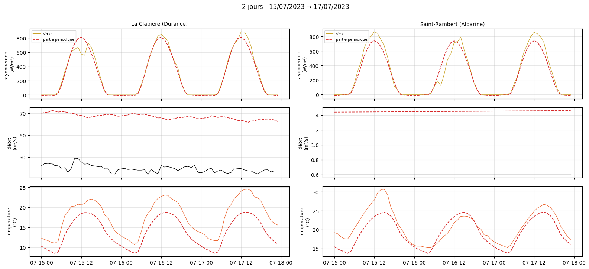
    

    
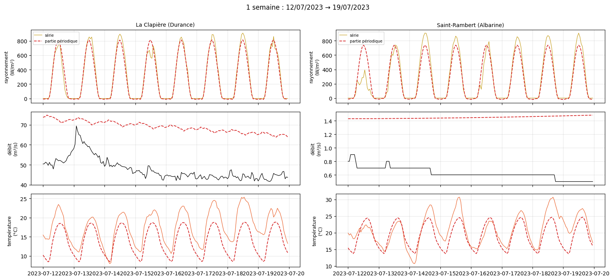
    

    
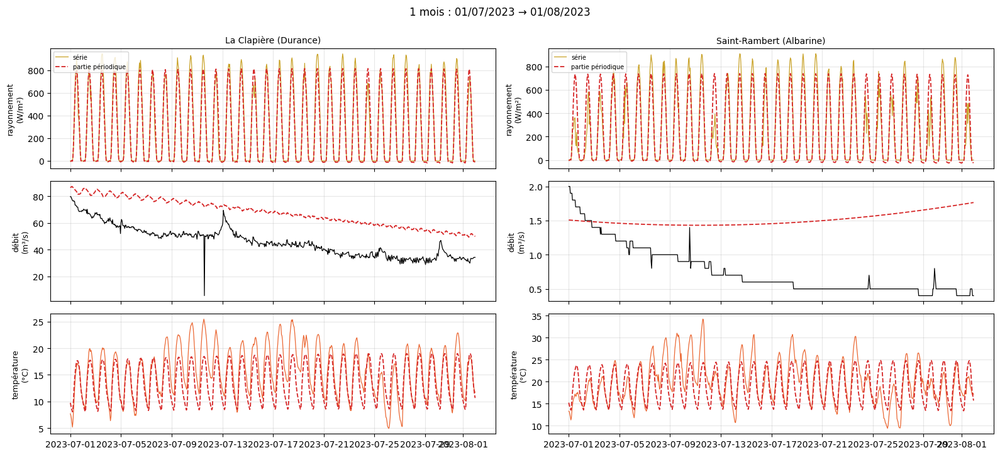
    

    
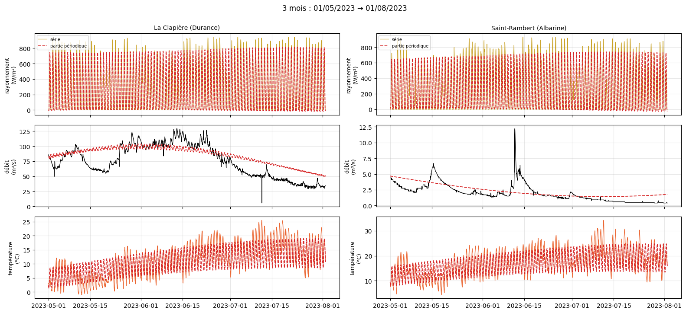
    

    
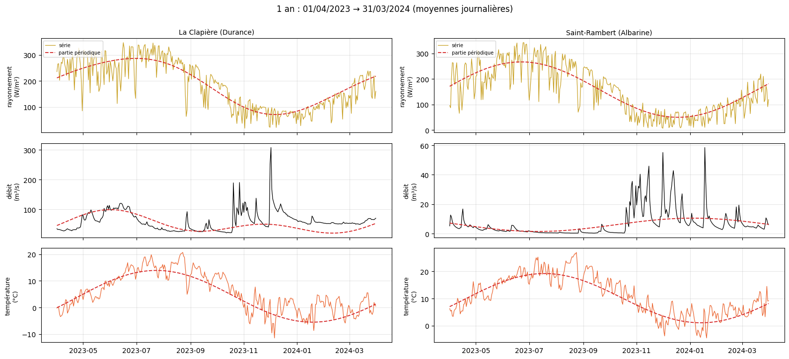
    

    
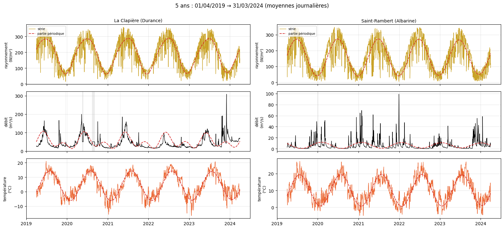
    

    
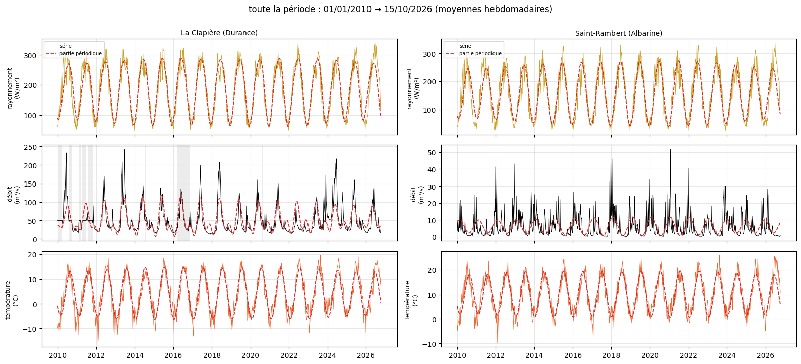
    

