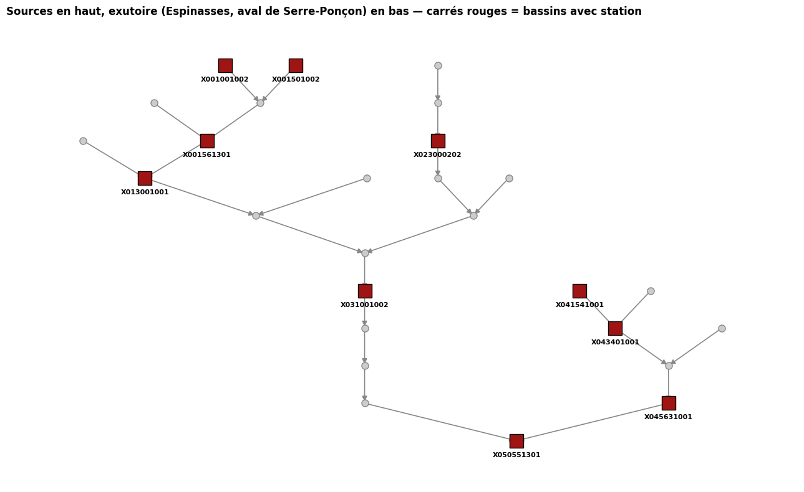

# 3.1 — L'arbre des bassins et les carreaux

Amont d'Espinasses (Durance, juste en aval du barrage de Serre-Ponçon) : stations, carte, arbre.

## 1. Réseau

Les 1,03 million de bassins du monde et leur arbre.

    1,034,083 bassins | 63,523 racines

## 2. Stations réelles (Hub'Eau), actives, vraiment dans le bassin

Élargi jusqu'à Espinasses [QNR Serre-Ponçon] (pas de station Hub'Eau exactement « à Talard » --
vérifié par nom et par commune, aucune) : le point de contrôle juste après le barrage/lac.
Ça inclut au passage tout l'Ubaye, qui se jette dans le lac.

    27 bassins en amont d'Espinasses
    13 stations actives trouvées, sur 5 cours d'eau différents

<table border="1" class="dataframe">
  <thead>
    <tr style="text-align: right;">
      <th></th>
      <th>code</th>
      <th>nom</th>
      <th>libelle_cours_eau</th>
      <th>surface_bv_km2</th>
    </tr>
  </thead>
  <tbody>
    <tr>
      <th>0</th>
      <td>X001001002</td>
      <td>La Durance à Val-des-Prés [Les Alberts]</td>
      <td>La Durance</td>
      <td>214.13</td>
    </tr>
    <tr>
      <th>1</th>
      <td>X001501002</td>
      <td>La Guisane au Monêtier-les-Bains [Le Casset] -...</td>
      <td>La Guisane</td>
      <td>90.15</td>
    </tr>
    <tr>
      <th>2</th>
      <td>X001561301</td>
      <td>La Durance à Briançon [aval] - aval - Station ...</td>
      <td>La Durance</td>
      <td>548.00</td>
    </tr>
    <tr>
      <th>3</th>
      <td>X013001001</td>
      <td>La Durance à l'Argentière-la-Bessée</td>
      <td>La Durance</td>
      <td>962.53</td>
    </tr>
    <tr>
      <th>4</th>
      <td>X023000202</td>
      <td>Le Guil à Château-Ville-Vieille [Pont de la Ch...</td>
      <td>Le Guil</td>
      <td>420.00</td>
    </tr>
    <tr>
      <th>5</th>
      <td>X031001001</td>
      <td>La Durance à Embrun [La Clapière]</td>
      <td>La Durance</td>
      <td>2174.81</td>
    </tr>
    <tr>
      <th>6</th>
      <td>X031001002</td>
      <td>La Durance à Embrun [La Clapière] - EDF</td>
      <td>La Durance</td>
      <td>2174.81</td>
    </tr>
    <tr>
      <th>7</th>
      <td>X041541001</td>
      <td>Le Riou Mounal à Saint-Paul-sur-Ubaye [Col de ...</td>
      <td>Riou Mounal</td>
      <td>3.00</td>
    </tr>
    <tr>
      <th>8</th>
      <td>X043401001</td>
      <td>L'Ubaye à Barcelonnette [Abattoir]</td>
      <td>L'Ubaye</td>
      <td>542.66</td>
    </tr>
    <tr>
      <th>9</th>
      <td>X045401001</td>
      <td>L'Ubaye au Lauzet-Ubaye [Roche-Rousse]</td>
      <td>L'Ubaye</td>
      <td>942.96</td>
    </tr>
    <tr>
      <th>10</th>
      <td>X045401002</td>
      <td>L'Ubaye au Lauzet-Ubaye [Roche-Rousse] - EDF</td>
      <td>L'Ubaye</td>
      <td>942.96</td>
    </tr>
    <tr>
      <th>11</th>
      <td>X045631001</td>
      <td>L'Ubaye au Lauzet-Ubaye [tunnel]</td>
      <td>L'Ubaye</td>
      <td>10.00</td>
    </tr>
    <tr>
      <th>12</th>
      <td>X050551301</td>
      <td>La Durance à Espinasses [QNR Serre-Ponçon] - EDF</td>
      <td>La Durance</td>
      <td>3580.00</td>
    </tr>
  </tbody>
</table>

Rattache chaque station à son bassin ; écart relatif entre la surface amont du bassin trouvé et la surface officielle Hub'Eau.

    stations hors de tout bassin : 0

<table border="1" class="dataframe">
  <thead>
    <tr style="text-align: right;">
      <th></th>
      <th>surface_officielle_km2</th>
      <th>surface_amont_bassin_km2</th>
      <th>ecart_surface</th>
    </tr>
    <tr>
      <th>code</th>
      <th></th>
      <th></th>
      <th></th>
    </tr>
  </thead>
  <tbody>
    <tr>
      <th>X001001002</th>
      <td>214.13</td>
      <td>222.2</td>
      <td>0.037687</td>
    </tr>
    <tr>
      <th>X001501002</th>
      <td>90.15</td>
      <td>197.4</td>
      <td>1.189684</td>
    </tr>
    <tr>
      <th>X001561301</th>
      <td>548.00</td>
      <td>652.9</td>
      <td>0.191423</td>
    </tr>
    <tr>
      <th>X013001001</th>
      <td>962.53</td>
      <td>996.2</td>
      <td>0.034981</td>
    </tr>
    <tr>
      <th>X023000202</th>
      <td>420.00</td>
      <td>448.3</td>
      <td>0.067381</td>
    </tr>
    <tr>
      <th>X031001001</th>
      <td>2174.81</td>
      <td>2272.6</td>
      <td>0.044965</td>
    </tr>
    <tr>
      <th>X031001002</th>
      <td>2174.81</td>
      <td>2272.6</td>
      <td>0.044965</td>
    </tr>
    <tr>
      <th>X041541001</th>
      <td>3.00</td>
      <td>201.9</td>
      <td>66.300000</td>
    </tr>
    <tr>
      <th>X043401001</th>
      <td>542.66</td>
      <td>556.2</td>
      <td>0.024951</td>
    </tr>
    <tr>
      <th>X045401001</th>
      <td>942.96</td>
      <td>1002.2</td>
      <td>0.062823</td>
    </tr>
    <tr>
      <th>X045401002</th>
      <td>942.96</td>
      <td>1002.2</td>
      <td>0.062823</td>
    </tr>
    <tr>
      <th>X045631001</th>
      <td>10.00</td>
      <td>1002.2</td>
      <td>99.220000</td>
    </tr>
    <tr>
      <th>X050551301</th>
      <td>3580.00</td>
      <td>3575.0</td>
      <td>-0.001397</td>
    </tr>
  </tbody>
</table>

## 3. Carte

Fond de relief (OpenTopoMap), une seule carte à couches à cocher.

    27

Au survol d'un bassin : surface, altitude min/moy/max, débit moyen sortant (modélisé par ATLAS, cumulé : tout l'amont compris), débit spécifique (débit / surface amont totale), ruissellement local (eau produite dans ce bassin seul), couverture neigeuse, précipitation moyenne, degré de régulation (barrages), surface glaciaire.

Couches météo (décochées par défaut) : pavage de Voronoï des carreaux Open-Meteo (`voronoi_meteo_amont`) -- au survol, la part de l'amont servie par chaque carreau -- et leurs centres. Centres calculés, 0 appel à Open-Meteo.

Make this Notebook Trusted to load map: File -> Trust Notebook<iframe srcdoc="&lt;!DOCTYPE html&gt;
&lt;html&gt;
&lt;head&gt;

    &lt;meta http-equiv=&quot;content-type&quot; content=&quot;text/html; charset=UTF-8&quot; /&gt;
    &lt;script src=&quot;https://cdn.jsdelivr.net/npm/leaflet@1.9.3/dist/leaflet.js&quot;&gt;&lt;/script&gt;
    &lt;script src=&quot;https://code.jquery.com/jquery-3.7.1.min.js&quot;&gt;&lt;/script&gt;
    &lt;script src=&quot;https://cdn.jsdelivr.net/npm/bootstrap@5.2.2/dist/js/bootstrap.bundle.min.js&quot;&gt;&lt;/script&gt;
    &lt;script src=&quot;https://cdnjs.cloudflare.com/ajax/libs/Leaflet.awesome-markers/2.0.2/leaflet.awesome-markers.js&quot;&gt;&lt;/script&gt;
    &lt;link rel=&quot;stylesheet&quot; href=&quot;https://cdn.jsdelivr.net/npm/leaflet@1.9.3/dist/leaflet.css&quot;/&gt;
    &lt;link rel=&quot;stylesheet&quot; href=&quot;https://cdn.jsdelivr.net/npm/bootstrap@5.2.2/dist/css/bootstrap.min.css&quot;/&gt;
    &lt;link rel=&quot;stylesheet&quot; href=&quot;https://netdna.bootstrapcdn.com/bootstrap/3.0.0/css/bootstrap-glyphicons.css&quot;/&gt;
    &lt;link rel=&quot;stylesheet&quot; href=&quot;https://cdn.jsdelivr.net/npm/@fortawesome/fontawesome-free@6.2.0/css/all.min.css&quot;/&gt;
    &lt;link rel=&quot;stylesheet&quot; href=&quot;https://cdnjs.cloudflare.com/ajax/libs/Leaflet.awesome-markers/2.0.2/leaflet.awesome-markers.css&quot;/&gt;
    &lt;link rel=&quot;stylesheet&quot; href=&quot;https://cdn.jsdelivr.net/gh/python-visualization/folium/folium/templates/leaflet.awesome.rotate.min.css&quot;/&gt;

            &lt;meta name=&quot;viewport&quot; content=&quot;width=device-width,
                initial-scale=1.0, maximum-scale=1.0, user-scalable=no&quot; /&gt;
            &lt;style&gt;
                #map_edc83604c6550a8e3df61fafffdbe3f7 {
                    position: relative;
                    width: 100.0%;
                    height: 100.0%;
                    left: 0.0%;
                    top: 0.0%;
                }
                .leaflet-container { font-size: 1rem; }
            &lt;/style&gt;

            &lt;style&gt;html, body {
                width: 100%;
                height: 100%;
                margin: 0;
                padding: 0;
            }
            &lt;/style&gt;

            &lt;style&gt;#map {
                position:absolute;
                top:0;
                bottom:0;
                right:0;
                left:0;
                }
            &lt;/style&gt;

            &lt;script&gt;
                L_NO_TOUCH = false;
                L_DISABLE_3D = false;
            &lt;/script&gt;

                    &lt;style&gt;
                        .foliumtooltip {

                        }
                       .foliumtooltip table{
                            margin: auto;
                        }
                        .foliumtooltip tr{
                            text-align: left;
                        }
                        .foliumtooltip th{
                            padding: 2px; padding-right: 8px;
                        }
                    &lt;/style&gt;

                    &lt;style&gt;
                        .foliumtooltip {

                        }
                       .foliumtooltip table{
                            margin: auto;
                        }
                        .foliumtooltip tr{
                            text-align: left;
                        }
                        .foliumtooltip th{
                            padding: 2px; padding-right: 8px;
                        }
                    &lt;/style&gt;

&lt;/head&gt;
&lt;body&gt;

            &lt;div class=&quot;folium-map&quot; id=&quot;map_edc83604c6550a8e3df61fafffdbe3f7&quot; &gt;&lt;/div&gt;

&lt;/body&gt;
&lt;script&gt;

    setTimeout(function() {
            map_edc83604c6550a8e3df61fafffdbe3f7.invalidateSize();
            map_edc83604c6550a8e3df61fafffdbe3f7.fitBounds([[44.254166666758294, 6.237500000224884], [45.10833333291703, 7.075000000349803]]);
        }, 250);

            var map_edc83604c6550a8e3df61fafffdbe3f7 = L.map(
                &quot;map_edc83604c6550a8e3df61fafffdbe3f7&quot;,
                {
                    center: [0.0, 0.0],
                    crs: L.CRS.EPSG3857,
                    ...{
  &quot;zoom&quot;: 1,
  &quot;zoomControl&quot;: true,
  &quot;preferCanvas&quot;: false,
}

                }
            );

            var tile_layer_a34a25165419b7d757223d18c63eb4e4 = L.tileLayer(
                &quot;https://{s}.tile.opentopomap.org/{z}/{x}/{y}.png&quot;,
                {
  &quot;minZoom&quot;: 0,
  &quot;maxZoom&quot;: 17,
  &quot;maxNativeZoom&quot;: 17,
  &quot;noWrap&quot;: false,
  &quot;attribution&quot;: &quot;OpenTopoMap (CC-BY-SA), donn\u00e9es SRTM/OSM&quot;,
  &quot;subdomains&quot;: &quot;abc&quot;,
  &quot;detectRetina&quot;: false,
  &quot;tms&quot;: false,
  &quot;opacity&quot;: 1,
}

            );

            tile_layer_a34a25165419b7d757223d18c63eb4e4.addTo(map_edc83604c6550a8e3df61fafffdbe3f7);

            map_edc83604c6550a8e3df61fafffdbe3f7.fitBounds(
                [[44.254166666758294, 6.237500000224884], [45.10833333291703, 7.075000000349803]],
                {}
            );

        function geo_json_66492e4cd0b5d8f55d0effcae537e25f_styler(feature) {
            switch(feature.id) {
                default:
                    return {&quot;color&quot;: &quot;#0d47a1&quot;, &quot;fillColor&quot;: &quot;#1f77b4&quot;, &quot;fillOpacity&quot;: 0.15, &quot;weight&quot;: 2};
            }
        }

        function geo_json_66492e4cd0b5d8f55d0effcae537e25f_onEachFeature(feature, layer) {

            layer.on({
            });
        };
        var geo_json_66492e4cd0b5d8f55d0effcae537e25f = L.geoJson(null, {
                onEachFeature: geo_json_66492e4cd0b5d8f55d0effcae537e25f_onEachFeature,

                style: geo_json_66492e4cd0b5d8f55d0effcae537e25f_styler,
            ...{
}
        });

        function geo_json_66492e4cd0b5d8f55d0effcae537e25f_add (data) {
            geo_json_66492e4cd0b5d8f55d0effcae537e25f
                .addData(data);
        }
            geo_json_66492e4cd0b5d8f55d0effcae537e25f_add({&quot;features&quot;: [{&quot;geometry&quot;: {&quot;coordinates&quot;: [[[[6.2833333331668655, 44.44166666638358], [6.2811228436443685, 44.44223395423364], [6.277210489672427, 44.44526604549168], [6.272789509728113, 44.44640062119174], [6.268877156655492, 44.44943271244978], [6.260289509753136, 44.4505672881499], [6.256377156680458, 44.45359937850856], [6.2477895097781015, 44.45473395420868], [6.24387715670548, 44.457766045466656], [6.238350931550315, 44.45918409556958], [6.237500000224884, 44.46250000027487], [6.237853325870333, 44.4732577850188], [6.241313340638214, 44.47674221458158], [6.242019992828432, 44.48159111893506], [6.257980007571348, 44.49757554757349], [6.258333333216797, 44.5083333332168], [6.268877156655492, 44.507766045366736], [6.272789509728113, 44.50473395410876], [6.277210489672427, 44.50359937840864], [6.289456176661247, 44.492233954133724], [6.2952258635828, 44.490753173620135], [6.295833333141843, 44.47500000024985], [6.295833333141843, 44.47083333329175], [6.292304314292721, 44.469927639548985], [6.291099379233003, 44.45195617683612], [6.283900621016869, 44.4438771568054], [6.2833333331668655, 44.44166666638358]]]], &quot;type&quot;: &quot;MultiPolygon&quot;}, &quot;id&quot;: &quot;0&quot;, &quot;properties&quot;: {&quot;HYBAS_ID&quot;: 2120562210.0, &quot;SUB_AREA&quot;: 22.6, &quot;UP_AREA&quot;: 3575.0, &quot;debit_specifique_L_s_km2&quot;: 14.4, &quot;dis_m3_pyr&quot;: 51.51, &quot;dor_pc_pva&quot;: 782, &quot;ele_mt_sav&quot;: 944, &quot;ele_mt_smn&quot;: 658, &quot;ele_mt_smx&quot;: 1533, &quot;gla_pc_sse&quot;: 0, &quot;pre_mm_syr&quot;: 852, &quot;run_mm_syr&quot;: 455, &quot;snw_pc_syr&quot;: 13}, &quot;type&quot;: &quot;Feature&quot;}, {&quot;geometry&quot;: {&quot;coordinates&quot;: [[[[6.300000000099999, 44.47500000024985], [6.295833333141843, 44.47500000024985], [6.2952258635828, 44.490753173620135], [6.289456176661247, 44.492233954133724], [6.277210489672427, 44.50359937840864], [6.272789509728113, 44.50473395410876], [6.268877156655492, 44.507766045366736], [6.258333333216797, 44.5083333332168], [6.251956176736201, 44.50890062106686], [6.248043823663579, 44.51193271232489], [6.242517598508414, 44.51335076242782], [6.241666666283663, 44.51666666623373], [6.242680867727927, 44.520035468162405], [6.2533401488288405, 44.521659681549124], [6.255002509658141, 44.532568698087005], [6.270142449714342, 44.53411288799941], [6.271476067866274, 44.568801540658626], [6.274357265475487, 44.5728651255252], [6.275642733925054, 44.57713487457488], [6.278523932433586, 44.581198459441396], [6.279166667108029, 44.583333333066946], [6.279519992753535, 44.58575778569332], [6.28298000752136, 44.58924221435677], [6.2833333331668655, 44.591666666983144], [6.286649067900214, 44.59251742923601], [6.287500000124965, 44.595833333041924], [6.287500000124965, 44.60416666695818], [6.291666667083064, 44.60416666695818], [6.299026997498004, 44.603511894858116], [6.307766045266817, 44.59387715650564], [6.3092207166627645, 44.58820834653801], [6.318877156555573, 44.586932712174985], [6.322789510527514, 44.58390062091695], [6.327210489572508, 44.582766045216886], [6.331122843544449, 44.57973395485817], [6.343877156505641, 44.57859937915805], [6.3477895104775826, 44.57556728790007], [6.35221048952252, 44.57443271219995], [6.356122843494461, 44.57140062094197], [6.360543823438775, 44.57026604524185], [6.376956176486431, 44.55473395490816], [6.382624816482121, 44.553279283512154], [6.38390062081703, 44.5436228436194], [6.3910993790331645, 44.535543823588625], [6.391666666883225, 44.52916666710803], [6.392019992528674, 44.51840888146478], [6.3996466742546545, 44.51075778494385], [6.399999999900103, 44.49166666628366], [6.355908881289906, 44.491313340638214], [6.352424451727131, 44.48785332587033], [6.343408881314872, 44.487146674579435], [6.339924451752097, 44.483686658912234], [6.322575548322959, 44.482980007621336], [6.319091118760184, 44.479519992853454], [6.305908881389826, 44.47881334066318], [6.302424451827051, 44.4753533258953], [6.300000000099999, 44.47500000024985]]]], &quot;type&quot;: &quot;MultiPolygon&quot;}, &quot;id&quot;: &quot;1&quot;, &quot;properties&quot;: {&quot;HYBAS_ID&quot;: 2120562000.0, &quot;SUB_AREA&quot;: 101.7, &quot;UP_AREA&quot;: 2550.1, &quot;debit_specifique_L_s_km2&quot;: 16.1, &quot;dis_m3_pyr&quot;: 40.99, &quot;dor_pc_pva&quot;: 0, &quot;ele_mt_sav&quot;: 1123, &quot;ele_mt_smn&quot;: 757, &quot;ele_mt_smx&quot;: 2451, &quot;gla_pc_sse&quot;: 0, &quot;pre_mm_syr&quot;: 912, &quot;run_mm_syr&quot;: 473, &quot;snw_pc_syr&quot;: 14}, &quot;type&quot;: &quot;Feature&quot;}, {&quot;geometry&quot;: {&quot;coordinates&quot;: [[[[6.391666666883225, 44.52916666710803], [6.3910993790331645, 44.535543823588625], [6.38390062081703, 44.5436228436194], [6.382624816482121, 44.553279283512154], [6.376956176486431, 44.55473395490816], [6.360543823438775, 44.57026604524185], [6.356122843494461, 44.57140062094197], [6.35221048952252, 44.57443271219995], [6.3477895104775826, 44.57556728790007], [6.343877156505641, 44.57859937915805], [6.331122843544449, 44.57973395485817], [6.327210489572508, 44.582766045216886], [6.322789510527514, 44.58390062091695], [6.318877156555573, 44.586932712174985], [6.3092207166627645, 44.58820834653801], [6.307766045266817, 44.59387715650564], [6.299026997498004, 44.603511894858116], [6.291666667083064, 44.60416666695818], [6.2920199927285125, 44.614924451702166], [6.299646674454493, 44.62257554822304], [6.300000000099999, 44.62499999995009], [6.302424451827051, 44.62535332559554], [6.305908881389826, 44.62881334126274], [6.314924451802085, 44.62951999255364], [6.318408881364803, 44.63298000732152], [6.323257785718283, 44.633686659511795], [6.3267422143817384, 44.63714667427962], [6.331623501523438, 44.63785807309165], [6.3371466743795395, 44.64340888121495], [6.337857734147178, 44.6482883031627], [6.347575548272971, 44.65798000727159], [6.352424451727131, 44.65868665946181], [6.356620449174443, 44.66285332552059], [6.364924451702109, 44.66214667422969], [6.37257554822304, 44.65451999250371], [6.377424451677143, 44.653813341212754], [6.3892422142568535, 44.642019992528674], [6.394091118610277, 44.641313341237776], [6.397575548173052, 44.637853325570575], [6.399999999900103, 44.637499999925126], [6.400713941994866, 44.6215721979986], [6.422955660975049, 44.62017788370241], [6.427044338725295, 44.61732211622274], [6.4323503280052705, 44.615683661172056], [6.43431633862815, 44.60931633877806], [6.4374999998252065, 44.60833333301696], [6.436894904476333, 44.60199381496267], [6.432728237518177, 44.596373833685504], [6.434163072567799, 44.58821614545877], [6.441666666783306, 44.587500000025045], [6.4420199924287544, 44.564242214406704], [6.453813341112834, 44.55242445182705], [6.45416666675834, 44.541666667083064], [6.454519992403789, 44.52257554752356], [6.45798000717167, 44.5190911188601], [6.458690897866688, 44.514212714045584], [6.4767422149813, 44.49618665888727], [6.499999999700265, 44.49583333324176], [6.502456834215593, 44.49547526007524], [6.507980007971014, 44.489924451951936], [6.5086866592619685, 44.47257554762348], [6.51214667402985, 44.46909111896002], [6.512853325320748, 44.4642422146066], [6.516313340987949, 44.460757785043825], [6.516666666633398, 44.45416666635862], [6.501742214931312, 44.45381334071317], [6.498257785368537, 44.45035332594529], [6.495833333641485, 44.45000000029984], [6.4936228432196685, 44.4505672881499], [6.489710490147047, 44.45359937850856], [6.468622843269657, 44.45473395420868], [6.45637715628078, 44.46609937848359], [6.439456176361489, 44.46723395418371], [6.435543823288867, 44.47026604544169], [6.4134092540339225, 44.47145690880933], [6.411932712025077, 44.47721048977235], [6.408900620767099, 44.48112284374429], [6.407766045066978, 44.485543823688545], [6.403770786192865, 44.49069892021902], [6.399999999900103, 44.49166666628366], [6.3996466742546545, 44.51075778494385], [6.392019992528674, 44.51840888146478], [6.391666666883225, 44.52916666710803]]]], &quot;type&quot;: &quot;MultiPolygon&quot;}, &quot;id&quot;: &quot;2&quot;, &quot;properties&quot;: {&quot;HYBAS_ID&quot;: 2121190240.0, &quot;SUB_AREA&quot;: 152.9, &quot;UP_AREA&quot;: 2448.5, &quot;debit_specifique_L_s_km2&quot;: 15.4, &quot;dis_m3_pyr&quot;: 37.63, &quot;dor_pc_pva&quot;: 0, &quot;ele_mt_sav&quot;: 1710, &quot;ele_mt_smn&quot;: 756, &quot;ele_mt_smx&quot;: 2863, &quot;gla_pc_sse&quot;: 0, &quot;pre_mm_syr&quot;: 1148, &quot;run_mm_syr&quot;: 475, &quot;snw_pc_syr&quot;: 30}, &quot;type&quot;: &quot;Feature&quot;}, {&quot;geometry&quot;: {&quot;coordinates&quot;: [[[[6.45416666675834, 44.541666667083064], [6.453813341112834, 44.55242445182705], [6.4420199924287544, 44.564242214406704], [6.441666666783306, 44.587500000025045], [6.448043823263902, 44.586932712174985], [6.451956176336523, 44.58390062091695], [6.457750448024797, 44.582413736704666], [6.466099378883257, 44.57304382351367], [6.467233954583378, 44.568622843569415], [6.470266045841413, 44.56471048959747], [6.471684265016847, 44.559184095369744], [6.478770786043015, 44.55736558705223], [6.4827660458163905, 44.55221048962244], [6.483333333666451, 44.5500000001], [6.48749999972523, 44.5500000001], [6.487853325370736, 44.54340888141479], [6.4913133410378805, 44.539924451852016], [6.492019992328835, 44.505908881489745], [6.499646674054816, 44.49825778496887], [6.499999999700265, 44.49583333324176], [6.4767422149813, 44.49618665888727], [6.458690897866688, 44.514212714045584], [6.45798000717167, 44.5190911188601], [6.454519992403789, 44.52257554752356], [6.45416666675834, 44.541666667083064]]]], &quot;type&quot;: &quot;MultiPolygon&quot;}, &quot;id&quot;: &quot;3&quot;, &quot;properties&quot;: {&quot;HYBAS_ID&quot;: 2121190070.0, &quot;SUB_AREA&quot;: 23.1, &quot;UP_AREA&quot;: 2295.9, &quot;debit_specifique_L_s_km2&quot;: 14.7, &quot;dis_m3_pyr&quot;: 33.73, &quot;dor_pc_pva&quot;: 0, &quot;ele_mt_sav&quot;: 1175, &quot;ele_mt_smn&quot;: 769, &quot;ele_mt_smx&quot;: 2329, &quot;gla_pc_sse&quot;: 0, &quot;pre_mm_syr&quot;: 904, &quot;run_mm_syr&quot;: 462, &quot;snw_pc_syr&quot;: 17}, &quot;type&quot;: &quot;Feature&quot;}, {&quot;geometry&quot;: {&quot;coordinates&quot;: [[[[6.516666666633398, 44.45416666635862], [6.516313340987949, 44.460757785043825], [6.512853325320748, 44.4642422146066], [6.51214667402985, 44.46909111896002], [6.5086866592619685, 44.47257554762348], [6.507980007971014, 44.489924451951936], [6.502456834215593, 44.49547526007524], [6.499999999700265, 44.49583333324176], [6.499646674054816, 44.49825778496887], [6.492019992328835, 44.505908881489745], [6.4913133410378805, 44.539924451852016], [6.487853325370736, 44.54340888141479], [6.48749999972523, 44.5500000001], [6.483333333666451, 44.5500000001], [6.4827660458163905, 44.55221048962244], [6.478770786043015, 44.55736558705223], [6.471684265016847, 44.559184095369744], [6.470266045841413, 44.56471048959747], [6.467233954583378, 44.568622843569415], [6.466099378883257, 44.57304382351367], [6.457750448024797, 44.582413736704666], [6.451956176336523, 44.58390062091695], [6.448043823263902, 44.586932712174985], [6.441666666783306, 44.587500000025045], [6.434163072567799, 44.58821614545877], [6.432728237518177, 44.596373833685504], [6.436894904476333, 44.60199381496267], [6.4374999998252065, 44.60833333301696], [6.439710490246966, 44.60890062086702], [6.443622843319588, 44.611932712125], [6.448043823263902, 44.61306728782512], [6.461511908347916, 44.62556728780015], [6.473043823213914, 44.62443271210003], [6.4865119082979845, 44.611932712125], [6.489710490147047, 44.61306728782512], [6.495086669714112, 44.61723395478322], [6.502210490122081, 44.61609937908315], [6.511562771204979, 44.6077660451669], [6.532425096541033, 44.60896063892238], [6.534242587725316, 44.61604309051626], [6.545833333541566, 44.61666666693321], [6.548043823064006, 44.61609937908315], [6.552083333079395, 44.61296861421022], [6.557196214533747, 44.61693115215098], [6.558900621366604, 44.61028951045262], [6.570266045641517, 44.59804382346374], [6.571400621341638, 44.59362284351948], [6.574432711700354, 44.589710489547485], [6.575702921352786, 44.58009575751328], [6.585289510002951, 44.57140062094197], [6.641666666383571, 44.57083333309191], [6.644982401116977, 44.569982570839045], [6.646753099675834, 44.56308288576662], [6.6561228437942646, 44.55473395490816], [6.664710489797301, 44.55359937920804], [6.668622843769299, 44.55056728795006], [6.674604119584501, 44.54903225403535], [6.678599378458614, 44.54387715660556], [6.679166666308674, 44.537500000124965], [6.678813340663169, 44.52257554752356], [6.670847235911253, 44.514584011742784], [6.674985419541542, 44.510416666695846], [6.671186658937188, 44.50659111888507], [6.670833333291739, 44.50000000019992], [6.664242214606588, 44.49964667455441], [6.660757785043813, 44.49618665888727], [6.651742214631554, 44.49548000759631], [6.642024400505704, 44.48578830258816], [6.641313340738122, 44.480908881539676], [6.637853325970241, 44.47742445197696], [6.637146674679343, 44.460075547648444], [6.633686659012142, 44.45659111898499], [6.633333333366693, 44.45000000029984], [6.597789509977929, 44.44943271244978], [6.593877156905307, 44.44640062119174], [6.586753336497338, 44.44526604549168], [6.581377156930273, 44.44943271244978], [6.51758558490684, 44.45058593739117], [6.516666666633398, 44.45416666635862]]]], &quot;type&quot;: &quot;MultiPolygon&quot;}, &quot;id&quot;: &quot;4&quot;, &quot;properties&quot;: {&quot;HYBAS_ID&quot;: 2121189970.0, &quot;SUB_AREA&quot;: 222.1, &quot;UP_AREA&quot;: 2272.6, &quot;debit_specifique_L_s_km2&quot;: 14.4, &quot;dis_m3_pyr&quot;: 32.7, &quot;dor_pc_pva&quot;: 0, &quot;ele_mt_sav&quot;: 1815, &quot;ele_mt_smn&quot;: 785, &quot;ele_mt_smx&quot;: 2882, &quot;gla_pc_sse&quot;: 0, &quot;pre_mm_syr&quot;: 1177, &quot;run_mm_syr&quot;: 451, &quot;snw_pc_syr&quot;: 32}, &quot;type&quot;: &quot;Feature&quot;}, {&quot;geometry&quot;: {&quot;coordinates&quot;: [[[[6.641666666383571, 44.57083333309191], [6.585289510002951, 44.57140062094197], [6.575702921352786, 44.58009575751328], [6.574432711700354, 44.589710489547485], [6.571400621341638, 44.59362284351948], [6.570266045641517, 44.59804382346374], [6.558900621366604, 44.61028951045262], [6.557196214533747, 44.61693115215098], [6.552083333079395, 44.61296861421022], [6.548043823064006, 44.61609937908315], [6.545833333541566, 44.61666666693321], [6.534242587725316, 44.61604309051626], [6.532425096541033, 44.60896063892238], [6.511562771204979, 44.6077660451669], [6.502210490122081, 44.61609937908315], [6.495086669714112, 44.61723395478322], [6.489710490147047, 44.61306728782512], [6.4865119082979845, 44.611932712125], [6.473043823213914, 44.62443271210003], [6.461511908347916, 44.62556728780015], [6.448043823263902, 44.61306728782512], [6.443622843319588, 44.611932712125], [6.439710490246966, 44.60890062086702], [6.4374999998252065, 44.60833333301696], [6.43431633862815, 44.60931633877806], [6.4323503280052705, 44.615683661172056], [6.427044338725295, 44.61732211622274], [6.422955660975049, 44.62017788370241], [6.400713941994866, 44.6215721979986], [6.399999999900103, 44.637499999925126], [6.403315734633509, 44.63835076217799], [6.40473395470832, 44.64387715640572], [6.421510484621194, 44.66160447836404], [6.428315734583521, 44.663350762128005], [6.429733954658332, 44.668877156355734], [6.43276604501699, 44.672789510327675], [6.433900621616431, 44.67721049027199], [6.436932711975146, 44.68112284334461], [6.4374999998252065, 44.68333333376637], [6.441666666783306, 44.68333333376637], [6.457420010125418, 44.683940972398034], [6.459301079781028, 44.691270616146085], [6.4644561763115576, 44.695266045891344], [6.4688771562558145, 44.696400621591465], [6.472789510227756, 44.699432711950124], [6.489710490147047, 44.700567287650244], [6.4936228432196685, 44.70359937890828], [6.504166666658364, 44.70416666675834], [6.5051344127230095, 44.700396050437405], [6.510289510152802, 44.696400621591465], [6.514710490097116, 44.695266045891344], [6.518622843169737, 44.692233954633366], [6.528247240218036, 44.69096238880326], [6.532766045716471, 44.68554382328887], [6.5342207171124755, 44.67987501332124], [6.543877157005227, 44.67859937895821], [6.549253336572292, 44.67443271200011], [6.5688771569552955, 44.67556728770023], [6.574253336522304, 44.67973395465833], [6.589710489947208, 44.67859937895821], [6.59362284301983, 44.67556728770023], [6.598043822964087, 44.67443271200011], [6.601956176936085, 44.67140062164145], [6.608333333416624, 44.67083333289207], [6.61250000037478, 44.67083333289207], [6.611844550185879, 44.64787767181713], [6.599344550210844, 44.63400065060961], [6.600743442056228, 44.61323682981589], [6.61250000037478, 44.61249999997506], [6.614672682398407, 44.61189507369875], [6.62699398438491, 44.60060492627639], [6.63550601539032, 44.59939507372371], [6.6394939843599445, 44.59643825931829], [6.649215189829192, 44.595056491463936], [6.650443861594965, 44.58674180768833], [6.646438428690601, 44.58133951810436], [6.645228237992853, 44.5769938150126], [6.642271762631765, 44.57300618508742], [6.641666666383571, 44.57083333309191]]]], &quot;type&quot;: &quot;MultiPolygon&quot;}, &quot;id&quot;: &quot;5&quot;, &quot;properties&quot;: {&quot;HYBAS_ID&quot;: 2121189410.0, &quot;SUB_AREA&quot;: 144.3, &quot;UP_AREA&quot;: 2050.7, &quot;debit_specifique_L_s_km2&quot;: 14.4, &quot;dis_m3_pyr&quot;: 29.55, &quot;dor_pc_pva&quot;: 0, &quot;ele_mt_sav&quot;: 1897, &quot;ele_mt_smn&quot;: 851, &quot;ele_mt_smx&quot;: 2973, &quot;gla_pc_sse&quot;: 0, &quot;pre_mm_syr&quot;: 1236, &quot;run_mm_syr&quot;: 466, &quot;snw_pc_syr&quot;: 33}, &quot;type&quot;: &quot;Feature&quot;}, {&quot;geometry&quot;: {&quot;coordinates&quot;: [[[[6.608333333416624, 44.67083333289207], [6.601956176936085, 44.67140062164145], [6.598043822964087, 44.67443271200011], [6.59362284301983, 44.67556728770023], [6.589710489947208, 44.67859937895821], [6.574253336522304, 44.67973395465833], [6.5688771569552955, 44.67556728770023], [6.549253336572292, 44.67443271200011], [6.543877157005227, 44.67859937895821], [6.5342207171124755, 44.67987501332124], [6.532766045716471, 44.68554382328887], [6.528247240218036, 44.69096238880326], [6.518622843169737, 44.692233954633366], [6.514710490097116, 44.695266045891344], [6.510289510152802, 44.696400621591465], [6.5051344127230095, 44.700396050437405], [6.504166666658364, 44.70416666675834], [6.51575741247467, 44.70479024227592], [6.5172339544834585, 44.71054382323888], [6.521843295631641, 44.71607089555545], [6.5605438230390405, 44.71723395458338], [6.574184672384774, 44.729994032198874], [6.575567288299737, 44.736285061506464], [6.570833333491578, 44.73749999972529], [6.570833333491578, 44.741666666683386], [6.579166666508513, 44.741666666683386], [6.581591119134885, 44.742019992328835], [6.585787116582196, 44.746186659286934], [6.602424452126797, 44.745480007996036], [6.606249999937575, 44.74168124739168], [6.610075547748352, 44.745480007996036], [6.614924452101832, 44.746186659286934], [6.618408881664607, 44.749646674054816], [6.627424452076866, 44.75035332534571], [6.630908881639641, 44.753813341012915], [6.64409111901, 44.75451999230387], [6.647575547673455, 44.75798000797107], [6.652424452026878, 44.75868665926197], [6.655908881589653, 44.76214667402985], [6.664924452001912, 44.76285332532075], [6.668408881564687, 44.76631334098795], [6.673257785018791, 44.76701999227885], [6.680908881539722, 44.77464667400483], [6.6833333332667735, 44.77499999965033], [6.683686658912222, 44.772575547923225], [6.691313340638203, 44.76492445230167], [6.691666666283652, 44.75416666665842], [6.6910993784335915, 44.751956177135924], [6.683900621116834, 44.743877156205826], [6.682672119322888, 44.73006625675242], [6.676956176786177, 44.72859937885829], [6.673043822814236, 44.72556728760031], [6.668622843769299, 44.72443271190019], [6.664710489797301, 44.72140062154148], [6.662500000274861, 44.72083333369147], [6.660289509853044, 44.72140062154148], [6.656377156780422, 44.72443271190019], [6.644896104871407, 44.72556728760031], [6.634253098801537, 44.71608378104173], [6.632766045516632, 44.71028951025272], [6.629733954258654, 44.70637715628078], [6.628599378558533, 44.70195617633652], [6.620250447700073, 44.692586263145586], [6.613161214318609, 44.690767075839915], [6.611838785531575, 44.675899590793506], [6.608333333416624, 44.67499999985017], [6.608333333416624, 44.67083333289207]]]], &quot;type&quot;: &quot;MultiPolygon&quot;}, &quot;id&quot;: &quot;6&quot;, &quot;properties&quot;: {&quot;HYBAS_ID&quot;: 2120558760.0, &quot;SUB_AREA&quot;: 70.6, &quot;UP_AREA&quot;: 1171.7, &quot;debit_specifique_L_s_km2&quot;: 14.6, &quot;dis_m3_pyr&quot;: 17.12, &quot;dor_pc_pva&quot;: 0, &quot;ele_mt_sav&quot;: 1745, &quot;ele_mt_smn&quot;: 884, &quot;ele_mt_smx&quot;: 2848, &quot;gla_pc_sse&quot;: 0, &quot;pre_mm_syr&quot;: 1181, &quot;run_mm_syr&quot;: 455, &quot;snw_pc_syr&quot;: 27}, &quot;type&quot;: &quot;Feature&quot;}, {&quot;geometry&quot;: {&quot;coordinates&quot;: [[[[6.579166666508513, 44.741666666683386], [6.570833333491578, 44.741666666683386], [6.570266045641517, 44.743877156205826], [6.567233954383539, 44.747789510177824], [6.565815735208048, 44.7533159044055], [6.560289510052883, 44.754733954508424], [6.556377156980261, 44.75776604576646], [6.551956177036004, 44.75890062146658], [6.548043823064006, 44.76193271182524], [6.543622843119749, 44.76306728752536], [6.539710490047128, 44.76609937878334], [6.535289510102871, 44.76723395448346], [6.527210490072093, 44.77443271180027], [6.520086669664124, 44.775567287500394], [6.514710490097116, 44.77140062144156], [6.4977895101778245, 44.770266045741494], [6.493877156205826, 44.76723395448346], [6.486753336697177, 44.76609937878334], [6.481377156230849, 44.770266045741494], [6.474253336722143, 44.77140062144156], [6.4688771562558145, 44.76723395448346], [6.456122843294622, 44.76609937878334], [6.452210490222001, 44.76306728752536], [6.414456176411477, 44.76193271182524], [6.410543823338799, 44.75890062146658], [6.358333333016958, 44.75833333361652], [6.357980007371509, 44.76492445230167], [6.3545199926036275, 44.768408880965126], [6.354166666958179, 44.77499999965033], [6.369091118660265, 44.77535332529578], [6.380908881239918, 44.78714667397986], [6.385757785593398, 44.787853326170136], [6.3892422142568535, 44.79131334093796], [6.394091118610277, 44.792019992228916], [6.402451069761128, 44.800353326145114], [6.41075778554341, 44.799646673954896], [6.414953782990722, 44.79548000789612], [6.435757785493479, 44.796186659187015], [6.439242215056254, 44.799646673954896], [6.452424452426612, 44.800353326145114], [6.455908881090011, 44.803813340912995], [6.485757785393503, 44.80451999220395], [6.489953782840871, 44.80868665916205], [6.502424452326636, 44.807980007871095], [6.5066204497740046, 44.803813340912995], [6.535757785293583, 44.80451999220395], [6.539953782740952, 44.80868665916205], [6.548257785268618, 44.807980007871095], [6.551742214831393, 44.80451999220395], [6.56249999957538, 44.804166666558444], [6.566666666533479, 44.804166666558444], [6.5676344125981245, 44.800396050237566], [6.572789510027917, 44.796400621391626], [6.581377156930273, 44.795266045691505], [6.590729438013227, 44.78693271177531], [6.606377156880342, 44.78806728747537], [6.628141445571316, 44.80890062136666], [6.631377156830354, 44.80776604566654], [6.635289509903032, 44.804733954408505], [6.641270785718234, 44.803198920493855], [6.645266045491667, 44.79804382306406], [6.646750386421218, 44.79225938546233], [6.670833333291739, 44.79166666658347], [6.671494547235625, 44.7842329236106], [6.67877078564328, 44.782365586602566], [6.682766045416713, 44.77721049007209], [6.6833333332667735, 44.77499999965033], [6.680908881539722, 44.77464667400483], [6.673257785018791, 44.76701999227885], [6.668408881564687, 44.76631334098795], [6.664924452001912, 44.76285332532075], [6.655908881589653, 44.76214667402985], [6.652424452026878, 44.75868665926197], [6.647575547673455, 44.75798000797107], [6.64409111901, 44.75451999230387], [6.630908881639641, 44.753813341012915], [6.627424452076866, 44.75035332534571], [6.618408881664607, 44.749646674054816], [6.614924452101832, 44.746186659286934], [6.610075547748352, 44.745480007996036], [6.606249999937575, 44.74168124739168], [6.602424452126797, 44.745480007996036], [6.585787116582196, 44.746186659286934], [6.581591119134885, 44.742019992328835], [6.579166666508513, 44.741666666683386]]]], &quot;type&quot;: &quot;MultiPolygon&quot;}, &quot;id&quot;: &quot;7&quot;, &quot;properties&quot;: {&quot;HYBAS_ID&quot;: 2120557240.0, &quot;SUB_AREA&quot;: 106.7, &quot;UP_AREA&quot;: 996.2, &quot;debit_specifique_L_s_km2&quot;: 14.7, &quot;dis_m3_pyr&quot;: 14.64, &quot;dor_pc_pva&quot;: 0, &quot;ele_mt_sav&quot;: 1980, &quot;ele_mt_smn&quot;: 930, &quot;ele_mt_smx&quot;: 3166, &quot;gla_pc_sse&quot;: 0, &quot;pre_mm_syr&quot;: 1303, &quot;run_mm_syr&quot;: 474, &quot;snw_pc_syr&quot;: 35}, &quot;type&quot;: &quot;Feature&quot;}, {&quot;geometry&quot;: {&quot;coordinates&quot;: [[[[6.358333333016958, 44.91250000027486], [6.358686658662407, 44.92325778501879], [6.362146674329608, 44.926742214581566], [6.362499999975057, 44.93333333326677], [6.364924451702109, 44.93368665891222], [6.385783047549637, 44.954519992803455], [6.394091118610277, 44.95381334061324], [6.397575548173052, 44.950353325845356], [6.412499999875138, 44.95000000019991], [6.432209269342366, 44.94944831019143], [6.436970520373279, 44.94391479513172], [6.438258531206316, 44.93844604474924], [6.4435850358207745, 44.93386298269053], [6.448081630762715, 44.93280368384296], [6.457250298162762, 44.924470350826084], [6.464748297695849, 44.92552964967365], [6.472751701829623, 44.93280368384296], [6.477248297670826, 44.93386298269053], [6.482392543880849, 44.93802964964868], [6.49391496460396, 44.93697035080112], [6.499059210813982, 44.93280368384296], [6.502248297620895, 44.93386298269053], [6.507392543830861, 44.93802964964868], [6.511852349306537, 44.93654853009065], [6.513029480026546, 44.92691853835993], [6.520303853240307, 44.918914795181706], [6.521591864972663, 44.91344604479917], [6.526918368687802, 44.908862982740516], [6.5291666666084325, 44.908333333316705], [6.528599378758372, 44.901956176836165], [6.5212873671183615, 44.89374999986268], [6.528599378758372, 44.88554382288919], [6.529733954458493, 44.8769561768861], [6.532766045716471, 44.873043822914155], [6.533989291872388, 44.85929328056051], [6.53945617706097, 44.854733954308585], [6.545250447849924, 44.853247070096245], [6.553599378708384, 44.84387715690531], [6.554733954408505, 44.83945617696105], [6.561932711725319, 44.83137715693027], [6.56306728742544, 44.82278951002792], [6.567233954383539, 44.81741333046091], [6.565927971498752, 44.809212918141725], [6.56249999957538, 44.8083333335166], [6.56249999957538, 44.804166666558444], [6.551742214831393, 44.80451999220395], [6.548257785268618, 44.807980007871095], [6.539953782740952, 44.80868665916205], [6.535757785293583, 44.80451999220395], [6.5066204497740046, 44.803813340912995], [6.502424452326636, 44.807980007871095], [6.489953782840871, 44.80868665916205], [6.485757785393503, 44.80451999220395], [6.455908881090011, 44.803813340912995], [6.452424452426612, 44.800353326145114], [6.439242215056254, 44.799646673954896], [6.435757785493479, 44.796186659187015], [6.414953782990722, 44.79548000789612], [6.41075778554341, 44.799646673954896], [6.402451069761128, 44.800353326145114], [6.394091118610277, 44.792019992228916], [6.3892422142568535, 44.79131334093796], [6.385757785593398, 44.787853326170136], [6.380908881239918, 44.78714667397986], [6.369091118660265, 44.77535332529578], [6.354166666958179, 44.77499999965033], [6.351956176536362, 44.775567287500394], [6.346537611021972, 44.78008626297071], [6.345124816557075, 44.79077928303752], [6.341666666983144, 44.79166666658347], [6.340815734758394, 44.7949825712887], [6.337500000025045, 44.795833333541566], [6.337853325670494, 44.79825778526862], [6.341313341337695, 44.80174221483139], [6.341666666983144, 44.81249999957538], [6.342233954833205, 44.814710489997196], [6.346097988231634, 44.8196960445369], [6.3394561765613275, 44.82140062134164], [6.333923848606787, 44.82601454003907], [6.333333333066889, 44.850000000399746], [6.343877156505641, 44.850567288249806], [6.3477895104775826, 44.853599378608465], [6.353315734733428, 44.85501742871139], [6.354166666958179, 44.85833333341668], [6.358597988206611, 44.85947062147204], [6.354733954808239, 44.86445617691106], [6.353599379108118, 44.87991333033597], [6.357766045166898, 44.88528950990303], [6.3589006208670185, 44.892413330311], [6.354635450265846, 44.89791666682078], [6.357766045166898, 44.901956176836165], [6.358333333016958, 44.91250000027486]]]], &quot;type&quot;: &quot;MultiPolygon&quot;}, &quot;id&quot;: &quot;8&quot;, &quot;properties&quot;: {&quot;HYBAS_ID&quot;: 2120556240.0, &quot;SUB_AREA&quot;: 236.6, &quot;UP_AREA&quot;: 236.6, &quot;debit_specifique_L_s_km2&quot;: 16.5, &quot;dis_m3_pyr&quot;: 3.9, &quot;dor_pc_pva&quot;: 0, &quot;ele_mt_sav&quot;: 2294, &quot;ele_mt_smn&quot;: 1017, &quot;ele_mt_smx&quot;: 3899, &quot;gla_pc_sse&quot;: 8, &quot;pre_mm_syr&quot;: 1475, &quot;run_mm_syr&quot;: 493, &quot;snw_pc_syr&quot;: 44}, &quot;type&quot;: &quot;Feature&quot;}, {&quot;geometry&quot;: {&quot;coordinates&quot;: [[[[6.566666666533479, 44.804166666558444], [6.56249999957538, 44.804166666558444], [6.56249999957538, 44.8083333335166], [6.565927971498752, 44.809212918141725], [6.567233954383539, 44.81741333046091], [6.56306728742544, 44.82278951002792], [6.561932711725319, 44.83137715693027], [6.554733954408505, 44.83945617696105], [6.553599378708384, 44.84387715690531], [6.545250447849924, 44.853247070096245], [6.53945617706097, 44.854733954308585], [6.533989291872388, 44.85929328056051], [6.532766045716471, 44.873043822914155], [6.529733954458493, 44.8769561768861], [6.528599378758372, 44.88554382288919], [6.5212873671183615, 44.89374999986268], [6.528599378758372, 44.901956176836165], [6.5291666666084325, 44.908333333316705], [6.548257785268618, 44.90868665896221], [6.552083333079395, 44.91248541956651], [6.555908880890172, 44.90868665896221], [6.560757785243652, 44.907980007671256], [6.564242214806427, 44.904519992004055], [6.581591119134885, 44.90381334071316], [6.58507554779834, 44.900353325945275], [6.598257785168698, 44.89964667465438], [6.601742214731473, 44.896186658987176], [6.629166666408594, 44.89583333334173], [6.629166666408594, 44.89166666638363], [6.629166666408594, 44.88750000032479], [6.629938083275988, 44.87993808327599], [6.643801709981005, 44.87852376266159], [6.647864956702449, 44.8756429031975], [6.652135043897204, 44.87435709660281], [6.660364956677483, 44.867309570180566], [6.666690233067868, 44.86540493469005], [6.670190599516616, 44.860468207042175], [6.672042676828141, 44.8543165420748], [6.681198289669396, 44.846476237188654], [6.686535813676926, 44.844868977821136], [6.688142733999996, 44.839531792858], [6.691023932508529, 44.83546820709216], [6.692309400958152, 44.822865125924864], [6.695190599466628, 44.81880154105835], [6.695833333241808, 44.81666666653348], [6.693408881514699, 44.81631334088803], [6.689924451951924, 44.81285332612015], [6.685075547598501, 44.81214667392993], [6.6753577334726515, 44.80245496982104], [6.674646674604389, 44.79757554787329], [6.671186658937188, 44.79409111831052], [6.670833333291739, 44.79166666658347], [6.646750386421218, 44.79225938546233], [6.645266045491667, 44.79804382306406], [6.641270785718234, 44.803198920493855], [6.635289509903032, 44.804733954408505], [6.631377156830354, 44.80776604566654], [6.628141445571316, 44.80890062136666], [6.606377156880342, 44.78806728747537], [6.590729438013227, 44.78693271177531], [6.581377156930273, 44.795266045691505], [6.572789510027917, 44.796400621391626], [6.5676344125981245, 44.800396050237566], [6.566666666533479, 44.804166666558444]]]], &quot;type&quot;: &quot;MultiPolygon&quot;}, &quot;id&quot;: &quot;9&quot;, &quot;properties&quot;: {&quot;HYBAS_ID&quot;: 2120556250.0, &quot;SUB_AREA&quot;: 113.6, &quot;UP_AREA&quot;: 652.9, &quot;debit_specifique_L_s_km2&quot;: 14.2, &quot;dis_m3_pyr&quot;: 9.27, &quot;dor_pc_pva&quot;: 0, &quot;ele_mt_sav&quot;: 1933, &quot;ele_mt_smn&quot;: 1036, &quot;ele_mt_smx&quot;: 2811, &quot;gla_pc_sse&quot;: 0, &quot;pre_mm_syr&quot;: 1287, &quot;run_mm_syr&quot;: 458, &quot;snw_pc_syr&quot;: 33}, &quot;type&quot;: &quot;Feature&quot;}, {&quot;geometry&quot;: {&quot;coordinates&quot;: [[[[6.820833332991981, 44.81249999957538], [6.814242214306773, 44.81285332612015], [6.810757785643318, 44.81631334088803], [6.79757554827296, 44.81701999217893], [6.794091118710185, 44.82048000784613], [6.7774537831655834, 44.82118665913708], [6.773257785718272, 44.81701999217893], [6.768408881364849, 44.81631334088803], [6.764924451802074, 44.81285332612015], [6.752451069960955, 44.81214667392993], [6.744091118810161, 44.82048000784613], [6.731620449324339, 44.82118665913708], [6.727424451877027, 44.81701999217893], [6.7149537823912056, 44.81631334088803], [6.710757784943894, 44.82048000784613], [6.70662044937427, 44.82118665913708], [6.702424451926959, 44.81701999217893], [6.695833333241808, 44.81666666653348], [6.695190599466628, 44.81880154105835], [6.692309400958152, 44.822865125924864], [6.691023932508529, 44.83546820709216], [6.688142733999996, 44.839531792858], [6.686535813676926, 44.844868977821136], [6.681198289669396, 44.846476237188654], [6.672042676828141, 44.8543165420748], [6.670190599516616, 44.860468207042175], [6.666690233067868, 44.86540493469005], [6.660364956677483, 44.867309570180566], [6.652135043897204, 44.87435709660281], [6.647864956702449, 44.8756429031975], [6.643801709981005, 44.87852376266159], [6.629938083275988, 44.87993808327599], [6.629166666408594, 44.88750000032479], [6.629166666408594, 44.89166666638363], [6.633333333366693, 44.89166666638363], [6.637500000324792, 44.89166666638363], [6.677210489772335, 44.89223395423363], [6.6811228437442765, 44.89526604549167], [6.727210489672416, 44.89640062119179], [6.731122843644357, 44.899432712449766], [6.740779283537165, 44.90070834681279], [6.741666667083052, 44.904166666358606], [6.744091118810161, 44.904519992004055], [6.7482871162574725, 44.90868665896221], [6.752424451827039, 44.907980007671256], [6.76078440387721, 44.89964667465438], [6.769091118760173, 44.900353325945275], [6.772575548322948, 44.90381334071316], [6.7750000000499995, 44.904166666358606], [6.777160135631789, 44.90354919453972], [6.789506530502024, 44.892284139101776], [6.799205864459111, 44.89087253174199], [6.800861443500878, 44.87949761242493], [6.806173197435157, 44.87561747216864], [6.810493469498056, 44.87438252763161], [6.814506530452093, 44.87145080610986], [6.828180440674828, 44.87011616992538], [6.8300930450580495, 44.863426377625274], [6.835493469448124, 44.861882527656576], [6.8395065304021045, 44.85895080523551], [6.852160305453765, 44.85771586069848], [6.86033969432151, 44.85061747221863], [6.87916666680826, 44.850000000399746], [6.87916666680826, 44.84583333344165], [6.878813341162811, 44.843408881714595], [6.87118665943683, 44.835757785193664], [6.870475260624801, 44.83087632897946], [6.864924451602235, 44.82535332609518], [6.862499999875126, 44.825000000449734], [6.839242214256842, 44.82464667390491], [6.827424451677132, 44.81285332612015], [6.820833332991981, 44.81249999957538]]]], &quot;type&quot;: &quot;MultiPolygon&quot;}, &quot;id&quot;: &quot;10&quot;, &quot;properties&quot;: {&quot;HYBAS_ID&quot;: 2120554470.0, &quot;SUB_AREA&quot;: 119.7, &quot;UP_AREA&quot;: 119.7, &quot;debit_specifique_L_s_km2&quot;: 14.2, &quot;dis_m3_pyr&quot;: 1.7, &quot;dor_pc_pva&quot;: 0, &quot;ele_mt_sav&quot;: 2252, &quot;ele_mt_smn&quot;: 1201, &quot;ele_mt_smx&quot;: 3116, &quot;gla_pc_sse&quot;: 0, &quot;pre_mm_syr&quot;: 1432, &quot;run_mm_syr&quot;: 459, &quot;snw_pc_syr&quot;: 44}, &quot;type&quot;: &quot;Feature&quot;}, {&quot;geometry&quot;: {&quot;coordinates&quot;: [[[[6.633333333366693, 44.89166666638363], [6.629166666408594, 44.89166666638363], [6.629166666408594, 44.89583333334173], [6.633333333366693, 44.89583333334173], [6.633333333366693, 44.89166666638363]]]], &quot;type&quot;: &quot;MultiPolygon&quot;}, &quot;id&quot;: &quot;11&quot;, &quot;properties&quot;: {&quot;HYBAS_ID&quot;: 2120554390.0, &quot;SUB_AREA&quot;: 0.2, &quot;UP_AREA&quot;: 419.8, &quot;debit_specifique_L_s_km2&quot;: 14.5, &quot;dis_m3_pyr&quot;: 6.07, &quot;dor_pc_pva&quot;: 0, &quot;ele_mt_sav&quot;: 1202, &quot;ele_mt_smn&quot;: 1202, &quot;ele_mt_smx&quot;: 1202, &quot;gla_pc_sse&quot;: 0, &quot;pre_mm_syr&quot;: 957, &quot;run_mm_syr&quot;: 456, &quot;snw_pc_syr&quot;: 19}, &quot;type&quot;: &quot;Feature&quot;}, {&quot;geometry&quot;: {&quot;coordinates&quot;: [[[[6.637500000324792, 44.89166666638363], [6.633333333366693, 44.89166666638363], [6.633333333366693, 44.89583333334173], [6.633333333366693, 44.900000000299826], [6.635493468948482, 44.90061747211871], [6.6405078467597605, 44.9042805987707], [6.6422843081743395, 44.91049363887038], [6.645215691550959, 44.91450636077997], [6.6464509751324385, 44.9383382160359], [6.628774007114771, 44.9572543670954], [6.6228398638686485, 44.95895080593499], [6.618826802914668, 44.96188252745674], [6.610339863893671, 44.96311747199377], [6.605325486981712, 44.966780598645755], [6.603549024667814, 44.97299363874549], [6.595011562633545, 44.98261888295514], [6.5786975432570785, 44.98395080588506], [6.572993469073367, 44.9797841389269], [6.570096672723309, 44.97854919438987], [6.56049346909839, 44.98688252740675], [6.556173197035491, 44.98811747194384], [6.547993469123355, 44.995215861323004], [6.54243486207929, 44.99680514863877], [6.5408571031728115, 45.00764533106724], [6.518673197110388, 45.00895080583507], [6.514660136156408, 45.01188252735682], [6.51033986409351, 45.01311747189385], [6.506326802240153, 45.01604919431492], [6.500659857466474, 45.0176693382694], [6.499382357909553, 45.047993638595585], [6.491369967749847, 45.0572269016003], [6.48749999972523, 45.05833333301695], [6.48697052027336, 45.07308146184005], [6.482387119170255, 45.07840813552707], [6.475892299889779, 45.07993774383186], [6.4744705202983255, 45.08443332253984], [6.484401109523617, 45.09519992423719], [6.49391496460396, 45.096362983265124], [6.4977517017796345, 45.09947035047634], [6.502248297620895, 45.1005296493239], [6.5075748022354105, 45.10511271138256], [6.50833333361652, 45.10833333291703], [6.510757785343571, 45.10798000727158], [6.514242214906346, 45.1045199925037], [6.51909111836045, 45.1038133412128], [6.522575547923225, 45.1003533255456], [6.531591118335484, 45.09964667425464], [6.535787115782796, 45.095480007296544], [6.539924452251739, 45.09618665948682], [6.5434088809151945, 45.09964667425464], [6.549999999600345, 45.09999999990015], [6.549999999600345, 45.09583333294199], [6.553449503991487, 45.094846937636134], [6.554883830024778, 45.080153062214094], [6.56049346909839, 45.07854919419003], [6.568673197010469, 45.071450805710185], [6.5948326955725065, 45.07016635439379], [6.59675971159146, 45.063426378124916], [6.602160135981535, 45.0618825272569], [6.615860324394475, 45.049382527281864], [6.622993468973448, 45.05061747271827], [6.628697544056479, 45.05478413877705], [6.631326802889703, 45.05354919423996], [6.639506530801782, 45.04645080576012], [6.645065137845904, 45.04486151844435], [6.646640353469593, 45.0340389672246], [6.6658418441258505, 45.032629055086886], [6.670215691501028, 45.02716030560367], [6.672201199425842, 45.020215861273016], [6.693826802764761, 45.021450805810105], [6.699530876948472, 45.025617472768204], [6.702160135781696, 45.02438252733185], [6.706173197634996, 45.021450805810105], [6.727160135731708, 45.020215861273016], [6.731173197585065, 45.017284138852006], [6.741335551094835, 45.01580505356043], [6.74521569135112, 45.01049363867054], [6.745833333141832, 45.00416666705809], [6.745178561941145, 44.996806165772], [6.735543823588614, 44.988067287975014], [6.731122843644357, 44.98693271227489], [6.7230438236136365, 44.979733954958135], [6.717327881076926, 44.978267076164684], [6.71609937838366, 44.964456176711224], [6.712235344985231, 44.95947062217152], [6.720250447500177, 44.957413736854505], [6.728599378358695, 44.94804382366357], [6.729765489685633, 44.91352369496258], [6.739456176661292, 44.904733954208666], [6.741666667083052, 44.904166666358606], [6.740779283537165, 44.90070834681279], [6.731122843644357, 44.899432712449766], [6.727210489672416, 44.89640062119179], [6.6811228437442765, 44.89526604549167], [6.677210489772335, 44.89223395423363], [6.637500000324792, 44.89166666638363]]]], &quot;type&quot;: &quot;MultiPolygon&quot;}, &quot;id&quot;: &quot;12&quot;, &quot;properties&quot;: {&quot;HYBAS_ID&quot;: 2120554400.0, &quot;SUB_AREA&quot;: 222.1, &quot;UP_AREA&quot;: 222.2, &quot;debit_specifique_L_s_km2&quot;: 14.1, &quot;dis_m3_pyr&quot;: 3.13, &quot;dor_pc_pva&quot;: 0, &quot;ele_mt_sav&quot;: 2174, &quot;ele_mt_smn&quot;: 1210, &quot;ele_mt_smx&quot;: 3000, &quot;gla_pc_sse&quot;: 0, &quot;pre_mm_syr&quot;: 1442, &quot;run_mm_syr&quot;: 463, &quot;snw_pc_syr&quot;: 44}, &quot;type&quot;: &quot;Feature&quot;}, {&quot;geometry&quot;: {&quot;coordinates&quot;: [[[[6.3749999999500915, 45.0666666669332], [6.389710490346886, 45.06609937908314], [6.395086669913951, 45.06193271212504], [6.4063771563806995, 45.063067287825106], [6.410416666396088, 45.06619805269804], [6.414456176411477, 45.063067287825106], [6.439710490246966, 45.06193271212504], [6.443622843319588, 45.05890062086701], [6.449149068474753, 45.05748257076408], [6.451214938918326, 45.04943271215001], [6.45637715628078, 45.05056728785013], [6.460289510252721, 45.05359937910811], [6.4688771562558145, 45.05473395480823], [6.472789510227756, 45.057766045166886], [6.479166666708352, 45.05833333301695], [6.480303785691206, 45.05390218084102], [6.48528951020279, 45.057766045166886], [6.48749999972523, 45.05833333301695], [6.491369967749847, 45.0572269016003], [6.499382357909553, 45.047993638595585], [6.500659857466474, 45.0176693382694], [6.506326802240153, 45.01604919431492], [6.51033986409351, 45.01311747189385], [6.514660136156408, 45.01188252735682], [6.518673197110388, 45.00895080583507], [6.5408571031728115, 45.00764533106724], [6.54243486207929, 44.99680514863877], [6.547993469123355, 44.995215861323004], [6.556173197035491, 44.98811747194384], [6.56049346909839, 44.98688252740675], [6.570096672723309, 44.97854919438987], [6.572993469073367, 44.9797841389269], [6.5786975432570785, 44.98395080588506], [6.595011562633545, 44.98261888295514], [6.603549024667814, 44.97299363874549], [6.605325486981712, 44.966780598645755], [6.610339863893671, 44.96311747199377], [6.618826802914668, 44.96188252745674], [6.6228398638686485, 44.95895080593499], [6.628774007114771, 44.9572543670954], [6.6464509751324385, 44.9383382160359], [6.645215691550959, 44.91450636077997], [6.6422843081743395, 44.91049363887038], [6.6405078467597605, 44.9042805987707], [6.635493468948482, 44.90061747211871], [6.633333333366693, 44.900000000299826], [6.633333333366693, 44.89583333334173], [6.629166666408594, 44.89583333334173], [6.601742214731473, 44.896186658987176], [6.598257785168698, 44.89964667465438], [6.58507554779834, 44.900353325945275], [6.581591119134885, 44.90381334071316], [6.564242214806427, 44.904519992004055], [6.560757785243652, 44.907980007671256], [6.555908880890172, 44.90868665896221], [6.552083333079395, 44.91248541956651], [6.548257785268618, 44.90868665896221], [6.5291666666084325, 44.908333333316705], [6.526918368687802, 44.908862982740516], [6.521591864972663, 44.91344604479917], [6.520303853240307, 44.918914795181706], [6.513029480026546, 44.92691853835993], [6.511852349306537, 44.93654853009065], [6.507392543830861, 44.93802964964868], [6.502248297620895, 44.93386298269053], [6.499059210813982, 44.93280368384296], [6.49391496460396, 44.93697035080112], [6.482392543880849, 44.93802964964868], [6.477248297670826, 44.93386298269053], [6.472751701829623, 44.93280368384296], [6.464748297695849, 44.92552964967365], [6.457250298162762, 44.924470350826084], [6.448081630762715, 44.93280368384296], [6.4435850358207745, 44.93386298269053], [6.438258531206316, 44.93844604474924], [6.436970520373279, 44.94391479513172], [6.432209269342366, 44.94944831019143], [6.412499999875138, 44.95000000019991], [6.412853325520587, 44.99409111881016], [6.416652086124941, 44.99791666662094], [6.41251458058349, 45.00208333357904], [6.416313341187788, 45.005908881389814], [6.4170199924787426, 45.010046386931265], [6.412853325520587, 45.01424221440675], [6.412146674229689, 45.01909111876017], [6.408686659461807, 45.02257554832295], [6.40798000727159, 45.02742445177711], [6.404519992503708, 45.03090888133988], [6.403813341212754, 45.035757785693306], [6.394121806176486, 45.045475599819156], [6.3892422142568535, 45.04618665868742], [6.385757785593398, 45.04964667435456], [6.380908881239918, 45.05035332564552], [6.375358073116615, 45.05587632942911], [6.374646674304643, 45.06075778564332], [6.371186658637441, 45.06424221430677], [6.370833332991992, 45.0666666669332], [6.3749999999500915, 45.0666666669332]]]], &quot;type&quot;: &quot;MultiPolygon&quot;}, &quot;id&quot;: &quot;13&quot;, &quot;properties&quot;: {&quot;HYBAS_ID&quot;: 2120554300.0, &quot;SUB_AREA&quot;: 197.2, &quot;UP_AREA&quot;: 197.4, &quot;debit_specifique_L_s_km2&quot;: 14.9, &quot;dis_m3_pyr&quot;: 2.94, &quot;dor_pc_pva&quot;: 0, &quot;ele_mt_sav&quot;: 2145, &quot;ele_mt_smn&quot;: 1210, &quot;ele_mt_smx&quot;: 3531, &quot;gla_pc_sse&quot;: 2, &quot;pre_mm_syr&quot;: 1433, &quot;run_mm_syr&quot;: 473, &quot;snw_pc_syr&quot;: 42}, &quot;type&quot;: &quot;Feature&quot;}, {&quot;geometry&quot;: {&quot;coordinates&quot;: [[[[6.354166666958179, 44.745833333641485], [6.3545199926036275, 44.74825778536854], [6.357980007371509, 44.75174221493131], [6.358333333016958, 44.75833333361652], [6.410543823338799, 44.75890062146658], [6.414456176411477, 44.76193271182524], [6.452210490222001, 44.76306728752536], [6.456122843294622, 44.76609937878334], [6.4688771562558145, 44.76723395448346], [6.474253336722143, 44.77140062144156], [6.481377156230849, 44.770266045741494], [6.486753336697177, 44.76609937878334], [6.493877156205826, 44.76723395448346], [6.4977895101778245, 44.770266045741494], [6.514710490097116, 44.77140062144156], [6.520086669664124, 44.775567287500394], [6.527210490072093, 44.77443271180027], [6.535289510102871, 44.76723395448346], [6.539710490047128, 44.76609937878334], [6.543622843119749, 44.76306728752536], [6.548043823064006, 44.76193271182524], [6.551956177036004, 44.75890062146658], [6.556377156980261, 44.75776604576646], [6.560289510052883, 44.754733954508424], [6.565815735208048, 44.7533159044055], [6.567233954383539, 44.747789510177824], [6.570266045641517, 44.743877156205826], [6.570833333491578, 44.741666666683386], [6.570833333491578, 44.73749999972529], [6.575567288299737, 44.736285061506464], [6.574184672384774, 44.729994032198874], [6.5605438230390405, 44.71723395458338], [6.521843295631641, 44.71607089555545], [6.5172339544834585, 44.71054382323888], [6.51575741247467, 44.70479024227592], [6.504166666658364, 44.70416666675834], [6.4936228432196685, 44.70359937890828], [6.489710490147047, 44.700567287650244], [6.472789510227756, 44.699432711950124], [6.4688771562558145, 44.696400621591465], [6.4644561763115576, 44.695266045891344], [6.459301079781028, 44.691270616146085], [6.457420010125418, 44.683940972398034], [6.441666666783306, 44.68333333376637], [6.440668911241289, 44.68682284899535], [6.418673197310284, 44.688117472543354], [6.404239569500589, 44.70141465945903], [6.407776726314921, 44.70625644298053], [6.4006176416908716, 44.7145063611797], [6.399205864359203, 44.724205865108615], [6.389506530402116, 44.72561747246846], [6.38132680248998, 44.7327158609483], [6.360339864393268, 44.733950805485335], [6.352160135581812, 44.74104919396518], [6.350000000000023, 44.741666666683386], [6.350850932224773, 44.74498257138862], [6.354166666958179, 44.745833333641485]]]], &quot;type&quot;: &quot;MultiPolygon&quot;}, &quot;id&quot;: &quot;14&quot;, &quot;properties&quot;: {&quot;HYBAS_ID&quot;: 2120557350.0, &quot;SUB_AREA&quot;: 104.9, &quot;UP_AREA&quot;: 104.9, &quot;debit_specifique_L_s_km2&quot;: 15.8, &quot;dis_m3_pyr&quot;: 1.66, &quot;dor_pc_pva&quot;: 0, &quot;ele_mt_sav&quot;: 2188, &quot;ele_mt_smn&quot;: 1030, &quot;ele_mt_smx&quot;: 3091, &quot;gla_pc_sse&quot;: 0, &quot;pre_mm_syr&quot;: 1391, &quot;run_mm_syr&quot;: 485, &quot;snw_pc_syr&quot;: 40}, &quot;type&quot;: &quot;Feature&quot;}, {&quot;geometry&quot;: {&quot;coordinates&quot;: [[[[6.61250000037478, 44.67083333289207], [6.608333333416624, 44.67083333289207], [6.608333333416624, 44.67499999985017], [6.611838785531575, 44.675899590793506], [6.613161214318609, 44.690767075839915], [6.620250447700073, 44.692586263145586], [6.628599378558533, 44.70195617633652], [6.629733954258654, 44.70637715628078], [6.632766045516632, 44.71028951025272], [6.634253098801537, 44.71608378104173], [6.644896104871407, 44.72556728760031], [6.656377156780422, 44.72443271190019], [6.660289509853044, 44.72140062154148], [6.662500000274861, 44.72083333369147], [6.661901516741636, 44.70091552762955], [6.6561228437942646, 44.699432711950124], [6.63554382288919, 44.67973395465833], [6.629875182893443, 44.678279283262384], [6.628599378558533, 44.668622843369576], [6.625567288199818, 44.664710490296955], [6.625000000349758, 44.66249999987514], [6.625000000349758, 44.65833333291704], [6.624646674704309, 44.63090888123992], [6.621186659037107, 44.62742445167714], [6.62048000774621, 44.62257554822304], [6.612853326020229, 44.614924451702166], [6.61250000037478, 44.61249999997506], [6.600743442056228, 44.61323682981589], [6.599344550210844, 44.63400065060961], [6.611844550185879, 44.64787767181713], [6.61250000037478, 44.67083333289207]]]], &quot;type&quot;: &quot;MultiPolygon&quot;}, &quot;id&quot;: &quot;15&quot;, &quot;properties&quot;: {&quot;HYBAS_ID&quot;: 2120558770.0, &quot;SUB_AREA&quot;: 21.5, &quot;UP_AREA&quot;: 734.5, &quot;debit_specifique_L_s_km2&quot;: 14.4, &quot;dis_m3_pyr&quot;: 10.61, &quot;dor_pc_pva&quot;: 0, &quot;ele_mt_sav&quot;: 1553, &quot;ele_mt_smn&quot;: 886, &quot;ele_mt_smx&quot;: 2548, &quot;gla_pc_sse&quot;: 0, &quot;pre_mm_syr&quot;: 1071, &quot;run_mm_syr&quot;: 449, &quot;snw_pc_syr&quot;: 24}, &quot;type&quot;: &quot;Feature&quot;}, {&quot;geometry&quot;: {&quot;coordinates&quot;: [[[[6.629166666408594, 44.66249999987514], [6.625000000349758, 44.66249999987514], [6.625567288199818, 44.664710490296955], [6.628599378558533, 44.668622843369576], [6.629875182893443, 44.678279283262384], [6.63554382288919, 44.67973395465833], [6.6561228437942646, 44.699432711950124], [6.661901516741636, 44.70091552762955], [6.662500000274861, 44.72083333369147], [6.664710489797301, 44.72140062154148], [6.668622843769299, 44.72443271190019], [6.673043822814236, 44.72556728760031], [6.676956176786177, 44.72859937885829], [6.682672119322888, 44.73006625675242], [6.683900621116834, 44.743877156205826], [6.6910993784335915, 44.751956177135924], [6.691666666283652, 44.75416666665842], [6.6952504475501655, 44.753247070296084], [6.703599378408626, 44.743877156205826], [6.705017598483437, 44.738350761978154], [6.711917114483299, 44.73658040336295], [6.720371500744193, 44.727092149283294], [6.71609937838366, 44.72157999671953], [6.717233954983101, 44.71445617631156], [6.720266045341759, 44.71054382323888], [6.72083333319182, 44.70416666675834], [6.725000000149919, 44.70416666675834], [6.7253533257954246, 44.70174221503123], [6.732980007521405, 44.69409111851036], [6.733691406333378, 44.68920966229615], [6.7399522570910335, 44.6829800072216], [6.756591118785138, 44.683686659411876], [6.760075548347913, 44.6871466741797], [6.80242445172712, 44.687853325470655], [6.805908881289895, 44.69131334113786], [6.814924451702154, 44.692019992428754], [6.818408881264929, 44.695480007196636], [6.820833332991981, 44.695833333741405], [6.821191067114114, 44.69337836352071], [6.830908881239907, 44.683686659411876], [6.835757785593387, 44.6829800072216], [6.839242214256842, 44.67951999245372], [6.844091118610265, 44.67881334116282], [6.84757554817304, 44.67535332549562], [6.860757785543399, 44.67464667420472], [6.86840888116501, 44.66701999247874], [6.873257785518433, 44.66631334118779], [6.876742214181888, 44.66285332552059], [6.881591118535368, 44.66214667422969], [6.8850755480980865, 44.65868665946181], [6.898257785468445, 44.65798000727159], [6.90174221503122, 44.65451999250371], [6.904166666758329, 44.65416666685826], [6.903512234601976, 44.64681159118203], [6.889710490246955, 44.63390062081703], [6.881122843344599, 44.632766045116966], [6.8772104902719775, 44.62973395475825], [6.8644561764114655, 44.62859937905813], [6.860543823338844, 44.62556728780015], [6.854875013371213, 44.624112616404204], [6.853458319445906, 44.613387383521], [6.847789510377652, 44.611932712125], [6.843877156405711, 44.60890062086702], [6.82278951042764, 44.6077660451669], [6.818877156455642, 44.60473395480824], [6.795833333041912, 44.60416666695818], [6.795266045191909, 44.60637715648062], [6.791270785418476, 44.61153225391047], [6.785289510502537, 44.61306728782512], [6.764710489597462, 44.632766045116966], [6.761753336147592, 44.63390062081703], [6.756377156580584, 44.62973395475825], [6.745086670113778, 44.62859937905813], [6.73971048964745, 44.632766045116966], [6.7352895097031364, 44.63390062081703], [6.727210489672416, 44.641099379033164], [6.722789509728159, 44.642233954733285], [6.718877156655481, 44.645266045091944], [6.714456176711224, 44.646400620792065], [6.710543823638602, 44.6494327120501], [6.693622843719311, 44.650567287750164], [6.685543823688533, 44.65776604506698], [6.672789509828078, 44.6589006207671], [6.668877156755457, 44.66193271202508], [6.6561228437942646, 44.6630672877252], [6.652210489822323, 44.66609937898323], [6.638714938543615, 44.6672339546833], [6.636638047807708, 44.65914103203306], [6.630381605526736, 44.65776604506698], [6.629166666408594, 44.66249999987514]]]], &quot;type&quot;: &quot;MultiPolygon&quot;}, &quot;id&quot;: &quot;16&quot;, &quot;properties&quot;: {&quot;HYBAS_ID&quot;: 2120558890.0, &quot;SUB_AREA&quot;: 144.0, &quot;UP_AREA&quot;: 592.3, &quot;debit_specifique_L_s_km2&quot;: 14.6, &quot;dis_m3_pyr&quot;: 8.65, &quot;dor_pc_pva&quot;: 0, &quot;ele_mt_sav&quot;: 2113, &quot;ele_mt_smn&quot;: 911, &quot;ele_mt_smx&quot;: 3215, &quot;gla_pc_sse&quot;: 0, &quot;pre_mm_syr&quot;: 1326, &quot;run_mm_syr&quot;: 459, &quot;snw_pc_syr&quot;: 37}, &quot;type&quot;: &quot;Feature&quot;}, {&quot;geometry&quot;: {&quot;coordinates&quot;: [[[[6.820833332991981, 44.75833333361652], [6.820266045141921, 44.7561228431947], [6.817233954783262, 44.75221049012208], [6.816099379083141, 44.747789510177824], [6.811932712124985, 44.74241332971144], [6.813067287825106, 44.726956177185855], [6.816099379083141, 44.723043823213914], [6.817233954783262, 44.71862284326966], [6.820266045141921, 44.714710490197035], [6.8214006208420415, 44.71028951025272], [6.8255672878001405, 44.70491332978639], [6.824261304915353, 44.69671291746721], [6.820833332991981, 44.695833333741405], [6.818408881264929, 44.695480007196636], [6.814924451702154, 44.692019992428754], [6.805908881289895, 44.69131334113786], [6.80242445172712, 44.687853325470655], [6.760075548347913, 44.6871466741797], [6.756591118785138, 44.683686659411876], [6.7399522570910335, 44.6829800072216], [6.733691406333378, 44.68920966229615], [6.732980007521405, 44.69409111851036], [6.7253533257954246, 44.70174221503123], [6.725000000149919, 44.70416666675834], [6.72083333319182, 44.70416666675834], [6.720266045341759, 44.71054382323888], [6.717233954983101, 44.71445617631156], [6.71609937838366, 44.72157999671953], [6.720371500744193, 44.727092149283294], [6.711917114483299, 44.73658040336295], [6.705017598483437, 44.738350761978154], [6.703599378408626, 44.743877156205826], [6.6952504475501655, 44.753247070296084], [6.691666666283652, 44.75416666665842], [6.691313340638203, 44.76492445230167], [6.683686658912222, 44.772575547923225], [6.6833333332667735, 44.77499999965033], [6.682766045416713, 44.77721049007209], [6.67877078564328, 44.782365586602566], [6.671494547235625, 44.7842329236106], [6.670833333291739, 44.79166666658347], [6.671186658937188, 44.79409111831052], [6.674646674604389, 44.79757554787329], [6.6753577334726515, 44.80245496982104], [6.685075547598501, 44.81214667392993], [6.689924451951924, 44.81285332612015], [6.693408881514699, 44.81631334088803], [6.695833333241808, 44.81666666653348], [6.702424451926959, 44.81701999217893], [6.70662044937427, 44.82118665913708], [6.710757784943894, 44.82048000784613], [6.7149537823912056, 44.81631334088803], [6.727424451877027, 44.81701999217893], [6.731620449324339, 44.82118665913708], [6.744091118810161, 44.82048000784613], [6.752451069960955, 44.81214667392993], [6.764924451802074, 44.81285332612015], [6.768408881364849, 44.81631334088803], [6.773257785718272, 44.81701999217893], [6.7774537831655834, 44.82118665913708], [6.794091118710185, 44.82048000784613], [6.79757554827296, 44.81701999217893], [6.810757785643318, 44.81631334088803], [6.814242214306773, 44.81285332612015], [6.820833332991981, 44.81249999957538], [6.820480007346532, 44.81007554784833], [6.8170199925786505, 44.80659111828555], [6.816313341287696, 44.79757554787329], [6.807980007371498, 44.78921576579501], [6.8086866586623955, 44.78507554789826], [6.812146674329597, 44.781591118335484], [6.8128533256205515, 44.77674221488138], [6.816313341287696, 44.773257785318606], [6.8170199925786505, 44.768408880965126], [6.820480007346532, 44.76492445230167], [6.820833332991981, 44.75833333361652]]]], &quot;type&quot;: &quot;MultiPolygon&quot;}, &quot;id&quot;: &quot;17&quot;, &quot;properties&quot;: {&quot;HYBAS_ID&quot;: 2121188630.0, &quot;SUB_AREA&quot;: 133.8, &quot;UP_AREA&quot;: 448.3, &quot;debit_specifique_L_s_km2&quot;: 15.0, &quot;dis_m3_pyr&quot;: 6.71, &quot;dor_pc_pva&quot;: 0, &quot;ele_mt_sav&quot;: 2056, &quot;ele_mt_smn&quot;: 1187, &quot;ele_mt_smx&quot;: 3116, &quot;gla_pc_sse&quot;: 0, &quot;pre_mm_syr&quot;: 1316, &quot;run_mm_syr&quot;: 454, &quot;snw_pc_syr&quot;: 35}, &quot;type&quot;: &quot;Feature&quot;}, {&quot;geometry&quot;: {&quot;coordinates&quot;: [[[[6.820833332991981, 44.75833333361652], [6.820480007346532, 44.76492445230167], [6.8170199925786505, 44.768408880965126], [6.816313341287696, 44.773257785318606], [6.8128533256205515, 44.77674221488138], [6.812146674329597, 44.781591118335484], [6.8086866586623955, 44.78507554789826], [6.807980007371498, 44.78921576579501], [6.816313341287696, 44.79757554787329], [6.8170199925786505, 44.80659111828555], [6.820480007346532, 44.81007554784833], [6.820833332991981, 44.81249999957538], [6.827424451677132, 44.81285332612015], [6.839242214256842, 44.82464667390491], [6.862499999875126, 44.825000000449734], [6.863350762127993, 44.8216840957445], [6.869982570639195, 44.81998257123871], [6.871400621641442, 44.81445617701104], [6.8744327120001, 44.81054382303904], [6.875919596212441, 44.80474955225009], [6.885289510302698, 44.796400621391626], [6.899100409756159, 44.79517211869836], [6.899999999800173, 44.79166666658347], [6.904166666758329, 44.79166666658347], [6.904733954608389, 44.78112284314477], [6.912038167327637, 44.772925483124595], [6.908346557347784, 44.76816236689979], [6.914456176311546, 44.76306728752536], [6.920172118848257, 44.76160040963123], [6.9214006215415225, 44.747789510177824], [6.924432711900181, 44.743877156205826], [6.925702921552613, 44.73426242417162], [6.935289510202779, 44.72556728760031], [6.939710490147036, 44.72443271190019], [6.947789510177813, 44.71723395458338], [6.95221049012207, 44.71609937888326], [6.9561228431946915, 44.71306728762528], [6.964710490097104, 44.71193271192516], [6.98112284314476, 44.696400621591465], [6.986649237372433, 44.69498257148854], [6.987499999625356, 44.691666666783306], [6.98525187167661, 44.691137017359495], [6.96876356368756, 44.675384860223176], [6.963499281366808, 44.679648844618555], [6.958944023647803, 44.6782297773824], [6.957803684192697, 44.66441853798517], [6.946362983065285, 44.65224812784885], [6.945833333641474, 44.6499999999001], [6.939242214956323, 44.65035332554561], [6.935757785393548, 44.653813341212754], [6.92257554802319, 44.65451999250371], [6.919091118460415, 44.65798000727159], [6.914953612918964, 44.65868665946181], [6.910757785443479, 44.65451999250371], [6.904166666758329, 44.65416666685826], [6.90174221503122, 44.65451999250371], [6.898257785468445, 44.65798000727159], [6.8850755480980865, 44.65868665946181], [6.881591118535368, 44.66214667422969], [6.876742214181888, 44.66285332552059], [6.873257785518433, 44.66631334118779], [6.86840888116501, 44.66701999247874], [6.860757785543399, 44.67464667420472], [6.84757554817304, 44.67535332549562], [6.844091118610265, 44.67881334116282], [6.839242214256842, 44.67951999245372], [6.835757785593387, 44.6829800072216], [6.830908881239907, 44.683686659411876], [6.821191067114114, 44.69337836352071], [6.820833332991981, 44.695833333741405], [6.824261304915353, 44.69671291746721], [6.8255672878001405, 44.70491332978639], [6.8214006208420415, 44.71028951025272], [6.820266045141921, 44.714710490197035], [6.817233954783262, 44.71862284326966], [6.816099379083141, 44.723043823213914], [6.813067287825106, 44.726956177185855], [6.811932712124985, 44.74241332971144], [6.816099379083141, 44.747789510177824], [6.817233954783262, 44.75221049012208], [6.820266045141921, 44.7561228431947], [6.820833332991981, 44.75833333361652]]]], &quot;type&quot;: &quot;MultiPolygon&quot;}, &quot;id&quot;: &quot;18&quot;, &quot;properties&quot;: {&quot;HYBAS_ID&quot;: 2121188190.0, &quot;SUB_AREA&quot;: 153.0, &quot;UP_AREA&quot;: 314.5, &quot;debit_specifique_L_s_km2&quot;: 15.6, &quot;dis_m3_pyr&quot;: 4.91, &quot;dor_pc_pva&quot;: 0, &quot;ele_mt_sav&quot;: 2283, &quot;ele_mt_smn&quot;: 1398, &quot;ele_mt_smx&quot;: 3088, &quot;gla_pc_sse&quot;: 0, &quot;pre_mm_syr&quot;: 1409, &quot;run_mm_syr&quot;: 486, &quot;snw_pc_syr&quot;: 42}, &quot;type&quot;: &quot;Feature&quot;}, {&quot;geometry&quot;: {&quot;coordinates&quot;: [[[[7.075000000349803, 44.67916666680827], [7.070833333391647, 44.67916666680827], [7.05833333341667, 44.67916666680827], [7.055908881689561, 44.67951999245372], [7.052424452126786, 44.6829800072216], [7.0434088817145835, 44.683686659411876], [7.0399244521518085, 44.6871466741797], [7.035075547798328, 44.687853325470655], [7.031591119134873, 44.69131334113786], [6.987499999625356, 44.691666666783306], [6.986649237372433, 44.69498257148854], [6.98112284314476, 44.696400621591465], [6.964710490097104, 44.71193271192516], [6.9561228431946915, 44.71306728762528], [6.95221049012207, 44.71609937888326], [6.947789510177813, 44.71723395458338], [6.939710490147036, 44.72443271190019], [6.935289510202779, 44.72556728760031], [6.925702921552613, 44.73426242417162], [6.924432711900181, 44.743877156205826], [6.9214006215415225, 44.747789510177824], [6.920172118848257, 44.76160040963123], [6.914456176311546, 44.76306728752536], [6.908346557347784, 44.76816236689979], [6.912038167327637, 44.772925483124595], [6.904733954608389, 44.78112284314477], [6.904166666758329, 44.79166666658347], [6.899999999800173, 44.79166666658347], [6.899100409756159, 44.79517211869836], [6.885289510302698, 44.796400621391626], [6.875919596212441, 44.80474955225009], [6.8744327120001, 44.81054382303904], [6.871400621641442, 44.81445617701104], [6.869982570639195, 44.81998257123871], [6.863350762127993, 44.8216840957445], [6.862499999875126, 44.825000000449734], [6.864924451602235, 44.82535332609518], [6.870475260624801, 44.83087632897946], [6.87118665943683, 44.835757785193664], [6.878813341162811, 44.843408881714595], [6.87916666680826, 44.84583333344165], [6.87916666680826, 44.850000000399746], [6.885543823288856, 44.849432712549685], [6.890920002855921, 44.845266045591586], [6.9157558864250746, 44.84645046621608], [6.917586263095586, 44.85358378076694], [6.92822943823802, 44.86306728822484], [6.943877156205815, 44.86193271252472], [6.947789510177813, 44.858900621266685], [6.95221049012207, 44.85776604556662], [6.9602895101528475, 44.850567288249806], [6.968877156155884, 44.849432712549685], [6.972789510127825, 44.84640062129171], [6.995833333541555, 44.84583333344165], [7.00416666655849, 44.84583333344165], [7.004521009337168, 44.83504842154747], [7.014242214806416, 44.82535332609518], [7.020833333491623, 44.825000000449734], [7.020266045641563, 44.82278951002792], [7.017233954383528, 44.818877156955296], [7.016099378683407, 44.81445617701104], [7.013067287425429, 44.81054382303904], [7.011932711725308, 44.80612284309478], [7.008900621366649, 44.80221049002216], [7.0077660456665285, 44.797789510077905], [7.003599378708429, 44.79241333051084], [7.0047339544084934, 44.78945617706097], [7.011932711725308, 44.78137715613093], [7.013350761828235, 44.7758507619032], [7.020219252116817, 44.774088202208816], [7.021400621341627, 44.747789510177824], [7.024432711700342, 44.743877156205826], [7.025567288299783, 44.73528951020279], [7.028599378658441, 44.73137715623085], [7.0301344125731475, 44.725396050387474], [7.03528951000294, 44.72140062154148], [7.039710489947197, 44.72026604584141], [7.0436228430198184, 44.71723395458338], [7.062500000374769, 44.71666666673332], [7.066666666433548, 44.71666666673332], [7.067019992078997, 44.70174221503123], [7.074646674704297, 44.69409111851036], [7.075000000349803, 44.67916666680827]]]], &quot;type&quot;: &quot;MultiPolygon&quot;}, &quot;id&quot;: &quot;19&quot;, &quot;properties&quot;: {&quot;HYBAS_ID&quot;: 2121187920.0, &quot;SUB_AREA&quot;: 161.7, &quot;UP_AREA&quot;: 161.7, &quot;debit_specifique_L_s_km2&quot;: 16.2, &quot;dis_m3_pyr&quot;: 2.62, &quot;dor_pc_pva&quot;: 0, &quot;ele_mt_sav&quot;: 2333, &quot;ele_mt_smn&quot;: 1529, &quot;ele_mt_smx&quot;: 3189, &quot;gla_pc_sse&quot;: 0, &quot;pre_mm_syr&quot;: 1437, &quot;run_mm_syr&quot;: 519, &quot;snw_pc_syr&quot;: 45}, &quot;type&quot;: &quot;Feature&quot;}, {&quot;geometry&quot;: {&quot;coordinates&quot;: [[[[6.679166666308674, 44.537500000124965], [6.678599378458614, 44.54387715660556], [6.674604119584501, 44.54903225403535], [6.668622843769299, 44.55056728795006], [6.664710489797301, 44.55359937920804], [6.6561228437942646, 44.55473395490816], [6.646753099675834, 44.56308288576662], [6.644982401116977, 44.569982570839045], [6.641666666383571, 44.57083333309191], [6.642271762631765, 44.57300618508742], [6.645228237992853, 44.5769938150126], [6.646438428690601, 44.58133951810436], [6.650443861594965, 44.58674180768833], [6.649215189829192, 44.595056491463936], [6.6394939843599445, 44.59643825931829], [6.63550601539032, 44.59939507372371], [6.62699398438491, 44.60060492627639], [6.614672682398407, 44.61189507369875], [6.61250000037478, 44.61249999997506], [6.612853326020229, 44.614924451702166], [6.62048000774621, 44.62257554822304], [6.621186659037107, 44.62742445167714], [6.624646674704309, 44.63090888123992], [6.625000000349758, 44.65833333291704], [6.625000000349758, 44.66249999987514], [6.629166666408594, 44.66249999987514], [6.630381605526736, 44.65776604506698], [6.636638047807708, 44.65914103203306], [6.638714938543615, 44.6672339546833], [6.652210489822323, 44.66609937898323], [6.6561228437942646, 44.6630672877252], [6.668877156755457, 44.66193271202508], [6.672789509828078, 44.6589006207671], [6.685543823688533, 44.65776604506698], [6.693622843719311, 44.650567287750164], [6.710543823638602, 44.6494327120501], [6.714456176711224, 44.646400620792065], [6.718877156655481, 44.645266045091944], [6.722789509728159, 44.642233954733285], [6.727210489672416, 44.641099379033164], [6.7352895097031364, 44.63390062081703], [6.73971048964745, 44.632766045116966], [6.745086670113778, 44.62859937905813], [6.756377156580584, 44.62973395475825], [6.761753336147592, 44.63390062081703], [6.764710489597462, 44.632766045116966], [6.785289510502537, 44.61306728782512], [6.791270785418476, 44.61153225391047], [6.795266045191909, 44.60637715648062], [6.795833333041912, 44.60416666695818], [6.795266045191909, 44.60195617653636], [6.792233954833193, 44.59804382346374], [6.7904517278649905, 44.591099379133084], [6.785289510502537, 44.592233954833205], [6.781241183533837, 44.595371500594354], [6.773043823513717, 44.588067287875106], [6.767517598358552, 44.58664923777218], [6.765746900698957, 44.57974955269975], [6.756377156580584, 44.57140062094197], [6.750850931425418, 44.569982570839045], [6.749096509696187, 44.56314561617728], [6.735428025982685, 44.55045979828111], [6.729913330136128, 44.55473395490816], [6.726956176686258, 44.55359937920804], [6.7147104896973815, 44.542233954933124], [6.708333333216785, 44.541666667083064], [6.685075547598501, 44.541313340538295], [6.681591118935046, 44.53785332577041], [6.679166666308674, 44.537500000124965]]]], &quot;type&quot;: &quot;MultiPolygon&quot;}, &quot;id&quot;: &quot;20&quot;, &quot;properties&quot;: {&quot;HYBAS_ID&quot;: 2120558970.0, &quot;SUB_AREA&quot;: 120.9, &quot;UP_AREA&quot;: 120.9, &quot;debit_specifique_L_s_km2&quot;: 14.0, &quot;dis_m3_pyr&quot;: 1.69, &quot;dor_pc_pva&quot;: 0, &quot;ele_mt_sav&quot;: 2093, &quot;ele_mt_smn&quot;: 915, &quot;ele_mt_smx&quot;: 3116, &quot;gla_pc_sse&quot;: 0, &quot;pre_mm_syr&quot;: 1309, &quot;run_mm_syr&quot;: 449, &quot;snw_pc_syr&quot;: 38}, &quot;type&quot;: &quot;Feature&quot;}, {&quot;geometry&quot;: {&quot;coordinates&quot;: [[[[6.420833332892073, 44.36666666653349], [6.418622843369576, 44.36723395438355], [6.4147104902969545, 44.37026604564153], [6.409184265141789, 44.371684095744456], [6.407766045066978, 44.377210489972185], [6.40473395470832, 44.38112284304481], [6.403599379008199, 44.38554382298912], [6.392233954733285, 44.39778950997794], [6.3910993790331645, 44.4022104899222], [6.388067287775186, 44.406122842994876], [6.386932712075065, 44.41054382293913], [6.382326423225891, 44.41606716576712], [6.3477895104775826, 44.41723395428363], [6.343749999562874, 44.42036471915651], [6.339710489547485, 44.41723395428363], [6.324253337021958, 44.41609937858351], [6.318877156555573, 44.42026604554161], [6.314456176611316, 44.42140062124173], [6.310543823538694, 44.42443271249971], [6.301956176636281, 44.42556728819983], [6.289710489647405, 44.43693271247474], [6.284184265391559, 44.43835076257767], [6.2833333331668655, 44.44166666638358], [6.283900621016869, 44.4438771568054], [6.291099379233003, 44.45195617683612], [6.292304314292721, 44.469927639548985], [6.295833333141843, 44.47083333329175], [6.295833333141843, 44.47500000024985], [6.300000000099999, 44.47500000024985], [6.302424451827051, 44.4753533258953], [6.305908881389826, 44.47881334066318], [6.319091118760184, 44.479519992853454], [6.322575548322959, 44.482980007621336], [6.339924451752097, 44.483686658912234], [6.343408881314872, 44.487146674579435], [6.352424451727131, 44.48785332587033], [6.355908881289906, 44.491313340638214], [6.399999999900103, 44.49166666628366], [6.403770786192865, 44.49069892021902], [6.407766045066978, 44.485543823688545], [6.408900620767099, 44.48112284374429], [6.411932712025077, 44.47721048977235], [6.4134092540339225, 44.47145690880933], [6.435543823288867, 44.47026604544169], [6.439456176361489, 44.46723395418371], [6.45637715628078, 44.46609937848359], [6.468622843269657, 44.45473395420868], [6.489710490147047, 44.45359937850856], [6.4936228432196685, 44.4505672881499], [6.495833333641485, 44.45000000029984], [6.495480007996036, 44.447575547673466], [6.487853325370736, 44.439924452051855], [6.487146674079781, 44.41840888166462], [6.4836866593119, 44.41492445210184], [6.482980008021002, 44.405908881689584], [6.479519992353801, 44.40242445212681], [6.479166666708352, 44.39583333344166], [6.478267076664281, 44.39232788042739], [6.4644561763115576, 44.3910993786335], [6.460543823238879, 44.38806728827478], [6.451956176336523, 44.38693271257466], [6.4479166663211345, 44.383801947701784], [6.442413329811359, 44.38806728827478], [6.437935723155135, 44.38634948693931], [6.421400621641396, 44.36887715695531], [6.420833332892073, 44.36666666653349]]]], &quot;type&quot;: &quot;MultiPolygon&quot;}, &quot;id&quot;: &quot;21&quot;, &quot;properties&quot;: {&quot;HYBAS_ID&quot;: 2120562060.0, &quot;SUB_AREA&quot;: 130.2, &quot;UP_AREA&quot;: 1002.2, &quot;debit_specifique_L_s_km2&quot;: 10.8, &quot;dis_m3_pyr&quot;: 10.83, &quot;dor_pc_pva&quot;: 0, &quot;ele_mt_sav&quot;: 1422, &quot;ele_mt_smn&quot;: 757, &quot;ele_mt_smx&quot;: 2400, &quot;gla_pc_sse&quot;: 0, &quot;pre_mm_syr&quot;: 1009, &quot;run_mm_syr&quot;: 445, &quot;snw_pc_syr&quot;: 23}, &quot;type&quot;: &quot;Feature&quot;}, {&quot;geometry&quot;: {&quot;coordinates&quot;: [[[[6.4666666667333175, 44.304166666658375], [6.466313341087869, 44.31075778534358], [6.462853325420667, 44.31424221490636], [6.462499999775218, 44.31666666663341], [6.4621466741297695, 44.31909111836046], [6.458686659361888, 44.322575547923236], [6.45798000717167, 44.331591118335496], [6.437853325470655, 44.351742214831404], [6.437146674179701, 44.35659111828551], [6.4316235013236, 44.36214192730813], [6.4267422141819, 44.36285332612016], [6.4232577855184445, 44.36631334088804], [6.420833332892073, 44.36666666653349], [6.421400621641396, 44.36887715695531], [6.437935723155135, 44.38634948693931], [6.442413329811359, 44.38806728827478], [6.4479166663211345, 44.383801947701784], [6.451956176336523, 44.38693271257466], [6.460543823238879, 44.38806728827478], [6.4644561763115576, 44.3910993786335], [6.478267076664281, 44.39232788042739], [6.479166666708352, 44.39583333344166], [6.479519992353801, 44.40242445212681], [6.482980008021002, 44.405908881689584], [6.4836866593119, 44.41492445210184], [6.487146674079781, 44.41840888166462], [6.487853325370736, 44.439924452051855], [6.495480007996036, 44.447575547673466], [6.495833333641485, 44.45000000029984], [6.498257785368537, 44.45035332594529], [6.501742214931312, 44.45381334071317], [6.516666666633398, 44.45416666635862], [6.51758558490684, 44.45058593739117], [6.581377156930273, 44.44943271244978], [6.586753336497338, 44.44526604549168], [6.593877156905307, 44.44640062119174], [6.597789509977929, 44.44943271244978], [6.633333333366693, 44.45000000029984], [6.634184264692124, 44.446684095594605], [6.639710489847289, 44.44526604549168], [6.64362284381923, 44.44223395423364], [6.650421651038414, 44.440489366591066], [6.629733954258654, 44.41887715685533], [6.628599378558533, 44.410289509952975], [6.625567288199818, 44.40637715688035], [6.625000000349758, 44.383333333466624], [6.6208333333916585, 44.383333333466624], [6.6208333333916585, 44.379166666508524], [6.620266045541598, 44.37695617698603], [6.6130672882248405, 44.36887715695531], [6.611612616828836, 44.363208346987676], [6.601956176936085, 44.36193271172533], [6.598043822964087, 44.358900621366615], [6.5894561769610505, 44.35776604566655], [6.581377156930273, 44.35056728745042], [6.564456177010982, 44.349432711750296], [6.556377156980261, 44.34223395443348], [6.550850931825096, 44.340815904330555], [6.549432711750285, 44.33528951010288], [6.546400621391626, 44.331377156130884], [6.545833333541566, 44.32083333359151], [6.545833333541566, 44.31666666663341], [6.542375183068316, 44.31577928308752], [6.541099378733406, 44.306122843194714], [6.538067287475371, 44.30221049012209], [6.5369327117752505, 44.29362284321968], [6.533900621416592, 44.28971049014706], [6.533333333566532, 44.28749999972524], [6.50833333361652, 44.28749999972524], [6.506122843194703, 44.28693271187518], [6.502210490122081, 44.28390062151652], [6.499062771229944, 44.2827660458164], [6.489710490147047, 44.29109937883334], [6.484184264991882, 44.292517428936264], [6.4827660458163905, 44.29804382316394], [6.4781762019702, 44.30354749871816], [6.4666666667333175, 44.304166666658375]]]], &quot;type&quot;: &quot;MultiPolygon&quot;}, &quot;id&quot;: &quot;22&quot;, &quot;properties&quot;: {&quot;HYBAS_ID&quot;: 2121191280.0, &quot;SUB_AREA&quot;: 186.2, &quot;UP_AREA&quot;: 871.9, &quot;debit_specifique_L_s_km2&quot;: 10.9, &quot;dis_m3_pyr&quot;: 9.53, &quot;dor_pc_pva&quot;: 0, &quot;ele_mt_sav&quot;: 1889, &quot;ele_mt_smn&quot;: 982, &quot;ele_mt_smx&quot;: 2854, &quot;gla_pc_sse&quot;: 0, &quot;pre_mm_syr&quot;: 1188, &quot;run_mm_syr&quot;: 436, &quot;snw_pc_syr&quot;: 33}, &quot;type&quot;: &quot;Feature&quot;}, {&quot;geometry&quot;: {&quot;coordinates&quot;: [[[[6.762500000074965, 44.47083333329175], [6.766666667033121, 44.47083333329175], [6.76701999267857, 44.4684088815647], [6.774646674404551, 44.460757785043825], [6.775353325695448, 44.455908881589664], [6.77881334136265, 44.45242445202689], [6.7795247392753595, 44.44754299581268], [6.785075548297982, 44.44201999202909], [6.794091118710185, 44.441313340738134], [6.79757554827296, 44.43785332597025], [6.806591118685219, 44.437146674679354], [6.810075548247994, 44.43368665901215], [6.814924451702154, 44.432980007721255], [6.822575548223028, 44.425353325995275], [6.827424451677132, 44.42464667470432], [6.835075548198063, 44.41701999207902], [6.839955139218375, 44.41630893321076], [6.849646674254643, 44.40659111908491], [6.850353325545598, 44.397575547773386], [6.853813341212799, 44.39409111910993], [6.854519992503697, 44.38507554779835], [6.857980007271578, 44.381591119134896], [6.858686659461796, 44.376742214781416], [6.8621466742296775, 44.37325778521864], [6.862853325520632, 44.36424221480644], [6.866313341187777, 44.36075778524366], [6.866666666833282, 44.358333333516555], [6.866313341187777, 44.35590888089018], [6.862853325520632, 44.35242445222673], [6.862141926708603, 44.34754299601252], [6.856250339381688, 44.34168090824738], [6.851713053714491, 44.346186659187026], [6.839242214256842, 44.34548000789613], [6.835757785593387, 44.34201999222893], [6.830908881239907, 44.34131334093797], [6.827424451677132, 44.33785332617015], [6.822575548223028, 44.33714667397987], [6.819091118660253, 44.33368665921199], [6.812499999975046, 44.33333333356654], [6.8116031222863285, 44.336827935360986], [6.799062771529748, 44.33806728747538], [6.789710489547531, 44.329733954458504], [6.774253337021946, 44.32859937875838], [6.768877156555561, 44.33276604571648], [6.756122843594426, 44.3339006214166], [6.748043823563648, 44.34109937873342], [6.740920003155679, 44.34223395443348], [6.735543823588614, 44.33806728747538], [6.731122843644357, 44.33693271177526], [6.727210489672416, 44.3339006214166], [6.7159200032056106, 44.33276604571648], [6.710416666695835, 44.33703138539016], [6.706377156680503, 44.3339006214166], [6.690920003255599, 44.33276604571648], [6.685543823688533, 44.33693271177526], [6.659244960786339, 44.33811408189939], [6.657766045466701, 44.34387715700524], [6.650567288149887, 44.351956177036016], [6.649432712449766, 44.36054382303905], [6.632656182536834, 44.37827114499737], [6.625850931675188, 44.38001742876139], [6.625000000349758, 44.383333333466624], [6.625567288199818, 44.40637715688035], [6.628599378558533, 44.410289509952975], [6.629733954258654, 44.41887715685533], [6.650421651038414, 44.440489366591066], [6.64362284381923, 44.44223395423364], [6.639710489847289, 44.44526604549168], [6.634184264692124, 44.446684095594605], [6.633333333366693, 44.45000000029984], [6.633686659012142, 44.45659111898499], [6.637146674679343, 44.460075547648444], [6.637853325970241, 44.47742445197696], [6.641313340738122, 44.480908881539676], [6.642024400505704, 44.48578830258816], [6.651742214631554, 44.49548000759631], [6.660757785043813, 44.49618665888727], [6.664242214606588, 44.49964667455441], [6.670833333291739, 44.50000000019992], [6.685757784993825, 44.49964667455441], [6.689953782441137, 44.49548000759631], [6.69825778496886, 44.49618665888727], [6.702084011767795, 44.499986097580404], [6.710075547548513, 44.49201999282843], [6.714924451901993, 44.491313340638214], [6.722575547523547, 44.483686658912234], [6.7315911188351265, 44.482980007621336], [6.743749152501437, 44.470846896866874], [6.747916666620938, 44.474985419541554], [6.751742214431715, 44.4711866589372], [6.762500000074965, 44.47083333329175]]]], &quot;type&quot;: &quot;MultiPolygon&quot;}, &quot;id&quot;: &quot;23&quot;, &quot;properties&quot;: {&quot;HYBAS_ID&quot;: 2120563680.0, &quot;SUB_AREA&quot;: 250.0, &quot;UP_AREA&quot;: 556.2, &quot;debit_specifique_L_s_km2&quot;: 12.2, &quot;dis_m3_pyr&quot;: 6.76, &quot;dor_pc_pva&quot;: 0, &quot;ele_mt_sav&quot;: 1994, &quot;ele_mt_smn&quot;: 1129, &quot;ele_mt_smx&quot;: 2934, &quot;gla_pc_sse&quot;: 0, &quot;pre_mm_syr&quot;: 1228, &quot;run_mm_syr&quot;: 462, &quot;snw_pc_syr&quot;: 37}, &quot;type&quot;: &quot;Feature&quot;}, {&quot;geometry&quot;: {&quot;coordinates&quot;: [[[[6.762500000074965, 44.47083333329175], [6.751742214431715, 44.4711866589372], [6.747916666620938, 44.474985419541554], [6.743749152501437, 44.470846896866874], [6.7315911188351265, 44.482980007621336], [6.722575547523547, 44.483686658912234], [6.714924451901993, 44.491313340638214], [6.710075547548513, 44.49201999282843], [6.702084011767795, 44.499986097580404], [6.69825778496886, 44.49618665888727], [6.689953782441137, 44.49548000759631], [6.685757784993825, 44.49964667455441], [6.670833333291739, 44.50000000019992], [6.671186658937188, 44.50659111888507], [6.674985419541542, 44.510416666695846], [6.670847235911253, 44.514584011742784], [6.678813340663169, 44.52257554752356], [6.679166666308674, 44.537500000124965], [6.681591118935046, 44.53785332577041], [6.685075547598501, 44.541313340538295], [6.708333333216785, 44.541666667083064], [6.7147104896973815, 44.542233954933124], [6.726956176686258, 44.55359937920804], [6.729913330136128, 44.55473395490816], [6.735428025982685, 44.55045979828111], [6.749096509696187, 44.56314561617728], [6.750850931425418, 44.569982570839045], [6.756377156580584, 44.57140062094197], [6.765746900698957, 44.57974955269975], [6.767517598358552, 44.58664923777218], [6.773043823513717, 44.588067287875106], [6.781241183533837, 44.595371500594354], [6.785289510502537, 44.592233954833205], [6.7904517278649905, 44.591099379133084], [6.792233954833193, 44.59804382346374], [6.795266045191909, 44.60195617653636], [6.795833333041912, 44.60416666695818], [6.818877156455642, 44.60473395480824], [6.82278951042764, 44.6077660451669], [6.843877156405711, 44.60890062086702], [6.847789510377652, 44.611932712125], [6.853458319445906, 44.613387383521], [6.854875013371213, 44.624112616404204], [6.860543823338844, 44.62556728780015], [6.8644561764114655, 44.62859937905813], [6.8772104902719775, 44.62973395475825], [6.881122843344599, 44.632766045116966], [6.889710490246955, 44.63390062081703], [6.903512234601976, 44.64681159118203], [6.904166666758329, 44.65416666685826], [6.910757785443479, 44.65451999250371], [6.914953612918964, 44.65868665946181], [6.919091118460415, 44.65798000727159], [6.92257554802319, 44.65451999250371], [6.935757785393548, 44.653813341212754], [6.939242214956323, 44.65035332554561], [6.945833333641474, 44.6499999999001], [6.949149237447386, 44.64914923764724], [6.950567287550314, 44.643622843419564], [6.953599378808349, 44.639710490346886], [6.95473395450847, 44.62695617648643], [6.958597818834335, 44.62197062194667], [6.954166666658409, 44.62083333299199], [6.950708347112595, 44.61994595034537], [6.949432711850193, 44.61028951045262], [6.9410837809917325, 44.60091959636236], [6.934184095919363, 44.599149237747156], [6.932766045816436, 44.59362284351948], [6.929733954558401, 44.589710489547485], [6.92859937885828, 44.572789510527514], [6.92460395001234, 44.56763441309772], [6.91751742898623, 44.56581590478021], [6.916666666733306, 44.56250000007498], [6.914456176311546, 44.561932712224916], [6.910543823238925, 44.55890062096694], [6.893622843319633, 44.55776604526682], [6.881377156330757, 44.5464006209919], [6.867566256877296, 44.545172119198014], [6.865815904580359, 44.53835076237783], [6.860289510352686, 44.536932712274904], [6.854835001634058, 44.5323838972991], [6.8535993790081875, 44.52008667016378], [6.857766045066967, 44.51471048969739], [6.858900620767088, 44.510289509753136], [6.861932712025066, 44.506377156680514], [6.862499999875126, 44.5041666662587], [6.85612284339453, 44.50359937840864], [6.852210490321909, 44.50056728804998], [6.847789510377652, 44.49943271234986], [6.843877156405711, 44.49640062109182], [6.839456176461397, 44.49526604539176], [6.835543823388775, 44.492233954133724], [6.832586669938905, 44.4910993784336], [6.827210489472577, 44.49526604539176], [6.82278951042764, 44.49640062109182], [6.814710489497543, 44.50359937840864], [6.795086670013859, 44.50473395410876], [6.789710489547531, 44.50056728804998], [6.780054049654723, 44.499291652787576], [6.778599379158095, 44.49362284371932], [6.7672339548831815, 44.481377156730446], [6.7658157348083705, 44.475850762502716], [6.762500000074965, 44.47500000024985], [6.762500000074965, 44.47083333329175]]]], &quot;type&quot;: &quot;MultiPolygon&quot;}, &quot;id&quot;: &quot;24&quot;, &quot;properties&quot;: {&quot;HYBAS_ID&quot;: 2120562070.0, &quot;SUB_AREA&quot;: 201.9, &quot;UP_AREA&quot;: 201.9, &quot;debit_specifique_L_s_km2&quot;: 14.4, &quot;dis_m3_pyr&quot;: 2.91, &quot;dor_pc_pva&quot;: 0, &quot;ele_mt_sav&quot;: 2392, &quot;ele_mt_smn&quot;: 1310, &quot;ele_mt_smx&quot;: 3288, &quot;gla_pc_sse&quot;: 0, &quot;pre_mm_syr&quot;: 1434, &quot;run_mm_syr&quot;: 477, &quot;snw_pc_syr&quot;: 44}, &quot;type&quot;: &quot;Feature&quot;}, {&quot;geometry&quot;: {&quot;coordinates&quot;: [[[[6.766666667033121, 44.47083333329175], [6.762500000074965, 44.47083333329175], [6.762500000074965, 44.47500000024985], [6.7658157348083705, 44.475850762502716], [6.7672339548831815, 44.481377156730446], [6.778599379158095, 44.49362284371932], [6.780054049654723, 44.499291652787576], [6.789710489547531, 44.50056728804998], [6.795086670013859, 44.50473395410876], [6.814710489497543, 44.50359937840864], [6.82278951042764, 44.49640062109182], [6.827210489472577, 44.49526604539176], [6.832586669938905, 44.4910993784336], [6.835543823388775, 44.492233954133724], [6.839456176461397, 44.49526604539176], [6.843877156405711, 44.49640062109182], [6.847789510377652, 44.49943271234986], [6.852210490321909, 44.50056728804998], [6.85612284339453, 44.50359937840864], [6.862499999875126, 44.5041666662587], [6.863142903622133, 44.502031792633204], [6.874357096103154, 44.48963487385038], [6.87619086411712, 44.48354458311604], [6.889531792258481, 44.47147623703876], [6.893801540408788, 44.47019042954474], [6.897865126174679, 44.46730957008066], [6.907506985359134, 44.46584031887568], [6.909210205086936, 44.45466206869958], [6.922865126124748, 44.44230957013059], [6.936728583757201, 44.44089525041551], [6.937499999725276, 44.433333333366704], [6.934184095919363, 44.43248257111384], [6.932766045816436, 44.42695617688611], [6.9276312937492435, 44.4207990854095], [6.918877156255803, 44.428599378558545], [6.914456176311546, 44.42973395425861], [6.910404798842421, 44.43287387422998], [6.896436563896373, 44.41980726449373], [6.895833333741393, 44.404166666458536], [6.895247395750744, 44.37175225176509], [6.891666666783294, 44.37083333349159], [6.888350762078062, 44.36998257123872], [6.886649237572328, 44.36335076182826], [6.883333333766416, 44.36249999957539], [6.882419840203511, 44.35894097214822], [6.866666666833282, 44.358333333516555], [6.866313341187777, 44.36075778524366], [6.862853325520632, 44.36424221480644], [6.8621466742296775, 44.37325778521864], [6.858686659461796, 44.376742214781416], [6.857980007271578, 44.381591119134896], [6.854519992503697, 44.38507554779835], [6.853813341212799, 44.39409111910993], [6.850353325545598, 44.397575547773386], [6.849646674254643, 44.40659111908491], [6.839955139218375, 44.41630893321076], [6.835075548198063, 44.41701999207902], [6.827424451677132, 44.42464667470432], [6.822575548223028, 44.425353325995275], [6.814924451702154, 44.432980007721255], [6.810075548247994, 44.43368665901215], [6.806591118685219, 44.437146674679354], [6.79757554827296, 44.43785332597025], [6.794091118710185, 44.441313340738134], [6.785075548297982, 44.44201999202909], [6.7795247392753595, 44.44754299581268], [6.77881334136265, 44.45242445202689], [6.775353325695448, 44.455908881589664], [6.774646674404551, 44.460757785043825], [6.76701999267857, 44.4684088815647], [6.766666667033121, 44.47083333329175]]]], &quot;type&quot;: &quot;MultiPolygon&quot;}, &quot;id&quot;: &quot;25&quot;, &quot;properties&quot;: {&quot;HYBAS_ID&quot;: 2120562080.0, &quot;SUB_AREA&quot;: 104.2, &quot;UP_AREA&quot;: 104.4, &quot;debit_specifique_L_s_km2&quot;: 14.2, &quot;dis_m3_pyr&quot;: 1.48, &quot;dor_pc_pva&quot;: 0, &quot;ele_mt_sav&quot;: 2246, &quot;ele_mt_smn&quot;: 1312, &quot;ele_mt_smx&quot;: 3008, &quot;gla_pc_sse&quot;: 0, &quot;pre_mm_syr&quot;: 1340, &quot;run_mm_syr&quot;: 496, &quot;snw_pc_syr&quot;: 44}, &quot;type&quot;: &quot;Feature&quot;}, {&quot;geometry&quot;: {&quot;coordinates&quot;: [[[[6.72083333319182, 44.26249999977523], [6.710327318151258, 44.26310492605154], [6.705728827323583, 44.266514417806206], [6.703561570909812, 44.271373833435746], [6.708777194511981, 44.278408474371645], [6.707548522746151, 44.28672315814731], [6.697827318176223, 44.28810492600161], [6.689672682248556, 44.29522840736519], [6.666125996617495, 44.29643825991781], [6.660506015340388, 44.29227159295971], [6.657792663600617, 44.29106174040703], [6.652172682323453, 44.29522840736519], [6.6494593305836815, 44.29643825991781], [6.643839348407255, 44.29227159295971], [6.632792663650548, 44.29106174040703], [6.627172682373441, 44.29522840736519], [6.62445933063367, 44.29643825991781], [6.618839348457186, 44.29227159295971], [6.614493984409876, 44.29106174040703], [6.610506015440308, 44.28810492600161], [6.60362599674238, 44.28689507344893], [6.598006015465273, 44.29106174040703], [6.592420112198454, 44.292617119684394], [6.591061571134674, 44.30217285169579], [6.582487657779211, 44.3117852104192], [6.568660651467951, 44.31310492595162], [6.564672681599006, 44.3160617403571], [6.560327317551696, 44.31727159290972], [6.556339348582128, 44.3202284073152], [6.545833333541566, 44.32083333359151], [6.546400621391626, 44.331377156130884], [6.549432711750285, 44.33528951010288], [6.550850931825096, 44.340815904330555], [6.556377156980261, 44.34223395443348], [6.564456177010982, 44.349432711750296], [6.581377156930273, 44.35056728745042], [6.5894561769610505, 44.35776604566655], [6.598043822964087, 44.358900621366615], [6.601956176936085, 44.36193271172533], [6.611612616828836, 44.363208346987676], [6.6130672882248405, 44.36887715695531], [6.620266045541598, 44.37695617698603], [6.6208333333916585, 44.379166666508524], [6.6208333333916585, 44.383333333466624], [6.625000000349758, 44.383333333466624], [6.625850931675188, 44.38001742876139], [6.632656182536834, 44.37827114499737], [6.649432712449766, 44.36054382303905], [6.650567288149887, 44.351956177036016], [6.657766045466701, 44.34387715700524], [6.659244960786339, 44.33811408189939], [6.685543823688533, 44.33693271177526], [6.690920003255599, 44.33276604571648], [6.706377156680503, 44.3339006214166], [6.710416666695835, 44.33703138539016], [6.7159200032056106, 44.33276604571648], [6.727210489672416, 44.3339006214166], [6.731122843644357, 44.33693271177526], [6.735543823588614, 44.33806728747538], [6.740920003155679, 44.34223395443348], [6.748043823563648, 44.34109937873342], [6.756122843594426, 44.3339006214166], [6.768877156555561, 44.33276604571648], [6.774253337021946, 44.32859937875838], [6.789710489547531, 44.329733954458504], [6.799062771529748, 44.33806728747538], [6.8116031222863285, 44.336827935360986], [6.812499999975046, 44.33333333356654], [6.809041849501796, 44.332445950020656], [6.807624816532098, 44.32172071713745], [6.800708516484917, 44.31994595004562], [6.799432712150008, 44.31028951015281], [6.796400620891973, 44.30637715618087], [6.795266045191909, 44.29778951017778], [6.788067287875094, 44.28971049014706], [6.787500000025034, 44.274999999750264], [6.7811982894695575, 44.27564290349727], [6.777135043647377, 44.278523762961356], [6.759248860946229, 44.27980957045537], [6.7575619171487915, 44.263271416642624], [6.743698289544454, 44.26185709602822], [6.735468376764231, 44.2548095705053], [6.729166667108075, 44.254166666758294], [6.726742214481646, 44.2545199924038], [6.721191406358344, 44.260042996187394], [6.72083333319182, 44.26249999977523]]]], &quot;type&quot;: &quot;MultiPolygon&quot;}, &quot;id&quot;: &quot;26&quot;, &quot;properties&quot;: {&quot;HYBAS_ID&quot;: 2120563720.0, &quot;SUB_AREA&quot;: 129.6, &quot;UP_AREA&quot;: 129.6, &quot;debit_specifique_L_s_km2&quot;: 12.4, &quot;dis_m3_pyr&quot;: 1.61, &quot;dor_pc_pva&quot;: 0, &quot;ele_mt_sav&quot;: 2109, &quot;ele_mt_smn&quot;: 1125, &quot;ele_mt_smx&quot;: 2940, &quot;gla_pc_sse&quot;: 0, &quot;pre_mm_syr&quot;: 1266, &quot;run_mm_syr&quot;: 454, &quot;snw_pc_syr&quot;: 39}, &quot;type&quot;: &quot;Feature&quot;}], &quot;type&quot;: &quot;FeatureCollection&quot;});

    geo_json_66492e4cd0b5d8f55d0effcae537e25f.bindTooltip(
    function(layer){
    let div = L.DomUtil.create(&#x27;div&#x27;);

    let handleObject = feature =&gt; {
        if (feature === null) {
            return &#x27;&#x27;;
        } else if (typeof(feature)==&#x27;object&#x27;) {
            return JSON.stringify(feature);
        } else {
            return feature;
        }
    }
    let fields = [&quot;HYBAS_ID&quot;, &quot;SUB_AREA&quot;, &quot;ele_mt_smn&quot;, &quot;ele_mt_sav&quot;, &quot;ele_mt_smx&quot;, &quot;dis_m3_pyr&quot;, &quot;debit_specifique_L_s_km2&quot;, &quot;run_mm_syr&quot;, &quot;snw_pc_syr&quot;, &quot;pre_mm_syr&quot;, &quot;dor_pc_pva&quot;, &quot;gla_pc_sse&quot;];
    let aliases = [&quot;Bassin&quot;, &quot;Surface (km\u00b2)&quot;, &quot;Altitude min (m)&quot;, &quot;Altitude moy. (m)&quot;, &quot;Altitude max (m)&quot;, &quot;D\u00e9bit moyen sortant, cumul\u00e9 (m\u00b3/s)&quot;, &quot;D\u00e9bit sp\u00e9cifique (L/s/km\u00b2 amont)&quot;, &quot;Ruissellement local (mm/an)&quot;, &quot;Neige, couverture moy. (%)&quot;, &quot;Pr\u00e9cipitation moy. (mm/an)&quot;, &quot;Degr\u00e9 de r\u00e9gulation (%)&quot;, &quot;Surface glaciaire (%)&quot;];
    let table = &#x27;&lt;table&gt;&#x27; +
        String(
        fields.map(
        (v,i)=&gt;
        `&lt;tr&gt;
            &lt;th&gt;${aliases[i]}&lt;/th&gt;

            &lt;td&gt;${handleObject(layer.feature.properties[v])}&lt;/td&gt;
        &lt;/tr&gt;`).join(&#x27;&#x27;))
    +&#x27;&lt;/table&gt;&#x27;;
    div.innerHTML=table;

    return div
    }
    ,{
  &quot;sticky&quot;: true,
  &quot;className&quot;: &quot;foliumtooltip&quot;,
});

            geo_json_66492e4cd0b5d8f55d0effcae537e25f.addTo(map_edc83604c6550a8e3df61fafffdbe3f7);

            var feature_group_8a0f0d18bd649916effd3fee5b10d93f = L.featureGroup(
                {
}
            );

            var marker_f86902a33b1e70545910b92572199eb7 = L.marker(
                [44.924487799, 6.679418537],
                {
}
            ).addTo(feature_group_8a0f0d18bd649916effd3fee5b10d93f);

            var icon_4a8739233088390dc89698aca488c724 = L.AwesomeMarkers.icon(
                {
  &quot;markerColor&quot;: &quot;red&quot;,
  &quot;iconColor&quot;: &quot;white&quot;,
  &quot;icon&quot;: &quot;tint&quot;,
  &quot;prefix&quot;: &quot;glyphicon&quot;,
  &quot;extraClasses&quot;: &quot;fa-rotate-0&quot;,
}
            );

        var popup_08b9cadb212f4c4396033546435d8f97 = L.popup({
  &quot;maxWidth&quot;: &quot;100%&quot;,
});

                var html_46340862d5fd35bd55fdd2c1f22980af = $(`&lt;div id=&quot;html_46340862d5fd35bd55fdd2c1f22980af&quot; style=&quot;width: 100.0%; height: 100.0%;&quot;&gt;X001001002 — écart de surface +3.8%&lt;/div&gt;`)[0];
                popup_08b9cadb212f4c4396033546435d8f97.setContent(html_46340862d5fd35bd55fdd2c1f22980af);

        marker_f86902a33b1e70545910b92572199eb7.bindPopup(popup_08b9cadb212f4c4396033546435d8f97)
        ;

                marker_f86902a33b1e70545910b92572199eb7.setIcon(icon_4a8739233088390dc89698aca488c724);

            var marker_d7553a15a0e344688122ed3bbeb68fb9 = L.marker(
                [44.983669278, 6.486530909],
                {
}
            ).addTo(feature_group_8a0f0d18bd649916effd3fee5b10d93f);

            var icon_4309b2c10df38ec4414573eb66be9635 = L.AwesomeMarkers.icon(
                {
  &quot;markerColor&quot;: &quot;red&quot;,
  &quot;iconColor&quot;: &quot;white&quot;,
  &quot;icon&quot;: &quot;tint&quot;,
  &quot;prefix&quot;: &quot;glyphicon&quot;,
  &quot;extraClasses&quot;: &quot;fa-rotate-0&quot;,
}
            );

        var popup_436d4bf2dcebb95340a2d85a1119c1fd = L.popup({
  &quot;maxWidth&quot;: &quot;100%&quot;,
});

                var html_d94d5a1386a2f6187337eb12e7ef209b = $(`&lt;div id=&quot;html_d94d5a1386a2f6187337eb12e7ef209b&quot; style=&quot;width: 100.0%; height: 100.0%;&quot;&gt;X001501002 — écart de surface +119.0%&lt;/div&gt;`)[0];
                popup_436d4bf2dcebb95340a2d85a1119c1fd.setContent(html_d94d5a1386a2f6187337eb12e7ef209b);

        marker_d7553a15a0e344688122ed3bbeb68fb9.bindPopup(popup_436d4bf2dcebb95340a2d85a1119c1fd)
        ;

                marker_d7553a15a0e344688122ed3bbeb68fb9.setIcon(icon_4309b2c10df38ec4414573eb66be9635);

            var marker_9953865aa07e8c9dc6e68065f4713402 = L.marker(
                [44.886522408, 6.624926345],
                {
}
            ).addTo(feature_group_8a0f0d18bd649916effd3fee5b10d93f);

            var icon_6d21991e51618b5359c688fe9f0a2e91 = L.AwesomeMarkers.icon(
                {
  &quot;markerColor&quot;: &quot;red&quot;,
  &quot;iconColor&quot;: &quot;white&quot;,
  &quot;icon&quot;: &quot;tint&quot;,
  &quot;prefix&quot;: &quot;glyphicon&quot;,
  &quot;extraClasses&quot;: &quot;fa-rotate-0&quot;,
}
            );

        var popup_70f2c6c29c46475b5329b6dffeeacbea = L.popup({
  &quot;maxWidth&quot;: &quot;100%&quot;,
});

                var html_7a8364b986611e693ac5bd16562b9c44 = $(`&lt;div id=&quot;html_7a8364b986611e693ac5bd16562b9c44&quot; style=&quot;width: 100.0%; height: 100.0%;&quot;&gt;X001561301 — écart de surface +19.1%&lt;/div&gt;`)[0];
                popup_70f2c6c29c46475b5329b6dffeeacbea.setContent(html_7a8364b986611e693ac5bd16562b9c44);

        marker_9953865aa07e8c9dc6e68065f4713402.bindPopup(popup_70f2c6c29c46475b5329b6dffeeacbea)
        ;

                marker_9953865aa07e8c9dc6e68065f4713402.setIcon(icon_6d21991e51618b5359c688fe9f0a2e91);

            var marker_a1bc1fa48ff35d43b0bec90625e97c49 = L.marker(
                [44.776533696, 6.559183105],
                {
}
            ).addTo(feature_group_8a0f0d18bd649916effd3fee5b10d93f);

            var icon_bba5e08c6e1da031e9b5a6aa3fe254f4 = L.AwesomeMarkers.icon(
                {
  &quot;markerColor&quot;: &quot;red&quot;,
  &quot;iconColor&quot;: &quot;white&quot;,
  &quot;icon&quot;: &quot;tint&quot;,
  &quot;prefix&quot;: &quot;glyphicon&quot;,
  &quot;extraClasses&quot;: &quot;fa-rotate-0&quot;,
}
            );

        var popup_5c05e1265c50af7d511c2b6be49e935b = L.popup({
  &quot;maxWidth&quot;: &quot;100%&quot;,
});

                var html_b1ff63778739a0ada30df1b28ddabdb7 = $(`&lt;div id=&quot;html_b1ff63778739a0ada30df1b28ddabdb7&quot; style=&quot;width: 100.0%; height: 100.0%;&quot;&gt;X013001001 — écart de surface +3.5%&lt;/div&gt;`)[0];
                popup_5c05e1265c50af7d511c2b6be49e935b.setContent(html_b1ff63778739a0ada30df1b28ddabdb7);

        marker_a1bc1fa48ff35d43b0bec90625e97c49.bindPopup(popup_5c05e1265c50af7d511c2b6be49e935b)
        ;

                marker_a1bc1fa48ff35d43b0bec90625e97c49.setIcon(icon_bba5e08c6e1da031e9b5a6aa3fe254f4);

            var marker_8fe6b2d3abc3169d42a946478c1bbb69 = L.marker(
                [44.719456702, 6.761617629],
                {
}
            ).addTo(feature_group_8a0f0d18bd649916effd3fee5b10d93f);

            var icon_ba999c0f030252a1af1af2fc6b884970 = L.AwesomeMarkers.icon(
                {
  &quot;markerColor&quot;: &quot;red&quot;,
  &quot;iconColor&quot;: &quot;white&quot;,
  &quot;icon&quot;: &quot;tint&quot;,
  &quot;prefix&quot;: &quot;glyphicon&quot;,
  &quot;extraClasses&quot;: &quot;fa-rotate-0&quot;,
}
            );

        var popup_b2f85b9d07ff561bf28e009fa8a7842e = L.popup({
  &quot;maxWidth&quot;: &quot;100%&quot;,
});

                var html_0d5abf4f4ade4cfe1799eae35a48dc90 = $(`&lt;div id=&quot;html_0d5abf4f4ade4cfe1799eae35a48dc90&quot; style=&quot;width: 100.0%; height: 100.0%;&quot;&gt;X023000202 — écart de surface +6.7%&lt;/div&gt;`)[0];
                popup_b2f85b9d07ff561bf28e009fa8a7842e.setContent(html_0d5abf4f4ade4cfe1799eae35a48dc90);

        marker_8fe6b2d3abc3169d42a946478c1bbb69.bindPopup(popup_b2f85b9d07ff561bf28e009fa8a7842e)
        ;

                marker_8fe6b2d3abc3169d42a946478c1bbb69.setIcon(icon_ba999c0f030252a1af1af2fc6b884970);

            var marker_44fb38e64be40f05ef0102660b422b0a = L.marker(
                [44.555356405, 6.498009964],
                {
}
            ).addTo(feature_group_8a0f0d18bd649916effd3fee5b10d93f);

            var icon_4deefeb77d2ccad86691b78ea94c6750 = L.AwesomeMarkers.icon(
                {
  &quot;markerColor&quot;: &quot;red&quot;,
  &quot;iconColor&quot;: &quot;white&quot;,
  &quot;icon&quot;: &quot;tint&quot;,
  &quot;prefix&quot;: &quot;glyphicon&quot;,
  &quot;extraClasses&quot;: &quot;fa-rotate-0&quot;,
}
            );

        var popup_333e38a785b69b21443caab97c9e2096 = L.popup({
  &quot;maxWidth&quot;: &quot;100%&quot;,
});

                var html_26300ae1e4e2f5a39dea5ce9c8f4b96f = $(`&lt;div id=&quot;html_26300ae1e4e2f5a39dea5ce9c8f4b96f&quot; style=&quot;width: 100.0%; height: 100.0%;&quot;&gt;X031001001 — écart de surface +4.5%&lt;/div&gt;`)[0];
                popup_333e38a785b69b21443caab97c9e2096.setContent(html_26300ae1e4e2f5a39dea5ce9c8f4b96f);

        marker_44fb38e64be40f05ef0102660b422b0a.bindPopup(popup_333e38a785b69b21443caab97c9e2096)
        ;

                marker_44fb38e64be40f05ef0102660b422b0a.setIcon(icon_4deefeb77d2ccad86691b78ea94c6750);

            var marker_01532d4d6016039cc1eab26994340c95 = L.marker(
                [44.555356405, 6.498009964],
                {
}
            ).addTo(feature_group_8a0f0d18bd649916effd3fee5b10d93f);

            var icon_f6f72cc4fd17c1d589aeee3a4d6e14b0 = L.AwesomeMarkers.icon(
                {
  &quot;markerColor&quot;: &quot;red&quot;,
  &quot;iconColor&quot;: &quot;white&quot;,
  &quot;icon&quot;: &quot;tint&quot;,
  &quot;prefix&quot;: &quot;glyphicon&quot;,
  &quot;extraClasses&quot;: &quot;fa-rotate-0&quot;,
}
            );

        var popup_374614471b7141ccb3799ce65f6df405 = L.popup({
  &quot;maxWidth&quot;: &quot;100%&quot;,
});

                var html_432787d2e5e5b6d2756e2ca6d8bd8198 = $(`&lt;div id=&quot;html_432787d2e5e5b6d2756e2ca6d8bd8198&quot; style=&quot;width: 100.0%; height: 100.0%;&quot;&gt;X031001002 — écart de surface +4.5%&lt;/div&gt;`)[0];
                popup_374614471b7141ccb3799ce65f6df405.setContent(html_432787d2e5e5b6d2756e2ca6d8bd8198);

        marker_01532d4d6016039cc1eab26994340c95.bindPopup(popup_374614471b7141ccb3799ce65f6df405)
        ;

                marker_01532d4d6016039cc1eab26994340c95.setIcon(icon_f6f72cc4fd17c1d589aeee3a4d6e14b0);

            var marker_ec4b91cec2bcaf4d8bd977cba83d0c87 = L.marker(
                [44.531734106, 6.700853332],
                {
}
            ).addTo(feature_group_8a0f0d18bd649916effd3fee5b10d93f);

            var icon_c54fd65452240243c0770c2cef9feaa0 = L.AwesomeMarkers.icon(
                {
  &quot;markerColor&quot;: &quot;red&quot;,
  &quot;iconColor&quot;: &quot;white&quot;,
  &quot;icon&quot;: &quot;tint&quot;,
  &quot;prefix&quot;: &quot;glyphicon&quot;,
  &quot;extraClasses&quot;: &quot;fa-rotate-0&quot;,
}
            );

        var popup_61b54eb035ee00c5412f7972fac1a23c = L.popup({
  &quot;maxWidth&quot;: &quot;100%&quot;,
});

                var html_921d8c614c9a4b82b0d0ff539ce3c84b = $(`&lt;div id=&quot;html_921d8c614c9a4b82b0d0ff539ce3c84b&quot; style=&quot;width: 100.0%; height: 100.0%;&quot;&gt;X041541001 — écart de surface +6630.0%&lt;/div&gt;`)[0];
                popup_61b54eb035ee00c5412f7972fac1a23c.setContent(html_921d8c614c9a4b82b0d0ff539ce3c84b);

        marker_ec4b91cec2bcaf4d8bd977cba83d0c87.bindPopup(popup_61b54eb035ee00c5412f7972fac1a23c)
        ;

                marker_ec4b91cec2bcaf4d8bd977cba83d0c87.setIcon(icon_c54fd65452240243c0770c2cef9feaa0);

            var marker_b17c6c1ebcd8cd87577d9ddff7b1a92d = L.marker(
                [44.384303029, 6.651689553],
                {
}
            ).addTo(feature_group_8a0f0d18bd649916effd3fee5b10d93f);

            var icon_32084c9dfcb181ecc0079c137b1102ea = L.AwesomeMarkers.icon(
                {
  &quot;markerColor&quot;: &quot;red&quot;,
  &quot;iconColor&quot;: &quot;white&quot;,
  &quot;icon&quot;: &quot;tint&quot;,
  &quot;prefix&quot;: &quot;glyphicon&quot;,
  &quot;extraClasses&quot;: &quot;fa-rotate-0&quot;,
}
            );

        var popup_a68dfff6edc22968806e3839e06c3ce1 = L.popup({
  &quot;maxWidth&quot;: &quot;100%&quot;,
});

                var html_17afad8d19486df5982704bce0af4c03 = $(`&lt;div id=&quot;html_17afad8d19486df5982704bce0af4c03&quot; style=&quot;width: 100.0%; height: 100.0%;&quot;&gt;X043401001 — écart de surface +2.5%&lt;/div&gt;`)[0];
                popup_a68dfff6edc22968806e3839e06c3ce1.setContent(html_17afad8d19486df5982704bce0af4c03);

        marker_b17c6c1ebcd8cd87577d9ddff7b1a92d.bindPopup(popup_a68dfff6edc22968806e3839e06c3ce1)
        ;

                marker_b17c6c1ebcd8cd87577d9ddff7b1a92d.setIcon(icon_32084c9dfcb181ecc0079c137b1102ea);

            var marker_dfd9ae843d4f3c587af237f3c6cb5717 = L.marker(
                [44.449458363, 6.39901426],
                {
}
            ).addTo(feature_group_8a0f0d18bd649916effd3fee5b10d93f);

            var icon_e1e3838be0fa7e14bb188bd73bee9dfe = L.AwesomeMarkers.icon(
                {
  &quot;markerColor&quot;: &quot;red&quot;,
  &quot;iconColor&quot;: &quot;white&quot;,
  &quot;icon&quot;: &quot;tint&quot;,
  &quot;prefix&quot;: &quot;glyphicon&quot;,
  &quot;extraClasses&quot;: &quot;fa-rotate-0&quot;,
}
            );

        var popup_060f72db209b26d8434f7a68c7cbeb45 = L.popup({
  &quot;maxWidth&quot;: &quot;100%&quot;,
});

                var html_2c8adf76c5b0e397c92dc43dd3513875 = $(`&lt;div id=&quot;html_2c8adf76c5b0e397c92dc43dd3513875&quot; style=&quot;width: 100.0%; height: 100.0%;&quot;&gt;X045401001 — écart de surface +6.3%&lt;/div&gt;`)[0];
                popup_060f72db209b26d8434f7a68c7cbeb45.setContent(html_2c8adf76c5b0e397c92dc43dd3513875);

        marker_dfd9ae843d4f3c587af237f3c6cb5717.bindPopup(popup_060f72db209b26d8434f7a68c7cbeb45)
        ;

                marker_dfd9ae843d4f3c587af237f3c6cb5717.setIcon(icon_e1e3838be0fa7e14bb188bd73bee9dfe);

            var marker_c50d34ac5ffc18e9884b34608f1a4545 = L.marker(
                [44.449458363, 6.39901426],
                {
}
            ).addTo(feature_group_8a0f0d18bd649916effd3fee5b10d93f);

            var icon_0ab42d6db2f5c949a24279fd42c6e9ac = L.AwesomeMarkers.icon(
                {
  &quot;markerColor&quot;: &quot;red&quot;,
  &quot;iconColor&quot;: &quot;white&quot;,
  &quot;icon&quot;: &quot;tint&quot;,
  &quot;prefix&quot;: &quot;glyphicon&quot;,
  &quot;extraClasses&quot;: &quot;fa-rotate-0&quot;,
}
            );

        var popup_9ce8dd1b33d2b727daf0dc636b088d7b = L.popup({
  &quot;maxWidth&quot;: &quot;100%&quot;,
});

                var html_1e118818c940606ba711d8d44b415dee = $(`&lt;div id=&quot;html_1e118818c940606ba711d8d44b415dee&quot; style=&quot;width: 100.0%; height: 100.0%;&quot;&gt;X045401002 — écart de surface +6.3%&lt;/div&gt;`)[0];
                popup_9ce8dd1b33d2b727daf0dc636b088d7b.setContent(html_1e118818c940606ba711d8d44b415dee);

        marker_c50d34ac5ffc18e9884b34608f1a4545.bindPopup(popup_9ce8dd1b33d2b727daf0dc636b088d7b)
        ;

                marker_c50d34ac5ffc18e9884b34608f1a4545.setIcon(icon_0ab42d6db2f5c949a24279fd42c6e9ac);

            var marker_eb111ca33fff2844243059d1e03a660d = L.marker(
                [44.43722505, 6.423163309],
                {
}
            ).addTo(feature_group_8a0f0d18bd649916effd3fee5b10d93f);

            var icon_21be9c3c882824ca70c0d367784b6e54 = L.AwesomeMarkers.icon(
                {
  &quot;markerColor&quot;: &quot;red&quot;,
  &quot;iconColor&quot;: &quot;white&quot;,
  &quot;icon&quot;: &quot;tint&quot;,
  &quot;prefix&quot;: &quot;glyphicon&quot;,
  &quot;extraClasses&quot;: &quot;fa-rotate-0&quot;,
}
            );

        var popup_1dc188ad90322fd266e67de956a3f409 = L.popup({
  &quot;maxWidth&quot;: &quot;100%&quot;,
});

                var html_256577dee8197da80ac3e00e46fa0d22 = $(`&lt;div id=&quot;html_256577dee8197da80ac3e00e46fa0d22&quot; style=&quot;width: 100.0%; height: 100.0%;&quot;&gt;X045631001 — écart de surface +9922.0%&lt;/div&gt;`)[0];
                popup_1dc188ad90322fd266e67de956a3f409.setContent(html_256577dee8197da80ac3e00e46fa0d22);

        marker_eb111ca33fff2844243059d1e03a660d.bindPopup(popup_1dc188ad90322fd266e67de956a3f409)
        ;

                marker_eb111ca33fff2844243059d1e03a660d.setIcon(icon_21be9c3c882824ca70c0d367784b6e54);

            var marker_c05ade52c8a8838d00bbf611ddd87566 = L.marker(
                [44.470913176, 6.272764047],
                {
}
            ).addTo(feature_group_8a0f0d18bd649916effd3fee5b10d93f);

            var icon_3e6c3884acb50ed72f89a280be0e476f = L.AwesomeMarkers.icon(
                {
  &quot;markerColor&quot;: &quot;red&quot;,
  &quot;iconColor&quot;: &quot;white&quot;,
  &quot;icon&quot;: &quot;tint&quot;,
  &quot;prefix&quot;: &quot;glyphicon&quot;,
  &quot;extraClasses&quot;: &quot;fa-rotate-0&quot;,
}
            );

        var popup_d1928197bb201aafb14df96fd71f8396 = L.popup({
  &quot;maxWidth&quot;: &quot;100%&quot;,
});

                var html_2dc5a6aa1e73f503b8d5dcb44f0f1fe2 = $(`&lt;div id=&quot;html_2dc5a6aa1e73f503b8d5dcb44f0f1fe2&quot; style=&quot;width: 100.0%; height: 100.0%;&quot;&gt;X050551301 — écart de surface -0.1%&lt;/div&gt;`)[0];
                popup_d1928197bb201aafb14df96fd71f8396.setContent(html_2dc5a6aa1e73f503b8d5dcb44f0f1fe2);

        marker_c05ade52c8a8838d00bbf611ddd87566.bindPopup(popup_d1928197bb201aafb14df96fd71f8396)
        ;

                marker_c05ade52c8a8838d00bbf611ddd87566.setIcon(icon_3e6c3884acb50ed72f89a280be0e476f);

            feature_group_8a0f0d18bd649916effd3fee5b10d93f.addTo(map_edc83604c6550a8e3df61fafffdbe3f7);

            var feature_group_f8103616f823509fc6cde55835a90561 = L.featureGroup(
                {
}
            );

            var circle_marker_dcd9220b0f8b39ad56607555710aaa89 = L.circleMarker(
                [44.474128892634326, 6.2672758314637],
                {&quot;bubblingMouseEvents&quot;: true, &quot;color&quot;: &quot;#0d3&quot;, &quot;dashArray&quot;: null, &quot;dashOffset&quot;: null, &quot;fill&quot;: true, &quot;fillColor&quot;: &quot;#0d3&quot;, &quot;fillOpacity&quot;: 0.9, &quot;fillRule&quot;: &quot;evenodd&quot;, &quot;lineCap&quot;: &quot;round&quot;, &quot;lineJoin&quot;: &quot;round&quot;, &quot;opacity&quot;: 1.0, &quot;radius&quot;: 5, &quot;stroke&quot;: true, &quot;weight&quot;: 3}
            ).addTo(feature_group_f8103616f823509fc6cde55835a90561);

            circle_marker_dcd9220b0f8b39ad56607555710aaa89.bindTooltip(
                `&lt;div&gt;
                     2120562210.0
                 &lt;/div&gt;`,
                {
  &quot;sticky&quot;: true,
}
            );

            var circle_marker_2f2d15c68fa94ee336546ae449d2316e = L.circleMarker(
                [44.539583333604014, 6.328926381477563],
                {&quot;bubblingMouseEvents&quot;: true, &quot;color&quot;: &quot;#0d3&quot;, &quot;dashArray&quot;: null, &quot;dashOffset&quot;: null, &quot;fill&quot;: true, &quot;fillColor&quot;: &quot;#0d3&quot;, &quot;fillOpacity&quot;: 0.9, &quot;fillRule&quot;: &quot;evenodd&quot;, &quot;lineCap&quot;: &quot;round&quot;, &quot;lineJoin&quot;: &quot;round&quot;, &quot;opacity&quot;: 1.0, &quot;radius&quot;: 5, &quot;stroke&quot;: true, &quot;weight&quot;: 3}
            ).addTo(feature_group_f8103616f823509fc6cde55835a90561);

            circle_marker_2f2d15c68fa94ee336546ae449d2316e.bindTooltip(
                `&lt;div&gt;
                     2120562000.0
                 &lt;/div&gt;`,
                {
  &quot;sticky&quot;: true,
}
            );

            var circle_marker_54c87937dd9e424ce2c160989c0a5425 = L.circleMarker(
                [44.55948808465743, 6.4093484564441585],
                {&quot;bubblingMouseEvents&quot;: true, &quot;color&quot;: &quot;#0d3&quot;, &quot;dashArray&quot;: null, &quot;dashOffset&quot;: null, &quot;fill&quot;: true, &quot;fillColor&quot;: &quot;#0d3&quot;, &quot;fillOpacity&quot;: 0.9, &quot;fillRule&quot;: &quot;evenodd&quot;, &quot;lineCap&quot;: &quot;round&quot;, &quot;lineJoin&quot;: &quot;round&quot;, &quot;opacity&quot;: 1.0, &quot;radius&quot;: 5, &quot;stroke&quot;: true, &quot;weight&quot;: 3}
            ).addTo(feature_group_f8103616f823509fc6cde55835a90561);

            circle_marker_54c87937dd9e424ce2c160989c0a5425.bindTooltip(
                `&lt;div&gt;
                     2121190240.0
                 &lt;/div&gt;`,
                {
  &quot;sticky&quot;: true,
}
            );

            var circle_marker_915844aa04b047c2b4ff507d1d6e13f2 = L.circleMarker(
                [44.54079555946754, 6.472315562766045],
                {&quot;bubblingMouseEvents&quot;: true, &quot;color&quot;: &quot;#0d3&quot;, &quot;dashArray&quot;: null, &quot;dashOffset&quot;: null, &quot;fill&quot;: true, &quot;fillColor&quot;: &quot;#0d3&quot;, &quot;fillOpacity&quot;: 0.9, &quot;fillRule&quot;: &quot;evenodd&quot;, &quot;lineCap&quot;: &quot;round&quot;, &quot;lineJoin&quot;: &quot;round&quot;, &quot;opacity&quot;: 1.0, &quot;radius&quot;: 5, &quot;stroke&quot;: true, &quot;weight&quot;: 3}
            ).addTo(feature_group_f8103616f823509fc6cde55835a90561);

            circle_marker_915844aa04b047c2b4ff507d1d6e13f2.bindTooltip(
                `&lt;div&gt;
                     2121190070.0
                 &lt;/div&gt;`,
                {
  &quot;sticky&quot;: true,
}
            );

            var circle_marker_1f842eb0da4f9724b0e71d787801d91d = L.circleMarker(
                [44.53003777382426, 6.585254366906106],
                {&quot;bubblingMouseEvents&quot;: true, &quot;color&quot;: &quot;#0d3&quot;, &quot;dashArray&quot;: null, &quot;dashOffset&quot;: null, &quot;fill&quot;: true, &quot;fillColor&quot;: &quot;#0d3&quot;, &quot;fillOpacity&quot;: 0.9, &quot;fillRule&quot;: &quot;evenodd&quot;, &quot;lineCap&quot;: &quot;round&quot;, &quot;lineJoin&quot;: &quot;round&quot;, &quot;opacity&quot;: 1.0, &quot;radius&quot;: 5, &quot;stroke&quot;: true, &quot;weight&quot;: 3}
            ).addTo(feature_group_f8103616f823509fc6cde55835a90561);

            circle_marker_1f842eb0da4f9724b0e71d787801d91d.bindTooltip(
                `&lt;div&gt;
                     2121189970.0
                 &lt;/div&gt;`,
                {
  &quot;sticky&quot;: true,
}
            );

            var circle_marker_c9c7d70ba0c8126958de6ed76396410a = L.circleMarker(
                [44.63792538105156, 6.50226884783416],
                {&quot;bubblingMouseEvents&quot;: true, &quot;color&quot;: &quot;#0d3&quot;, &quot;dashArray&quot;: null, &quot;dashOffset&quot;: null, &quot;fill&quot;: true, &quot;fillColor&quot;: &quot;#0d3&quot;, &quot;fillOpacity&quot;: 0.9, &quot;fillRule&quot;: &quot;evenodd&quot;, &quot;lineCap&quot;: &quot;round&quot;, &quot;lineJoin&quot;: &quot;round&quot;, &quot;opacity&quot;: 1.0, &quot;radius&quot;: 5, &quot;stroke&quot;: true, &quot;weight&quot;: 3}
            ).addTo(feature_group_f8103616f823509fc6cde55835a90561);

            circle_marker_c9c7d70ba0c8126958de6ed76396410a.bindTooltip(
                `&lt;div&gt;
                     2121189410.0
                 &lt;/div&gt;`,
                {
  &quot;sticky&quot;: true,
}
            );

            var circle_marker_50dfe2ebd849e20679ce18f53f485346 = L.circleMarker(
                [44.722916666720835, 6.604270096945868],
                {&quot;bubblingMouseEvents&quot;: true, &quot;color&quot;: &quot;#0d3&quot;, &quot;dashArray&quot;: null, &quot;dashOffset&quot;: null, &quot;fill&quot;: true, &quot;fillColor&quot;: &quot;#0d3&quot;, &quot;fillOpacity&quot;: 0.9, &quot;fillRule&quot;: &quot;evenodd&quot;, &quot;lineCap&quot;: &quot;round&quot;, &quot;lineJoin&quot;: &quot;round&quot;, &quot;opacity&quot;: 1.0, &quot;radius&quot;: 5, &quot;stroke&quot;: true, &quot;weight&quot;: 3}
            ).addTo(feature_group_f8103616f823509fc6cde55835a90561);

            circle_marker_50dfe2ebd849e20679ce18f53f485346.bindTooltip(
                `&lt;div&gt;
                     2120558760.0
                 &lt;/div&gt;`,
                {
  &quot;sticky&quot;: true,
}
            );

            var circle_marker_f2c6531f71be266a10c0ef758f09ff4a = L.circleMarker(
                [44.77517666247306, 6.602913668803967],
                {&quot;bubblingMouseEvents&quot;: true, &quot;color&quot;: &quot;#0d3&quot;, &quot;dashArray&quot;: null, &quot;dashOffset&quot;: null, &quot;fill&quot;: true, &quot;fillColor&quot;: &quot;#0d3&quot;, &quot;fillOpacity&quot;: 0.9, &quot;fillRule&quot;: &quot;evenodd&quot;, &quot;lineCap&quot;: &quot;round&quot;, &quot;lineJoin&quot;: &quot;round&quot;, &quot;opacity&quot;: 1.0, &quot;radius&quot;: 5, &quot;stroke&quot;: true, &quot;weight&quot;: 3}
            ).addTo(feature_group_f8103616f823509fc6cde55835a90561);

            circle_marker_f2c6531f71be266a10c0ef758f09ff4a.bindTooltip(
                `&lt;div&gt;
                     2120557240.0
                 &lt;/div&gt;`,
                {
  &quot;sticky&quot;: true,
}
            );

            var circle_marker_0f8616586ad388f48488c3a2820cdddf = L.circleMarker(
                [44.86874999991261, 6.443783403012095],
                {&quot;bubblingMouseEvents&quot;: true, &quot;color&quot;: &quot;#0d3&quot;, &quot;dashArray&quot;: null, &quot;dashOffset&quot;: null, &quot;fill&quot;: true, &quot;fillColor&quot;: &quot;#0d3&quot;, &quot;fillOpacity&quot;: 0.9, &quot;fillRule&quot;: &quot;evenodd&quot;, &quot;lineCap&quot;: &quot;round&quot;, &quot;lineJoin&quot;: &quot;round&quot;, &quot;opacity&quot;: 1.0, &quot;radius&quot;: 5, &quot;stroke&quot;: true, &quot;weight&quot;: 3}
            ).addTo(feature_group_f8103616f823509fc6cde55835a90561);

            circle_marker_0f8616586ad388f48488c3a2820cdddf.bindTooltip(
                `&lt;div&gt;
                     2120556240.0
                 &lt;/div&gt;`,
                {
  &quot;sticky&quot;: true,
}
            );

            var circle_marker_63c7b9147ce564f918c286ad577c880f = L.circleMarker(
                [44.84986165364245, 6.6127559519546555],
                {&quot;bubblingMouseEvents&quot;: true, &quot;color&quot;: &quot;#0d3&quot;, &quot;dashArray&quot;: null, &quot;dashOffset&quot;: null, &quot;fill&quot;: true, &quot;fillColor&quot;: &quot;#0d3&quot;, &quot;fillOpacity&quot;: 0.9, &quot;fillRule&quot;: &quot;evenodd&quot;, &quot;lineCap&quot;: &quot;round&quot;, &quot;lineJoin&quot;: &quot;round&quot;, &quot;opacity&quot;: 1.0, &quot;radius&quot;: 5, &quot;stroke&quot;: true, &quot;weight&quot;: 3}
            ).addTo(feature_group_f8103616f823509fc6cde55835a90561);

            circle_marker_63c7b9147ce564f918c286ad577c880f.bindTooltip(
                `&lt;div&gt;
                     2120556250.0
                 &lt;/div&gt;`,
                {
  &quot;sticky&quot;: true,
}
            );

            var circle_marker_20de4bef3599cee46ae24bd49b0cb8a4 = L.circleMarker(
                [44.85970950613884, 6.7544435053892045],
                {&quot;bubblingMouseEvents&quot;: true, &quot;color&quot;: &quot;#0d3&quot;, &quot;dashArray&quot;: null, &quot;dashOffset&quot;: null, &quot;fill&quot;: true, &quot;fillColor&quot;: &quot;#0d3&quot;, &quot;fillOpacity&quot;: 0.9, &quot;fillRule&quot;: &quot;evenodd&quot;, &quot;lineCap&quot;: &quot;round&quot;, &quot;lineJoin&quot;: &quot;round&quot;, &quot;opacity&quot;: 1.0, &quot;radius&quot;: 5, &quot;stroke&quot;: true, &quot;weight&quot;: 3}
            ).addTo(feature_group_f8103616f823509fc6cde55835a90561);

            circle_marker_20de4bef3599cee46ae24bd49b0cb8a4.bindTooltip(
                `&lt;div&gt;
                     2120554470.0
                 &lt;/div&gt;`,
                {
  &quot;sticky&quot;: true,
}
            );

            var circle_marker_7bd4446281987788c93dd97f96d643eb = L.circleMarker(
                [44.89374999986268, 6.631249999887643],
                {&quot;bubblingMouseEvents&quot;: true, &quot;color&quot;: &quot;#0d3&quot;, &quot;dashArray&quot;: null, &quot;dashOffset&quot;: null, &quot;fill&quot;: true, &quot;fillColor&quot;: &quot;#0d3&quot;, &quot;fillOpacity&quot;: 0.9, &quot;fillRule&quot;: &quot;evenodd&quot;, &quot;lineCap&quot;: &quot;round&quot;, &quot;lineJoin&quot;: &quot;round&quot;, &quot;opacity&quot;: 1.0, &quot;radius&quot;: 5, &quot;stroke&quot;: true, &quot;weight&quot;: 3}
            ).addTo(feature_group_f8103616f823509fc6cde55835a90561);

            circle_marker_7bd4446281987788c93dd97f96d643eb.bindTooltip(
                `&lt;div&gt;
                     2120554390.0
                 &lt;/div&gt;`,
                {
  &quot;sticky&quot;: true,
}
            );

            var circle_marker_eb80984887b7decb5919c2f134db6bab = L.circleMarker(
                [45.00048641641504, 6.64370250558178],
                {&quot;bubblingMouseEvents&quot;: true, &quot;color&quot;: &quot;#0d3&quot;, &quot;dashArray&quot;: null, &quot;dashOffset&quot;: null, &quot;fill&quot;: true, &quot;fillColor&quot;: &quot;#0d3&quot;, &quot;fillOpacity&quot;: 0.9, &quot;fillRule&quot;: &quot;evenodd&quot;, &quot;lineCap&quot;: &quot;round&quot;, &quot;lineJoin&quot;: &quot;round&quot;, &quot;opacity&quot;: 1.0, &quot;radius&quot;: 5, &quot;stroke&quot;: true, &quot;weight&quot;: 3}
            ).addTo(feature_group_f8103616f823509fc6cde55835a90561);

            circle_marker_eb80984887b7decb5919c2f134db6bab.bindTooltip(
                `&lt;div&gt;
                     2120554400.0
                 &lt;/div&gt;`,
                {
  &quot;sticky&quot;: true,
}
            );

            var circle_marker_8dd87fbc32e859230fb817d4cb6f1159 = L.circleMarker(
                [44.98120151094102, 6.489895109258125],
                {&quot;bubblingMouseEvents&quot;: true, &quot;color&quot;: &quot;#0d3&quot;, &quot;dashArray&quot;: null, &quot;dashOffset&quot;: null, &quot;fill&quot;: true, &quot;fillColor&quot;: &quot;#0d3&quot;, &quot;fillOpacity&quot;: 0.9, &quot;fillRule&quot;: &quot;evenodd&quot;, &quot;lineCap&quot;: &quot;round&quot;, &quot;lineJoin&quot;: &quot;round&quot;, &quot;opacity&quot;: 1.0, &quot;radius&quot;: 5, &quot;stroke&quot;: true, &quot;weight&quot;: 3}
            ).addTo(feature_group_f8103616f823509fc6cde55835a90561);

            circle_marker_8dd87fbc32e859230fb817d4cb6f1159.bindTooltip(
                `&lt;div&gt;
                     2120554300.0
                 &lt;/div&gt;`,
                {
  &quot;sticky&quot;: true,
}
            );

            var circle_marker_1ae51c0762cb977e3c52b8ea8fa6e0af = L.circleMarker(
                [44.727805752333666, 6.479415121090488],
                {&quot;bubblingMouseEvents&quot;: true, &quot;color&quot;: &quot;#0d3&quot;, &quot;dashArray&quot;: null, &quot;dashOffset&quot;: null, &quot;fill&quot;: true, &quot;fillColor&quot;: &quot;#0d3&quot;, &quot;fillOpacity&quot;: 0.9, &quot;fillRule&quot;: &quot;evenodd&quot;, &quot;lineCap&quot;: &quot;round&quot;, &quot;lineJoin&quot;: &quot;round&quot;, &quot;opacity&quot;: 1.0, &quot;radius&quot;: 5, &quot;stroke&quot;: true, &quot;weight&quot;: 3}
            ).addTo(feature_group_f8103616f823509fc6cde55835a90561);

            circle_marker_1ae51c0762cb977e3c52b8ea8fa6e0af.bindTooltip(
                `&lt;div&gt;
                     2120557350.0
                 &lt;/div&gt;`,
                {
  &quot;sticky&quot;: true,
}
            );

            var circle_marker_15e20adb095163a63c0957b3ceb6a84f = L.circleMarker(
                [44.669728088130825, 6.6206069227184585],
                {&quot;bubblingMouseEvents&quot;: true, &quot;color&quot;: &quot;#0d3&quot;, &quot;dashArray&quot;: null, &quot;dashOffset&quot;: null, &quot;fill&quot;: true, &quot;fillColor&quot;: &quot;#0d3&quot;, &quot;fillOpacity&quot;: 0.9, &quot;fillRule&quot;: &quot;evenodd&quot;, &quot;lineCap&quot;: &quot;round&quot;, &quot;lineJoin&quot;: &quot;round&quot;, &quot;opacity&quot;: 1.0, &quot;radius&quot;: 5, &quot;stroke&quot;: true, &quot;weight&quot;: 3}
            ).addTo(feature_group_f8103616f823509fc6cde55835a90561);

            circle_marker_15e20adb095163a63c0957b3ceb6a84f.bindTooltip(
                `&lt;div&gt;
                     2120558770.0
                 &lt;/div&gt;`,
                {
  &quot;sticky&quot;: true,
}
            );

            var circle_marker_cba617f33b66c3d6e330c049fc6d214a = L.circleMarker(
                [44.67916666680827, 6.737499926097705],
                {&quot;bubblingMouseEvents&quot;: true, &quot;color&quot;: &quot;#0d3&quot;, &quot;dashArray&quot;: null, &quot;dashOffset&quot;: null, &quot;fill&quot;: true, &quot;fillColor&quot;: &quot;#0d3&quot;, &quot;fillOpacity&quot;: 0.9, &quot;fillRule&quot;: &quot;evenodd&quot;, &quot;lineCap&quot;: &quot;round&quot;, &quot;lineJoin&quot;: &quot;round&quot;, &quot;opacity&quot;: 1.0, &quot;radius&quot;: 5, &quot;stroke&quot;: true, &quot;weight&quot;: 3}
            ).addTo(feature_group_f8103616f823509fc6cde55835a90561);

            circle_marker_cba617f33b66c3d6e330c049fc6d214a.bindTooltip(
                `&lt;div&gt;
                     2120558890.0
                 &lt;/div&gt;`,
                {
  &quot;sticky&quot;: true,
}
            );

            var circle_marker_be66607aa91e2cbfa4fa64eb7458c5f4 = L.circleMarker(
                [44.75000000014995, 6.757405185454145],
                {&quot;bubblingMouseEvents&quot;: true, &quot;color&quot;: &quot;#0d3&quot;, &quot;dashArray&quot;: null, &quot;dashOffset&quot;: null, &quot;fill&quot;: true, &quot;fillColor&quot;: &quot;#0d3&quot;, &quot;fillOpacity&quot;: 0.9, &quot;fillRule&quot;: &quot;evenodd&quot;, &quot;lineCap&quot;: &quot;round&quot;, &quot;lineJoin&quot;: &quot;round&quot;, &quot;opacity&quot;: 1.0, &quot;radius&quot;: 5, &quot;stroke&quot;: true, &quot;weight&quot;: 3}
            ).addTo(feature_group_f8103616f823509fc6cde55835a90561);

            circle_marker_be66607aa91e2cbfa4fa64eb7458c5f4.bindTooltip(
                `&lt;div&gt;
                     2121188630.0
                 &lt;/div&gt;`,
                {
  &quot;sticky&quot;: true,
}
            );

            var circle_marker_584204580d0878f42e178f6964ae7d05 = L.circleMarker(
                [44.73833787694153, 6.868698183083199],
                {&quot;bubblingMouseEvents&quot;: true, &quot;color&quot;: &quot;#0d3&quot;, &quot;dashArray&quot;: null, &quot;dashOffset&quot;: null, &quot;fill&quot;: true, &quot;fillColor&quot;: &quot;#0d3&quot;, &quot;fillOpacity&quot;: 0.9, &quot;fillRule&quot;: &quot;evenodd&quot;, &quot;lineCap&quot;: &quot;round&quot;, &quot;lineJoin&quot;: &quot;round&quot;, &quot;opacity&quot;: 1.0, &quot;radius&quot;: 5, &quot;stroke&quot;: true, &quot;weight&quot;: 3}
            ).addTo(feature_group_f8103616f823509fc6cde55835a90561);

            circle_marker_584204580d0878f42e178f6964ae7d05.bindTooltip(
                `&lt;div&gt;
                     2121188190.0
                 &lt;/div&gt;`,
                {
  &quot;sticky&quot;: true,
}
            );

            var circle_marker_9a9b68bbaced547a2577902997800e8c = L.circleMarker(
                [44.77054392501219, 6.965285413847992],
                {&quot;bubblingMouseEvents&quot;: true, &quot;color&quot;: &quot;#0d3&quot;, &quot;dashArray&quot;: null, &quot;dashOffset&quot;: null, &quot;fill&quot;: true, &quot;fillColor&quot;: &quot;#0d3&quot;, &quot;fillOpacity&quot;: 0.9, &quot;fillRule&quot;: &quot;evenodd&quot;, &quot;lineCap&quot;: &quot;round&quot;, &quot;lineJoin&quot;: &quot;round&quot;, &quot;opacity&quot;: 1.0, &quot;radius&quot;: 5, &quot;stroke&quot;: true, &quot;weight&quot;: 3}
            ).addTo(feature_group_f8103616f823509fc6cde55835a90561);

            circle_marker_9a9b68bbaced547a2577902997800e8c.bindTooltip(
                `&lt;div&gt;
                     2121187920.0
                 &lt;/div&gt;`,
                {
  &quot;sticky&quot;: true,
}
            );

            var circle_marker_82827ebf847652299a2334e0c7fe25b5 = L.circleMarker(
                [44.60306142174727, 6.709931410386536],
                {&quot;bubblingMouseEvents&quot;: true, &quot;color&quot;: &quot;#0d3&quot;, &quot;dashArray&quot;: null, &quot;dashOffset&quot;: null, &quot;fill&quot;: true, &quot;fillColor&quot;: &quot;#0d3&quot;, &quot;fillOpacity&quot;: 0.9, &quot;fillRule&quot;: &quot;evenodd&quot;, &quot;lineCap&quot;: &quot;round&quot;, &quot;lineJoin&quot;: &quot;round&quot;, &quot;opacity&quot;: 1.0, &quot;radius&quot;: 5, &quot;stroke&quot;: true, &quot;weight&quot;: 3}
            ).addTo(feature_group_f8103616f823509fc6cde55835a90561);

            circle_marker_82827ebf847652299a2334e0c7fe25b5.bindTooltip(
                `&lt;div&gt;
                     2120558970.0
                 &lt;/div&gt;`,
                {
  &quot;sticky&quot;: true,
}
            );

            var circle_marker_4df981c7705c3411606afe852a5d72e8 = L.circleMarker(
                [44.431250000337286, 6.391700878640478],
                {&quot;bubblingMouseEvents&quot;: true, &quot;color&quot;: &quot;#0d3&quot;, &quot;dashArray&quot;: null, &quot;dashOffset&quot;: null, &quot;fill&quot;: true, &quot;fillColor&quot;: &quot;#0d3&quot;, &quot;fillOpacity&quot;: 0.9, &quot;fillRule&quot;: &quot;evenodd&quot;, &quot;lineCap&quot;: &quot;round&quot;, &quot;lineJoin&quot;: &quot;round&quot;, &quot;opacity&quot;: 1.0, &quot;radius&quot;: 5, &quot;stroke&quot;: true, &quot;weight&quot;: 3}
            ).addTo(feature_group_f8103616f823509fc6cde55835a90561);

            circle_marker_4df981c7705c3411606afe852a5d72e8.bindTooltip(
                `&lt;div&gt;
                     2120562060.0
                 &lt;/div&gt;`,
                {
  &quot;sticky&quot;: true,
}
            );

            var circle_marker_3f8063dfe3e58966ea75c9e47a4767fe = L.circleMarker(
                [44.3677719117444, 6.5169503244471265],
                {&quot;bubblingMouseEvents&quot;: true, &quot;color&quot;: &quot;#0d3&quot;, &quot;dashArray&quot;: null, &quot;dashOffset&quot;: null, &quot;fill&quot;: true, &quot;fillColor&quot;: &quot;#0d3&quot;, &quot;fillOpacity&quot;: 0.9, &quot;fillRule&quot;: &quot;evenodd&quot;, &quot;lineCap&quot;: &quot;round&quot;, &quot;lineJoin&quot;: &quot;round&quot;, &quot;opacity&quot;: 1.0, &quot;radius&quot;: 5, &quot;stroke&quot;: true, &quot;weight&quot;: 3}
            ).addTo(feature_group_f8103616f823509fc6cde55835a90561);

            circle_marker_3f8063dfe3e58966ea75c9e47a4767fe.bindTooltip(
                `&lt;div&gt;
                     2121191280.0
                 &lt;/div&gt;`,
                {
  &quot;sticky&quot;: true,
}
            );

            var circle_marker_8de4a2a11b9dc64d1a52b1f2ed47d566 = L.circleMarker(
                [44.413299221581866, 6.735976862552464],
                {&quot;bubblingMouseEvents&quot;: true, &quot;color&quot;: &quot;#0d3&quot;, &quot;dashArray&quot;: null, &quot;dashOffset&quot;: null, &quot;fill&quot;: true, &quot;fillColor&quot;: &quot;#0d3&quot;, &quot;fillOpacity&quot;: 0.9, &quot;fillRule&quot;: &quot;evenodd&quot;, &quot;lineCap&quot;: &quot;round&quot;, &quot;lineJoin&quot;: &quot;round&quot;, &quot;opacity&quot;: 1.0, &quot;radius&quot;: 5, &quot;stroke&quot;: true, &quot;weight&quot;: 3}
            ).addTo(feature_group_f8103616f823509fc6cde55835a90561);

            circle_marker_8de4a2a11b9dc64d1a52b1f2ed47d566.bindTooltip(
                `&lt;div&gt;
                     2120563680.0
                 &lt;/div&gt;`,
                {
  &quot;sticky&quot;: true,
}
            );

            var circle_marker_886201dbb587c1f381f047e301cbc122 = L.circleMarker(
                [44.564480760478745, 6.833306995027842],
                {&quot;bubblingMouseEvents&quot;: true, &quot;color&quot;: &quot;#0d3&quot;, &quot;dashArray&quot;: null, &quot;dashOffset&quot;: null, &quot;fill&quot;: true, &quot;fillColor&quot;: &quot;#0d3&quot;, &quot;fillOpacity&quot;: 0.9, &quot;fillRule&quot;: &quot;evenodd&quot;, &quot;lineCap&quot;: &quot;round&quot;, &quot;lineJoin&quot;: &quot;round&quot;, &quot;opacity&quot;: 1.0, &quot;radius&quot;: 5, &quot;stroke&quot;: true, &quot;weight&quot;: 3}
            ).addTo(feature_group_f8103616f823509fc6cde55835a90561);

            circle_marker_886201dbb587c1f381f047e301cbc122.bindTooltip(
                `&lt;div&gt;
                     2120562070.0
                 &lt;/div&gt;`,
                {
  &quot;sticky&quot;: true,
}
            );

            var circle_marker_616f4b6bbdfafedddd6be59ef760bf7e = L.circleMarker(
                [44.43110826268622, 6.862659772398217],
                {&quot;bubblingMouseEvents&quot;: true, &quot;color&quot;: &quot;#0d3&quot;, &quot;dashArray&quot;: null, &quot;dashOffset&quot;: null, &quot;fill&quot;: true, &quot;fillColor&quot;: &quot;#0d3&quot;, &quot;fillOpacity&quot;: 0.9, &quot;fillRule&quot;: &quot;evenodd&quot;, &quot;lineCap&quot;: &quot;round&quot;, &quot;lineJoin&quot;: &quot;round&quot;, &quot;opacity&quot;: 1.0, &quot;radius&quot;: 5, &quot;stroke&quot;: true, &quot;weight&quot;: 3}
            ).addTo(feature_group_f8103616f823509fc6cde55835a90561);

            circle_marker_616f4b6bbdfafedddd6be59ef760bf7e.bindTooltip(
                `&lt;div&gt;
                     2120562080.0
                 &lt;/div&gt;`,
                {
  &quot;sticky&quot;: true,
}
            );

            var circle_marker_ffb92d58a316176738931e167dbf0b66 = L.circleMarker(
                [44.31860877147767, 6.679527831309164],
                {&quot;bubblingMouseEvents&quot;: true, &quot;color&quot;: &quot;#0d3&quot;, &quot;dashArray&quot;: null, &quot;dashOffset&quot;: null, &quot;fill&quot;: true, &quot;fillColor&quot;: &quot;#0d3&quot;, &quot;fillOpacity&quot;: 0.9, &quot;fillRule&quot;: &quot;evenodd&quot;, &quot;lineCap&quot;: &quot;round&quot;, &quot;lineJoin&quot;: &quot;round&quot;, &quot;opacity&quot;: 1.0, &quot;radius&quot;: 5, &quot;stroke&quot;: true, &quot;weight&quot;: 3}
            ).addTo(feature_group_f8103616f823509fc6cde55835a90561);

            circle_marker_ffb92d58a316176738931e167dbf0b66.bindTooltip(
                `&lt;div&gt;
                     2120563720.0
                 &lt;/div&gt;`,
                {
  &quot;sticky&quot;: true,
}
            );

        function geo_json_49a70e50e649a219ba51afbd9c42bf76_styler(feature) {
            switch(feature.id) {
                case &quot;0&quot;: case &quot;1&quot;: case &quot;2&quot;: case &quot;3&quot;: case &quot;4&quot;: case &quot;5&quot;: case &quot;6&quot;: case &quot;7&quot;: case &quot;8&quot;: case &quot;9&quot;: case &quot;10&quot;: case &quot;11&quot;: case &quot;12&quot;: case &quot;13&quot;: case &quot;14&quot;: case &quot;15&quot;: case &quot;16&quot;: case &quot;17&quot;: case &quot;18&quot;: case &quot;19&quot;: case &quot;20&quot;: case &quot;21&quot;: 
                    return {&quot;color&quot;: &quot;#7a3d00&quot;, &quot;fillColor&quot;: &quot;#e07a1f&quot;, &quot;fillOpacity&quot;: 0.5998385346892107, &quot;weight&quot;: 1.2};
                case &quot;22&quot;: case &quot;23&quot;: case &quot;24&quot;: case &quot;25&quot;: 
                    return {&quot;color&quot;: &quot;#7a3d00&quot;, &quot;fillColor&quot;: &quot;#e07a1f&quot;, &quot;fillOpacity&quot;: 0.5977558741280057, &quot;weight&quot;: 1.2};
                case &quot;26&quot;: 
                    return {&quot;color&quot;: &quot;#7a3d00&quot;, &quot;fillColor&quot;: &quot;#e07a1f&quot;, &quot;fillOpacity&quot;: 0.5956732135668006, &quot;weight&quot;: 1.2};
                case &quot;27&quot;: 
                    return {&quot;color&quot;: &quot;#7a3d00&quot;, &quot;fillColor&quot;: &quot;#e07a1f&quot;, &quot;fillOpacity&quot;: 0.5915078924443905, &quot;weight&quot;: 1.2};
                case &quot;28&quot;: 
                    return {&quot;color&quot;: &quot;#7a3d00&quot;, &quot;fillColor&quot;: &quot;#e07a1f&quot;, &quot;fillOpacity&quot;: 0.5769292685159552, &quot;weight&quot;: 1.2};
                case &quot;29&quot;: 
                    return {&quot;color&quot;: &quot;#7a3d00&quot;, &quot;fillColor&quot;: &quot;#e07a1f&quot;, &quot;fillOpacity&quot;: 0.56651596570993, &quot;weight&quot;: 1.2};
                case &quot;30&quot;: 
                    return {&quot;color&quot;: &quot;#7a3d00&quot;, &quot;fillColor&quot;: &quot;#e07a1f&quot;, &quot;fillOpacity&quot;: 0.5644333051487249, &quot;weight&quot;: 1.2};
                case &quot;31&quot;: 
                    return {&quot;color&quot;: &quot;#7a3d00&quot;, &quot;fillColor&quot;: &quot;#e07a1f&quot;, &quot;fillOpacity&quot;: 0.5394413784142643, &quot;weight&quot;: 1.2};
                case &quot;32&quot;: 
                    return {&quot;color&quot;: &quot;#7a3d00&quot;, &quot;fillColor&quot;: &quot;#e07a1f&quot;, &quot;fillOpacity&quot;: 0.5352760572918542, &quot;weight&quot;: 1.2};
                case &quot;33&quot;: 
                    return {&quot;color&quot;: &quot;#7a3d00&quot;, &quot;fillColor&quot;: &quot;#e07a1f&quot;, &quot;fillOpacity&quot;: 0.5082014699961888, &quot;weight&quot;: 1.2};
                case &quot;34&quot;: 
                    return {&quot;color&quot;: &quot;#7a3d00&quot;, &quot;fillColor&quot;: &quot;#e07a1f&quot;, &quot;fillOpacity&quot;: 0.472796240455703, &quot;weight&quot;: 1.2};
                case &quot;35&quot;: 
                    return {&quot;color&quot;: &quot;#7a3d00&quot;, &quot;fillColor&quot;: &quot;#e07a1f&quot;, &quot;fillOpacity&quot;: 0.4478043137212424, &quot;weight&quot;: 1.2};
                case &quot;36&quot;: 
                    return {&quot;color&quot;: &quot;#7a3d00&quot;, &quot;fillColor&quot;: &quot;#e07a1f&quot;, &quot;fillOpacity&quot;: 0.4436389925988323, &quot;weight&quot;: 1.2};
                case &quot;37&quot;: 
                    return {&quot;color&quot;: &quot;#7a3d00&quot;, &quot;fillColor&quot;: &quot;#e07a1f&quot;, &quot;fillOpacity&quot;: 0.4311430292316021, &quot;weight&quot;: 1.2};
                case &quot;38&quot;: 
                    return {&quot;color&quot;: &quot;#7a3d00&quot;, &quot;fillColor&quot;: &quot;#e07a1f&quot;, &quot;fillOpacity&quot;: 0.4290603686703971, &quot;weight&quot;: 1.2};
                case &quot;39&quot;: 
                    return {&quot;color&quot;: &quot;#7a3d00&quot;, &quot;fillColor&quot;: &quot;#e07a1f&quot;, &quot;fillOpacity&quot;: 0.41656440530316674, &quot;weight&quot;: 1.2};
                case &quot;40&quot;: 
                    return {&quot;color&quot;: &quot;#7a3d00&quot;, &quot;fillColor&quot;: &quot;#e07a1f&quot;, &quot;fillOpacity&quot;: 0.36866321239545075, &quot;weight&quot;: 1.2};
                case &quot;41&quot;: 
                    return {&quot;color&quot;: &quot;#7a3d00&quot;, &quot;fillColor&quot;: &quot;#e07a1f&quot;, &quot;fillOpacity&quot;: 0.36241523071183557, &quot;weight&quot;: 1.2};
                case &quot;42&quot;: 
                    return {&quot;color&quot;: &quot;#7a3d00&quot;, &quot;fillColor&quot;: &quot;#e07a1f&quot;, &quot;fillOpacity&quot;: 0.3436712856609902, &quot;weight&quot;: 1.2};
                case &quot;43&quot;: 
                    return {&quot;color&quot;: &quot;#7a3d00&quot;, &quot;fillColor&quot;: &quot;#e07a1f&quot;, &quot;fillOpacity&quot;: 0.27077816601881366, &quot;weight&quot;: 1.2};
                case &quot;44&quot;: 
                    return {&quot;color&quot;: &quot;#7a3d00&quot;, &quot;fillColor&quot;: &quot;#e07a1f&quot;, &quot;fillOpacity&quot;: 0.2499515604067632, &quot;weight&quot;: 1.2};
                case &quot;45&quot;: 
                    return {&quot;color&quot;: &quot;#7a3d00&quot;, &quot;fillColor&quot;: &quot;#e07a1f&quot;, &quot;fillOpacity&quot;: 0.24370357872314807, &quot;weight&quot;: 1.2};
                case &quot;46&quot;: 
                    return {&quot;color&quot;: &quot;#7a3d00&quot;, &quot;fillColor&quot;: &quot;#e07a1f&quot;, &quot;fillOpacity&quot;: 0.2166289914274825, &quot;weight&quot;: 1.2};
                case &quot;47&quot;: 
                    return {&quot;color&quot;: &quot;#7a3d00&quot;, &quot;fillColor&quot;: &quot;#e07a1f&quot;, &quot;fillOpacity&quot;: 0.20413302806025224, &quot;weight&quot;: 1.2};
                case &quot;48&quot;: 
                    return {&quot;color&quot;: &quot;#7a3d00&quot;, &quot;fillColor&quot;: &quot;#e07a1f&quot;, &quot;fillOpacity&quot;: 0.2020503674990472, &quot;weight&quot;: 1.2};
                case &quot;49&quot;: 
                    return {&quot;color&quot;: &quot;#7a3d00&quot;, &quot;fillColor&quot;: &quot;#e07a1f&quot;, &quot;fillOpacity&quot;: 0.19996770693784213, &quot;weight&quot;: 1.2};
                case &quot;50&quot;: 
                    return {&quot;color&quot;: &quot;#7a3d00&quot;, &quot;fillColor&quot;: &quot;#e07a1f&quot;, &quot;fillOpacity&quot;: 0.1895544041318169, &quot;weight&quot;: 1.2};
                case &quot;51&quot;: case &quot;52&quot;: 
                    return {&quot;color&quot;: &quot;#7a3d00&quot;, &quot;fillColor&quot;: &quot;#e07a1f&quot;, &quot;fillOpacity&quot;: 0.18330642244820178, &quot;weight&quot;: 1.2};
                case &quot;53&quot;: 
                    return {&quot;color&quot;: &quot;#7a3d00&quot;, &quot;fillColor&quot;: &quot;#e07a1f&quot;, &quot;fillOpacity&quot;: 0.1603971562749463, &quot;weight&quot;: 1.2};
                case &quot;54&quot;: 
                    return {&quot;color&quot;: &quot;#7a3d00&quot;, &quot;fillColor&quot;: &quot;#e07a1f&quot;, &quot;fillOpacity&quot;: 0.15623183515253622, &quot;weight&quot;: 1.2};
                case &quot;55&quot;: 
                    return {&quot;color&quot;: &quot;#7a3d00&quot;, &quot;fillColor&quot;: &quot;#e07a1f&quot;, &quot;fillOpacity&quot;: 0.14790119290771603, &quot;weight&quot;: 1.2};
                case &quot;56&quot;: 
                    return {&quot;color&quot;: &quot;#7a3d00&quot;, &quot;fillColor&quot;: &quot;#e07a1f&quot;, &quot;fillOpacity&quot;: 0.13540522954048576, &quot;weight&quot;: 1.2};
                case &quot;57&quot;: 
                    return {&quot;color&quot;: &quot;#7a3d00&quot;, &quot;fillColor&quot;: &quot;#e07a1f&quot;, &quot;fillOpacity&quot;: 0.11249596336723028, &quot;weight&quot;: 1.2};
                default:
                    return {&quot;color&quot;: &quot;#7a3d00&quot;, &quot;fillColor&quot;: &quot;#e07a1f&quot;, &quot;fillOpacity&quot;: 0.1, &quot;weight&quot;: 1.2};
            }
        }

        function geo_json_49a70e50e649a219ba51afbd9c42bf76_onEachFeature(feature, layer) {

            layer.on({
            });
        };
        var geo_json_49a70e50e649a219ba51afbd9c42bf76 = L.geoJson(null, {
                onEachFeature: geo_json_49a70e50e649a219ba51afbd9c42bf76_onEachFeature,

                style: geo_json_49a70e50e649a219ba51afbd9c42bf76_styler,
            ...{
}
        });

        function geo_json_49a70e50e649a219ba51afbd9c42bf76_add (data) {
            geo_json_49a70e50e649a219ba51afbd9c42bf76
                .addData(data);
        }
            geo_json_49a70e50e649a219ba51afbd9c42bf76_add({&quot;features&quot;: [{&quot;geometry&quot;: {&quot;coordinates&quot;: [[[6.488372093023256, 44.982026646181815], [6.498447204968944, 45.00059614931384], [6.627906976744186, 44.98184266739543], [6.627906976744186, 44.9304378008992], [6.617647058823529, 44.911586225960725], [6.488372093023256, 44.930254959536924], [6.488372093023256, 44.982026646181815]]], &quot;type&quot;: &quot;Polygon&quot;}, &quot;id&quot;: &quot;0&quot;, &quot;properties&quot;: {&quot;carreau&quot;: 830767, &quot;lat_centre&quot;: 44.9561, &quot;lon_centre&quot;: 6.5581, &quot;pourcentage&quot;: 2.4, &quot;surface_km2&quot;: 86.0}, &quot;type&quot;: &quot;Feature&quot;}, {&quot;geometry&quot;: {&quot;coordinates&quot;: [[[6.478328173374614, 44.91176939915851], [6.488372093023256, 44.930254959536924], [6.617647058823529, 44.911586225960725], [6.617647058823529, 44.86009606738491], [6.60741885625966, 44.841329530138346], [6.478328173374614, 44.859914024883196], [6.478328173374614, 44.91176939915851]]], &quot;type&quot;: &quot;Polygon&quot;}, &quot;id&quot;: &quot;1&quot;, &quot;properties&quot;: {&quot;carreau&quot;: 833347, &quot;lat_centre&quot;: 44.8858, &quot;lon_centre&quot;: 6.548, &quot;pourcentage&quot;: 2.4, &quot;surface_km2&quot;: 86.0}, &quot;type&quot;: &quot;Feature&quot;}, {&quot;geometry&quot;: {&quot;coordinates&quot;: [[[6.746522411128284, 44.84114781742377], [6.756965944272446, 44.860277450312346], [6.885625965996908, 44.84096676428348], [6.885625965996908, 44.79011512172544], [6.875, 44.7707113963108], [6.746522411128284, 44.78993518447243], [6.746522411128284, 44.84114781742377]]], &quot;type&quot;: &quot;Polygon&quot;}, &quot;id&quot;: &quot;2&quot;, &quot;properties&quot;: {&quot;carreau&quot;: 835933, &quot;lat_centre&quot;: 44.8155, &quot;lon_centre&quot;: 6.8161, &quot;pourcentage&quot;: 2.4, &quot;surface_km2&quot;: 86.0}, &quot;type&quot;: &quot;Feature&quot;}, {&quot;geometry&quot;: {&quot;coordinates&quot;: [[[6.60741885625966, 44.841329530138346], [6.617647058823529, 44.86009606738491], [6.746522411128284, 44.84114781742377], [6.746522411128284, 44.78993518447243], [6.736111111111111, 44.77089166131837], [6.60741885625966, 44.7897545917103], [6.60741885625966, 44.841329530138346]]], &quot;type&quot;: &quot;Polygon&quot;}, &quot;id&quot;: &quot;3&quot;, &quot;properties&quot;: {&quot;carreau&quot;: 835932, &quot;lat_centre&quot;: 44.8155, &quot;lon_centre&quot;: 6.677, &quot;pourcentage&quot;: 2.4, &quot;surface_km2&quot;: 86.0}, &quot;type&quot;: &quot;Feature&quot;}, {&quot;geometry&quot;: {&quot;coordinates&quot;: [[[6.468315301391035, 44.8415119024272], [6.478328173374614, 44.859914024883196], [6.60741885625966, 44.841329530138346], [6.60741885625966, 44.7897545917103], [6.597222222222222, 44.77107258183506], [6.468315301391035, 44.78957334343906], [6.468315301391035, 44.8415119024272]]], &quot;type&quot;: &quot;Polygon&quot;}, &quot;id&quot;: &quot;4&quot;, &quot;properties&quot;: {&quot;carreau&quot;: 835931, &quot;lat_centre&quot;: 44.8155, &quot;lon_centre&quot;: 6.5379, &quot;pourcentage&quot;: 2.4, &quot;surface_km2&quot;: 86.0}, &quot;type&quot;: &quot;Feature&quot;}, {&quot;geometry&quot;: {&quot;coordinates&quot;: [[[6.875, 44.7707113963108], [6.885625965996908, 44.79011512172544], [7.013888888888889, 44.77053178681235], [7.013888888888889, 44.719950839006785], [7.003081664098613, 44.700276938666484], [6.875, 44.719772334794946], [6.875, 44.7707113963108]]], &quot;type&quot;: &quot;Polygon&quot;}, &quot;id&quot;: &quot;5&quot;, &quot;properties&quot;: {&quot;carreau&quot;: 838522, &quot;lat_centre&quot;: 44.7452, &quot;lon_centre&quot;: 6.9444, &quot;pourcentage&quot;: 2.4, &quot;surface_km2&quot;: 85.9}, &quot;type&quot;: &quot;Feature&quot;}, {&quot;geometry&quot;: {&quot;coordinates&quot;: [[[6.736111111111111, 44.77089166131837], [6.746522411128284, 44.78993518447243], [6.875, 44.7707113963108], [6.875, 44.719772334794946], [6.864406779661017, 44.70045576861593], [6.736111111111111, 44.71959317910788], [6.736111111111111, 44.77089166131837]]], &quot;type&quot;: &quot;Polygon&quot;}, &quot;id&quot;: &quot;6&quot;, &quot;properties&quot;: {&quot;carreau&quot;: 838521, &quot;lat_centre&quot;: 44.7452, &quot;lon_centre&quot;: 6.8056, &quot;pourcentage&quot;: 2.4, &quot;surface_km2&quot;: 85.9}, &quot;type&quot;: &quot;Feature&quot;}, {&quot;geometry&quot;: {&quot;coordinates&quot;: [[[6.597222222222222, 44.77107258183506], [6.60741885625966, 44.7897545917103], [6.736111111111111, 44.77089166131837], [6.736111111111111, 44.71959317910788], [6.72573189522342, 44.700635250040605], [6.597222222222222, 44.7194133719456], [6.597222222222222, 44.77107258183506]]], &quot;type&quot;: &quot;Polygon&quot;}, &quot;id&quot;: &quot;7&quot;, &quot;properties&quot;: {&quot;carreau&quot;: 838520, &quot;lat_centre&quot;: 44.7452, &quot;lon_centre&quot;: 6.6667, &quot;pourcentage&quot;: 2.4, &quot;surface_km2&quot;: 85.9}, &quot;type&quot;: &quot;Feature&quot;}, {&quot;geometry&quot;: {&quot;coordinates&quot;: [[[6.458333333333334, 44.77125415786086], [6.468315301391035, 44.78957334343906], [6.597222222222222, 44.77107258183506], [6.597222222222222, 44.7194133719456], [6.587057010785824, 44.700815382940505], [6.458333333333334, 44.71923291330808], [6.458333333333334, 44.77125415786086]]], &quot;type&quot;: &quot;Polygon&quot;}, &quot;id&quot;: &quot;8&quot;, &quot;properties&quot;: {&quot;carreau&quot;: 838519, &quot;lat_centre&quot;: 44.7452, &quot;lon_centre&quot;: 6.5278, &quot;pourcentage&quot;: 2.4, &quot;surface_km2&quot;: 85.9}, &quot;type&quot;: &quot;Feature&quot;}, {&quot;geometry&quot;: {&quot;coordinates&quot;: [[[6.72573189522342, 44.700635250040605], [6.736111111111111, 44.71959317910788], [6.864406779661017, 44.70045576861593], [6.864406779661017, 44.649429810896244], [6.853846153846154, 44.63019988313714], [6.72573189522342, 44.64925143227343], [6.72573189522342, 44.700635250040605]]], &quot;type&quot;: &quot;Polygon&quot;}, &quot;id&quot;: &quot;9&quot;, &quot;properties&quot;: {&quot;carreau&quot;: 841113, &quot;lat_centre&quot;: 44.6749, &quot;lon_centre&quot;: 6.7951, &quot;pourcentage&quot;: 2.4, &quot;surface_km2&quot;: 85.9}, &quot;type&quot;: &quot;Feature&quot;}, {&quot;geometry&quot;: {&quot;coordinates&quot;: [[[6.587057010785824, 44.700815382940505], [6.597222222222222, 44.7194133719456], [6.72573189522342, 44.700635250040605], [6.72573189522342, 44.64925143227343], [6.7153846153846155, 44.63037858549612], [6.587057010785824, 44.6490724061783], [6.587057010785824, 44.700815382940505]]], &quot;type&quot;: &quot;Polygon&quot;}, &quot;id&quot;: &quot;10&quot;, &quot;properties&quot;: {&quot;carreau&quot;: 841112, &quot;lat_centre&quot;: 44.6749, &quot;lon_centre&quot;: 6.6564, &quot;pourcentage&quot;: 2.4, &quot;surface_km2&quot;: 85.9}, &quot;type&quot;: &quot;Feature&quot;}, {&quot;geometry&quot;: {&quot;coordinates&quot;: [[[6.448382126348228, 44.70099616731563], [6.458333333333334, 44.71923291330808], [6.587057010785824, 44.700815382940505], [6.587057010785824, 44.6490724061783], [6.576923076923077, 44.6305579353274], [6.448382126348228, 44.648892732610854], [6.448382126348228, 44.70099616731563]]], &quot;type&quot;: &quot;Polygon&quot;}, &quot;id&quot;: &quot;11&quot;, &quot;properties&quot;: {&quot;carreau&quot;: 841111, &quot;lat_centre&quot;: 44.6749, &quot;lon_centre&quot;: 6.5177, &quot;pourcentage&quot;: 2.4, &quot;surface_km2&quot;: 85.9}, &quot;type&quot;: &quot;Feature&quot;}, {&quot;geometry&quot;: {&quot;coordinates&quot;: [[[6.7153846153846155, 44.63037858549612], [6.72573189522342, 44.64925143227343], [6.853846153846154, 44.63019988313714], [6.853846153846154, 44.57908754806924], [6.84331797235023, 44.559943741795394], [6.7153846153846155, 44.578909942041186], [6.7153846153846155, 44.63037858549612]]], &quot;type&quot;: &quot;Polygon&quot;}, &quot;id&quot;: &quot;12&quot;, &quot;properties&quot;: {&quot;carreau&quot;: 843709, &quot;lat_centre&quot;: 44.6046, &quot;lon_centre&quot;: 6.7846, &quot;pourcentage&quot;: 2.4, &quot;surface_km2&quot;: 85.9}, &quot;type&quot;: &quot;Feature&quot;}, {&quot;geometry&quot;: {&quot;coordinates&quot;: [[[6.576923076923077, 44.6305579353274], [6.587057010785824, 44.6490724061783], [6.7153846153846155, 44.63037858549612], [6.7153846153846155, 44.578909942041186], [6.705069124423963, 44.5601216695735], [6.576923076923077, 44.57873169251303], [6.576923076923077, 44.6305579353274]]], &quot;type&quot;: &quot;Polygon&quot;}, &quot;id&quot;: &quot;13&quot;, &quot;properties&quot;: {&quot;carreau&quot;: 843708, &quot;lat_centre&quot;: 44.6046, &quot;lon_centre&quot;: 6.6462, &quot;pourcentage&quot;: 2.4, &quot;surface_km2&quot;: 85.9}, &quot;type&quot;: &quot;Feature&quot;}, {&quot;geometry&quot;: {&quot;coordinates&quot;: [[[6.438461538461539, 44.63073793263101], [6.448382126348228, 44.648892732610854], [6.576923076923077, 44.6305579353274], [6.576923076923077, 44.57873169251303], [6.566820276497696, 44.56030024085171], [6.438461538461539, 44.578552799484775], [6.438461538461539, 44.63073793263101]]], &quot;type&quot;: &quot;Polygon&quot;}, &quot;id&quot;: &quot;14&quot;, &quot;properties&quot;: {&quot;carreau&quot;: 843707, &quot;lat_centre&quot;: 44.6046, &quot;lon_centre&quot;: 6.5077, &quot;pourcentage&quot;: 2.4, &quot;surface_km2&quot;: 85.9}, &quot;type&quot;: &quot;Feature&quot;}, {&quot;geometry&quot;: {&quot;coordinates&quot;: [[[6.705069124423963, 44.5601216695735], [6.7153846153846155, 44.578909942041186], [6.84331797235023, 44.559943741795394], [6.84331797235023, 44.5087455443713], [6.83282208588957, 44.48968734649451], [6.705069124423963, 44.50856870650047], [6.705069124423963, 44.5601216695735]]], &quot;type&quot;: &quot;Polygon&quot;}, &quot;id&quot;: &quot;15&quot;, &quot;properties&quot;: {&quot;carreau&quot;: 846309, &quot;lat_centre&quot;: 44.5343, &quot;lon_centre&quot;: 6.7742, &quot;pourcentage&quot;: 2.4, &quot;surface_km2&quot;: 85.8}, &quot;type&quot;: &quot;Feature&quot;}, {&quot;geometry&quot;: {&quot;coordinates&quot;: [[[6.566820276497696, 44.56030024085171], [6.576923076923077, 44.57873169251303], [6.705069124423963, 44.5601216695735], [6.705069124423963, 44.50856870650047], [6.6947852760736195, 44.4898645041445], [6.566820276497696, 44.508391229071336], [6.566820276497696, 44.56030024085171]]], &quot;type&quot;: &quot;Polygon&quot;}, &quot;id&quot;: &quot;16&quot;, &quot;properties&quot;: {&quot;carreau&quot;: 846308, &quot;lat_centre&quot;: 44.5343, &quot;lon_centre&quot;: 6.6359, &quot;pourcentage&quot;: 2.4, &quot;surface_km2&quot;: 85.8}, &quot;type&quot;: &quot;Feature&quot;}, {&quot;geometry&quot;: {&quot;coordinates&quot;: [[[6.428571428571429, 44.560479455630016], [6.438461538461539, 44.578552799484775], [6.566820276497696, 44.56030024085171], [6.566820276497696, 44.508391229071336], [6.556748466257669, 44.49004230135279], [6.428571428571429, 44.5082131120839], [6.428571428571429, 44.560479455630016]]], &quot;type&quot;: &quot;Polygon&quot;}, &quot;id&quot;: &quot;17&quot;, &quot;properties&quot;: {&quot;carreau&quot;: 846307, &quot;lat_centre&quot;: 44.5343, &quot;lon_centre&quot;: 6.4977, &quot;pourcentage&quot;: 2.4, &quot;surface_km2&quot;: 85.8}, &quot;type&quot;: &quot;Feature&quot;}, {&quot;geometry&quot;: {&quot;coordinates&quot;: [[[6.290322580645162, 44.560659313908424], [6.3, 44.57837326295642], [6.428571428571429, 44.560479455630016], [6.428571428571429, 44.5082131120839], [6.418711656441718, 44.490220738119376], [6.290322580645162, 44.50803435553816], [6.290322580645162, 44.560659313908424]]], &quot;type&quot;: &quot;Polygon&quot;}, &quot;id&quot;: &quot;18&quot;, &quot;properties&quot;: {&quot;carreau&quot;: 846306, &quot;lat_centre&quot;: 44.5343, &quot;lon_centre&quot;: 6.3594, &quot;pourcentage&quot;: 2.4, &quot;surface_km2&quot;: 85.8}, &quot;type&quot;: &quot;Feature&quot;}, {&quot;geometry&quot;: {&quot;coordinates&quot;: [[[6.6947852760736195, 44.4898645041445], [6.705069124423963, 44.50856870650047], [6.83282208588957, 44.48968734649451], [6.83282208588957, 44.43840379787713], [6.822358346094946, 44.41943069912136], [6.6947852760736195, 44.43822772375765], [6.6947852760736195, 44.4898645041445]]], &quot;type&quot;: &quot;Polygon&quot;}, &quot;id&quot;: &quot;19&quot;, &quot;properties&quot;: {&quot;carreau&quot;: 848913, &quot;lat_centre&quot;: 44.464, &quot;lon_centre&quot;: 6.7638, &quot;pourcentage&quot;: 2.4, &quot;surface_km2&quot;: 85.8}, &quot;type&quot;: &quot;Feature&quot;}, {&quot;geometry&quot;: {&quot;coordinates&quot;: [[[6.556748466257669, 44.49004230135279], [6.566820276497696, 44.508391229071336], [6.6947852760736195, 44.4898645041445], [6.6947852760736195, 44.43822772375765], [6.684532924961715, 44.41960709106416], [6.556748466257669, 44.438051013991526], [6.556748466257669, 44.49004230135279]]], &quot;type&quot;: &quot;Polygon&quot;}, &quot;id&quot;: &quot;20&quot;, &quot;properties&quot;: {&quot;carreau&quot;: 848912, &quot;lat_centre&quot;: 44.464, &quot;lon_centre&quot;: 6.6258, &quot;pourcentage&quot;: 2.4, &quot;surface_km2&quot;: 85.8}, &quot;type&quot;: &quot;Feature&quot;}, {&quot;geometry&quot;: {&quot;coordinates&quot;: [[[6.418711656441718, 44.490220738119376], [6.428571428571429, 44.5082131120839], [6.556748466257669, 44.49004230135279], [6.556748466257669, 44.438051013991526], [6.546707503828484, 44.4197841186536], [6.418711656441718, 44.43787366857877], [6.418711656441718, 44.490220738119376]]], &quot;type&quot;: &quot;Polygon&quot;}, &quot;id&quot;: &quot;21&quot;, &quot;properties&quot;: {&quot;carreau&quot;: 848911, &quot;lat_centre&quot;: 44.464, &quot;lon_centre&quot;: 6.4877, &quot;pourcentage&quot;: 2.4, &quot;surface_km2&quot;: 85.8}, &quot;type&quot;: &quot;Feature&quot;}, {&quot;geometry&quot;: {&quot;coordinates&quot;: [[[6.684532924961715, 44.41960709106416], [6.6947852760736195, 44.43822772375765], [6.822358346094946, 44.41943069912136], [6.822358346094946, 44.368062306678546], [6.811926605504587, 44.349173801546016], [6.684532924961715, 44.36788699193594], [6.684532924961715, 44.41960709106416]]], &quot;type&quot;: &quot;Polygon&quot;}, &quot;id&quot;: &quot;22&quot;, &quot;properties&quot;: {&quot;carreau&quot;: 851521, &quot;lat_centre&quot;: 44.3937, &quot;lon_centre&quot;: 6.7534, &quot;pourcentage&quot;: 2.39, &quot;surface_km2&quot;: 85.8}, &quot;type&quot;: &quot;Feature&quot;}, {&quot;geometry&quot;: {&quot;coordinates&quot;: [[[6.546707503828484, 44.4197841186536], [6.556748466257669, 44.438051013991526], [6.684532924961715, 44.41960709106416], [6.684532924961715, 44.36788699193594], [6.674311926605505, 44.34934943217104], [6.546707503828484, 44.36771104542851], [6.546707503828484, 44.4197841186536]]], &quot;type&quot;: &quot;Polygon&quot;}, &quot;id&quot;: &quot;23&quot;, &quot;properties&quot;: {&quot;carreau&quot;: 851520, &quot;lat_centre&quot;: 44.3937, &quot;lon_centre&quot;: 6.6156, &quot;pourcentage&quot;: 2.39, &quot;surface_km2&quot;: 85.8}, &quot;type&quot;: &quot;Feature&quot;}, {&quot;geometry&quot;: {&quot;coordinates&quot;: [[[6.280674846625767, 44.49039981444427], [6.290322580645162, 44.50803435553816], [6.418711656441718, 44.490220738119376], [6.418711656441718, 44.43787366857877], [6.408882082695253, 44.41996178188969], [6.290326922142352, 44.436360591298666], [6.289710489647405, 44.43693271247474], [6.284184265391559, 44.43835076257767], [6.2833333331668655, 44.44166666638358], [6.2811228436443685, 44.44223395423364], [6.280674846625767, 44.44258115386166], [6.280674846625767, 44.49039981444427]]], &quot;type&quot;: &quot;Polygon&quot;}, &quot;id&quot;: &quot;24&quot;, &quot;properties&quot;: {&quot;carreau&quot;: 848910, &quot;lat_centre&quot;: 44.464, &quot;lon_centre&quot;: 6.3497, &quot;pourcentage&quot;: 2.39, &quot;surface_km2&quot;: 85.6}, &quot;type&quot;: &quot;Feature&quot;}, {&quot;geometry&quot;: {&quot;coordinates&quot;: [[[6.408882082695253, 44.41996178188969], [6.418711656441718, 44.43787366857877], [6.546707503828484, 44.4197841186536], [6.546707503828484, 44.36771104542851], [6.536697247706423, 44.349525694560896], [6.424201771456856, 44.365375969053794], [6.4232577855184445, 44.36631334088804], [6.420833332892073, 44.36666666653349], [6.418622843369576, 44.36723395438355], [6.4147104902969545, 44.37026604564153], [6.409184265141789, 44.371684095744456], [6.408882082695253, 44.372861613506274], [6.408882082695253, 44.41996178188969]]], &quot;type&quot;: &quot;Polygon&quot;}, &quot;id&quot;: &quot;25&quot;, &quot;properties&quot;: {&quot;carreau&quot;: 851519, &quot;lat_centre&quot;: 44.3937, &quot;lon_centre&quot;: 6.4778, &quot;pourcentage&quot;: 2.39, &quot;surface_km2&quot;: 85.5}, &quot;type&quot;: &quot;Feature&quot;}, {&quot;geometry&quot;: {&quot;coordinates&quot;: [[[6.498447204968944, 45.052283641607175], [6.50855365474339, 45.070937596144944], [6.608087630660099, 45.05647430358137], [6.615860324394475, 45.049382527281864], [6.622993468973448, 45.05061747271827], [6.627207830847488, 45.053695945270675], [6.631952106663756, 45.053006554050235], [6.638198757763975, 45.04758569449549], [6.638198757763975, 45.00077979420043], [6.627906976744186, 44.98184266739543], [6.498447204968944, 45.00059614931384], [6.498447204968944, 45.052283641607175]]], &quot;type&quot;: &quot;Polygon&quot;}, &quot;id&quot;: &quot;26&quot;, &quot;properties&quot;: {&quot;carreau&quot;: 828191, &quot;lat_centre&quot;: 45.0264, &quot;lon_centre&quot;: 6.5683, &quot;pourcentage&quot;: 2.38, &quot;surface_km2&quot;: 85.3}, &quot;type&quot;: &quot;Feature&quot;}, {&quot;geometry&quot;: {&quot;coordinates&quot;: [[[6.617647058823529, 44.911586225960725], [6.627906976744186, 44.9304378008992], [6.7297012688551145, 44.915424809619104], [6.729765489685633, 44.91352369496258], [6.739456176661292, 44.904733954208666], [6.741666667083052, 44.904166666358606], [6.744091118810161, 44.904519992004055], [6.7482871162574725, 44.90868665896221], [6.752424451827039, 44.907980007671256], [6.756965944272446, 44.903452975851685], [6.756965944272446, 44.860277450312346], [6.746522411128284, 44.84114781742377], [6.617647058823529, 44.86009606738491], [6.617647058823529, 44.911586225960725]]], &quot;type&quot;: &quot;Polygon&quot;}, &quot;id&quot;: &quot;27&quot;, &quot;properties&quot;: {&quot;carreau&quot;: 833348, &quot;lat_centre&quot;: 44.8858, &quot;lon_centre&quot;: 6.6873, &quot;pourcentage&quot;: 2.36, &quot;surface_km2&quot;: 84.5}, &quot;type&quot;: &quot;Feature&quot;}, {&quot;geometry&quot;: {&quot;coordinates&quot;: [[[6.3, 44.62499999926392], [6.300000000099999, 44.62499999995009], [6.302424451827051, 44.62535332559554], [6.305908881389826, 44.62881334126274], [6.314924451802085, 44.62951999255364], [6.318408881364803, 44.63298000732152], [6.323257785718283, 44.633686659511795], [6.3267422143817384, 44.63714667427962], [6.331623501523438, 44.63785807309165], [6.3371466743795395, 44.64340888121495], [6.3373570356907445, 44.644852418939294], [6.438461538461539, 44.63073793263101], [6.438461538461539, 44.578552799484775], [6.428571428571429, 44.560479455630016], [6.3, 44.57837326295642], [6.3, 44.62499999926392]]], &quot;type&quot;: &quot;Polygon&quot;}, &quot;id&quot;: &quot;28&quot;, &quot;properties&quot;: {&quot;carreau&quot;: 843706, &quot;lat_centre&quot;: 44.6046, &quot;lon_centre&quot;: 6.3692, &quot;pourcentage&quot;: 2.29, &quot;surface_km2&quot;: 81.9}, &quot;type&quot;: &quot;Feature&quot;}, {&quot;geometry&quot;: {&quot;coordinates&quot;: [[[6.3337348746365105, 44.85002160448436], [6.343877156505641, 44.850567288249806], [6.3477895104775826, 44.853599378608465], [6.353315734733428, 44.85501742871139], [6.353983961321575, 44.85762136780711], [6.468315301391035, 44.8415119024272], [6.468315301391035, 44.78957334343906], [6.458333333333334, 44.77125415786086], [6.345612563588105, 44.78708767118603], [6.345124816557075, 44.79077928303752], [6.341666666983144, 44.79166666658347], [6.340815734758394, 44.7949825712887], [6.337500000025045, 44.795833333541566], [6.337853325670494, 44.79825778526862], [6.341313341337695, 44.80174221483139], [6.341666666983144, 44.81249999957538], [6.342233954833205, 44.814710489997196], [6.346097988231634, 44.8196960445369], [6.3394561765613275, 44.82140062134164], [6.333923848606787, 44.82601454003907], [6.333350234125565, 44.84931351605593], [6.3337348746365105, 44.85002160448436]]], &quot;type&quot;: &quot;Polygon&quot;}, &quot;id&quot;: &quot;29&quot;, &quot;properties&quot;: {&quot;carreau&quot;: 835930, &quot;lat_centre&quot;: 44.8155, &quot;lon_centre&quot;: 6.3988, &quot;pourcentage&quot;: 2.24, &quot;surface_km2&quot;: 80.2}, &quot;type&quot;: &quot;Feature&quot;}, {&quot;geometry&quot;: {&quot;coordinates&quot;: [[[6.674311926605505, 44.34934943217104], [6.684532924961715, 44.36788699193594], [6.811926605504587, 44.349173801546016], [6.811926605504587, 44.33318619687532], [6.809041849501796, 44.332445950020656], [6.807624816532098, 44.32172071713745], [6.800708516484917, 44.31994595004562], [6.799432712150008, 44.31028951015281], [6.796400620891973, 44.30637715618087], [6.795266045191909, 44.29778951017778], [6.788067287875094, 44.28971049014706], [6.787728961324099, 44.28093725539708], [6.674311926605505, 44.29754650917525], [6.674311926605505, 44.34934943217104]]], &quot;type&quot;: &quot;Polygon&quot;}, &quot;id&quot;: &quot;30&quot;, &quot;properties&quot;: {&quot;carreau&quot;: 854133, &quot;lat_centre&quot;: 44.3234, &quot;lon_centre&quot;: 6.7431, &quot;pourcentage&quot;: 2.23, &quot;surface_km2&quot;: 79.8}, &quot;type&quot;: &quot;Feature&quot;}, {&quot;geometry&quot;: {&quot;coordinates&quot;: [[[6.478328173374614, 44.91176939915851], [6.478328173374614, 44.859914024883196], [6.468315301391035, 44.8415119024272], [6.353983961321575, 44.85762136780711], [6.354166666958179, 44.85833333341668], [6.358597988206611, 44.85947062147204], [6.354733954808239, 44.86445617691106], [6.353599379108118, 44.87991333033597], [6.357766045166898, 44.88528950990303], [6.3589006208670185, 44.892413330311], [6.354635450265846, 44.89791666682078], [6.357766045166898, 44.901956176836165], [6.358333333016958, 44.91250000027486], [6.358686658662407, 44.92325778501879], [6.362146674329608, 44.926742214581566], [6.362223717939763, 44.928179425791704], [6.478328173374614, 44.91176939915851]]], &quot;type&quot;: &quot;Polygon&quot;}, &quot;id&quot;: &quot;31&quot;, &quot;properties&quot;: {&quot;carreau&quot;: 833346, &quot;lat_centre&quot;: 44.8858, &quot;lon_centre&quot;: 6.4087, &quot;pourcentage&quot;: 2.11, &quot;surface_km2&quot;: 75.5}, &quot;type&quot;: &quot;Feature&quot;}, {&quot;geometry&quot;: {&quot;coordinates&quot;: [[[6.885625965996908, 44.84096676428348], [6.888853045412538, 44.846867986742495], [6.890920002855921, 44.845266045591586], [6.9157558864250746, 44.84645046621608], [6.917586263095586, 44.85358378076694], [6.921045382757485, 44.85666599887125], [6.960169817159755, 44.850673939898954], [6.9602895101528475, 44.850567288249806], [6.964487899663222, 44.85001260880489], [6.969025641072316, 44.84931763609692], [6.972789510127825, 44.84640062129171], [6.990998897932743, 44.8459523465296], [7.00422933100837, 44.843926054356196], [7.004521009337168, 44.83504842154747], [7.014242214806416, 44.82535332609518], [7.020833333491623, 44.825000000449734], [7.020266045641563, 44.82278951002792], [7.017233954383528, 44.818877156955296], [7.016099378683407, 44.81445617701104], [7.013067287425429, 44.81054382303904], [7.011932711725308, 44.80612284309478], [7.008900621366649, 44.80221049002216], [7.0077660456665285, 44.797789510077905], [7.003599378708429, 44.79241333051084], [7.0047339544084934, 44.78945617706097], [7.011932711725308, 44.78137715613093], [7.013350761828235, 44.7758507619032], [7.016380143032241, 44.77507337633741], [7.013888888888889, 44.77053178681235], [6.885625965996908, 44.79011512172544], [6.885625965996908, 44.84096676428348]]], &quot;type&quot;: &quot;Polygon&quot;}, &quot;id&quot;: &quot;32&quot;, &quot;properties&quot;: {&quot;carreau&quot;: 835934, &quot;lat_centre&quot;: 44.8155, &quot;lon_centre&quot;: 6.9552, &quot;pourcentage&quot;: 2.09, &quot;surface_km2&quot;: 74.9}, &quot;type&quot;: &quot;Feature&quot;}, {&quot;geometry&quot;: {&quot;coordinates&quot;: [[[6.536697247706423, 44.349525694560896], [6.546707503828484, 44.36771104542851], [6.674311926605505, 44.34934943217104], [6.674311926605505, 44.29754650917525], [6.673491069766988, 44.29605983500104], [6.666125996617495, 44.29643825991781], [6.660506015340388, 44.29227159295971], [6.657792663600617, 44.29106174040703], [6.652172682323453, 44.29522840736519], [6.6494593305836815, 44.29643825991781], [6.643839348407255, 44.29227159295971], [6.632792663650548, 44.29106174040703], [6.627172682373441, 44.29522840736519], [6.62445933063367, 44.29643825991781], [6.618839348457186, 44.29227159295971], [6.614493984409876, 44.29106174040703], [6.610506015440308, 44.28810492600161], [6.606366179304724, 44.2873769350562], [6.602162730123005, 44.287979942663476], [6.598006015465273, 44.29106174040703], [6.592420112198454, 44.292617119684394], [6.591061571134674, 44.30217285169579], [6.582487657779211, 44.3117852104192], [6.568660651467951, 44.31310492595162], [6.564672681599006, 44.3160617403571], [6.560327317551696, 44.31727159290972], [6.556339348582128, 44.3202284073152], [6.545833333541566, 44.32083333359151], [6.545833333541566, 44.31666666663341], [6.542375183068316, 44.31577928308752], [6.541099378733406, 44.306122843194714], [6.538067287475371, 44.30221049012209], [6.53741435881137, 44.29726844807209], [6.536697247706423, 44.29737132155357], [6.536697247706423, 44.349525694560896]]], &quot;type&quot;: &quot;Polygon&quot;}, &quot;id&quot;: &quot;33&quot;, &quot;properties&quot;: {&quot;carreau&quot;: 854132, &quot;lat_centre&quot;: 44.3234, &quot;lon_centre&quot;: 6.6055, &quot;pourcentage&quot;: 1.96, &quot;surface_km2&quot;: 70.3}, &quot;type&quot;: &quot;Feature&quot;}, {&quot;geometry&quot;: {&quot;coordinates&quot;: [[[6.864406779661017, 44.70045576861593], [6.875, 44.719772334794946], [7.003081664098613, 44.700276938666484], [7.003081664098613, 44.69154180259935], [6.987499999625356, 44.691666666783306], [6.98525187167661, 44.691137017359495], [6.96876356368756, 44.675384860223176], [6.963499281366808, 44.679648844618555], [6.958944023647803, 44.6782297773824], [6.957803684192697, 44.66441853798517], [6.946362983065285, 44.65224812784885], [6.945833333641474, 44.6499999999001], [6.949149237447386, 44.64914923764724], [6.950567287550314, 44.643622843419564], [6.953599378808349, 44.639710490346886], [6.953943387956782, 44.635843317227], [6.864406779661017, 44.649429810896244], [6.864406779661017, 44.70045576861593]]], &quot;type&quot;: &quot;Polygon&quot;}, &quot;id&quot;: &quot;34&quot;, &quot;properties&quot;: {&quot;carreau&quot;: 841114, &quot;lat_centre&quot;: 44.6749, &quot;lon_centre&quot;: 6.9337, &quot;pourcentage&quot;: 1.79, &quot;surface_km2&quot;: 64.0}, &quot;type&quot;: &quot;Feature&quot;}, {&quot;geometry&quot;: {&quot;coordinates&quot;: [[[6.627906976744186, 44.98184266739543], [6.638198757763975, 45.00077979420043], [6.731369371779298, 44.98699597988407], [6.731122843644357, 44.98693271227489], [6.7230438236136365, 44.979733954958135], [6.717327881076926, 44.978267076164684], [6.71609937838366, 44.964456176711224], [6.712235344985231, 44.95947062217152], [6.720250447500177, 44.957413736854505], [6.728599378358695, 44.94804382366357], [6.7297012688551145, 44.915424809619104], [6.627906976744186, 44.9304378008992], [6.627906976744186, 44.98184266739543]]], &quot;type&quot;: &quot;Polygon&quot;}, &quot;id&quot;: &quot;35&quot;, &quot;properties&quot;: {&quot;carreau&quot;: 830768, &quot;lat_centre&quot;: 44.9561, &quot;lon_centre&quot;: 6.6977, &quot;pourcentage&quot;: 1.67, &quot;surface_km2&quot;: 59.8}, &quot;type&quot;: &quot;Feature&quot;}, {&quot;geometry&quot;: {&quot;coordinates&quot;: [[[6.412620854571369, 45.06448972795415], [6.414456176411477, 45.063067287825106], [6.4263936325993845, 45.0625309854809], [6.441757989143399, 45.06034589125549], [6.443622843319588, 45.05890062086701], [6.449149068474753, 45.05748257076408], [6.451214938918326, 45.04943271215001], [6.45637715628078, 45.05056728785013], [6.460289510252721, 45.05359937910811], [6.4688771562558145, 45.05473395480823], [6.4707906416501535, 45.05621691382912], [6.480047623250631, 45.054900400704604], [6.480303785691206, 45.05390218084102], [6.481352395300959, 45.05471483810948], [6.498447204968944, 45.052283641607175], [6.498447204968944, 45.00059614931384], [6.488372093023256, 44.982026646181815], [6.412842458557491, 44.992735042439946], [6.412853325520587, 44.99409111881016], [6.416652086124941, 44.99791666662094], [6.41251458058349, 45.00208333357904], [6.416313341187788, 45.005908881389814], [6.4170199924787426, 45.010046386931265], [6.412853325520587, 45.01424221440675], [6.412146674229689, 45.01909111876017], [6.408686659461807, 45.02257554832295], [6.40798000727159, 45.02742445177711], [6.404519992503708, 45.03090888133988], [6.403813341212754, 45.035757785693306], [6.394121806176486, 45.045475599819156], [6.3892422142568535, 45.04618665868742], [6.385757785593398, 45.04964667435456], [6.380908881239918, 45.05035332564552], [6.375358073116615, 45.05587632942911], [6.374646674304643, 45.06075778564332], [6.371186658637441, 45.06424221430677], [6.370833332991992, 45.0666666669332], [6.3749999999500915, 45.0666666669332], [6.389710490346886, 45.06609937908314], [6.395086669913951, 45.06193271212504], [6.4063771563806995, 45.063067287825106], [6.40889598802297, 45.065019472519886], [6.412620854571369, 45.06448972795415]]], &quot;type&quot;: &quot;Polygon&quot;}, &quot;id&quot;: &quot;36&quot;, &quot;properties&quot;: {&quot;carreau&quot;: 828190, &quot;lat_centre&quot;: 45.0264, &quot;lon_centre&quot;: 6.4286, &quot;pourcentage&quot;: 1.65, &quot;surface_km2&quot;: 59.2}, &quot;type&quot;: &quot;Feature&quot;}, {&quot;geometry&quot;: {&quot;coordinates&quot;: [[[6.488372093023256, 44.982026646181815], [6.488372093023256, 44.930254959536924], [6.478328173374614, 44.91176939915851], [6.362223717939763, 44.928179425791704], [6.362499999975057, 44.93333333326677], [6.364924451702109, 44.93368665891222], [6.385783047549637, 44.954519992803455], [6.394091118610277, 44.95381334061324], [6.397575548173052, 44.950353325845356], [6.412499999875138, 44.95000000019991], [6.412842458557491, 44.992735042439946], [6.488372093023256, 44.982026646181815]]], &quot;type&quot;: &quot;Polygon&quot;}, &quot;id&quot;: &quot;37&quot;, &quot;properties&quot;: {&quot;carreau&quot;: 830766, &quot;lat_centre&quot;: 44.9561, &quot;lon_centre&quot;: 6.4186, &quot;pourcentage&quot;: 1.59, &quot;surface_km2&quot;: 56.9}, &quot;type&quot;: &quot;Feature&quot;}, {&quot;geometry&quot;: {&quot;coordinates&quot;: [[[6.458333333333334, 44.77125415786086], [6.458333333333334, 44.71923291330808], [6.448382126348228, 44.70099616731563], [6.407356062395126, 44.70674120368807], [6.4006176416908716, 44.7145063611797], [6.399205864359203, 44.724205865108615], [6.389506530402116, 44.72561747246846], [6.38132680248998, 44.7327158609483], [6.360339864393268, 44.733950805485335], [6.352160135581812, 44.74104919396518], [6.350000000000023, 44.741666666683386], [6.350850932224773, 44.74498257138862], [6.354166666958179, 44.745833333641485], [6.3545199926036275, 44.74825778536854], [6.357980007371509, 44.75174221493131], [6.358333333016958, 44.75833333361652], [6.357980007371509, 44.76492445230167], [6.3545199926036275, 44.768408880965126], [6.354166666958179, 44.77499999965033], [6.351956176536362, 44.775567287500394], [6.346537611021972, 44.78008626297071], [6.345612563588105, 44.78708767118603], [6.458333333333334, 44.77125415786086]]], &quot;type&quot;: &quot;Polygon&quot;}, &quot;id&quot;: &quot;38&quot;, &quot;properties&quot;: {&quot;carreau&quot;: 838518, &quot;lat_centre&quot;: 44.7452, &quot;lon_centre&quot;: 6.3889, &quot;pourcentage&quot;: 1.58, &quot;surface_km2&quot;: 56.7}, &quot;type&quot;: &quot;Feature&quot;}, {&quot;geometry&quot;: {&quot;coordinates&quot;: [[[6.853846153846154, 44.63019988313714], [6.864406779661017, 44.649429810896244], [6.953943387956782, 44.635843317227], [6.95473395450847, 44.62695617648643], [6.958597818834335, 44.62197062194667], [6.954166666658409, 44.62083333299199], [6.950708347112595, 44.61994595034537], [6.949432711850193, 44.61028951045262], [6.9410837809917325, 44.60091959636236], [6.934184095919363, 44.599149237747156], [6.932766045816436, 44.59362284351948], [6.929733954558401, 44.589710489547485], [6.92859937885828, 44.572789510527514], [6.925123655233901, 44.56830496215646], [6.853846153846154, 44.57908754806924], [6.853846153846154, 44.63019988313714]]], &quot;type&quot;: &quot;Polygon&quot;}, &quot;id&quot;: &quot;39&quot;, &quot;properties&quot;: {&quot;carreau&quot;: 843710, &quot;lat_centre&quot;: 44.6046, &quot;lon_centre&quot;: 6.9231, &quot;pourcentage&quot;: 1.52, &quot;surface_km2&quot;: 54.3}, &quot;type&quot;: &quot;Feature&quot;}, {&quot;geometry&quot;: {&quot;coordinates&quot;: [[[6.536697247706423, 44.349525694560896], [6.536697247706423, 44.29737132155357], [6.531255845006921, 44.28749999972524], [6.50833333361652, 44.28749999972524], [6.506122843194703, 44.28693271187518], [6.502210490122081, 44.28390062151652], [6.499832496761402, 44.28304348859756], [6.498549084583466, 44.28322376536669], [6.489710490147047, 44.29109937883334], [6.484184264991882, 44.292517428936264], [6.4827660458163905, 44.29804382316394], [6.4781762019702, 44.30354749871816], [6.4666666667333175, 44.304166666658375], [6.466313341087869, 44.31075778534358], [6.462853325420667, 44.31424221490636], [6.462499999775218, 44.31666666663341], [6.4621466741297695, 44.31909111836046], [6.458686659361888, 44.322575547923236], [6.45798000717167, 44.331591118335496], [6.437853325470655, 44.351742214831404], [6.437146674179701, 44.35659111828551], [6.4316235013236, 44.36214192730813], [6.4267422141819, 44.36285332612016], [6.424201771456856, 44.365375969053794], [6.536697247706423, 44.349525694560896]]], &quot;type&quot;: &quot;Polygon&quot;}, &quot;id&quot;: &quot;40&quot;, &quot;properties&quot;: {&quot;carreau&quot;: 854131, &quot;lat_centre&quot;: 44.3234, &quot;lon_centre&quot;: 6.4679, &quot;pourcentage&quot;: 1.29, &quot;surface_km2&quot;: 46.4}, &quot;type&quot;: &quot;Feature&quot;}, {&quot;geometry&quot;: {&quot;coordinates&quot;: [[[[6.822358346094946, 44.41943069912136], [6.83282208588957, 44.43840379787713], [6.9047549165190345, 44.42758868195905], [6.896436563896373, 44.41980726449373], [6.895833333741393, 44.404166666458536], [6.895247395750744, 44.37175225176509], [6.891666666783294, 44.37083333349159], [6.888350762078062, 44.36998257123872], [6.886649237572328, 44.36335076182826], [6.883333333766416, 44.36249999957539], [6.88244917618346, 44.359055266940736], [6.822358346094946, 44.368062306678546], [6.822358346094946, 44.41943069912136]]], [[[6.93011387779241, 44.42377595690244], [6.9276312937492435, 44.4207990854095], [6.923108313687386, 44.424829244910214], [6.93011387779241, 44.42377595690244]]]], &quot;type&quot;: &quot;MultiPolygon&quot;}, &quot;id&quot;: &quot;41&quot;, &quot;properties&quot;: {&quot;carreau&quot;: 851522, &quot;lat_centre&quot;: 44.3937, &quot;lon_centre&quot;: 6.8913, &quot;pourcentage&quot;: 1.26, &quot;surface_km2&quot;: 45.1}, &quot;type&quot;: &quot;Feature&quot;}, {&quot;geometry&quot;: {&quot;coordinates&quot;: [[[6.83282208588957, 44.48968734649451], [6.84331797235023, 44.5087455443713], [6.862049894637957, 44.50592054361649], [6.862499999875126, 44.5041666662587], [6.863142903622133, 44.502031792633204], [6.874357096103154, 44.48963487385038], [6.87619086411712, 44.48354458311604], [6.889531792258481, 44.47147623703876], [6.893801540408788, 44.47019042954474], [6.897865126174679, 44.46730957008066], [6.907506985359134, 44.46584031887568], [6.909210205086936, 44.45466206869958], [6.922865126124748, 44.44230957013059], [6.936728583757201, 44.44089525041551], [6.937499999725276, 44.433333333366704], [6.934184095919363, 44.43248257111384], [6.932766045816436, 44.42695617688611], [6.93011387779241, 44.42377595690244], [6.923108313687386, 44.424829244910214], [6.918877156255803, 44.428599378558545], [6.914456176311546, 44.42973395425861], [6.910404798842421, 44.43287387422998], [6.9047549165190345, 44.42758868195905], [6.83282208588957, 44.43840379787713], [6.83282208588957, 44.48968734649451]]], &quot;type&quot;: &quot;Polygon&quot;}, &quot;id&quot;: &quot;42&quot;, &quot;properties&quot;: {&quot;carreau&quot;: 848914, &quot;lat_centre&quot;: 44.464, &quot;lon_centre&quot;: 6.9018, &quot;pourcentage&quot;: 1.17, &quot;surface_km2&quot;: 41.8}, &quot;type&quot;: &quot;Feature&quot;}, {&quot;geometry&quot;: {&quot;coordinates&quot;: [[[6.638198757763975, 45.04758569449549], [6.639506530801782, 45.04645080576012], [6.645065137845904, 45.04486151844435], [6.646640353469593, 45.0340389672246], [6.6658418441258505, 45.032629055086886], [6.670215691501028, 45.02716030560367], [6.672201199425842, 45.020215861273016], [6.693826802764761, 45.021450805810105], [6.699530876948472, 45.025617472768204], [6.702160135781696, 45.02438252733185], [6.706173197634996, 45.021450805810105], [6.727160135731708, 45.020215861273016], [6.731173197585065, 45.017284138852006], [6.741335551094835, 45.01580505356043], [6.74521569135112, 45.01049363867054], [6.745833333141832, 45.00416666705809], [6.745178561941145, 44.996806165772], [6.735543823588614, 44.988067287975014], [6.731369371779298, 44.98699597988407], [6.638198757763975, 45.00077979420043], [6.638198757763975, 45.04758569449549]]], &quot;type&quot;: &quot;Polygon&quot;}, &quot;id&quot;: &quot;43&quot;, &quot;properties&quot;: {&quot;carreau&quot;: 828192, &quot;lat_centre&quot;: 45.0264, &quot;lon_centre&quot;: 6.7081, &quot;pourcentage&quot;: 0.82, &quot;surface_km2&quot;: 29.5}, &quot;type&quot;: &quot;Feature&quot;}, {&quot;geometry&quot;: {&quot;coordinates&quot;: [[[6.756965944272446, 44.903452975851685], [6.76078440387721, 44.89964667465438], [6.769091118760173, 44.900353325945275], [6.772575548322948, 44.90381334071316], [6.7750000000499995, 44.904166666358606], [6.777160135631789, 44.90354919453972], [6.789506530502024, 44.892284139101776], [6.799205864459111, 44.89087253174199], [6.800861443500878, 44.87949761242493], [6.806173197435157, 44.87561747216864], [6.810493469498056, 44.87438252763161], [6.814506530452093, 44.87145080610986], [6.828180440674828, 44.87011616992538], [6.8300930450580495, 44.863426377625274], [6.835493469448124, 44.861882527656576], [6.8395065304021045, 44.85895080523551], [6.852160305453765, 44.85771586069848], [6.86033969432151, 44.85061747221863], [6.87916666680826, 44.850000000399746], [6.885543823288856, 44.849432712549685], [6.888853045412538, 44.846867986742495], [6.885625965996908, 44.84096676428348], [6.756965944272446, 44.860277450312346], [6.756965944272446, 44.903452975851685]]], &quot;type&quot;: &quot;Polygon&quot;}, &quot;id&quot;: &quot;44&quot;, &quot;properties&quot;: {&quot;carreau&quot;: 833349, &quot;lat_centre&quot;: 44.8858, &quot;lon_centre&quot;: 6.8266, &quot;pourcentage&quot;: 0.72, &quot;surface_km2&quot;: 25.8}, &quot;type&quot;: &quot;Feature&quot;}, {&quot;geometry&quot;: {&quot;coordinates&quot;: [[[6.448382126348228, 44.70099616731563], [6.448382126348228, 44.648892732610854], [6.438461538461539, 44.63073793263101], [6.3373570356907445, 44.644852418939294], [6.337857734147178, 44.6482883031627], [6.347575548272971, 44.65798000727159], [6.352424451727131, 44.65868665946181], [6.356620449174443, 44.66285332552059], [6.364924451702109, 44.66214667422969], [6.37257554822304, 44.65451999250371], [6.377424451677143, 44.653813341212754], [6.3892422142568535, 44.642019992528674], [6.394091118610277, 44.641313341237776], [6.397575548173052, 44.637853325570575], [6.399999999900103, 44.637499999925126], [6.403315734633509, 44.63835076217799], [6.40473395470832, 44.64387715640572], [6.421510484621194, 44.66160447836404], [6.428315734583521, 44.663350762128005], [6.429733954658332, 44.668877156355734], [6.43276604501699, 44.672789510327675], [6.433900621616431, 44.67721049027199], [6.436932711975146, 44.68112284334461], [6.4374999998252065, 44.68333333376637], [6.441666666783306, 44.68333333376637], [6.440668911241289, 44.68682284899535], [6.418673197310284, 44.688117472543354], [6.404239569500589, 44.70141465945903], [6.407776726314921, 44.70625644298053], [6.407356062395126, 44.70674120368807], [6.448382126348228, 44.70099616731563]]], &quot;type&quot;: &quot;Polygon&quot;}, &quot;id&quot;: &quot;45&quot;, &quot;properties&quot;: {&quot;carreau&quot;: 841110, &quot;lat_centre&quot;: 44.6749, &quot;lon_centre&quot;: 6.379, &quot;pourcentage&quot;: 0.69, &quot;surface_km2&quot;: 24.8}, &quot;type&quot;: &quot;Feature&quot;}, {&quot;geometry&quot;: {&quot;coordinates&quot;: [[[6.84331797235023, 44.559943741795394], [6.853846153846154, 44.57908754806924], [6.925123655233901, 44.56830496215646], [6.92460395001234, 44.56763441309772], [6.91751742898623, 44.56581590478021], [6.916666666733306, 44.56250000007498], [6.914456176311546, 44.561932712224916], [6.910543823238925, 44.55890062096694], [6.893622843319633, 44.55776604526682], [6.881377156330757, 44.5464006209919], [6.867566256877296, 44.545172119198014], [6.865815904580359, 44.53835076237783], [6.860289510352686, 44.536932712274904], [6.854835001634058, 44.5323838972991], [6.8535993790081875, 44.52008667016378], [6.857766045066967, 44.51471048969739], [6.858900620767088, 44.510289509753136], [6.861932712025066, 44.506377156680514], [6.862049894637957, 44.50592054361649], [6.84331797235023, 44.5087455443713], [6.84331797235023, 44.559943741795394]]], &quot;type&quot;: &quot;Polygon&quot;}, &quot;id&quot;: &quot;46&quot;, &quot;properties&quot;: {&quot;carreau&quot;: 846310, &quot;lat_centre&quot;: 44.5343, &quot;lon_centre&quot;: 6.9124, &quot;pourcentage&quot;: 0.56, &quot;surface_km2&quot;: 20.0}, &quot;type&quot;: &quot;Feature&quot;}, {&quot;geometry&quot;: {&quot;coordinates&quot;: [[[6.290322580645162, 44.560659313908424], [6.290322580645162, 44.50803435553816], [6.280674846625767, 44.49039981444427], [6.254378948835585, 44.49396898032955], [6.257980007571348, 44.49757554757349], [6.258333333216797, 44.5083333332168], [6.251956176736201, 44.50890062106686], [6.248043823663579, 44.51193271232489], [6.242517598508414, 44.51335076242782], [6.241666666283663, 44.51666666623373], [6.242680867727927, 44.520035468162405], [6.2533401488288405, 44.521659681549124], [6.255002509658141, 44.532568698087005], [6.270142449714342, 44.53411288799941], [6.2712628011728135, 44.56325427494205], [6.290322580645162, 44.560659313908424]]], &quot;type&quot;: &quot;Polygon&quot;}, &quot;id&quot;: &quot;47&quot;, &quot;properties&quot;: {&quot;carreau&quot;: 846305, &quot;lat_centre&quot;: 44.5343, &quot;lon_centre&quot;: 6.2212, &quot;pourcentage&quot;: 0.5, &quot;surface_km2&quot;: 18.1}, &quot;type&quot;: &quot;Feature&quot;}, {&quot;geometry&quot;: {&quot;coordinates&quot;: [[[[6.627207830847488, 45.053695945270675], [6.628697544056479, 45.05478413877705], [6.631326802889703, 45.05354919423996], [6.631952106663756, 45.053006554050235], [6.627207830847488, 45.053695945270675]]], [[[6.50855365474339, 45.070937596144944], [6.50855365474339, 45.10830122458363], [6.510757785343571, 45.10798000727158], [6.514242214906346, 45.1045199925037], [6.51909111836045, 45.1038133412128], [6.522575547923225, 45.1003533255456], [6.531591118335484, 45.09964667425464], [6.535787115782796, 45.095480007296544], [6.539924452251739, 45.09618665948682], [6.5434088809151945, 45.09964667425464], [6.549999999600345, 45.09999999990015], [6.549999999600345, 45.09583333294199], [6.553449503991487, 45.094846937636134], [6.554883830024778, 45.080153062214094], [6.56049346909839, 45.07854919419003], [6.568673197010469, 45.071450805710185], [6.5948326955725065, 45.07016635439379], [6.59675971159146, 45.063426378124916], [6.602160135981535, 45.0618825272569], [6.608087630660099, 45.05647430358137], [6.50855365474339, 45.070937596144944]]]], &quot;type&quot;: &quot;MultiPolygon&quot;}, &quot;id&quot;: &quot;48&quot;, &quot;properties&quot;: {&quot;carreau&quot;: 825619, &quot;lat_centre&quot;: 45.0967, &quot;lon_centre&quot;: 6.5785, &quot;pourcentage&quot;: 0.49, &quot;surface_km2&quot;: 17.7}, &quot;type&quot;: &quot;Feature&quot;}, {&quot;geometry&quot;: {&quot;coordinates&quot;: [[[7.013888888888889, 44.719950839006785], [7.066783332063454, 44.711738718305995], [7.067019992078997, 44.70174221503123], [7.074646674704297, 44.69409111851036], [7.075000000349803, 44.67916666680827], [7.070833333391647, 44.67916666680827], [7.05833333341667, 44.67916666680827], [7.055908881689561, 44.67951999245372], [7.052424452126786, 44.6829800072216], [7.0434088817145835, 44.683686659411876], [7.0399244521518085, 44.6871466741797], [7.035075547798328, 44.687853325470655], [7.031591119134873, 44.69131334113786], [7.003081664098613, 44.69154180259935], [7.003081664098613, 44.700276938666484], [7.013888888888889, 44.719950839006785]]], &quot;type&quot;: &quot;Polygon&quot;}, &quot;id&quot;: &quot;49&quot;, &quot;properties&quot;: {&quot;carreau&quot;: 841115, &quot;lat_centre&quot;: 44.6749, &quot;lon_centre&quot;: 7.0724, &quot;pourcentage&quot;: 0.48, &quot;surface_km2&quot;: 17.0}, &quot;type&quot;: &quot;Feature&quot;}, {&quot;geometry&quot;: {&quot;coordinates&quot;: [[[6.674311926605505, 44.29754650917525], [6.787728961324099, 44.28093725539708], [6.787500000025034, 44.274999999750264], [6.7811982894695575, 44.27564290349727], [6.777135043647377, 44.278523762961356], [6.759248860946229, 44.27980957045537], [6.7575619171487915, 44.263271416642624], [6.743698289544454, 44.26185709602822], [6.735468376764231, 44.2548095705053], [6.729166667108075, 44.254166666758294], [6.726742214481646, 44.2545199924038], [6.721191406358344, 44.260042996187394], [6.72083333319182, 44.26249999977523], [6.710327318151258, 44.26310492605154], [6.705728827323583, 44.266514417806206], [6.703561570909812, 44.271373833435746], [6.708777194511981, 44.278408474371645], [6.707548522746151, 44.28672315814731], [6.697827318176223, 44.28810492600161], [6.689672682248556, 44.29522840736519], [6.673491069766988, 44.29605983500104], [6.674311926605505, 44.29754650917525]]], &quot;type&quot;: &quot;Polygon&quot;}, &quot;id&quot;: &quot;50&quot;, &quot;properties&quot;: {&quot;carreau&quot;: 856749, &quot;lat_centre&quot;: 44.2531, &quot;lon_centre&quot;: 6.7328, &quot;pourcentage&quot;: 0.43, &quot;surface_km2&quot;: 15.4}, &quot;type&quot;: &quot;Feature&quot;}, {&quot;geometry&quot;: {&quot;coordinates&quot;: [[[6.408882082695253, 44.41996178188969], [6.408882082695253, 44.372861613506274], [6.407766045066978, 44.377210489972185], [6.40473395470832, 44.38112284304481], [6.403599379008199, 44.38554382298912], [6.392233954733285, 44.39778950997794], [6.3910993790331645, 44.4022104899222], [6.388067287775186, 44.406122842994876], [6.386932712075065, 44.41054382293913], [6.382326423225891, 44.41606716576712], [6.3477895104775826, 44.41723395428363], [6.343749999562874, 44.42036471915651], [6.339710489547485, 44.41723395428363], [6.324253337021958, 44.41609937858351], [6.318877156555573, 44.42026604554161], [6.314456176611316, 44.42140062124173], [6.310543823538694, 44.42443271249971], [6.301956176636281, 44.42556728819983], [6.290326922142352, 44.436360591298666], [6.408882082695253, 44.41996178188969]]], &quot;type&quot;: &quot;Polygon&quot;}, &quot;id&quot;: &quot;51&quot;, &quot;properties&quot;: {&quot;carreau&quot;: 851518, &quot;lat_centre&quot;: 44.3937, &quot;lon_centre&quot;: 6.34, &quot;pourcentage&quot;: 0.4, &quot;surface_km2&quot;: 14.4}, &quot;type&quot;: &quot;Feature&quot;}, {&quot;geometry&quot;: {&quot;coordinates&quot;: [[[6.280674846625767, 44.49039981444427], [6.280674846625767, 44.44258115386166], [6.277210489672427, 44.44526604549168], [6.272789509728113, 44.44640062119174], [6.268877156655492, 44.44943271244978], [6.260289509753136, 44.4505672881499], [6.256377156680458, 44.45359937850856], [6.2477895097781015, 44.45473395420868], [6.24387715670548, 44.457766045466656], [6.238350931550315, 44.45918409556958], [6.237500000224884, 44.46250000027487], [6.237853325870333, 44.4732577850188], [6.241313340638214, 44.47674221458158], [6.242019992828432, 44.48159111893506], [6.254378948835585, 44.49396898032955], [6.280674846625767, 44.49039981444427]]], &quot;type&quot;: &quot;Polygon&quot;}, &quot;id&quot;: &quot;52&quot;, &quot;properties&quot;: {&quot;carreau&quot;: 848909, &quot;lat_centre&quot;: 44.464, &quot;lon_centre&quot;: 6.2117, &quot;pourcentage&quot;: 0.4, &quot;surface_km2&quot;: 14.3}, &quot;type&quot;: &quot;Feature&quot;}, {&quot;geometry&quot;: {&quot;coordinates&quot;: [[[6.811926605504587, 44.349173801546016], [6.822358346094946, 44.368062306678546], [6.88244917618346, 44.359055266940736], [6.882419840203511, 44.35894097214822], [6.866666666833282, 44.358333333516555], [6.866313341187777, 44.35590888089018], [6.862853325520632, 44.35242445222673], [6.862141926708603, 44.34754299601252], [6.856250339381688, 44.34168090824738], [6.851713053714491, 44.346186659187026], [6.839242214256842, 44.34548000789613], [6.835757785593387, 44.34201999222893], [6.830908881239907, 44.34131334093797], [6.827424451677132, 44.33785332617015], [6.822575548223028, 44.33714667397987], [6.819091118660253, 44.33368665921199], [6.812499999975046, 44.33333333356654], [6.811926605504587, 44.33318619687532], [6.811926605504587, 44.349173801546016]]], &quot;type&quot;: &quot;Polygon&quot;}, &quot;id&quot;: &quot;53&quot;, &quot;properties&quot;: {&quot;carreau&quot;: 854134, &quot;lat_centre&quot;: 44.3234, &quot;lon_centre&quot;: 6.8807, &quot;pourcentage&quot;: 0.29, &quot;surface_km2&quot;: 10.6}, &quot;type&quot;: &quot;Feature&quot;}, {&quot;geometry&quot;: {&quot;coordinates&quot;: [[[[6.50855365474339, 45.070937596144944], [6.498447204968944, 45.052283641607175], [6.481352395300959, 45.05471483810948], [6.48528951020279, 45.057766045166886], [6.48749999972523, 45.05833333301695], [6.48697052027336, 45.07308146184005], [6.482387119170255, 45.07840813552707], [6.475892299889779, 45.07993774383186], [6.4744705202983255, 45.08443332253984], [6.484401109523617, 45.09519992423719], [6.49391496460396, 45.096362983265124], [6.4977517017796345, 45.09947035047634], [6.502248297620895, 45.1005296493239], [6.5075748022354105, 45.10511271138256], [6.50833333361652, 45.10833333291703], [6.50855365474339, 45.10830122458363], [6.50855365474339, 45.070937596144944]]], [[[6.4707906416501535, 45.05621691382912], [6.472789510227756, 45.057766045166886], [6.479166666708352, 45.05833333301695], [6.480047623250631, 45.054900400704604], [6.4707906416501535, 45.05621691382912]]], [[[6.4263936325993845, 45.0625309854809], [6.439710490246966, 45.06193271212504], [6.441757989143399, 45.06034589125549], [6.4263936325993845, 45.0625309854809]]], [[[6.40889598802297, 45.065019472519886], [6.410416666396088, 45.06619805269804], [6.412620854571369, 45.06448972795415], [6.40889598802297, 45.065019472519886]]]], &quot;type&quot;: &quot;MultiPolygon&quot;}, &quot;id&quot;: &quot;54&quot;, &quot;properties&quot;: {&quot;carreau&quot;: 825618, &quot;lat_centre&quot;: 45.0967, &quot;lon_centre&quot;: 6.4386, &quot;pourcentage&quot;: 0.27, &quot;surface_km2&quot;: 9.7}, &quot;type&quot;: &quot;Feature&quot;}, {&quot;geometry&quot;: {&quot;coordinates&quot;: [[[6.3, 44.57837326295642], [6.290322580645162, 44.560659313908424], [6.2712628011728135, 44.56325427494205], [6.271476067866274, 44.568801540658626], [6.274357265475487, 44.5728651255252], [6.275642733925054, 44.57713487457488], [6.278523932433586, 44.581198459441396], [6.279166667108029, 44.583333333066946], [6.279519992753535, 44.58575778569332], [6.28298000752136, 44.58924221435677], [6.2833333331668655, 44.591666666983144], [6.286649067900214, 44.59251742923601], [6.287500000124965, 44.595833333041924], [6.287500000124965, 44.60416666695818], [6.291666667083064, 44.60416666695818], [6.2920199927285125, 44.614924451702166], [6.299646674454493, 44.62257554822304], [6.3, 44.62499999926392], [6.3, 44.57837326295642]]], &quot;type&quot;: &quot;Polygon&quot;}, &quot;id&quot;: &quot;55&quot;, &quot;properties&quot;: {&quot;carreau&quot;: 843705, &quot;lat_centre&quot;: 44.6046, &quot;lon_centre&quot;: 6.2308, &quot;pourcentage&quot;: 0.23, &quot;surface_km2&quot;: 8.1}, &quot;type&quot;: &quot;Feature&quot;}, {&quot;geometry&quot;: {&quot;coordinates&quot;: [[[7.016380143032241, 44.77507337633741], [7.020219252116817, 44.774088202208816], [7.021400621341627, 44.747789510177824], [7.024432711700342, 44.743877156205826], [7.025567288299783, 44.73528951020279], [7.028599378658441, 44.73137715623085], [7.0301344125731475, 44.725396050387474], [7.03528951000294, 44.72140062154148], [7.039710489947197, 44.72026604584141], [7.0436228430198184, 44.71723395458338], [7.062500000374769, 44.71666666673332], [7.066666666433548, 44.71666666673332], [7.066783332063454, 44.711738718305995], [7.013888888888889, 44.719950839006785], [7.013888888888889, 44.77053178681235], [7.016380143032241, 44.77507337633741]]], &quot;type&quot;: &quot;Polygon&quot;}, &quot;id&quot;: &quot;56&quot;, &quot;properties&quot;: {&quot;carreau&quot;: 838523, &quot;lat_centre&quot;: 44.7452, &quot;lon_centre&quot;: 7.0833, &quot;pourcentage&quot;: 0.17, &quot;surface_km2&quot;: 6.2}, &quot;type&quot;: &quot;Feature&quot;}, {&quot;geometry&quot;: {&quot;coordinates&quot;: [[[[6.990998897932743, 44.8459523465296], [6.995833333541555, 44.84583333344165], [7.00416666655849, 44.84583333344165], [7.00422933100837, 44.843926054356196], [6.990998897932743, 44.8459523465296]]], [[[6.964487899663222, 44.85001260880489], [6.968877156155884, 44.849432712549685], [6.969025641072316, 44.84931763609692], [6.964487899663222, 44.85001260880489]]], [[[6.921045382757485, 44.85666599887125], [6.92822943823802, 44.86306728822484], [6.943877156205815, 44.86193271252472], [6.947789510177813, 44.858900621266685], [6.95221049012207, 44.85776604556662], [6.960169817159755, 44.850673939898954], [6.921045382757485, 44.85666599887125]]]], &quot;type&quot;: &quot;MultiPolygon&quot;}, &quot;id&quot;: &quot;57&quot;, &quot;properties&quot;: {&quot;carreau&quot;: 833350, &quot;lat_centre&quot;: 44.8858, &quot;lon_centre&quot;: 6.9659, &quot;pourcentage&quot;: 0.06, &quot;surface_km2&quot;: 2.2}, &quot;type&quot;: &quot;Feature&quot;}, {&quot;geometry&quot;: {&quot;coordinates&quot;: [[[[6.536697247706423, 44.29737132155357], [6.53741435881137, 44.29726844807209], [6.5369327117752505, 44.29362284321968], [6.533900621416592, 44.28971049014706], [6.533333333566532, 44.28749999972524], [6.531255845006921, 44.28749999972524], [6.536697247706423, 44.29737132155357]]], [[[6.606366179304724, 44.2873769350562], [6.60362599674238, 44.28689507344893], [6.602162730123005, 44.287979942663476], [6.606366179304724, 44.2873769350562]]]], &quot;type&quot;: &quot;MultiPolygon&quot;}, &quot;id&quot;: &quot;58&quot;, &quot;properties&quot;: {&quot;carreau&quot;: 856748, &quot;lat_centre&quot;: 44.2531, &quot;lon_centre&quot;: 6.5954, &quot;pourcentage&quot;: 0.0, &quot;surface_km2&quot;: 0.2}, &quot;type&quot;: &quot;Feature&quot;}, {&quot;geometry&quot;: {&quot;coordinates&quot;: [[[6.499832496761402, 44.28304348859756], [6.499062771229944, 44.2827660458164], [6.498549084583466, 44.28322376536669], [6.499832496761402, 44.28304348859756]]], &quot;type&quot;: &quot;Polygon&quot;}, &quot;id&quot;: &quot;59&quot;, &quot;properties&quot;: {&quot;carreau&quot;: 856747, &quot;lat_centre&quot;: 44.2531, &quot;lon_centre&quot;: 6.458, &quot;pourcentage&quot;: 0.0, &quot;surface_km2&quot;: 0.0}, &quot;type&quot;: &quot;Feature&quot;}, {&quot;geometry&quot;: {&quot;coordinates&quot;: [[[6.333350234125565, 44.84931351605593], [6.333333333066889, 44.850000000399746], [6.3337348746365105, 44.85002160448436], [6.333350234125565, 44.84931351605593]]], &quot;type&quot;: &quot;Polygon&quot;}, &quot;id&quot;: &quot;60&quot;, &quot;properties&quot;: {&quot;carreau&quot;: 833345, &quot;lat_centre&quot;: 44.8858, &quot;lon_centre&quot;: 6.2693, &quot;pourcentage&quot;: 0.0, &quot;surface_km2&quot;: 0.0}, &quot;type&quot;: &quot;Feature&quot;}], &quot;type&quot;: &quot;FeatureCollection&quot;});

    geo_json_49a70e50e649a219ba51afbd9c42bf76.bindTooltip(
    function(layer){
    let div = L.DomUtil.create(&#x27;div&#x27;);

    let handleObject = feature =&gt; {
        if (feature === null) {
            return &#x27;&#x27;;
        } else if (typeof(feature)==&#x27;object&#x27;) {
            return JSON.stringify(feature);
        } else {
            return feature;
        }
    }
    let fields = [&quot;pourcentage&quot;, &quot;surface_km2&quot;, &quot;lat_centre&quot;, &quot;lon_centre&quot;];
    let aliases = [&quot;Part de l\u0027amont (%)&quot;, &quot;Surface (km\u00b2)&quot;, &quot;Latitude du centre&quot;, &quot;Longitude du centre&quot;];
    let table = &#x27;&lt;table&gt;&#x27; +
        String(
        fields.map(
        (v,i)=&gt;
        `&lt;tr&gt;
            &lt;th&gt;${aliases[i]}&lt;/th&gt;

            &lt;td&gt;${handleObject(layer.feature.properties[v])}&lt;/td&gt;
        &lt;/tr&gt;`).join(&#x27;&#x27;))
    +&#x27;&lt;/table&gt;&#x27;;
    div.innerHTML=table;

    return div
    }
    ,{
  &quot;sticky&quot;: true,
  &quot;className&quot;: &quot;foliumtooltip&quot;,
});

            var feature_group_b6381fbd26a5fbb4b509fceed3a576f9 = L.featureGroup(
                {
}
            );

            var circle_marker_0b1dbbd12dc90bafbe7d077db0bf5bc1 = L.circleMarker(
                [44.956062178163634, 6.558139534883721],
                {&quot;bubblingMouseEvents&quot;: true, &quot;color&quot;: &quot;#a01414&quot;, &quot;dashArray&quot;: null, &quot;dashOffset&quot;: null, &quot;fill&quot;: true, &quot;fillColor&quot;: &quot;#a01414&quot;, &quot;fillOpacity&quot;: 0.9, &quot;fillRule&quot;: &quot;evenodd&quot;, &quot;lineCap&quot;: &quot;round&quot;, &quot;lineJoin&quot;: &quot;round&quot;, &quot;opacity&quot;: 1.0, &quot;radius&quot;: 4, &quot;stroke&quot;: true, &quot;weight&quot;: 3}
            ).addTo(feature_group_b6381fbd26a5fbb4b509fceed3a576f9);

            var circle_marker_14770510ec4cc9be5d28830b0dc288f2 = L.circleMarker(
                [44.88576341106536, 6.547987616099071],
                {&quot;bubblingMouseEvents&quot;: true, &quot;color&quot;: &quot;#a01414&quot;, &quot;dashArray&quot;: null, &quot;dashOffset&quot;: null, &quot;fill&quot;: true, &quot;fillColor&quot;: &quot;#a01414&quot;, &quot;fillOpacity&quot;: 0.9, &quot;fillRule&quot;: &quot;evenodd&quot;, &quot;lineCap&quot;: &quot;round&quot;, &quot;lineJoin&quot;: &quot;round&quot;, &quot;opacity&quot;: 1.0, &quot;radius&quot;: 4, &quot;stroke&quot;: true, &quot;weight&quot;: 3}
            ).addTo(feature_group_b6381fbd26a5fbb4b509fceed3a576f9);

            var circle_marker_5adb4dc1da02bc35561cddefa358d776 = L.circleMarker(
                [44.81546464396056, 6.816074188562596],
                {&quot;bubblingMouseEvents&quot;: true, &quot;color&quot;: &quot;#a01414&quot;, &quot;dashArray&quot;: null, &quot;dashOffset&quot;: null, &quot;fill&quot;: true, &quot;fillColor&quot;: &quot;#a01414&quot;, &quot;fillOpacity&quot;: 0.9, &quot;fillRule&quot;: &quot;evenodd&quot;, &quot;lineCap&quot;: &quot;round&quot;, &quot;lineJoin&quot;: &quot;round&quot;, &quot;opacity&quot;: 1.0, &quot;radius&quot;: 4, &quot;stroke&quot;: true, &quot;weight&quot;: 3}
            ).addTo(feature_group_b6381fbd26a5fbb4b509fceed3a576f9);

            var circle_marker_f338e350dd982a5a7f7a92a3c83b13f8 = L.circleMarker(
                [44.81546464396056, 6.676970633693972],
                {&quot;bubblingMouseEvents&quot;: true, &quot;color&quot;: &quot;#a01414&quot;, &quot;dashArray&quot;: null, &quot;dashOffset&quot;: null, &quot;fill&quot;: true, &quot;fillColor&quot;: &quot;#a01414&quot;, &quot;fillOpacity&quot;: 0.9, &quot;fillRule&quot;: &quot;evenodd&quot;, &quot;lineCap&quot;: &quot;round&quot;, &quot;lineJoin&quot;: &quot;round&quot;, &quot;opacity&quot;: 1.0, &quot;radius&quot;: 4, &quot;stroke&quot;: true, &quot;weight&quot;: 3}
            ).addTo(feature_group_b6381fbd26a5fbb4b509fceed3a576f9);

            var circle_marker_b10e6f2c3b6d8bc9655142fa73c65a6b = L.circleMarker(
                [44.81546464396056, 6.5378670788253475],
                {&quot;bubblingMouseEvents&quot;: true, &quot;color&quot;: &quot;#a01414&quot;, &quot;dashArray&quot;: null, &quot;dashOffset&quot;: null, &quot;fill&quot;: true, &quot;fillColor&quot;: &quot;#a01414&quot;, &quot;fillOpacity&quot;: 0.9, &quot;fillRule&quot;: &quot;evenodd&quot;, &quot;lineCap&quot;: &quot;round&quot;, &quot;lineJoin&quot;: &quot;round&quot;, &quot;opacity&quot;: 1.0, &quot;radius&quot;: 4, &quot;stroke&quot;: true, &quot;weight&quot;: 3}
            ).addTo(feature_group_b6381fbd26a5fbb4b509fceed3a576f9);

            var circle_marker_142bbbf74391af909a6511d570f81421 = L.circleMarker(
                [44.74516587684927, 6.944444444444445],
                {&quot;bubblingMouseEvents&quot;: true, &quot;color&quot;: &quot;#a01414&quot;, &quot;dashArray&quot;: null, &quot;dashOffset&quot;: null, &quot;fill&quot;: true, &quot;fillColor&quot;: &quot;#a01414&quot;, &quot;fillOpacity&quot;: 0.9, &quot;fillRule&quot;: &quot;evenodd&quot;, &quot;lineCap&quot;: &quot;round&quot;, &quot;lineJoin&quot;: &quot;round&quot;, &quot;opacity&quot;: 1.0, &quot;radius&quot;: 4, &quot;stroke&quot;: true, &quot;weight&quot;: 3}
            ).addTo(feature_group_b6381fbd26a5fbb4b509fceed3a576f9);

            var circle_marker_be26a0ce2fbec0d418dbbea269fdaefd = L.circleMarker(
                [44.74516587684927, 6.805555555555555],
                {&quot;bubblingMouseEvents&quot;: true, &quot;color&quot;: &quot;#a01414&quot;, &quot;dashArray&quot;: null, &quot;dashOffset&quot;: null, &quot;fill&quot;: true, &quot;fillColor&quot;: &quot;#a01414&quot;, &quot;fillOpacity&quot;: 0.9, &quot;fillRule&quot;: &quot;evenodd&quot;, &quot;lineCap&quot;: &quot;round&quot;, &quot;lineJoin&quot;: &quot;round&quot;, &quot;opacity&quot;: 1.0, &quot;radius&quot;: 4, &quot;stroke&quot;: true, &quot;weight&quot;: 3}
            ).addTo(feature_group_b6381fbd26a5fbb4b509fceed3a576f9);

            var circle_marker_c72f3ffd2ea819d869aaf1be9bccfbc5 = L.circleMarker(
                [44.74516587684927, 6.666666666666667],
                {&quot;bubblingMouseEvents&quot;: true, &quot;color&quot;: &quot;#a01414&quot;, &quot;dashArray&quot;: null, &quot;dashOffset&quot;: null, &quot;fill&quot;: true, &quot;fillColor&quot;: &quot;#a01414&quot;, &quot;fillOpacity&quot;: 0.9, &quot;fillRule&quot;: &quot;evenodd&quot;, &quot;lineCap&quot;: &quot;round&quot;, &quot;lineJoin&quot;: &quot;round&quot;, &quot;opacity&quot;: 1.0, &quot;radius&quot;: 4, &quot;stroke&quot;: true, &quot;weight&quot;: 3}
            ).addTo(feature_group_b6381fbd26a5fbb4b509fceed3a576f9);

            var circle_marker_7f25052bf02912ed06300330dbe4202e = L.circleMarker(
                [44.74516587684927, 6.527777777777778],
                {&quot;bubblingMouseEvents&quot;: true, &quot;color&quot;: &quot;#a01414&quot;, &quot;dashArray&quot;: null, &quot;dashOffset&quot;: null, &quot;fill&quot;: true, &quot;fillColor&quot;: &quot;#a01414&quot;, &quot;fillOpacity&quot;: 0.9, &quot;fillRule&quot;: &quot;evenodd&quot;, &quot;lineCap&quot;: &quot;round&quot;, &quot;lineJoin&quot;: &quot;round&quot;, &quot;opacity&quot;: 1.0, &quot;radius&quot;: 4, &quot;stroke&quot;: true, &quot;weight&quot;: 3}
            ).addTo(feature_group_b6381fbd26a5fbb4b509fceed3a576f9);

            var circle_marker_5c3f5a7ca070b3e71ff86adaa1416109 = L.circleMarker(
                [44.674867109731515, 6.795069337442219],
                {&quot;bubblingMouseEvents&quot;: true, &quot;color&quot;: &quot;#a01414&quot;, &quot;dashArray&quot;: null, &quot;dashOffset&quot;: null, &quot;fill&quot;: true, &quot;fillColor&quot;: &quot;#a01414&quot;, &quot;fillOpacity&quot;: 0.9, &quot;fillRule&quot;: &quot;evenodd&quot;, &quot;lineCap&quot;: &quot;round&quot;, &quot;lineJoin&quot;: &quot;round&quot;, &quot;opacity&quot;: 1.0, &quot;radius&quot;: 4, &quot;stroke&quot;: true, &quot;weight&quot;: 3}
            ).addTo(feature_group_b6381fbd26a5fbb4b509fceed3a576f9);

            var circle_marker_37cb247c63adf85a4e5b515f8e06b3e6 = L.circleMarker(
                [44.674867109731515, 6.656394453004623],
                {&quot;bubblingMouseEvents&quot;: true, &quot;color&quot;: &quot;#a01414&quot;, &quot;dashArray&quot;: null, &quot;dashOffset&quot;: null, &quot;fill&quot;: true, &quot;fillColor&quot;: &quot;#a01414&quot;, &quot;fillOpacity&quot;: 0.9, &quot;fillRule&quot;: &quot;evenodd&quot;, &quot;lineCap&quot;: &quot;round&quot;, &quot;lineJoin&quot;: &quot;round&quot;, &quot;opacity&quot;: 1.0, &quot;radius&quot;: 4, &quot;stroke&quot;: true, &quot;weight&quot;: 3}
            ).addTo(feature_group_b6381fbd26a5fbb4b509fceed3a576f9);

            var circle_marker_41786db224d2cc11d3b277cb140e61f0 = L.circleMarker(
                [44.674867109731515, 6.517719568567026],
                {&quot;bubblingMouseEvents&quot;: true, &quot;color&quot;: &quot;#a01414&quot;, &quot;dashArray&quot;: null, &quot;dashOffset&quot;: null, &quot;fill&quot;: true, &quot;fillColor&quot;: &quot;#a01414&quot;, &quot;fillOpacity&quot;: 0.9, &quot;fillRule&quot;: &quot;evenodd&quot;, &quot;lineCap&quot;: &quot;round&quot;, &quot;lineJoin&quot;: &quot;round&quot;, &quot;opacity&quot;: 1.0, &quot;radius&quot;: 4, &quot;stroke&quot;: true, &quot;weight&quot;: 3}
            ).addTo(feature_group_b6381fbd26a5fbb4b509fceed3a576f9);

            var circle_marker_52543e16019f800ed72793950dfac00b = L.circleMarker(
                [44.60456834260734, 6.7846153846153845],
                {&quot;bubblingMouseEvents&quot;: true, &quot;color&quot;: &quot;#a01414&quot;, &quot;dashArray&quot;: null, &quot;dashOffset&quot;: null, &quot;fill&quot;: true, &quot;fillColor&quot;: &quot;#a01414&quot;, &quot;fillOpacity&quot;: 0.9, &quot;fillRule&quot;: &quot;evenodd&quot;, &quot;lineCap&quot;: &quot;round&quot;, &quot;lineJoin&quot;: &quot;round&quot;, &quot;opacity&quot;: 1.0, &quot;radius&quot;: 4, &quot;stroke&quot;: true, &quot;weight&quot;: 3}
            ).addTo(feature_group_b6381fbd26a5fbb4b509fceed3a576f9);

            var circle_marker_4d84effedfea13d142a61b52ab5afeec = L.circleMarker(
                [44.60456834260734, 6.6461538461538465],
                {&quot;bubblingMouseEvents&quot;: true, &quot;color&quot;: &quot;#a01414&quot;, &quot;dashArray&quot;: null, &quot;dashOffset&quot;: null, &quot;fill&quot;: true, &quot;fillColor&quot;: &quot;#a01414&quot;, &quot;fillOpacity&quot;: 0.9, &quot;fillRule&quot;: &quot;evenodd&quot;, &quot;lineCap&quot;: &quot;round&quot;, &quot;lineJoin&quot;: &quot;round&quot;, &quot;opacity&quot;: 1.0, &quot;radius&quot;: 4, &quot;stroke&quot;: true, &quot;weight&quot;: 3}
            ).addTo(feature_group_b6381fbd26a5fbb4b509fceed3a576f9);

            var circle_marker_02ffd6d4d64f0ef5d60772e8f6dc5066 = L.circleMarker(
                [44.60456834260734, 6.507692307692308],
                {&quot;bubblingMouseEvents&quot;: true, &quot;color&quot;: &quot;#a01414&quot;, &quot;dashArray&quot;: null, &quot;dashOffset&quot;: null, &quot;fill&quot;: true, &quot;fillColor&quot;: &quot;#a01414&quot;, &quot;fillOpacity&quot;: 0.9, &quot;fillRule&quot;: &quot;evenodd&quot;, &quot;lineCap&quot;: &quot;round&quot;, &quot;lineJoin&quot;: &quot;round&quot;, &quot;opacity&quot;: 1.0, &quot;radius&quot;: 4, &quot;stroke&quot;: true, &quot;weight&quot;: 3}
            ).addTo(feature_group_b6381fbd26a5fbb4b509fceed3a576f9);

            var circle_marker_84366439c004574d638d695ff137690b = L.circleMarker(
                [44.534269575476756, 6.774193548387097],
                {&quot;bubblingMouseEvents&quot;: true, &quot;color&quot;: &quot;#a01414&quot;, &quot;dashArray&quot;: null, &quot;dashOffset&quot;: null, &quot;fill&quot;: true, &quot;fillColor&quot;: &quot;#a01414&quot;, &quot;fillOpacity&quot;: 0.9, &quot;fillRule&quot;: &quot;evenodd&quot;, &quot;lineCap&quot;: &quot;round&quot;, &quot;lineJoin&quot;: &quot;round&quot;, &quot;opacity&quot;: 1.0, &quot;radius&quot;: 4, &quot;stroke&quot;: true, &quot;weight&quot;: 3}
            ).addTo(feature_group_b6381fbd26a5fbb4b509fceed3a576f9);

            var circle_marker_e29927865f300eb03730a8272fed8b4c = L.circleMarker(
                [44.534269575476756, 6.635944700460829],
                {&quot;bubblingMouseEvents&quot;: true, &quot;color&quot;: &quot;#a01414&quot;, &quot;dashArray&quot;: null, &quot;dashOffset&quot;: null, &quot;fill&quot;: true, &quot;fillColor&quot;: &quot;#a01414&quot;, &quot;fillOpacity&quot;: 0.9, &quot;fillRule&quot;: &quot;evenodd&quot;, &quot;lineCap&quot;: &quot;round&quot;, &quot;lineJoin&quot;: &quot;round&quot;, &quot;opacity&quot;: 1.0, &quot;radius&quot;: 4, &quot;stroke&quot;: true, &quot;weight&quot;: 3}
            ).addTo(feature_group_b6381fbd26a5fbb4b509fceed3a576f9);

            var circle_marker_36901eb543edb8cdcede3d9c5e9ac8da = L.circleMarker(
                [44.534269575476756, 6.497695852534562],
                {&quot;bubblingMouseEvents&quot;: true, &quot;color&quot;: &quot;#a01414&quot;, &quot;dashArray&quot;: null, &quot;dashOffset&quot;: null, &quot;fill&quot;: true, &quot;fillColor&quot;: &quot;#a01414&quot;, &quot;fillOpacity&quot;: 0.9, &quot;fillRule&quot;: &quot;evenodd&quot;, &quot;lineCap&quot;: &quot;round&quot;, &quot;lineJoin&quot;: &quot;round&quot;, &quot;opacity&quot;: 1.0, &quot;radius&quot;: 4, &quot;stroke&quot;: true, &quot;weight&quot;: 3}
            ).addTo(feature_group_b6381fbd26a5fbb4b509fceed3a576f9);

            var circle_marker_ae9422d31f9f6542b5e744697361665a = L.circleMarker(
                [44.534269575476756, 6.359447004608295],
                {&quot;bubblingMouseEvents&quot;: true, &quot;color&quot;: &quot;#a01414&quot;, &quot;dashArray&quot;: null, &quot;dashOffset&quot;: null, &quot;fill&quot;: true, &quot;fillColor&quot;: &quot;#a01414&quot;, &quot;fillOpacity&quot;: 0.9, &quot;fillRule&quot;: &quot;evenodd&quot;, &quot;lineCap&quot;: &quot;round&quot;, &quot;lineJoin&quot;: &quot;round&quot;, &quot;opacity&quot;: 1.0, &quot;radius&quot;: 4, &quot;stroke&quot;: true, &quot;weight&quot;: 3}
            ).addTo(feature_group_b6381fbd26a5fbb4b509fceed3a576f9);

            var circle_marker_8834e1e7a1c5360bd9778289d82e32e5 = L.circleMarker(
                [44.4639708083398, 6.763803680981595],
                {&quot;bubblingMouseEvents&quot;: true, &quot;color&quot;: &quot;#a01414&quot;, &quot;dashArray&quot;: null, &quot;dashOffset&quot;: null, &quot;fill&quot;: true, &quot;fillColor&quot;: &quot;#a01414&quot;, &quot;fillOpacity&quot;: 0.9, &quot;fillRule&quot;: &quot;evenodd&quot;, &quot;lineCap&quot;: &quot;round&quot;, &quot;lineJoin&quot;: &quot;round&quot;, &quot;opacity&quot;: 1.0, &quot;radius&quot;: 4, &quot;stroke&quot;: true, &quot;weight&quot;: 3}
            ).addTo(feature_group_b6381fbd26a5fbb4b509fceed3a576f9);

            var circle_marker_af2647a68ab2c97b64ec3122d05b73ac = L.circleMarker(
                [44.4639708083398, 6.625766871165644],
                {&quot;bubblingMouseEvents&quot;: true, &quot;color&quot;: &quot;#a01414&quot;, &quot;dashArray&quot;: null, &quot;dashOffset&quot;: null, &quot;fill&quot;: true, &quot;fillColor&quot;: &quot;#a01414&quot;, &quot;fillOpacity&quot;: 0.9, &quot;fillRule&quot;: &quot;evenodd&quot;, &quot;lineCap&quot;: &quot;round&quot;, &quot;lineJoin&quot;: &quot;round&quot;, &quot;opacity&quot;: 1.0, &quot;radius&quot;: 4, &quot;stroke&quot;: true, &quot;weight&quot;: 3}
            ).addTo(feature_group_b6381fbd26a5fbb4b509fceed3a576f9);

            var circle_marker_bd9d13487c2d12ce44a91c3ced340b40 = L.circleMarker(
                [44.4639708083398, 6.487730061349693],
                {&quot;bubblingMouseEvents&quot;: true, &quot;color&quot;: &quot;#a01414&quot;, &quot;dashArray&quot;: null, &quot;dashOffset&quot;: null, &quot;fill&quot;: true, &quot;fillColor&quot;: &quot;#a01414&quot;, &quot;fillOpacity&quot;: 0.9, &quot;fillRule&quot;: &quot;evenodd&quot;, &quot;lineCap&quot;: &quot;round&quot;, &quot;lineJoin&quot;: &quot;round&quot;, &quot;opacity&quot;: 1.0, &quot;radius&quot;: 4, &quot;stroke&quot;: true, &quot;weight&quot;: 3}
            ).addTo(feature_group_b6381fbd26a5fbb4b509fceed3a576f9);

            var circle_marker_be364914e7bcbeea02657d59843a8b98 = L.circleMarker(
                [44.39367204119651, 6.7534456355283305],
                {&quot;bubblingMouseEvents&quot;: true, &quot;color&quot;: &quot;#a01414&quot;, &quot;dashArray&quot;: null, &quot;dashOffset&quot;: null, &quot;fill&quot;: true, &quot;fillColor&quot;: &quot;#a01414&quot;, &quot;fillOpacity&quot;: 0.9, &quot;fillRule&quot;: &quot;evenodd&quot;, &quot;lineCap&quot;: &quot;round&quot;, &quot;lineJoin&quot;: &quot;round&quot;, &quot;opacity&quot;: 1.0, &quot;radius&quot;: 4, &quot;stroke&quot;: true, &quot;weight&quot;: 3}
            ).addTo(feature_group_b6381fbd26a5fbb4b509fceed3a576f9);

            var circle_marker_b3ae7bf0b8c1a92e24caa7950ee6b5ca = L.circleMarker(
                [44.39367204119651, 6.6156202143951],
                {&quot;bubblingMouseEvents&quot;: true, &quot;color&quot;: &quot;#a01414&quot;, &quot;dashArray&quot;: null, &quot;dashOffset&quot;: null, &quot;fill&quot;: true, &quot;fillColor&quot;: &quot;#a01414&quot;, &quot;fillOpacity&quot;: 0.9, &quot;fillRule&quot;: &quot;evenodd&quot;, &quot;lineCap&quot;: &quot;round&quot;, &quot;lineJoin&quot;: &quot;round&quot;, &quot;opacity&quot;: 1.0, &quot;radius&quot;: 4, &quot;stroke&quot;: true, &quot;weight&quot;: 3}
            ).addTo(feature_group_b6381fbd26a5fbb4b509fceed3a576f9);

            var circle_marker_a33ed087c5bf90cc8bab3ec7132e2431 = L.circleMarker(
                [44.4639708083398, 6.3496932515337425],
                {&quot;bubblingMouseEvents&quot;: true, &quot;color&quot;: &quot;#a01414&quot;, &quot;dashArray&quot;: null, &quot;dashOffset&quot;: null, &quot;fill&quot;: true, &quot;fillColor&quot;: &quot;#a01414&quot;, &quot;fillOpacity&quot;: 0.9, &quot;fillRule&quot;: &quot;evenodd&quot;, &quot;lineCap&quot;: &quot;round&quot;, &quot;lineJoin&quot;: &quot;round&quot;, &quot;opacity&quot;: 1.0, &quot;radius&quot;: 4, &quot;stroke&quot;: true, &quot;weight&quot;: 3}
            ).addTo(feature_group_b6381fbd26a5fbb4b509fceed3a576f9);

            var circle_marker_0e69461bc94103f60d740783caacd3f7 = L.circleMarker(
                [44.39367204119651, 6.477794793261868],
                {&quot;bubblingMouseEvents&quot;: true, &quot;color&quot;: &quot;#a01414&quot;, &quot;dashArray&quot;: null, &quot;dashOffset&quot;: null, &quot;fill&quot;: true, &quot;fillColor&quot;: &quot;#a01414&quot;, &quot;fillOpacity&quot;: 0.9, &quot;fillRule&quot;: &quot;evenodd&quot;, &quot;lineCap&quot;: &quot;round&quot;, &quot;lineJoin&quot;: &quot;round&quot;, &quot;opacity&quot;: 1.0, &quot;radius&quot;: 4, &quot;stroke&quot;: true, &quot;weight&quot;: 3}
            ).addTo(feature_group_b6381fbd26a5fbb4b509fceed3a576f9);

            var circle_marker_f7b3f3cf06621632b195fc24f9785bb6 = L.circleMarker(
                [45.026360945255334, 6.568322981366459],
                {&quot;bubblingMouseEvents&quot;: true, &quot;color&quot;: &quot;#a01414&quot;, &quot;dashArray&quot;: null, &quot;dashOffset&quot;: null, &quot;fill&quot;: true, &quot;fillColor&quot;: &quot;#a01414&quot;, &quot;fillOpacity&quot;: 0.9, &quot;fillRule&quot;: &quot;evenodd&quot;, &quot;lineCap&quot;: &quot;round&quot;, &quot;lineJoin&quot;: &quot;round&quot;, &quot;opacity&quot;: 1.0, &quot;radius&quot;: 4, &quot;stroke&quot;: true, &quot;weight&quot;: 3}
            ).addTo(feature_group_b6381fbd26a5fbb4b509fceed3a576f9);

            var circle_marker_af4ebbfa2448ceb183eaf1d7808bd7f0 = L.circleMarker(
                [44.88576341106536, 6.687306501547988],
                {&quot;bubblingMouseEvents&quot;: true, &quot;color&quot;: &quot;#a01414&quot;, &quot;dashArray&quot;: null, &quot;dashOffset&quot;: null, &quot;fill&quot;: true, &quot;fillColor&quot;: &quot;#a01414&quot;, &quot;fillOpacity&quot;: 0.9, &quot;fillRule&quot;: &quot;evenodd&quot;, &quot;lineCap&quot;: &quot;round&quot;, &quot;lineJoin&quot;: &quot;round&quot;, &quot;opacity&quot;: 1.0, &quot;radius&quot;: 4, &quot;stroke&quot;: true, &quot;weight&quot;: 3}
            ).addTo(feature_group_b6381fbd26a5fbb4b509fceed3a576f9);

            var circle_marker_4b843854b54821cdbed526b133f47278 = L.circleMarker(
                [44.60456834260734, 6.369230769230769],
                {&quot;bubblingMouseEvents&quot;: true, &quot;color&quot;: &quot;#a01414&quot;, &quot;dashArray&quot;: null, &quot;dashOffset&quot;: null, &quot;fill&quot;: true, &quot;fillColor&quot;: &quot;#a01414&quot;, &quot;fillOpacity&quot;: 0.9, &quot;fillRule&quot;: &quot;evenodd&quot;, &quot;lineCap&quot;: &quot;round&quot;, &quot;lineJoin&quot;: &quot;round&quot;, &quot;opacity&quot;: 1.0, &quot;radius&quot;: 4, &quot;stroke&quot;: true, &quot;weight&quot;: 3}
            ).addTo(feature_group_b6381fbd26a5fbb4b509fceed3a576f9);

            var circle_marker_dc4d9dc8163a1aed5294af6a1a9ef3dc = L.circleMarker(
                [44.81546464396056, 6.398763523956723],
                {&quot;bubblingMouseEvents&quot;: true, &quot;color&quot;: &quot;#a01414&quot;, &quot;dashArray&quot;: null, &quot;dashOffset&quot;: null, &quot;fill&quot;: true, &quot;fillColor&quot;: &quot;#a01414&quot;, &quot;fillOpacity&quot;: 0.9, &quot;fillRule&quot;: &quot;evenodd&quot;, &quot;lineCap&quot;: &quot;round&quot;, &quot;lineJoin&quot;: &quot;round&quot;, &quot;opacity&quot;: 1.0, &quot;radius&quot;: 4, &quot;stroke&quot;: true, &quot;weight&quot;: 3}
            ).addTo(feature_group_b6381fbd26a5fbb4b509fceed3a576f9);

            var circle_marker_76a921232f6af8df2a7c443c0708f351 = L.circleMarker(
                [44.323373274046915, 6.743119266055046],
                {&quot;bubblingMouseEvents&quot;: true, &quot;color&quot;: &quot;#a01414&quot;, &quot;dashArray&quot;: null, &quot;dashOffset&quot;: null, &quot;fill&quot;: true, &quot;fillColor&quot;: &quot;#a01414&quot;, &quot;fillOpacity&quot;: 0.9, &quot;fillRule&quot;: &quot;evenodd&quot;, &quot;lineCap&quot;: &quot;round&quot;, &quot;lineJoin&quot;: &quot;round&quot;, &quot;opacity&quot;: 1.0, &quot;radius&quot;: 4, &quot;stroke&quot;: true, &quot;weight&quot;: 3}
            ).addTo(feature_group_b6381fbd26a5fbb4b509fceed3a576f9);

            var circle_marker_24b8c2b39aec55696d376b0c12fdc5cf = L.circleMarker(
                [44.88576341106536, 6.408668730650155],
                {&quot;bubblingMouseEvents&quot;: true, &quot;color&quot;: &quot;#a01414&quot;, &quot;dashArray&quot;: null, &quot;dashOffset&quot;: null, &quot;fill&quot;: true, &quot;fillColor&quot;: &quot;#a01414&quot;, &quot;fillOpacity&quot;: 0.9, &quot;fillRule&quot;: &quot;evenodd&quot;, &quot;lineCap&quot;: &quot;round&quot;, &quot;lineJoin&quot;: &quot;round&quot;, &quot;opacity&quot;: 1.0, &quot;radius&quot;: 4, &quot;stroke&quot;: true, &quot;weight&quot;: 3}
            ).addTo(feature_group_b6381fbd26a5fbb4b509fceed3a576f9);

            var circle_marker_77cf047bd7ee03633b7642536f499d7c = L.circleMarker(
                [44.81546464396056, 6.955177743431221],
                {&quot;bubblingMouseEvents&quot;: true, &quot;color&quot;: &quot;#a01414&quot;, &quot;dashArray&quot;: null, &quot;dashOffset&quot;: null, &quot;fill&quot;: true, &quot;fillColor&quot;: &quot;#a01414&quot;, &quot;fillOpacity&quot;: 0.9, &quot;fillRule&quot;: &quot;evenodd&quot;, &quot;lineCap&quot;: &quot;round&quot;, &quot;lineJoin&quot;: &quot;round&quot;, &quot;opacity&quot;: 1.0, &quot;radius&quot;: 4, &quot;stroke&quot;: true, &quot;weight&quot;: 3}
            ).addTo(feature_group_b6381fbd26a5fbb4b509fceed3a576f9);

            var circle_marker_fab79c8fe3c1594a986d3019482ead03 = L.circleMarker(
                [44.323373274046915, 6.605504587155964],
                {&quot;bubblingMouseEvents&quot;: true, &quot;color&quot;: &quot;#a01414&quot;, &quot;dashArray&quot;: null, &quot;dashOffset&quot;: null, &quot;fill&quot;: true, &quot;fillColor&quot;: &quot;#a01414&quot;, &quot;fillOpacity&quot;: 0.9, &quot;fillRule&quot;: &quot;evenodd&quot;, &quot;lineCap&quot;: &quot;round&quot;, &quot;lineJoin&quot;: &quot;round&quot;, &quot;opacity&quot;: 1.0, &quot;radius&quot;: 4, &quot;stroke&quot;: true, &quot;weight&quot;: 3}
            ).addTo(feature_group_b6381fbd26a5fbb4b509fceed3a576f9);

            var circle_marker_4297568143f717e16b8cdd5d4b3481ab = L.circleMarker(
                [44.674867109731515, 6.933744221879815],
                {&quot;bubblingMouseEvents&quot;: true, &quot;color&quot;: &quot;#a01414&quot;, &quot;dashArray&quot;: null, &quot;dashOffset&quot;: null, &quot;fill&quot;: true, &quot;fillColor&quot;: &quot;#a01414&quot;, &quot;fillOpacity&quot;: 0.9, &quot;fillRule&quot;: &quot;evenodd&quot;, &quot;lineCap&quot;: &quot;round&quot;, &quot;lineJoin&quot;: &quot;round&quot;, &quot;opacity&quot;: 1.0, &quot;radius&quot;: 4, &quot;stroke&quot;: true, &quot;weight&quot;: 3}
            ).addTo(feature_group_b6381fbd26a5fbb4b509fceed3a576f9);

            var circle_marker_6dc4d6091b11b0f8c1077f52357373c2 = L.circleMarker(
                [44.956062178163634, 6.6976744186046515],
                {&quot;bubblingMouseEvents&quot;: true, &quot;color&quot;: &quot;#a01414&quot;, &quot;dashArray&quot;: null, &quot;dashOffset&quot;: null, &quot;fill&quot;: true, &quot;fillColor&quot;: &quot;#a01414&quot;, &quot;fillOpacity&quot;: 0.9, &quot;fillRule&quot;: &quot;evenodd&quot;, &quot;lineCap&quot;: &quot;round&quot;, &quot;lineJoin&quot;: &quot;round&quot;, &quot;opacity&quot;: 1.0, &quot;radius&quot;: 4, &quot;stroke&quot;: true, &quot;weight&quot;: 3}
            ).addTo(feature_group_b6381fbd26a5fbb4b509fceed3a576f9);

            var circle_marker_4f34b47fe2067659ccf04ef05b2d1669 = L.circleMarker(
                [45.026360945255334, 6.428571428571429],
                {&quot;bubblingMouseEvents&quot;: true, &quot;color&quot;: &quot;#a01414&quot;, &quot;dashArray&quot;: null, &quot;dashOffset&quot;: null, &quot;fill&quot;: true, &quot;fillColor&quot;: &quot;#a01414&quot;, &quot;fillOpacity&quot;: 0.9, &quot;fillRule&quot;: &quot;evenodd&quot;, &quot;lineCap&quot;: &quot;round&quot;, &quot;lineJoin&quot;: &quot;round&quot;, &quot;opacity&quot;: 1.0, &quot;radius&quot;: 4, &quot;stroke&quot;: true, &quot;weight&quot;: 3}
            ).addTo(feature_group_b6381fbd26a5fbb4b509fceed3a576f9);

            var circle_marker_3cfb090c3405c8dac585896d0519fcf7 = L.circleMarker(
                [44.956062178163634, 6.4186046511627906],
                {&quot;bubblingMouseEvents&quot;: true, &quot;color&quot;: &quot;#a01414&quot;, &quot;dashArray&quot;: null, &quot;dashOffset&quot;: null, &quot;fill&quot;: true, &quot;fillColor&quot;: &quot;#a01414&quot;, &quot;fillOpacity&quot;: 0.9, &quot;fillRule&quot;: &quot;evenodd&quot;, &quot;lineCap&quot;: &quot;round&quot;, &quot;lineJoin&quot;: &quot;round&quot;, &quot;opacity&quot;: 1.0, &quot;radius&quot;: 4, &quot;stroke&quot;: true, &quot;weight&quot;: 3}
            ).addTo(feature_group_b6381fbd26a5fbb4b509fceed3a576f9);

            var circle_marker_b5a800fbe4f31e58b93650be57609a11 = L.circleMarker(
                [44.74516587684927, 6.388888888888889],
                {&quot;bubblingMouseEvents&quot;: true, &quot;color&quot;: &quot;#a01414&quot;, &quot;dashArray&quot;: null, &quot;dashOffset&quot;: null, &quot;fill&quot;: true, &quot;fillColor&quot;: &quot;#a01414&quot;, &quot;fillOpacity&quot;: 0.9, &quot;fillRule&quot;: &quot;evenodd&quot;, &quot;lineCap&quot;: &quot;round&quot;, &quot;lineJoin&quot;: &quot;round&quot;, &quot;opacity&quot;: 1.0, &quot;radius&quot;: 4, &quot;stroke&quot;: true, &quot;weight&quot;: 3}
            ).addTo(feature_group_b6381fbd26a5fbb4b509fceed3a576f9);

            var circle_marker_38d851363f64bf8509ad98f21bfb07c7 = L.circleMarker(
                [44.60456834260734, 6.923076923076923],
                {&quot;bubblingMouseEvents&quot;: true, &quot;color&quot;: &quot;#a01414&quot;, &quot;dashArray&quot;: null, &quot;dashOffset&quot;: null, &quot;fill&quot;: true, &quot;fillColor&quot;: &quot;#a01414&quot;, &quot;fillOpacity&quot;: 0.9, &quot;fillRule&quot;: &quot;evenodd&quot;, &quot;lineCap&quot;: &quot;round&quot;, &quot;lineJoin&quot;: &quot;round&quot;, &quot;opacity&quot;: 1.0, &quot;radius&quot;: 4, &quot;stroke&quot;: true, &quot;weight&quot;: 3}
            ).addTo(feature_group_b6381fbd26a5fbb4b509fceed3a576f9);

            var circle_marker_b84b2b4c5894452f2f1a33bbb07a6e78 = L.circleMarker(
                [44.323373274046915, 6.467889908256881],
                {&quot;bubblingMouseEvents&quot;: true, &quot;color&quot;: &quot;#a01414&quot;, &quot;dashArray&quot;: null, &quot;dashOffset&quot;: null, &quot;fill&quot;: true, &quot;fillColor&quot;: &quot;#a01414&quot;, &quot;fillOpacity&quot;: 0.9, &quot;fillRule&quot;: &quot;evenodd&quot;, &quot;lineCap&quot;: &quot;round&quot;, &quot;lineJoin&quot;: &quot;round&quot;, &quot;opacity&quot;: 1.0, &quot;radius&quot;: 4, &quot;stroke&quot;: true, &quot;weight&quot;: 3}
            ).addTo(feature_group_b6381fbd26a5fbb4b509fceed3a576f9);

            var circle_marker_6582a909d3e04f4bf38dfe373db890f9 = L.circleMarker(
                [44.39367204119651, 6.891271056661562],
                {&quot;bubblingMouseEvents&quot;: true, &quot;color&quot;: &quot;#a01414&quot;, &quot;dashArray&quot;: null, &quot;dashOffset&quot;: null, &quot;fill&quot;: true, &quot;fillColor&quot;: &quot;#a01414&quot;, &quot;fillOpacity&quot;: 0.9, &quot;fillRule&quot;: &quot;evenodd&quot;, &quot;lineCap&quot;: &quot;round&quot;, &quot;lineJoin&quot;: &quot;round&quot;, &quot;opacity&quot;: 1.0, &quot;radius&quot;: 4, &quot;stroke&quot;: true, &quot;weight&quot;: 3}
            ).addTo(feature_group_b6381fbd26a5fbb4b509fceed3a576f9);

            var circle_marker_f6afbf9c8af7129a599c2820a9ba2153 = L.circleMarker(
                [44.4639708083398, 6.901840490797546],
                {&quot;bubblingMouseEvents&quot;: true, &quot;color&quot;: &quot;#a01414&quot;, &quot;dashArray&quot;: null, &quot;dashOffset&quot;: null, &quot;fill&quot;: true, &quot;fillColor&quot;: &quot;#a01414&quot;, &quot;fillOpacity&quot;: 0.9, &quot;fillRule&quot;: &quot;evenodd&quot;, &quot;lineCap&quot;: &quot;round&quot;, &quot;lineJoin&quot;: &quot;round&quot;, &quot;opacity&quot;: 1.0, &quot;radius&quot;: 4, &quot;stroke&quot;: true, &quot;weight&quot;: 3}
            ).addTo(feature_group_b6381fbd26a5fbb4b509fceed3a576f9);

            var circle_marker_ed36c166096b2917e4f2adf3bb3f4316 = L.circleMarker(
                [45.026360945255334, 6.708074534161491],
                {&quot;bubblingMouseEvents&quot;: true, &quot;color&quot;: &quot;#a01414&quot;, &quot;dashArray&quot;: null, &quot;dashOffset&quot;: null, &quot;fill&quot;: true, &quot;fillColor&quot;: &quot;#a01414&quot;, &quot;fillOpacity&quot;: 0.9, &quot;fillRule&quot;: &quot;evenodd&quot;, &quot;lineCap&quot;: &quot;round&quot;, &quot;lineJoin&quot;: &quot;round&quot;, &quot;opacity&quot;: 1.0, &quot;radius&quot;: 4, &quot;stroke&quot;: true, &quot;weight&quot;: 3}
            ).addTo(feature_group_b6381fbd26a5fbb4b509fceed3a576f9);

            var circle_marker_a4f31dbc1d5b445c3727141b3cd03cec = L.circleMarker(
                [44.88576341106536, 6.826625386996904],
                {&quot;bubblingMouseEvents&quot;: true, &quot;color&quot;: &quot;#a01414&quot;, &quot;dashArray&quot;: null, &quot;dashOffset&quot;: null, &quot;fill&quot;: true, &quot;fillColor&quot;: &quot;#a01414&quot;, &quot;fillOpacity&quot;: 0.9, &quot;fillRule&quot;: &quot;evenodd&quot;, &quot;lineCap&quot;: &quot;round&quot;, &quot;lineJoin&quot;: &quot;round&quot;, &quot;opacity&quot;: 1.0, &quot;radius&quot;: 4, &quot;stroke&quot;: true, &quot;weight&quot;: 3}
            ).addTo(feature_group_b6381fbd26a5fbb4b509fceed3a576f9);

            var circle_marker_5adb0e8dfbf657324b09952807cdf24b = L.circleMarker(
                [44.674867109731515, 6.37904468412943],
                {&quot;bubblingMouseEvents&quot;: true, &quot;color&quot;: &quot;#a01414&quot;, &quot;dashArray&quot;: null, &quot;dashOffset&quot;: null, &quot;fill&quot;: true, &quot;fillColor&quot;: &quot;#a01414&quot;, &quot;fillOpacity&quot;: 0.9, &quot;fillRule&quot;: &quot;evenodd&quot;, &quot;lineCap&quot;: &quot;round&quot;, &quot;lineJoin&quot;: &quot;round&quot;, &quot;opacity&quot;: 1.0, &quot;radius&quot;: 4, &quot;stroke&quot;: true, &quot;weight&quot;: 3}
            ).addTo(feature_group_b6381fbd26a5fbb4b509fceed3a576f9);

            var circle_marker_1600821c3af387f94a816aa03a1532fc = L.circleMarker(
                [44.534269575476756, 6.912442396313364],
                {&quot;bubblingMouseEvents&quot;: true, &quot;color&quot;: &quot;#a01414&quot;, &quot;dashArray&quot;: null, &quot;dashOffset&quot;: null, &quot;fill&quot;: true, &quot;fillColor&quot;: &quot;#a01414&quot;, &quot;fillOpacity&quot;: 0.9, &quot;fillRule&quot;: &quot;evenodd&quot;, &quot;lineCap&quot;: &quot;round&quot;, &quot;lineJoin&quot;: &quot;round&quot;, &quot;opacity&quot;: 1.0, &quot;radius&quot;: 4, &quot;stroke&quot;: true, &quot;weight&quot;: 3}
            ).addTo(feature_group_b6381fbd26a5fbb4b509fceed3a576f9);

            var circle_marker_ea568d62336f8a1f2b69ae0f1c400bdd = L.circleMarker(
                [44.534269575476756, 6.221198156682028],
                {&quot;bubblingMouseEvents&quot;: true, &quot;color&quot;: &quot;#a01414&quot;, &quot;dashArray&quot;: null, &quot;dashOffset&quot;: null, &quot;fill&quot;: true, &quot;fillColor&quot;: &quot;#a01414&quot;, &quot;fillOpacity&quot;: 0.9, &quot;fillRule&quot;: &quot;evenodd&quot;, &quot;lineCap&quot;: &quot;round&quot;, &quot;lineJoin&quot;: &quot;round&quot;, &quot;opacity&quot;: 1.0, &quot;radius&quot;: 4, &quot;stroke&quot;: true, &quot;weight&quot;: 3}
            ).addTo(feature_group_b6381fbd26a5fbb4b509fceed3a576f9);

            var circle_marker_44e29b9291192ff3a8f61297bcb0353c = L.circleMarker(
                [45.09665971234046, 6.578538102643857],
                {&quot;bubblingMouseEvents&quot;: true, &quot;color&quot;: &quot;#a01414&quot;, &quot;dashArray&quot;: null, &quot;dashOffset&quot;: null, &quot;fill&quot;: true, &quot;fillColor&quot;: &quot;#a01414&quot;, &quot;fillOpacity&quot;: 0.9, &quot;fillRule&quot;: &quot;evenodd&quot;, &quot;lineCap&quot;: &quot;round&quot;, &quot;lineJoin&quot;: &quot;round&quot;, &quot;opacity&quot;: 1.0, &quot;radius&quot;: 4, &quot;stroke&quot;: true, &quot;weight&quot;: 3}
            ).addTo(feature_group_b6381fbd26a5fbb4b509fceed3a576f9);

            var circle_marker_c1585551c884ccada7cb024fd6c9f31b = L.circleMarker(
                [44.674867109731515, 7.072419106317412],
                {&quot;bubblingMouseEvents&quot;: true, &quot;color&quot;: &quot;#a01414&quot;, &quot;dashArray&quot;: null, &quot;dashOffset&quot;: null, &quot;fill&quot;: true, &quot;fillColor&quot;: &quot;#a01414&quot;, &quot;fillOpacity&quot;: 0.9, &quot;fillRule&quot;: &quot;evenodd&quot;, &quot;lineCap&quot;: &quot;round&quot;, &quot;lineJoin&quot;: &quot;round&quot;, &quot;opacity&quot;: 1.0, &quot;radius&quot;: 4, &quot;stroke&quot;: true, &quot;weight&quot;: 3}
            ).addTo(feature_group_b6381fbd26a5fbb4b509fceed3a576f9);

            var circle_marker_cce16f5c7ef716692922b1eabd61e435 = L.circleMarker(
                [44.253074506891046, 6.732824427480916],
                {&quot;bubblingMouseEvents&quot;: true, &quot;color&quot;: &quot;#a01414&quot;, &quot;dashArray&quot;: null, &quot;dashOffset&quot;: null, &quot;fill&quot;: true, &quot;fillColor&quot;: &quot;#a01414&quot;, &quot;fillOpacity&quot;: 0.9, &quot;fillRule&quot;: &quot;evenodd&quot;, &quot;lineCap&quot;: &quot;round&quot;, &quot;lineJoin&quot;: &quot;round&quot;, &quot;opacity&quot;: 1.0, &quot;radius&quot;: 4, &quot;stroke&quot;: true, &quot;weight&quot;: 3}
            ).addTo(feature_group_b6381fbd26a5fbb4b509fceed3a576f9);

            var circle_marker_482f7bb3391b85a914d35b5d3a1784f6 = L.circleMarker(
                [44.39367204119651, 6.339969372128637],
                {&quot;bubblingMouseEvents&quot;: true, &quot;color&quot;: &quot;#a01414&quot;, &quot;dashArray&quot;: null, &quot;dashOffset&quot;: null, &quot;fill&quot;: true, &quot;fillColor&quot;: &quot;#a01414&quot;, &quot;fillOpacity&quot;: 0.9, &quot;fillRule&quot;: &quot;evenodd&quot;, &quot;lineCap&quot;: &quot;round&quot;, &quot;lineJoin&quot;: &quot;round&quot;, &quot;opacity&quot;: 1.0, &quot;radius&quot;: 4, &quot;stroke&quot;: true, &quot;weight&quot;: 3}
            ).addTo(feature_group_b6381fbd26a5fbb4b509fceed3a576f9);

            var circle_marker_0c530e381bf2be4fb652c0ceed61f96b = L.circleMarker(
                [44.4639708083398, 6.211656441717792],
                {&quot;bubblingMouseEvents&quot;: true, &quot;color&quot;: &quot;#a01414&quot;, &quot;dashArray&quot;: null, &quot;dashOffset&quot;: null, &quot;fill&quot;: true, &quot;fillColor&quot;: &quot;#a01414&quot;, &quot;fillOpacity&quot;: 0.9, &quot;fillRule&quot;: &quot;evenodd&quot;, &quot;lineCap&quot;: &quot;round&quot;, &quot;lineJoin&quot;: &quot;round&quot;, &quot;opacity&quot;: 1.0, &quot;radius&quot;: 4, &quot;stroke&quot;: true, &quot;weight&quot;: 3}
            ).addTo(feature_group_b6381fbd26a5fbb4b509fceed3a576f9);

            var circle_marker_aecfa865973be83943a24e0717e8224f = L.circleMarker(
                [44.323373274046915, 6.8807339449541285],
                {&quot;bubblingMouseEvents&quot;: true, &quot;color&quot;: &quot;#a01414&quot;, &quot;dashArray&quot;: null, &quot;dashOffset&quot;: null, &quot;fill&quot;: true, &quot;fillColor&quot;: &quot;#a01414&quot;, &quot;fillOpacity&quot;: 0.9, &quot;fillRule&quot;: &quot;evenodd&quot;, &quot;lineCap&quot;: &quot;round&quot;, &quot;lineJoin&quot;: &quot;round&quot;, &quot;opacity&quot;: 1.0, &quot;radius&quot;: 4, &quot;stroke&quot;: true, &quot;weight&quot;: 3}
            ).addTo(feature_group_b6381fbd26a5fbb4b509fceed3a576f9);

            var circle_marker_66c55965de85613bf84084589a271778 = L.circleMarker(
                [45.09665971234046, 6.438569206842923],
                {&quot;bubblingMouseEvents&quot;: true, &quot;color&quot;: &quot;#a01414&quot;, &quot;dashArray&quot;: null, &quot;dashOffset&quot;: null, &quot;fill&quot;: true, &quot;fillColor&quot;: &quot;#a01414&quot;, &quot;fillOpacity&quot;: 0.9, &quot;fillRule&quot;: &quot;evenodd&quot;, &quot;lineCap&quot;: &quot;round&quot;, &quot;lineJoin&quot;: &quot;round&quot;, &quot;opacity&quot;: 1.0, &quot;radius&quot;: 4, &quot;stroke&quot;: true, &quot;weight&quot;: 3}
            ).addTo(feature_group_b6381fbd26a5fbb4b509fceed3a576f9);

            var circle_marker_df67a278f1bf9983dcee33a905145bf4 = L.circleMarker(
                [44.60456834260734, 6.230769230769231],
                {&quot;bubblingMouseEvents&quot;: true, &quot;color&quot;: &quot;#a01414&quot;, &quot;dashArray&quot;: null, &quot;dashOffset&quot;: null, &quot;fill&quot;: true, &quot;fillColor&quot;: &quot;#a01414&quot;, &quot;fillOpacity&quot;: 0.9, &quot;fillRule&quot;: &quot;evenodd&quot;, &quot;lineCap&quot;: &quot;round&quot;, &quot;lineJoin&quot;: &quot;round&quot;, &quot;opacity&quot;: 1.0, &quot;radius&quot;: 4, &quot;stroke&quot;: true, &quot;weight&quot;: 3}
            ).addTo(feature_group_b6381fbd26a5fbb4b509fceed3a576f9);

            var circle_marker_0a2a15dbaaa24826b7241ee6ca8a5026 = L.circleMarker(
                [44.74516587684927, 7.083333333333333],
                {&quot;bubblingMouseEvents&quot;: true, &quot;color&quot;: &quot;#a01414&quot;, &quot;dashArray&quot;: null, &quot;dashOffset&quot;: null, &quot;fill&quot;: true, &quot;fillColor&quot;: &quot;#a01414&quot;, &quot;fillOpacity&quot;: 0.9, &quot;fillRule&quot;: &quot;evenodd&quot;, &quot;lineCap&quot;: &quot;round&quot;, &quot;lineJoin&quot;: &quot;round&quot;, &quot;opacity&quot;: 1.0, &quot;radius&quot;: 4, &quot;stroke&quot;: true, &quot;weight&quot;: 3}
            ).addTo(feature_group_b6381fbd26a5fbb4b509fceed3a576f9);

            var circle_marker_211a535d4b4e6e775becfec26861c484 = L.circleMarker(
                [44.88576341106536, 6.96594427244582],
                {&quot;bubblingMouseEvents&quot;: true, &quot;color&quot;: &quot;#a01414&quot;, &quot;dashArray&quot;: null, &quot;dashOffset&quot;: null, &quot;fill&quot;: true, &quot;fillColor&quot;: &quot;#a01414&quot;, &quot;fillOpacity&quot;: 0.9, &quot;fillRule&quot;: &quot;evenodd&quot;, &quot;lineCap&quot;: &quot;round&quot;, &quot;lineJoin&quot;: &quot;round&quot;, &quot;opacity&quot;: 1.0, &quot;radius&quot;: 4, &quot;stroke&quot;: true, &quot;weight&quot;: 3}
            ).addTo(feature_group_b6381fbd26a5fbb4b509fceed3a576f9);

            var circle_marker_9977495c498b9a7fb55ea8d178edf58e = L.circleMarker(
                [44.253074506891046, 6.595419847328245],
                {&quot;bubblingMouseEvents&quot;: true, &quot;color&quot;: &quot;#a01414&quot;, &quot;dashArray&quot;: null, &quot;dashOffset&quot;: null, &quot;fill&quot;: true, &quot;fillColor&quot;: &quot;#a01414&quot;, &quot;fillOpacity&quot;: 0.9, &quot;fillRule&quot;: &quot;evenodd&quot;, &quot;lineCap&quot;: &quot;round&quot;, &quot;lineJoin&quot;: &quot;round&quot;, &quot;opacity&quot;: 1.0, &quot;radius&quot;: 4, &quot;stroke&quot;: true, &quot;weight&quot;: 3}
            ).addTo(feature_group_b6381fbd26a5fbb4b509fceed3a576f9);

            var circle_marker_528d96b807ca49d597e4b9d0e4a93305 = L.circleMarker(
                [44.253074506891046, 6.458015267175573],
                {&quot;bubblingMouseEvents&quot;: true, &quot;color&quot;: &quot;#a01414&quot;, &quot;dashArray&quot;: null, &quot;dashOffset&quot;: null, &quot;fill&quot;: true, &quot;fillColor&quot;: &quot;#a01414&quot;, &quot;fillOpacity&quot;: 0.9, &quot;fillRule&quot;: &quot;evenodd&quot;, &quot;lineCap&quot;: &quot;round&quot;, &quot;lineJoin&quot;: &quot;round&quot;, &quot;opacity&quot;: 1.0, &quot;radius&quot;: 4, &quot;stroke&quot;: true, &quot;weight&quot;: 3}
            ).addTo(feature_group_b6381fbd26a5fbb4b509fceed3a576f9);

            var circle_marker_5d8496362c9aaa7d149b87080d8f6595 = L.circleMarker(
                [44.88576341106536, 6.269349845201238],
                {&quot;bubblingMouseEvents&quot;: true, &quot;color&quot;: &quot;#a01414&quot;, &quot;dashArray&quot;: null, &quot;dashOffset&quot;: null, &quot;fill&quot;: true, &quot;fillColor&quot;: &quot;#a01414&quot;, &quot;fillOpacity&quot;: 0.9, &quot;fillRule&quot;: &quot;evenodd&quot;, &quot;lineCap&quot;: &quot;round&quot;, &quot;lineJoin&quot;: &quot;round&quot;, &quot;opacity&quot;: 1.0, &quot;radius&quot;: 4, &quot;stroke&quot;: true, &quot;weight&quot;: 3}
            ).addTo(feature_group_b6381fbd26a5fbb4b509fceed3a576f9);

            var layer_control_4670be215648ba3bbc23da138e9e3795_layers = {
                base_layers : {
                },
                overlays :  {
                    &quot;Fond : relief (OpenTopoMap)&quot; : tile_layer_a34a25165419b7d757223d18c63eb4e4,
                    &quot;Bassins amont&quot; : geo_json_66492e4cd0b5d8f55d0effcae537e25f,
                    &quot;Stations&quot; : feature_group_8a0f0d18bd649916effd3fee5b10d93f,
                    &quot;Barycentres des bassins&quot; : feature_group_f8103616f823509fc6cde55835a90561,
                    &quot;Pavage de Vorono\u00ef m\u00e9t\u00e9o (61 carreaux)&quot; : geo_json_49a70e50e649a219ba51afbd9c42bf76,
                    &quot;Centres des carreaux m\u00e9t\u00e9o (61)&quot; : feature_group_b6381fbd26a5fbb4b509fceed3a576f9,
                },
            };
            let layer_control_4670be215648ba3bbc23da138e9e3795 = L.control.layers(
                layer_control_4670be215648ba3bbc23da138e9e3795_layers.base_layers,
                layer_control_4670be215648ba3bbc23da138e9e3795_layers.overlays,
                {
  &quot;position&quot;: &quot;topright&quot;,
  &quot;collapsed&quot;: false,
  &quot;autoZIndex&quot;: true,
}
            ).addTo(map_edc83604c6550a8e3df61fafffdbe3f7);

&lt;/script&gt;
&lt;/html&gt;" style="position:absolute;width:100%;height:100%;left:0;top:0;border:none !important;" allowfullscreen webkitallowfullscreen mozallowfullscreen></iframe>

## 4. Arbre de l'amont

Un nœud = un bassin, une flèche = vers le bassin aval. Sources en haut, exutoire (Espinasses) en bas ; carrés rouges = bassins avec une station (code affiché).

    

    

## 5. Carreaux météo d'un bassin

Table de recouvrement d'un continent : une ligne par morceau commun à un bassin et un carreau (numéro du carreau, centre, surface). Calculée la première fois (~30 s pour l'Europe), puis relue depuis `data/cache/`. Rangée par bassin. Ci-dessous : le bassin d'Espinasses seul.

    865,866 lignes, 137,658 bassins (0.0 s)

<table border="1" class="dataframe">
  <thead>
    <tr style="text-align: right;">
      <th></th>
      <th>carreau</th>
      <th>lon_centre</th>
      <th>lat_centre</th>
      <th>surface_km2</th>
      <th>pourcentage</th>
    </tr>
  </thead>
  <tbody>
    <tr>
      <th>0</th>
      <td>848909</td>
      <td>6.211656</td>
      <td>44.463971</td>
      <td>14.260665</td>
      <td>63.006086</td>
    </tr>
    <tr>
      <th>1</th>
      <td>848910</td>
      <td>6.349693</td>
      <td>44.463971</td>
      <td>5.332465</td>
      <td>23.559754</td>
    </tr>
    <tr>
      <th>2</th>
      <td>846305</td>
      <td>6.221198</td>
      <td>44.534270</td>
      <td>3.040659</td>
      <td>13.434159</td>
    </tr>
  </tbody>
</table>

Tout l'amont : lignes de ses bassins additionnées carreau par carreau.

    61 carreaux, 3583 km² (1.3 ms)
    écart max avec le pavage de la carte : 0.0003 %

<table border="1" class="dataframe">
  <thead>
    <tr style="text-align: right;">
      <th></th>
      <th>carreau</th>
      <th>lon_centre</th>
      <th>lat_centre</th>
      <th>surface_km2</th>
      <th>pourcentage</th>
    </tr>
  </thead>
  <tbody>
    <tr>
      <th>0</th>
      <td>830767</td>
      <td>6.558140</td>
      <td>44.956062</td>
      <td>86.012142</td>
      <td>2.400657</td>
    </tr>
    <tr>
      <th>1</th>
      <td>833347</td>
      <td>6.547988</td>
      <td>44.885763</td>
      <td>85.991154</td>
      <td>2.400071</td>
    </tr>
    <tr>
      <th>2</th>
      <td>835933</td>
      <td>6.816074</td>
      <td>44.815465</td>
      <td>85.966729</td>
      <td>2.399389</td>
    </tr>
    <tr>
      <th>3</th>
      <td>835932</td>
      <td>6.676971</td>
      <td>44.815465</td>
      <td>85.957155</td>
      <td>2.399122</td>
    </tr>
    <tr>
      <th>4</th>
      <td>835931</td>
      <td>6.537867</td>
      <td>44.815465</td>
      <td>85.945852</td>
      <td>2.398807</td>
    </tr>
    <tr>
      <th>...</th>
      <td>...</td>
      <td>...</td>
      <td>...</td>
      <td>...</td>
      <td>...</td>
    </tr>
    <tr>
      <th>56</th>
      <td>838523</td>
      <td>7.083333</td>
      <td>44.745166</td>
      <td>6.224130</td>
      <td>0.173720</td>
    </tr>
    <tr>
      <th>57</th>
      <td>833350</td>
      <td>6.965944</td>
      <td>44.885763</td>
      <td>2.163473</td>
      <td>0.060384</td>
    </tr>
    <tr>
      <th>58</th>
      <td>856748</td>
      <td>6.595420</td>
      <td>44.253075</td>
      <td>0.165410</td>
      <td>0.004617</td>
    </tr>
    <tr>
      <th>59</th>
      <td>856747</td>
      <td>6.458015</td>
      <td>44.253075</td>
      <td>0.002195</td>
      <td>0.000061</td>
    </tr>
    <tr>
      <th>60</th>
      <td>833345</td>
      <td>6.269350</td>
      <td>44.885763</td>
      <td>0.001212</td>
      <td>0.000034</td>
    </tr>
  </tbody>
</table>

61 rows × 5 columns

