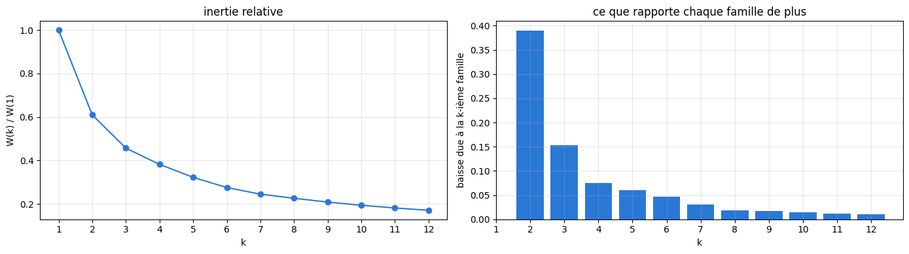
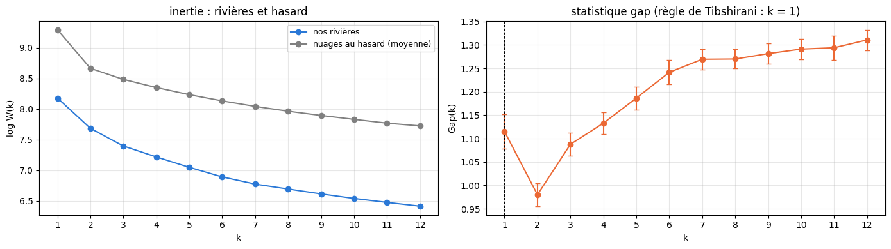
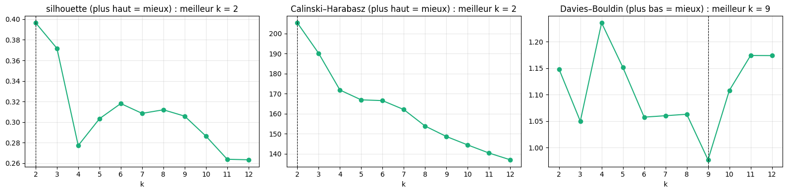
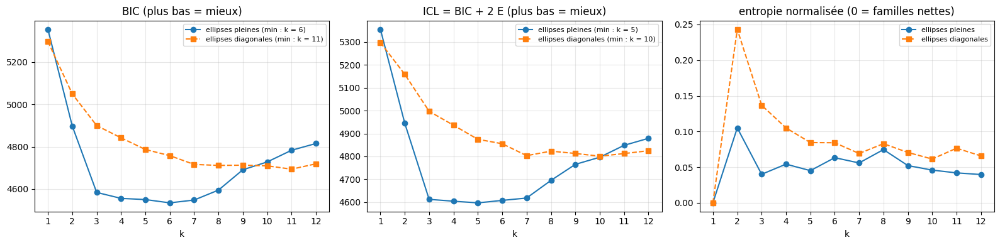
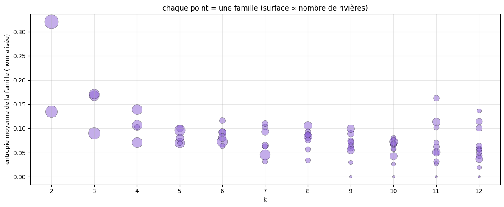
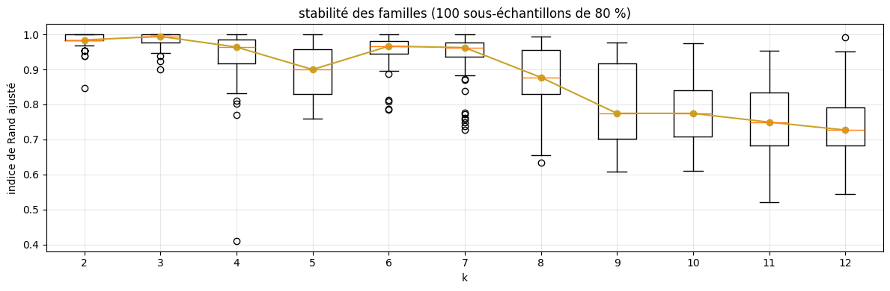
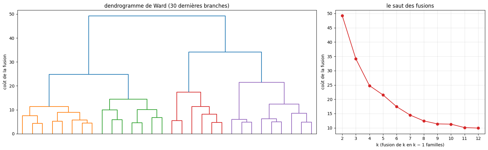
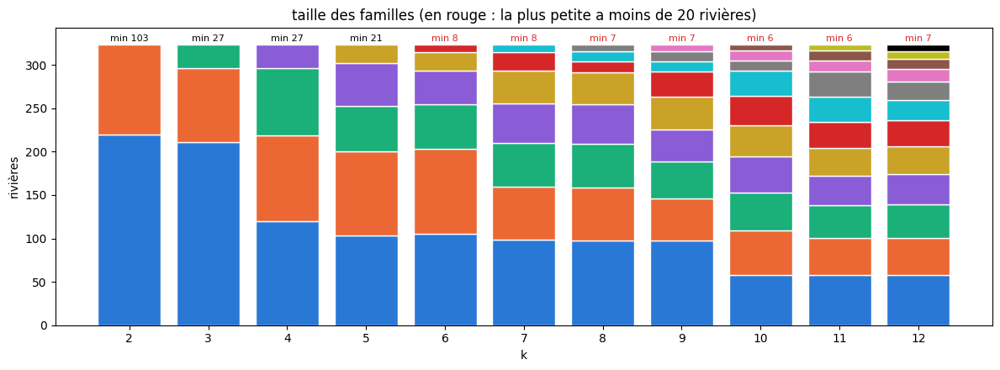
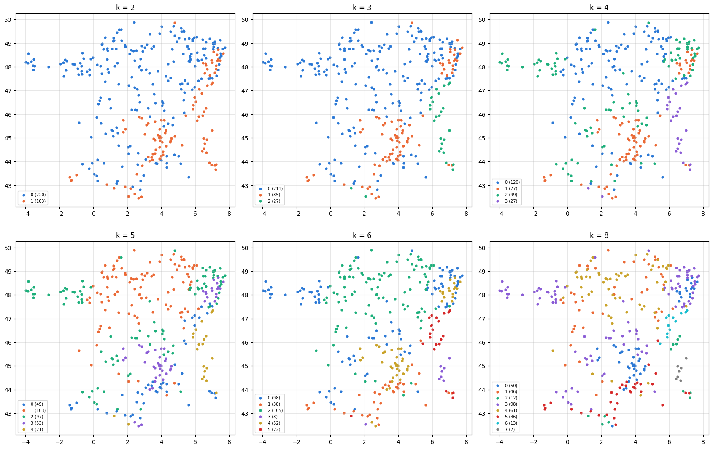

# 3.5 — Combien de familles d'attributs ?

Au notebook 3.4, les 323 rivières (310 d'apprentissage du notebook 5.08 + 13 de kayak) ont été rangées en **k = 4** familles par k-means, k
choisi à la main. Ici on cherche k avec des critères, **sur les attributs seuls** (aucun débit, aucun entraînement) : est-ce que les
rivières forment vraiment des groupes, et combien ?

**Les mêmes rivières et la même distance qu'au notebook 3.4** : 12 attributs BasinATLAS moyennés sur l'amont, réduits (moyenne 0, écart-type 1),
projetés sur les 5 premières composantes principales (92 % de la variance) ; distance euclidienne entre ces 5 coordonnées.

**Les critères**, chacun pour k = 1 à 12 :

1. **L'inertie et son coude** : W(k) = Σ_a d(a, centre de sa famille)².
2. **La statistique gap** (Tibshirani, Walther et Hastie, 2001) : l'inertie comparée à celle de nuages sans aucun groupe.
3. **La silhouette, Calinski–Harabasz et Davies–Bouldin** : la séparation des familles.
4. **Le mélange de gaussiennes** : BIC, **entropie** des appartenances, ICL ; l'entropie aussi famille par famille.
5. **La stabilité** : les familles restent-elles les mêmes quand on retire 20 % des rivières ?
6. **Le dendrogramme** (classification hiérarchique de Ward) : tous les k d'un coup.

Puis la taille des familles (un LSTM a besoin d'une quinzaine de rivières au moins, notebook 5.07), comment elles se coupent quand k augmente,
et leurs cartes.

## Les rivières dans l'espace des 5 axes

Les attributs viennent des données d'apprentissage de chaque rivière (mêmes moyennes sur l'amont qu'au notebook 3.4). Contrôle : k-means à
k = 4 doit redonner les familles du notebook 3.4 (120, 77, 99 et 27 rivières).

    323 rivières, m = 5 axes (92% de la variance)
    tailles des familles à k = 4 : [120, 99, 77, 27]

## 1. L'inertie et son coude

W(k) baisse toujours quand k augmente (k = N donne 0). On cherche le coude : là où une famille de plus ne fait presque plus baisser
l'inertie. À droite : la baisse apportée par chaque famille supplémentaire, W(k − 1) − W(k), en part de l'inertie totale W(1).

    

    

## 2. La statistique gap

On tire B = 50 nuages de N points **uniformément** dans la boîte qui contient nos rivières (alignée sur les 5 axes principaux : c'est la
référence « aucun groupe » de Tibshirani et al.), on leur applique le même k-means, et

$$\text{Gap}(k) = \overline{\log W^*(k)} - \log W(k), \qquad s(k) = \text{écart-type}(\log W^*(k)) \cdot \sqrt{1 + 1/B}.$$

Gap(k) grand : nos rivières sont bien plus groupées en k familles que des points au hasard. **Règle** : le plus petit k tel que
Gap(k) ≥ Gap(k + 1) − s(k + 1). Elle peut répondre k = 1 (« pas de groupes »).

    

    

                                   1      2      3      4      5      6      7   \
    Gap(k)                      1.115   0.98  1.088  1.133  1.186  1.242  1.269   
    s(k)                        0.036  0.025  0.024  0.023  0.024  0.026  0.022   
    Gap(k) ≥ Gap(k+1) − s(k+1)   True  False  False  False  False  False   True   
    
                                  8      9      10     11     12  
    Gap(k)                      1.27  1.281  1.291  1.294  1.311  
    s(k)                        0.02  0.022  0.022  0.026  0.022  
    Gap(k) ≥ Gap(k+1) − s(k+1)  True   True   True   True  False  

## 3. La séparation des familles

- **Silhouette** (de −1 à 1, plus haut = mieux) : pour chaque rivière, (b − a) / max(a, b), où a est sa distance moyenne aux rivières de sa
  famille et b à celles de la famille voisine la plus proche ; moyenne sur les rivières.
- **Calinski–Harabasz** (plus haut = mieux) : dispersion entre les familles / dispersion dans les familles, corrigée du nombre de familles.
- **Davies–Bouldin** (plus bas = mieux) : pour chaque famille, sa ressemblance avec la plus proche (rayons additionnés / distance des
  centres) ; moyenne sur les familles.

    

    

## 4. Le mélange de gaussiennes : BIC, entropie, ICL

Chaque famille j est une « bosse » gaussienne (centre et forme) dans l'espace des 5 axes ; le modèle donne à chaque rivière a une
probabilité t(a, j) d'appartenir à chaque famille.

- **BIC(k) = −2 · log-vraisemblance + (nombre de paramètres) · ln N** : décrire les données, en payant chaque paramètre. Plus bas = mieux.
- **Entropie E(k) = − Σ_a Σ_j t(a, j) · ln t(a, j)** : 0 si chaque rivière est sûre de sa famille, grande si beaucoup hésitent. Normalisée
  par N · ln k (entre 0 et 1).
- **ICL(k) = BIC(k) + 2 E(k)** : décrire les données **et** des familles nettement séparées. Plus bas = mieux.

Deux formes de bosses : **pleines** (chaque famille a sa propre ellipse : 20 paramètres par famille en 5 dimensions) et **diagonales**
(ellipses alignées sur les axes : 10 paramètres par famille). Chaque mélange : 20 départs, le meilleur gardé.

    

    

### L'entropie famille par famille

Pour chaque k (ellipses diagonales), chaque famille est un point : son entropie moyenne (sur les rivières qui y sont rangées, normalisée par
ln k ; 0 = toutes sûres d'y être) et sa taille (surface du point). Une famille floue est une famille que le mélange a créée sans vraie
frontière.

    

    

## 5. La stabilité

Pour chaque k : 100 fois, on retire au hasard 20 % des rivières, on refait k-means sur les 80 % restantes, et on compare leur rangement à
celui obtenu avec toutes les rivières (indice de Rand ajusté sur les rivières gardées : 1 = même rangement, 0 = comme au hasard). Un bon k
donne des familles qui ne dépendent pas de l'échantillon.

    

    

## 6. Le dendrogramme

Classification hiérarchique de Ward : on part de N familles d'une rivière et on fusionne à chaque étape les deux familles dont la fusion
augmente le moins l'inertie. La hauteur d'une fusion = ce qu'elle coûte. Couper l'arbre là où les branches verticales sont longues donne
des familles bien séparées. À droite : la hauteur des dernières fusions (la fusion qui passe de k à k − 1 familles).

    

    

    accord Ward / k-means (indice de Rand ajusté) : {2: 0.69, 3: 0.69, 4: 0.79, 5: 0.74, 6: 0.78, 7: 0.76, 8: 0.75}

## 7. La taille des familles

Pour chaque k, la taille des familles k-means, de la plus grosse à la plus petite. Trait : 20 rivières, en dessous un LSTM de famille risque
de manquer d'exemples (notebook 5.07).

    

    

## 8. Comment les familles se coupent quand k augmente

Tableaux croisés entre deux k successifs : d'où viennent les familles de k + 1 (lignes : familles à k, colonnes : familles à k + 1). Puis le
portrait (attributs moyens) des familles pour k = 2, 3, 4 et 6.

    k = 3    0   1   2
    k = 2             
    0      211   9   0
    1        0  76  27 
    
    k = 4    0   1   2   3
    k = 3                 
    0      120   0  91   0
    1        0  77   8   0
    2        0   0   0  27 
    
    k = 5   0    1   2   3   4
    k = 4                     
    0      14  103   3   0   0
    1      24    0   0  53   0
    2       5    0  94   0   0
    3       6    0   0   0  21 
    
    k = 6   0   1    2  3   4   5
    k = 5                        
    0       2  36    2  0   0   9
    1       0   0  103  0   0   0
    2      96   1    0  0   0   0
    3       0   1    0  0  52   0
    4       0   0    0  8   0  13 
    
    k = 7   0   1   2   3  4   5   6
    k = 6                           
    0       1   0  97   0  0   0   0
    1       1   0   0   0  0   0  37
    2      44   0   0   0  0  61   0
    3       0   0   0   0  8   0   0
    4       0  50   2   0  0   0   0
    5       0   0   0  22  0   0   0 
    
    k = 2

<table border="1" class="dataframe">
  <thead>
    <tr style="text-align: right;">
      <th></th>
      <th>rivières</th>
      <th>altitude</th>
      <th>pente</th>
      <th>neige</th>
      <th>pluie</th>
      <th>température</th>
      <th>karst</th>
      <th>forêt</th>
      <th>nappe</th>
      <th>aridité</th>
      <th>argile</th>
      <th>sable</th>
      <th>surface (km²)</th>
    </tr>
  </thead>
  <tbody>
    <tr>
      <th>0</th>
      <td>220</td>
      <td>284.4</td>
      <td>37.8</td>
      <td>6.6</td>
      <td>789.9</td>
      <td>102.7</td>
      <td>49.3</td>
      <td>19.6</td>
      <td>210.9</td>
      <td>96.1</td>
      <td>20.5</td>
      <td>42.2</td>
      <td>667.4</td>
    </tr>
    <tr>
      <th>1</th>
      <td>103</td>
      <td>961.6</td>
      <td>132.4</td>
      <td>19.6</td>
      <td>993.7</td>
      <td>78.6</td>
      <td>33.3</td>
      <td>75.1</td>
      <td>512.2</td>
      <td>136.9</td>
      <td>16.7</td>
      <td>46.9</td>
      <td>362.1</td>
    </tr>
  </tbody>
</table>

    k = 3

<table border="1" class="dataframe">
  <thead>
    <tr style="text-align: right;">
      <th></th>
      <th>rivières</th>
      <th>altitude</th>
      <th>pente</th>
      <th>neige</th>
      <th>pluie</th>
      <th>température</th>
      <th>karst</th>
      <th>forêt</th>
      <th>nappe</th>
      <th>aridité</th>
      <th>argile</th>
      <th>sable</th>
      <th>surface (km²)</th>
    </tr>
  </thead>
  <tbody>
    <tr>
      <th>0</th>
      <td>211</td>
      <td>274.3</td>
      <td>35.5</td>
      <td>6.5</td>
      <td>790.5</td>
      <td>102.8</td>
      <td>50.5</td>
      <td>17.8</td>
      <td>203.4</td>
      <td>96.3</td>
      <td>20.6</td>
      <td>42.1</td>
      <td>681.5</td>
    </tr>
    <tr>
      <th>1</th>
      <td>85</td>
      <td>765.7</td>
      <td>113.6</td>
      <td>14.6</td>
      <td>878.0</td>
      <td>88.6</td>
      <td>21.3</td>
      <td>76.7</td>
      <td>471.6</td>
      <td>110.2</td>
      <td>16.0</td>
      <td>48.4</td>
      <td>351.6</td>
    </tr>
    <tr>
      <th>2</th>
      <td>27</td>
      <td>1432.2</td>
      <td>178.3</td>
      <td>31.8</td>
      <td>1284.6</td>
      <td>54.6</td>
      <td>67.5</td>
      <td>65.9</td>
      <td>598.2</td>
      <td>205.6</td>
      <td>19.5</td>
      <td>41.4</td>
      <td>413.7</td>
    </tr>
  </tbody>
</table>

    k = 4

<table border="1" class="dataframe">
  <thead>
    <tr style="text-align: right;">
      <th></th>
      <th>rivières</th>
      <th>altitude</th>
      <th>pente</th>
      <th>neige</th>
      <th>pluie</th>
      <th>température</th>
      <th>karst</th>
      <th>forêt</th>
      <th>nappe</th>
      <th>aridité</th>
      <th>argile</th>
      <th>sable</th>
      <th>surface (km²)</th>
    </tr>
  </thead>
  <tbody>
    <tr>
      <th>0</th>
      <td>120</td>
      <td>266.0</td>
      <td>32.8</td>
      <td>6.4</td>
      <td>769.1</td>
      <td>102.3</td>
      <td>86.2</td>
      <td>16.3</td>
      <td>186.1</td>
      <td>93.2</td>
      <td>21.6</td>
      <td>40.6</td>
      <td>867.6</td>
    </tr>
    <tr>
      <th>1</th>
      <td>77</td>
      <td>797.7</td>
      <td>118.0</td>
      <td>15.0</td>
      <td>882.5</td>
      <td>88.1</td>
      <td>23.2</td>
      <td>78.9</td>
      <td>488.5</td>
      <td>110.8</td>
      <td>15.8</td>
      <td>48.7</td>
      <td>348.3</td>
    </tr>
    <tr>
      <th>2</th>
      <td>99</td>
      <td>299.1</td>
      <td>41.6</td>
      <td>6.9</td>
      <td>820.1</td>
      <td>102.7</td>
      <td>3.3</td>
      <td>22.8</td>
      <td>232.9</td>
      <td>100.6</td>
      <td>19.2</td>
      <td>44.2</td>
      <td>485.6</td>
    </tr>
    <tr>
      <th>3</th>
      <td>27</td>
      <td>1432.2</td>
      <td>178.3</td>
      <td>31.8</td>
      <td>1284.6</td>
      <td>54.6</td>
      <td>67.5</td>
      <td>65.9</td>
      <td>598.2</td>
      <td>205.6</td>
      <td>19.5</td>
      <td>41.4</td>
      <td>413.7</td>
    </tr>
  </tbody>
</table>

    k = 6

<table border="1" class="dataframe">
  <thead>
    <tr style="text-align: right;">
      <th></th>
      <th>rivières</th>
      <th>altitude</th>
      <th>pente</th>
      <th>neige</th>
      <th>pluie</th>
      <th>température</th>
      <th>karst</th>
      <th>forêt</th>
      <th>nappe</th>
      <th>aridité</th>
      <th>argile</th>
      <th>sable</th>
      <th>surface (km²)</th>
    </tr>
  </thead>
  <tbody>
    <tr>
      <th>0</th>
      <td>98</td>
      <td>295.3</td>
      <td>39.1</td>
      <td>7.1</td>
      <td>825.8</td>
      <td>101.9</td>
      <td>3.8</td>
      <td>21.7</td>
      <td>225.2</td>
      <td>101.7</td>
      <td>19.2</td>
      <td>44.1</td>
      <td>497.1</td>
    </tr>
    <tr>
      <th>1</th>
      <td>38</td>
      <td>650.1</td>
      <td>131.9</td>
      <td>8.7</td>
      <td>851.6</td>
      <td>107.5</td>
      <td>62.4</td>
      <td>73.4</td>
      <td>491.2</td>
      <td>97.3</td>
      <td>20.6</td>
      <td>43.6</td>
      <td>469.6</td>
    </tr>
    <tr>
      <th>2</th>
      <td>105</td>
      <td>233.2</td>
      <td>25.3</td>
      <td>6.2</td>
      <td>754.7</td>
      <td>101.5</td>
      <td>87.7</td>
      <td>10.6</td>
      <td>161.6</td>
      <td>92.2</td>
      <td>21.5</td>
      <td>40.5</td>
      <td>900.3</td>
    </tr>
    <tr>
      <th>3</th>
      <td>8</td>
      <td>2148.4</td>
      <td>233.7</td>
      <td>41.0</td>
      <td>1387.1</td>
      <td>25.4</td>
      <td>14.5</td>
      <td>46.9</td>
      <td>798.3</td>
      <td>272.4</td>
      <td>15.4</td>
      <td>46.3</td>
      <td>509.5</td>
    </tr>
    <tr>
      <th>4</th>
      <td>52</td>
      <td>824.0</td>
      <td>103.9</td>
      <td>17.1</td>
      <td>875.3</td>
      <td>81.4</td>
      <td>3.9</td>
      <td>78.2</td>
      <td>468.3</td>
      <td>113.5</td>
      <td>13.9</td>
      <td>51.0</td>
      <td>310.6</td>
    </tr>
    <tr>
      <th>5</th>
      <td>22</td>
      <td>1066.2</td>
      <td>144.9</td>
      <td>26.6</td>
      <td>1226.3</td>
      <td>69.3</td>
      <td>91.3</td>
      <td>72.5</td>
      <td>486.5</td>
      <td>173.0</td>
      <td>21.5</td>
      <td>39.1</td>
      <td>418.4</td>
    </tr>
  </tbody>
</table>

## 9. Les cartes

    

    

## 10. Le bilan

Le k que préfère chaque critère, et les tailles des familles.

<table border="1" class="dataframe">
  <thead>
    <tr style="text-align: right;">
      <th></th>
      <th>k préféré</th>
    </tr>
  </thead>
  <tbody>
    <tr>
      <th>coude (baisse &lt; 5 % de W(1))</th>
      <td>5</td>
    </tr>
    <tr>
      <th>gap (règle de Tibshirani)</th>
      <td>1</td>
    </tr>
    <tr>
      <th>silhouette</th>
      <td>2</td>
    </tr>
    <tr>
      <th>Calinski–Harabasz</th>
      <td>2</td>
    </tr>
    <tr>
      <th>Davies–Bouldin</th>
      <td>9</td>
    </tr>
    <tr>
      <th>BIC, ellipses pleines</th>
      <td>6</td>
    </tr>
    <tr>
      <th>BIC, ellipses diagonales</th>
      <td>11</td>
    </tr>
    <tr>
      <th>ICL, ellipses pleines</th>
      <td>5</td>
    </tr>
    <tr>
      <th>ICL, ellipses diagonales</th>
      <td>10</td>
    </tr>
    <tr>
      <th>stabilité (médiane la plus haute)</th>
      <td>3</td>
    </tr>
  </tbody>
</table>

<table border="1" class="dataframe">
  <thead>
    <tr style="text-align: right;">
      <th></th>
      <th>silhouette</th>
      <th>Gap</th>
      <th>ICL diag</th>
      <th>entropie normalisée (diag)</th>
      <th>stabilité (médiane)</th>
      <th>plus petite famille</th>
    </tr>
  </thead>
  <tbody>
    <tr>
      <th>1</th>
      <td>NaN</td>
      <td>1.115</td>
      <td>5297.739</td>
      <td>0.000</td>
      <td>NaN</td>
      <td>323</td>
    </tr>
    <tr>
      <th>2</th>
      <td>0.397</td>
      <td>0.980</td>
      <td>5158.718</td>
      <td>0.243</td>
      <td>0.984</td>
      <td>103</td>
    </tr>
    <tr>
      <th>3</th>
      <td>0.372</td>
      <td>1.088</td>
      <td>4996.997</td>
      <td>0.137</td>
      <td>0.994</td>
      <td>27</td>
    </tr>
    <tr>
      <th>4</th>
      <td>0.277</td>
      <td>1.133</td>
      <td>4936.165</td>
      <td>0.105</td>
      <td>0.964</td>
      <td>27</td>
    </tr>
    <tr>
      <th>5</th>
      <td>0.303</td>
      <td>1.186</td>
      <td>4874.551</td>
      <td>0.084</td>
      <td>0.900</td>
      <td>21</td>
    </tr>
    <tr>
      <th>6</th>
      <td>0.318</td>
      <td>1.242</td>
      <td>4855.229</td>
      <td>0.084</td>
      <td>0.966</td>
      <td>8</td>
    </tr>
    <tr>
      <th>7</th>
      <td>0.308</td>
      <td>1.269</td>
      <td>4803.167</td>
      <td>0.069</td>
      <td>0.962</td>
      <td>8</td>
    </tr>
    <tr>
      <th>8</th>
      <td>0.312</td>
      <td>1.270</td>
      <td>4822.839</td>
      <td>0.083</td>
      <td>0.877</td>
      <td>7</td>
    </tr>
    <tr>
      <th>9</th>
      <td>0.306</td>
      <td>1.281</td>
      <td>4812.762</td>
      <td>0.071</td>
      <td>0.775</td>
      <td>7</td>
    </tr>
    <tr>
      <th>10</th>
      <td>0.286</td>
      <td>1.291</td>
      <td>4800.813</td>
      <td>0.061</td>
      <td>0.774</td>
      <td>6</td>
    </tr>
    <tr>
      <th>11</th>
      <td>0.264</td>
      <td>1.294</td>
      <td>4812.307</td>
      <td>0.077</td>
      <td>0.749</td>
      <td>6</td>
    </tr>
    <tr>
      <th>12</th>
      <td>0.263</td>
      <td>1.311</td>
      <td>4824.617</td>
      <td>0.066</td>
      <td>0.727</td>
      <td>7</td>
    </tr>
  </tbody>
</table>

