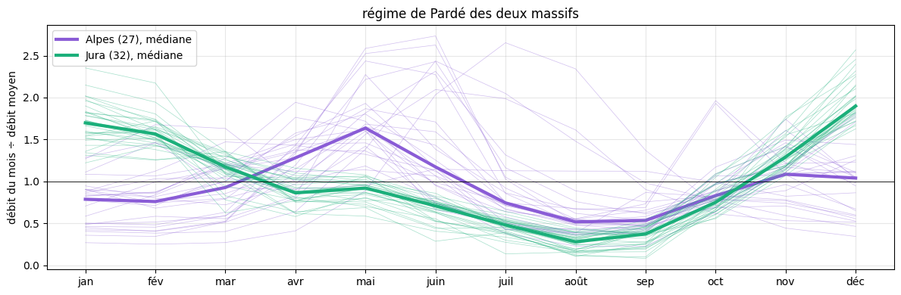
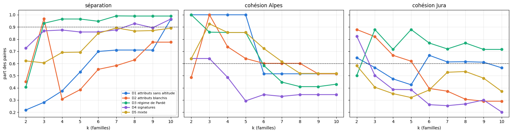
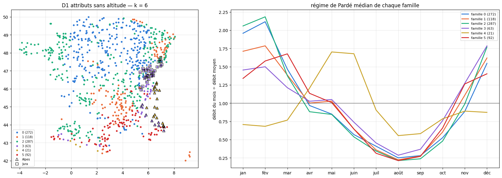
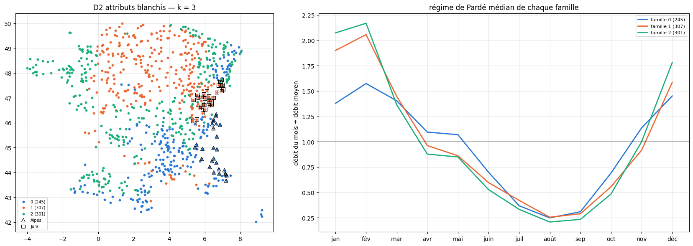
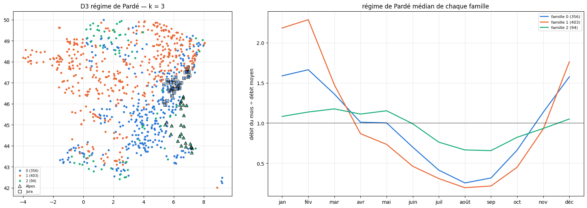
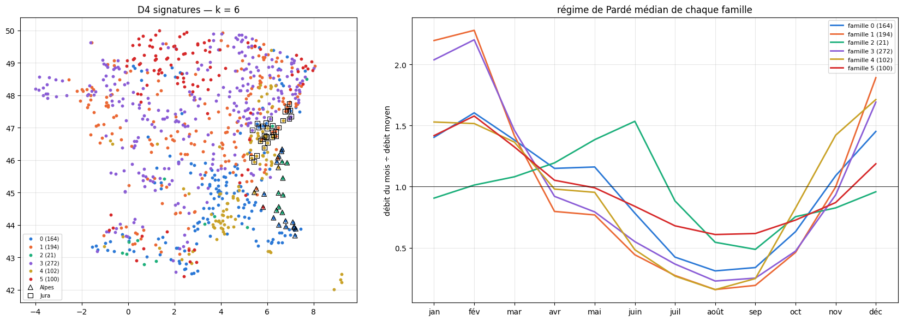
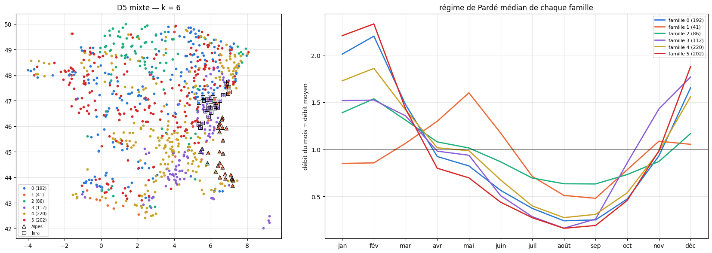

# 3.6 — Quelle distance sépare les Alpes du Jura ?

Au notebook 3.5, la distance sur les attributs BasinATLAS ne sépare le Jura des Alpes qu'à partir de 6 familles. Ici on essaie **d'autres
distances**, dont des distances **hydrologiques** calculées sur les débits mesurés, et on cherche celle qui sépare les deux massifs avec
**le moins de familles**.

**Plus de rivières** : le vivier n'exige plus des mesures depuis 2012 (ce filtre ne laissait que 8 rivières de haute montagne alpine) mais
seulement depuis début 2021 ; mêmes autres règles qu'au notebook 5.08 (France et alentours, régulation BasinATLAS ≤ 2 %, 50 à 20 000 km²,
une station par petit bassin, sans les éclusées connues), puis le même contrôle des éclusées sur 2022–2025, et au moins 3 ans de débits
journaliers.

## Les signatures hydrologiques

Calculées sur les débits journaliers (moyenne des mesures horaires, jours d'au moins 20 heures), sur tout ce qui est mesuré depuis
juillet 2009 :

| signature | définition | ce qu'elle dit |
|---|---|---|
| **régime de Pardé** (12 nombres) | débit moyen de chaque mois ÷ débit moyen annuel | la forme de l'année : pic de fonte en juin (nival), hautes eaux d'hiver (pluvial)… |
| **nervosité** (Richards–Baker) | Σ \|q(j) − q(j−1)\| ÷ Σ q(j) | à quel point le débit saute d'un jour à l'autre |
| **part du débit de base** (Lyne–Hollick) | débit lent (filtre numérique α = 0,925, trois passages) ÷ débit total | la part qui vient des nappes, du karst, de la neige |
| **vitesse de décrue** | médiane de ln(q(j) / q(j+1)) dans les décrues d'au moins 5 jours | la vidange du bassin après une crue |
| **contraste des débits** | log₁₀(Q5 / Q95) : débit dépassé 5 % du temps ÷ débit dépassé 95 % du temps | crues contre étiages |
| **lame d'eau écoulée** | débit moyen ÷ surface du bassin, en mm par an | la quantité d'eau rendue |
| **saison des crues** (2 nombres) | moyenne de cos et de sin du jour du maximum annuel (angle sur l'année) | quand arrivent les crues, et si elles arrivent toujours à la même saison |

## Les distances

On écrit chaque rivière comme un point ; la distance est **l'euclidienne entre ces points**. Seule la façon de construire les coordonnées
change.

| nom | coordonnées |
|---|---|
| **D1 — attributs sans altitude** | les 11 attributs du notebook 3.4 sauf l'altitude, réduits (moyenne 0, écart-type 1), projetés sur les composantes principales qui gardent 90 % de la variance |
| **D2 — attributs blanchis** | comme D1, puis chaque composante divisée par son écart-type : toutes les directions indépendantes pèsent pareil (distance de Mahalanobis). Le karst pèse autant que l'opposition montagne/plaine |
| **D3 — régime de Pardé** | les 12 coefficients mensuels, tels quels (sans unité) : deux rivières sont proches si leur année a la même forme |
| **D4 — signatures** | les signatures réduites, groupées en 5 blocs de poids égal : régime (12), nervosité (1), stockage (débit de base, décrue), extrêmes (contraste, lame d'eau), saison des crues (2). Dans un bloc de n signatures, chacune est divisée par √n : chaque bloc compte pour 1 |
| **D5 — mixte** | les 5 blocs de D4 et 3 blocs d'attributs (sans altitude), tous de poids égal : climat (neige, pluie, température, aridité), terrain (pente, karst, forêt, nappe, argile, sable), taille (surface) |

## Le test : séparer les Alpes du Jura

Deux groupes de référence, définis **sans** les distances : par le code hydrométrique (bassins du Sandre) et l'altitude moyenne de l'amont
(qui ne sert plus dans aucune distance) :

- **Alpes** : bassins de l'Isère (W), de la Durance (X0 à X2), de l'Arve et du Léman (V0), du Var (Y6) ; altitude moyenne ≥ 1 200 m ;
- **Jura** : bassins du Doubs (U2) et de l'Ain (V2) ; altitude moyenne de 400 à 1 300 m.

Pour chaque distance et chaque k (k-means, 30 départs) :

- **séparation** = part des paires (rivière alpine, rivière jurassienne) rangées dans deux familles différentes (1 = toutes séparées) ;
- **cohésion** = part des paires de rivières d'un même massif rangées dans la même famille (1 = chaque massif tient dans une famille).

On cherche le **plus petit k** où la séparation dépasse 90 % et où chaque massif garde une cohésion d'au moins 60 %.

    1174 stations dans le vivier ; 4 rivières de kayak ajoutées

## Les attributs BasinATLAS de l'amont

Moyennes sur tous les petits bassins en amont de la station, pondérées par leur surface (comme au notebook 3.4) ; l'altitude est gardée à
part, pour définir les groupes de référence.

    1178 rivières avec leurs attributs

## Les débits journaliers, le contrôle des éclusées et les signatures

Les débits viennent du cache local (téléchargés avant ce notebook). Une rivière est gardée si moins d'un tiers de ses jours calmes de
2022–2025 ont une amplitude dans la journée de plus de 30 % (même règle qu'au notebook 5.08) et si elle a au moins 3 ans de débits journaliers.

    1178 rivières calculées en 39 s
    1178 rivières avec des débits ; éclusées écartées : 56 ; gardées : 853

<table border="1" class="dataframe">
  <thead>
    <tr style="text-align: right;">
      <th></th>
      <th>nervosité</th>
      <th>débit de base</th>
      <th>décrue</th>
      <th>contraste</th>
      <th>lame d'eau (mm/an)</th>
      <th>crues cos</th>
      <th>crues sin</th>
    </tr>
  </thead>
  <tbody>
    <tr>
      <th>count</th>
      <td>853.000</td>
      <td>853.000</td>
      <td>853.000</td>
      <td>853.000</td>
      <td>853.000</td>
      <td>853.000</td>
      <td>853.000</td>
    </tr>
    <tr>
      <th>mean</th>
      <td>0.231</td>
      <td>0.590</td>
      <td>0.069</td>
      <td>1.520</td>
      <td>345.295</td>
      <td>0.561</td>
      <td>0.168</td>
    </tr>
    <tr>
      <th>std</th>
      <td>0.109</td>
      <td>0.119</td>
      <td>0.031</td>
      <td>0.503</td>
      <td>326.088</td>
      <td>0.265</td>
      <td>0.218</td>
    </tr>
    <tr>
      <th>min</th>
      <td>0.005</td>
      <td>0.244</td>
      <td>0.006</td>
      <td>0.160</td>
      <td>1.967</td>
      <td>-0.965</td>
      <td>-0.890</td>
    </tr>
    <tr>
      <th>25%</th>
      <td>0.160</td>
      <td>0.512</td>
      <td>0.048</td>
      <td>1.213</td>
      <td>162.476</td>
      <td>0.438</td>
      <td>0.042</td>
    </tr>
    <tr>
      <th>50%</th>
      <td>0.217</td>
      <td>0.577</td>
      <td>0.066</td>
      <td>1.516</td>
      <td>265.600</td>
      <td>0.594</td>
      <td>0.188</td>
    </tr>
    <tr>
      <th>75%</th>
      <td>0.291</td>
      <td>0.654</td>
      <td>0.085</td>
      <td>1.812</td>
      <td>395.959</td>
      <td>0.733</td>
      <td>0.311</td>
    </tr>
    <tr>
      <th>max</th>
      <td>0.667</td>
      <td>0.959</td>
      <td>0.242</td>
      <td>4.859</td>
      <td>3573.317</td>
      <td>0.983</td>
      <td>0.775</td>
    </tr>
  </tbody>
</table>

## Les groupes de référence : Alpes et Jura

    Alpes : 27 rivières — Ubaye à Le Lauzet-Ubaye [Roche-Rousse] ; Borne à Saint Jean de Sixt ; Giffre à Marignier [Plan Séraphin] ; Dranse de Morzine à Seytroux [Pont de Couvaloup] ; Ubaye à Barcelonette ; Arve à Chamonix ; Durance à Embrun [La Clapière] ; Dranse d'Abondance à Chevenoz [Vacheresse] ; Arve à Sallanches ; Le Bes à La Javie ; Guisane à Monetier-les-Bains ; Arly à Ugine [Pont de Fer] ; Var à Nice [Pont-Napoléon-III] [Aval] ; Méaudret à Méaudre ; Bronze à Bonneville [Thuet] ; Doron de Bozel à Planay ; Adouin à Saint Martin en Vercors [Tourtre] ; Durance à Val-des-Prés ; Var à Entrevaux [Pont-levis] ; Issole (Var) à Saint-André-les-Alpes ; Var à Malaussène [Coubaisse] ; Roizonne à La Valette [la Rochette] ; Vésubie à Utelle [Pont du Cros] ; Tinée à Tournefort Vieux Pont ; Tinée à St-Sauveur-sur-Tinée [Rte Chap Ste Blaise] ; Var à Villeneuve-d'Entraunes [Pont d'Enaux] ; Gerle (source) à Veynes
    
    Jura : 32 rivières — Albarine à Saint Rambert en Bugey ; Ain à Bourg de sirod ; Doubs à Goumois ; Saine à Syam ; Loue à Vuillafans ; Dessoubre à Rosureux ; Bienne à Morez ; Tacon à Saint Claude ; Loue à Champagne-sur-Loue ; Loue à Chenecey ; Doubs à Neublans ; Ain à Pont de Poitte ; Doubs à Rochefort-sur-Nenon ; Allan à Courcelles ; Oignin à Maillat [Pontet] ; Doubs à Pontarlier ; Doubs à Mouthe ; Angillon à Champagnole ; Suran à Pont-d'Ain-sur-Suran ; Doubs à Labergement Sainte Marie ; Loue à Montbarrey [Les trois Ours] ; Allan à Fesches-le-Châtel ; Herisson à Doucier ; Savoureuse à Belfort ; Doubs à Glere [Courclavon] ; Allaine à Joncherey ; Doubs à Ville-du-Pont [Spey] ; Jougnena à Jougne ; St Nicolas à Rougemont Le Château ; Verneau à Nans sous Sainte Anne ; Drugeon à La Rivière Drugeon - Ile du Martinet ; Source d'Arcier à Vaire Arcier

    

    

## Les cinq espaces

    D1 attributs sans altitude : 5 coordonnées
    D2 attributs blanchis : 5 coordonnées
    D3 régime de Pardé : 12 coordonnées
    D4 signatures : 19 coordonnées
    D5 mixte : 30 coordonnées

## Séparation et cohésion selon k

    

    

<table border="1" class="dataframe">
  <thead>
    <tr style="text-align: right;">
      <th></th>
      <th>plus petit k qui sépare</th>
      <th>séparation</th>
      <th>cohésion Alpes</th>
      <th>cohésion Jura</th>
      <th>silhouette</th>
      <th>plus petite famille</th>
    </tr>
    <tr>
      <th>distance</th>
      <th></th>
      <th></th>
      <th></th>
      <th></th>
      <th></th>
      <th></th>
    </tr>
  </thead>
  <tbody>
    <tr>
      <th>D1 attributs sans altitude</th>
      <td>NaN</td>
      <td>NaN</td>
      <td>NaN</td>
      <td>NaN</td>
      <td>NaN</td>
      <td>NaN</td>
    </tr>
    <tr>
      <th>D2 attributs blanchis</th>
      <td>3.0</td>
      <td>0.969</td>
      <td>1.000</td>
      <td>0.821</td>
      <td>0.220</td>
      <td>245.0</td>
    </tr>
    <tr>
      <th>D3 régime de Pardé</th>
      <td>3.0</td>
      <td>0.931</td>
      <td>0.858</td>
      <td>0.879</td>
      <td>0.264</td>
      <td>94.0</td>
    </tr>
    <tr>
      <th>D4 signatures</th>
      <td>NaN</td>
      <td>NaN</td>
      <td>NaN</td>
      <td>NaN</td>
      <td>NaN</td>
      <td>NaN</td>
    </tr>
    <tr>
      <th>D5 mixte</th>
      <td>NaN</td>
      <td>NaN</td>
      <td>NaN</td>
      <td>NaN</td>
      <td>NaN</td>
      <td>NaN</td>
    </tr>
  </tbody>
</table>

<table border="1" class="dataframe">
  <thead>
    <tr style="text-align: right;">
      <th>distance</th>
      <th>D1 attributs sans altitude</th>
      <th>D2 attributs blanchis</th>
      <th>D3 régime de Pardé</th>
      <th>D4 signatures</th>
      <th>D5 mixte</th>
    </tr>
    <tr>
      <th>k</th>
      <th></th>
      <th></th>
      <th></th>
      <th></th>
      <th></th>
    </tr>
  </thead>
  <tbody>
    <tr>
      <th>2</th>
      <td>0.22</td>
      <td>0.45</td>
      <td>0.41</td>
      <td>0.73</td>
      <td>0.62</td>
    </tr>
    <tr>
      <th>3</th>
      <td>0.28</td>
      <td>0.97</td>
      <td>0.93</td>
      <td>0.87</td>
      <td>0.61</td>
    </tr>
    <tr>
      <th>4</th>
      <td>0.38</td>
      <td>0.31</td>
      <td>0.97</td>
      <td>0.88</td>
      <td>0.69</td>
    </tr>
    <tr>
      <th>5</th>
      <td>0.53</td>
      <td>0.39</td>
      <td>0.97</td>
      <td>0.86</td>
      <td>0.69</td>
    </tr>
    <tr>
      <th>6</th>
      <td>0.70</td>
      <td>0.55</td>
      <td>0.95</td>
      <td>0.86</td>
      <td>0.85</td>
    </tr>
    <tr>
      <th>7</th>
      <td>0.71</td>
      <td>0.58</td>
      <td>0.99</td>
      <td>0.88</td>
      <td>0.89</td>
    </tr>
    <tr>
      <th>8</th>
      <td>0.71</td>
      <td>0.63</td>
      <td>0.99</td>
      <td>0.93</td>
      <td>0.87</td>
    </tr>
    <tr>
      <th>9</th>
      <td>0.71</td>
      <td>0.78</td>
      <td>0.99</td>
      <td>0.89</td>
      <td>0.87</td>
    </tr>
    <tr>
      <th>10</th>
      <td>0.96</td>
      <td>0.78</td>
      <td>0.99</td>
      <td>0.97</td>
      <td>0.89</td>
    </tr>
  </tbody>
</table>

## Les familles de chaque distance, à son plus petit k qui sépare

Pour chaque distance : la carte des familles (Alpes en triangles, Jura en carrés) et le régime de Pardé médian de chaque famille. Pour une
distance qui ne sépare jamais, k = 6.

    

    

    famille  0  2   3   4  5
    massif                  
    Alpes    0  0  10  17  0
    Jura     1  4  26   0  1 
    

    

    

    famille   0   1  2
    massif            
    Alpes    27   0  0
    Jura      1  29  2 
    

    

    

    famille   0  1   2
    massif            
    Alpes     2  0  25
    Jura     30  2   0 
    

    

    

    famille   0  1  2  3   4  5
    massif                     
    Alpes    14  2  8  0   2  1
    Jura      5  9  1  4  13  0 
    

    

    

    famille  0   1  2   3  4  5
    massif                     
    Alpes    0  23  1   2  1  0
    Jura     5   4  0  19  1  3 
    

## Les portraits des familles de la meilleure distance

La distance qui sépare avec le moins de familles (à égalité : la meilleure silhouette) ; moyennes des signatures et des attributs de chaque
famille, et où tombent les rivières de kayak et quelques repères.

    meilleure distance : D3 régime de Pardé, k = 3

<table border="1" class="dataframe">
  <thead>
    <tr style="text-align: right;">
      <th></th>
      <th>rivières</th>
      <th>nervosité</th>
      <th>débit de base</th>
      <th>décrue</th>
      <th>contraste</th>
      <th>lame d'eau (mm/an)</th>
      <th>crues cos</th>
      <th>crues sin</th>
      <th>pente</th>
      <th>neige</th>
      <th>pluie</th>
      <th>température</th>
      <th>karst</th>
      <th>forêt</th>
      <th>nappe</th>
      <th>aridité</th>
      <th>argile</th>
      <th>sable</th>
      <th>surface</th>
      <th>altitude (hors distance)</th>
    </tr>
  </thead>
  <tbody>
    <tr>
      <th>0</th>
      <td>356</td>
      <td>0.26</td>
      <td>0.58</td>
      <td>0.07</td>
      <td>1.49</td>
      <td>402.47</td>
      <td>0.50</td>
      <td>0.11</td>
      <td>79.09</td>
      <td>11.02</td>
      <td>879.36</td>
      <td>97.00</td>
      <td>47.50</td>
      <td>50.70</td>
      <td>342.29</td>
      <td>107.10</td>
      <td>19.11</td>
      <td>44.23</td>
      <td>2.62</td>
      <td>566.30</td>
    </tr>
    <tr>
      <th>1</th>
      <td>403</td>
      <td>0.23</td>
      <td>0.56</td>
      <td>0.07</td>
      <td>1.70</td>
      <td>272.85</td>
      <td>0.68</td>
      <td>0.22</td>
      <td>34.84</td>
      <td>6.75</td>
      <td>802.54</td>
      <td>102.52</td>
      <td>42.02</td>
      <td>17.63</td>
      <td>202.90</td>
      <td>98.84</td>
      <td>20.23</td>
      <td>42.47</td>
      <td>2.70</td>
      <td>270.65</td>
    </tr>
    <tr>
      <th>2</th>
      <td>94</td>
      <td>0.14</td>
      <td>0.76</td>
      <td>0.04</td>
      <td>0.84</td>
      <td>439.36</td>
      <td>0.30</td>
      <td>0.16</td>
      <td>116.21</td>
      <td>16.36</td>
      <td>919.73</td>
      <td>84.06</td>
      <td>64.49</td>
      <td>40.62</td>
      <td>428.63</td>
      <td>131.75</td>
      <td>19.71</td>
      <td>42.47</td>
      <td>2.63</td>
      <td>797.96</td>
    </tr>
  </tbody>
</table>

    famille 0 : Albarine à Saint Rambert en Bugey ; Hérault à Laroque ; Glueyre à Gluiras [Tisonèche] ; Eyrieux à Pont de Chervil ; Dourbie à Dourbies [Le Mazet] ; Vis à St-Laurent-le-minier [Pont de la mine] ; Ardèche à Meyras [BARUTEL] ; Gardon d'Anduze à Anduze ; Aude à Quillan [Pont RD118] ; Chassezac à Gravières
    famille 1 : Grand-Morin à Pommeuse
    famille 2 : Durance à Embrun [La Clapière] ; Ubaye à Barcelonette ; Vésubie à Utelle [Pont du Cros]

