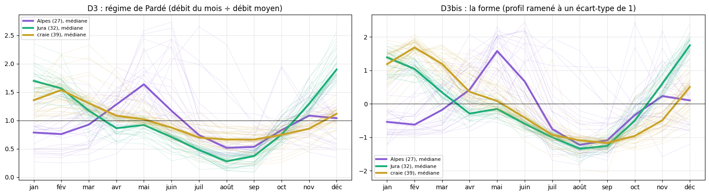
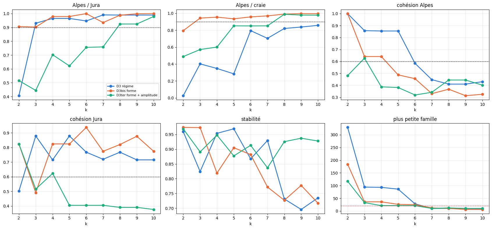
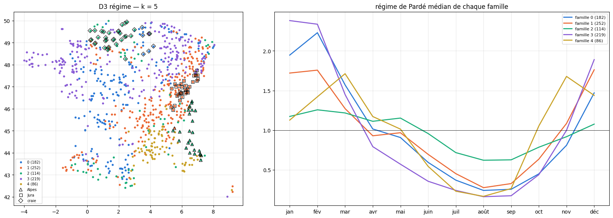
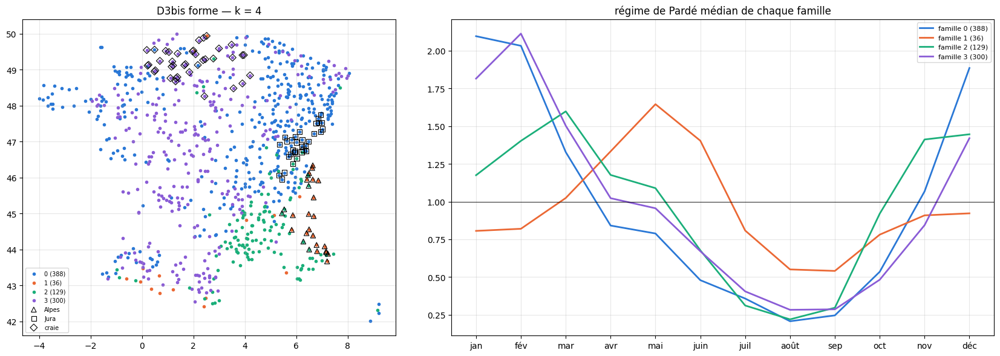
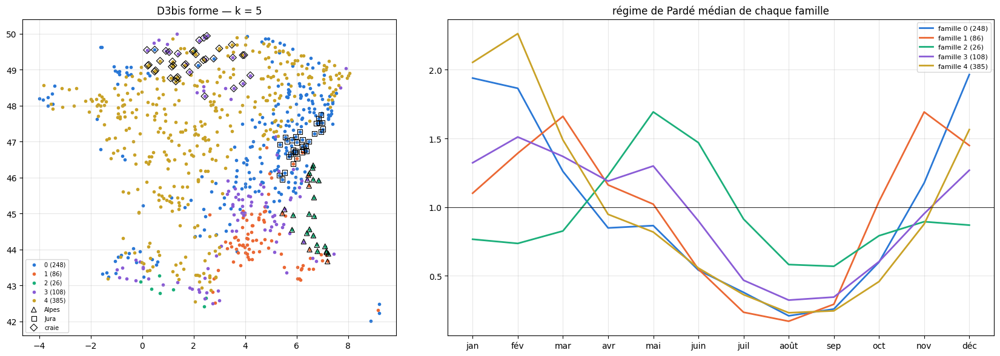
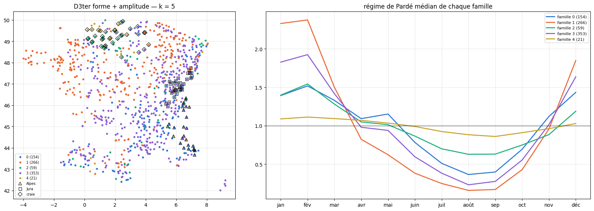

# 3.8 — La forme du régime : séparer la neige de la craie

Au notebook 3.7, la distance du régime de Pardé (D3) sépare les Alpes du Jura dès 3 familles, mais la famille des Alpes contient aussi les
**rivières de craie** du Bassin parisien : leurs régimes sont tous deux « plats » (la neige d'un côté, une grosse nappe de l'autre étalent le
débit sur l'année), et D3 compare des **écarts** au débit moyen, petits dans les deux cas, même si les mois des hautes eaux diffèrent
(mai–juin pour la neige, février–mars pour la craie).

**Trois distances**, sur les mêmes 853 rivières qu'aux notebooks 3.6 et 3.7 (débits mesurés, contrôle des éclusées) :

| nom | coordonnées d'une rivière | ce qui compte |
|---|---|---|
| **D3 — régime** | les 12 coefficients de Pardé p(m) = débit du mois m ÷ débit moyen | la forme **et** l'amplitude de l'année |
| **D3bis — forme** | (p(m) − 1) ÷ écart-type des 12 p(m) : le profil ramené à un écart-type de 1 | **seulement la forme** : quels mois sont hauts, lesquels sont bas. La distance vaut alors √(24 (1 − r)), r = corrélation entre les deux profils |
| **D3ter — forme + amplitude** | les 12 coordonnées de D3bis divisées par √12 (le bloc « forme » pèse 1), et l'amplitude log₁₀(écart-type des p(m)) réduite (pèse 1) | la forme d'abord, l'amplitude comme une seule information de plus |

**Le test** : séparer les Alpes du Jura (comme aux notebooks 3.6 et 3.7) **et** les Alpes de la craie, avec le moins de familles.
Groupe « craie » : bassins Artois–Picardie (E), Seine (H) et côtiers normands (I) ; débit de base ≥ 0,75 ; altitude moyenne < 300 m.

    853 rivières ; Alpes : 27 ; Jura : 32 ; craie : 39
    craie : Eure à Cailly-sur-Eure ; Eure à Louviers ; Eure à St-Georges-Motel ; Mauldre à Aulnay-sur-Mauldre [Centre ville] ; Touques à St-Martin-de-la-Lieue ; Epte à Fourges ; Avre à Muzy ; Vesle à Braine ; Iton à Normanville ; Suippe à Orainville ; Risle à Pont-Authou ; Andelle à Vascoeuil ; Serre (affluent de l'Oise) à Pont-à-Bucy [Nouvion-et-Catillon] ; Cailly à Notre-Dame-de-Bondeville ; Avre à Acon ; Charentonne à Trinité-de-Réville ; Somme canalisée à Lamotte-Brebière ; Blaise (Eure) à Aunay-sous-Crécy ; rigole d'alimentation de Berry-au-Bac à Berry-au-Bac [Débitmètre] ; Sausseron à Nesles-la-Vallée ; Orbiquet à Beuvillers ; Guiel à Montreuil-l'Argillé ; Petit Thérain à St-Omer ; Essonne à Boulancourt ; Thérain à Beauvais ; Thérain à Bonnières ; Verse à Noyon ; Thérain à Maysel ; Austreberthe à St-Paer ; Ancre à Bonnay ; Aubette à Ambleville ; Selle à Plachy-Buyon ; Superbe à St-Saturnin ; Ardusson à St-Aubin ; Breche à Nogent-sur-Oise ; Soude à Soudron ; Automne à Saintines ; Commerce à Gruchet-le-Valasse ; Lézarde à Montivilliers

## Les régimes des trois groupes, bruts et en forme

    

    

## Séparation et cohésion selon k

Séparation de deux groupes = part de leurs paires rangées dans deux familles différentes ; cohésion d'un groupe = part de ses paires dans la
même famille. Stabilité : accord (indice de Rand ajusté) entre le rangement de toutes les rivières et celui de 30 sous-échantillons de 80 %.

    

    

    plus petit k qui sépare les Alpes du Jura et de la craie (cohésions ≥ 0,6) : {'D3 régime': nan, 'D3bis forme': 4.0, 'D3ter forme + amplitude': nan}

<table border="1" class="dataframe">
  <thead>
    <tr style="text-align: right;">
      <th></th>
      <th></th>
      <th>Alpes / Jura</th>
      <th>Alpes / craie</th>
      <th>cohésion Alpes</th>
      <th>cohésion Jura</th>
      <th>cohésion craie</th>
      <th>silhouette</th>
      <th>stabilité</th>
      <th>plus petite famille</th>
    </tr>
    <tr>
      <th>distance</th>
      <th>k</th>
      <th></th>
      <th></th>
      <th></th>
      <th></th>
      <th></th>
      <th></th>
      <th></th>
      <th></th>
    </tr>
  </thead>
  <tbody>
    <tr>
      <th rowspan="9" valign="top">D3 régime</th>
      <th>2</th>
      <td>0.406</td>
      <td>0.026</td>
      <td>1.000</td>
      <td>0.502</td>
      <td>0.949</td>
      <td>0.339</td>
      <td>0.959</td>
      <td>329</td>
    </tr>
    <tr>
      <th>3</th>
      <td>0.931</td>
      <td>0.402</td>
      <td>0.858</td>
      <td>0.879</td>
      <td>0.514</td>
      <td>0.264</td>
      <td>0.824</td>
      <td>94</td>
    </tr>
    <tr>
      <th>4</th>
      <td>0.965</td>
      <td>0.348</td>
      <td>0.855</td>
      <td>0.716</td>
      <td>0.563</td>
      <td>0.248</td>
      <td>0.954</td>
      <td>93</td>
    </tr>
    <tr>
      <th>5</th>
      <td>0.965</td>
      <td>0.284</td>
      <td>0.855</td>
      <td>0.879</td>
      <td>0.609</td>
      <td>0.232</td>
      <td>0.969</td>
      <td>86</td>
    </tr>
    <tr>
      <th>6</th>
      <td>0.947</td>
      <td>0.795</td>
      <td>0.584</td>
      <td>0.768</td>
      <td>0.854</td>
      <td>0.245</td>
      <td>0.867</td>
      <td>28</td>
    </tr>
    <tr>
      <th>7</th>
      <td>0.991</td>
      <td>0.704</td>
      <td>0.447</td>
      <td>0.720</td>
      <td>0.441</td>
      <td>0.237</td>
      <td>0.929</td>
      <td>10</td>
    </tr>
    <tr>
      <th>8</th>
      <td>0.990</td>
      <td>0.821</td>
      <td>0.410</td>
      <td>0.768</td>
      <td>0.406</td>
      <td>0.233</td>
      <td>0.731</td>
      <td>10</td>
    </tr>
    <tr>
      <th>9</th>
      <td>0.990</td>
      <td>0.838</td>
      <td>0.410</td>
      <td>0.716</td>
      <td>0.421</td>
      <td>0.216</td>
      <td>0.696</td>
      <td>10</td>
    </tr>
    <tr>
      <th>10</th>
      <td>0.990</td>
      <td>0.858</td>
      <td>0.430</td>
      <td>0.716</td>
      <td>0.459</td>
      <td>0.196</td>
      <td>0.735</td>
      <td>9</td>
    </tr>
    <tr>
      <th rowspan="9" valign="top">D3bis forme</th>
      <th>2</th>
      <td>0.906</td>
      <td>0.795</td>
      <td>1.000</td>
      <td>0.825</td>
      <td>0.665</td>
      <td>0.457</td>
      <td>0.974</td>
      <td>184</td>
    </tr>
    <tr>
      <th>3</th>
      <td>0.903</td>
      <td>0.943</td>
      <td>0.641</td>
      <td>0.492</td>
      <td>0.762</td>
      <td>0.410</td>
      <td>0.973</td>
      <td>36</td>
    </tr>
    <tr>
      <th>4</th>
      <td>0.979</td>
      <td>0.954</td>
      <td>0.641</td>
      <td>0.825</td>
      <td>0.718</td>
      <td>0.240</td>
      <td>0.819</td>
      <td>36</td>
    </tr>
    <tr>
      <th>5</th>
      <td>0.979</td>
      <td>0.934</td>
      <td>0.487</td>
      <td>0.825</td>
      <td>0.394</td>
      <td>0.248</td>
      <td>0.905</td>
      <td>26</td>
    </tr>
    <tr>
      <th>6</th>
      <td>1.000</td>
      <td>0.957</td>
      <td>0.456</td>
      <td>0.938</td>
      <td>0.561</td>
      <td>0.229</td>
      <td>0.882</td>
      <td>25</td>
    </tr>
    <tr>
      <th>7</th>
      <td>0.935</td>
      <td>0.970</td>
      <td>0.330</td>
      <td>0.774</td>
      <td>0.421</td>
      <td>0.224</td>
      <td>0.772</td>
      <td>12</td>
    </tr>
    <tr>
      <th>8</th>
      <td>0.988</td>
      <td>0.991</td>
      <td>0.368</td>
      <td>0.821</td>
      <td>0.404</td>
      <td>0.221</td>
      <td>0.727</td>
      <td>10</td>
    </tr>
    <tr>
      <th>9</th>
      <td>0.999</td>
      <td>0.996</td>
      <td>0.313</td>
      <td>0.877</td>
      <td>0.432</td>
      <td>0.222</td>
      <td>0.777</td>
      <td>6</td>
    </tr>
    <tr>
      <th>10</th>
      <td>1.000</td>
      <td>0.995</td>
      <td>0.325</td>
      <td>0.774</td>
      <td>0.290</td>
      <td>0.217</td>
      <td>0.717</td>
      <td>6</td>
    </tr>
    <tr>
      <th rowspan="9" valign="top">D3ter forme + amplitude</th>
      <th>2</th>
      <td>0.515</td>
      <td>0.488</td>
      <td>0.481</td>
      <td>0.825</td>
      <td>0.698</td>
      <td>0.577</td>
      <td>0.969</td>
      <td>117</td>
    </tr>
    <tr>
      <th>3</th>
      <td>0.444</td>
      <td>0.572</td>
      <td>0.627</td>
      <td>0.516</td>
      <td>0.422</td>
      <td>0.397</td>
      <td>0.891</td>
      <td>33</td>
    </tr>
    <tr>
      <th>4</th>
      <td>0.703</td>
      <td>0.600</td>
      <td>0.387</td>
      <td>0.623</td>
      <td>0.452</td>
      <td>0.345</td>
      <td>0.948</td>
      <td>21</td>
    </tr>
    <tr>
      <th>5</th>
      <td>0.622</td>
      <td>0.852</td>
      <td>0.382</td>
      <td>0.405</td>
      <td>0.420</td>
      <td>0.302</td>
      <td>0.877</td>
      <td>21</td>
    </tr>
    <tr>
      <th>6</th>
      <td>0.756</td>
      <td>0.851</td>
      <td>0.319</td>
      <td>0.405</td>
      <td>0.420</td>
      <td>0.318</td>
      <td>0.913</td>
      <td>21</td>
    </tr>
    <tr>
      <th>7</th>
      <td>0.759</td>
      <td>0.852</td>
      <td>0.342</td>
      <td>0.405</td>
      <td>0.420</td>
      <td>0.330</td>
      <td>0.837</td>
      <td>10</td>
    </tr>
    <tr>
      <th>8</th>
      <td>0.925</td>
      <td>0.989</td>
      <td>0.444</td>
      <td>0.391</td>
      <td>0.422</td>
      <td>0.309</td>
      <td>0.925</td>
      <td>12</td>
    </tr>
    <tr>
      <th>9</th>
      <td>0.925</td>
      <td>0.979</td>
      <td>0.444</td>
      <td>0.391</td>
      <td>0.279</td>
      <td>0.301</td>
      <td>0.937</td>
      <td>10</td>
    </tr>
    <tr>
      <th>10</th>
      <td>0.979</td>
      <td>0.978</td>
      <td>0.402</td>
      <td>0.377</td>
      <td>0.281</td>
      <td>0.258</td>
      <td>0.928</td>
      <td>10</td>
    </tr>
  </tbody>
</table>

## Les familles de chaque distance

Pour chaque distance : à son plus petit k qui sépare (ou k = 5 s'il n'y en a pas) et à k = 5, la carte des familles (Alpes en triangles,
Jura en carrés, craie en losanges) et le régime médian de chaque famille.

    

    

    famille  0   1   2  3  4
    groupe                  
    Alpes    0   1  25  0  1
    Jura     0  30   0  2  0
    craie    5   4  30  0  0 
    

    

    

    famille   0   1  2   3
    groupe                
    Alpes     0  21  6   0
    Jura     29   0  3   0
    craie     3   2  1  33 
    

    

    

    famille   0  1   2   3   4
    groupe                    
    Alpes     0  6  18   3   0
    Jura     29  3   0   0   0
    craie     3  0   1  17  18 
    

    

    

    famille   0  1   2   3  4
    groupe                   
    Alpes    16  2   3   5  1
    Jura     16  3   0  13  0
    craie     4  1  24   2  8 
    

## Portrait des familles de D3bis à k = 5 et où tombent quelques repères

    D3bis forme — k = 5

<table border="1" class="dataframe">
  <thead>
    <tr style="text-align: right;">
      <th></th>
      <th>rivières</th>
      <th>nervosité</th>
      <th>débit de base</th>
      <th>décrue</th>
      <th>contraste</th>
      <th>lame d'eau (mm/an)</th>
      <th>crues cos</th>
      <th>crues sin</th>
      <th>altitude (m)</th>
      <th>mois du maximum</th>
    </tr>
  </thead>
  <tbody>
    <tr>
      <th>0</th>
      <td>248</td>
      <td>0.26</td>
      <td>0.54</td>
      <td>0.09</td>
      <td>1.68</td>
      <td>402.37</td>
      <td>0.65</td>
      <td>0.08</td>
      <td>469.33</td>
      <td>déc</td>
    </tr>
    <tr>
      <th>1</th>
      <td>86</td>
      <td>0.33</td>
      <td>0.51</td>
      <td>0.07</td>
      <td>1.68</td>
      <td>417.39</td>
      <td>0.40</td>
      <td>-0.09</td>
      <td>693.25</td>
      <td>nov</td>
    </tr>
    <tr>
      <th>2</th>
      <td>26</td>
      <td>0.14</td>
      <td>0.72</td>
      <td>0.04</td>
      <td>0.98</td>
      <td>590.00</td>
      <td>-0.08</td>
      <td>0.13</td>
      <td>1604.29</td>
      <td>mai</td>
    </tr>
    <tr>
      <th>3</th>
      <td>108</td>
      <td>0.18</td>
      <td>0.68</td>
      <td>0.05</td>
      <td>1.24</td>
      <td>416.39</td>
      <td>0.37</td>
      <td>0.24</td>
      <td>624.59</td>
      <td>fév</td>
    </tr>
    <tr>
      <th>4</th>
      <td>385</td>
      <td>0.21</td>
      <td>0.61</td>
      <td>0.06</td>
      <td>1.49</td>
      <td>255.96</td>
      <td>0.64</td>
      <td>0.27</td>
      <td>261.04</td>
      <td>fév</td>
    </tr>
  </tbody>
</table>

    famille 0 : Albarine à Saint Rambert en Bugey ; Vis à St-Laurent-le-minier [Pont de la mine]
    famille 1 : Hérault à Laroque ; Glueyre à Gluiras [Tisonèche] ; Eyrieux à Pont de Chervil ; Dourbie à Dourbies [Le Mazet] ; Ardèche à Meyras [BARUTEL] ; Gardon d'Anduze à Anduze ; Chassezac à Gravières
    famille 2 : Durance à Embrun [La Clapière] ; Ubaye à Barcelonette ; Vésubie à Utelle [Pont du Cros]
    famille 3 : Aude à Quillan [Pont RD118]
    famille 4 : Grand-Morin à Pommeuse
    
    D3ter forme + amplitude — k = 5

<table border="1" class="dataframe">
  <thead>
    <tr style="text-align: right;">
      <th></th>
      <th>rivières</th>
      <th>nervosité</th>
      <th>débit de base</th>
      <th>décrue</th>
      <th>contraste</th>
      <th>lame d'eau (mm/an)</th>
      <th>crues cos</th>
      <th>crues sin</th>
      <th>altitude (m)</th>
      <th>mois du maximum</th>
    </tr>
  </thead>
  <tbody>
    <tr>
      <th>0</th>
      <td>154</td>
      <td>0.23</td>
      <td>0.63</td>
      <td>0.06</td>
      <td>1.27</td>
      <td>458.29</td>
      <td>0.42</td>
      <td>0.14</td>
      <td>734.01</td>
      <td>fév</td>
    </tr>
    <tr>
      <th>1</th>
      <td>266</td>
      <td>0.24</td>
      <td>0.53</td>
      <td>0.08</td>
      <td>1.85</td>
      <td>279.66</td>
      <td>0.67</td>
      <td>0.20</td>
      <td>277.54</td>
      <td>fév</td>
    </tr>
    <tr>
      <th>2</th>
      <td>59</td>
      <td>0.14</td>
      <td>0.77</td>
      <td>0.04</td>
      <td>0.76</td>
      <td>285.13</td>
      <td>0.53</td>
      <td>0.24</td>
      <td>359.25</td>
      <td>fév</td>
    </tr>
    <tr>
      <th>3</th>
      <td>353</td>
      <td>0.25</td>
      <td>0.57</td>
      <td>0.07</td>
      <td>1.57</td>
      <td>352.65</td>
      <td>0.54</td>
      <td>0.15</td>
      <td>486.06</td>
      <td>fév</td>
    </tr>
    <tr>
      <th>4</th>
      <td>21</td>
      <td>0.05</td>
      <td>0.92</td>
      <td>0.01</td>
      <td>0.40</td>
      <td>393.41</td>
      <td>0.50</td>
      <td>0.14</td>
      <td>287.71</td>
      <td>fév</td>
    </tr>
  </tbody>
</table>

    famille 0 : Vésubie à Utelle [Pont du Cros] ; Aude à Quillan [Pont RD118]
    famille 1 : Eyrieux à Pont de Chervil ; Ubaye à Barcelonette
    famille 2 : 
    famille 3 : Durance à Embrun [La Clapière] ; Albarine à Saint Rambert en Bugey ; Hérault à Laroque ; Grand-Morin à Pommeuse ; Glueyre à Gluiras [Tisonèche] ; Dourbie à Dourbies [Le Mazet] ; Vis à St-Laurent-le-minier [Pont de la mine] ; Ardèche à Meyras [BARUTEL] ; Gardon d'Anduze à Anduze ; Chassezac à Gravières
    famille 4 : 
    

