# 3.9 — Combien de familles avec la forme du régime : les 5 familles

Au notebook 3.8, la **forme du régime** (D3bis) est la seule distance qui sépare les Alpes à la fois du Jura et des rivières de craie, dès
k = 4. Chaque rivière y est décrite par son profil de Pardé ramené à un écart-type de 1 : f(m) = (p(m) − 1) ÷ écart-type des 12 p(m), avec
p(m) = débit moyen du mois m ÷ débit moyen annuel. La distance euclidienne entre deux profils vaut √(24 (1 − r)), r = leur corrélation : elle
ne regarde que **quels mois sont hauts et lesquels sont bas**, pas l'amplitude.

On refait ici, avec cette distance, toute l'étude du nombre de familles des notebooks 3.5 et 3.7 : inertie et coude, statistique gap,
séparation (silhouette, Calinski–Harabasz, Davies–Bouldin), mélange de gaussiennes (BIC, entropie, ICL, entropie par famille), stabilité,
dendrogramme, taille des familles, comment elles se coupent, leurs régimes et leurs cartes, et la séparation des Alpes, du Jura et de la
craie selon k.

**Les coordonnées** : les 12 valeurs f(m), centrées et tournées sur leurs composantes principales (on garde celles qui font 99 % de la
variance ; une rotation ne change pas les distances). Les régimes tracés restent les régimes de Pardé bruts, plus faciles à lire.

## Les rivières et leurs coordonnées

Les rivières gardées au notebook 3.6 (contrôle des éclusées, au moins 3 ans de débits, signatures complètes).

    853 rivières ; 10 composantes gardées sur 12 (99.6% de la variance) ; part des trois premières : [40.2 23.2 12.9] %

    
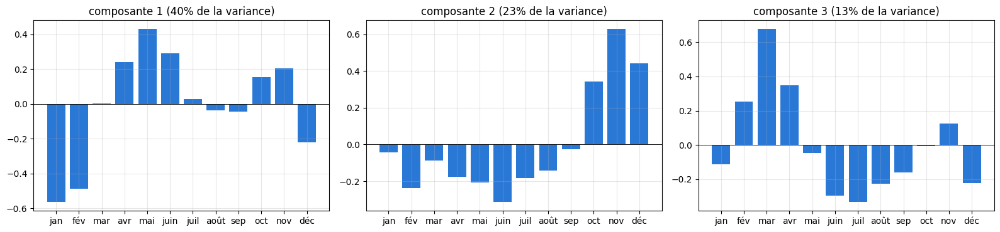
    

## 1. L'inertie et son coude

W(k) baisse toujours quand k augmente (k = N donne 0). On cherche le coude : là où une famille de plus ne fait presque plus baisser
l'inertie. À droite : la baisse apportée par chaque famille supplémentaire, W(k − 1) − W(k), en part de l'inertie totale W(1).

    
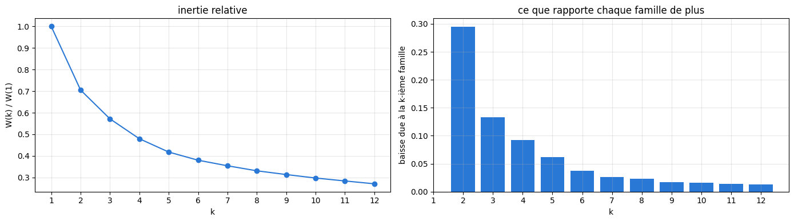
    

## 2. La statistique gap

On tire B = 50 nuages de N points **uniformément** dans la boîte qui contient nos rivières (alignée sur les 5 axes principaux : c'est la
référence « aucun groupe » de Tibshirani et al.), on leur applique le même k-means, et

$$\text{Gap}(k) = \overline{\log W^*(k)} - \log W(k), \qquad s(k) = \text{écart-type}(\log W^*(k)) \cdot \sqrt{1 + 1/B}.$$

Gap(k) grand : nos rivières sont bien plus groupées en k familles que des points au hasard. **Règle** : le plus petit k tel que
Gap(k) ≥ Gap(k + 1) − s(k + 1). Elle peut répondre k = 1 (« pas de groupes »).

    
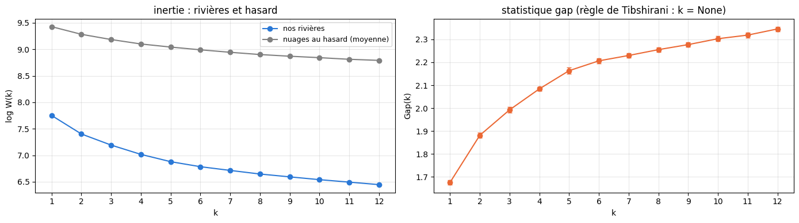
    

                                   1      2      3      4      5      6      7   \
    Gap(k)                      1.676  1.881  1.992  2.084  2.163  2.206   2.23   
    s(k)                        0.009  0.011  0.012  0.009  0.013  0.011  0.009   
    Gap(k) ≥ Gap(k+1) − s(k+1)  False  False  False  False  False  False  False   
    
                                   8      9      10     11     12  
    Gap(k)                      2.255  2.277  2.303  2.319  2.345  
    s(k)                         0.01  0.011  0.011  0.011   0.01  
    Gap(k) ≥ Gap(k+1) − s(k+1)  False  False  False  False  False  

## 3. La séparation des familles

- **Silhouette** (de −1 à 1, plus haut = mieux) : pour chaque rivière, (b − a) / max(a, b), où a est sa distance moyenne aux rivières de sa
  famille et b à celles de la famille voisine la plus proche ; moyenne sur les rivières.
- **Calinski–Harabasz** (plus haut = mieux) : dispersion entre les familles / dispersion dans les familles, corrigée du nombre de familles.
- **Davies–Bouldin** (plus bas = mieux) : pour chaque famille, sa ressemblance avec la plus proche (rayons additionnés / distance des
  centres) ; moyenne sur les familles.

    
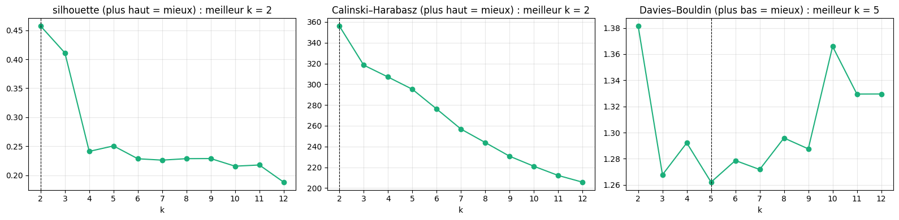
    

## 4. Le mélange de gaussiennes : BIC, entropie, ICL

Chaque famille j est une « bosse » gaussienne (centre et forme) dans l'espace des coordonnées ; le modèle donne à chaque rivière a une
probabilité t(a, j) d'appartenir à chaque famille.

- **BIC(k) = −2 · log-vraisemblance + (nombre de paramètres) · ln N** : décrire les données, en payant chaque paramètre. Plus bas = mieux.
- **Entropie E(k) = − Σ_a Σ_j t(a, j) · ln t(a, j)** : 0 si chaque rivière est sûre de sa famille, grande si beaucoup hésitent. Normalisée
  par N · ln k (entre 0 et 1).
- **ICL(k) = BIC(k) + 2 E(k)** : décrire les données **et** des familles nettement séparées. Plus bas = mieux.

Deux formes de bosses : **pleines** (chaque famille a sa propre ellipse) et **diagonales** (ellipses alignées sur les axes, deux fois moins
de paramètres). Chaque mélange : 20 départs, le meilleur gardé.

    
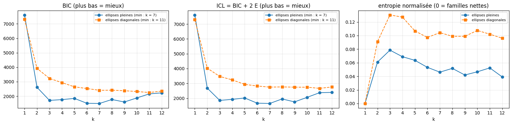
    

### L'entropie famille par famille

Pour chaque k (ellipses diagonales), chaque famille est un point : son entropie moyenne (sur les rivières qui y sont rangées, normalisée par
ln k ; 0 = toutes sûres d'y être) et sa taille (surface du point). Une famille floue est une famille que le mélange a créée sans vraie
frontière.

    
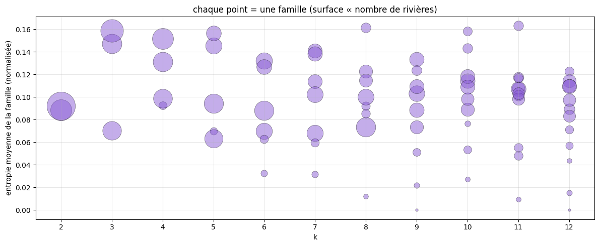
    

## 5. La stabilité

Pour chaque k : 100 fois, on retire au hasard 20 % des rivières, on refait k-means sur les 80 % restantes, et on compare leur rangement à
celui obtenu avec toutes les rivières (indice de Rand ajusté sur les rivières gardées : 1 = même rangement, 0 = comme au hasard). Un bon k
donne des familles qui ne dépendent pas de l'échantillon.

    
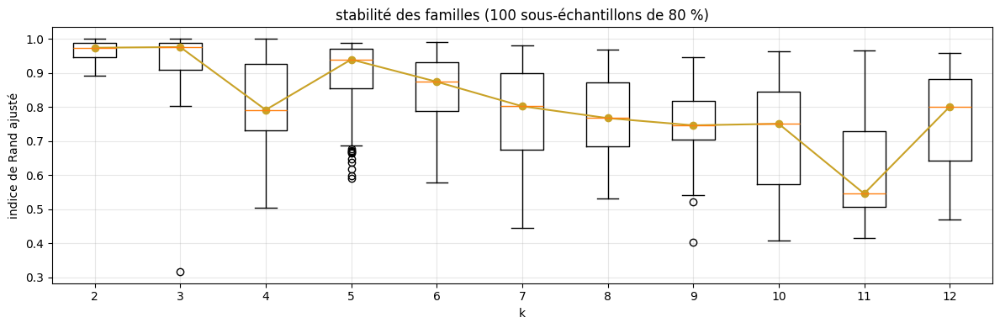
    

## 6. Le dendrogramme

Classification hiérarchique de Ward : on part de N familles d'une rivière et on fusionne à chaque étape les deux familles dont la fusion
augmente le moins l'inertie. La hauteur d'une fusion = ce qu'elle coûte. Couper l'arbre là où les branches verticales sont longues donne
des familles bien séparées. À droite : la hauteur des dernières fusions (la fusion qui passe de k à k − 1 familles).

    
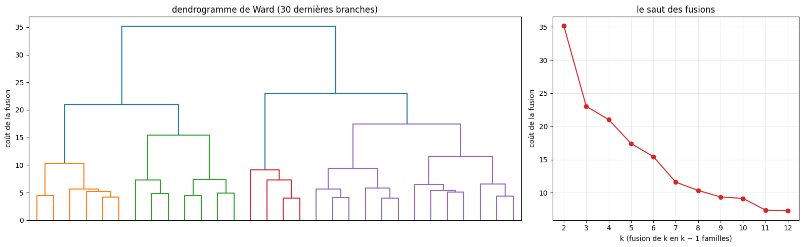
    

    accord Ward / k-means (indice de Rand ajusté) : {2: 0.78, 3: 0.68, 4: 0.69, 5: 0.36, 6: 0.71, 7: 0.67, 8: 0.64}

## 7. La taille des familles

Pour chaque k, la taille des familles k-means, de la plus grosse à la plus petite. Trait : 20 rivières, en dessous un LSTM de famille risque
de manquer d'exemples (notebook 5.07).

    
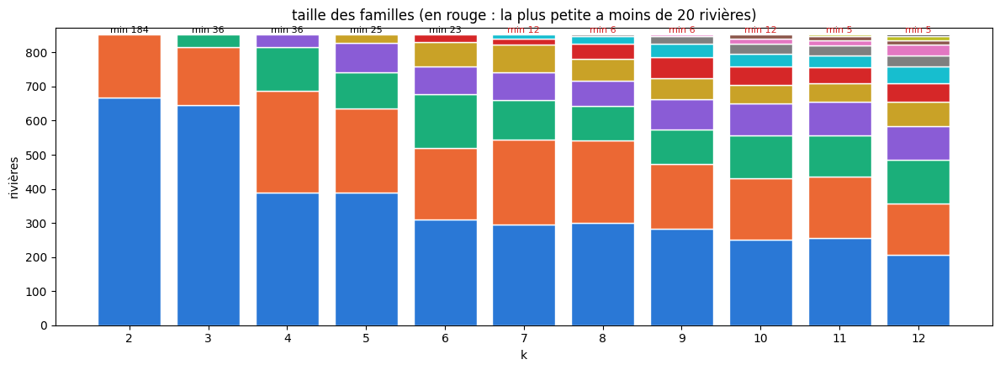
    

## 8. Comment les familles se coupent quand k augmente

Tableaux croisés entre deux k successifs : d'où viennent les familles de k + 1 (lignes : familles à k, colonnes : familles à k + 1). Puis le
portrait (attributs moyens) des familles pour k = 2, 3, 4 et 6.

    k = 3   0    1    2
    k = 2              
    0      36   12  136
    1       0  634   35 
    
    k = 4    0    1   2    3
    k = 3                   
    0        0    0  36    0
    1      355    0   0  291
    2       33  129   0    9 
    
    k = 5    0   1   2    3   4
    k = 4                      
    0      146   0   0  239   3
    1        0  82   0    6  41
    2        0   3  25    0   8
    3      243   0   0    1  56 
    
    k = 6    0   1   2    3   4    5
    k = 5                           
    0      218   0   0  171   0    0
    1        0  69   0    0  13    3
    2        0   1  22    0   2    0
    3       92   0   0    0   0  154
    4        0   1   1   38  66    2 
    
    k = 7    0    1   2   3   4    5   6
    k = 6                               
    0        0  254   0   0   0   56   0
    1        0    0   0  68   0    0   3
    2        0    0   1   0  12    0  10
    3        0    0  20   1   0  188   0
    4        4    0  62  10   0    0   5
    5      112   42   0   1   0    4   0 
    

    
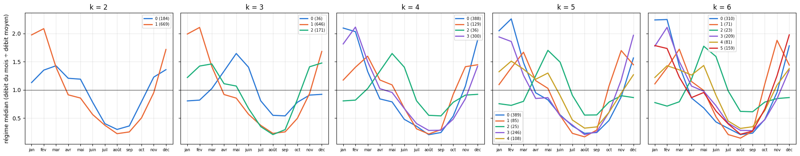
    

    k = 2

<table border="1" class="dataframe">
  <thead>
    <tr style="text-align: right;">
      <th></th>
      <th>rivières</th>
      <th>nervosité</th>
      <th>débit de base</th>
      <th>décrue</th>
      <th>contraste</th>
      <th>lame d'eau (mm/an)</th>
      <th>crues cos</th>
      <th>crues sin</th>
      <th>altitude (m)</th>
      <th>neige (%)</th>
      <th>karst (%)</th>
    </tr>
  </thead>
  <tbody>
    <tr>
      <th>0</th>
      <td>184</td>
      <td>0.25</td>
      <td>0.60</td>
      <td>0.06</td>
      <td>1.42</td>
      <td>483.55</td>
      <td>0.31</td>
      <td>0.05</td>
      <td>826.66</td>
      <td>14.68</td>
      <td>54.19</td>
    </tr>
    <tr>
      <th>1</th>
      <td>669</td>
      <td>0.22</td>
      <td>0.59</td>
      <td>0.07</td>
      <td>1.55</td>
      <td>307.27</td>
      <td>0.63</td>
      <td>0.20</td>
      <td>349.14</td>
      <td>8.19</td>
      <td>44.74</td>
    </tr>
  </tbody>
</table>

    k = 3

<table border="1" class="dataframe">
  <thead>
    <tr style="text-align: right;">
      <th></th>
      <th>rivières</th>
      <th>nervosité</th>
      <th>débit de base</th>
      <th>décrue</th>
      <th>contraste</th>
      <th>lame d'eau (mm/an)</th>
      <th>crues cos</th>
      <th>crues sin</th>
      <th>altitude (m)</th>
      <th>neige (%)</th>
      <th>karst (%)</th>
    </tr>
  </thead>
  <tbody>
    <tr>
      <th>0</th>
      <td>36</td>
      <td>0.15</td>
      <td>0.71</td>
      <td>0.04</td>
      <td>1.01</td>
      <td>534.95</td>
      <td>-0.00</td>
      <td>0.14</td>
      <td>1395.21</td>
      <td>26.62</td>
      <td>47.68</td>
    </tr>
    <tr>
      <th>1</th>
      <td>646</td>
      <td>0.22</td>
      <td>0.60</td>
      <td>0.07</td>
      <td>1.53</td>
      <td>298.73</td>
      <td>0.63</td>
      <td>0.21</td>
      <td>337.22</td>
      <td>7.85</td>
      <td>43.68</td>
    </tr>
    <tr>
      <th>2</th>
      <td>171</td>
      <td>0.31</td>
      <td>0.54</td>
      <td>0.07</td>
      <td>1.58</td>
      <td>481.27</td>
      <td>0.42</td>
      <td>0.01</td>
      <td>687.79</td>
      <td>12.58</td>
      <td>58.30</td>
    </tr>
  </tbody>
</table>

    k = 4

<table border="1" class="dataframe">
  <thead>
    <tr style="text-align: right;">
      <th></th>
      <th>rivières</th>
      <th>nervosité</th>
      <th>débit de base</th>
      <th>décrue</th>
      <th>contraste</th>
      <th>lame d'eau (mm/an)</th>
      <th>crues cos</th>
      <th>crues sin</th>
      <th>altitude (m)</th>
      <th>neige (%)</th>
      <th>karst (%)</th>
    </tr>
  </thead>
  <tbody>
    <tr>
      <th>0</th>
      <td>388</td>
      <td>0.25</td>
      <td>0.55</td>
      <td>0.08</td>
      <td>1.68</td>
      <td>358.52</td>
      <td>0.67</td>
      <td>0.13</td>
      <td>384.01</td>
      <td>9.44</td>
      <td>38.37</td>
    </tr>
    <tr>
      <th>1</th>
      <td>129</td>
      <td>0.30</td>
      <td>0.55</td>
      <td>0.07</td>
      <td>1.57</td>
      <td>479.36</td>
      <td>0.39</td>
      <td>-0.01</td>
      <td>716.12</td>
      <td>12.11</td>
      <td>54.66</td>
    </tr>
    <tr>
      <th>2</th>
      <td>36</td>
      <td>0.15</td>
      <td>0.71</td>
      <td>0.04</td>
      <td>1.01</td>
      <td>534.95</td>
      <td>-0.00</td>
      <td>0.14</td>
      <td>1395.21</td>
      <td>26.62</td>
      <td>47.68</td>
    </tr>
    <tr>
      <th>3</th>
      <td>300</td>
      <td>0.18</td>
      <td>0.65</td>
      <td>0.06</td>
      <td>1.35</td>
      <td>247.79</td>
      <td>0.56</td>
      <td>0.30</td>
      <td>313.59</td>
      <td>6.66</td>
      <td>54.17</td>
    </tr>
  </tbody>
</table>

    k = 5

<table border="1" class="dataframe">
  <thead>
    <tr style="text-align: right;">
      <th></th>
      <th>rivières</th>
      <th>nervosité</th>
      <th>débit de base</th>
      <th>décrue</th>
      <th>contraste</th>
      <th>lame d'eau (mm/an)</th>
      <th>crues cos</th>
      <th>crues sin</th>
      <th>altitude (m)</th>
      <th>neige (%)</th>
      <th>karst (%)</th>
    </tr>
  </thead>
  <tbody>
    <tr>
      <th>0</th>
      <td>389</td>
      <td>0.21</td>
      <td>0.61</td>
      <td>0.06</td>
      <td>1.49</td>
      <td>256.64</td>
      <td>0.64</td>
      <td>0.26</td>
      <td>263.25</td>
      <td>6.40</td>
      <td>50.46</td>
    </tr>
    <tr>
      <th>1</th>
      <td>85</td>
      <td>0.33</td>
      <td>0.51</td>
      <td>0.07</td>
      <td>1.68</td>
      <td>418.34</td>
      <td>0.40</td>
      <td>-0.09</td>
      <td>688.30</td>
      <td>11.21</td>
      <td>48.98</td>
    </tr>
    <tr>
      <th>2</th>
      <td>25</td>
      <td>0.14</td>
      <td>0.71</td>
      <td>0.04</td>
      <td>1.00</td>
      <td>606.02</td>
      <td>-0.09</td>
      <td>0.11</td>
      <td>1661.54</td>
      <td>31.80</td>
      <td>41.92</td>
    </tr>
    <tr>
      <th>3</th>
      <td>246</td>
      <td>0.27</td>
      <td>0.54</td>
      <td>0.09</td>
      <td>1.69</td>
      <td>402.51</td>
      <td>0.65</td>
      <td>0.08</td>
      <td>470.32</td>
      <td>10.89</td>
      <td>35.25</td>
    </tr>
    <tr>
      <th>4</th>
      <td>108</td>
      <td>0.18</td>
      <td>0.68</td>
      <td>0.05</td>
      <td>1.24</td>
      <td>416.44</td>
      <td>0.37</td>
      <td>0.25</td>
      <td>625.35</td>
      <td>11.71</td>
      <td>59.20</td>
    </tr>
  </tbody>
</table>

    k = 6

<table border="1" class="dataframe">
  <thead>
    <tr style="text-align: right;">
      <th></th>
      <th>rivières</th>
      <th>nervosité</th>
      <th>débit de base</th>
      <th>décrue</th>
      <th>contraste</th>
      <th>lame d'eau (mm/an)</th>
      <th>crues cos</th>
      <th>crues sin</th>
      <th>altitude (m)</th>
      <th>neige (%)</th>
      <th>karst (%)</th>
    </tr>
  </thead>
  <tbody>
    <tr>
      <th>0</th>
      <td>310</td>
      <td>0.23</td>
      <td>0.57</td>
      <td>0.07</td>
      <td>1.63</td>
      <td>292.53</td>
      <td>0.69</td>
      <td>0.19</td>
      <td>283.72</td>
      <td>7.68</td>
      <td>40.49</td>
    </tr>
    <tr>
      <th>1</th>
      <td>71</td>
      <td>0.34</td>
      <td>0.50</td>
      <td>0.06</td>
      <td>1.68</td>
      <td>423.90</td>
      <td>0.41</td>
      <td>-0.12</td>
      <td>638.43</td>
      <td>9.75</td>
      <td>48.04</td>
    </tr>
    <tr>
      <th>2</th>
      <td>23</td>
      <td>0.14</td>
      <td>0.73</td>
      <td>0.04</td>
      <td>0.97</td>
      <td>591.36</td>
      <td>-0.12</td>
      <td>0.15</td>
      <td>1632.32</td>
      <td>31.76</td>
      <td>41.02</td>
    </tr>
    <tr>
      <th>3</th>
      <td>209</td>
      <td>0.18</td>
      <td>0.66</td>
      <td>0.05</td>
      <td>1.30</td>
      <td>248.11</td>
      <td>0.56</td>
      <td>0.32</td>
      <td>308.76</td>
      <td>6.13</td>
      <td>57.29</td>
    </tr>
    <tr>
      <th>4</th>
      <td>81</td>
      <td>0.22</td>
      <td>0.64</td>
      <td>0.06</td>
      <td>1.37</td>
      <td>483.13</td>
      <td>0.29</td>
      <td>0.19</td>
      <td>789.22</td>
      <td>14.23</td>
      <td>52.50</td>
    </tr>
    <tr>
      <th>5</th>
      <td>159</td>
      <td>0.28</td>
      <td>0.53</td>
      <td>0.09</td>
      <td>1.67</td>
      <td>435.02</td>
      <td>0.61</td>
      <td>0.05</td>
      <td>543.38</td>
      <td>12.22</td>
      <td>42.59</td>
    </tr>
  </tbody>
</table>

## 9. Les cartes

    
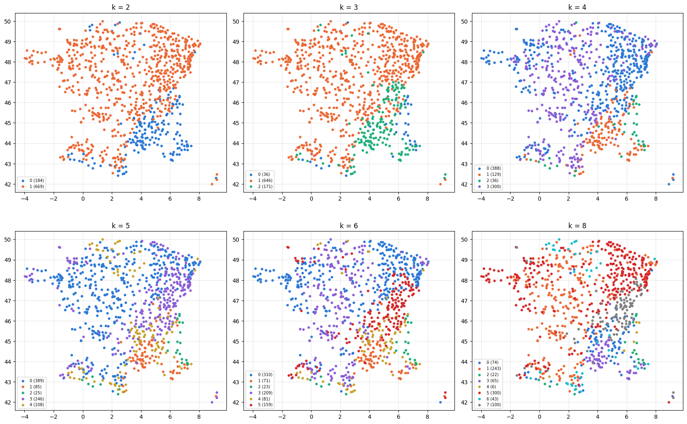
    

## 10. La séparation des Alpes, du Jura et de la craie selon k

Mêmes groupes de référence qu'aux notebooks 3.6 et 3.8 (craie : bassins E, H et I, débit de base ≥ 0,75, altitude moyenne < 300 m).
Séparation de deux groupes : part de leurs paires dans deux familles différentes ; cohésion : part des paires d'un même groupe dans la même
famille.

    
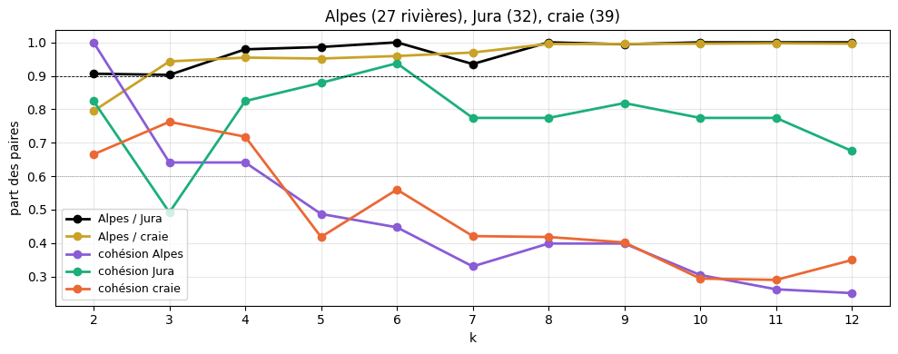
    

## 11. Le bilan

Le k que préfère chaque critère, et les tailles des familles.

<table border="1" class="dataframe">
  <thead>
    <tr style="text-align: right;">
      <th></th>
      <th>k préféré</th>
    </tr>
  </thead>
  <tbody>
    <tr>
      <th>coude (baisse &lt; 5 % de W(1))</th>
      <td>5.0</td>
    </tr>
    <tr>
      <th>gap (règle de Tibshirani)</th>
      <td>NaN</td>
    </tr>
    <tr>
      <th>silhouette</th>
      <td>2.0</td>
    </tr>
    <tr>
      <th>Calinski–Harabasz</th>
      <td>2.0</td>
    </tr>
    <tr>
      <th>Davies–Bouldin</th>
      <td>5.0</td>
    </tr>
    <tr>
      <th>BIC, ellipses pleines</th>
      <td>7.0</td>
    </tr>
    <tr>
      <th>BIC, ellipses diagonales</th>
      <td>11.0</td>
    </tr>
    <tr>
      <th>ICL, ellipses pleines</th>
      <td>7.0</td>
    </tr>
    <tr>
      <th>ICL, ellipses diagonales</th>
      <td>11.0</td>
    </tr>
    <tr>
      <th>stabilité (médiane la plus haute)</th>
      <td>3.0</td>
    </tr>
  </tbody>
</table>

<table border="1" class="dataframe">
  <thead>
    <tr style="text-align: right;">
      <th></th>
      <th>silhouette</th>
      <th>Gap</th>
      <th>ICL diag</th>
      <th>entropie normalisée (diag)</th>
      <th>stabilité (médiane)</th>
      <th>plus petite famille</th>
      <th>Alpes / Jura</th>
      <th>Alpes / craie</th>
      <th>cohésion Alpes</th>
      <th>cohésion Jura</th>
      <th>cohésion craie</th>
    </tr>
  </thead>
  <tbody>
    <tr>
      <th>1</th>
      <td>NaN</td>
      <td>1.676</td>
      <td>7310.761</td>
      <td>0.000</td>
      <td>NaN</td>
      <td>853</td>
      <td>NaN</td>
      <td>NaN</td>
      <td>NaN</td>
      <td>NaN</td>
      <td>NaN</td>
    </tr>
    <tr>
      <th>2</th>
      <td>0.457</td>
      <td>1.881</td>
      <td>4027.823</td>
      <td>0.091</td>
      <td>0.974</td>
      <td>184</td>
      <td>0.906</td>
      <td>0.795</td>
      <td>1.000</td>
      <td>0.825</td>
      <td>0.665</td>
    </tr>
    <tr>
      <th>3</th>
      <td>0.411</td>
      <td>1.992</td>
      <td>3470.645</td>
      <td>0.130</td>
      <td>0.976</td>
      <td>36</td>
      <td>0.903</td>
      <td>0.943</td>
      <td>0.641</td>
      <td>0.492</td>
      <td>0.762</td>
    </tr>
    <tr>
      <th>4</th>
      <td>0.241</td>
      <td>2.084</td>
      <td>3239.227</td>
      <td>0.127</td>
      <td>0.791</td>
      <td>36</td>
      <td>0.979</td>
      <td>0.954</td>
      <td>0.641</td>
      <td>0.825</td>
      <td>0.718</td>
    </tr>
    <tr>
      <th>5</th>
      <td>0.251</td>
      <td>2.163</td>
      <td>2937.691</td>
      <td>0.107</td>
      <td>0.939</td>
      <td>25</td>
      <td>0.986</td>
      <td>0.952</td>
      <td>0.487</td>
      <td>0.879</td>
      <td>0.418</td>
    </tr>
    <tr>
      <th>6</th>
      <td>0.229</td>
      <td>2.206</td>
      <td>2826.782</td>
      <td>0.097</td>
      <td>0.874</td>
      <td>23</td>
      <td>1.000</td>
      <td>0.959</td>
      <td>0.447</td>
      <td>0.938</td>
      <td>0.560</td>
    </tr>
    <tr>
      <th>7</th>
      <td>0.226</td>
      <td>2.230</td>
      <td>2751.460</td>
      <td>0.104</td>
      <td>0.802</td>
      <td>12</td>
      <td>0.935</td>
      <td>0.970</td>
      <td>0.330</td>
      <td>0.774</td>
      <td>0.421</td>
    </tr>
    <tr>
      <th>8</th>
      <td>0.229</td>
      <td>2.255</td>
      <td>2764.903</td>
      <td>0.099</td>
      <td>0.767</td>
      <td>6</td>
      <td>1.000</td>
      <td>0.995</td>
      <td>0.399</td>
      <td>0.774</td>
      <td>0.418</td>
    </tr>
    <tr>
      <th>9</th>
      <td>0.229</td>
      <td>2.277</td>
      <td>2747.510</td>
      <td>0.099</td>
      <td>0.746</td>
      <td>6</td>
      <td>0.994</td>
      <td>0.995</td>
      <td>0.399</td>
      <td>0.819</td>
      <td>0.402</td>
    </tr>
    <tr>
      <th>10</th>
      <td>0.216</td>
      <td>2.303</td>
      <td>2745.019</td>
      <td>0.107</td>
      <td>0.751</td>
      <td>12</td>
      <td>1.000</td>
      <td>0.996</td>
      <td>0.305</td>
      <td>0.774</td>
      <td>0.294</td>
    </tr>
    <tr>
      <th>11</th>
      <td>0.218</td>
      <td>2.319</td>
      <td>2669.106</td>
      <td>0.102</td>
      <td>0.546</td>
      <td>5</td>
      <td>1.000</td>
      <td>0.997</td>
      <td>0.262</td>
      <td>0.774</td>
      <td>0.290</td>
    </tr>
    <tr>
      <th>12</th>
      <td>0.188</td>
      <td>2.345</td>
      <td>2759.651</td>
      <td>0.096</td>
      <td>0.801</td>
      <td>5</td>
      <td>1.000</td>
      <td>0.996</td>
      <td>0.251</td>
      <td>0.675</td>
      <td>0.350</td>
    </tr>
  </tbody>
</table>

