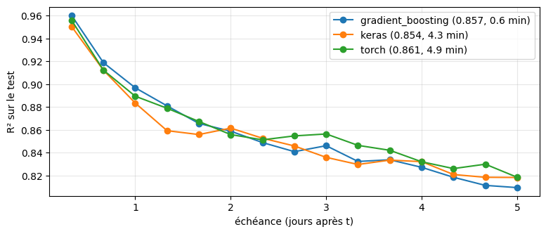
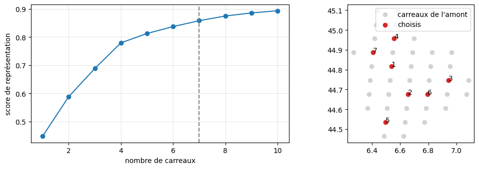
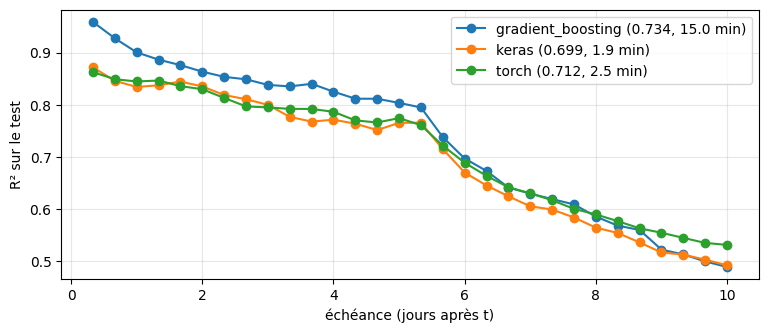
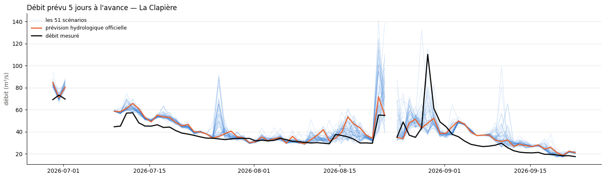
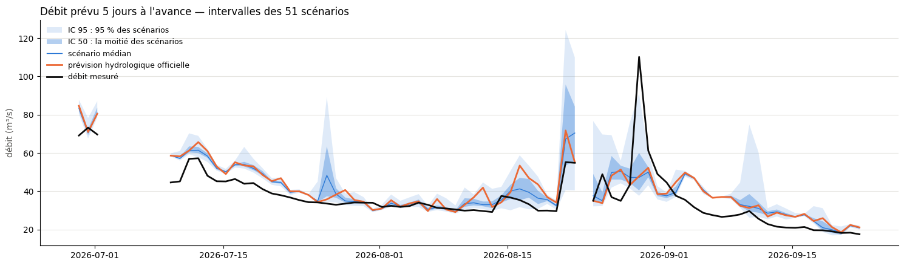
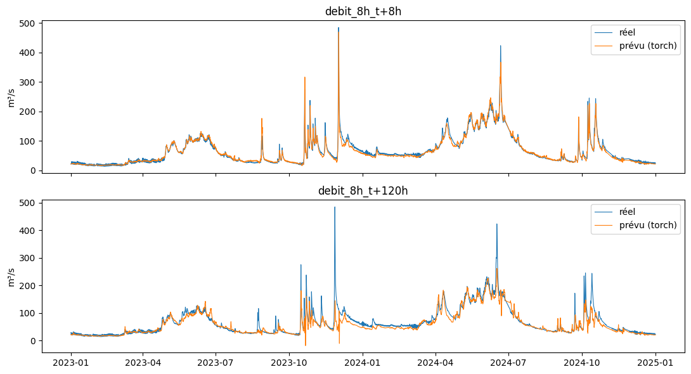

# 4.1 — Les premiers modèles, le test avec les vraies prévisions

X, Y d'une station (`src/features.py`), choix des carreaux, trois modèles (`src/modeles.py` : gradient boosting par échéance, réseau TensorFlow, réseau PyTorch), choix des hyperparamètres par validation croisée. Tout est compté depuis t, l'instant où l'on prévoit.

## 1. Choisir les carreaux

Glouton sur les attributs BasinATLAS (aucun appel) : chaque morceau de l'amont doit avoir un carreau choisi qui lui ressemble (neige, pluie, position), chaque morceau compte pour l'eau qu'il envoie à la rivière. Tout est réglable : `criteres={"snw_pc_syr": 1, "pre_mm_syr": 1, "position": 1}`, `poids="run_mm_syr"` ou `None`, `dedans_min`, `largeur`, `seuil`, `k_max`.

    7 carreaux retenus : [835931, 841112, 838522, 830767, 846307, 841113, 833346]

    

    

<table border="1" class="dataframe">
  <thead>
    <tr style="text-align: right;">
      <th></th>
      <th>rang</th>
      <th>carreau</th>
      <th>gain</th>
      <th>score</th>
      <th>retenu</th>
      <th>part_eau</th>
      <th>lon_centre</th>
      <th>lat_centre</th>
      <th>snw_pc_syr</th>
      <th>pre_mm_syr</th>
    </tr>
  </thead>
  <tbody>
    <tr>
      <th>0</th>
      <td>1</td>
      <td>835931</td>
      <td>0.448434</td>
      <td>0.448434</td>
      <td>True</td>
      <td>0.0384</td>
      <td>6.537867</td>
      <td>44.815465</td>
      <td>38.7</td>
      <td>1379.8</td>
    </tr>
    <tr>
      <th>1</th>
      <td>2</td>
      <td>841112</td>
      <td>0.140245</td>
      <td>0.588679</td>
      <td>True</td>
      <td>0.0365</td>
      <td>6.656394</td>
      <td>44.674867</td>
      <td>33.5</td>
      <td>1256.5</td>
    </tr>
    <tr>
      <th>2</th>
      <td>3</td>
      <td>838522</td>
      <td>0.099867</td>
      <td>0.688546</td>
      <td>True</td>
      <td>0.0406</td>
      <td>6.944444</td>
      <td>44.745166</td>
      <td>44.0</td>
      <td>1427.3</td>
    </tr>
    <tr>
      <th>3</th>
      <td>4</td>
      <td>830767</td>
      <td>0.090871</td>
      <td>0.779416</td>
      <td>True</td>
      <td>0.0379</td>
      <td>6.558140</td>
      <td>44.956062</td>
      <td>42.2</td>
      <td>1434.6</td>
    </tr>
    <tr>
      <th>4</th>
      <td>5</td>
      <td>846307</td>
      <td>0.033247</td>
      <td>0.812664</td>
      <td>True</td>
      <td>0.0212</td>
      <td>6.497696</td>
      <td>44.534270</td>
      <td>32.0</td>
      <td>1177.0</td>
    </tr>
    <tr>
      <th>5</th>
      <td>6</td>
      <td>841113</td>
      <td>0.024466</td>
      <td>0.837130</td>
      <td>True</td>
      <td>0.0369</td>
      <td>6.795069</td>
      <td>44.674867</td>
      <td>37.1</td>
      <td>1332.5</td>
    </tr>
    <tr>
      <th>6</th>
      <td>7</td>
      <td>833346</td>
      <td>0.020917</td>
      <td>0.858046</td>
      <td>True</td>
      <td>0.0347</td>
      <td>6.408669</td>
      <td>44.885763</td>
      <td>44.0</td>
      <td>1475.0</td>
    </tr>
    <tr>
      <th>7</th>
      <td>8</td>
      <td>835932</td>
      <td>0.016591</td>
      <td>0.874637</td>
      <td>False</td>
      <td>0.0367</td>
      <td>6.676971</td>
      <td>44.815465</td>
      <td>35.5</td>
      <td>1319.8</td>
    </tr>
    <tr>
      <th>8</th>
      <td>9</td>
      <td>830768</td>
      <td>0.010840</td>
      <td>0.885477</td>
      <td>False</td>
      <td>0.0259</td>
      <td>6.697674</td>
      <td>44.956062</td>
      <td>43.9</td>
      <td>1441.5</td>
    </tr>
    <tr>
      <th>9</th>
      <td>10</td>
      <td>841111</td>
      <td>0.007757</td>
      <td>0.893234</td>
      <td>False</td>
      <td>0.0373</td>
      <td>6.517720</td>
      <td>44.674867</td>
      <td>32.7</td>
      <td>1243.9</td>
    </tr>
  </tbody>
</table>

## 2. X et Y

On part de X et Y vides, on ajoute (ou retire) ce qu'on veut, puis `construire()` lit les caches. `F.X.columns` / `F.Y.columns` montrent ce qui est prévu avant de construire. Toute la météo est déjà en cache : aucun appel Open-Meteo.

    prévu  X : 280 colonnes  Y : 15 échéances
        type carreau        variable depuis jusqu_a  pas avant_echeance  \
    0  meteo  835931   precipitation    24h      5D  12h           None   
    1  meteo  835931  temperature_2m    24h      5D  12h           None   
    2  meteo  835931      snow_depth    24h      5D  12h           None   
    3  meteo  841112   precipitation    24h      5D  12h           None   
    4  meteo  841112  temperature_2m    24h      5D  12h           None   
    
      apres_echeance  
    0             0h  
    1             0h  
    2             0h  
    3             0h  
    4             0h  
    X : (115233, 280)  Y : (115233, 15)  années : [2010, 2011, 2012, 2013, 2014, 2015, 2016, 2017, 2018, 2019, 2020, 2021, 2022, 2023, 2024, 2025]

## 3. Entraîner les trois modèles (cellule longue)

`entrainer` apprend sur la période d'apprentissage, note sur la calibration et le test et ENREGISTRE chaque modèle dans `data/cache/modeles/`. Un modèle déjà entraîné avec la même recette, le même découpage et les mêmes réglages est relu (0 s, sans même construire X). Réglages modifiables : `entrainer(F, "torch", couches=(128, 128), lot=512)`.

    

    

## 3.5 on augmente le nombre de variables météo

    7 carreaux retenus : [835931, 841112, 838522, 830767, 846307, 841113, 833346]

    

    

<table border="1" class="dataframe">
  <thead>
    <tr style="text-align: right;">
      <th></th>
      <th>rang</th>
      <th>carreau</th>
      <th>gain</th>
      <th>score</th>
      <th>retenu</th>
      <th>part_eau</th>
      <th>lon_centre</th>
      <th>lat_centre</th>
      <th>snw_pc_syr</th>
      <th>pre_mm_syr</th>
    </tr>
  </thead>
  <tbody>
    <tr>
      <th>0</th>
      <td>1</td>
      <td>835931</td>
      <td>0.448434</td>
      <td>0.448434</td>
      <td>True</td>
      <td>0.0384</td>
      <td>6.537867</td>
      <td>44.815465</td>
      <td>38.7</td>
      <td>1379.8</td>
    </tr>
    <tr>
      <th>1</th>
      <td>2</td>
      <td>841112</td>
      <td>0.140245</td>
      <td>0.588679</td>
      <td>True</td>
      <td>0.0365</td>
      <td>6.656394</td>
      <td>44.674867</td>
      <td>33.5</td>
      <td>1256.5</td>
    </tr>
    <tr>
      <th>2</th>
      <td>3</td>
      <td>838522</td>
      <td>0.099867</td>
      <td>0.688546</td>
      <td>True</td>
      <td>0.0406</td>
      <td>6.944444</td>
      <td>44.745166</td>
      <td>44.0</td>
      <td>1427.3</td>
    </tr>
    <tr>
      <th>3</th>
      <td>4</td>
      <td>830767</td>
      <td>0.090871</td>
      <td>0.779416</td>
      <td>True</td>
      <td>0.0379</td>
      <td>6.558140</td>
      <td>44.956062</td>
      <td>42.2</td>
      <td>1434.6</td>
    </tr>
    <tr>
      <th>4</th>
      <td>5</td>
      <td>846307</td>
      <td>0.033247</td>
      <td>0.812664</td>
      <td>True</td>
      <td>0.0212</td>
      <td>6.497696</td>
      <td>44.534270</td>
      <td>32.0</td>
      <td>1177.0</td>
    </tr>
    <tr>
      <th>5</th>
      <td>6</td>
      <td>841113</td>
      <td>0.024466</td>
      <td>0.837130</td>
      <td>True</td>
      <td>0.0369</td>
      <td>6.795069</td>
      <td>44.674867</td>
      <td>37.1</td>
      <td>1332.5</td>
    </tr>
    <tr>
      <th>6</th>
      <td>7</td>
      <td>833346</td>
      <td>0.020917</td>
      <td>0.858046</td>
      <td>True</td>
      <td>0.0347</td>
      <td>6.408669</td>
      <td>44.885763</td>
      <td>44.0</td>
      <td>1475.0</td>
    </tr>
    <tr>
      <th>7</th>
      <td>8</td>
      <td>835932</td>
      <td>0.016591</td>
      <td>0.874637</td>
      <td>False</td>
      <td>0.0367</td>
      <td>6.676971</td>
      <td>44.815465</td>
      <td>35.5</td>
      <td>1319.8</td>
    </tr>
    <tr>
      <th>8</th>
      <td>9</td>
      <td>830768</td>
      <td>0.010840</td>
      <td>0.885477</td>
      <td>False</td>
      <td>0.0259</td>
      <td>6.697674</td>
      <td>44.956062</td>
      <td>43.9</td>
      <td>1441.5</td>
    </tr>
    <tr>
      <th>9</th>
      <td>10</td>
      <td>841111</td>
      <td>0.007757</td>
      <td>0.893234</td>
      <td>False</td>
      <td>0.0373</td>
      <td>6.517720</td>
      <td>44.674867</td>
      <td>32.7</td>
      <td>1243.9</td>
    </tr>
  </tbody>
</table>

    prévu  X : 532 colonnes  Y : 30 échéances
        type carreau                 variable depuis jusqu_a  pas avant_echeance  \
    0  meteo  835931           temperature_2m    24h      5D  12h           None   
    1  meteo  835931               snow_depth    24h      5D  12h           None   
    2  meteo  835931      shortwave_radiation    24h      5D  12h           None   
    3  meteo  835931                     rain    24h      5D  12h           None   
    4  meteo  835931  soil_moisture_7_to_28cm    24h      5D  12h           None   
    
      apres_echeance  
    0             0h  
    1             0h  
    2             0h  
    3             0h  
    4             0h  
    X : (111886, 532)  Y : (111886, 30)  années : [2010, 2011, 2012, 2013, 2014, 2015, 2016, 2017, 2018, 2019, 2020, 2021, 2022, 2023, 2024, 2025]

    

    

### 3.5 bis Un seul réseau pour toutes les échéances, ou un réseau par échéance ?

Un réseau peut sortir les 15 échéances d'un coup (**un seul réseau**, plusieurs sorties) ou être entraîné 15 fois, une par échéance, sur les seules colonnes de X qui la concernent (**un réseau par échéance**, comme le gradient boosting). Comparaison sur les mêmes X (sections 3 et 3.5), avec les mêmes réglages `RESEAU` : tous ces modèles sont déjà en cache, rien n'est réentraîné.

Résultat (mesuré le 2026-10-13) : même $R^2$ moyen à 0,01 près, un seul réseau 12 à 15 fois plus rapide ; c'est le défaut d'`entrainer` depuis le 2026-10-15 (`un_reseau_par_echeance=False`).

## 3.6 X réduit : un seul seuil pour l'espace et le temps

Même expérience que 3.5 (même débit passé, même date, mêmes échéances, mêmes réglages, 15 minutes par modèle), mais la météo de X, la table d'entrée du modèle, est choisie d'après les mesures du notebook 1.2 (section 8) au lieu de 7 carreaux au pas de 12 h. Les précipitations (pluie + neige) remplacent pluie et neige séparées : la température suffit au modèle pour faire la différence.

Un seul seuil `SEUIL` pour tout :

- **en espace**, pour chaque variable, on prend des carreaux un par un : à chaque tour, celui qui, ajouté aux carreaux déjà pris, reconstruit le mieux les 41 carreaux (par combinaison linéaire), jusqu'à garder `SEUIL` de la variance. Si $x$ est la série d'un carreau et $\hat x_S$ sa meilleure reconstruction à partir des carreaux choisis $S$, la part gardée est

$$
1 - \frac{\sum_{\text{carreaux}} \sum_t \left(x_t - \hat x_{S,t}\right)^2}{\sum_{\text{carreaux}} \sum_t \left(x_t - \bar x\right)^2} ;
$$

- **en temps**, le plus long pas (qui divise 24 h et 5 jours) qui garde `SEUIL` (notebook 1.2, 2.4.2) ; si même un seul morceau de toute la fenêtre (24 h avant t, 5 jours après) le garde, on prend seulement la valeur à t.

`SEUIL = 0.82` donne 560 colonnes, autant que les 532 de 3.5 : on compare à taille égale (0,95 en donnerait 3 605). Le choix se fait sur les années d'entraînement depuis 2017 (une seule source météo, voir notebook 1.2), jamais sur le test.

## 3.7 Comme 3.5, plus l'évapotranspiration

Même recette que 3.5 (mêmes 7 carreaux, 24 h avant t et 5 jours après au pas de 12 h, même débit passé, même date, mêmes échéances, mêmes réglages, 15 minutes au plus par modèle), avec une 7e variable météo : l'**évapotranspiration** (`et0_fao_evapotranspiration`, mm). C'est l'eau que l'air peut reprendre au sol et aux plantes ; Open-Meteo la calcule (formule FAO) à partir de la température, du vent, de l'humidité et du soleil.

## 3.8 Le test avec les vraies prévisions

Jusqu'ici, le test donne au modèle la météo future **réellement observée** : c'est comme s'il avait des prévisions parfaites, donc ses notes sont trop belles aux longues échéances. Ici, on refait le test avec ce qu'on aurait vraiment eu sous la main : pour chaque instant $t$, la dernière prévision ECMWF 9 km (archive Single Runs, depuis le 14 mars 2024) émise au moins 7 h avant $t$ (le temps qu'elle soit publiée). Seule la météo **après** $t$ change ; le passé, le débit et la date restent les mêmes (`Features.avec_previsions`). Deux règles :

- la pluie des prévisions est refaite comme celle de l'archive (précipitations − neige) : la `rain` brute des prévisions oublie les averses ;
- la neige au sol et l'humidité du sol futures gardent leur **valeur observée à $t$** (ce qu'on sait à $t$) : la neige au sol des prévisions vient d'un autre modèle que celle de l'archive, jusqu'à 2,5 fois plus ou moins de neige.

Les deux notes (météo observée, vraies prévisions) portent sur les mêmes heures : la partie du test couverte par l'archive (mars → décembre 2024). `entrainer` les calcule pour chaque nouveau modèle ; elles sont dans la fiche et dans `contenu_cache()` (colonnes `r2_previsions`, `r2_crue_previsions`, `erreur_pic_previsions`).

## 3.9 Un modèle branché sur les 51 scénarios ECMWF

On prend le modèle le plus cohérent avec les données disponibles : le gradient boosting de la **section 3** (`010b47e351d2`, 7 carreaux : précipitations, température, neige au sol). Ses 7 carreaux sont ceux dont on a déjà les 51 scénarios, et toute sa météo future (précipitations, température) en vient ; neige au sol à sa valeur à $t$. Avec les vraies prévisions, c'est l'un des meilleurs de ces 7 carreaux (3.8 : $R^2$ 0,848, erreur sur les pics 14,7 %). Depuis le 24 juin 2026 (début de l'archive des 51 scénarios à 9 km, voir notebook 1.2 section 9), chaque jour à 7 h UTC (dès que la prévision de 0 h est publiée), on lui donne :

- la **prévision officielle** ECMWF 9 km : c'est la **prévision hydrologique officielle**, celle qu'on ferait jusqu'ici ;
- chacun des **51 scénarios** à la place : précipitations et température du scénario ; neige au sol à sa valeur à $t$, comme toujours.

On obtient 51 prévisions de débit, plus l'officielle, comparées au débit mesuré. 2026 n'a jamais servi à l'entraînement (années 2010-2025 hors test) : c'est un vrai test. On trace l'échéance **J+5** : le débit moyen des 8 heures qui finissent 5 jours après $t$.

    

    

    

    

    débit mesuré dans l'IC 50 : 19% des jours (50 % attendus) ; dans l'IC 95 : 35% (95 % attendus)

## 4. Prévision et réalité sur le test (meilleur modèle)

    

    

## 5. Choisir les hyperparamètres (gradient boosting)

Validation croisée par blocs d'années, dans la période d'apprentissage seulement (calibration et test mis de côté). Temps ≈ combinaisons × plis × échéances entraînements : commencer petit (`max_iter=50` fixé pour tous les essais). Marche aussi avec `nom="torch"` et une grille comme `{"lot": [64, 512]}`.

## 6. Cache des modèles

Tous les modèles enregistrés, du plus récent au plus ancien. `vider_cache(...)` en supprime (tous si rien n'est donné).
