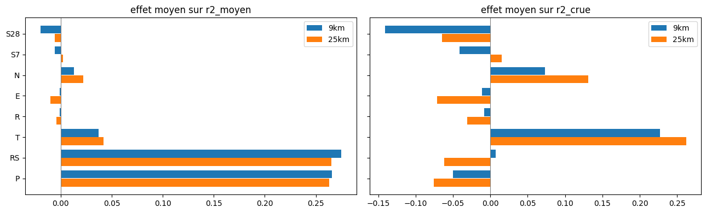
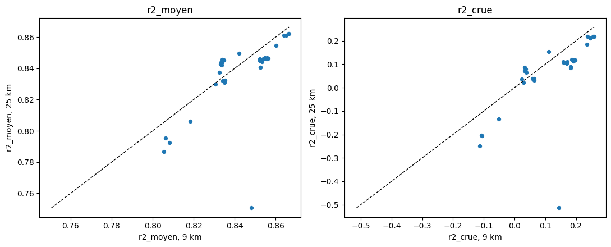

# 4.2 — Le criblage des variables et de la grille

Résultats de la file d'entraînement de nuit (`scripts/file_entrainement.py`) : des dizaines de gradient boosting **identiques sauf** les variables météo de X (la table d'entrée du modèle) et la grille des carreaux. Le gradient boosting est déterministe : deux modèles ne diffèrent que par leurs données.

Règles communes : 2010-2025, test 2023-2024 ; 15 échéances de 8 h à 5 jours ; débit des 24 dernières heures ; date ; variables de flux sur 24 h avant $t$ et 5 jours après, au pas de 12 h ; **neige au sol et humidité du sol seulement à $t$** ; 7 carreaux par grille ; 4 minutes d'entraînement au plus.

| sigle | variable | type |
|---|---|---|
| P | précipitations (pluie + neige) | flux |
| RS | pluie et neige qui tombe séparées (remplace P) | flux |
| T | température à 2 m | flux |
| R | rayonnement solaire | flux |
| E | évapotranspiration | flux |
| N | neige au sol | état, à $t$ |
| S7 | humidité du sol 7-28 cm | état, à $t$ |
| S28 | humidité du sol 28-100 cm | état, à $t$ |

Grilles : **9 km** = 7 carreaux O1280 choisis par `choisir_carreaux` (météo best_match) ; **25 km** = les 7 carreaux ERA5 0,25° qui couvrent 98 % du bassin (`bassins.carreaux_utiles`, météo ERA5, neige au sol ERA5-Land).

Notes : $R^2$ moyen sur les 15 échéances ; $R^2$ crue et erreur sur les pics (`modeles.scores_crue`) ; **« prévisions »** = les mêmes notes avec de vraies prévisions archivées : à 9 km la prévision officielle ECMWF (mars-déc. 2024, section 3.8 du notebook 4.1), à 25 km le contrôle des 51 scénarios de dynamical.org (avril-déc. 2024).

    The autoreload extension is already loaded. To reload it, use:
      %reload_ext autoreload
    133 modèles : 95 à 9 km, 38 à 25 km

## 1. Le classement

Trié par $R^2$ avec les vraies prévisions quand il existe (9 km), sinon par $R^2$ avec la météo observée.

<table border="1" class="dataframe">
  <thead>
    <tr style="text-align: right;">
      <th></th>
      <th>grille</th>
      <th>modele</th>
      <th>variables</th>
      <th>pas</th>
      <th>depuis</th>
      <th>n_carreaux</th>
      <th>colonnes_x</th>
      <th>r2_moyen</th>
      <th>r2_previsions</th>
      <th>r2_crue</th>
      <th>r2_crue_previsions</th>
      <th>erreur_pic_pct</th>
      <th>erreur_pic_previsions</th>
      <th>r2_j1</th>
      <th>r2_j3</th>
      <th>r2_j5</th>
      <th>duree_min</th>
      <th>coupe</th>
    </tr>
  </thead>
  <tbody>
    <tr>
      <th>0</th>
      <td>9km</td>
      <td>torch</td>
      <td>RS+T+N</td>
      <td>RS:3h,T:12h</td>
      <td>RS:72h,T:72h</td>
      <td>7</td>
      <td>1043</td>
      <td>0.901</td>
      <td>0.888</td>
      <td>0.492</td>
      <td>0.351</td>
      <td>14.692</td>
      <td>14.309</td>
      <td>0.933</td>
      <td>0.891</td>
      <td>0.851</td>
      <td>6.543</td>
      <td>False</td>
    </tr>
    <tr>
      <th>1</th>
      <td>9km</td>
      <td>torch</td>
      <td>RS+T+R+E+N</td>
      <td>12h</td>
      <td>72h</td>
      <td>7</td>
      <td>595</td>
      <td>0.892</td>
      <td>0.887</td>
      <td>0.485</td>
      <td>0.370</td>
      <td>14.744</td>
      <td>14.410</td>
      <td>0.913</td>
      <td>0.884</td>
      <td>0.857</td>
      <td>5.660</td>
      <td>False</td>
    </tr>
    <tr>
      <th>2</th>
      <td>9km</td>
      <td>torch</td>
      <td>RS+T+N</td>
      <td>12h</td>
      <td>72h</td>
      <td>7</td>
      <td>371</td>
      <td>0.896</td>
      <td>0.883</td>
      <td>0.465</td>
      <td>0.330</td>
      <td>14.875</td>
      <td>15.502</td>
      <td>0.917</td>
      <td>0.901</td>
      <td>0.844</td>
      <td>5.017</td>
      <td>False</td>
    </tr>
    <tr>
      <th>3</th>
      <td>9km</td>
      <td>torch</td>
      <td>RS+T+N</td>
      <td>RS:12h,T:12h</td>
      <td>RS:72h,T:72h</td>
      <td>7</td>
      <td>371</td>
      <td>0.898</td>
      <td>0.883</td>
      <td>0.483</td>
      <td>0.325</td>
      <td>14.896</td>
      <td>15.385</td>
      <td>0.925</td>
      <td>0.892</td>
      <td>0.862</td>
      <td>5.042</td>
      <td>False</td>
    </tr>
    <tr>
      <th>4</th>
      <td>9km</td>
      <td>torch</td>
      <td>RS+T+R+E+N</td>
      <td>12h</td>
      <td>24h</td>
      <td>10</td>
      <td>638</td>
      <td>0.893</td>
      <td>0.879</td>
      <td>0.495</td>
      <td>0.303</td>
      <td>15.363</td>
      <td>14.830</td>
      <td>0.918</td>
      <td>0.883</td>
      <td>0.854</td>
      <td>5.292</td>
      <td>False</td>
    </tr>
    <tr>
      <th>...</th>
      <td>...</td>
      <td>...</td>
      <td>...</td>
      <td>...</td>
      <td>...</td>
      <td>...</td>
      <td>...</td>
      <td>...</td>
      <td>...</td>
      <td>...</td>
      <td>...</td>
      <td>...</td>
      <td>...</td>
      <td>...</td>
      <td>...</td>
      <td>...</td>
      <td>...</td>
      <td>...</td>
    </tr>
    <tr>
      <th>128</th>
      <td>25km</td>
      <td>gradient_boosting</td>
      <td>P+R+N+S7</td>
      <td>12h</td>
      <td>24h</td>
      <td>7</td>
      <td>210</td>
      <td>0.795</td>
      <td>NaN</td>
      <td>-0.205</td>
      <td>NaN</td>
      <td>21.201</td>
      <td>NaN</td>
      <td>0.881</td>
      <td>0.758</td>
      <td>0.714</td>
      <td>2.220</td>
      <td>False</td>
    </tr>
    <tr>
      <th>129</th>
      <td>25km</td>
      <td>gradient_boosting</td>
      <td>P+R</td>
      <td>12h</td>
      <td>24h</td>
      <td>7</td>
      <td>196</td>
      <td>0.793</td>
      <td>NaN</td>
      <td>-0.207</td>
      <td>NaN</td>
      <td>21.783</td>
      <td>NaN</td>
      <td>0.885</td>
      <td>0.747</td>
      <td>0.706</td>
      <td>2.288</td>
      <td>False</td>
    </tr>
    <tr>
      <th>130</th>
      <td>25km</td>
      <td>gradient_boosting</td>
      <td>P+E+S7</td>
      <td>12h</td>
      <td>24h</td>
      <td>7</td>
      <td>203</td>
      <td>0.787</td>
      <td>NaN</td>
      <td>-0.250</td>
      <td>NaN</td>
      <td>21.493</td>
      <td>NaN</td>
      <td>0.881</td>
      <td>0.752</td>
      <td>0.666</td>
      <td>2.423</td>
      <td>False</td>
    </tr>
    <tr>
      <th>131</th>
      <td>25km</td>
      <td>gradient_boosting</td>
      <td>RS+T+R+E</td>
      <td>12h</td>
      <td>24h</td>
      <td>7</td>
      <td>448</td>
      <td>0.751</td>
      <td>NaN</td>
      <td>-0.514</td>
      <td>NaN</td>
      <td>25.947</td>
      <td>NaN</td>
      <td>0.896</td>
      <td>0.768</td>
      <td>0.532</td>
      <td>4.685</td>
      <td>True</td>
    </tr>
    <tr>
      <th>132</th>
      <td>9km</td>
      <td>gradient_boosting</td>
      <td>aucune météo</td>
      <td>12h</td>
      <td>24h</td>
      <td>7</td>
      <td>28</td>
      <td>0.670</td>
      <td>NaN</td>
      <td>-0.950</td>
      <td>NaN</td>
      <td>27.688</td>
      <td>NaN</td>
      <td>0.805</td>
      <td>0.611</td>
      <td>0.539</td>
      <td>0.605</td>
      <td>False</td>
    </tr>
  </tbody>
</table>

133 rows × 18 columns

## 2. Ce qu'apporte chaque variable

Deux lectures :

- **une à une**, autour de la référence P+T+R+N+S7 : la différence de note quand on retire (ou ajoute, ou remplace) une seule variable ;
- **sur tous les modèles** : pour chaque grille, on ajuste note $\approx a + \sum_v b_v \, \mathbb{1}_v$ ($\mathbb{1}_v$ = 1 si la variable $v$ est dans X) par moindres carrés ; $b_v$ est l'effet moyen de la variable, les autres étant ce qu'elles sont.

<table border="1" class="dataframe">
  <thead>
    <tr style="text-align: right;">
      <th></th>
      <th></th>
      <th>Δ r2_moyen</th>
      <th>Δ r2_crue</th>
      <th>Δ r2_j5</th>
      <th>Δ r2_previsions</th>
      <th>Δ r2_crue_previsions</th>
    </tr>
    <tr>
      <th>grille</th>
      <th>changement</th>
      <th></th>
      <th></th>
      <th></th>
      <th></th>
      <th></th>
    </tr>
  </thead>
  <tbody>
    <tr>
      <th rowspan="15" valign="top">25km</th>
      <th>+ E</th>
      <td>0.000</td>
      <td>-0.001</td>
      <td>-0.002</td>
      <td>NaN</td>
      <td>NaN</td>
    </tr>
    <tr>
      <th>+ E + S28</th>
      <td>-0.001</td>
      <td>-0.032</td>
      <td>-0.004</td>
      <td>NaN</td>
      <td>NaN</td>
    </tr>
    <tr>
      <th>+ S28</th>
      <td>-0.002</td>
      <td>-0.039</td>
      <td>-0.007</td>
      <td>NaN</td>
      <td>NaN</td>
    </tr>
    <tr>
      <th>− N</th>
      <td>-0.013</td>
      <td>-0.074</td>
      <td>-0.034</td>
      <td>NaN</td>
      <td>NaN</td>
    </tr>
    <tr>
      <th>− N + E</th>
      <td>-0.014</td>
      <td>-0.074</td>
      <td>-0.030</td>
      <td>NaN</td>
      <td>NaN</td>
    </tr>
    <tr>
      <th>− N − R</th>
      <td>-0.016</td>
      <td>-0.089</td>
      <td>-0.038</td>
      <td>NaN</td>
      <td>NaN</td>
    </tr>
    <tr>
      <th>− N − S7</th>
      <td>-0.005</td>
      <td>-0.027</td>
      <td>-0.007</td>
      <td>NaN</td>
      <td>NaN</td>
    </tr>
    <tr>
      <th>− P + RS</th>
      <td>0.015</td>
      <td>0.107</td>
      <td>0.017</td>
      <td>NaN</td>
      <td>NaN</td>
    </tr>
    <tr>
      <th>− R</th>
      <td>-0.002</td>
      <td>-0.009</td>
      <td>0.001</td>
      <td>NaN</td>
      <td>NaN</td>
    </tr>
    <tr>
      <th>− R + E</th>
      <td>-0.001</td>
      <td>-0.005</td>
      <td>-0.002</td>
      <td>NaN</td>
      <td>NaN</td>
    </tr>
    <tr>
      <th>− R + S28</th>
      <td>-0.002</td>
      <td>-0.039</td>
      <td>-0.010</td>
      <td>NaN</td>
      <td>NaN</td>
    </tr>
    <tr>
      <th>− R − S7</th>
      <td>0.000</td>
      <td>0.007</td>
      <td>0.009</td>
      <td>NaN</td>
      <td>NaN</td>
    </tr>
    <tr>
      <th>− S7</th>
      <td>0.001</td>
      <td>0.007</td>
      <td>0.009</td>
      <td>NaN</td>
      <td>NaN</td>
    </tr>
    <tr>
      <th>− S7 + E</th>
      <td>0.000</td>
      <td>0.001</td>
      <td>0.006</td>
      <td>NaN</td>
      <td>NaN</td>
    </tr>
    <tr>
      <th>− T</th>
      <td>-0.050</td>
      <td>-0.316</td>
      <td>-0.075</td>
      <td>NaN</td>
      <td>NaN</td>
    </tr>
    <tr>
      <th rowspan="16" valign="top">9km</th>
      <th>+ E</th>
      <td>-0.002</td>
      <td>-0.013</td>
      <td>-0.005</td>
      <td>-0.001</td>
      <td>-0.005</td>
    </tr>
    <tr>
      <th>+ E + S28</th>
      <td>-0.019</td>
      <td>-0.136</td>
      <td>-0.031</td>
      <td>-0.032</td>
      <td>-0.220</td>
    </tr>
    <tr>
      <th>+ S28</th>
      <td>-0.021</td>
      <td>-0.139</td>
      <td>-0.036</td>
      <td>-0.037</td>
      <td>-0.245</td>
    </tr>
    <tr>
      <th>− N</th>
      <td>-0.019</td>
      <td>-0.108</td>
      <td>-0.050</td>
      <td>-0.026</td>
      <td>-0.192</td>
    </tr>
    <tr>
      <th>− N + E</th>
      <td>-0.020</td>
      <td>-0.113</td>
      <td>-0.053</td>
      <td>-0.025</td>
      <td>-0.187</td>
    </tr>
    <tr>
      <th>− N − R</th>
      <td>-0.023</td>
      <td>-0.142</td>
      <td>-0.069</td>
      <td>-0.026</td>
      <td>-0.196</td>
    </tr>
    <tr>
      <th>− N − S7</th>
      <td>-0.001</td>
      <td>0.011</td>
      <td>0.004</td>
      <td>-0.002</td>
      <td>-0.028</td>
    </tr>
    <tr>
      <th>− P + RS</th>
      <td>0.010</td>
      <td>0.065</td>
      <td>0.014</td>
      <td>0.005</td>
      <td>0.032</td>
    </tr>
    <tr>
      <th>− R</th>
      <td>-0.001</td>
      <td>-0.003</td>
      <td>-0.002</td>
      <td>0.000</td>
      <td>0.000</td>
    </tr>
    <tr>
      <th>− R + E</th>
      <td>-0.002</td>
      <td>-0.011</td>
      <td>-0.006</td>
      <td>0.000</td>
      <td>0.002</td>
    </tr>
    <tr>
      <th>− R + S28</th>
      <td>-0.020</td>
      <td>-0.138</td>
      <td>-0.038</td>
      <td>-0.035</td>
      <td>-0.234</td>
    </tr>
    <tr>
      <th>− R − S7</th>
      <td>0.003</td>
      <td>0.025</td>
      <td>0.021</td>
      <td>0.005</td>
      <td>0.032</td>
    </tr>
    <tr>
      <th>− S7</th>
      <td>0.002</td>
      <td>0.020</td>
      <td>0.018</td>
      <td>0.003</td>
      <td>0.022</td>
    </tr>
    <tr>
      <th>− S7 + E</th>
      <td>0.002</td>
      <td>0.020</td>
      <td>0.012</td>
      <td>0.005</td>
      <td>0.031</td>
    </tr>
    <tr>
      <th>− T</th>
      <td>-0.048</td>
      <td>-0.279</td>
      <td>-0.067</td>
      <td>-0.033</td>
      <td>-0.168</td>
    </tr>
    <tr>
      <th>− T + E</th>
      <td>-0.038</td>
      <td>-0.229</td>
      <td>-0.050</td>
      <td>-0.018</td>
      <td>-0.083</td>
    </tr>
  </tbody>
</table>

    

    

<table border="1" class="dataframe">
  <thead>
    <tr>
      <th></th>
      <th colspan="3" halign="left">25km</th>
      <th colspan="4" halign="left">9km</th>
    </tr>
    <tr>
      <th></th>
      <th>r2_moyen</th>
      <th>r2_crue</th>
      <th>r2_j5</th>
      <th>r2_moyen</th>
      <th>r2_crue</th>
      <th>r2_j5</th>
      <th>r2_previsions</th>
    </tr>
  </thead>
  <tbody>
    <tr>
      <th>constante</th>
      <td>0.529</td>
      <td>-0.138</td>
      <td>0.463</td>
      <td>0.542</td>
      <td>-0.043</td>
      <td>0.486</td>
      <td>0.548</td>
    </tr>
    <tr>
      <th>P</th>
      <td>0.263</td>
      <td>-0.076</td>
      <td>0.238</td>
      <td>0.266</td>
      <td>-0.050</td>
      <td>0.244</td>
      <td>0.271</td>
    </tr>
    <tr>
      <th>RS</th>
      <td>0.265</td>
      <td>-0.062</td>
      <td>0.225</td>
      <td>0.275</td>
      <td>0.007</td>
      <td>0.242</td>
      <td>0.277</td>
    </tr>
    <tr>
      <th>T</th>
      <td>0.042</td>
      <td>0.262</td>
      <td>0.066</td>
      <td>0.037</td>
      <td>0.227</td>
      <td>0.050</td>
      <td>0.017</td>
    </tr>
    <tr>
      <th>R</th>
      <td>-0.004</td>
      <td>-0.031</td>
      <td>-0.012</td>
      <td>-0.001</td>
      <td>-0.008</td>
      <td>-0.001</td>
      <td>-0.002</td>
    </tr>
    <tr>
      <th>E</th>
      <td>-0.010</td>
      <td>-0.071</td>
      <td>-0.031</td>
      <td>-0.001</td>
      <td>-0.011</td>
      <td>-0.010</td>
      <td>0.001</td>
    </tr>
    <tr>
      <th>N</th>
      <td>0.022</td>
      <td>0.131</td>
      <td>0.056</td>
      <td>0.013</td>
      <td>0.073</td>
      <td>0.041</td>
      <td>0.015</td>
    </tr>
    <tr>
      <th>S7</th>
      <td>0.002</td>
      <td>0.015</td>
      <td>0.000</td>
      <td>-0.006</td>
      <td>-0.041</td>
      <td>-0.019</td>
      <td>-0.009</td>
    </tr>
    <tr>
      <th>S28</th>
      <td>-0.006</td>
      <td>-0.065</td>
      <td>-0.023</td>
      <td>-0.020</td>
      <td>-0.141</td>
      <td>-0.039</td>
      <td>-0.035</td>
    </tr>
  </tbody>
</table>

## 3. 9 km ou 25 km ?

Chaque jeu de variables a été entraîné sur les deux grilles : on compare les paires (note à 25 km − note à 9 km). Au-dessus de la diagonale, 25 km fait mieux.

    32 paires
    écart moyen (25 km − 9 km) : {'r2_moyen': -0.006, 'r2_crue': -0.055, 'r2_j5': -0.009}
    part des paires où 25 km fait mieux : {'r2_moyen': 0.25, 'r2_crue': 0.25, 'r2_j5': 0.47}

    

    

<table border="1" class="dataframe">
  <thead>
    <tr style="text-align: right;">
      <th></th>
      <th>r2_moyen</th>
      <th>r2_crue</th>
      <th>r2_j5</th>
    </tr>
    <tr>
      <th>variables</th>
      <th></th>
      <th></th>
      <th></th>
    </tr>
  </thead>
  <tbody>
    <tr>
      <th>RS+T+R+E</th>
      <td>-0.098</td>
      <td>-0.658</td>
      <td>-0.194</td>
    </tr>
    <tr>
      <th>P+E+S7</th>
      <td>-0.019</td>
      <td>-0.136</td>
      <td>-0.043</td>
    </tr>
    <tr>
      <th>P+R</th>
      <td>-0.016</td>
      <td>-0.101</td>
      <td>-0.021</td>
    </tr>
    <tr>
      <th>P+R+E+N</th>
      <td>-0.012</td>
      <td>-0.084</td>
      <td>-0.028</td>
    </tr>
    <tr>
      <th>P+T+R</th>
      <td>-0.012</td>
      <td>-0.097</td>
      <td>-0.022</td>
    </tr>
    <tr>
      <th>P+T</th>
      <td>-0.012</td>
      <td>-0.094</td>
      <td>-0.018</td>
    </tr>
    <tr>
      <th>P+R+N+S7</th>
      <td>-0.011</td>
      <td>-0.098</td>
      <td>-0.018</td>
    </tr>
    <tr>
      <th>P+T+N</th>
      <td>-0.010</td>
      <td>-0.079</td>
      <td>-0.022</td>
    </tr>
    <tr>
      <th>P+T+R+E+N</th>
      <td>-0.010</td>
      <td>-0.079</td>
      <td>-0.015</td>
    </tr>
    <tr>
      <th>P+T+N+S7</th>
      <td>-0.009</td>
      <td>-0.066</td>
      <td>-0.007</td>
    </tr>
    <tr>
      <th>P+T+R+N</th>
      <td>-0.009</td>
      <td>-0.073</td>
      <td>-0.019</td>
    </tr>
    <tr>
      <th>P+T+R+N+S7</th>
      <td>-0.008</td>
      <td>-0.060</td>
      <td>-0.010</td>
    </tr>
    <tr>
      <th>P+T+E+N</th>
      <td>-0.008</td>
      <td>-0.066</td>
      <td>-0.014</td>
    </tr>
    <tr>
      <th>P+T+E+N+S7</th>
      <td>-0.007</td>
      <td>-0.055</td>
      <td>-0.006</td>
    </tr>
    <tr>
      <th>P+T+R+E+N+S7</th>
      <td>-0.006</td>
      <td>-0.049</td>
      <td>-0.007</td>
    </tr>
    <tr>
      <th>RS+T</th>
      <td>-0.005</td>
      <td>-0.049</td>
      <td>0.005</td>
    </tr>
    <tr>
      <th>RS+T+R+N</th>
      <td>-0.004</td>
      <td>-0.041</td>
      <td>0.005</td>
    </tr>
    <tr>
      <th>RS+T+N</th>
      <td>-0.004</td>
      <td>-0.037</td>
      <td>0.006</td>
    </tr>
    <tr>
      <th>P+T+E+S7</th>
      <td>-0.004</td>
      <td>-0.033</td>
      <td>0.001</td>
    </tr>
    <tr>
      <th>RS+T+R+E+N</th>
      <td>-0.004</td>
      <td>-0.034</td>
      <td>0.006</td>
    </tr>
    <tr>
      <th>RS+T+R+N+S7</th>
      <td>-0.003</td>
      <td>-0.018</td>
      <td>-0.008</td>
    </tr>
    <tr>
      <th>P+T+R+S7</th>
      <td>-0.003</td>
      <td>-0.026</td>
      <td>0.006</td>
    </tr>
    <tr>
      <th>P+T+R+E+S7</th>
      <td>-0.002</td>
      <td>-0.021</td>
      <td>0.012</td>
    </tr>
    <tr>
      <th>P+T+S7</th>
      <td>-0.001</td>
      <td>-0.007</td>
      <td>0.022</td>
    </tr>
    <tr>
      <th>P+T+R+E+N+S28</th>
      <td>0.005</td>
      <td>0.011</td>
      <td>-0.018</td>
    </tr>
    <tr>
      <th>RS+T+R+S7</th>
      <td>0.007</td>
      <td>0.044</td>
      <td>0.021</td>
    </tr>
    <tr>
      <th>P+T+E+N+S28</th>
      <td>0.008</td>
      <td>0.028</td>
      <td>0.017</td>
    </tr>
    <tr>
      <th>P+T+N+S28</th>
      <td>0.009</td>
      <td>0.038</td>
      <td>0.014</td>
    </tr>
    <tr>
      <th>P+T+N+S7+S28</th>
      <td>0.010</td>
      <td>0.038</td>
      <td>0.019</td>
    </tr>
    <tr>
      <th>P+T+R+E+N+S7+S28</th>
      <td>0.010</td>
      <td>0.044</td>
      <td>0.017</td>
    </tr>
    <tr>
      <th>P+T+R+N+S7+S28</th>
      <td>0.011</td>
      <td>0.040</td>
      <td>0.020</td>
    </tr>
    <tr>
      <th>P+T+E+N+S7+S28</th>
      <td>0.012</td>
      <td>0.052</td>
      <td>0.020</td>
    </tr>
  </tbody>
</table>

## 4. Gradient boosting ou réseaux de neurones ? (file 2, étape A)

Mêmes X que les meilleurs jeux de la file 1 (découpage de base : pas de 12 h, 24 h de passé, 7 carreaux), refaits en keras et torch (un seul réseau pour toutes les échéances, 10 minutes au plus). Attention : un réseau n'est entraîné qu'une fois, ses notes varient d'un entraînement à l'autre.

<table border="1" class="dataframe">
  <thead>
    <tr>
      <th></th>
      <th></th>
      <th colspan="3" halign="left">r2_crue_previsions</th>
      <th colspan="3" halign="left">r2_moyen</th>
      <th colspan="3" halign="left">r2_previsions</th>
    </tr>
    <tr>
      <th></th>
      <th>modele</th>
      <th>gradient_boosting</th>
      <th>keras</th>
      <th>torch</th>
      <th>gradient_boosting</th>
      <th>keras</th>
      <th>torch</th>
      <th>gradient_boosting</th>
      <th>keras</th>
      <th>torch</th>
    </tr>
    <tr>
      <th>grille</th>
      <th>variables</th>
      <th></th>
      <th></th>
      <th></th>
      <th></th>
      <th></th>
      <th></th>
      <th></th>
      <th></th>
      <th></th>
    </tr>
  </thead>
  <tbody>
    <tr>
      <th rowspan="4" valign="top">25km</th>
      <th>RS+T+N</th>
      <td>NaN</td>
      <td>NaN</td>
      <td>NaN</td>
      <td>0.862</td>
      <td>0.870</td>
      <td>0.867</td>
      <td>NaN</td>
      <td>NaN</td>
      <td>NaN</td>
    </tr>
    <tr>
      <th>RS+T+R+E+N</th>
      <td>NaN</td>
      <td>NaN</td>
      <td>NaN</td>
      <td>0.861</td>
      <td>NaN</td>
      <td>NaN</td>
      <td>NaN</td>
      <td>NaN</td>
      <td>NaN</td>
    </tr>
    <tr>
      <th>RS+T+R+N</th>
      <td>NaN</td>
      <td>NaN</td>
      <td>NaN</td>
      <td>0.862</td>
      <td>0.856</td>
      <td>0.840</td>
      <td>NaN</td>
      <td>NaN</td>
      <td>NaN</td>
    </tr>
    <tr>
      <th>RS+T+R+N+S7</th>
      <td>NaN</td>
      <td>NaN</td>
      <td>NaN</td>
      <td>0.861</td>
      <td>NaN</td>
      <td>NaN</td>
      <td>NaN</td>
      <td>NaN</td>
      <td>NaN</td>
    </tr>
    <tr>
      <th rowspan="4" valign="top">9km</th>
      <th>RS+T+N</th>
      <td>0.119</td>
      <td>0.052</td>
      <td>0.277</td>
      <td>0.866</td>
      <td>0.874</td>
      <td>0.887</td>
      <td>0.855</td>
      <td>0.840</td>
      <td>0.876</td>
    </tr>
    <tr>
      <th>RS+T+R+E+N</th>
      <td>0.102</td>
      <td>0.132</td>
      <td>0.258</td>
      <td>0.865</td>
      <td>0.873</td>
      <td>0.886</td>
      <td>0.853</td>
      <td>0.852</td>
      <td>0.872</td>
    </tr>
    <tr>
      <th>RS+T+R+N</th>
      <td>0.115</td>
      <td>0.171</td>
      <td>0.194</td>
      <td>0.866</td>
      <td>0.885</td>
      <td>0.867</td>
      <td>0.854</td>
      <td>0.855</td>
      <td>0.861</td>
    </tr>
    <tr>
      <th>RS+T+R+N+S7</th>
      <td>0.096</td>
      <td>0.168</td>
      <td>0.267</td>
      <td>0.864</td>
      <td>0.890</td>
      <td>0.870</td>
      <td>0.851</td>
      <td>0.858</td>
      <td>0.868</td>
    </tr>
  </tbody>
</table>

## 5. Découpage en temps et en espace (file 2, étape C)

Pour les meilleures configurations : pas des variables de flux (3 h, 6 h, 12 h, 24 h, ou un pas par variable), durée de passé (24 h, 72 h, 7 jours), nombre de carreaux (9 km : 3 à 41 dans l'ordre de `choisir_carreaux` ; 25 km : 4 à 9 par surface). Neige au sol et sol toujours à $t$ ; météo future jusqu'à 5 jours.

    
    === torch, RS+T+N

<table border="1" class="dataframe">
  <thead>
    <tr style="text-align: right;">
      <th></th>
      <th>grille</th>
      <th>pas</th>
      <th>depuis</th>
      <th>n_carreaux</th>
      <th>colonnes_x</th>
      <th>r2_moyen</th>
      <th>r2_previsions</th>
      <th>r2_crue_previsions</th>
      <th>erreur_pic_previsions</th>
      <th>r2_j5</th>
      <th>duree_min</th>
      <th>coupe</th>
    </tr>
  </thead>
  <tbody>
    <tr>
      <th>104</th>
      <td>25km</td>
      <td>12h</td>
      <td>24h</td>
      <td>4</td>
      <td>176</td>
      <td>0.862</td>
      <td>NaN</td>
      <td>NaN</td>
      <td>NaN</td>
      <td>0.809</td>
      <td>5.995</td>
      <td>False</td>
    </tr>
    <tr>
      <th>105</th>
      <td>25km</td>
      <td>12h</td>
      <td>24h</td>
      <td>5</td>
      <td>213</td>
      <td>0.849</td>
      <td>NaN</td>
      <td>NaN</td>
      <td>NaN</td>
      <td>0.808</td>
      <td>7.185</td>
      <td>False</td>
    </tr>
    <tr>
      <th>77</th>
      <td>25km</td>
      <td>12h</td>
      <td>24h</td>
      <td>7</td>
      <td>287</td>
      <td>0.867</td>
      <td>NaN</td>
      <td>NaN</td>
      <td>NaN</td>
      <td>0.837</td>
      <td>6.378</td>
      <td>False</td>
    </tr>
    <tr>
      <th>86</th>
      <td>9km</td>
      <td>12h</td>
      <td>24h</td>
      <td>3</td>
      <td>139</td>
      <td>0.833</td>
      <td>0.809</td>
      <td>-0.150</td>
      <td>19.417</td>
      <td>0.785</td>
      <td>1.852</td>
      <td>False</td>
    </tr>
    <tr>
      <th>87</th>
      <td>9km</td>
      <td>12h</td>
      <td>24h</td>
      <td>5</td>
      <td>213</td>
      <td>0.870</td>
      <td>0.868</td>
      <td>0.239</td>
      <td>16.644</td>
      <td>0.819</td>
      <td>3.028</td>
      <td>False</td>
    </tr>
    <tr>
      <th>82</th>
      <td>9km</td>
      <td>12h</td>
      <td>168h</td>
      <td>7</td>
      <td>539</td>
      <td>0.892</td>
      <td>0.873</td>
      <td>0.285</td>
      <td>16.628</td>
      <td>0.865</td>
      <td>5.213</td>
      <td>False</td>
    </tr>
    <tr>
      <th>67</th>
      <td>9km</td>
      <td>12h</td>
      <td>24h</td>
      <td>7</td>
      <td>287</td>
      <td>0.887</td>
      <td>0.876</td>
      <td>0.277</td>
      <td>14.664</td>
      <td>0.869</td>
      <td>7.272</td>
      <td>False</td>
    </tr>
    <tr>
      <th>79</th>
      <td>9km</td>
      <td>24h</td>
      <td>24h</td>
      <td>7</td>
      <td>161</td>
      <td>0.856</td>
      <td>0.846</td>
      <td>0.076</td>
      <td>17.822</td>
      <td>0.813</td>
      <td>3.117</td>
      <td>False</td>
    </tr>
    <tr>
      <th>80</th>
      <td>9km</td>
      <td>3h</td>
      <td>24h</td>
      <td>7</td>
      <td>1043</td>
      <td>0.864</td>
      <td>0.861</td>
      <td>0.187</td>
      <td>15.926</td>
      <td>0.849</td>
      <td>10.000</td>
      <td>True</td>
    </tr>
    <tr>
      <th>78</th>
      <td>9km</td>
      <td>6h</td>
      <td>24h</td>
      <td>7</td>
      <td>539</td>
      <td>0.856</td>
      <td>0.866</td>
      <td>0.245</td>
      <td>15.504</td>
      <td>0.824</td>
      <td>5.423</td>
      <td>False</td>
    </tr>
    <tr>
      <th>85</th>
      <td>9km</td>
      <td>RS:3h,T:12h</td>
      <td>24h</td>
      <td>7</td>
      <td>791</td>
      <td>0.892</td>
      <td>0.868</td>
      <td>0.232</td>
      <td>14.627</td>
      <td>0.862</td>
      <td>9.647</td>
      <td>False</td>
    </tr>
    <tr>
      <th>84</th>
      <td>9km</td>
      <td>RS:6h,T:24h</td>
      <td>24h</td>
      <td>7</td>
      <td>413</td>
      <td>0.883</td>
      <td>0.873</td>
      <td>0.254</td>
      <td>15.170</td>
      <td>0.857</td>
      <td>5.982</td>
      <td>False</td>
    </tr>
    <tr>
      <th>81</th>
      <td>9km</td>
      <td>12h</td>
      <td>72h</td>
      <td>7</td>
      <td>371</td>
      <td>0.896</td>
      <td>0.883</td>
      <td>0.330</td>
      <td>15.502</td>
      <td>0.844</td>
      <td>5.017</td>
      <td>False</td>
    </tr>
    <tr>
      <th>83</th>
      <td>9km</td>
      <td>6h</td>
      <td>72h</td>
      <td>7</td>
      <td>707</td>
      <td>0.887</td>
      <td>0.872</td>
      <td>0.276</td>
      <td>14.869</td>
      <td>0.864</td>
      <td>8.475</td>
      <td>False</td>
    </tr>
    <tr>
      <th>88</th>
      <td>9km</td>
      <td>12h</td>
      <td>24h</td>
      <td>10</td>
      <td>398</td>
      <td>0.897</td>
      <td>0.872</td>
      <td>0.258</td>
      <td>14.346</td>
      <td>0.869</td>
      <td>5.040</td>
      <td>False</td>
    </tr>
    <tr>
      <th>89</th>
      <td>9km</td>
      <td>12h</td>
      <td>24h</td>
      <td>15</td>
      <td>583</td>
      <td>0.890</td>
      <td>0.862</td>
      <td>0.192</td>
      <td>15.398</td>
      <td>0.856</td>
      <td>7.027</td>
      <td>False</td>
    </tr>
    <tr>
      <th>90</th>
      <td>9km</td>
      <td>12h</td>
      <td>24h</td>
      <td>41</td>
      <td>1545</td>
      <td>0.843</td>
      <td>0.850</td>
      <td>0.170</td>
      <td>16.295</td>
      <td>0.819</td>
      <td>5.130</td>
      <td>False</td>
    </tr>
  </tbody>
</table>

    
    === torch, RS+T+R+E+N

<table border="1" class="dataframe">
  <thead>
    <tr style="text-align: right;">
      <th></th>
      <th>grille</th>
      <th>pas</th>
      <th>depuis</th>
      <th>n_carreaux</th>
      <th>colonnes_x</th>
      <th>r2_moyen</th>
      <th>r2_previsions</th>
      <th>r2_crue_previsions</th>
      <th>erreur_pic_previsions</th>
      <th>r2_j5</th>
      <th>duree_min</th>
      <th>coupe</th>
    </tr>
  </thead>
  <tbody>
    <tr>
      <th>99</th>
      <td>9km</td>
      <td>12h</td>
      <td>24h</td>
      <td>3</td>
      <td>211</td>
      <td>0.856</td>
      <td>0.842</td>
      <td>0.077</td>
      <td>15.918</td>
      <td>0.839</td>
      <td>3.138</td>
      <td>False</td>
    </tr>
    <tr>
      <th>100</th>
      <td>9km</td>
      <td>12h</td>
      <td>24h</td>
      <td>5</td>
      <td>333</td>
      <td>0.845</td>
      <td>0.849</td>
      <td>0.127</td>
      <td>16.837</td>
      <td>0.814</td>
      <td>3.187</td>
      <td>False</td>
    </tr>
    <tr>
      <th>95</th>
      <td>9km</td>
      <td>12h</td>
      <td>168h</td>
      <td>7</td>
      <td>875</td>
      <td>0.885</td>
      <td>0.867</td>
      <td>0.252</td>
      <td>15.846</td>
      <td>0.865</td>
      <td>4.023</td>
      <td>False</td>
    </tr>
    <tr>
      <th>71</th>
      <td>9km</td>
      <td>12h</td>
      <td>24h</td>
      <td>7</td>
      <td>455</td>
      <td>0.886</td>
      <td>0.872</td>
      <td>0.258</td>
      <td>15.510</td>
      <td>0.859</td>
      <td>6.952</td>
      <td>False</td>
    </tr>
    <tr>
      <th>92</th>
      <td>9km</td>
      <td>24h</td>
      <td>24h</td>
      <td>7</td>
      <td>245</td>
      <td>0.829</td>
      <td>0.844</td>
      <td>0.072</td>
      <td>17.721</td>
      <td>0.780</td>
      <td>2.945</td>
      <td>False</td>
    </tr>
    <tr>
      <th>93</th>
      <td>9km</td>
      <td>3h</td>
      <td>24h</td>
      <td>7</td>
      <td>1715</td>
      <td>0.867</td>
      <td>0.850</td>
      <td>0.134</td>
      <td>16.818</td>
      <td>0.850</td>
      <td>8.683</td>
      <td>False</td>
    </tr>
    <tr>
      <th>91</th>
      <td>9km</td>
      <td>6h</td>
      <td>24h</td>
      <td>7</td>
      <td>875</td>
      <td>0.861</td>
      <td>0.849</td>
      <td>0.121</td>
      <td>17.049</td>
      <td>0.846</td>
      <td>9.520</td>
      <td>False</td>
    </tr>
    <tr>
      <th>98</th>
      <td>9km</td>
      <td>RS:3h,T:12h,R:24h,E:24h</td>
      <td>24h</td>
      <td>7</td>
      <td>875</td>
      <td>0.867</td>
      <td>0.852</td>
      <td>0.139</td>
      <td>16.470</td>
      <td>0.853</td>
      <td>8.040</td>
      <td>False</td>
    </tr>
    <tr>
      <th>97</th>
      <td>9km</td>
      <td>RS:6h,T:24h,R:24h,E:24h</td>
      <td>24h</td>
      <td>7</td>
      <td>497</td>
      <td>0.864</td>
      <td>0.860</td>
      <td>0.198</td>
      <td>15.296</td>
      <td>0.827</td>
      <td>5.260</td>
      <td>False</td>
    </tr>
    <tr>
      <th>94</th>
      <td>9km</td>
      <td>12h</td>
      <td>72h</td>
      <td>7</td>
      <td>595</td>
      <td>0.892</td>
      <td>0.887</td>
      <td>0.370</td>
      <td>14.410</td>
      <td>0.857</td>
      <td>5.660</td>
      <td>False</td>
    </tr>
    <tr>
      <th>96</th>
      <td>9km</td>
      <td>6h</td>
      <td>72h</td>
      <td>7</td>
      <td>1155</td>
      <td>0.898</td>
      <td>0.877</td>
      <td>0.314</td>
      <td>16.242</td>
      <td>0.874</td>
      <td>5.343</td>
      <td>False</td>
    </tr>
    <tr>
      <th>101</th>
      <td>9km</td>
      <td>12h</td>
      <td>24h</td>
      <td>10</td>
      <td>638</td>
      <td>0.893</td>
      <td>0.879</td>
      <td>0.303</td>
      <td>14.830</td>
      <td>0.854</td>
      <td>5.292</td>
      <td>False</td>
    </tr>
    <tr>
      <th>102</th>
      <td>9km</td>
      <td>12h</td>
      <td>24h</td>
      <td>15</td>
      <td>943</td>
      <td>0.889</td>
      <td>0.854</td>
      <td>0.125</td>
      <td>15.833</td>
      <td>0.856</td>
      <td>5.288</td>
      <td>False</td>
    </tr>
    <tr>
      <th>103</th>
      <td>9km</td>
      <td>12h</td>
      <td>24h</td>
      <td>41</td>
      <td>2529</td>
      <td>0.816</td>
      <td>0.807</td>
      <td>-0.141</td>
      <td>20.955</td>
      <td>0.775</td>
      <td>5.995</td>
      <td>False</td>
    </tr>
  </tbody>
</table>

## 6. Un pas et un passé par variable (file 3)

Torch, RS+T+N, 9 km, 7 carreaux : pluie et neige (pas 3, 6 ou 12 h ; passé 24 ou 72 h) croisées avec la température (pas 12 ou 24 h ; passé 24 ou 72 h). D'abord la même configuration avec 3 graines différentes : l'écart entre elles donne ce qui varie **par hasard** d'un entraînement à l'autre ; une différence plus petite entre deux découpages ne veut rien dire.

    même configuration, graines différentes : R² prévisions de [0.878, 0.867, 0.878] (écart 0.011) ; R² crue prévisions de [0.305, 0.25, 0.289]

<table border="1" class="dataframe">
  <thead>
    <tr style="text-align: right;">
      <th></th>
      <th>pas</th>
      <th>depuis</th>
      <th>colonnes_x</th>
      <th>r2_moyen</th>
      <th>r2_previsions</th>
      <th>r2_crue_previsions</th>
      <th>erreur_pic_previsions</th>
      <th>r2_j5</th>
      <th>duree_min</th>
      <th>coupe</th>
    </tr>
  </thead>
  <tbody>
    <tr>
      <th>120</th>
      <td>RS:3h,T:12h</td>
      <td>RS:72h,T:72h</td>
      <td>1043</td>
      <td>0.901</td>
      <td>0.888</td>
      <td>0.351</td>
      <td>14.309</td>
      <td>0.851</td>
      <td>6.543</td>
      <td>False</td>
    </tr>
    <tr>
      <th>128</th>
      <td>RS:12h,T:12h</td>
      <td>RS:72h,T:72h</td>
      <td>371</td>
      <td>0.898</td>
      <td>0.883</td>
      <td>0.325</td>
      <td>15.385</td>
      <td>0.862</td>
      <td>5.042</td>
      <td>False</td>
    </tr>
    <tr>
      <th>132</th>
      <td>RS:12h,T:12h</td>
      <td>RS:24h,T:72h</td>
      <td>315</td>
      <td>0.888</td>
      <td>0.878</td>
      <td>0.335</td>
      <td>15.965</td>
      <td>0.860</td>
      <td>3.855</td>
      <td>False</td>
    </tr>
    <tr>
      <th>119</th>
      <td>RS:3h,T:12h</td>
      <td>RS:72h,T:24h</td>
      <td>1015</td>
      <td>0.884</td>
      <td>0.876</td>
      <td>0.293</td>
      <td>15.364</td>
      <td>0.865</td>
      <td>4.212</td>
      <td>False</td>
    </tr>
    <tr>
      <th>112</th>
      <td>RS:6h,T:12h</td>
      <td>RS:72h,T:72h</td>
      <td>595</td>
      <td>0.884</td>
      <td>0.876</td>
      <td>0.271</td>
      <td>15.257</td>
      <td>0.853</td>
      <td>12.865</td>
      <td>True</td>
    </tr>
    <tr>
      <th>122</th>
      <td>RS:3h,T:24h</td>
      <td>RS:24h,T:72h</td>
      <td>763</td>
      <td>0.903</td>
      <td>0.874</td>
      <td>0.270</td>
      <td>14.812</td>
      <td>0.886</td>
      <td>8.933</td>
      <td>False</td>
    </tr>
    <tr>
      <th>116</th>
      <td>RS:6h,T:12h</td>
      <td>RS:24h,T:72h</td>
      <td>483</td>
      <td>0.895</td>
      <td>0.873</td>
      <td>0.261</td>
      <td>15.284</td>
      <td>0.851</td>
      <td>5.978</td>
      <td>False</td>
    </tr>
    <tr>
      <th>126</th>
      <td>RS:12h,T:24h</td>
      <td>RS:72h,T:72h</td>
      <td>315</td>
      <td>0.877</td>
      <td>0.873</td>
      <td>0.296</td>
      <td>16.573</td>
      <td>0.833</td>
      <td>3.697</td>
      <td>False</td>
    </tr>
    <tr>
      <th>110</th>
      <td>RS:6h,T:24h</td>
      <td>RS:72h,T:72h</td>
      <td>539</td>
      <td>0.891</td>
      <td>0.872</td>
      <td>0.240</td>
      <td>16.124</td>
      <td>0.873</td>
      <td>5.193</td>
      <td>False</td>
    </tr>
    <tr>
      <th>127</th>
      <td>RS:12h,T:12h</td>
      <td>RS:72h,T:24h</td>
      <td>343</td>
      <td>0.881</td>
      <td>0.871</td>
      <td>0.222</td>
      <td>16.116</td>
      <td>0.839</td>
      <td>3.788</td>
      <td>False</td>
    </tr>
    <tr>
      <th>121</th>
      <td>RS:3h,T:24h</td>
      <td>RS:24h,T:24h</td>
      <td>749</td>
      <td>0.875</td>
      <td>0.869</td>
      <td>0.250</td>
      <td>15.261</td>
      <td>0.864</td>
      <td>7.462</td>
      <td>False</td>
    </tr>
    <tr>
      <th>125</th>
      <td>RS:12h,T:24h</td>
      <td>RS:72h,T:24h</td>
      <td>301</td>
      <td>0.868</td>
      <td>0.868</td>
      <td>0.225</td>
      <td>15.976</td>
      <td>0.805</td>
      <td>2.693</td>
      <td>False</td>
    </tr>
    <tr>
      <th>118</th>
      <td>RS:3h,T:24h</td>
      <td>RS:72h,T:72h</td>
      <td>987</td>
      <td>0.896</td>
      <td>0.867</td>
      <td>0.224</td>
      <td>16.738</td>
      <td>0.880</td>
      <td>6.768</td>
      <td>False</td>
    </tr>
    <tr>
      <th>114</th>
      <td>RS:6h,T:24h</td>
      <td>RS:24h,T:72h</td>
      <td>427</td>
      <td>0.898</td>
      <td>0.865</td>
      <td>0.231</td>
      <td>16.830</td>
      <td>0.889</td>
      <td>7.910</td>
      <td>False</td>
    </tr>
    <tr>
      <th>130</th>
      <td>RS:12h,T:24h</td>
      <td>RS:24h,T:72h</td>
      <td>259</td>
      <td>0.887</td>
      <td>0.864</td>
      <td>0.220</td>
      <td>16.282</td>
      <td>0.852</td>
      <td>5.200</td>
      <td>False</td>
    </tr>
    <tr>
      <th>129</th>
      <td>RS:12h,T:24h</td>
      <td>RS:24h,T:24h</td>
      <td>245</td>
      <td>0.881</td>
      <td>0.864</td>
      <td>0.200</td>
      <td>15.788</td>
      <td>0.855</td>
      <td>4.637</td>
      <td>False</td>
    </tr>
    <tr>
      <th>109</th>
      <td>RS:6h,T:24h</td>
      <td>RS:72h,T:24h</td>
      <td>525</td>
      <td>0.880</td>
      <td>0.863</td>
      <td>0.201</td>
      <td>16.677</td>
      <td>0.840</td>
      <td>3.913</td>
      <td>False</td>
    </tr>
    <tr>
      <th>131</th>
      <td>RS:12h,T:12h</td>
      <td>RS:24h,T:24h</td>
      <td>287</td>
      <td>0.873</td>
      <td>0.863</td>
      <td>0.186</td>
      <td>15.034</td>
      <td>0.846</td>
      <td>4.970</td>
      <td>False</td>
    </tr>
    <tr>
      <th>124</th>
      <td>RS:3h,T:12h</td>
      <td>RS:24h,T:72h</td>
      <td>819</td>
      <td>0.894</td>
      <td>0.859</td>
      <td>0.180</td>
      <td>16.104</td>
      <td>0.875</td>
      <td>9.063</td>
      <td>False</td>
    </tr>
    <tr>
      <th>111</th>
      <td>RS:6h,T:12h</td>
      <td>RS:72h,T:24h</td>
      <td>567</td>
      <td>0.870</td>
      <td>0.855</td>
      <td>0.145</td>
      <td>16.467</td>
      <td>0.849</td>
      <td>10.000</td>
      <td>True</td>
    </tr>
    <tr>
      <th>123</th>
      <td>RS:3h,T:12h</td>
      <td>RS:24h,T:24h</td>
      <td>791</td>
      <td>0.886</td>
      <td>0.847</td>
      <td>0.089</td>
      <td>16.354</td>
      <td>0.858</td>
      <td>8.953</td>
      <td>False</td>
    </tr>
    <tr>
      <th>115</th>
      <td>RS:6h,T:12h</td>
      <td>RS:24h,T:24h</td>
      <td>455</td>
      <td>0.877</td>
      <td>0.845</td>
      <td>0.085</td>
      <td>15.962</td>
      <td>0.844</td>
      <td>5.980</td>
      <td>False</td>
    </tr>
    <tr>
      <th>113</th>
      <td>RS:6h,T:24h</td>
      <td>RS:24h,T:24h</td>
      <td>413</td>
      <td>0.857</td>
      <td>0.844</td>
      <td>0.069</td>
      <td>17.178</td>
      <td>0.821</td>
      <td>3.187</td>
      <td>False</td>
    </tr>
    <tr>
      <th>117</th>
      <td>RS:3h,T:24h</td>
      <td>RS:72h,T:24h</td>
      <td>973</td>
      <td>0.868</td>
      <td>0.843</td>
      <td>0.039</td>
      <td>18.009</td>
      <td>0.818</td>
      <td>9.653</td>
      <td>False</td>
    </tr>
  </tbody>
</table>

## 6 ESSAYE apres connaissance des résultats précédents.

<table border="1" class="dataframe">
  <thead>
    <tr style="text-align: right;">
      <th></th>
      <th>cle</th>
      <th>etiquette</th>
      <th>nom</th>
      <th>colonnes_x</th>
      <th>r2_moyen</th>
      <th>r2_previsions</th>
      <th>r2_crue_previsions</th>
      <th>erreur_pic_previsions</th>
      <th>duree_min</th>
    </tr>
  </thead>
  <tbody>
    <tr>
      <th>0</th>
      <td>e8ec5d56f924</td>
      <td>mon essai 2</td>
      <td>torch</td>
      <td>506</td>
      <td>0.9269</td>
      <td>0.8980</td>
      <td>0.3702</td>
      <td>14.9</td>
      <td>6.9</td>
    </tr>
    <tr>
      <th>1</th>
      <td>3cd28691305d</td>
      <td>mon essai 1</td>
      <td>torch</td>
      <td>506</td>
      <td>0.9320</td>
      <td>0.8958</td>
      <td>0.3091</td>
      <td>16.6</td>
      <td>9.3</td>
    </tr>
    <tr>
      <th>14</th>
      <td>131079ee3258</td>
      <td>criblage 3 par variable torch RS+T+N : pas RS:...</td>
      <td>torch</td>
      <td>1043</td>
      <td>0.9009</td>
      <td>0.8876</td>
      <td>0.3515</td>
      <td>14.3</td>
      <td>6.5</td>
    </tr>
    <tr>
      <th>40</th>
      <td>1499e115f08f</td>
      <td>criblage 2C temps 9km torch : RS+T+R+E+N, pas ...</td>
      <td>torch</td>
      <td>595</td>
      <td>0.8918</td>
      <td>0.8865</td>
      <td>0.3698</td>
      <td>14.4</td>
      <td>5.7</td>
    </tr>
    <tr>
      <th>53</th>
      <td>19be8744eeb0</td>
      <td>criblage 2C temps 9km torch : RS+T+N, pas 12h,...</td>
      <td>torch</td>
      <td>371</td>
      <td>0.8958</td>
      <td>0.8835</td>
      <td>0.3299</td>
      <td>15.5</td>
      <td>5.0</td>
    </tr>
    <tr>
      <th>6</th>
      <td>b64ce75e945b</td>
      <td>criblage 3 par variable torch RS+T+N : pas RS:...</td>
      <td>torch</td>
      <td>371</td>
      <td>0.8977</td>
      <td>0.8827</td>
      <td>0.3253</td>
      <td>15.4</td>
      <td>5.0</td>
    </tr>
    <tr>
      <th>33</th>
      <td>c347043a45f8</td>
      <td>criblage 2C espace 9km torch : RS+T+R+E+N, pas...</td>
      <td>torch</td>
      <td>638</td>
      <td>0.8925</td>
      <td>0.8793</td>
      <td>0.3031</td>
      <td>14.8</td>
      <td>5.3</td>
    </tr>
    <tr>
      <th>2</th>
      <td>8210c591350b</td>
      <td>criblage 3 par variable torch RS+T+N : pas RS:...</td>
      <td>torch</td>
      <td>315</td>
      <td>0.8883</td>
      <td>0.8777</td>
      <td>0.3351</td>
      <td>16.0</td>
      <td>3.9</td>
    </tr>
    <tr>
      <th>28</th>
      <td>32dc2e3c75af</td>
      <td>criblage 3 graine torch RS+T+N : pas RS:12h,T:...</td>
      <td>torch</td>
      <td>371</td>
      <td>0.8871</td>
      <td>0.8777</td>
      <td>0.3053</td>
      <td>17.2</td>
      <td>2.9</td>
    </tr>
    <tr>
      <th>26</th>
      <td>d52a1efafebe</td>
      <td>criblage 3 graine torch RS+T+N : pas RS:12h,T:...</td>
      <td>torch</td>
      <td>371</td>
      <td>0.8898</td>
      <td>0.8777</td>
      <td>0.2888</td>
      <td>14.9</td>
      <td>5.4</td>
    </tr>
    <tr>
      <th>38</th>
      <td>5acd5335cf02</td>
      <td>criblage 2C temps 9km torch : RS+T+R+E+N, pas ...</td>
      <td>torch</td>
      <td>1155</td>
      <td>0.8979</td>
      <td>0.8770</td>
      <td>0.3139</td>
      <td>16.2</td>
      <td>5.3</td>
    </tr>
    <tr>
      <th>15</th>
      <td>7113d3950868</td>
      <td>criblage 3 par variable torch RS+T+N : pas RS:...</td>
      <td>torch</td>
      <td>1015</td>
      <td>0.8838</td>
      <td>0.8759</td>
      <td>0.2930</td>
      <td>15.4</td>
      <td>4.2</td>
    </tr>
    <tr>
      <th>67</th>
      <td>566244c42e71</td>
      <td>criblage 2A 9km torch : RS+T+N, pas 12h, passé...</td>
      <td>torch</td>
      <td>287</td>
      <td>0.8874</td>
      <td>0.8757</td>
      <td>0.2773</td>
      <td>14.7</td>
      <td>7.3</td>
    </tr>
    <tr>
      <th>22</th>
      <td>5761b65333ae</td>
      <td>criblage 3 par variable torch RS+T+N : pas RS:...</td>
      <td>torch</td>
      <td>595</td>
      <td>0.8842</td>
      <td>0.8757</td>
      <td>0.2711</td>
      <td>15.3</td>
      <td>12.9</td>
    </tr>
    <tr>
      <th>12</th>
      <td>6a5860b67bca</td>
      <td>criblage 3 par variable torch RS+T+N : pas RS:...</td>
      <td>torch</td>
      <td>763</td>
      <td>0.9030</td>
      <td>0.8736</td>
      <td>0.2701</td>
      <td>14.8</td>
      <td>8.9</td>
    </tr>
    <tr>
      <th>18</th>
      <td>1da7d65ba60b</td>
      <td>criblage 3 par variable torch RS+T+N : pas RS:...</td>
      <td>torch</td>
      <td>483</td>
      <td>0.8950</td>
      <td>0.8734</td>
      <td>0.2609</td>
      <td>15.3</td>
      <td>6.0</td>
    </tr>
    <tr>
      <th>52</th>
      <td>4c3bc1ecebd6</td>
      <td>criblage 2C temps 9km torch : RS+T+N, pas 12h,...</td>
      <td>torch</td>
      <td>539</td>
      <td>0.8919</td>
      <td>0.8733</td>
      <td>0.2849</td>
      <td>16.6</td>
      <td>5.2</td>
    </tr>
    <tr>
      <th>8</th>
      <td>be6ed3090078</td>
      <td>criblage 3 par variable torch RS+T+N : pas RS:...</td>
      <td>torch</td>
      <td>315</td>
      <td>0.8772</td>
      <td>0.8730</td>
      <td>0.2959</td>
      <td>16.6</td>
      <td>3.7</td>
    </tr>
    <tr>
      <th>50</th>
      <td>ab8bc3e019ea</td>
      <td>criblage 2C temps 9km torch : RS+T+N, pas RS:6...</td>
      <td>torch</td>
      <td>413</td>
      <td>0.8832</td>
      <td>0.8729</td>
      <td>0.2543</td>
      <td>15.2</td>
      <td>6.0</td>
    </tr>
    <tr>
      <th>51</th>
      <td>dd6643c88d3d</td>
      <td>criblage 2C temps 9km torch : RS+T+N, pas 6h, ...</td>
      <td>torch</td>
      <td>707</td>
      <td>0.8874</td>
      <td>0.8722</td>
      <td>0.2759</td>
      <td>14.9</td>
      <td>8.5</td>
    </tr>
  </tbody>
</table>

    None

<table border="1" class="dataframe">
  <thead>
    <tr style="text-align: right;">
      <th></th>
      <th>cle</th>
      <th>etiquette</th>
      <th>nom</th>
      <th>colonnes_x</th>
      <th>r2_moyen</th>
      <th>r2_previsions</th>
      <th>r2_crue_previsions</th>
      <th>erreur_pic_previsions</th>
      <th>duree_min</th>
    </tr>
  </thead>
  <tbody>
    <tr>
      <th>2</th>
      <td>3cd28691305d</td>
      <td>mon essai 1</td>
      <td>torch</td>
      <td>506</td>
      <td>0.9320</td>
      <td>0.8958</td>
      <td>0.3091</td>
      <td>16.6</td>
      <td>9.3</td>
    </tr>
    <tr>
      <th>1</th>
      <td>e8ec5d56f924</td>
      <td>mon essai 2</td>
      <td>torch</td>
      <td>506</td>
      <td>0.9269</td>
      <td>0.8980</td>
      <td>0.3702</td>
      <td>14.9</td>
      <td>6.9</td>
    </tr>
    <tr>
      <th>0</th>
      <td>34c53675eb23</td>
      <td>mon essai 25 km</td>
      <td>torch</td>
      <td>456</td>
      <td>0.9166</td>
      <td>0.8823</td>
      <td>0.3731</td>
      <td>14.3</td>
      <td>8.8</td>
    </tr>
    <tr>
      <th>13</th>
      <td>6a5860b67bca</td>
      <td>criblage 3 par variable torch RS+T+N : pas RS:...</td>
      <td>torch</td>
      <td>763</td>
      <td>0.9030</td>
      <td>0.8736</td>
      <td>0.2701</td>
      <td>14.8</td>
      <td>8.9</td>
    </tr>
    <tr>
      <th>15</th>
      <td>131079ee3258</td>
      <td>criblage 3 par variable torch RS+T+N : pas RS:...</td>
      <td>torch</td>
      <td>1043</td>
      <td>0.9009</td>
      <td>0.8876</td>
      <td>0.3515</td>
      <td>14.3</td>
      <td>6.5</td>
    </tr>
    <tr>
      <th>39</th>
      <td>5acd5335cf02</td>
      <td>criblage 2C temps 9km torch : RS+T+R+E+N, pas ...</td>
      <td>torch</td>
      <td>1155</td>
      <td>0.8979</td>
      <td>0.8770</td>
      <td>0.3139</td>
      <td>16.2</td>
      <td>5.3</td>
    </tr>
    <tr>
      <th>21</th>
      <td>48a9b8383543</td>
      <td>criblage 3 par variable torch RS+T+N : pas RS:...</td>
      <td>torch</td>
      <td>427</td>
      <td>0.8979</td>
      <td>0.8646</td>
      <td>0.2311</td>
      <td>16.8</td>
      <td>7.9</td>
    </tr>
    <tr>
      <th>7</th>
      <td>b64ce75e945b</td>
      <td>criblage 3 par variable torch RS+T+N : pas RS:...</td>
      <td>torch</td>
      <td>371</td>
      <td>0.8977</td>
      <td>0.8827</td>
      <td>0.3253</td>
      <td>15.4</td>
      <td>5.0</td>
    </tr>
    <tr>
      <th>47</th>
      <td>a8ca3e5d1923</td>
      <td>criblage 2C espace 9km torch : RS+T+N, pas 12h...</td>
      <td>torch</td>
      <td>398</td>
      <td>0.8972</td>
      <td>0.8718</td>
      <td>0.2584</td>
      <td>14.3</td>
      <td>5.0</td>
    </tr>
    <tr>
      <th>17</th>
      <td>dcbd06b06c15</td>
      <td>criblage 3 par variable torch RS+T+N : pas RS:...</td>
      <td>torch</td>
      <td>987</td>
      <td>0.8964</td>
      <td>0.8672</td>
      <td>0.2239</td>
      <td>16.7</td>
      <td>6.8</td>
    </tr>
    <tr>
      <th>54</th>
      <td>19be8744eeb0</td>
      <td>criblage 2C temps 9km torch : RS+T+N, pas 12h,...</td>
      <td>torch</td>
      <td>371</td>
      <td>0.8958</td>
      <td>0.8835</td>
      <td>0.3299</td>
      <td>15.5</td>
      <td>5.0</td>
    </tr>
    <tr>
      <th>19</th>
      <td>1da7d65ba60b</td>
      <td>criblage 3 par variable torch RS+T+N : pas RS:...</td>
      <td>torch</td>
      <td>483</td>
      <td>0.8950</td>
      <td>0.8734</td>
      <td>0.2609</td>
      <td>15.3</td>
      <td>6.0</td>
    </tr>
    <tr>
      <th>11</th>
      <td>16a74746c9a5</td>
      <td>criblage 3 par variable torch RS+T+N : pas RS:...</td>
      <td>torch</td>
      <td>819</td>
      <td>0.8944</td>
      <td>0.8590</td>
      <td>0.1795</td>
      <td>16.1</td>
      <td>9.1</td>
    </tr>
    <tr>
      <th>34</th>
      <td>c347043a45f8</td>
      <td>criblage 2C espace 9km torch : RS+T+R+E+N, pas...</td>
      <td>torch</td>
      <td>638</td>
      <td>0.8925</td>
      <td>0.8793</td>
      <td>0.3031</td>
      <td>14.8</td>
      <td>5.3</td>
    </tr>
    <tr>
      <th>50</th>
      <td>33189fec0d05</td>
      <td>criblage 2C temps 9km torch : RS+T+N, pas RS:3...</td>
      <td>torch</td>
      <td>791</td>
      <td>0.8922</td>
      <td>0.8684</td>
      <td>0.2316</td>
      <td>14.6</td>
      <td>9.6</td>
    </tr>
    <tr>
      <th>53</th>
      <td>4c3bc1ecebd6</td>
      <td>criblage 2C temps 9km torch : RS+T+N, pas 12h,...</td>
      <td>torch</td>
      <td>539</td>
      <td>0.8919</td>
      <td>0.8733</td>
      <td>0.2849</td>
      <td>16.6</td>
      <td>5.2</td>
    </tr>
    <tr>
      <th>41</th>
      <td>1499e115f08f</td>
      <td>criblage 2C temps 9km torch : RS+T+R+E+N, pas ...</td>
      <td>torch</td>
      <td>595</td>
      <td>0.8918</td>
      <td>0.8865</td>
      <td>0.3698</td>
      <td>14.4</td>
      <td>5.7</td>
    </tr>
    <tr>
      <th>25</th>
      <td>4a310f822079</td>
      <td>criblage 3 par variable torch RS+T+N : pas RS:...</td>
      <td>torch</td>
      <td>539</td>
      <td>0.8905</td>
      <td>0.8716</td>
      <td>0.2404</td>
      <td>16.1</td>
      <td>5.2</td>
    </tr>
    <tr>
      <th>46</th>
      <td>22d5cac640ce</td>
      <td>criblage 2C espace 9km torch : RS+T+N, pas 12h...</td>
      <td>torch</td>
      <td>583</td>
      <td>0.8902</td>
      <td>0.8619</td>
      <td>0.1923</td>
      <td>15.4</td>
      <td>7.0</td>
    </tr>
    <tr>
      <th>63</th>
      <td>d5bfc56c2f35</td>
      <td>criblage 2A 9km keras : RS+T+R+N+S7, pas 12h, ...</td>
      <td>keras</td>
      <td>378</td>
      <td>0.8899</td>
      <td>0.8577</td>
      <td>0.1685</td>
      <td>17.2</td>
      <td>2.0</td>
    </tr>
  </tbody>
</table>

