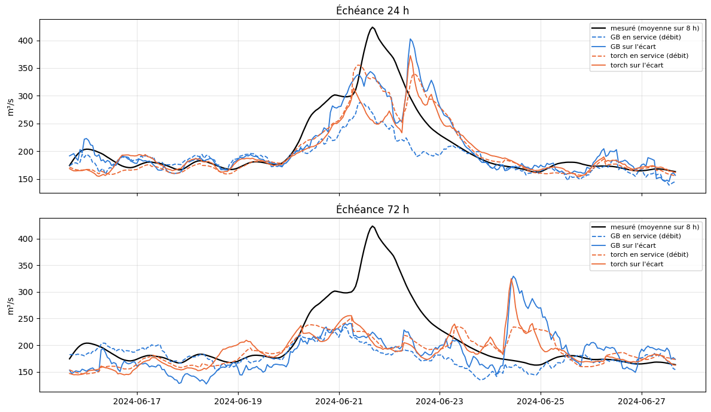

# 4.4 — Prévoir l'écart au débit actuel

**L'idée** : au lieu d'apprendre le débit à chaque échéance, le modèle apprend **l'écart entre ce débit et le débit actuel** ; la
prévision vaut débit actuel + écart prévu. Le débit actuel, la meilleure information à court terme, est ainsi gardé tel quel, et le
modèle ne se concentre que sur ce qui change.

**Comparable** : exactement les mêmes entrées (la recette en service), les mêmes réglages et la même période d'apprentissage que les
deux modèles en service de La Clapière (le GB avec le poids ×4 sur les montées, calculé sur les mêmes montées ; le torch) ; même
évaluation en conditions réelles (passé de service, prévision officielle de l'époque, calibration + test, mêmes heures, mêmes seuils
de crue). Les modèles entraînés sont gardés en cache (`data/cache/modeles_ecart/`). Rien n'est mis en service.

    GB : {'random_state': 42, 'max_depth': 4, 'max_leaf_nodes': 31, 'learning_rate': 0.1, 'max_iter': 300, 'l2_regularization': 10, 'min_samples_leaf': 7, 'early_stopping': True, 'validation_fraction': 0.1, 'n_iter_no_change': 15} | poids des crues : {'type': 'montee', 'facteur': 4} | durée max : None
    torch : {'couches': [256, 256, 128], 'dropout': [0.3, 0.3, 0.2], 'l2': 0.003, 'taux': 0.003, 'decroissance': 0.0001, 'epoques': 300, 'lot': 64, 'validation': 0.15, 'patience': 20, 'graine': 1} | poids des crues : None | durée max : 10min

## Les entrées et la nouvelle cible

    apprentissage : 102014 heures, 287 entrées ; écart moyen à 24 h : +0.01 m³/s (écart-type 12.3, contre 40.8 pour le débit lui-même)

## Entraîner sur l'écart (ou relire du cache)

    GB : entraîné sur l'écart, gardé dans data/cache/modeles_ecart/52a0c9cee4b03f58295e6f8a_GB

    torch : entraîné sur l'écart, gardé dans data/cache/modeles_ecart/52a0c9cee4b03f58295e6f8a_torch

## Les notes en conditions réelles

    19562 heures notées, de 2024-04-01 à 2026-10-15

<table border="1" class="dataframe">
  <thead>
    <tr style="text-align: right;">
      <th></th>
      <th>R² J+1</th>
      <th>R² J+2</th>
      <th>R² J+3</th>
      <th>R² J+4</th>
      <th>R² J+5</th>
      <th>R² moyen</th>
      <th>crue J+1</th>
      <th>crue J+3</th>
      <th>crue J+5</th>
      <th>R² crue</th>
      <th>R² montée</th>
      <th>erreur pic %</th>
      <th>biais pic %</th>
      <th>pics</th>
    </tr>
  </thead>
  <tbody>
    <tr>
      <th>GB en service (débit)</th>
      <td>0.964</td>
      <td>0.928</td>
      <td>0.905</td>
      <td>0.898</td>
      <td>0.874</td>
      <td>0.914</td>
      <td>0.743</td>
      <td>0.313</td>
      <td>0.111</td>
      <td>0.389</td>
      <td>0.711</td>
      <td>13.806</td>
      <td>-1.555</td>
      <td>46.0</td>
    </tr>
    <tr>
      <th>GB sur l'écart</th>
      <td>0.973</td>
      <td>0.932</td>
      <td>0.909</td>
      <td>0.902</td>
      <td>0.883</td>
      <td>0.920</td>
      <td>0.824</td>
      <td>0.348</td>
      <td>0.165</td>
      <td>0.431</td>
      <td>0.756</td>
      <td>14.855</td>
      <td>1.606</td>
      <td>46.0</td>
    </tr>
    <tr>
      <th>torch en service (débit)</th>
      <td>0.959</td>
      <td>0.930</td>
      <td>0.905</td>
      <td>0.900</td>
      <td>0.891</td>
      <td>0.917</td>
      <td>0.712</td>
      <td>0.271</td>
      <td>0.230</td>
      <td>0.393</td>
      <td>0.703</td>
      <td>16.001</td>
      <td>-8.901</td>
      <td>46.0</td>
    </tr>
    <tr>
      <th>torch sur l'écart</th>
      <td>0.970</td>
      <td>0.925</td>
      <td>0.902</td>
      <td>0.889</td>
      <td>0.882</td>
      <td>0.914</td>
      <td>0.779</td>
      <td>0.265</td>
      <td>0.208</td>
      <td>0.380</td>
      <td>0.685</td>
      <td>15.728</td>
      <td>-6.335</td>
      <td>46.0</td>
    </tr>
  </tbody>
</table>

## La plus forte crue de la période (échéances 24 h et 72 h)

    

    

