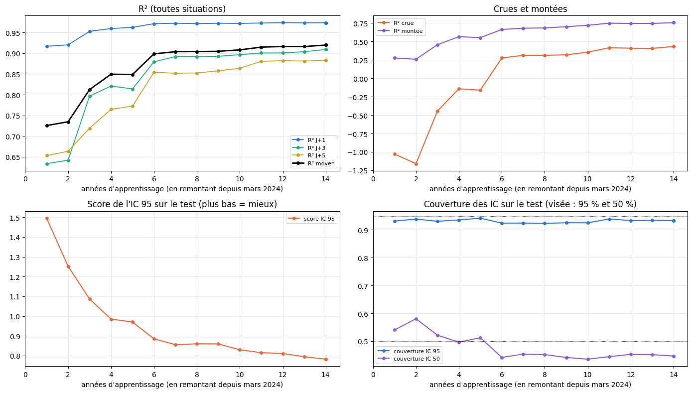

# 4.5 — Combien d'années d'apprentissage faut-il au GB ?

Le GB en service à La Clapière (`gb-ecart`), **à l'identique** (même recette : les 7 carreaux, précipitations, rayonnement et
température de −24 h à +5 jours par pas de 12 h, neige au sol à t, débit des 24 dernières heures, date ; mêmes réglages ; cible
« écart au débit actuel » ; poids ×4 sur les montées), entraîné sur des périodes de plus en plus longues qui finissent toutes à la fin
de l'apprentissage (31 mars 2024) : la dernière année (avril 2023 → mars 2024), les deux dernières, … jusqu'à 14 ans (avril 2010 →
mars 2024), puis tout l'apprentissage (janvier 2010 → mars 2024, le GB en service). Des blocs d'avril à mars : chaque période a des
saisons complètes.

**Notes identiques pour tous, en conditions réelles** : calibration + test (avril 2024 → aujourd'hui) ; passé de service ; météo future
= la prévision officielle ECMWF publiée à l'époque (la dernière parue au moins 7 h avant chaque instant) ; mêmes heures, mêmes seuils
de crue (ceux de l'apprentissage complet) ; IC réglés sur la calibration avec les 50 scénarios, notés sur le test. Les modèles sont
gardés en cache (`data/cache/modeles_annees/`). Rien n'est mis en service.

    recette : 2010-01-01 → 2026-10-03 | réglages : {'random_state': 42, 'max_depth': 4, 'max_leaf_nodes': 31, 'learning_rate': 0.1, 'max_iter': 300, 'l2_regularization': 10, 'min_samples_leaf': 7, 'early_stopping': True, 'validation_fraction': 0.1, 'n_iter_no_change': 15} | poids : {'type': 'montee', 'facteur': 4} | cible : ecart | durée max : None

## Les données et les périodes

                                     1           2           3           4  \
    début                   2023-04-01  2022-04-01  2021-04-01  2020-04-01   
    heures d'apprentissage        8664       17424       25951       32931   
    
                                     5           6           7           8  \
    début                   2019-04-01  2018-04-01  2017-04-01  2016-04-01   
    heures d'apprentissage       41044       49654       57836       58345   
    
                                     9          10          11          12  \
    début                   2015-04-01  2014-04-01  2013-04-01  2012-04-01   
    heures d'apprentissage       66625       74497       83257       92017   
    
                                    13          14        tout  
    début                   2011-04-01  2010-04-01  2010-04-03  
    heures d'apprentissage       96169      102014      102014  

## Les entraînements

Le même code que `modeles.entrainer` (et que le notebook 4.4) : les poids des montées sont calculés sur la période elle-même (même règle,
débit médian de la période).

    1 an(s) : entraîné en 9 s

    2 an(s) : entraîné en 9 s

    3 an(s) : entraîné en 12 s

    4 an(s) : entraîné en 14 s

    5 an(s) : entraîné en 17 s

    6 an(s) : entraîné en 20 s

    7 an(s) : entraîné en 22 s

    8 an(s) : entraîné en 23 s

    9 an(s) : entraîné en 26 s

    10 an(s) : entraîné en 29 s

    11 an(s) : entraîné en 31 s

    12 an(s) : entraîné en 35 s

    13 an(s) : entraîné en 34 s

    14 an(s) : entraîné en 37 s

    tout an(s) : entraîné en 37 s

## Les prévisions en conditions réelles

Une seule fois pour tous les modèles : le X de calibration + test avec le passé de service, la prévision officielle de l'époque et les
50 scénarios.

    19562 heures avec la prévision officielle, 50 scénarios ; prévisions de 15 modèles en 390 s

    contrôle : le modèle « tout » refait ici et le GB en service prévoient la même chose (écart max 0.00e+00 m³/s)

## Les notes

    19483 heures notées, de 2024-04-01 à 2026-10-15 (calibration 8182, test 11301)

<table border="1" class="dataframe">
  <thead>
    <tr style="text-align: right;">
      <th></th>
      <th>heures d'apprentissage</th>
      <th>R² J+1</th>
      <th>R² J+2</th>
      <th>R² J+3</th>
      <th>R² J+4</th>
      <th>R² J+5</th>
      <th>R² moyen</th>
      <th>crue J+1</th>
      <th>crue J+3</th>
      <th>crue J+5</th>
      <th>R² crue</th>
      <th>R² montée</th>
      <th>erreur pic %</th>
      <th>biais pic %</th>
      <th>IC 50 couverture</th>
      <th>IC 95 couverture</th>
      <th>IC 95 score</th>
    </tr>
    <tr>
      <th>années</th>
      <th></th>
      <th></th>
      <th></th>
      <th></th>
      <th></th>
      <th></th>
      <th></th>
      <th></th>
      <th></th>
      <th></th>
      <th></th>
      <th></th>
      <th></th>
      <th></th>
      <th></th>
      <th></th>
      <th></th>
    </tr>
  </thead>
  <tbody>
    <tr>
      <th>1</th>
      <td>8664</td>
      <td>0.917</td>
      <td>0.745</td>
      <td>0.634</td>
      <td>0.680</td>
      <td>0.653</td>
      <td>0.726</td>
      <td>0.409</td>
      <td>-1.821</td>
      <td>-1.539</td>
      <td>-1.029</td>
      <td>0.276</td>
      <td>24.245</td>
      <td>-14.997</td>
      <td>0.540</td>
      <td>0.932</td>
      <td>1.496</td>
    </tr>
    <tr>
      <th>2</th>
      <td>17424</td>
      <td>0.920</td>
      <td>0.766</td>
      <td>0.642</td>
      <td>0.681</td>
      <td>0.664</td>
      <td>0.735</td>
      <td>0.384</td>
      <td>-1.980</td>
      <td>-1.729</td>
      <td>-1.160</td>
      <td>0.259</td>
      <td>25.835</td>
      <td>-16.539</td>
      <td>0.581</td>
      <td>0.939</td>
      <td>1.252</td>
    </tr>
    <tr>
      <th>3</th>
      <td>25951</td>
      <td>0.953</td>
      <td>0.848</td>
      <td>0.797</td>
      <td>0.745</td>
      <td>0.719</td>
      <td>0.812</td>
      <td>0.649</td>
      <td>-0.543</td>
      <td>-1.205</td>
      <td>-0.445</td>
      <td>0.457</td>
      <td>20.550</td>
      <td>-11.591</td>
      <td>0.522</td>
      <td>0.931</td>
      <td>1.087</td>
    </tr>
    <tr>
      <th>4</th>
      <td>32931</td>
      <td>0.960</td>
      <td>0.886</td>
      <td>0.821</td>
      <td>0.816</td>
      <td>0.765</td>
      <td>0.849</td>
      <td>0.712</td>
      <td>-0.363</td>
      <td>-0.868</td>
      <td>-0.142</td>
      <td>0.566</td>
      <td>18.039</td>
      <td>-8.083</td>
      <td>0.496</td>
      <td>0.936</td>
      <td>0.985</td>
    </tr>
    <tr>
      <th>5</th>
      <td>41044</td>
      <td>0.962</td>
      <td>0.882</td>
      <td>0.814</td>
      <td>0.813</td>
      <td>0.772</td>
      <td>0.849</td>
      <td>0.736</td>
      <td>-0.473</td>
      <td>-0.792</td>
      <td>-0.161</td>
      <td>0.553</td>
      <td>17.547</td>
      <td>-9.501</td>
      <td>0.512</td>
      <td>0.942</td>
      <td>0.970</td>
    </tr>
    <tr>
      <th>6</th>
      <td>49654</td>
      <td>0.971</td>
      <td>0.916</td>
      <td>0.879</td>
      <td>0.871</td>
      <td>0.854</td>
      <td>0.898</td>
      <td>0.807</td>
      <td>0.144</td>
      <td>-0.084</td>
      <td>0.277</td>
      <td>0.664</td>
      <td>15.249</td>
      <td>-4.547</td>
      <td>0.442</td>
      <td>0.924</td>
      <td>0.885</td>
    </tr>
    <tr>
      <th>7</th>
      <td>57836</td>
      <td>0.972</td>
      <td>0.921</td>
      <td>0.892</td>
      <td>0.882</td>
      <td>0.852</td>
      <td>0.904</td>
      <td>0.810</td>
      <td>0.218</td>
      <td>-0.091</td>
      <td>0.313</td>
      <td>0.681</td>
      <td>15.250</td>
      <td>-2.086</td>
      <td>0.454</td>
      <td>0.924</td>
      <td>0.856</td>
    </tr>
    <tr>
      <th>8</th>
      <td>58345</td>
      <td>0.971</td>
      <td>0.922</td>
      <td>0.892</td>
      <td>0.882</td>
      <td>0.852</td>
      <td>0.904</td>
      <td>0.802</td>
      <td>0.205</td>
      <td>-0.083</td>
      <td>0.313</td>
      <td>0.685</td>
      <td>15.138</td>
      <td>-2.582</td>
      <td>0.452</td>
      <td>0.923</td>
      <td>0.860</td>
    </tr>
    <tr>
      <th>9</th>
      <td>66625</td>
      <td>0.972</td>
      <td>0.922</td>
      <td>0.893</td>
      <td>0.879</td>
      <td>0.857</td>
      <td>0.905</td>
      <td>0.814</td>
      <td>0.229</td>
      <td>-0.027</td>
      <td>0.320</td>
      <td>0.702</td>
      <td>15.216</td>
      <td>-2.120</td>
      <td>0.441</td>
      <td>0.925</td>
      <td>0.859</td>
    </tr>
    <tr>
      <th>10</th>
      <td>74497</td>
      <td>0.972</td>
      <td>0.923</td>
      <td>0.897</td>
      <td>0.885</td>
      <td>0.864</td>
      <td>0.908</td>
      <td>0.813</td>
      <td>0.262</td>
      <td>0.036</td>
      <td>0.356</td>
      <td>0.721</td>
      <td>14.868</td>
      <td>-1.452</td>
      <td>0.435</td>
      <td>0.925</td>
      <td>0.830</td>
    </tr>
    <tr>
      <th>11</th>
      <td>83257</td>
      <td>0.973</td>
      <td>0.925</td>
      <td>0.901</td>
      <td>0.895</td>
      <td>0.881</td>
      <td>0.915</td>
      <td>0.821</td>
      <td>0.288</td>
      <td>0.192</td>
      <td>0.415</td>
      <td>0.749</td>
      <td>15.191</td>
      <td>1.652</td>
      <td>0.444</td>
      <td>0.939</td>
      <td>0.815</td>
    </tr>
    <tr>
      <th>12</th>
      <td>92017</td>
      <td>0.974</td>
      <td>0.927</td>
      <td>0.901</td>
      <td>0.898</td>
      <td>0.882</td>
      <td>0.916</td>
      <td>0.824</td>
      <td>0.301</td>
      <td>0.163</td>
      <td>0.409</td>
      <td>0.746</td>
      <td>14.615</td>
      <td>0.891</td>
      <td>0.453</td>
      <td>0.933</td>
      <td>0.811</td>
    </tr>
    <tr>
      <th>13</th>
      <td>96169</td>
      <td>0.973</td>
      <td>0.926</td>
      <td>0.904</td>
      <td>0.897</td>
      <td>0.881</td>
      <td>0.916</td>
      <td>0.823</td>
      <td>0.301</td>
      <td>0.160</td>
      <td>0.407</td>
      <td>0.746</td>
      <td>15.115</td>
      <td>1.288</td>
      <td>0.452</td>
      <td>0.934</td>
      <td>0.795</td>
    </tr>
    <tr>
      <th>14</th>
      <td>102014</td>
      <td>0.974</td>
      <td>0.931</td>
      <td>0.909</td>
      <td>0.902</td>
      <td>0.883</td>
      <td>0.920</td>
      <td>0.827</td>
      <td>0.350</td>
      <td>0.164</td>
      <td>0.433</td>
      <td>0.757</td>
      <td>14.826</td>
      <td>1.600</td>
      <td>0.447</td>
      <td>0.933</td>
      <td>0.782</td>
    </tr>
    <tr>
      <th>tout</th>
      <td>102014</td>
      <td>0.974</td>
      <td>0.931</td>
      <td>0.909</td>
      <td>0.902</td>
      <td>0.883</td>
      <td>0.920</td>
      <td>0.827</td>
      <td>0.350</td>
      <td>0.164</td>
      <td>0.433</td>
      <td>0.757</td>
      <td>14.826</td>
      <td>1.600</td>
      <td>0.447</td>
      <td>0.933</td>
      <td>0.782</td>
    </tr>
  </tbody>
</table>

## Les courbes

En abscisse, le nombre d'années d'apprentissage (14,25 = tout l'apprentissage, le GB en service).

    

    

