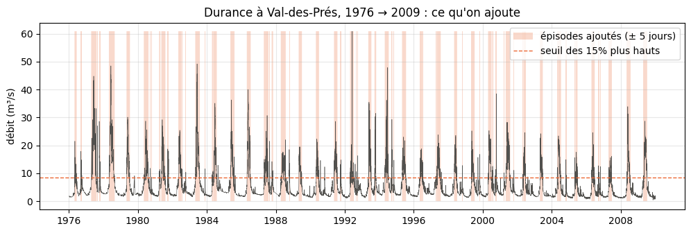
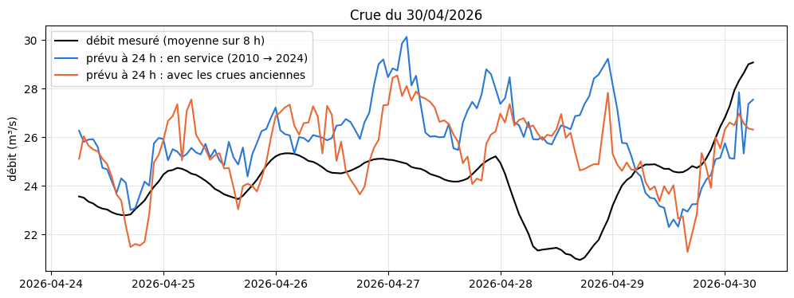
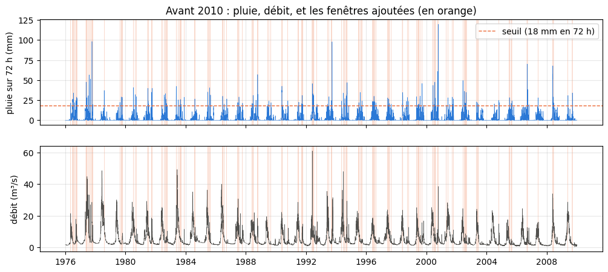
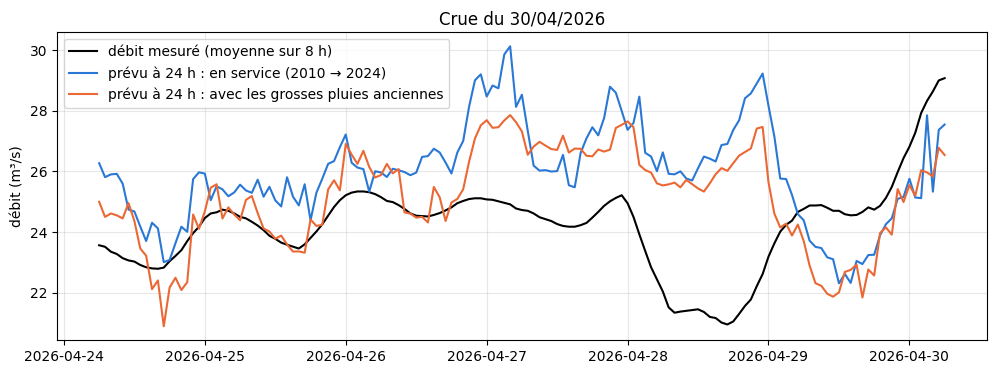

# 4.6 — Apprendre aussi sur les crues et les pluies anciennes (Durance à Val-des-Prés)

Le GB en service à Val-des-Prés apprend sur 2010 → mars 2024. On lui ajoute le passé plus ancien (débits depuis 1975), de deux façons : d'abord les épisodes de hautes eaux choisis par le **débit** (partie 1), puis les grosses pluies choisies par la **pluie** (partie 2).

## Partie 1 — Apprendre aussi sur les crues anciennes (Durance à Val-des-Prés)

**L'idée** : le modèle en service apprend sur 2010 → mars 2024, toutes les heures. On lui ajoute le passé plus ancien (RiverApp a les
débits de Val-des-Prés depuis 1975), mais **seulement les épisodes de hautes eaux** : les périodes où le débit est dans les
`PART_HAUTE` (15 %) les plus hauts, élargies de `MARGE` (5 jours) avant et après pour voir la montée et la décrue. Le modèle voit
ainsi plus de crues, sans être noyé sous des dizaines d'années de débits ordinaires.

**La comparaison** : mêmes entrées, mêmes réglages (GB, poids ×4 sur les montées) que le modèle en service ; notes sur calibration +
test (avril 2024 → aujourd'hui), avec les entrées telles qu'en service (passé de service, prévision officielle) ; R² et R² en crue
(heures au-dessus du seuil de crue du modèle en service, le même pour les deux).

Rien n'est mis en service : le modèle entraîné ici reste dans le carnet.

### Le modèle en service et sa recette

    modèle en service : 20c28ad470f5 | réglages : {'random_state': 42, 'max_depth': 4, 'max_leaf_nodes': 31, 'learning_rate': 0.1, 'max_iter': 300, 'l2_regularization': 10, 'min_samples_leaf': 7, 'early_stopping': True, 'validation_fraction': 0.1, 'n_iter_no_change': 15} | poids des crues : {'type': 'montee', 'facteur': 4}
    carreaux : [10259947] | apprentissage : 2010-01-01 → 2024-03-31

### Les entrées depuis 1976

Même recette, mais depuis `DEBUT_ANCIEN` (le passé observé manquant est téléchargé la première fois).

    X : 435882 heures de 1976-01-01 à 2026-10-10 ; apprentissage normal : 124597 heures

### Les épisodes de hautes eaux avant 2010

    seuil des 15% plus hauts : 8.4 m³/s
    83 épisodes avant 2010, 80538 heures ajoutées (65% de l'apprentissage normal)

    

    

### Entraîner le modèle avec les crues anciennes

Mêmes réglages et même poids des crues que le modèle en service ; apprentissage normal + épisodes anciens.

    entraîné sur 205135 heures (124597 normales + 80538 de crues anciennes)

### Les notes, comme en service

Calibration + test (avril 2024 → aujourd'hui), passé de service et prévision officielle ; seuil de crue du modèle en service pour les deux.

    17450 heures notées, de 2024-04-01 à 2026-10-10

<table border="1" class="dataframe">
  <thead>
    <tr style="text-align: right;">
      <th></th>
      <th>en service (2010 → 2024)</th>
      <th>avec les crues anciennes</th>
    </tr>
  </thead>
  <tbody>
    <tr>
      <th>R² J+1</th>
      <td>0.956</td>
      <td>0.952</td>
    </tr>
    <tr>
      <th>R² J+3</th>
      <td>0.848</td>
      <td>0.801</td>
    </tr>
    <tr>
      <th>R² J+5</th>
      <td>0.801</td>
      <td>0.733</td>
    </tr>
    <tr>
      <th>R² moyen</th>
      <td>0.865</td>
      <td>0.824</td>
    </tr>
    <tr>
      <th>R² crue J+1</th>
      <td>0.633</td>
      <td>0.607</td>
    </tr>
    <tr>
      <th>R² crue J+3</th>
      <td>0.042</td>
      <td>-0.186</td>
    </tr>
    <tr>
      <th>R² crue J+5</th>
      <td>-0.145</td>
      <td>-0.601</td>
    </tr>
    <tr>
      <th>R² crue</th>
      <td>0.151</td>
      <td>-0.073</td>
    </tr>
    <tr>
      <th>R² montée</th>
      <td>0.791</td>
      <td>0.771</td>
    </tr>
    <tr>
      <th>erreur sur le pic (%)</th>
      <td>20.027</td>
      <td>20.189</td>
    </tr>
    <tr>
      <th>pics sous-estimés de (%)</th>
      <td>-13.129</td>
      <td>-14.051</td>
    </tr>
  </tbody>
</table>

### La plus forte crue de la période, vue par les deux modèles (échéance 24 h)

    

    

## Partie 2 — Apprendre aussi sur les grosses pluies anciennes (Durance à Val-des-Prés)

Suite de la première partie : là, choisir le passé ancien par le **débit** ramenait surtout la fonte des neiges des années 1970-1980 (plus
fortes qu'aujourd'hui), et le modèle se dégradait. Ici on choisit par la **pluie** :

- **pluie liquide** sur le bassin (précipitations − neige tombée, ERA5 25 km, moyenne des carreaux pondérée par leur part du bassin) :
  une grosse chute de neige ne fait pas monter la rivière tout de suite ;
- découpée en **événements** (séparés par au moins `SEC` heures sans pluie) ; la force d'un événement = son plus fort **cumul sur
  `CUMUL` heures** (72 h : l'échelle qui fait monter une rivière de montagne) ;
- on garde les événements d'avant 2010 dont la force dépasse le seuil des `PART_FORTE` (10 %) événements les plus forts de
  l'apprentissage normal (2010 → mars 2024), avec `MARGE` (5 jours) avant et après.

Même modèle, mêmes réglages, même évaluation que la première partie (calibration + test, comme en service). Rien n'est mis en service.

### Le modèle en service, sa recette, les entrées depuis 1976

    modèle en service 20c28ad470f5 ; X : 435882 heures depuis 1976-01-01 ; apprentissage normal : 124597 heures

### La pluie liquide sur le bassin

    carreaux : [10259947] ; pluie liquide moyenne : 317 mm/an

### Les événements de pluie et leur force

    857 événements de pluie dans l'apprentissage normal ; seuil des 10% plus forts : 18 mm en 72 h
    220 événements forts avant 2010 (sur 1977)

<table border="1" class="dataframe">
  <thead>
    <tr style="text-align: right;">
      <th></th>
      <th>debut</th>
      <th>fin</th>
      <th>total_mm</th>
      <th>force_mm</th>
    </tr>
  </thead>
  <tbody>
    <tr>
      <th>1439.0</th>
      <td>2000-10-11 13:00:00+00:00</td>
      <td>2000-10-16 17:00:00+00:00</td>
      <td>123.2</td>
      <td>119.7</td>
    </tr>
    <tr>
      <th>105.0</th>
      <td>1977-10-05 05:00:00+00:00</td>
      <td>1977-10-10 10:00:00+00:00</td>
      <td>116.4</td>
      <td>98.3</td>
    </tr>
    <tr>
      <th>991.0</th>
      <td>1993-09-22 04:00:00+00:00</td>
      <td>1993-09-25 16:00:00+00:00</td>
      <td>102.1</td>
      <td>97.9</td>
    </tr>
    <tr>
      <th>1805.0</th>
      <td>2006-09-08 02:00:00+00:00</td>
      <td>2006-09-18 13:00:00+00:00</td>
      <td>96.0</td>
      <td>70.1</td>
    </tr>
    <tr>
      <th>1875.0</th>
      <td>2008-05-24 03:00:00+00:00</td>
      <td>2008-06-12 11:00:00+00:00</td>
      <td>192.0</td>
      <td>67.9</td>
    </tr>
    <tr>
      <th>1435.0</th>
      <td>2000-09-28 23:00:00+00:00</td>
      <td>2000-10-02 14:00:00+00:00</td>
      <td>61.6</td>
      <td>61.0</td>
    </tr>
    <tr>
      <th>729.0</th>
      <td>1988-10-09 23:00:00+00:00</td>
      <td>1988-10-15 13:00:00+00:00</td>
      <td>71.4</td>
      <td>57.0</td>
    </tr>
    <tr>
      <th>90.0</th>
      <td>1977-07-27 20:00:00+00:00</td>
      <td>1977-07-31 16:00:00+00:00</td>
      <td>59.1</td>
      <td>56.6</td>
    </tr>
    <tr>
      <th>93.0</th>
      <td>1977-08-26 14:00:00+00:00</td>
      <td>1977-08-30 18:00:00+00:00</td>
      <td>55.5</td>
      <td>51.5</td>
    </tr>
    <tr>
      <th>1528.0</th>
      <td>2002-06-03 11:00:00+00:00</td>
      <td>2002-06-09 14:00:00+00:00</td>
      <td>62.9</td>
      <td>49.6</td>
    </tr>
  </tbody>
</table>

### Les heures ajoutées

    48113 heures ajoutées (39% de l'apprentissage normal)
    mois des heures ajoutées (%) : {4: 1, 5: 10, 6: 22, 7: 21, 8: 14, 9: 19, 10: 13, 11: 1, 12: 0}

    

    

### Entraîner avec les grosses pluies anciennes

    entraîné sur 172710 heures (124597 normales + 48113 de grosses pluies anciennes)

### Les notes, comme en service (calibration + test)

    17450 heures notées, de 2024-04-01 à 2026-10-10

<table border="1" class="dataframe">
  <thead>
    <tr style="text-align: right;">
      <th></th>
      <th>en service (2010 → 2024)</th>
      <th>avec les grosses pluies anciennes</th>
    </tr>
  </thead>
  <tbody>
    <tr>
      <th>R² J+1</th>
      <td>0.956</td>
      <td>0.946</td>
    </tr>
    <tr>
      <th>R² J+3</th>
      <td>0.848</td>
      <td>0.804</td>
    </tr>
    <tr>
      <th>R² J+5</th>
      <td>0.801</td>
      <td>0.758</td>
    </tr>
    <tr>
      <th>R² moyen</th>
      <td>0.865</td>
      <td>0.828</td>
    </tr>
    <tr>
      <th>R² crue J+1</th>
      <td>0.633</td>
      <td>0.566</td>
    </tr>
    <tr>
      <th>R² crue J+3</th>
      <td>0.042</td>
      <td>-0.194</td>
    </tr>
    <tr>
      <th>R² crue J+5</th>
      <td>-0.145</td>
      <td>-0.324</td>
    </tr>
    <tr>
      <th>R² crue</th>
      <td>0.151</td>
      <td>-0.047</td>
    </tr>
    <tr>
      <th>R² montée</th>
      <td>0.791</td>
      <td>0.737</td>
    </tr>
    <tr>
      <th>erreur sur le pic (%)</th>
      <td>20.027</td>
      <td>21.439</td>
    </tr>
    <tr>
      <th>pics sous-estimés de (%)</th>
      <td>-13.129</td>
      <td>-16.259</td>
    </tr>
  </tbody>
</table>

### La plus forte crue de la période (échéance 24 h)

    

    

