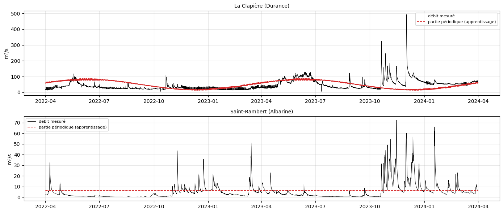
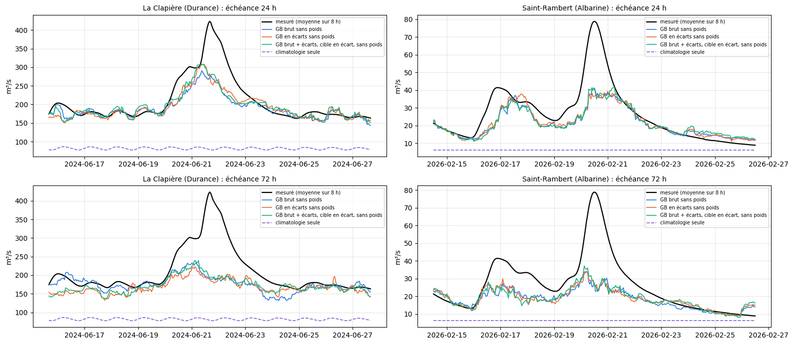

# 4.7 — Apprendre en écart à la partie périodique

À La Clapière et sur l'Albarine : le GB et le réseau torch, mais **le rayonnement, la température et le débit sont donnés — et le débit appris — en écart à
leur partie périodique** (leur climatologie de Fourier, notebook 2.7). La prévision vaut ce que le GB prédit + la partie périodique du débit
à l'échéance. Précipitations et neige au sol restent brutes.

**Comparé à**, sur les mêmes heures, en conditions réelles (passé de service, prévision officielle de l'époque, IC réglés sur la
calibration avec les 50 scénarios et notés sur le test, mêmes seuils de crue) :

- les mêmes modèles avec **les deux** en entrée — chaque colonne de rayonnement, de température et de débit passé, brute et en écart à sa
  partie périodique —, avec la cible brute (le débit) ou en écart (débit − partie périodique) ;
- le **GB brut sans poids** (même recette, mêmes réglages, cible débit, aucun poids sur les montées) : seule différence avec le GB en
  écarts, les écarts à la partie périodique ; de même le **torch brut sans poids** face au torch en écarts (réglages du torch en service à
  La Clapière, un seul réseau pour les 15 échéances) ;
- le **GB en service** (poids ×4 sur les montées ; à La Clapière, cible écart au débit actuel), pour situer ;
- la **climatologie seule** : la partie périodique du débit prise comme prévision.

**La partie périodique**, estimée sur l'apprentissage seulement (2010 → mars 2024) puis prolongée : pour chaque série (rayonnement et
température de chaque carreau, débit), les pics du spectre à plus de 5 fois le fond, comme au notebook 2.7 ; chaque pic est ramené à sa
famille exacte, **n cycles par jour + m cycles par an**, et l'on garde une seule sinusoïde par famille, à cette fréquence exacte (garder les
fréquences voisines de chaque pic, comme au notebook 2.7, reproduit les différences d'une année à l'autre de l'apprentissage et, prolongé,
les rejoue : ce n'est plus une climatologie) ; puis l'amplitude et la phase de ces sinusoïdes ajustées par moindres carrés **sur les
heures réellement mesurées** (pas de trou à combler). Une somme de sinusoïdes se calcule à n'importe quelle date : on l'évalue aussi sur la calibration, le test et les prévisions.

Côté X, chaque colonne est une somme (météo) ou une moyenne (débit) sur un morceau d'heures : on lui retire la somme (ou la moyenne) de la
partie périodique sur le même morceau ; de même pour les échéances de Y. Pour la météo future, en conditions réelles, c'est la prévision
moins la partie périodique.

## La partie périodique : repérage des pics, ajustement sur les heures mesurées

## Les données, les parties périodiques et le passage en écarts

    La Clapière (Durance) : 7 carreaux, 15 parties périodiques en 4 s ; débit : 117 familles de fréquences, 34% de la variance de l'apprentissage

    Saint-Rambert (Albarine) : 1 carreaux, 3 parties périodiques en 1 s ; débit : 0 familles de fréquences, 0% de la variance de l'apprentissage

    

    

## Les entraînements

GB : mêmes réglages que le GB en service de chaque station ; torch : réglages du torch en service à La Clapière. Tous **sans poids** ; cible :
le débit (brut), ou son écart à la partie périodique.

    La Clapière (Durance) gradient_boosting deux_brut entraîné en 53 s

    La Clapière (Durance) gradient_boosting deux_ecart entraîné en 47 s

    La Clapière (Durance) torch deux_brut entraîné en 335 s

    La Clapière (Durance) torch deux_ecart entraîné en 304 s

    Saint-Rambert (Albarine) gradient_boosting deux_brut entraîné en 15 s

    Saint-Rambert (Albarine) gradient_boosting deux_ecart entraîné en 12 s

    Saint-Rambert (Albarine) torch deux_brut entraîné en 127 s

    Saint-Rambert (Albarine) torch deux_ecart entraîné en 259 s

## Les prévisions en conditions réelles

    La Clapière (Durance) : 19483 heures, prévisions en 333 s

    Saint-Rambert (Albarine) : 19485 heures, prévisions en 164 s

## Les notes

R² et crues sur calibration + test ; IC réglés sur la calibration, notés sur le test (score rapporté au débit moyen : plus bas = mieux).

<table border="1" class="dataframe">
  <thead>
    <tr style="text-align: right;">
      <th></th>
      <th></th>
      <th>R² J+1</th>
      <th>R² J+2</th>
      <th>R² J+3</th>
      <th>R² J+4</th>
      <th>R² J+5</th>
      <th>R² moyen</th>
      <th>crue J+1</th>
      <th>crue J+3</th>
      <th>crue J+5</th>
      <th>R² crue</th>
      <th>R² montée</th>
      <th>biais pic %</th>
      <th>IC 95 couverture</th>
      <th>IC 95 score</th>
    </tr>
    <tr>
      <th>station</th>
      <th>modèle</th>
      <th></th>
      <th></th>
      <th></th>
      <th></th>
      <th></th>
      <th></th>
      <th></th>
      <th></th>
      <th></th>
      <th></th>
      <th></th>
      <th></th>
      <th></th>
      <th></th>
    </tr>
  </thead>
  <tbody>
    <tr>
      <th rowspan="10" valign="top">La Clapière (Durance)</th>
      <th>GB en service (gb-ecart)</th>
      <td>0.974</td>
      <td>0.931</td>
      <td>0.909</td>
      <td>0.902</td>
      <td>0.883</td>
      <td>0.920</td>
      <td>0.827</td>
      <td>0.350</td>
      <td>0.164</td>
      <td>0.433</td>
      <td>0.757</td>
      <td>1.600</td>
      <td>0.933</td>
      <td>0.782</td>
    </tr>
    <tr>
      <th>GB brut sans poids</th>
      <td>0.965</td>
      <td>0.933</td>
      <td>0.911</td>
      <td>0.903</td>
      <td>0.881</td>
      <td>0.919</td>
      <td>0.736</td>
      <td>0.323</td>
      <td>0.124</td>
      <td>0.390</td>
      <td>0.702</td>
      <td>-4.171</td>
      <td>0.908</td>
      <td>0.864</td>
    </tr>
    <tr>
      <th>GB en écarts sans poids</th>
      <td>0.966</td>
      <td>0.923</td>
      <td>0.894</td>
      <td>0.872</td>
      <td>0.841</td>
      <td>0.899</td>
      <td>0.747</td>
      <td>0.199</td>
      <td>-0.213</td>
      <td>0.238</td>
      <td>0.626</td>
      <td>-7.159</td>
      <td>0.918</td>
      <td>0.911</td>
    </tr>
    <tr>
      <th>GB brut + écarts, cible brute, sans poids</th>
      <td>0.966</td>
      <td>0.933</td>
      <td>0.911</td>
      <td>0.894</td>
      <td>0.865</td>
      <td>0.914</td>
      <td>0.747</td>
      <td>0.323</td>
      <td>-0.024</td>
      <td>0.343</td>
      <td>0.675</td>
      <td>-7.157</td>
      <td>0.906</td>
      <td>0.849</td>
    </tr>
    <tr>
      <th>GB brut + écarts, cible en écart, sans poids</th>
      <td>0.968</td>
      <td>0.926</td>
      <td>0.902</td>
      <td>0.887</td>
      <td>0.861</td>
      <td>0.909</td>
      <td>0.755</td>
      <td>0.246</td>
      <td>-0.065</td>
      <td>0.299</td>
      <td>0.660</td>
      <td>-5.909</td>
      <td>0.914</td>
      <td>0.832</td>
    </tr>
    <tr>
      <th>torch brut sans poids</th>
      <td>0.959</td>
      <td>0.930</td>
      <td>0.905</td>
      <td>0.900</td>
      <td>0.891</td>
      <td>0.917</td>
      <td>0.716</td>
      <td>0.272</td>
      <td>0.230</td>
      <td>0.395</td>
      <td>0.703</td>
      <td>-8.834</td>
      <td>0.883</td>
      <td>0.891</td>
    </tr>
    <tr>
      <th>torch en écarts sans poids</th>
      <td>0.935</td>
      <td>0.886</td>
      <td>0.858</td>
      <td>0.851</td>
      <td>0.838</td>
      <td>0.873</td>
      <td>0.542</td>
      <td>-0.093</td>
      <td>-0.216</td>
      <td>0.049</td>
      <td>0.518</td>
      <td>-17.328</td>
      <td>0.849</td>
      <td>1.235</td>
    </tr>
    <tr>
      <th>torch brut + écarts, cible brute, sans poids</th>
      <td>0.947</td>
      <td>0.910</td>
      <td>0.892</td>
      <td>0.876</td>
      <td>0.865</td>
      <td>0.898</td>
      <td>0.647</td>
      <td>0.192</td>
      <td>0.042</td>
      <td>0.266</td>
      <td>0.649</td>
      <td>-10.726</td>
      <td>0.845</td>
      <td>1.066</td>
    </tr>
    <tr>
      <th>torch brut + écarts, cible en écart, sans poids</th>
      <td>0.947</td>
      <td>0.918</td>
      <td>0.888</td>
      <td>0.874</td>
      <td>0.863</td>
      <td>0.898</td>
      <td>0.647</td>
      <td>0.137</td>
      <td>0.025</td>
      <td>0.257</td>
      <td>0.619</td>
      <td>-11.619</td>
      <td>0.908</td>
      <td>1.024</td>
    </tr>
    <tr>
      <th>climatologie seule</th>
      <td>0.332</td>
      <td>0.333</td>
      <td>0.334</td>
      <td>0.335</td>
      <td>0.335</td>
      <td>0.334</td>
      <td>-3.769</td>
      <td>-3.812</td>
      <td>-3.872</td>
      <td>-3.814</td>
      <td>-0.666</td>
      <td>-49.798</td>
      <td>0.818</td>
      <td>3.611</td>
    </tr>
    <tr>
      <th rowspan="10" valign="top">Saint-Rambert (Albarine)</th>
      <th>GB en service (gb-prtn-x4)</th>
      <td>0.827</td>
      <td>0.627</td>
      <td>0.551</td>
      <td>0.553</td>
      <td>0.446</td>
      <td>0.601</td>
      <td>0.480</td>
      <td>-0.171</td>
      <td>-0.428</td>
      <td>-0.045</td>
      <td>0.217</td>
      <td>-4.313</td>
      <td>0.841</td>
      <td>3.187</td>
    </tr>
    <tr>
      <th>GB brut sans poids</th>
      <td>0.873</td>
      <td>0.724</td>
      <td>0.639</td>
      <td>0.610</td>
      <td>0.529</td>
      <td>0.675</td>
      <td>0.449</td>
      <td>-0.410</td>
      <td>-0.854</td>
      <td>-0.295</td>
      <td>0.035</td>
      <td>-19.253</td>
      <td>0.912</td>
      <td>2.187</td>
    </tr>
    <tr>
      <th>GB en écarts sans poids</th>
      <td>0.871</td>
      <td>0.716</td>
      <td>0.627</td>
      <td>0.602</td>
      <td>0.525</td>
      <td>0.668</td>
      <td>0.436</td>
      <td>-0.457</td>
      <td>-0.824</td>
      <td>-0.311</td>
      <td>0.027</td>
      <td>-16.615</td>
      <td>0.921</td>
      <td>2.166</td>
    </tr>
    <tr>
      <th>GB brut + écarts, cible brute, sans poids</th>
      <td>0.874</td>
      <td>0.724</td>
      <td>0.635</td>
      <td>0.608</td>
      <td>0.533</td>
      <td>0.675</td>
      <td>0.455</td>
      <td>-0.429</td>
      <td>-0.852</td>
      <td>-0.303</td>
      <td>0.029</td>
      <td>-18.321</td>
      <td>0.920</td>
      <td>2.214</td>
    </tr>
    <tr>
      <th>GB brut + écarts, cible en écart, sans poids</th>
      <td>0.874</td>
      <td>0.724</td>
      <td>0.635</td>
      <td>0.608</td>
      <td>0.533</td>
      <td>0.675</td>
      <td>0.455</td>
      <td>-0.429</td>
      <td>-0.852</td>
      <td>-0.303</td>
      <td>0.029</td>
      <td>-18.321</td>
      <td>0.920</td>
      <td>2.214</td>
    </tr>
    <tr>
      <th>torch brut sans poids</th>
      <td>0.820</td>
      <td>0.723</td>
      <td>0.643</td>
      <td>0.575</td>
      <td>0.486</td>
      <td>0.649</td>
      <td>0.194</td>
      <td>-0.507</td>
      <td>-1.152</td>
      <td>-0.492</td>
      <td>-0.100</td>
      <td>-31.395</td>
      <td>0.786</td>
      <td>2.763</td>
    </tr>
    <tr>
      <th>torch en écarts sans poids</th>
      <td>0.821</td>
      <td>0.701</td>
      <td>0.645</td>
      <td>0.595</td>
      <td>0.495</td>
      <td>0.652</td>
      <td>0.172</td>
      <td>-0.512</td>
      <td>-1.069</td>
      <td>-0.495</td>
      <td>-0.106</td>
      <td>-32.259</td>
      <td>0.852</td>
      <td>2.778</td>
    </tr>
    <tr>
      <th>torch brut + écarts, cible brute, sans poids</th>
      <td>0.814</td>
      <td>0.710</td>
      <td>0.657</td>
      <td>0.610</td>
      <td>0.513</td>
      <td>0.661</td>
      <td>0.133</td>
      <td>-0.508</td>
      <td>-1.084</td>
      <td>-0.502</td>
      <td>-0.117</td>
      <td>-34.133</td>
      <td>0.846</td>
      <td>2.738</td>
    </tr>
    <tr>
      <th>torch brut + écarts, cible en écart, sans poids</th>
      <td>0.847</td>
      <td>0.728</td>
      <td>0.644</td>
      <td>0.615</td>
      <td>0.497</td>
      <td>0.666</td>
      <td>0.383</td>
      <td>-0.482</td>
      <td>-1.015</td>
      <td>-0.378</td>
      <td>-0.047</td>
      <td>-24.749</td>
      <td>0.703</td>
      <td>3.660</td>
    </tr>
    <tr>
      <th>climatologie seule</th>
      <td>-0.007</td>
      <td>-0.007</td>
      <td>-0.007</td>
      <td>-0.008</td>
      <td>-0.009</td>
      <td>-0.008</td>
      <td>-3.020</td>
      <td>-3.114</td>
      <td>-3.107</td>
      <td>-3.087</td>
      <td>-1.504</td>
      <td>-80.975</td>
      <td>0.771</td>
      <td>9.083</td>
    </tr>
  </tbody>
</table>

## La plus forte crue de la période (échéances 24 h et 72 h)

    

    

