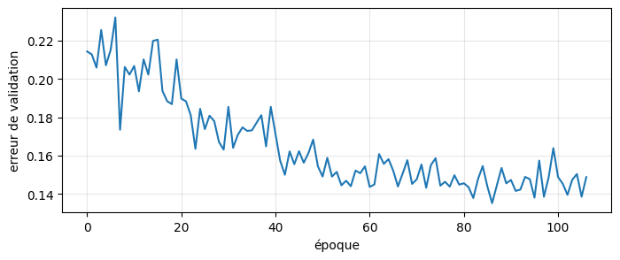
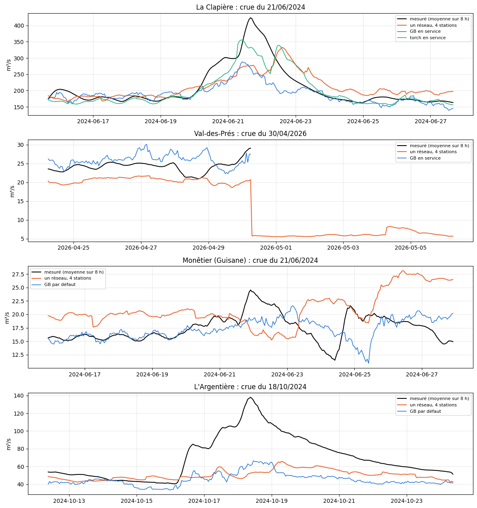

# 5.01 — Un seul réseau pour 4 stations de la Durance

**Entrées** : la météo des **9 carreaux** 25 km de l'amont de La Clapière (100 % du bassin) — pluie de −72 h à +5 jours par pas
de 6 h, température et rayonnement de −72 h à +5 jours par pas de 12 h, neige au sol à t — ; le **débit des 24 dernières heures
des 4 stations** ; la date et l'heure. **Sortie** : les 15 échéances (toutes les 8 h jusqu'à 5 jours) des **4 stations** à la fois,
60 débits.

L'Argentière n'a de débits que depuis novembre 2016 : avant, son débit d'entrée est remplacé par un indicateur « absent » et ses
sorties ne comptent pas dans l'erreur (l'apprentissage garde 2010 → mars 2024 pour les autres).

Taille **moyenne** : couches 512, 256, 128 (≈ 520 000 paramètres), dropout 0,3 / 0,3 / 0,2 ; le reste comme le torch en service
(L2, AdamW, arrêt anticipé sur les 15 % les plus récents de l'apprentissage, sans poids des crues). Le réseau entraîné est gardé en
cache (`data/cache/modeles_multi/`) et relu s'il existe.

**Comparaison** station par station avec un modèle à une station (ceux en service pour La Clapière et Val-des-Prés, un GB par défaut
entraîné ici pour Monêtier et L'Argentière), **en conditions réelles** : passé de service, prévision officielle de l'époque,
calibration + test (avril 2024 → aujourd'hui), mêmes heures et mêmes seuils de crue pour les deux. Rien n'est mis en service.

## Les entrées et les sorties

La météo et La Clapière dans un `Features`, le débit des autres stations dans le leur ; tout est aligné sur les heures de La Clapière.

    carreaux : 9 (2278 km²) | X : (121731, 689) | Y : (121731, 60) | 2010-04-03 → 2026-10-11
    heures connues par station : {'La Clapière': 121731, 'Val-des-Prés': 119328, 'Monêtier (Guisane)': 74485, "L'Argentière": 65089}

## Entraîner le réseau (ou le relire du cache)

    entraîné en 654 s, 107 époques ; gardé dans data/cache/modeles_multi/durance_moyen
    689 entrées → 60 sorties ; 527,036 paramètres ; 102134 heures d'apprentissage

    

    

## Les modèles à une station, pour comparer

Ceux en service pour La Clapière (GB et torch) et Val-des-Prés (GB) ; pour Monêtier et L'Argentière, un GB par défaut (la recette de la mise en service, poids ×4 sur les montées), entraîné ici et gardé dans le cache des modèles.

    {'La Clapière': ['GB en service', 'torch en service'], 'Val-des-Prés': ['GB en service'], 'Monêtier (Guisane)': ['GB par défaut'], "L'Argentière": ['GB par défaut']}

## Les notes en conditions réelles

Calibration + test (avril 2024 → aujourd'hui), passé de service, prévision officielle de l'époque ; pour chaque station, les heures communes à tous ses modèles et les seuils de crue de son apprentissage (les 10 % les plus forts).

<table border="1" class="dataframe">
  <thead>
    <tr style="text-align: right;">
      <th></th>
      <th></th>
      <th>R² J+1</th>
      <th>R² J+2</th>
      <th>R² J+3</th>
      <th>R² J+4</th>
      <th>R² J+5</th>
      <th>R² moyen</th>
      <th>crue J+1</th>
      <th>crue J+3</th>
      <th>crue J+5</th>
      <th>R² crue</th>
      <th>R² montée</th>
      <th>erreur pic %</th>
      <th>biais pic %</th>
      <th>pics</th>
      <th>heures</th>
    </tr>
    <tr>
      <th>station</th>
      <th>modèle</th>
      <th></th>
      <th></th>
      <th></th>
      <th></th>
      <th></th>
      <th></th>
      <th></th>
      <th></th>
      <th></th>
      <th></th>
      <th></th>
      <th></th>
      <th></th>
      <th></th>
      <th></th>
    </tr>
  </thead>
  <tbody>
    <tr>
      <th rowspan="3" valign="top">La Clapière</th>
      <th>un réseau, 4 stations (durance_moyen)</th>
      <td>0.936</td>
      <td>0.912</td>
      <td>0.892</td>
      <td>0.880</td>
      <td>0.872</td>
      <td>0.899</td>
      <td>0.641</td>
      <td>0.301</td>
      <td>0.168</td>
      <td>0.358</td>
      <td>0.685</td>
      <td>17.337</td>
      <td>-8.367</td>
      <td>46</td>
      <td>19562</td>
    </tr>
    <tr>
      <th>GB en service</th>
      <td>0.964</td>
      <td>0.928</td>
      <td>0.905</td>
      <td>0.898</td>
      <td>0.874</td>
      <td>0.914</td>
      <td>0.743</td>
      <td>0.313</td>
      <td>0.111</td>
      <td>0.389</td>
      <td>0.711</td>
      <td>13.806</td>
      <td>-1.555</td>
      <td>46</td>
      <td>19562</td>
    </tr>
    <tr>
      <th>torch en service</th>
      <td>0.959</td>
      <td>0.930</td>
      <td>0.905</td>
      <td>0.900</td>
      <td>0.891</td>
      <td>0.917</td>
      <td>0.712</td>
      <td>0.271</td>
      <td>0.230</td>
      <td>0.393</td>
      <td>0.702</td>
      <td>16.001</td>
      <td>-8.901</td>
      <td>46</td>
      <td>19562</td>
    </tr>
    <tr>
      <th rowspan="2" valign="top">Val-des-Prés</th>
      <th>un réseau, 4 stations (durance_moyen)</th>
      <td>0.936</td>
      <td>0.911</td>
      <td>0.888</td>
      <td>0.867</td>
      <td>0.841</td>
      <td>0.889</td>
      <td>0.619</td>
      <td>0.181</td>
      <td>-0.177</td>
      <td>0.198</td>
      <td>0.740</td>
      <td>15.408</td>
      <td>-12.839</td>
      <td>38</td>
      <td>17450</td>
    </tr>
    <tr>
      <th>GB en service</th>
      <td>0.956</td>
      <td>0.897</td>
      <td>0.848</td>
      <td>0.822</td>
      <td>0.801</td>
      <td>0.865</td>
      <td>0.626</td>
      <td>0.036</td>
      <td>-0.144</td>
      <td>0.147</td>
      <td>0.793</td>
      <td>18.428</td>
      <td>11.501</td>
      <td>38</td>
      <td>17450</td>
    </tr>
    <tr>
      <th rowspan="2" valign="top">Monêtier (Guisane)</th>
      <th>un réseau, 4 stations (durance_moyen)</th>
      <td>0.863</td>
      <td>0.830</td>
      <td>0.776</td>
      <td>0.718</td>
      <td>0.678</td>
      <td>0.773</td>
      <td>0.300</td>
      <td>-0.447</td>
      <td>-1.298</td>
      <td>-0.479</td>
      <td>0.584</td>
      <td>18.320</td>
      <td>6.102</td>
      <td>35</td>
      <td>12884</td>
    </tr>
    <tr>
      <th>GB par défaut</th>
      <td>0.967</td>
      <td>0.916</td>
      <td>0.870</td>
      <td>0.825</td>
      <td>0.771</td>
      <td>0.870</td>
      <td>0.773</td>
      <td>0.135</td>
      <td>-0.633</td>
      <td>0.098</td>
      <td>0.659</td>
      <td>16.133</td>
      <td>2.842</td>
      <td>35</td>
      <td>12884</td>
    </tr>
    <tr>
      <th rowspan="2" valign="top">L'Argentière</th>
      <th>un réseau, 4 stations (durance_moyen)</th>
      <td>0.811</td>
      <td>0.776</td>
      <td>0.773</td>
      <td>0.774</td>
      <td>0.773</td>
      <td>0.782</td>
      <td>-0.147</td>
      <td>-0.426</td>
      <td>-0.294</td>
      <td>-0.337</td>
      <td>0.453</td>
      <td>23.423</td>
      <td>-21.545</td>
      <td>62</td>
      <td>17152</td>
    </tr>
    <tr>
      <th>GB par défaut</th>
      <td>0.929</td>
      <td>0.849</td>
      <td>0.837</td>
      <td>0.828</td>
      <td>0.796</td>
      <td>0.848</td>
      <td>0.503</td>
      <td>-0.082</td>
      <td>-0.224</td>
      <td>0.005</td>
      <td>0.544</td>
      <td>15.064</td>
      <td>-7.120</td>
      <td>62</td>
      <td>17152</td>
    </tr>
  </tbody>
</table>

## La plus forte crue de chaque station (échéance 24 h)

    

    

