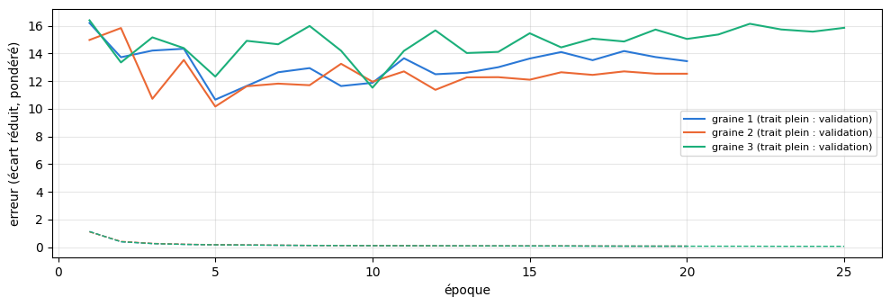
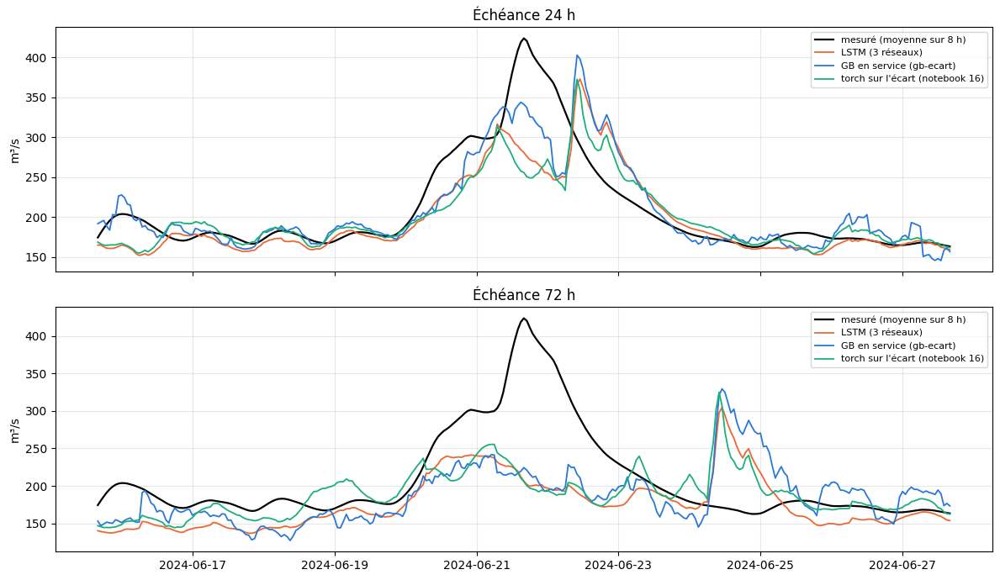
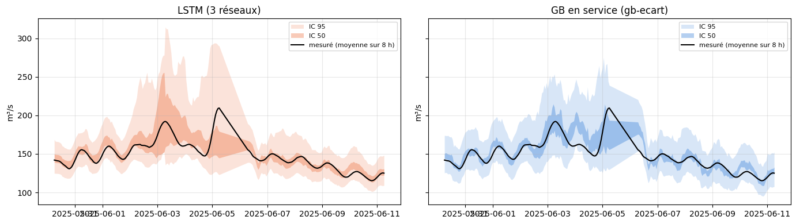

# 5.02 — Un LSTM « passé + futur » pour La Clapière

**Seule l'architecture change** par rapport au GB en service (`gb-ecart`) : mêmes 7 carreaux 25 km, mêmes variables
(précipitations, rayonnement, température, neige au sol à t), débit mesuré en entrée, mêmes 15 échéances (toutes les 8 h jusqu'à
5 jours), même cible (l'écart au débit actuel), même poids ×4 sur les montées, même apprentissage (2010 → mars 2024).

- **Encodeur** : un LSTM lit les **90 derniers jours** par pas de 8 h (270 pas) : météo des 7 carreaux (cumul sur 8 h), débit
  mesuré (moyenne sur 8 h, avec un indicateur « absent »), date et heure. Il finit sur une mémoire (h, c) : l'état du bassin à t.
- **Transfert** : c passe par une couche linéaire, h par une couche linéaire puis tanh.
- **Décodeur** : un second LSTM part de cette mémoire et lit, pour chacune des 15 tranches de 8 h, la météo prévue (en
  apprentissage : l'observée, comme pour le GB), la neige au sol à t, la date de la tranche et le débit actuel ; une couche
  linéaire donne l'écart prévu. La tranche k ne voit que la météo jusqu'à k.

Taille 128, dropout 0,3 (sortie et transfert), AdamW (pas 10⁻³, décroissance 10⁻⁴), écrêtage du gradient à 1, pas divisé par 2
après 5 époques sans progrès, arrêt après 15, validation sur les 15 % les plus récents de l'apprentissage, biais d'oubli à 3 au
départ. **3 réseaux** (graines 1, 2, 3), moyennés. Gardés en cache (`data/cache/modeles_lstm/`) et relus s'ils existent.

**Notes en conditions réelles**, comme pour le GB : calibration + test (avril 2024 → aujourd'hui), prévision officielle de
l'époque ; passé de service (les 6 derniers jours : premières heures des prévisions officielles ; avant : ERA5, disponible en
service avec ~5 jours de retard), neige au sol d'il y a 6 jours ; mêmes heures et mêmes seuils de crue pour tous les modèles.
Intervalles de confiance réglés et notés comme pour tous nos modèles. Rien n'est mis en service.

    carreaux : [10259946, 10259947, 10261386, 10261387, 10261388, 10262826, 10262827] | apprentissage jusqu'au 2026-10-03 | appareil : mps

## Les données

Le futur (météo des 15 tranches, neige à t, débit à t, date) et les cibles viennent d'un `Features` : c'est lui qui, plus bas,
remplace la météo future par la prévision officielle de l'époque, exactement comme pour le GB. Le passé (90 jours par pas de 8 h)
est lu dans les séries horaires des mêmes caches.

    apprentissage : 102543 heures ; passé horaire : 149472 heures, 0.0% sans météo, 10.7% sans débit

## Mise à l'échelle et tenseurs

Moyennes et écarts-types de l'apprentissage seulement. Une même série (le cumul de pluie sur 8 h d'un carreau) a la même échelle
dans le passé et dans le futur. Débit absent : 0 (la moyenne) et l'indicateur à 1.

    102543 instants d'apprentissage gardés sur 102543 ; poids : {'type': 'montee', 'facteur': 4}

## Le réseau

    196993 paramètres

    graine 1 : relu du cache data/cache/modeles_lstm/52a0c9cee4b03f58295e6f8a_L270_g1
    graine 2 : relu du cache data/cache/modeles_lstm/52a0c9cee4b03f58295e6f8a_L270_g2
    graine 3 : relu du cache data/cache/modeles_lstm/52a0c9cee4b03f58295e6f8a_L270_g3

    

    

    {1: '20 époques, 5 min', 2: '20 époques, 6 min', 3: '25 époques, 8 min'}

## Les notes en conditions réelles

Le futur : la prévision officielle de l'époque (`prevision_officielle`, comme pour le GB). Le passé de l'encodeur : celui qu'on
aurait en service à t — les 6 derniers jours tirés des premières heures des prévisions officielles (`PasseService`), avant
ERA5 ; là où l'un manque, l'autre.

    19562 heures notées, de 2024-04-01 à 2026-10-15

<table border="1" class="dataframe">
  <thead>
    <tr style="text-align: right;">
      <th></th>
      <th>R² J+1</th>
      <th>R² J+2</th>
      <th>R² J+3</th>
      <th>R² J+4</th>
      <th>R² J+5</th>
      <th>R² moyen</th>
      <th>crue J+1</th>
      <th>crue J+3</th>
      <th>crue J+5</th>
      <th>R² crue</th>
      <th>R² montée</th>
      <th>erreur pic %</th>
      <th>biais pic %</th>
      <th>pics</th>
    </tr>
  </thead>
  <tbody>
    <tr>
      <th>LSTM (3 réseaux)</th>
      <td>0.972</td>
      <td>0.933</td>
      <td>0.911</td>
      <td>0.902</td>
      <td>0.879</td>
      <td>0.920</td>
      <td>0.810</td>
      <td>0.331</td>
      <td>0.120</td>
      <td>0.409</td>
      <td>0.713</td>
      <td>13.888</td>
      <td>-4.673</td>
      <td>46.0</td>
    </tr>
    <tr>
      <th>LSTM graine 1</th>
      <td>0.973</td>
      <td>0.931</td>
      <td>0.904</td>
      <td>0.893</td>
      <td>0.873</td>
      <td>0.915</td>
      <td>0.818</td>
      <td>0.272</td>
      <td>0.062</td>
      <td>0.371</td>
      <td>0.703</td>
      <td>14.044</td>
      <td>-1.998</td>
      <td>46.0</td>
    </tr>
    <tr>
      <th>LSTM graine 2</th>
      <td>0.969</td>
      <td>0.927</td>
      <td>0.903</td>
      <td>0.892</td>
      <td>0.867</td>
      <td>0.911</td>
      <td>0.789</td>
      <td>0.270</td>
      <td>0.070</td>
      <td>0.361</td>
      <td>0.696</td>
      <td>14.711</td>
      <td>-6.586</td>
      <td>46.0</td>
    </tr>
    <tr>
      <th>LSTM graine 3</th>
      <td>0.970</td>
      <td>0.928</td>
      <td>0.909</td>
      <td>0.898</td>
      <td>0.872</td>
      <td>0.915</td>
      <td>0.795</td>
      <td>0.346</td>
      <td>0.103</td>
      <td>0.405</td>
      <td>0.702</td>
      <td>15.117</td>
      <td>-4.256</td>
      <td>46.0</td>
    </tr>
    <tr>
      <th>GB en service (gb-ecart)</th>
      <td>0.973</td>
      <td>0.931</td>
      <td>0.909</td>
      <td>0.902</td>
      <td>0.883</td>
      <td>0.920</td>
      <td>0.824</td>
      <td>0.348</td>
      <td>0.165</td>
      <td>0.431</td>
      <td>0.756</td>
      <td>14.872</td>
      <td>1.631</td>
      <td>46.0</td>
    </tr>
    <tr>
      <th>torch sur l'écart (notebook 16)</th>
      <td>0.970</td>
      <td>0.925</td>
      <td>0.902</td>
      <td>0.889</td>
      <td>0.882</td>
      <td>0.914</td>
      <td>0.779</td>
      <td>0.265</td>
      <td>0.208</td>
      <td>0.380</td>
      <td>0.685</td>
      <td>15.728</td>
      <td>-6.335</td>
      <td>46.0</td>
    </tr>
  </tbody>
</table>

## La plus forte crue de la période (échéances 24 h et 72 h)

    

    

## Les intervalles de confiance

La méthode de tous nos modèles (`Modele.calibrer`) : chaque borne s'écarte de la prévision faite avec la prévision officielle de
a × l'écart des prévisions faites avec les 50 scénarios + b × la prévision, avec a et b réglés sur la **calibration** (avril 2024 →
mars 2025) ; notes sur le **test** (avril 2025 → aujourd'hui) : couverture (à comparer à 50 % et 95 %), largeur et score
d'intervalle rapportés au débit moyen (plus bas = mieux).

Pour le LSTM, la mémoire de l'encodeur ne dépend que du passé : elle est calculée une fois par instant, puis le décodeur tourne avec
la prévision officielle et avec chacun des 50 scénarios. Le GB en service est réglé et noté de la même façon, sur les mêmes heures.

    LSTM : 19851 instants × 50 scénarios en 43 s

    GB : 19483 instants × 50 scénarios en 51 s

    calibration : 8182 heures ; test : 11301 heures, de 2025-04-01 à 2026-10-15

<table border="1" class="dataframe">
  <thead>
    <tr style="text-align: right;">
      <th></th>
      <th>IC 50 couverture</th>
      <th>IC 50 couverture J+1</th>
      <th>IC 50 couverture J+5</th>
      <th>IC 50 largeur</th>
      <th>IC 50 score</th>
      <th>IC 50 score J+1</th>
      <th>IC 50 score J+5</th>
      <th>IC 95 couverture</th>
      <th>IC 95 couverture J+1</th>
      <th>IC 95 couverture J+5</th>
      <th>IC 95 largeur</th>
      <th>IC 95 score</th>
      <th>IC 95 score J+1</th>
      <th>IC 95 score J+5</th>
    </tr>
  </thead>
  <tbody>
    <tr>
      <th>LSTM (3 réseaux)</th>
      <td>0.438</td>
      <td>0.349</td>
      <td>0.495</td>
      <td>0.157</td>
      <td>0.296</td>
      <td>0.199</td>
      <td>0.361</td>
      <td>0.901</td>
      <td>0.865</td>
      <td>0.912</td>
      <td>0.583</td>
      <td>0.731</td>
      <td>0.571</td>
      <td>0.917</td>
    </tr>
    <tr>
      <th>GB en service (gb-ecart)</th>
      <td>0.447</td>
      <td>0.426</td>
      <td>0.455</td>
      <td>0.156</td>
      <td>0.324</td>
      <td>0.182</td>
      <td>0.433</td>
      <td>0.933</td>
      <td>0.921</td>
      <td>0.925</td>
      <td>0.602</td>
      <td>0.782</td>
      <td>0.466</td>
      <td>1.060</td>
    </tr>
  </tbody>
</table>

## Les intervalles pendant la plus forte crue du test (échéance 24 h)

    

    

