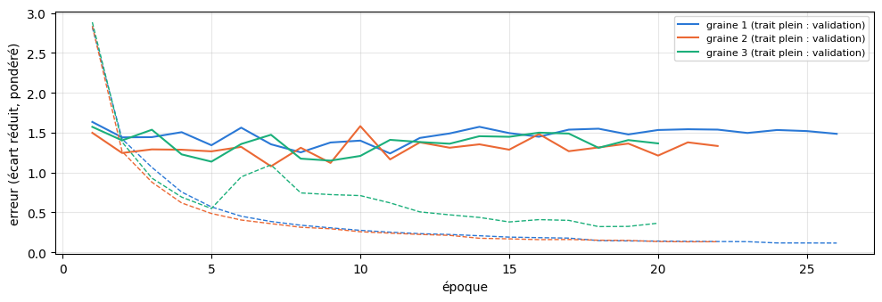
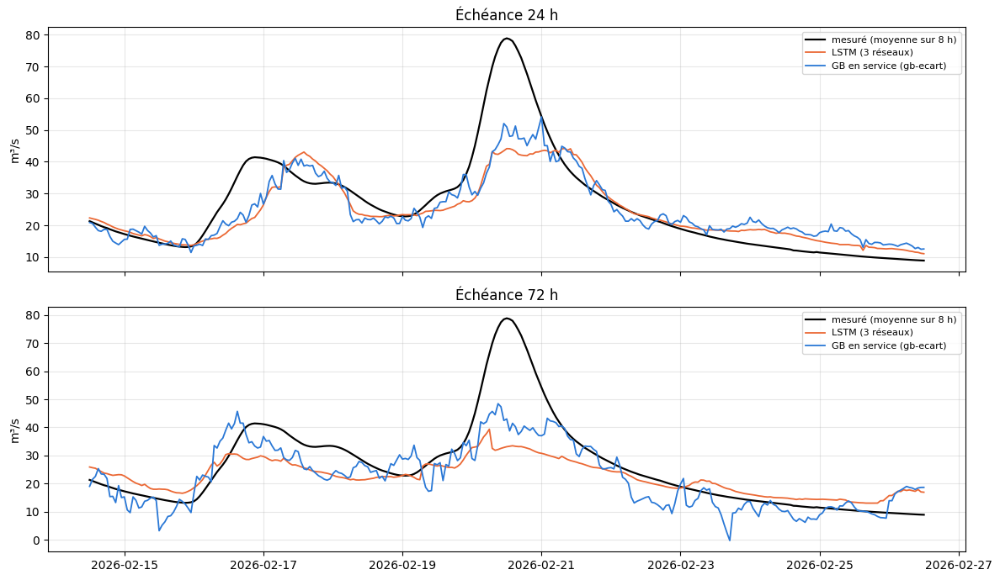
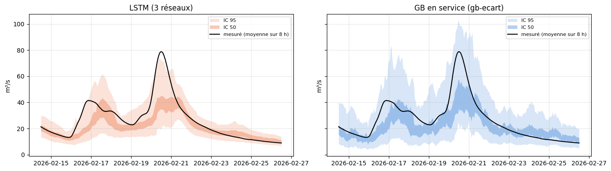
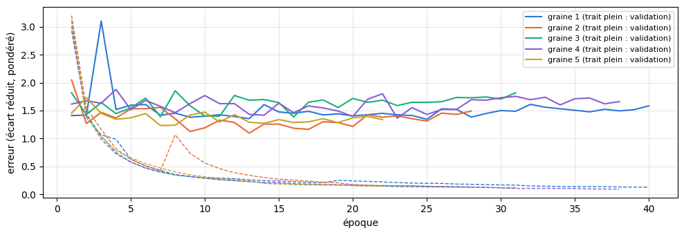
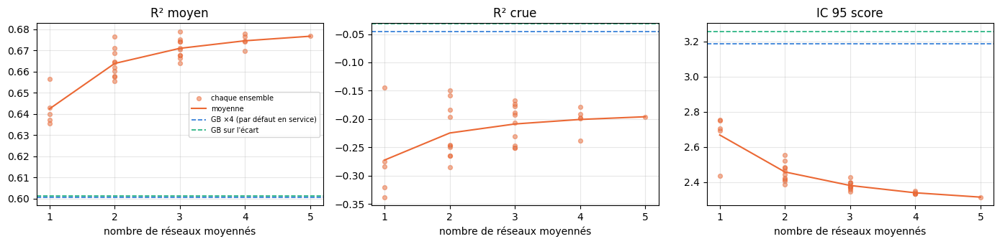
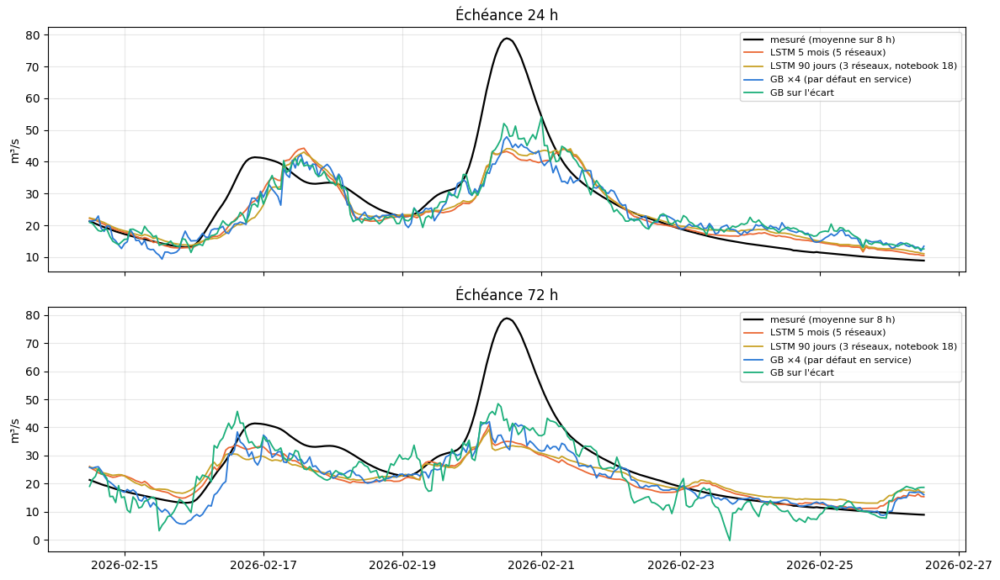
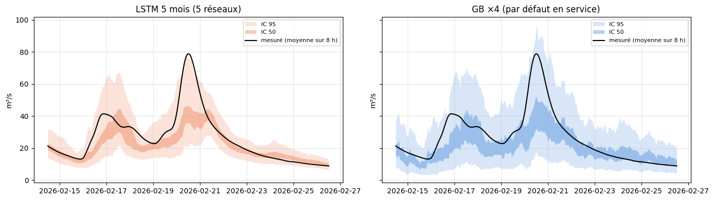

# 5.03 — Le LSTM sur l'Albarine : 90 jours, puis 5 mois et 5 réseaux

Le LSTM de La Clapière (notebook 5.02), sans rien changer, sur une station difficile : l'Albarine, petit bassin karstique du Bugey (partie 1) ; puis avec 5 mois de passé et 5 réseaux (partie 2).

## Partie 1 — Le LSTM « passé + futur » à Saint-Rambert-en-Bugey (Albarine)

Le LSTM du notebook 5.02, sans rien changer à ses réglages, sur une station difficile sans régulation : l'Albarine, petit bassin
karstique du Bugey (330 km², aucun barrage, pas d'éclusées), où le GB voit mal venir les crues (R² crue négatif dès J+3).

**Seule l'architecture change** par rapport au GB en service (`gb-ecart`) : mêmes carreaux 25 km (ceux du GB en service : un seul pour les 330 km² de l'Albarine), mêmes variables
(précipitations, rayonnement, température, neige au sol à t), débit mesuré en entrée, mêmes 15 échéances (toutes les 8 h jusqu'à
5 jours), même cible (l'écart au débit actuel), même poids ×4 sur les montées, même apprentissage (2010 → mars 2024).

- **Encodeur** : un LSTM lit les **90 derniers jours** par pas de 8 h (270 pas) : météo des carreaux (cumul sur 8 h), débit
  mesuré (moyenne sur 8 h, avec un indicateur « absent »), date et heure. Il finit sur une mémoire (h, c) : l'état du bassin à t.
- **Transfert** : c passe par une couche linéaire, h par une couche linéaire puis tanh.
- **Décodeur** : un second LSTM part de cette mémoire et lit, pour chacune des 15 tranches de 8 h, la météo prévue (en
  apprentissage : l'observée, comme pour le GB), la neige au sol à t, la date de la tranche et le débit actuel ; une couche
  linéaire donne l'écart prévu. La tranche k ne voit que la météo jusqu'à k.

Taille 128, dropout 0,3 (sortie et transfert), AdamW (pas 10⁻³, décroissance 10⁻⁴), écrêtage du gradient à 1, pas divisé par 2
après 5 époques sans progrès, arrêt après 15, validation sur les 15 % les plus récents de l'apprentissage, biais d'oubli à 3 au
départ. **3 réseaux** (graines 1, 2, 3), moyennés. Gardés en cache (`data/cache/modeles_lstm/`) et relus s'ils existent.

**Notes en conditions réelles**, comme pour le GB : calibration + test (avril 2024 → aujourd'hui), prévision officielle de
l'époque ; passé de service (les 6 derniers jours : premières heures des prévisions officielles ; avant : ERA5, disponible en
service avec ~5 jours de retard), neige au sol d'il y a 6 jours ; mêmes heures et mêmes seuils de crue pour tous les modèles.
Intervalles de confiance réglés et notés comme pour tous nos modèles. Rien n'est mis en service.

    carreaux : [10254182] | apprentissage jusqu'au 2026-10-21 | appareil : mps

### Les données

Le futur (météo des 15 tranches, neige à t, débit à t, date) et les cibles viennent d'un `Features` : c'est lui qui, plus bas,
remplace la météo future par la prévision officielle de l'époque, exactement comme pour le GB. Le passé (90 jours par pas de 8 h)
est lu dans les séries horaires des mêmes caches.

    apprentissage : 106900 heures ; passé horaire : 149904 heures, 0.1% sans météo, 0.5% sans débit

### Mise à l'échelle et tenseurs

Moyennes et écarts-types de l'apprentissage seulement. Une même série (le cumul de pluie sur 8 h d'un carreau) a la même échelle
dans le passé et dans le futur. Débit absent : 0 (la moyenne) et l'indicateur à 1.

    106900 instants d'apprentissage gardés sur 106900 ; poids : {'type': 'montee', 'facteur': 4}

### Le réseau

    175489 paramètres

    graine 1 : relu du cache data/cache/modeles_lstm/52d9b0f7300459be744f9d0d_L270_g1
    graine 2 : relu du cache data/cache/modeles_lstm/52d9b0f7300459be744f9d0d_L270_g2
    graine 3 : relu du cache data/cache/modeles_lstm/52d9b0f7300459be744f9d0d_L270_g3

    

    

    {1: '26 époques, 19 min', 2: '22 époques, 7 min', 3: '20 époques, 7 min'}

### Les notes en conditions réelles

Le futur : la prévision officielle de l'époque (`prevision_officielle`, comme pour le GB). Le passé de l'encodeur : celui qu'on
aurait en service à t — les 6 derniers jours tirés des premières heures des prévisions officielles (`PasseService`), avant
ERA5 ; là où l'un manque, l'autre.

    19516 heures notées, de 2024-04-01 à 2026-10-16

<table border="1" class="dataframe">
  <thead>
    <tr style="text-align: right;">
      <th></th>
      <th>R² J+1</th>
      <th>R² J+2</th>
      <th>R² J+3</th>
      <th>R² J+4</th>
      <th>R² J+5</th>
      <th>R² moyen</th>
      <th>crue J+1</th>
      <th>crue J+3</th>
      <th>crue J+5</th>
      <th>R² crue</th>
      <th>R² montée</th>
      <th>erreur pic %</th>
      <th>biais pic %</th>
      <th>pics</th>
    </tr>
  </thead>
  <tbody>
    <tr>
      <th>LSTM (3 réseaux)</th>
      <td>0.851</td>
      <td>0.705</td>
      <td>0.619</td>
      <td>0.605</td>
      <td>0.505</td>
      <td>0.657</td>
      <td>0.480</td>
      <td>-0.206</td>
      <td>-0.531</td>
      <td>-0.092</td>
      <td>0.172</td>
      <td>36.438</td>
      <td>-10.964</td>
      <td>26.0</td>
    </tr>
    <tr>
      <th>LSTM graine 1</th>
      <td>0.848</td>
      <td>0.694</td>
      <td>0.571</td>
      <td>0.548</td>
      <td>0.467</td>
      <td>0.626</td>
      <td>0.479</td>
      <td>-0.301</td>
      <td>-0.564</td>
      <td>-0.149</td>
      <td>0.117</td>
      <td>38.802</td>
      <td>-10.871</td>
      <td>26.0</td>
    </tr>
    <tr>
      <th>LSTM graine 2</th>
      <td>0.816</td>
      <td>0.648</td>
      <td>0.572</td>
      <td>0.551</td>
      <td>0.440</td>
      <td>0.605</td>
      <td>0.451</td>
      <td>-0.241</td>
      <td>-0.712</td>
      <td>-0.171</td>
      <td>0.101</td>
      <td>38.099</td>
      <td>-9.477</td>
      <td>26.0</td>
    </tr>
    <tr>
      <th>LSTM graine 3</th>
      <td>0.822</td>
      <td>0.668</td>
      <td>0.611</td>
      <td>0.615</td>
      <td>0.514</td>
      <td>0.646</td>
      <td>0.330</td>
      <td>-0.297</td>
      <td>-0.490</td>
      <td>-0.167</td>
      <td>0.153</td>
      <td>36.920</td>
      <td>-10.184</td>
      <td>26.0</td>
    </tr>
    <tr>
      <th>GB en service (gb-ecart)</th>
      <td>0.840</td>
      <td>0.629</td>
      <td>0.550</td>
      <td>0.552</td>
      <td>0.436</td>
      <td>0.601</td>
      <td>0.536</td>
      <td>-0.156</td>
      <td>-0.466</td>
      <td>-0.032</td>
      <td>0.246</td>
      <td>30.719</td>
      <td>-4.547</td>
      <td>26.0</td>
    </tr>
  </tbody>
</table>

### La plus forte crue de la période (échéances 24 h et 72 h)

    

    

### Les intervalles de confiance

La méthode de tous nos modèles (`Modele.calibrer`) : chaque borne s'écarte de la prévision faite avec la prévision officielle de
a × l'écart des prévisions faites avec les 50 scénarios + b × la prévision, avec a et b réglés sur la **calibration** (avril 2024 →
mars 2025) ; notes sur le **test** (avril 2025 → aujourd'hui) : couverture (à comparer à 50 % et 95 %), largeur et score
d'intervalle rapportés au débit moyen (plus bas = mieux).

Pour le LSTM, la mémoire de l'encodeur ne dépend que du passé : elle est calculée une fois par instant, puis le décodeur tourne avec
la prévision officielle et avec chacun des 50 scénarios. Le GB en service est réglé et noté de la même façon, sur les mêmes heures.

    LSTM : 19830 instants × 50 scénarios en 16 s

    GB : 19485 instants × 50 scénarios en 23 s

    calibration : 7975 heures ; test : 11510 heures, de 2025-04-01 à 2026-10-16

<table border="1" class="dataframe">
  <thead>
    <tr style="text-align: right;">
      <th></th>
      <th>IC 50 couverture</th>
      <th>IC 50 couverture J+1</th>
      <th>IC 50 couverture J+5</th>
      <th>IC 50 largeur</th>
      <th>IC 50 score</th>
      <th>IC 50 score J+1</th>
      <th>IC 50 score J+5</th>
      <th>IC 95 couverture</th>
      <th>IC 95 couverture J+1</th>
      <th>IC 95 couverture J+5</th>
      <th>IC 95 largeur</th>
      <th>IC 95 score</th>
      <th>IC 95 score J+1</th>
      <th>IC 95 score J+5</th>
    </tr>
  </thead>
  <tbody>
    <tr>
      <th>LSTM (3 réseaux)</th>
      <td>0.429</td>
      <td>0.449</td>
      <td>0.436</td>
      <td>0.491</td>
      <td>1.070</td>
      <td>0.576</td>
      <td>1.435</td>
      <td>0.873</td>
      <td>0.883</td>
      <td>0.889</td>
      <td>1.535</td>
      <td>2.391</td>
      <td>1.251</td>
      <td>3.591</td>
    </tr>
    <tr>
      <th>GB en service (gb-ecart)</th>
      <td>0.428</td>
      <td>0.412</td>
      <td>0.459</td>
      <td>0.647</td>
      <td>1.314</td>
      <td>0.736</td>
      <td>1.684</td>
      <td>0.837</td>
      <td>0.863</td>
      <td>0.839</td>
      <td>2.096</td>
      <td>3.257</td>
      <td>1.797</td>
      <td>4.376</td>
    </tr>
  </tbody>
</table>

### Les intervalles pendant la plus forte crue du test (échéance 24 h)

    

    

## Partie 2 — L'Albarine avec 5 mois de passé et 5 réseaux

Le LSTM de la première partie (Saint-Rambert-en-Bugey, l'Albarine) avec trois changements, et rien d'autre :

- l'encodeur lit **5 mois** de passé (150 jours, 450 pas de 8 h) au lieu de 90 jours ;
- les mêmes règles d'arrêt que les notebooks 5.02 et 5.03 (après 15 époques sans progrès, 100 au plus) ; les réseaux 1 et 2, d'abord
  entraînés avec des règles plus courtes (10 époques au plus, puis arrêt après 5 sans progrès), reprennent de leurs meilleurs poids ;
- **5 réseaux** (graines 1 à 5), pour voir ce que donne la moyenne de 1, 2, 3, 4 ou 5 réseaux.

Comparé, sur les mêmes heures, au LSTM 90 jours de la première partie (ses 3 réseaux relus du cache, même mise à l'échelle) et aux deux
GB de la station : le GB ×4 (par défaut en service) et le GB sur l'écart.

Rappel de la première partie — **seule l'architecture change** par rapport aux GB : mêmes carreaux 25 km (ceux du GB en service : un seul pour les 330 km² de l'Albarine), mêmes variables
(précipitations, rayonnement, température, neige au sol à t), débit mesuré en entrée, mêmes 15 échéances (toutes les 8 h jusqu'à
5 jours), même cible (l'écart au débit actuel), même poids ×4 sur les montées, même apprentissage (2010 → mars 2024).

- **Encodeur** : un LSTM lit les **150 derniers jours** par pas de 8 h (450 pas) : météo des carreaux (cumul sur 8 h), débit
  mesuré (moyenne sur 8 h, avec un indicateur « absent »), date et heure. Il finit sur une mémoire (h, c) : l'état du bassin à t.
- **Transfert** : c passe par une couche linéaire, h par une couche linéaire puis tanh.
- **Décodeur** : un second LSTM part de cette mémoire et lit, pour chacune des 15 tranches de 8 h, la météo prévue (en
  apprentissage : l'observée, comme pour le GB), la neige au sol à t, la date de la tranche et le débit actuel ; une couche
  linéaire donne l'écart prévu. La tranche k ne voit que la météo jusqu'à k.

Taille 128, dropout 0,3 (sortie et transfert), AdamW (pas 10⁻³, décroissance 10⁻⁴), écrêtage du gradient à 1, pas divisé par 2
après 5 époques sans progrès, arrêt après 15 époques sans progrès (100 au plus), validation sur les 15 % les plus récents de l'apprentissage, biais d'oubli à 3 au
départ. **5 réseaux** (graines 1 à 5), moyennés. Gardés en cache (`data/cache/modeles_lstm/`) et relus s'ils existent.

**Notes en conditions réelles**, comme pour le GB : calibration + test (avril 2024 → aujourd'hui), prévision officielle de
l'époque ; passé de service (les 6 derniers jours : premières heures des prévisions officielles ; avant : ERA5, disponible en
service avec ~5 jours de retard), neige au sol d'il y a 6 jours ; mêmes heures et mêmes seuils de crue pour tous les modèles.
Intervalles de confiance réglés et notés comme pour tous nos modèles, sur les mêmes heures. Rien n'est mis en service.

    carreaux : [10254182] | apprentissage jusqu'au 2026-10-21 | appareil : mps

### Les données

Le futur (météo des 15 tranches, neige à t, débit à t, date) et les cibles viennent d'un `Features` : c'est lui qui, plus bas,
remplace la météo future par la prévision officielle de l'époque, exactement comme pour le GB. Le passé (150 jours par pas de 8 h)
est lu dans les séries horaires des mêmes caches.

    apprentissage : 106900 heures ; passé horaire : 151392 heures, 0.1% sans météo, 0.5% sans débit

### Mise à l'échelle et tenseurs

Moyennes et écarts-types de l'apprentissage seulement. Une même série (le cumul de pluie sur 8 h d'un carreau) a la même échelle
dans le passé et dans le futur. Débit absent : 0 (la moyenne) et l'indicateur à 1.

    106900 instants d'apprentissage gardés sur 106900 ; poids : {'type': 'montee', 'facteur': 4}

### Le réseau

    175489 paramètres

    graine 1 : relu du cache data/cache/modeles_lstm/52d9b0f7300459be744f9d0d_L450_g1
    graine 2 : relu du cache data/cache/modeles_lstm/52d9b0f7300459be744f9d0d_L450_g2
    graine 3 : relu du cache data/cache/modeles_lstm/52d9b0f7300459be744f9d0d_L450_g3
    graine 4 : relu du cache data/cache/modeles_lstm/52d9b0f7300459be744f9d0d_L450_g4
    graine 5 : relu du cache data/cache/modeles_lstm/52d9b0f7300459be744f9d0d_L450_g5

    

    

    {1: '40 époques, 80 min', 2: '28 époques, 33 min', 3: '31 époques, 37 min', 4: '38 époques, 42 min', 5: '22 époques, 26 min'}

### Les prévisions en conditions réelles

Calibration + test (avril 2024 → aujourd'hui), prévision officielle de l'époque et les 50 scénarios ; passé de service (les 6
derniers jours : premières heures des prévisions officielles ; avant : ERA5, disponible en service avec ~5 jours de retard), neige
au sol d'il y a 6 jours. Pour chaque réseau, la mémoire de l'encodeur est calculée une fois par instant, puis le décodeur tourne avec
la prévision officielle et avec chacun des scénarios. Les réseaux 90 jours lisent les 270 derniers pas des mêmes fenêtres. Tous les
modèles sont notés sur les mêmes heures : celles où tous ont la prévision officielle et les 50 scénarios.

    LSTM : 19830 instants × 50 scénarios, 5 + 3 réseaux en 35 s

    GB : 19485 et 19485 instants en 46 s
    19485 heures communes, de 2024-04-01 à 2026-10-16 ; calibration 7975, test 11510

### Les notes

R² et crues sur calibration + test (mêmes seuils de crue pour tous : ceux de l'apprentissage du GB) ; intervalles réglés sur la
calibration et notés sur le test (score rapporté au débit moyen : plus bas = mieux). Un ensemble de réseaux = la moyenne de leurs
prévisions, pour la prévision officielle comme pour chaque scénario.

    en 6 s

<table border="1" class="dataframe">
  <thead>
    <tr style="text-align: right;">
      <th></th>
      <th>R² J+1</th>
      <th>R² J+2</th>
      <th>R² J+3</th>
      <th>R² J+4</th>
      <th>R² J+5</th>
      <th>R² moyen</th>
      <th>crue J+1</th>
      <th>crue J+3</th>
      <th>crue J+5</th>
      <th>R² crue</th>
      <th>R² montée</th>
      <th>erreur pic %</th>
      <th>biais pic %</th>
      <th>IC 50 couverture</th>
      <th>IC 95 couverture</th>
      <th>IC 95 score</th>
      <th>IC 95 score J+1</th>
      <th>IC 95 score J+5</th>
    </tr>
  </thead>
  <tbody>
    <tr>
      <th>LSTM 5 mois (5 réseaux)</th>
      <td>0.851</td>
      <td>0.728</td>
      <td>0.647</td>
      <td>0.623</td>
      <td>0.534</td>
      <td>0.677</td>
      <td>0.430</td>
      <td>-0.270</td>
      <td>-0.721</td>
      <td>-0.196</td>
      <td>0.104</td>
      <td>36.410</td>
      <td>-13.836</td>
      <td>0.426</td>
      <td>0.900</td>
      <td>2.314</td>
      <td>1.279</td>
      <td>3.634</td>
    </tr>
    <tr>
      <th>LSTM 90 jours (3 réseaux, notebook 18)</th>
      <td>0.851</td>
      <td>0.705</td>
      <td>0.618</td>
      <td>0.605</td>
      <td>0.505</td>
      <td>0.657</td>
      <td>0.481</td>
      <td>-0.206</td>
      <td>-0.531</td>
      <td>-0.093</td>
      <td>0.172</td>
      <td>36.438</td>
      <td>-10.963</td>
      <td>0.429</td>
      <td>0.873</td>
      <td>2.391</td>
      <td>1.251</td>
      <td>3.591</td>
    </tr>
    <tr>
      <th>GB ×4 (par défaut en service)</th>
      <td>0.827</td>
      <td>0.627</td>
      <td>0.551</td>
      <td>0.553</td>
      <td>0.446</td>
      <td>0.601</td>
      <td>0.480</td>
      <td>-0.171</td>
      <td>-0.428</td>
      <td>-0.045</td>
      <td>0.217</td>
      <td>30.909</td>
      <td>-4.313</td>
      <td>0.423</td>
      <td>0.841</td>
      <td>3.187</td>
      <td>1.849</td>
      <td>4.349</td>
    </tr>
    <tr>
      <th>GB sur l'écart</th>
      <td>0.840</td>
      <td>0.629</td>
      <td>0.550</td>
      <td>0.551</td>
      <td>0.436</td>
      <td>0.601</td>
      <td>0.537</td>
      <td>-0.156</td>
      <td>-0.466</td>
      <td>-0.032</td>
      <td>0.246</td>
      <td>30.719</td>
      <td>-4.547</td>
      <td>0.428</td>
      <td>0.837</td>
      <td>3.257</td>
      <td>1.797</td>
      <td>4.376</td>
    </tr>
  </tbody>
</table>

### Combien de réseaux ?

Pour k = 1 à 5 : toutes les façons de choisir k réseaux parmi les 5 (5, 10, 10, 5 et 1), notées chacune ; on donne la moyenne de
ces notes, et pour les principales la moins bonne et la meilleure (ce que le hasard de l'initialisation peut donner).

    31 ensembles notés en 39 s

<table border="1" class="dataframe">
  <thead>
    <tr style="text-align: right;">
      <th></th>
      <th>ensembles</th>
      <th>R² J+1</th>
      <th>R² J+3</th>
      <th>R² J+5</th>
      <th>R² moyen</th>
      <th>R² crue</th>
      <th>R² montée</th>
      <th>erreur pic %</th>
      <th>biais pic %</th>
      <th>IC 95 couverture</th>
      <th>IC 95 score</th>
      <th>R² moyen (pire – meilleur)</th>
      <th>R² crue (pire – meilleur)</th>
      <th>IC 95 score (pire – meilleur)</th>
    </tr>
    <tr>
      <th>réseaux</th>
      <th></th>
      <th></th>
      <th></th>
      <th></th>
      <th></th>
      <th></th>
      <th></th>
      <th></th>
      <th></th>
      <th></th>
      <th></th>
      <th></th>
      <th></th>
      <th></th>
    </tr>
  </thead>
  <tbody>
    <tr>
      <th>1</th>
      <td>5</td>
      <td>0.826</td>
      <td>0.607</td>
      <td>0.503</td>
      <td>0.642</td>
      <td>-0.272</td>
      <td>0.050</td>
      <td>37.966</td>
      <td>-12.805</td>
      <td>0.866</td>
      <td>2.668</td>
      <td>0.635 – 0.657</td>
      <td>-0.338 – -0.144</td>
      <td>2.753 – 2.436</td>
    </tr>
    <tr>
      <th>2</th>
      <td>10</td>
      <td>0.841</td>
      <td>0.632</td>
      <td>0.523</td>
      <td>0.664</td>
      <td>-0.225</td>
      <td>0.083</td>
      <td>36.989</td>
      <td>-13.445</td>
      <td>0.883</td>
      <td>2.457</td>
      <td>0.656 – 0.677</td>
      <td>-0.286 – -0.149</td>
      <td>2.552 – 2.385</td>
    </tr>
    <tr>
      <th>3</th>
      <td>10</td>
      <td>0.847</td>
      <td>0.640</td>
      <td>0.529</td>
      <td>0.671</td>
      <td>-0.209</td>
      <td>0.095</td>
      <td>36.665</td>
      <td>-13.668</td>
      <td>0.891</td>
      <td>2.380</td>
      <td>0.664 – 0.679</td>
      <td>-0.251 – -0.168</td>
      <td>2.426 – 2.345</td>
    </tr>
    <tr>
      <th>4</th>
      <td>5</td>
      <td>0.849</td>
      <td>0.644</td>
      <td>0.532</td>
      <td>0.675</td>
      <td>-0.201</td>
      <td>0.100</td>
      <td>36.511</td>
      <td>-13.776</td>
      <td>0.897</td>
      <td>2.338</td>
      <td>0.670 – 0.678</td>
      <td>-0.237 – -0.178</td>
      <td>2.350 – 2.332</td>
    </tr>
    <tr>
      <th>5</th>
      <td>1</td>
      <td>0.851</td>
      <td>0.647</td>
      <td>0.534</td>
      <td>0.677</td>
      <td>-0.196</td>
      <td>0.104</td>
      <td>36.410</td>
      <td>-13.836</td>
      <td>0.900</td>
      <td>2.314</td>
      <td>0.677 – 0.677</td>
      <td>-0.196 – -0.196</td>
      <td>2.314 – 2.314</td>
    </tr>
  </tbody>
</table>

    

    

### La plus forte crue de la période (échéances 24 h et 72 h)

    

    

### Les intervalles pendant la plus forte crue du test (échéance 24 h)

    

    

