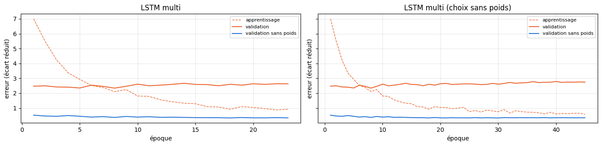
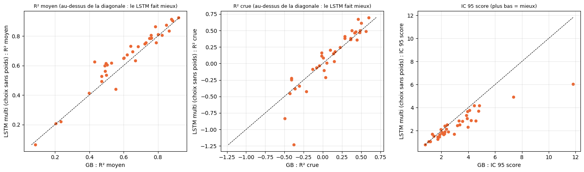
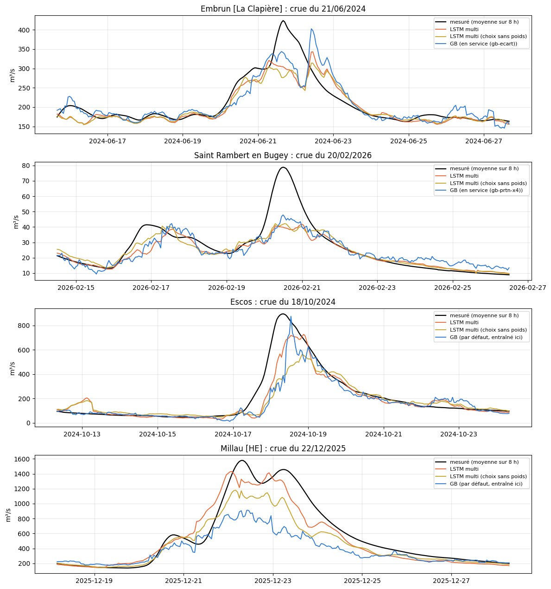

# 5.04 — Un seul LSTM pour 36 rivières

**L'idée** (celle de Kratzert et de Google) : au lieu d'un LSTM par station, **un seul réseau appris sur des dizaines de rivières
à la fois**, qui reçoit en plus quelques **attributs** de chaque bassin (BasinATLAS : surface, altitude, pente, karst, forêt,
sols, pluie et neige moyennes, régulation). Il voit ainsi des milliers de crues au lieu de quelques dizaines.

**Ce qui ne change pas**, pour que la différence vienne du modèle :

- la météo : ERA5 25 km (serveur de RiverApp) pour le passé, la prévision officielle ECMWF de 0 h et ses 50 scénarios pour le
  futur ; mêmes variables (précipitations, rayonnement, température, neige au sol à t) ; pour chaque station, les mêmes carreaux
  que son GB par défaut (les plus grands de l'amont, en nombre proportionnel à sa surface) ;
- le débit mesuré en entrée, les 15 échéances (toutes les 8 h jusqu'à 5 jours), la cible (l'écart au débit actuel), le poids ×4
  sur les montées, le découpage (apprentissage jusqu'en mars 2024, calibration, test) ;
- l'architecture et la taille du LSTM des notebooks 5.02 à 5.03 (encodeur sur 90 jours, décodeur sur la prévision, mémoire de 128) ;
- la notation en conditions réelles (passé de service, prévision officielle de l'époque, IC réglés sur la calibration et notés
  sur le test) et les seuils de crue de chaque station.

**Ce qui change** : un réseau pour toutes les stations, donc des entrées de même taille partout. La météo de chaque station est la
**moyenne de ses carreaux pondérée par leur surface dans le bassin** (au lieu d'une colonne par carreau), et les attributs du bassin
s'ajoutent à chaque pas.

**Le choix des stations** : en France dans les deux pavés de scénarios en cache (42–50° N, 4° O–12° E), débits depuis 2009 au moins,
régulation BasinATLAS ≤ 1 %, 100 à 12 000 km², les plus populaires ; sans les stations où l'on a vu des éclusées ni les doublons ; plus
les stations en service naturelles. Puis un contrôle sur les débits horaires : on écarte celles qui font des éclusées (le débit varie
de plus de 30 % dans la journée plus d'un jour calme sur trois) ou qui ont trop de trous.

**Comparé à** : le GB de chaque station (celui en service par défaut ; pour les autres, le GB par défaut entraîné ici avec la même
recette), et pour La Clapière et l'Albarine aux LSTM par station des notebooks 5.02 et 5.03.

## Le contrôle des débits : éclusées et trous

Sur 2022–2025, pour chaque station : la part des jours « calmes » (débit moyen à moins de 5 % de la veille) où le débit varie de plus de
30 % dans la journée (signe d'usines hydroélectriques), et la part des heures d'apprentissage où le débit manque.

    36 stations gardées sur 53

<table border="1" class="dataframe">
  <thead>
    <tr style="text-align: right;">
      <th></th>
      <th>nom</th>
      <th>riviere</th>
      <th>eclusees</th>
      <th>debit_present</th>
      <th>gardee</th>
    </tr>
  </thead>
  <tbody>
    <tr>
      <th>52a0ca1de4b03f58295e7682</th>
      <td>Auxonne</td>
      <td>Saône</td>
      <td>0.0</td>
      <td>0.2461</td>
      <td>False</td>
    </tr>
    <tr>
      <th>63e607d5c974c776396d3900</th>
      <td>Val-des-Prés</td>
      <td>Durance</td>
      <td>0.015936</td>
      <td>0.999904</td>
      <td>True</td>
    </tr>
    <tr>
      <th>5334b0c278302ecc0db707c9</th>
      <td>Le Lauzet-Ubaye [Roche-Rousse]</td>
      <td>Ubaye</td>
      <td>0.01745</td>
      <td>0.905623</td>
      <td>True</td>
    </tr>
    <tr>
      <th>52a0c9f4e4b03f58295e724a</th>
      <td>Mussidan</td>
      <td>Isle</td>
      <td>0.023622</td>
      <td>0.338963</td>
      <td>False</td>
    </tr>
    <tr>
      <th>52a0ca02e4b03f58295e736a</th>
      <td>Coudes</td>
      <td>Allier</td>
      <td>0.024575</td>
      <td>0.979091</td>
      <td>True</td>
    </tr>
    <tr>
      <th>52a0e677e4b09e9f7f03a1f3</th>
      <td>Chalon Sur Saone</td>
      <td>Saône</td>
      <td>0.034226</td>
      <td>0.421992</td>
      <td>False</td>
    </tr>
    <tr>
      <th>52a0c9e1e4b03f58295e70b6</th>
      <td>Soueix-Rogalle</td>
      <td>Salat</td>
      <td>0.034483</td>
      <td>0.966942</td>
      <td>True</td>
    </tr>
    <tr>
      <th>52a0c9eae4b03f58295e714e</th>
      <td>Millau [HE]</td>
      <td>Tarn</td>
      <td>0.034602</td>
      <td>0.75953</td>
      <td>True</td>
    </tr>
    <tr>
      <th>52a0c9f4e4b03f58295e7232</th>
      <td>Perigueux</td>
      <td>Isle</td>
      <td>0.035144</td>
      <td>0.961977</td>
      <td>True</td>
    </tr>
    <tr>
      <th>52d9b0fe300459be744f9d4d</th>
      <td>Entraigues [Pont Battant]</td>
      <td>Bonne</td>
      <td>0.04224</td>
      <td>0.236738</td>
      <td>False</td>
    </tr>
    <tr>
      <th>52a0ca65e4b03f58295e7e7a</th>
      <td>Allèves [La Charniaz]</td>
      <td>Chéran</td>
      <td>0.044776</td>
      <td>0.997894</td>
      <td>True</td>
    </tr>
    <tr>
      <th>52a0ca30e4b03f58295e78de</th>
      <td>Osses</td>
      <td>Nive</td>
      <td>0.045378</td>
      <td>0.996637</td>
      <td>True</td>
    </tr>
    <tr>
      <th>52a0ca16e4b03f58295e75ba</th>
      <td>Pommeuse</td>
      <td>Grand-Morin</td>
      <td>0.046914</td>
      <td>0.990959</td>
      <td>True</td>
    </tr>
    <tr>
      <th>52a0ca03e4b03f58295e738e</th>
      <td>Pontgibaud</td>
      <td>Sioule</td>
      <td>0.054795</td>
      <td>0.975927</td>
      <td>True</td>
    </tr>
    <tr>
      <th>52a0c9f6e4b03f58295e726e</th>
      <td>Goudet</td>
      <td>Loire</td>
      <td>0.058577</td>
      <td>0.994194</td>
      <td>True</td>
    </tr>
    <tr>
      <th>52a0ca1ee4b03f58295e76a2</th>
      <td>Vuillafans</td>
      <td>Loue</td>
      <td>0.063745</td>
      <td>0.994891</td>
      <td>True</td>
    </tr>
    <tr>
      <th>52a0c9ede4b03f58295e7182</th>
      <td>Figeac</td>
      <td>Célé</td>
      <td>0.067941</td>
      <td>0.996877</td>
      <td>True</td>
    </tr>
    <tr>
      <th>52a0c9f7e4b03f58295e728e</th>
      <td>Chadrac [Pont du Monteil]</td>
      <td>Loire</td>
      <td>0.068182</td>
      <td>0.989037</td>
      <td>True</td>
    </tr>
    <tr>
      <th>52a0c9dfe4b03f58295e7096</th>
      <td>Aspet</td>
      <td>Ger</td>
      <td>0.072581</td>
      <td>0.996837</td>
      <td>True</td>
    </tr>
    <tr>
      <th>52a0ca5fe4b03f58295e7e1e</th>
      <td>Laroque</td>
      <td>Hérault</td>
      <td>0.073171</td>
      <td>0.97869</td>
      <td>True</td>
    </tr>
    <tr>
      <th>52fa770c30045a6748a5f3e0</th>
      <td>Eymoutiers</td>
      <td>Vienne</td>
      <td>0.075949</td>
      <td>0.968872</td>
      <td>True</td>
    </tr>
    <tr>
      <th>52d9b0f7300459be744f9d0d</th>
      <td>Saint Rambert en Bugey</td>
      <td>Albarine</td>
      <td>0.087209</td>
      <td>0.986899</td>
      <td>True</td>
    </tr>
    <tr>
      <th>52a0ca01e4b03f58295e7356</th>
      <td>Joursac</td>
      <td>Alagnon</td>
      <td>0.104911</td>
      <td>0.977233</td>
      <td>True</td>
    </tr>
    <tr>
      <th>52a0ca46e4b03f58295e7bbe</th>
      <td>Couilly-Pont-aux-Dames [Station ultrason]</td>
      <td>Grand-Morin</td>
      <td>0.112698</td>
      <td>0.888494</td>
      <td>True</td>
    </tr>
    <tr>
      <th>52a0e69be4b09e9f7f03a4b7</th>
      <td>Rosureux</td>
      <td>Dessoubre</td>
      <td>0.12459</td>
      <td>0.89659</td>
      <td>True</td>
    </tr>
    <tr>
      <th>52a0ca2ee4b03f58295e78aa</th>
      <td>Escos</td>
      <td>Gave d'Oloron</td>
      <td>0.125</td>
      <td>0.997598</td>
      <td>True</td>
    </tr>
    <tr>
      <th>52a0ca03e4b03f58295e7392</th>
      <td>La Prugne</td>
      <td>Sioulet</td>
      <td>0.132911</td>
      <td>0.974918</td>
      <td>True</td>
    </tr>
    <tr>
      <th>52a0ca1ee4b03f58295e76be</th>
      <td>Goumois</td>
      <td>Doubs</td>
      <td>0.133065</td>
      <td>0.996532</td>
      <td>True</td>
    </tr>
    <tr>
      <th>52a0ca65e4b03f58295e7e7e</th>
      <td>Dingy-St-Clair</td>
      <td>Fier</td>
      <td>0.133531</td>
      <td>0.995571</td>
      <td>True</td>
    </tr>
    <tr>
      <th>52a0ca21e4b03f58295e7712</th>
      <td>Macon</td>
      <td>Saône</td>
      <td>0.13594</td>
      <td>0.6053</td>
      <td>False</td>
    </tr>
    <tr>
      <th>52a0c9f8e4b03f58295e72a2</th>
      <td>Sauvessanges</td>
      <td>Ance du Nord</td>
      <td>0.144554</td>
      <td>0.977032</td>
      <td>True</td>
    </tr>
    <tr>
      <th>52a0e6a0e4b09e9f7f03a52b</th>
      <td>Morez</td>
      <td>Bienne</td>
      <td>0.15444</td>
      <td>0.985513</td>
      <td>True</td>
    </tr>
    <tr>
      <th>52a0c9ebe4b03f58295e7166</th>
      <td>Cocurès</td>
      <td>Tarn</td>
      <td>0.157522</td>
      <td>0.996717</td>
      <td>True</td>
    </tr>
    <tr>
      <th>52a0ca1de4b03f58295e7686</th>
      <td>Lechâtelet</td>
      <td>Saône</td>
      <td>0.162447</td>
      <td>0.98247</td>
      <td>True</td>
    </tr>
    <tr>
      <th>52a0ca34e4b03f58295e7976</th>
      <td>Epinal</td>
      <td>Moselle</td>
      <td>0.182065</td>
      <td>0.969777</td>
      <td>True</td>
    </tr>
    <tr>
      <th>52a0c9f5e4b03f58295e7256</th>
      <td>Montignac</td>
      <td>Vézère</td>
      <td>0.188264</td>
      <td>0.966382</td>
      <td>True</td>
    </tr>
    <tr>
      <th>52d9b10f300459be744f9d84</th>
      <td>Bourg de sirod</td>
      <td>Ain</td>
      <td>0.206395</td>
      <td>0.982999</td>
      <td>True</td>
    </tr>
    <tr>
      <th>52a0ca30e4b03f58295e78da</th>
      <td>Orthez</td>
      <td>Gave de Pau</td>
      <td>0.21822</td>
      <td>0.668525</td>
      <td>False</td>
    </tr>
    <tr>
      <th>52a0e68fe4b09e9f7f03a3bb</th>
      <td>Syam</td>
      <td>Saine</td>
      <td>0.26257</td>
      <td>0.976136</td>
      <td>True</td>
    </tr>
    <tr>
      <th>52a0c9dbe4b03f58295e7056</th>
      <td>Pont-de-Labeaume</td>
      <td>Ardèche</td>
      <td>0.264151</td>
      <td>0.983455</td>
      <td>True</td>
    </tr>
    <tr>
      <th>52fa771230045a6748a5f404</th>
      <td>Rive-de-Gier</td>
      <td>Gier</td>
      <td>0.269777</td>
      <td>0.99815</td>
      <td>True</td>
    </tr>
    <tr>
      <th>52a0c9cee4b03f58295e6f8a</th>
      <td>Embrun [La Clapière]</td>
      <td>Durance</td>
      <td>0.304907</td>
      <td>0.857878</td>
      <td>True</td>
    </tr>
    <tr>
      <th>52a0ca31e4b03f58295e78f6</th>
      <td>Tarbes-Adour</td>
      <td>Adour</td>
      <td>0.35443</td>
      <td>0.996532</td>
      <td>False</td>
    </tr>
    <tr>
      <th>52a0c9dfe4b03f58295e708e</th>
      <td>Cazères</td>
      <td>Garonne</td>
      <td>0.357259</td>
      <td>0.673321</td>
      <td>False</td>
    </tr>
    <tr>
      <th>52a0ca3ae4b03f58295e7a56</th>
      <td>Toul</td>
      <td>Moselle</td>
      <td>0.504587</td>
      <td>0.962009</td>
      <td>False</td>
    </tr>
    <tr>
      <th>52a0ca1ee4b03f58295e7696</th>
      <td>Beaumerousse</td>
      <td>Doubs</td>
      <td>0.536023</td>
      <td>0.998807</td>
      <td>False</td>
    </tr>
    <tr>
      <th>52a0ca2fe4b03f58295e78ba</th>
      <td>Licq-Atherey [Pont de Licq]</td>
      <td>Saison</td>
      <td>0.553265</td>
      <td>0.933244</td>
      <td>False</td>
    </tr>
    <tr>
      <th>52a0c9e0e4b03f58295e70ae</th>
      <td>St-Lizier [St-Girons]</td>
      <td>Salat</td>
      <td>0.601542</td>
      <td>0.996236</td>
      <td>False</td>
    </tr>
    <tr>
      <th>52a0c9e0e4b03f58295e70a2</th>
      <td>Arreau-Aure</td>
      <td>Neste d'Aure</td>
      <td>0.606513</td>
      <td>0.679224</td>
      <td>False</td>
    </tr>
    <tr>
      <th>52a396713004d4ecefa72d7a</th>
      <td>Albi</td>
      <td>Tarn</td>
      <td>0.613833</td>
      <td>0.75398</td>
      <td>False</td>
    </tr>
    <tr>
      <th>5a2e6c485782af5a4631a35d</th>
      <td>St-Pé-de-Bigorre</td>
      <td>Gave de Pau</td>
      <td>0.680346</td>
      <td>0.992664</td>
      <td>False</td>
    </tr>
    <tr>
      <th>52a0c9dfe4b03f58295e709a</th>
      <td>Chaum</td>
      <td>Garonne</td>
      <td>0.748366</td>
      <td>0.996869</td>
      <td>False</td>
    </tr>
    <tr>
      <th>52a0c9e0e4b03f58295e709e</th>
      <td>St-Béat [HE]</td>
      <td>Garonne</td>
      <td>0.879061</td>
      <td>0.997165</td>
      <td>False</td>
    </tr>
  </tbody>
</table>

## Les données de chaque station

Les carreaux et leur poids (surface dans le bassin) ; les attributs, moyennés sur tout l'amont (pondérés par la surface de chaque
petit bassin), plus la surface et la régulation ; le passé horaire (cumul sur 8 h de la météo moyenne du bassin, débit moyen sur 8 h)
et le futur de `Features` (la météo des 15 tranches, que `prevision_officielle` remplacera plus bas).

## Mise à l'échelle commune

Météo et neige : une seule échelle pour toutes les stations (10 mm de pluie valent 10 mm partout). Débit en entrée : l'échelle de
chaque station (le réseau voit l'état du débit par rapport à son habitude ; la surface et le reste sont dans les attributs). Écart à
prévoir : réduit par station et par échéance, pour que chaque rivière compte autant dans l'erreur, quelle que soit sa taille.
Attributs : réduits sur l'ensemble des stations. Tout est calculé sur l'apprentissage.

## Le réseau

Le même encodeur–décodeur que les notebooks 5.02 à 5.03, avec les attributs du bassin ajoutés à chaque pas, en entrée de l'encodeur comme
du décodeur.

## L'apprentissage

Toutes les stations dans un même tirage : à chaque époque, un huitième des instants d'apprentissage de toutes les stations, tiré au
hasard (deux heures voisines donnent presque la même fenêtre) ; validation sur les 15 % les plus récents de l'apprentissage de chaque
station (un instant sur 8). Mêmes réglages que les notebooks 5.02 à 5.03 ; un seul réseau (graine 1), au plus 2 h d'apprentissage. Deux versions, identiques
sauf le choix de la meilleure époque : sur la validation pondérée (×4 sur les montées, comme les notebooks 5.02 à 5.03), ou sur la
validation sans poids. La première s'arrête tôt : quelques très grosses crues font monter la validation pondérée alors que la
validation sans poids progresse encore. Les poids sont enregistrés à chaque progrès : l'apprentissage peut reprendre où il s'est arrêté.

    données de 36 stations en 0 s

    4111818 instants d'apprentissage (3495028 pour apprendre, 616790 de validation), 15 attributs, 190849 paramètres
    reprise après 23 époques

    reprise après 45 époques

    LSTM multi : 23 époques en 28 min ; meilleure : époque 8
    LSTM multi (choix sans poids) : 45 époques en 51 min ; meilleure : époque 30

    

    

## Les prévisions en conditions réelles, station par station

Pour chaque station, sur calibration + test (avril 2024 → aujourd'hui) : la prévision officielle de l'époque et les 50 scénarios ;
passé de service pour l'encodeur (les 6 derniers jours : premières heures des prévisions officielles ; avant : ERA5) ; la mémoire de
l'encodeur est calculée une fois par instant, puis le décodeur tourne pour la prévision officielle et pour chaque scénario. Le GB de la
station est nourri de la même façon (sa propre recette, passé de service). Résultats gardés en cache par station.

    36 stations prévues en 317 s

## Les notes, station par station

Heures communes au LSTM et au GB de chaque station ; R² et crues sur calibration + test (seuils de crue de l'apprentissage du GB) ;
intervalles réglés sur la calibration et notés sur le test (score rapporté au débit moyen : plus bas = mieux).

<table border="1" class="dataframe">
  <thead>
    <tr>
      <th></th>
      <th></th>
      <th colspan="3" halign="left">R² J+1</th>
      <th colspan="3" halign="left">R² J+3</th>
      <th colspan="3" halign="left">R² J+5</th>
      <th colspan="3" halign="left">R² moyen</th>
      <th colspan="3" halign="left">R² crue</th>
      <th colspan="3" halign="left">R² montée</th>
      <th colspan="3" halign="left">biais pic %</th>
      <th colspan="3" halign="left">IC 95 couverture</th>
      <th colspan="3" halign="left">IC 95 score</th>
    </tr>
    <tr>
      <th></th>
      <th>modèle</th>
      <th>LSTM multi</th>
      <th>LSTM multi (choix sans poids)</th>
      <th>GB</th>
      <th>LSTM multi</th>
      <th>LSTM multi (choix sans poids)</th>
      <th>GB</th>
      <th>LSTM multi</th>
      <th>LSTM multi (choix sans poids)</th>
      <th>GB</th>
      <th>LSTM multi</th>
      <th>LSTM multi (choix sans poids)</th>
      <th>GB</th>
      <th>LSTM multi</th>
      <th>LSTM multi (choix sans poids)</th>
      <th>GB</th>
      <th>LSTM multi</th>
      <th>LSTM multi (choix sans poids)</th>
      <th>GB</th>
      <th>LSTM multi</th>
      <th>LSTM multi (choix sans poids)</th>
      <th>GB</th>
      <th>LSTM multi</th>
      <th>LSTM multi (choix sans poids)</th>
      <th>GB</th>
      <th>LSTM multi</th>
      <th>LSTM multi (choix sans poids)</th>
      <th>GB</th>
    </tr>
    <tr>
      <th>station</th>
      <th>rivière</th>
      <th></th>
      <th></th>
      <th></th>
      <th></th>
      <th></th>
      <th></th>
      <th></th>
      <th></th>
      <th></th>
      <th></th>
      <th></th>
      <th></th>
      <th></th>
      <th></th>
      <th></th>
      <th></th>
      <th></th>
      <th></th>
      <th></th>
      <th></th>
      <th></th>
      <th></th>
      <th></th>
      <th></th>
      <th></th>
      <th></th>
      <th></th>
    </tr>
  </thead>
  <tbody>
    <tr>
      <th>Saint Rambert en Bugey</th>
      <th>Albarine</th>
      <td>0.850</td>
      <td>0.831</td>
      <td>0.827</td>
      <td>0.594</td>
      <td>0.603</td>
      <td>0.551</td>
      <td>0.473</td>
      <td>0.496</td>
      <td>0.446</td>
      <td>0.642</td>
      <td>0.649</td>
      <td>0.601</td>
      <td>0.135</td>
      <td>-0.033</td>
      <td>-0.045</td>
      <td>0.363</td>
      <td>0.234</td>
      <td>0.217</td>
      <td>-0.292</td>
      <td>0.144</td>
      <td>-4.313</td>
      <td>0.819</td>
      <td>0.854</td>
      <td>0.841</td>
      <td>2.655</td>
      <td>2.439</td>
      <td>3.187</td>
    </tr>
    <tr>
      <th>Millau [HE]</th>
      <th>Tarn</th>
      <td>0.919</td>
      <td>0.923</td>
      <td>0.772</td>
      <td>0.682</td>
      <td>0.690</td>
      <td>0.622</td>
      <td>0.716</td>
      <td>0.608</td>
      <td>0.571</td>
      <td>0.758</td>
      <td>0.732</td>
      <td>0.641</td>
      <td>0.731</td>
      <td>0.698</td>
      <td>0.597</td>
      <td>0.731</td>
      <td>0.649</td>
      <td>0.537</td>
      <td>20.739</td>
      <td>14.648</td>
      <td>20.357</td>
      <td>0.863</td>
      <td>0.835</td>
      <td>0.900</td>
      <td>3.451</td>
      <td>4.176</td>
      <td>4.450</td>
    </tr>
    <tr>
      <th>Pontgibaud</th>
      <th>Sioule</th>
      <td>0.919</td>
      <td>0.913</td>
      <td>0.923</td>
      <td>0.759</td>
      <td>0.786</td>
      <td>0.728</td>
      <td>0.662</td>
      <td>0.670</td>
      <td>0.634</td>
      <td>0.770</td>
      <td>0.785</td>
      <td>0.750</td>
      <td>0.380</td>
      <td>0.381</td>
      <td>0.364</td>
      <td>0.551</td>
      <td>0.527</td>
      <td>0.536</td>
      <td>5.182</td>
      <td>1.839</td>
      <td>7.267</td>
      <td>0.867</td>
      <td>0.911</td>
      <td>0.916</td>
      <td>1.953</td>
      <td>1.892</td>
      <td>2.002</td>
    </tr>
    <tr>
      <th>Bourg de sirod</th>
      <th>Ain</th>
      <td>0.859</td>
      <td>0.860</td>
      <td>0.841</td>
      <td>0.652</td>
      <td>0.673</td>
      <td>0.605</td>
      <td>0.464</td>
      <td>0.504</td>
      <td>0.451</td>
      <td>0.655</td>
      <td>0.673</td>
      <td>0.621</td>
      <td>0.033</td>
      <td>-0.086</td>
      <td>-0.134</td>
      <td>0.355</td>
      <td>0.250</td>
      <td>0.229</td>
      <td>-12.104</td>
      <td>-17.881</td>
      <td>-11.859</td>
      <td>0.837</td>
      <td>0.903</td>
      <td>0.841</td>
      <td>2.935</td>
      <td>2.521</td>
      <td>3.368</td>
    </tr>
    <tr>
      <th>Dingy-St-Clair</th>
      <th>Fier</th>
      <td>0.734</td>
      <td>0.705</td>
      <td>0.707</td>
      <td>0.339</td>
      <td>0.376</td>
      <td>0.311</td>
      <td>0.230</td>
      <td>0.228</td>
      <td>0.201</td>
      <td>0.418</td>
      <td>0.414</td>
      <td>0.398</td>
      <td>-0.531</td>
      <td>-0.835</td>
      <td>-0.498</td>
      <td>-0.140</td>
      <td>-0.339</td>
      <td>-0.117</td>
      <td>-9.657</td>
      <td>-16.829</td>
      <td>-3.216</td>
      <td>0.860</td>
      <td>0.889</td>
      <td>0.837</td>
      <td>2.849</td>
      <td>3.069</td>
      <td>3.903</td>
    </tr>
    <tr>
      <th>Perigueux</th>
      <th>Isle</th>
      <td>0.942</td>
      <td>0.946</td>
      <td>0.928</td>
      <td>0.803</td>
      <td>0.802</td>
      <td>0.795</td>
      <td>0.713</td>
      <td>0.699</td>
      <td>0.685</td>
      <td>0.814</td>
      <td>0.810</td>
      <td>0.800</td>
      <td>0.495</td>
      <td>0.473</td>
      <td>0.479</td>
      <td>0.599</td>
      <td>0.567</td>
      <td>0.572</td>
      <td>-3.663</td>
      <td>-6.381</td>
      <td>0.874</td>
      <td>0.862</td>
      <td>0.856</td>
      <td>0.879</td>
      <td>2.399</td>
      <td>2.435</td>
      <td>2.242</td>
    </tr>
    <tr>
      <th>Pont-de-Labeaume</th>
      <th>Ardèche</th>
      <td>0.645</td>
      <td>0.711</td>
      <td>0.712</td>
      <td>0.507</td>
      <td>0.605</td>
      <td>0.552</td>
      <td>0.218</td>
      <td>0.235</td>
      <td>0.245</td>
      <td>0.465</td>
      <td>0.535</td>
      <td>0.500</td>
      <td>0.247</td>
      <td>0.365</td>
      <td>0.362</td>
      <td>0.375</td>
      <td>0.437</td>
      <td>0.444</td>
      <td>34.721</td>
      <td>26.069</td>
      <td>32.057</td>
      <td>0.862</td>
      <td>0.850</td>
      <td>0.862</td>
      <td>3.350</td>
      <td>3.338</td>
      <td>3.869</td>
    </tr>
    <tr>
      <th>Coudes</th>
      <th>Allier</th>
      <td>0.944</td>
      <td>0.935</td>
      <td>0.924</td>
      <td>0.737</td>
      <td>0.698</td>
      <td>0.647</td>
      <td>0.625</td>
      <td>0.588</td>
      <td>0.532</td>
      <td>0.760</td>
      <td>0.728</td>
      <td>0.684</td>
      <td>0.288</td>
      <td>0.178</td>
      <td>0.159</td>
      <td>0.454</td>
      <td>0.337</td>
      <td>0.359</td>
      <td>-2.635</td>
      <td>-2.865</td>
      <td>5.905</td>
      <td>0.916</td>
      <td>0.949</td>
      <td>0.955</td>
      <td>1.640</td>
      <td>1.684</td>
      <td>1.859</td>
    </tr>
    <tr>
      <th>Osses</th>
      <th>Nive</th>
      <td>0.832</td>
      <td>0.815</td>
      <td>0.790</td>
      <td>0.516</td>
      <td>0.499</td>
      <td>0.477</td>
      <td>0.208</td>
      <td>0.306</td>
      <td>0.182</td>
      <td>0.513</td>
      <td>0.528</td>
      <td>0.471</td>
      <td>-0.424</td>
      <td>-0.454</td>
      <td>-0.428</td>
      <td>0.113</td>
      <td>0.149</td>
      <td>0.072</td>
      <td>3.798</td>
      <td>-0.883</td>
      <td>13.366</td>
      <td>0.881</td>
      <td>0.880</td>
      <td>0.940</td>
      <td>2.390</td>
      <td>2.532</td>
      <td>2.423</td>
    </tr>
    <tr>
      <th>Escos</th>
      <th>Gave d'Oloron</th>
      <td>0.837</td>
      <td>0.815</td>
      <td>0.840</td>
      <td>0.314</td>
      <td>0.335</td>
      <td>0.511</td>
      <td>0.240</td>
      <td>0.235</td>
      <td>0.356</td>
      <td>0.435</td>
      <td>0.439</td>
      <td>0.554</td>
      <td>-1.100</td>
      <td>-1.233</td>
      <td>-0.378</td>
      <td>-0.229</td>
      <td>-0.296</td>
      <td>0.142</td>
      <td>8.405</td>
      <td>9.500</td>
      <td>20.890</td>
      <td>0.919</td>
      <td>0.941</td>
      <td>0.928</td>
      <td>2.017</td>
      <td>2.127</td>
      <td>1.970</td>
    </tr>
    <tr>
      <th>Montignac</th>
      <th>Vézère</th>
      <td>0.959</td>
      <td>0.964</td>
      <td>0.948</td>
      <td>0.863</td>
      <td>0.874</td>
      <td>0.841</td>
      <td>0.792</td>
      <td>0.789</td>
      <td>0.759</td>
      <td>0.870</td>
      <td>0.874</td>
      <td>0.849</td>
      <td>0.588</td>
      <td>0.614</td>
      <td>0.503</td>
      <td>0.684</td>
      <td>0.689</td>
      <td>0.627</td>
      <td>-1.346</td>
      <td>-2.260</td>
      <td>-4.392</td>
      <td>0.820</td>
      <td>0.847</td>
      <td>0.829</td>
      <td>1.645</td>
      <td>1.458</td>
      <td>1.726</td>
    </tr>
    <tr>
      <th>Epinal</th>
      <th>Moselle</th>
      <td>0.936</td>
      <td>0.942</td>
      <td>0.949</td>
      <td>0.764</td>
      <td>0.778</td>
      <td>0.810</td>
      <td>0.687</td>
      <td>0.707</td>
      <td>0.728</td>
      <td>0.790</td>
      <td>0.806</td>
      <td>0.824</td>
      <td>-0.431</td>
      <td>-0.344</td>
      <td>-0.307</td>
      <td>0.526</td>
      <td>0.446</td>
      <td>0.537</td>
      <td>6.793</td>
      <td>1.886</td>
      <td>6.761</td>
      <td>0.772</td>
      <td>0.820</td>
      <td>0.839</td>
      <td>1.809</td>
      <td>1.525</td>
      <td>1.424</td>
    </tr>
    <tr>
      <th>Syam</th>
      <th>Saine</th>
      <td>0.754</td>
      <td>0.753</td>
      <td>0.747</td>
      <td>0.455</td>
      <td>0.544</td>
      <td>0.460</td>
      <td>0.295</td>
      <td>0.386</td>
      <td>0.311</td>
      <td>0.495</td>
      <td>0.561</td>
      <td>0.493</td>
      <td>-0.155</td>
      <td>-0.224</td>
      <td>-0.408</td>
      <td>0.242</td>
      <td>0.174</td>
      <td>0.039</td>
      <td>-12.280</td>
      <td>-21.503</td>
      <td>-20.038</td>
      <td>0.786</td>
      <td>0.825</td>
      <td>0.810</td>
      <td>3.810</td>
      <td>3.718</td>
      <td>4.754</td>
    </tr>
    <tr>
      <th>Cocurès</th>
      <th>Tarn</th>
      <td>0.861</td>
      <td>0.860</td>
      <td>0.776</td>
      <td>0.624</td>
      <td>0.620</td>
      <td>0.563</td>
      <td>0.492</td>
      <td>0.488</td>
      <td>0.479</td>
      <td>0.655</td>
      <td>0.653</td>
      <td>0.602</td>
      <td>0.499</td>
      <td>0.463</td>
      <td>0.414</td>
      <td>0.512</td>
      <td>0.460</td>
      <td>0.440</td>
      <td>22.553</td>
      <td>11.268</td>
      <td>37.794</td>
      <td>0.793</td>
      <td>0.810</td>
      <td>0.882</td>
      <td>2.625</td>
      <td>2.874</td>
      <td>3.315</td>
    </tr>
    <tr>
      <th>Vuillafans</th>
      <th>Loue</th>
      <td>0.913</td>
      <td>0.917</td>
      <td>0.917</td>
      <td>0.683</td>
      <td>0.726</td>
      <td>0.693</td>
      <td>0.527</td>
      <td>0.608</td>
      <td>0.577</td>
      <td>0.704</td>
      <td>0.747</td>
      <td>0.723</td>
      <td>0.027</td>
      <td>-0.065</td>
      <td>-0.083</td>
      <td>0.453</td>
      <td>0.399</td>
      <td>0.392</td>
      <td>-1.528</td>
      <td>-6.060</td>
      <td>-1.651</td>
      <td>0.899</td>
      <td>0.950</td>
      <td>0.916</td>
      <td>1.640</td>
      <td>1.474</td>
      <td>1.837</td>
    </tr>
    <tr>
      <th>Chadrac [Pont du Monteil]</th>
      <th>Loire</th>
      <td>0.632</td>
      <td>0.550</td>
      <td>0.426</td>
      <td>0.191</td>
      <td>0.100</td>
      <td>0.172</td>
      <td>0.181</td>
      <td>0.154</td>
      <td>0.155</td>
      <td>0.288</td>
      <td>0.219</td>
      <td>0.234</td>
      <td>0.077</td>
      <td>0.011</td>
      <td>0.049</td>
      <td>0.225</td>
      <td>0.083</td>
      <td>0.085</td>
      <td>19.350</td>
      <td>-1.538</td>
      <td>49.506</td>
      <td>0.924</td>
      <td>0.955</td>
      <td>0.924</td>
      <td>3.077</td>
      <td>3.761</td>
      <td>4.106</td>
    </tr>
    <tr>
      <th>Figeac</th>
      <th>Célé</th>
      <td>0.874</td>
      <td>0.901</td>
      <td>0.891</td>
      <td>0.760</td>
      <td>0.750</td>
      <td>0.804</td>
      <td>0.652</td>
      <td>0.603</td>
      <td>0.691</td>
      <td>0.769</td>
      <td>0.754</td>
      <td>0.791</td>
      <td>0.425</td>
      <td>0.359</td>
      <td>0.443</td>
      <td>0.564</td>
      <td>0.506</td>
      <td>0.604</td>
      <td>2.066</td>
      <td>2.335</td>
      <td>-0.444</td>
      <td>0.811</td>
      <td>0.820</td>
      <td>0.838</td>
      <td>1.932</td>
      <td>1.730</td>
      <td>2.232</td>
    </tr>
    <tr>
      <th>Laroque</th>
      <th>Hérault</th>
      <td>0.779</td>
      <td>0.806</td>
      <td>0.815</td>
      <td>0.645</td>
      <td>0.632</td>
      <td>0.665</td>
      <td>0.516</td>
      <td>0.521</td>
      <td>0.557</td>
      <td>0.631</td>
      <td>0.633</td>
      <td>0.669</td>
      <td>0.499</td>
      <td>0.485</td>
      <td>0.561</td>
      <td>0.535</td>
      <td>0.502</td>
      <td>0.570</td>
      <td>32.940</td>
      <td>26.523</td>
      <td>34.573</td>
      <td>0.764</td>
      <td>0.717</td>
      <td>0.777</td>
      <td>3.444</td>
      <td>3.686</td>
      <td>3.960</td>
    </tr>
    <tr>
      <th>Lechâtelet</th>
      <th>Saône</th>
      <td>0.984</td>
      <td>0.986</td>
      <td>0.988</td>
      <td>0.891</td>
      <td>0.917</td>
      <td>0.876</td>
      <td>0.788</td>
      <td>0.842</td>
      <td>0.771</td>
      <td>0.888</td>
      <td>0.916</td>
      <td>0.879</td>
      <td>0.525</td>
      <td>0.501</td>
      <td>0.380</td>
      <td>0.743</td>
      <td>0.725</td>
      <td>0.675</td>
      <td>-3.607</td>
      <td>-5.383</td>
      <td>-4.525</td>
      <td>0.909</td>
      <td>0.883</td>
      <td>0.916</td>
      <td>1.026</td>
      <td>1.051</td>
      <td>1.166</td>
    </tr>
    <tr>
      <th>Goudet</th>
      <th>Loire</th>
      <td>0.638</td>
      <td>0.590</td>
      <td>0.371</td>
      <td>0.136</td>
      <td>0.120</td>
      <td>0.149</td>
      <td>-0.024</td>
      <td>0.010</td>
      <td>0.112</td>
      <td>0.217</td>
      <td>0.208</td>
      <td>0.204</td>
      <td>0.167</td>
      <td>0.153</td>
      <td>0.141</td>
      <td>0.301</td>
      <td>0.230</td>
      <td>0.154</td>
      <td>56.551</td>
      <td>23.305</td>
      <td>59.342</td>
      <td>0.970</td>
      <td>0.952</td>
      <td>0.925</td>
      <td>6.169</td>
      <td>6.049</td>
      <td>11.821</td>
    </tr>
    <tr>
      <th>Pommeuse</th>
      <th>Grand-Morin</th>
      <td>0.883</td>
      <td>0.871</td>
      <td>0.738</td>
      <td>0.582</td>
      <td>0.583</td>
      <td>0.452</td>
      <td>0.456</td>
      <td>0.449</td>
      <td>0.365</td>
      <td>0.620</td>
      <td>0.614</td>
      <td>0.497</td>
      <td>0.189</td>
      <td>0.160</td>
      <td>-0.014</td>
      <td>0.337</td>
      <td>0.284</td>
      <td>0.194</td>
      <td>-14.038</td>
      <td>-16.692</td>
      <td>-1.729</td>
      <td>0.994</td>
      <td>0.987</td>
      <td>0.982</td>
      <td>2.341</td>
      <td>2.335</td>
      <td>3.975</td>
    </tr>
    <tr>
      <th>Allèves [La Charniaz]</th>
      <th>Chéran</th>
      <td>0.741</td>
      <td>0.766</td>
      <td>0.752</td>
      <td>0.365</td>
      <td>0.440</td>
      <td>0.416</td>
      <td>0.318</td>
      <td>0.333</td>
      <td>0.321</td>
      <td>0.460</td>
      <td>0.493</td>
      <td>0.472</td>
      <td>-0.124</td>
      <td>-0.425</td>
      <td>-0.214</td>
      <td>0.043</td>
      <td>-0.105</td>
      <td>0.079</td>
      <td>-15.681</td>
      <td>-25.241</td>
      <td>-10.353</td>
      <td>0.859</td>
      <td>0.874</td>
      <td>0.853</td>
      <td>2.869</td>
      <td>2.815</td>
      <td>3.571</td>
    </tr>
    <tr>
      <th>Rosureux</th>
      <th>Dessoubre</th>
      <td>0.899</td>
      <td>0.893</td>
      <td>0.893</td>
      <td>0.703</td>
      <td>0.672</td>
      <td>0.618</td>
      <td>0.532</td>
      <td>0.537</td>
      <td>0.480</td>
      <td>0.704</td>
      <td>0.696</td>
      <td>0.652</td>
      <td>-0.172</td>
      <td>-0.380</td>
      <td>-0.360</td>
      <td>0.272</td>
      <td>0.099</td>
      <td>0.148</td>
      <td>-8.328</td>
      <td>-9.450</td>
      <td>-5.195</td>
      <td>0.821</td>
      <td>0.854</td>
      <td>0.795</td>
      <td>3.293</td>
      <td>2.861</td>
      <td>4.558</td>
    </tr>
    <tr>
      <th>Soueix-Rogalle</th>
      <th>Salat</th>
      <td>0.858</td>
      <td>0.859</td>
      <td>0.834</td>
      <td>0.604</td>
      <td>0.619</td>
      <td>0.551</td>
      <td>0.380</td>
      <td>0.345</td>
      <td>0.219</td>
      <td>0.612</td>
      <td>0.617</td>
      <td>0.529</td>
      <td>-0.276</td>
      <td>-0.248</td>
      <td>-0.408</td>
      <td>0.135</td>
      <td>0.126</td>
      <td>0.012</td>
      <td>-14.115</td>
      <td>-17.334</td>
      <td>-5.745</td>
      <td>0.961</td>
      <td>0.978</td>
      <td>0.953</td>
      <td>1.286</td>
      <td>1.261</td>
      <td>1.729</td>
    </tr>
    <tr>
      <th>Eymoutiers</th>
      <th>Vienne</th>
      <td>0.956</td>
      <td>0.955</td>
      <td>0.901</td>
      <td>0.867</td>
      <td>0.867</td>
      <td>0.782</td>
      <td>0.769</td>
      <td>0.778</td>
      <td>0.690</td>
      <td>0.864</td>
      <td>0.864</td>
      <td>0.786</td>
      <td>0.706</td>
      <td>0.671</td>
      <td>0.462</td>
      <td>0.711</td>
      <td>0.660</td>
      <td>0.542</td>
      <td>-5.593</td>
      <td>-11.353</td>
      <td>-9.592</td>
      <td>0.837</td>
      <td>0.815</td>
      <td>0.741</td>
      <td>1.765</td>
      <td>1.705</td>
      <td>2.949</td>
    </tr>
    <tr>
      <th>La Prugne</th>
      <th>Sioulet</th>
      <td>0.914</td>
      <td>0.929</td>
      <td>0.911</td>
      <td>0.784</td>
      <td>0.796</td>
      <td>0.748</td>
      <td>0.686</td>
      <td>0.701</td>
      <td>0.641</td>
      <td>0.789</td>
      <td>0.806</td>
      <td>0.760</td>
      <td>0.430</td>
      <td>0.414</td>
      <td>0.286</td>
      <td>0.622</td>
      <td>0.586</td>
      <td>0.542</td>
      <td>-0.966</td>
      <td>-6.116</td>
      <td>-0.060</td>
      <td>0.705</td>
      <td>0.785</td>
      <td>0.791</td>
      <td>2.203</td>
      <td>2.135</td>
      <td>2.362</td>
    </tr>
    <tr>
      <th>Morez</th>
      <th>Bienne</th>
      <td>0.756</td>
      <td>0.793</td>
      <td>0.759</td>
      <td>0.405</td>
      <td>0.634</td>
      <td>0.504</td>
      <td>0.163</td>
      <td>0.376</td>
      <td>0.253</td>
      <td>0.427</td>
      <td>0.604</td>
      <td>0.503</td>
      <td>0.135</td>
      <td>0.083</td>
      <td>0.006</td>
      <td>0.361</td>
      <td>0.322</td>
      <td>0.272</td>
      <td>4.313</td>
      <td>-4.992</td>
      <td>-2.401</td>
      <td>0.847</td>
      <td>0.878</td>
      <td>0.826</td>
      <td>3.112</td>
      <td>2.900</td>
      <td>4.207</td>
    </tr>
    <tr>
      <th>Couilly-Pont-aux-Dames [Station ultrason]</th>
      <th>Grand-Morin</th>
      <td>0.883</td>
      <td>0.872</td>
      <td>0.814</td>
      <td>0.523</td>
      <td>0.542</td>
      <td>0.388</td>
      <td>0.440</td>
      <td>0.444</td>
      <td>0.336</td>
      <td>0.592</td>
      <td>0.598</td>
      <td>0.490</td>
      <td>0.127</td>
      <td>0.115</td>
      <td>-0.014</td>
      <td>0.386</td>
      <td>0.360</td>
      <td>0.337</td>
      <td>-7.467</td>
      <td>-9.783</td>
      <td>0.264</td>
      <td>0.854</td>
      <td>0.857</td>
      <td>0.884</td>
      <td>4.132</td>
      <td>4.180</td>
      <td>4.812</td>
    </tr>
    <tr>
      <th>Aspet</th>
      <th>Ger</th>
      <td>0.847</td>
      <td>0.870</td>
      <td>0.801</td>
      <td>0.591</td>
      <td>0.614</td>
      <td>0.391</td>
      <td>0.368</td>
      <td>0.383</td>
      <td>0.107</td>
      <td>0.597</td>
      <td>0.624</td>
      <td>0.432</td>
      <td>0.315</td>
      <td>0.245</td>
      <td>0.227</td>
      <td>0.489</td>
      <td>0.440</td>
      <td>0.395</td>
      <td>-8.743</td>
      <td>-12.319</td>
      <td>3.353</td>
      <td>0.926</td>
      <td>0.964</td>
      <td>0.951</td>
      <td>2.037</td>
      <td>1.923</td>
      <td>2.524</td>
    </tr>
    <tr>
      <th>Sauvessanges</th>
      <th>Ance du Nord</th>
      <td>0.849</td>
      <td>0.847</td>
      <td>0.868</td>
      <td>0.718</td>
      <td>0.754</td>
      <td>0.726</td>
      <td>0.618</td>
      <td>0.683</td>
      <td>0.633</td>
      <td>0.719</td>
      <td>0.756</td>
      <td>0.730</td>
      <td>-0.157</td>
      <td>-0.213</td>
      <td>0.035</td>
      <td>0.404</td>
      <td>0.303</td>
      <td>0.472</td>
      <td>-5.890</td>
      <td>-8.831</td>
      <td>-2.023</td>
      <td>0.770</td>
      <td>0.875</td>
      <td>0.824</td>
      <td>2.162</td>
      <td>1.686</td>
      <td>2.169</td>
    </tr>
    <tr>
      <th>Rive-de-Gier</th>
      <th>Gier</th>
      <td>0.420</td>
      <td>0.417</td>
      <td>0.251</td>
      <td>-0.063</td>
      <td>-0.017</td>
      <td>0.024</td>
      <td>-0.156</td>
      <td>-0.122</td>
      <td>0.018</td>
      <td>0.032</td>
      <td>0.063</td>
      <td>0.085</td>
      <td>-0.068</td>
      <td>-0.103</td>
      <td>0.017</td>
      <td>0.209</td>
      <td>0.085</td>
      <td>0.039</td>
      <td>52.514</td>
      <td>23.655</td>
      <td>56.207</td>
      <td>0.955</td>
      <td>0.935</td>
      <td>0.861</td>
      <td>4.434</td>
      <td>4.941</td>
      <td>7.382</td>
    </tr>
    <tr>
      <th>Joursac</th>
      <th>Alagnon</th>
      <td>0.907</td>
      <td>0.914</td>
      <td>0.889</td>
      <td>0.797</td>
      <td>0.774</td>
      <td>0.765</td>
      <td>0.695</td>
      <td>0.699</td>
      <td>0.635</td>
      <td>0.797</td>
      <td>0.784</td>
      <td>0.757</td>
      <td>0.537</td>
      <td>0.499</td>
      <td>0.488</td>
      <td>0.616</td>
      <td>0.548</td>
      <td>0.600</td>
      <td>-0.709</td>
      <td>1.801</td>
      <td>7.624</td>
      <td>0.861</td>
      <td>0.918</td>
      <td>0.936</td>
      <td>1.914</td>
      <td>1.761</td>
      <td>2.085</td>
    </tr>
    <tr>
      <th>Le Lauzet-Ubaye [Roche-Rousse]</th>
      <th>Ubaye</th>
      <td>0.973</td>
      <td>0.965</td>
      <td>0.960</td>
      <td>0.898</td>
      <td>0.896</td>
      <td>0.868</td>
      <td>0.865</td>
      <td>0.852</td>
      <td>0.832</td>
      <td>0.912</td>
      <td>0.903</td>
      <td>0.885</td>
      <td>0.474</td>
      <td>0.382</td>
      <td>0.289</td>
      <td>0.724</td>
      <td>0.662</td>
      <td>0.619</td>
      <td>1.167</td>
      <td>-2.965</td>
      <td>3.299</td>
      <td>0.724</td>
      <td>0.638</td>
      <td>0.871</td>
      <td>1.540</td>
      <td>1.713</td>
      <td>1.306</td>
    </tr>
    <tr>
      <th>Embrun [La Clapière]</th>
      <th>Durance</th>
      <td>0.974</td>
      <td>0.976</td>
      <td>0.974</td>
      <td>0.915</td>
      <td>0.920</td>
      <td>0.909</td>
      <td>0.882</td>
      <td>0.883</td>
      <td>0.883</td>
      <td>0.923</td>
      <td>0.926</td>
      <td>0.920</td>
      <td>0.525</td>
      <td>0.484</td>
      <td>0.433</td>
      <td>0.767</td>
      <td>0.732</td>
      <td>0.757</td>
      <td>0.681</td>
      <td>-6.165</td>
      <td>1.600</td>
      <td>0.939</td>
      <td>0.925</td>
      <td>0.933</td>
      <td>0.808</td>
      <td>0.779</td>
      <td>0.782</td>
    </tr>
    <tr>
      <th>Val-des-Prés</th>
      <th>Durance</th>
      <td>0.953</td>
      <td>0.956</td>
      <td>0.956</td>
      <td>0.783</td>
      <td>0.821</td>
      <td>0.848</td>
      <td>0.694</td>
      <td>0.733</td>
      <td>0.801</td>
      <td>0.807</td>
      <td>0.834</td>
      <td>0.865</td>
      <td>-0.139</td>
      <td>0.033</td>
      <td>0.151</td>
      <td>0.735</td>
      <td>0.721</td>
      <td>0.791</td>
      <td>17.243</td>
      <td>10.911</td>
      <td>13.129</td>
      <td>0.938</td>
      <td>0.944</td>
      <td>0.942</td>
      <td>1.011</td>
      <td>1.049</td>
      <td>1.057</td>
    </tr>
    <tr>
      <th>Goumois</th>
      <th>Doubs</th>
      <td>0.910</td>
      <td>0.922</td>
      <td>0.935</td>
      <td>0.743</td>
      <td>0.780</td>
      <td>0.757</td>
      <td>0.635</td>
      <td>0.664</td>
      <td>0.607</td>
      <td>0.760</td>
      <td>0.788</td>
      <td>0.761</td>
      <td>0.114</td>
      <td>0.202</td>
      <td>0.097</td>
      <td>0.511</td>
      <td>0.511</td>
      <td>0.452</td>
      <td>1.437</td>
      <td>-2.027</td>
      <td>2.148</td>
      <td>0.947</td>
      <td>0.908</td>
      <td>0.892</td>
      <td>1.917</td>
      <td>1.911</td>
      <td>2.243</td>
    </tr>
  </tbody>
</table>

## Le résumé

Médianes sur les stations, et sur combien de stations le LSTM multi fait mieux que le GB (pour le score d'IC : plus bas = mieux).

    36 stations

<table border="1" class="dataframe">
  <thead>
    <tr style="text-align: right;">
      <th></th>
      <th>R² J+1</th>
      <th>R² J+3</th>
      <th>R² J+5</th>
      <th>R² moyen</th>
      <th>R² crue</th>
      <th>R² montée</th>
      <th>biais pic %</th>
      <th>IC 95 couverture</th>
      <th>IC 95 score</th>
    </tr>
  </thead>
  <tbody>
    <tr>
      <th>GB (médiane)</th>
      <td>0.840</td>
      <td>0.620</td>
      <td>0.506</td>
      <td>0.646</td>
      <td>0.119</td>
      <td>0.418</td>
      <td>1.237</td>
      <td>0.881</td>
      <td>2.474</td>
    </tr>
    <tr>
      <th>LSTM multi (médiane)</th>
      <td>0.878</td>
      <td>0.667</td>
      <td>0.522</td>
      <td>0.679</td>
      <td>0.151</td>
      <td>0.453</td>
      <td>-0.500</td>
      <td>0.861</td>
      <td>2.272</td>
    </tr>
    <tr>
      <th>LSTM multi : stations où il fait mieux que le GB</th>
      <td>22.000</td>
      <td>22.000</td>
      <td>22.000</td>
      <td>24.000</td>
      <td>27.000</td>
      <td>27.000</td>
      <td>19.000</td>
      <td>11.000</td>
      <td>31.000</td>
    </tr>
    <tr>
      <th>LSTM multi (choix sans poids) (médiane)</th>
      <td>0.871</td>
      <td>0.672</td>
      <td>0.529</td>
      <td>0.684</td>
      <td>0.157</td>
      <td>0.418</td>
      <td>-2.915</td>
      <td>0.879</td>
      <td>2.235</td>
    </tr>
    <tr>
      <th>LSTM multi (choix sans poids) : stations où il fait mieux que le GB</th>
      <td>25.000</td>
      <td>28.000</td>
      <td>27.000</td>
      <td>29.000</td>
      <td>23.000</td>
      <td>20.000</td>
      <td>18.000</td>
      <td>20.000</td>
      <td>31.000</td>
    </tr>
  </tbody>
</table>

    

    

## La Clapière et l'Albarine : face aux LSTM par station

Les notes des LSTM par station viennent des notebooks 5.02 (La Clapière, 3 réseaux) et 18 (l'Albarine, 3 réseaux), mêmes réglages et même
période ; leurs heures notées diffèrent un peu (quelques dizaines d'heures sur ~19 500).

<table border="1" class="dataframe">
  <thead>
    <tr style="text-align: right;">
      <th></th>
      <th></th>
      <th>R² J+1</th>
      <th>R² J+3</th>
      <th>R² J+5</th>
      <th>R² moyen</th>
      <th>R² crue</th>
      <th>R² montée</th>
      <th>biais pic %</th>
      <th>IC 95 couverture</th>
      <th>IC 95 score</th>
    </tr>
  </thead>
  <tbody>
    <tr>
      <th rowspan="4" valign="top">Embrun [La Clapière]</th>
      <th>GB</th>
      <td>0.974</td>
      <td>0.909</td>
      <td>0.883</td>
      <td>0.920</td>
      <td>0.433</td>
      <td>0.757</td>
      <td>1.600</td>
      <td>0.933</td>
      <td>0.782</td>
    </tr>
    <tr>
      <th>LSTM multi</th>
      <td>0.974</td>
      <td>0.915</td>
      <td>0.882</td>
      <td>0.923</td>
      <td>0.525</td>
      <td>0.767</td>
      <td>0.681</td>
      <td>0.939</td>
      <td>0.808</td>
    </tr>
    <tr>
      <th>LSTM multi (choix sans poids)</th>
      <td>0.976</td>
      <td>0.920</td>
      <td>0.883</td>
      <td>0.926</td>
      <td>0.484</td>
      <td>0.732</td>
      <td>-6.165</td>
      <td>0.925</td>
      <td>0.779</td>
    </tr>
    <tr>
      <th>LSTM par station (notebook 17)</th>
      <td>0.972</td>
      <td>0.911</td>
      <td>0.879</td>
      <td>0.920</td>
      <td>0.409</td>
      <td>0.713</td>
      <td>-4.673</td>
      <td>0.901</td>
      <td>0.731</td>
    </tr>
    <tr>
      <th rowspan="4" valign="top">Saint Rambert en Bugey</th>
      <th>GB</th>
      <td>0.827</td>
      <td>0.551</td>
      <td>0.446</td>
      <td>0.601</td>
      <td>-0.045</td>
      <td>0.217</td>
      <td>-4.313</td>
      <td>0.841</td>
      <td>3.187</td>
    </tr>
    <tr>
      <th>LSTM multi</th>
      <td>0.850</td>
      <td>0.594</td>
      <td>0.473</td>
      <td>0.642</td>
      <td>0.135</td>
      <td>0.363</td>
      <td>-0.292</td>
      <td>0.819</td>
      <td>2.655</td>
    </tr>
    <tr>
      <th>LSTM multi (choix sans poids)</th>
      <td>0.831</td>
      <td>0.603</td>
      <td>0.496</td>
      <td>0.649</td>
      <td>-0.033</td>
      <td>0.234</td>
      <td>0.144</td>
      <td>0.854</td>
      <td>2.439</td>
    </tr>
    <tr>
      <th>LSTM par station (notebook 18)</th>
      <td>0.851</td>
      <td>0.619</td>
      <td>0.505</td>
      <td>0.657</td>
      <td>-0.092</td>
      <td>0.172</td>
      <td>-10.964</td>
      <td>0.873</td>
      <td>2.391</td>
    </tr>
  </tbody>
</table>

## Les plus fortes crues : quelques stations (échéance 24 h)

    

    

