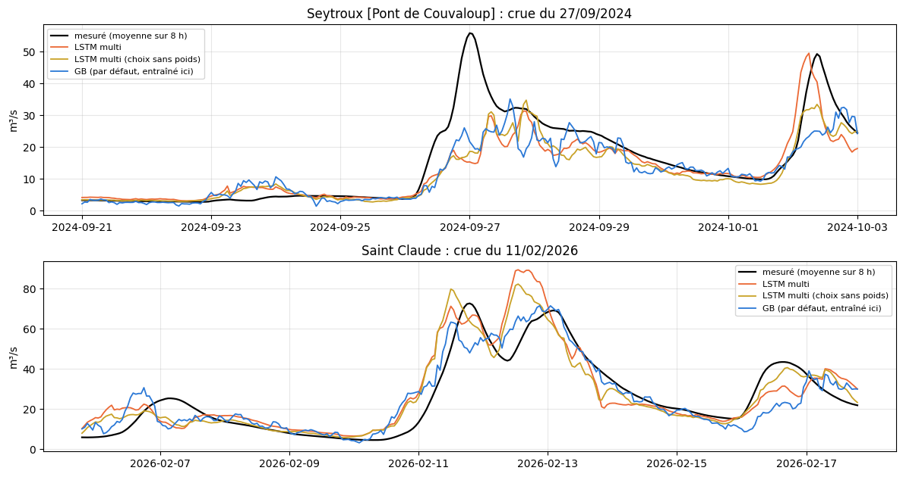

# 5.05 — Le LSTM multi-rivières sur des rivières jamais vues

Le réseau du notebook 5.04 (un seul LSTM appris sur 36 rivières, avec les attributs BasinATLAS), **relu tel quel, sans rien
réapprendre**, sur des rivières absentes de son apprentissage : ni la station, ni une autre station de la même rivière.

**Les rivières** : parmi les stations populaires des deux pavés de scénarios, débits depuis 2009, régulation BasinATLAS ≤ 1 %, dont
tous les carreaux étaient déjà en cache : Mende (Lot, Lozère), Chambon-sur-Lignon (Lignon, Haute-Loire), Seytroux (Dranse de Morzine,
Haute-Savoie), Saint-Claude (Tacon, Jura). Même contrôle qu'au notebook 5.04 (éclusées, trous de débit).

**Ce que le réseau reçoit d'une rivière inconnue** : la même chose qu'une rivière apprise — la météo moyenne de ses carreaux (ceux
de son GB par défaut, pondérés par leur surface), son débit mesuré, ses attributs BasinATLAS (réduits avec l'échelle des 36 rivières
d'apprentissage). Seules deux échelles viennent de la station elle-même, calculées sur son passé (2010 → mars 2024) comme pour la
mettre en service : son débit habituel (pour réduire le débit en entrée) et la dispersion de ses écarts à chaque échéance (pour
remettre la sortie en m³/s).

**Comparé à** : le GB par défaut de chaque station, entraîné sur elle (même recette que la mise en service), et aux notes médianes du
notebook 5.04 sur les rivières apprises. Mêmes notes en conditions réelles (passé de service, prévision officielle de l'époque, IC réglés
sur la calibration et notés sur le test).

## Le contrôle des débits

Comme au notebook 5.04 : sur 2022–2025, la part des jours calmes où le débit varie de plus de 30 % dans la journée, et la part des
heures d'apprentissage où le débit manque.

    2 stations gardées sur 4

<table border="1" class="dataframe">
  <thead>
    <tr style="text-align: right;">
      <th></th>
      <th>nom</th>
      <th>riviere</th>
      <th>eclusees</th>
      <th>debit_present</th>
      <th>gardee</th>
    </tr>
  </thead>
  <tbody>
    <tr>
      <th>52a0c9eee4b03f58295e7192</th>
      <td>Mende [HE]</td>
      <td>Lot</td>
      <td>0.03125</td>
      <td>0.435854</td>
      <td>False</td>
    </tr>
    <tr>
      <th>52a0e6a4e4b09e9f7f03a5a3</th>
      <td>Seytroux [Pont de Couvaloup]</td>
      <td>Dranse de Morzine</td>
      <td>0.091684</td>
      <td>0.901555</td>
      <td>True</td>
    </tr>
    <tr>
      <th>52d9b0ec300459be744f9ca9</th>
      <td>Saint Claude</td>
      <td>Tacon</td>
      <td>0.201717</td>
      <td>0.987291</td>
      <td>True</td>
    </tr>
    <tr>
      <th>52a0c9f7e4b03f58295e7292</th>
      <td>Chambon-sur-Lignon</td>
      <td>Lignon</td>
      <td>0.575581</td>
      <td>0.984608</td>
      <td>False</td>
    </tr>
  </tbody>
</table>

## Les réseaux du notebook 5.04 et les échelles des nouvelles stations

Les deux versions du notebook 5.04 (choix de l'époque sur la validation pondérée, ou sans poids), relues du cache. Les échelles de météo,
de neige et d'attributs sont celles des 36 rivières d'apprentissage ; pour chaque nouvelle station, son débit habituel et la dispersion
de ses écarts viennent de son passé.

    36 rivières d'apprentissage ; 2 rivières inconnues : ['Seytroux [Pont de Couvaloup]', 'Saint Claude']
                 Seytroux [Pont de Couvaloup]  Saint Claude
    ele_mt_sav                        1387.00       1078.00
    slp_dg_sav                         236.00        112.00
    kar_pc_sse                         100.00        100.00
    for_pc_sse                          92.00         88.00
    crp_pc_sse                           7.00          5.00
    urb_pc_sse                           0.00          2.00
    cly_pc_sav                          21.00         22.00
    snd_pc_sav                          39.00         38.00
    gwt_cm_sav                         730.00        373.00
    pre_mm_syr                        1386.00       1343.00
    snw_pc_syr                          36.00         32.00
    ari_ix_sav                         212.00        188.00
    tmp_dc_syr                          50.00         65.00
    surface_log                          2.31          2.17
    regulation                           0.00          0.00

## Les prévisions en conditions réelles

Exactement comme au notebook 5.04 : prévision officielle de l'époque et 50 scénarios, passé de service ; le GB de comparaison est le GB
par défaut de la station, entraîné sur elle.

    2 stations prévues en 127 s

## Les notes

Heures communes aux trois modèles de chaque station ; R² et crues sur calibration + test (seuils de crue de l'apprentissage du GB) ;
IC réglés sur la calibration, notés sur le test (score rapporté au débit moyen : plus bas = mieux). En dessous, pour situer : les
médianes du notebook 5.04 sur les 36 rivières apprises.

<table border="1" class="dataframe">
  <thead>
    <tr>
      <th></th>
      <th></th>
      <th colspan="3" halign="left">R² J+1</th>
      <th colspan="3" halign="left">R² J+3</th>
      <th colspan="3" halign="left">R² J+5</th>
      <th colspan="3" halign="left">R² moyen</th>
      <th colspan="3" halign="left">R² crue</th>
      <th colspan="3" halign="left">R² montée</th>
      <th colspan="3" halign="left">biais pic %</th>
      <th colspan="3" halign="left">IC 95 couverture</th>
      <th colspan="3" halign="left">IC 95 score</th>
    </tr>
    <tr>
      <th></th>
      <th>modèle</th>
      <th>LSTM multi</th>
      <th>LSTM multi (choix sans poids)</th>
      <th>GB</th>
      <th>LSTM multi</th>
      <th>LSTM multi (choix sans poids)</th>
      <th>GB</th>
      <th>LSTM multi</th>
      <th>LSTM multi (choix sans poids)</th>
      <th>GB</th>
      <th>LSTM multi</th>
      <th>LSTM multi (choix sans poids)</th>
      <th>GB</th>
      <th>LSTM multi</th>
      <th>LSTM multi (choix sans poids)</th>
      <th>GB</th>
      <th>LSTM multi</th>
      <th>LSTM multi (choix sans poids)</th>
      <th>GB</th>
      <th>LSTM multi</th>
      <th>LSTM multi (choix sans poids)</th>
      <th>GB</th>
      <th>LSTM multi</th>
      <th>LSTM multi (choix sans poids)</th>
      <th>GB</th>
      <th>LSTM multi</th>
      <th>LSTM multi (choix sans poids)</th>
      <th>GB</th>
    </tr>
    <tr>
      <th>station</th>
      <th>rivière</th>
      <th></th>
      <th></th>
      <th></th>
      <th></th>
      <th></th>
      <th></th>
      <th></th>
      <th></th>
      <th></th>
      <th></th>
      <th></th>
      <th></th>
      <th></th>
      <th></th>
      <th></th>
      <th></th>
      <th></th>
      <th></th>
      <th></th>
      <th></th>
      <th></th>
      <th></th>
      <th></th>
      <th></th>
      <th></th>
      <th></th>
      <th></th>
    </tr>
  </thead>
  <tbody>
    <tr>
      <th>Seytroux [Pont de Couvaloup]</th>
      <th>Dranse de Morzine</th>
      <td>0.845</td>
      <td>0.847</td>
      <td>0.862</td>
      <td>0.509</td>
      <td>0.495</td>
      <td>0.620</td>
      <td>0.320</td>
      <td>0.297</td>
      <td>0.474</td>
      <td>0.542</td>
      <td>0.528</td>
      <td>0.637</td>
      <td>-0.946</td>
      <td>-1.324</td>
      <td>-0.440</td>
      <td>-0.163</td>
      <td>-0.303</td>
      <td>0.105</td>
      <td>-12.952</td>
      <td>-22.320</td>
      <td>-12.864</td>
      <td>0.900</td>
      <td>0.917</td>
      <td>0.884</td>
      <td>1.906</td>
      <td>2.228</td>
      <td>2.058</td>
    </tr>
    <tr>
      <th>Saint Claude</th>
      <th>Tacon</th>
      <td>0.799</td>
      <td>0.829</td>
      <td>0.791</td>
      <td>0.583</td>
      <td>0.673</td>
      <td>0.527</td>
      <td>0.419</td>
      <td>0.499</td>
      <td>0.358</td>
      <td>0.598</td>
      <td>0.668</td>
      <td>0.550</td>
      <td>-0.124</td>
      <td>-0.325</td>
      <td>-0.083</td>
      <td>0.260</td>
      <td>0.120</td>
      <td>0.263</td>
      <td>-16.113</td>
      <td>-22.982</td>
      <td>-13.415</td>
      <td>0.881</td>
      <td>0.864</td>
      <td>0.836</td>
      <td>2.682</td>
      <td>2.746</td>
      <td>3.599</td>
    </tr>
  </tbody>
</table>

<table border="1" class="dataframe">
  <thead>
    <tr style="text-align: right;">
      <th></th>
      <th></th>
      <th>R² J+1</th>
      <th>R² J+3</th>
      <th>R² J+5</th>
      <th>R² moyen</th>
      <th>R² crue</th>
      <th>R² montée</th>
      <th>biais pic %</th>
      <th>IC 95 couverture</th>
      <th>IC 95 score</th>
    </tr>
  </thead>
  <tbody>
    <tr>
      <th rowspan="3" valign="top">Seytroux [Pont de Couvaloup]</th>
      <th>LSTM multi</th>
      <td>0.845</td>
      <td>0.509</td>
      <td>0.320</td>
      <td>0.542</td>
      <td>-0.946</td>
      <td>-0.163</td>
      <td>-12.952</td>
      <td>0.900</td>
      <td>1.906</td>
    </tr>
    <tr>
      <th>LSTM multi (choix sans poids)</th>
      <td>0.847</td>
      <td>0.495</td>
      <td>0.297</td>
      <td>0.528</td>
      <td>-1.324</td>
      <td>-0.303</td>
      <td>-22.320</td>
      <td>0.917</td>
      <td>2.228</td>
    </tr>
    <tr>
      <th>GB</th>
      <td>0.862</td>
      <td>0.620</td>
      <td>0.474</td>
      <td>0.637</td>
      <td>-0.440</td>
      <td>0.105</td>
      <td>-12.864</td>
      <td>0.884</td>
      <td>2.058</td>
    </tr>
    <tr>
      <th rowspan="3" valign="top">Saint Claude</th>
      <th>LSTM multi</th>
      <td>0.799</td>
      <td>0.583</td>
      <td>0.419</td>
      <td>0.598</td>
      <td>-0.124</td>
      <td>0.260</td>
      <td>-16.113</td>
      <td>0.881</td>
      <td>2.682</td>
    </tr>
    <tr>
      <th>LSTM multi (choix sans poids)</th>
      <td>0.829</td>
      <td>0.673</td>
      <td>0.499</td>
      <td>0.668</td>
      <td>-0.325</td>
      <td>0.120</td>
      <td>-22.982</td>
      <td>0.864</td>
      <td>2.746</td>
    </tr>
    <tr>
      <th>GB</th>
      <td>0.791</td>
      <td>0.527</td>
      <td>0.358</td>
      <td>0.550</td>
      <td>-0.083</td>
      <td>0.263</td>
      <td>-13.415</td>
      <td>0.836</td>
      <td>3.599</td>
    </tr>
    <tr>
      <th rowspan="3" valign="top">(notebook 20)</th>
      <th>GB (rivières apprises, médiane)</th>
      <td>0.840</td>
      <td>0.620</td>
      <td>0.506</td>
      <td>0.646</td>
      <td>0.119</td>
      <td>0.418</td>
      <td>1.237</td>
      <td>0.881</td>
      <td>2.474</td>
    </tr>
    <tr>
      <th>LSTM multi (rivières apprises, médiane)</th>
      <td>0.878</td>
      <td>0.667</td>
      <td>0.522</td>
      <td>0.679</td>
      <td>0.151</td>
      <td>0.453</td>
      <td>-0.500</td>
      <td>0.861</td>
      <td>2.272</td>
    </tr>
    <tr>
      <th>LSTM multi (choix sans poids) (rivières apprises, médiane)</th>
      <td>0.871</td>
      <td>0.672</td>
      <td>0.529</td>
      <td>0.684</td>
      <td>0.157</td>
      <td>0.418</td>
      <td>-2.915</td>
      <td>0.879</td>
      <td>2.235</td>
    </tr>
  </tbody>
</table>

## La plus forte crue de chaque station (échéance 24 h)

    

    

