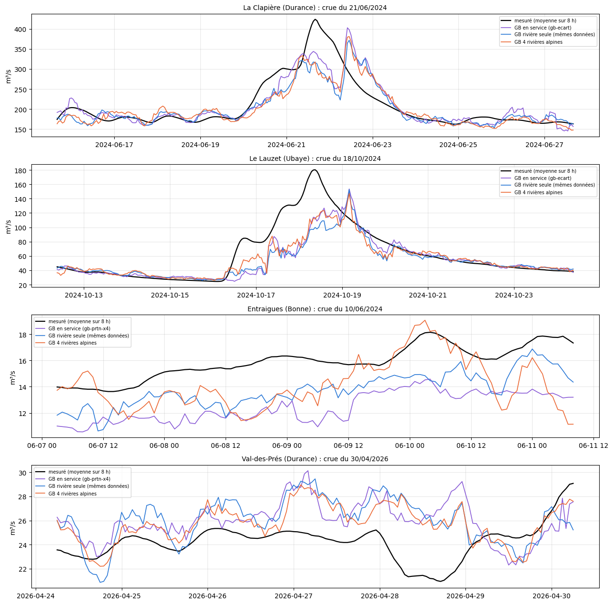
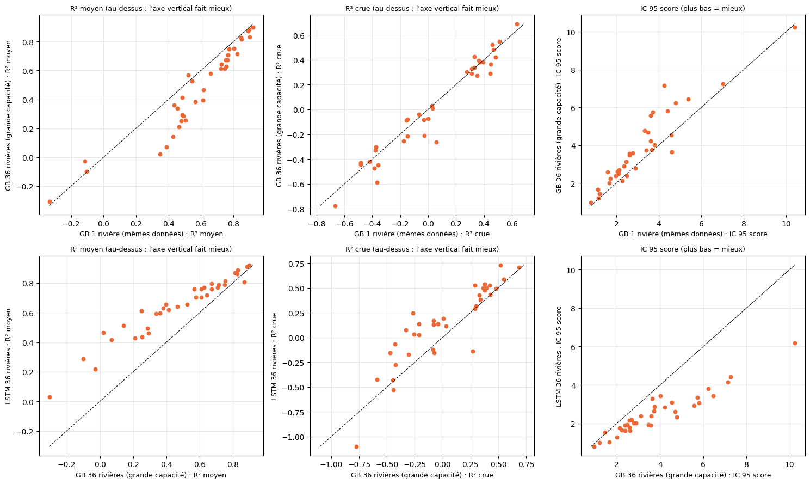

# 5.06 — Est-ce le LSTM, ou le nombre de rivières ?

Le LSTM multi-rivières (notebook 5.04) est-il meilleur parce que c'est un LSTM, ou parce qu'il apprend sur beaucoup de rivières ? Un GB, puis un LSTM, appris sur 4 rivières alpines (partie 1) ; un GB appris sur les 36 rivières (partie 2).

## Partie 1 — Un GB, puis un LSTM, appris sur 4 rivières alpines à la fois

Première partie de la question « le LSTM multi-stations est-il meilleur parce que c'est un LSTM, ou parce qu'il apprend sur beaucoup de
rivières ? » : **un seul GB appris sur 4 rivières alpines** (La Clapière, l'Ubaye au Lauzet, la Bonne à Entraigues, la Durance à
Val-des-Prés), avec des attributs BasinATLAS, face au **même GB appris sur chaque rivière seule**.

**Les mêmes données pour tous** (pour que les 4 rivières aient les mêmes colonnes) :

- la recette du GB par défaut — précipitations, rayonnement et température de −24 h à +5 jours par pas de 12 h, neige au sol à t, débit des
  24 dernières heures heure par heure, date — avec la météo **moyenne des carreaux du bassin**, pondérée par leur surface dans le bassin ;
- le débit en entrée **réduit rivière par rivière** (moyenne 0, écart-type 1 sur l'apprentissage) ;
- 11 attributs BasinATLAS, moyennés sur tout l'amont (pondérés par la surface) : surface, altitude, pente, neige, pluie et température
  annuelles, karst, forêt, profondeur de la nappe, aridité, régulation ; avec 4 rivières seulement, ils servent surtout d'étiquette de rivière ;
- la cible : **l'écart au débit actuel, réduit rivière par rivière** et par échéance (chaque rivière compte autant, quelle que soit sa taille) ;
- le poids ×4 sur les montées (calculé rivière par rivière), les réglages du GB en service, l'apprentissage jusqu'en mars 2024.

**Notes en conditions réelles**, comme toujours : calibration + test, passé de service, prévision officielle de l'époque, IC réglés sur la
calibration avec les 50 scénarios et notés sur le test, mêmes heures et mêmes seuils de crue que le GB en service de chaque rivière (donné
pour situer).

### Les données de chaque rivière, ramenées aux mêmes colonnes

    La Clapière (Durance) : 7 carreau(x), 102014 heures d'apprentissage (11.6 ans), 76 colonnes

    Le Lauzet (Ubaye) : 3 carreau(x), 107250 heures d'apprentissage (12.2 ans), 76 colonnes

    Entraigues (Bonne) : 1 carreau(x), 15703 heures d'apprentissage (1.8 ans), 76 colonnes

    Val-des-Prés (Durance) : 1 carreau(x), 124454 heures d'apprentissage (14.2 ans), 76 colonnes

<table border="1" class="dataframe">
  <thead>
    <tr style="text-align: right;">
      <th></th>
      <th>La Clapière (Durance)</th>
      <th>Le Lauzet (Ubaye)</th>
      <th>Entraigues (Bonne)</th>
      <th>Val-des-Prés (Durance)</th>
    </tr>
  </thead>
  <tbody>
    <tr>
      <th>ele_mt_sav</th>
      <td>2099.15</td>
      <td>2021.44</td>
      <td>1848.00</td>
      <td>2174.00</td>
    </tr>
    <tr>
      <th>slp_dg_sav</th>
      <td>240.07</td>
      <td>232.62</td>
      <td>319.00</td>
      <td>221.00</td>
    </tr>
    <tr>
      <th>snw_pc_syr</th>
      <td>38.72</td>
      <td>36.83</td>
      <td>36.00</td>
      <td>44.00</td>
    </tr>
    <tr>
      <th>pre_mm_syr</th>
      <td>1352.45</td>
      <td>1250.18</td>
      <td>1327.00</td>
      <td>1442.00</td>
    </tr>
    <tr>
      <th>tmp_dc_syr</th>
      <td>26.99</td>
      <td>34.09</td>
      <td>35.00</td>
      <td>21.00</td>
    </tr>
    <tr>
      <th>kar_pc_sse</th>
      <td>0.00</td>
      <td>28.66</td>
      <td>0.00</td>
      <td>0.00</td>
    </tr>
    <tr>
      <th>for_pc_sse</th>
      <td>49.95</td>
      <td>47.40</td>
      <td>66.00</td>
      <td>43.00</td>
    </tr>
    <tr>
      <th>gwt_cm_sav</th>
      <td>826.78</td>
      <td>804.86</td>
      <td>1045.00</td>
      <td>799.00</td>
    </tr>
    <tr>
      <th>ari_ix_sav</th>
      <td>258.91</td>
      <td>233.30</td>
      <td>231.00</td>
      <td>278.00</td>
    </tr>
    <tr>
      <th>surface_log</th>
      <td>3.36</td>
      <td>3.00</td>
      <td>2.34</td>
      <td>2.35</td>
    </tr>
    <tr>
      <th>regulation</th>
      <td>0.00</td>
      <td>0.00</td>
      <td>0.00</td>
      <td>0.00</td>
    </tr>
  </tbody>
</table>

### Les entraînements

Le GB 4 rivières sur les heures d'apprentissage des 4 rivières mises bout à bout ; le même GB sur chaque rivière seule. Réglages du GB en
service, toutes les colonnes pour chaque échéance.

### Les prévisions en conditions réelles

    La Clapière (Durance) : 19483 heures, prévisions en 103 s

    Le Lauzet (Ubaye) : 18087 heures, prévisions en 81 s

    Entraigues (Bonne) : 12542 heures, prévisions en 55 s

    Val-des-Prés (Durance) : 17443 heures, prévisions en 71 s

### Les notes

R² et crues sur calibration + test ; IC réglés sur la calibration, notés sur le test (score rapporté au débit moyen : plus bas = mieux).

<table border="1" class="dataframe">
  <thead>
    <tr style="text-align: right;">
      <th></th>
      <th></th>
      <th>R² J+1</th>
      <th>R² J+2</th>
      <th>R² J+3</th>
      <th>R² J+4</th>
      <th>R² J+5</th>
      <th>R² moyen</th>
      <th>crue J+1</th>
      <th>crue J+3</th>
      <th>crue J+5</th>
      <th>R² crue</th>
      <th>R² montée</th>
      <th>biais pic %</th>
      <th>IC 95 couverture</th>
      <th>IC 95 score</th>
    </tr>
    <tr>
      <th>station</th>
      <th>modèle</th>
      <th></th>
      <th></th>
      <th></th>
      <th></th>
      <th></th>
      <th></th>
      <th></th>
      <th></th>
      <th></th>
      <th></th>
      <th></th>
      <th></th>
      <th></th>
      <th></th>
    </tr>
  </thead>
  <tbody>
    <tr>
      <th rowspan="3" valign="top">La Clapière (Durance)</th>
      <th>GB en service (gb-ecart)</th>
      <td>0.974</td>
      <td>0.931</td>
      <td>0.909</td>
      <td>0.902</td>
      <td>0.883</td>
      <td>0.920</td>
      <td>0.827</td>
      <td>0.350</td>
      <td>0.164</td>
      <td>0.433</td>
      <td>0.757</td>
      <td>1.600</td>
      <td>0.933</td>
      <td>0.782</td>
    </tr>
    <tr>
      <th>GB rivière seule (mêmes données)</th>
      <td>0.974</td>
      <td>0.937</td>
      <td>0.900</td>
      <td>0.892</td>
      <td>0.882</td>
      <td>0.917</td>
      <td>0.821</td>
      <td>0.313</td>
      <td>0.182</td>
      <td>0.432</td>
      <td>0.752</td>
      <td>-1.708</td>
      <td>0.933</td>
      <td>0.780</td>
    </tr>
    <tr>
      <th>GB 4 rivières alpines</th>
      <td>0.971</td>
      <td>0.935</td>
      <td>0.895</td>
      <td>0.881</td>
      <td>0.854</td>
      <td>0.907</td>
      <td>0.834</td>
      <td>0.286</td>
      <td>0.084</td>
      <td>0.400</td>
      <td>0.746</td>
      <td>0.797</td>
      <td>0.948</td>
      <td>0.847</td>
    </tr>
    <tr>
      <th rowspan="3" valign="top">Le Lauzet (Ubaye)</th>
      <th>GB en service (gb-ecart)</th>
      <td>0.960</td>
      <td>0.909</td>
      <td>0.868</td>
      <td>0.856</td>
      <td>0.832</td>
      <td>0.885</td>
      <td>0.765</td>
      <td>0.140</td>
      <td>-0.012</td>
      <td>0.289</td>
      <td>0.619</td>
      <td>3.299</td>
      <td>0.871</td>
      <td>1.306</td>
    </tr>
    <tr>
      <th>GB rivière seule (mêmes données)</th>
      <td>0.961</td>
      <td>0.911</td>
      <td>0.867</td>
      <td>0.855</td>
      <td>0.828</td>
      <td>0.884</td>
      <td>0.779</td>
      <td>0.144</td>
      <td>-0.042</td>
      <td>0.292</td>
      <td>0.615</td>
      <td>1.935</td>
      <td>0.891</td>
      <td>1.295</td>
    </tr>
    <tr>
      <th>GB 4 rivières alpines</th>
      <td>0.964</td>
      <td>0.902</td>
      <td>0.854</td>
      <td>0.831</td>
      <td>0.821</td>
      <td>0.875</td>
      <td>0.802</td>
      <td>0.096</td>
      <td>-0.035</td>
      <td>0.250</td>
      <td>0.639</td>
      <td>2.327</td>
      <td>0.909</td>
      <td>1.288</td>
    </tr>
    <tr>
      <th rowspan="3" valign="top">Entraigues (Bonne)</th>
      <th>GB en service (gb-prtn-x4)</th>
      <td>0.949</td>
      <td>0.887</td>
      <td>0.845</td>
      <td>0.824</td>
      <td>0.802</td>
      <td>0.862</td>
      <td>0.733</td>
      <td>0.153</td>
      <td>-0.220</td>
      <td>0.213</td>
      <td>0.722</td>
      <td>-9.863</td>
      <td>0.942</td>
      <td>1.238</td>
    </tr>
    <tr>
      <th>GB rivière seule (mêmes données)</th>
      <td>0.895</td>
      <td>0.797</td>
      <td>0.791</td>
      <td>0.753</td>
      <td>0.705</td>
      <td>0.788</td>
      <td>0.866</td>
      <td>0.429</td>
      <td>0.156</td>
      <td>0.448</td>
      <td>0.703</td>
      <td>-6.335</td>
      <td>0.974</td>
      <td>1.387</td>
    </tr>
    <tr>
      <th>GB 4 rivières alpines</th>
      <td>0.936</td>
      <td>0.822</td>
      <td>0.763</td>
      <td>0.721</td>
      <td>0.676</td>
      <td>0.784</td>
      <td>0.795</td>
      <td>0.205</td>
      <td>-0.031</td>
      <td>0.306</td>
      <td>0.678</td>
      <td>11.798</td>
      <td>0.916</td>
      <td>1.306</td>
    </tr>
    <tr>
      <th rowspan="3" valign="top">Val-des-Prés (Durance)</th>
      <th>GB en service (gb-prtn-x4)</th>
      <td>0.956</td>
      <td>0.897</td>
      <td>0.848</td>
      <td>0.822</td>
      <td>0.801</td>
      <td>0.865</td>
      <td>0.633</td>
      <td>0.042</td>
      <td>-0.145</td>
      <td>0.151</td>
      <td>0.791</td>
      <td>13.129</td>
      <td>0.942</td>
      <td>1.057</td>
    </tr>
    <tr>
      <th>GB rivière seule (mêmes données)</th>
      <td>0.962</td>
      <td>0.903</td>
      <td>0.844</td>
      <td>0.819</td>
      <td>0.803</td>
      <td>0.866</td>
      <td>0.692</td>
      <td>0.008</td>
      <td>-0.193</td>
      <td>0.148</td>
      <td>0.808</td>
      <td>13.403</td>
      <td>0.944</td>
      <td>1.010</td>
    </tr>
    <tr>
      <th>GB 4 rivières alpines</th>
      <td>0.965</td>
      <td>0.912</td>
      <td>0.857</td>
      <td>0.833</td>
      <td>0.802</td>
      <td>0.874</td>
      <td>0.717</td>
      <td>0.159</td>
      <td>-0.078</td>
      <td>0.262</td>
      <td>0.841</td>
      <td>11.537</td>
      <td>0.943</td>
      <td>1.000</td>
    </tr>
  </tbody>
</table>

    Moyennes sur les 4 rivières

<table border="1" class="dataframe">
  <thead>
    <tr style="text-align: right;">
      <th></th>
      <th>R² J+1</th>
      <th>R² J+2</th>
      <th>R² J+3</th>
      <th>R² J+4</th>
      <th>R² J+5</th>
      <th>R² moyen</th>
      <th>crue J+1</th>
      <th>crue J+3</th>
      <th>crue J+5</th>
      <th>R² crue</th>
      <th>R² montée</th>
      <th>biais pic %</th>
      <th>IC 95 couverture</th>
      <th>IC 95 score</th>
    </tr>
  </thead>
  <tbody>
    <tr>
      <th>GB en service</th>
      <td>0.959</td>
      <td>0.906</td>
      <td>0.868</td>
      <td>0.851</td>
      <td>0.830</td>
      <td>0.883</td>
      <td>0.740</td>
      <td>0.171</td>
      <td>-0.053</td>
      <td>0.271</td>
      <td>0.722</td>
      <td>2.041</td>
      <td>0.922</td>
      <td>1.096</td>
    </tr>
    <tr>
      <th>GB rivière seule (mêmes données)</th>
      <td>0.948</td>
      <td>0.887</td>
      <td>0.850</td>
      <td>0.830</td>
      <td>0.804</td>
      <td>0.864</td>
      <td>0.789</td>
      <td>0.224</td>
      <td>0.026</td>
      <td>0.330</td>
      <td>0.720</td>
      <td>1.824</td>
      <td>0.935</td>
      <td>1.118</td>
    </tr>
    <tr>
      <th>GB 4 rivières alpines</th>
      <td>0.959</td>
      <td>0.893</td>
      <td>0.842</td>
      <td>0.817</td>
      <td>0.788</td>
      <td>0.860</td>
      <td>0.787</td>
      <td>0.186</td>
      <td>-0.015</td>
      <td>0.304</td>
      <td>0.726</td>
      <td>6.615</td>
      <td>0.929</td>
      <td>1.110</td>
    </tr>
  </tbody>
</table>

### La plus forte crue de chaque rivière (échéance 24 h)

    

    

### Le LSTM sur les mêmes 4 rivières

Le LSTM multi-stations du notebook 5.04, à l'identique (encodeur sur 90 jours, décodeur sur la prévision, mémoire de 128, attributs
BasinATLAS, météo moyenne du bassin, cible écart réduite par rivière, poids ×4 sur les montées, choix de l'époque sur la validation sans
poids), appris sur ces 4 rivières seulement. Ses données par rivière sont celles du notebook 5.04 (même recette de carreaux) ; ses échelles
et ses poids sont à lui (`data/cache/lstm_4_alpines/`). Noté comme les GB, sur les heures où il a aussi son passé complet de 90 jours :
les notes des GB sont recalculées sur ces mêmes heures.

    352027 instants d'apprentissage (299221 pour apprendre, 52806 de validation), 15 attributs, données en 1 s

    époque 1 · apprentissage 5.1750 · validation 9.0781 (sans poids 1.5040) · 8 s

    époque 2 · apprentissage 3.8035 · validation 6.8943 (sans poids 1.1903) · 7 s

    époque 3 · apprentissage 3.0655 · validation 7.2608 (sans poids 1.1803) · 6 s

    époque 4 · apprentissage 2.5916 · validation 6.8549 (sans poids 0.9532) · 6 s

    époque 5 · apprentissage 2.0285 · validation 7.3672 (sans poids 0.9497) · 6 s

    époque 6 · apprentissage 1.6983 · validation 5.8611 (sans poids 0.9110) · 6 s

    époque 7 · apprentissage 1.9950 · validation 6.3847 (sans poids 0.8999) · 6 s

    époque 8 · apprentissage 1.3234 · validation 6.0733 (sans poids 0.8953) · 7 s

    époque 9 · apprentissage 1.2138 · validation 6.1716 (sans poids 0.8651) · 6 s

    époque 10 · apprentissage 1.0518 · validation 6.4957 (sans poids 0.8739) · 6 s

    époque 11 · apprentissage 1.1290 · validation 6.8226 (sans poids 0.8536) · 6 s

    époque 12 · apprentissage 1.3581 · validation 6.7711 (sans poids 0.9200) · 6 s

    époque 13 · apprentissage 1.1682 · validation 6.5504 (sans poids 0.7613) · 6 s

    époque 14 · apprentissage 1.1359 · validation 6.6747 (sans poids 0.9139) · 6 s

    époque 15 · apprentissage 0.8479 · validation 6.6276 (sans poids 0.8733) · 6 s

    époque 16 · apprentissage 0.9171 · validation 6.9267 (sans poids 0.9038) · 6 s

    époque 17 · apprentissage 0.7113 · validation 7.0848 (sans poids 0.7883) · 6 s

    époque 18 · apprentissage 0.6029 · validation 7.0912 (sans poids 0.8978) · 6 s

    époque 19 · apprentissage 0.5314 · validation 7.0647 (sans poids 0.8121) · 6 s

    époque 20 · apprentissage 0.5949 · validation 6.9726 (sans poids 0.8711) · 6 s

    époque 21 · apprentissage 0.5607 · validation 6.9273 (sans poids 0.8161) · 7 s

    époque 22 · apprentissage 0.4869 · validation 7.3154 (sans poids 0.8929) · 6 s

    époque 23 · apprentissage 0.4910 · validation 7.2154 (sans poids 0.8372) · 6 s

    époque 24 · apprentissage 0.5461 · validation 7.1597 (sans poids 0.8136) · 6 s

    époque 25 · apprentissage 0.6024 · validation 7.4975 (sans poids 0.8363) · 6 s

    époque 26 · apprentissage 0.4322 · validation 7.4249 (sans poids 0.8420) · 6 s

    époque 27 · apprentissage 0.5190 · validation 7.3423 (sans poids 0.8453) · 6 s

    époque 28 · apprentissage 0.5604 · validation 7.5204 (sans poids 0.8290) · 6 s

    28 époques en 3 min ; meilleure : époque 13

### GB et LSTM sur les 4 mêmes rivières

<table border="1" class="dataframe">
  <thead>
    <tr style="text-align: right;">
      <th></th>
      <th></th>
      <th>R² J+1</th>
      <th>R² J+2</th>
      <th>R² J+3</th>
      <th>R² J+4</th>
      <th>R² J+5</th>
      <th>R² moyen</th>
      <th>crue J+1</th>
      <th>crue J+3</th>
      <th>crue J+5</th>
      <th>R² crue</th>
      <th>R² montée</th>
      <th>biais pic %</th>
      <th>IC 95 couverture</th>
      <th>IC 95 score</th>
    </tr>
    <tr>
      <th>station</th>
      <th>modèle</th>
      <th></th>
      <th></th>
      <th></th>
      <th></th>
      <th></th>
      <th></th>
      <th></th>
      <th></th>
      <th></th>
      <th></th>
      <th></th>
      <th></th>
      <th></th>
      <th></th>
    </tr>
  </thead>
  <tbody>
    <tr>
      <th rowspan="4" valign="top">La Clapière (Durance)</th>
      <th>GB en service (gb-ecart)</th>
      <td>0.974</td>
      <td>0.931</td>
      <td>0.909</td>
      <td>0.902</td>
      <td>0.883</td>
      <td>0.920</td>
      <td>0.827</td>
      <td>0.350</td>
      <td>0.164</td>
      <td>0.433</td>
      <td>0.757</td>
      <td>1.600</td>
      <td>0.933</td>
      <td>0.782</td>
    </tr>
    <tr>
      <th>GB rivière seule (mêmes données)</th>
      <td>0.974</td>
      <td>0.937</td>
      <td>0.900</td>
      <td>0.892</td>
      <td>0.882</td>
      <td>0.917</td>
      <td>0.821</td>
      <td>0.313</td>
      <td>0.182</td>
      <td>0.432</td>
      <td>0.752</td>
      <td>-1.708</td>
      <td>0.933</td>
      <td>0.780</td>
    </tr>
    <tr>
      <th>GB 4 rivières alpines</th>
      <td>0.971</td>
      <td>0.935</td>
      <td>0.895</td>
      <td>0.881</td>
      <td>0.854</td>
      <td>0.907</td>
      <td>0.834</td>
      <td>0.286</td>
      <td>0.084</td>
      <td>0.400</td>
      <td>0.746</td>
      <td>0.797</td>
      <td>0.948</td>
      <td>0.847</td>
    </tr>
    <tr>
      <th>LSTM 4 rivières alpines</th>
      <td>0.975</td>
      <td>0.934</td>
      <td>0.900</td>
      <td>0.883</td>
      <td>0.857</td>
      <td>0.910</td>
      <td>0.838</td>
      <td>0.259</td>
      <td>-0.017</td>
      <td>0.352</td>
      <td>0.695</td>
      <td>-8.356</td>
      <td>0.940</td>
      <td>0.833</td>
    </tr>
    <tr>
      <th rowspan="4" valign="top">Le Lauzet (Ubaye)</th>
      <th>GB en service (gb-ecart)</th>
      <td>0.960</td>
      <td>0.909</td>
      <td>0.868</td>
      <td>0.856</td>
      <td>0.832</td>
      <td>0.885</td>
      <td>0.765</td>
      <td>0.140</td>
      <td>-0.012</td>
      <td>0.289</td>
      <td>0.619</td>
      <td>3.299</td>
      <td>0.871</td>
      <td>1.306</td>
    </tr>
    <tr>
      <th>GB rivière seule (mêmes données)</th>
      <td>0.961</td>
      <td>0.911</td>
      <td>0.867</td>
      <td>0.855</td>
      <td>0.828</td>
      <td>0.884</td>
      <td>0.779</td>
      <td>0.144</td>
      <td>-0.042</td>
      <td>0.292</td>
      <td>0.615</td>
      <td>1.935</td>
      <td>0.891</td>
      <td>1.295</td>
    </tr>
    <tr>
      <th>GB 4 rivières alpines</th>
      <td>0.964</td>
      <td>0.902</td>
      <td>0.854</td>
      <td>0.831</td>
      <td>0.821</td>
      <td>0.875</td>
      <td>0.802</td>
      <td>0.096</td>
      <td>-0.035</td>
      <td>0.250</td>
      <td>0.639</td>
      <td>2.327</td>
      <td>0.909</td>
      <td>1.288</td>
    </tr>
    <tr>
      <th>LSTM 4 rivières alpines</th>
      <td>0.951</td>
      <td>0.897</td>
      <td>0.881</td>
      <td>0.877</td>
      <td>0.844</td>
      <td>0.890</td>
      <td>0.686</td>
      <td>0.200</td>
      <td>-0.010</td>
      <td>0.278</td>
      <td>0.641</td>
      <td>-0.519</td>
      <td>0.828</td>
      <td>1.365</td>
    </tr>
    <tr>
      <th rowspan="4" valign="top">Entraigues (Bonne)</th>
      <th>GB en service (gb-prtn-x4)</th>
      <td>0.949</td>
      <td>0.887</td>
      <td>0.845</td>
      <td>0.824</td>
      <td>0.802</td>
      <td>0.862</td>
      <td>0.733</td>
      <td>0.153</td>
      <td>-0.220</td>
      <td>0.213</td>
      <td>0.722</td>
      <td>-9.863</td>
      <td>0.942</td>
      <td>1.238</td>
    </tr>
    <tr>
      <th>GB rivière seule (mêmes données)</th>
      <td>0.895</td>
      <td>0.797</td>
      <td>0.791</td>
      <td>0.753</td>
      <td>0.705</td>
      <td>0.788</td>
      <td>0.866</td>
      <td>0.429</td>
      <td>0.156</td>
      <td>0.448</td>
      <td>0.703</td>
      <td>-6.335</td>
      <td>0.974</td>
      <td>1.387</td>
    </tr>
    <tr>
      <th>GB 4 rivières alpines</th>
      <td>0.936</td>
      <td>0.822</td>
      <td>0.763</td>
      <td>0.721</td>
      <td>0.676</td>
      <td>0.784</td>
      <td>0.795</td>
      <td>0.205</td>
      <td>-0.031</td>
      <td>0.306</td>
      <td>0.678</td>
      <td>11.798</td>
      <td>0.916</td>
      <td>1.306</td>
    </tr>
    <tr>
      <th>LSTM 4 rivières alpines</th>
      <td>0.933</td>
      <td>0.860</td>
      <td>0.833</td>
      <td>0.832</td>
      <td>0.793</td>
      <td>0.850</td>
      <td>0.799</td>
      <td>0.340</td>
      <td>0.111</td>
      <td>0.450</td>
      <td>0.858</td>
      <td>9.873</td>
      <td>0.903</td>
      <td>1.111</td>
    </tr>
    <tr>
      <th rowspan="4" valign="top">Val-des-Prés (Durance)</th>
      <th>GB en service (gb-prtn-x4)</th>
      <td>0.956</td>
      <td>0.897</td>
      <td>0.848</td>
      <td>0.822</td>
      <td>0.801</td>
      <td>0.865</td>
      <td>0.633</td>
      <td>0.042</td>
      <td>-0.145</td>
      <td>0.151</td>
      <td>0.791</td>
      <td>13.129</td>
      <td>0.942</td>
      <td>1.057</td>
    </tr>
    <tr>
      <th>GB rivière seule (mêmes données)</th>
      <td>0.962</td>
      <td>0.903</td>
      <td>0.844</td>
      <td>0.819</td>
      <td>0.803</td>
      <td>0.866</td>
      <td>0.692</td>
      <td>0.008</td>
      <td>-0.193</td>
      <td>0.148</td>
      <td>0.808</td>
      <td>13.403</td>
      <td>0.944</td>
      <td>1.010</td>
    </tr>
    <tr>
      <th>GB 4 rivières alpines</th>
      <td>0.965</td>
      <td>0.912</td>
      <td>0.857</td>
      <td>0.833</td>
      <td>0.802</td>
      <td>0.874</td>
      <td>0.717</td>
      <td>0.159</td>
      <td>-0.078</td>
      <td>0.262</td>
      <td>0.841</td>
      <td>11.537</td>
      <td>0.943</td>
      <td>1.000</td>
    </tr>
    <tr>
      <th>LSTM 4 rivières alpines</th>
      <td>0.947</td>
      <td>0.875</td>
      <td>0.821</td>
      <td>0.770</td>
      <td>0.732</td>
      <td>0.829</td>
      <td>0.572</td>
      <td>0.003</td>
      <td>-0.598</td>
      <td>-0.023</td>
      <td>0.703</td>
      <td>14.711</td>
      <td>0.925</td>
      <td>1.021</td>
    </tr>
  </tbody>
</table>

    Moyennes sur les 4 rivières

<table border="1" class="dataframe">
  <thead>
    <tr style="text-align: right;">
      <th></th>
      <th>R² J+1</th>
      <th>R² J+2</th>
      <th>R² J+3</th>
      <th>R² J+4</th>
      <th>R² J+5</th>
      <th>R² moyen</th>
      <th>crue J+1</th>
      <th>crue J+3</th>
      <th>crue J+5</th>
      <th>R² crue</th>
      <th>R² montée</th>
      <th>biais pic %</th>
      <th>IC 95 couverture</th>
      <th>IC 95 score</th>
    </tr>
    <tr>
      <th>modèle</th>
      <th></th>
      <th></th>
      <th></th>
      <th></th>
      <th></th>
      <th></th>
      <th></th>
      <th></th>
      <th></th>
      <th></th>
      <th></th>
      <th></th>
      <th></th>
      <th></th>
    </tr>
  </thead>
  <tbody>
    <tr>
      <th>GB en service</th>
      <td>0.959</td>
      <td>0.906</td>
      <td>0.868</td>
      <td>0.851</td>
      <td>0.830</td>
      <td>0.883</td>
      <td>0.740</td>
      <td>0.171</td>
      <td>-0.053</td>
      <td>0.271</td>
      <td>0.722</td>
      <td>2.041</td>
      <td>0.922</td>
      <td>1.096</td>
    </tr>
    <tr>
      <th>GB rivière seule (mêmes données)</th>
      <td>0.948</td>
      <td>0.887</td>
      <td>0.850</td>
      <td>0.830</td>
      <td>0.804</td>
      <td>0.864</td>
      <td>0.789</td>
      <td>0.224</td>
      <td>0.026</td>
      <td>0.330</td>
      <td>0.720</td>
      <td>1.824</td>
      <td>0.935</td>
      <td>1.118</td>
    </tr>
    <tr>
      <th>GB 4 rivières alpines</th>
      <td>0.959</td>
      <td>0.893</td>
      <td>0.842</td>
      <td>0.817</td>
      <td>0.788</td>
      <td>0.860</td>
      <td>0.787</td>
      <td>0.186</td>
      <td>-0.015</td>
      <td>0.304</td>
      <td>0.726</td>
      <td>6.615</td>
      <td>0.929</td>
      <td>1.110</td>
    </tr>
    <tr>
      <th>LSTM 4 rivières alpines</th>
      <td>0.951</td>
      <td>0.892</td>
      <td>0.859</td>
      <td>0.841</td>
      <td>0.807</td>
      <td>0.870</td>
      <td>0.724</td>
      <td>0.201</td>
      <td>-0.129</td>
      <td>0.264</td>
      <td>0.724</td>
      <td>3.927</td>
      <td>0.899</td>
      <td>1.082</td>
    </tr>
  </tbody>
</table>

## Partie 2 — Un GB appris sur les 36 rivières du notebook 5.04

La question : le LSTM multi-stations (notebook 5.04) est-il meilleur que nos GB **parce que c'est un LSTM**, ou **parce qu'il apprend sur 36
rivières** ? On complète le tableau :

|  | une rivière | 36 rivières |
|---|---|---|
| **GB** | GB de chaque rivière (ci-dessous, mêmes données) | **GB 36 rivières (ici)** |
| **LSTM** | notebooks 5.02, 5.03 | LSTM 36 rivières (notebook 5.04) |

**Les mêmes sources que le LSTM multi**, dans la forme du GB : la météo moyenne des carreaux du bassin (ceux du GB par défaut de la rivière,
pondérés par leur surface) — précipitations, rayonnement, température de −24 h à +5 jours par pas de 12 h, neige au sol à t — ; le débit des 24
dernières heures **réduit rivière par rivière** ; la date ; les attributs BasinATLAS moyennés sur l'amont ; la **cible écart au débit actuel,
réduite rivière par rivière** ; le poids ×4 sur les montées. Pour que le GB ait aussi l'information du passé lointain que lit le LSTM (90 jours),
des **cumuls de précipitations et des moyennes de température sur 1–3, 3–10, 10–30 et 30–90 jours** ; en conditions réelles, comme pour le LSTM,
les 6 derniers jours viennent du passé de service (premières heures des prévisions officielles), le reste d'ERA5.

**Comparé**, en conditions réelles et sur les mêmes heures (prévision officielle de l'époque, IC réglés sur la calibration avec les 50 scénarios
et notés sur le test, seuils de crue du GB de la rivière) : au **même GB appris sur chaque rivière seule**, au **LSTM 36 rivières** (ses deux versions
du notebook 5.04), et au **GB de chaque rivière du notebook 5.04** (celui en service, ou le GB par défaut : une colonne par carreau, sans attributs ni
cumuls longs). Une heure sur quatre pour apprendre (deux heures voisines se ressemblent presque), réglages du GB par défaut. Le GB 36 rivières aux réglages
par défaut atteint son plafond de 300 arbres sur presque toutes les échéances (il manque de capacité pour 36 rivières) : il est refait en
**grande capacité** (1 500 arbres au plus, 127 feuilles, pas 0,2, 20 heures par feuille au moins ; arrêt automatique gardé).

### Les données de chaque rivière, aux mêmes colonnes

    36 rivières en 168 s ; 1019308 heures d'apprentissage, 84 colonnes

### Les entraînements

    36_rivieres_grand : 1019308 heures, entraîné en 553 s

    arbres par échéance — GB 36 : [300, 141, 300, 300, 210, 300, 300, 300, 300, 300, 300, 300, 300, 300, 300]
    arbres par échéance — GB 36 grande capacité : [245, 107, 161, 442, 570, 655, 432, 776, 352, 449, 999, 794, 905, 485, 536]

### Les prévisions en conditions réelles

Pour chaque rivière : son X de service (recette de son GB), la prévision officielle et les 50 scénarios ; ramenés aux colonnes communes, avec les
cumuls longs tirés du passé de service (6 derniers jours) et d'ERA5. Le LSTM 36 rivières et le GB de la rivière du notebook 5.04 sont relus de son cache.

    36 rivières prévues en 1994 s

### Les notes, rivière par rivière

Heures communes aux cinq modèles de chaque rivière ; R² et crues sur calibration + test ; IC réglés sur la calibration, notés sur le test (score
rapporté au débit moyen : plus bas = mieux).

<table border="1" class="dataframe">
  <thead>
    <tr>
      <th></th>
      <th colspan="6" halign="left">R² moyen</th>
      <th colspan="6" halign="left">R² crue</th>
      <th colspan="6" halign="left">IC 95 score</th>
    </tr>
    <tr>
      <th>modèle</th>
      <th>GB de la rivière (notebook 20)</th>
      <th>GB 1 rivière (mêmes données)</th>
      <th>GB 36 rivières</th>
      <th>GB 36 rivières (grande capacité)</th>
      <th>LSTM 36 rivières</th>
      <th>LSTM 36 rivières (choix sans poids)</th>
      <th>GB de la rivière (notebook 20)</th>
      <th>GB 1 rivière (mêmes données)</th>
      <th>GB 36 rivières</th>
      <th>GB 36 rivières (grande capacité)</th>
      <th>LSTM 36 rivières</th>
      <th>LSTM 36 rivières (choix sans poids)</th>
      <th>GB de la rivière (notebook 20)</th>
      <th>GB 1 rivière (mêmes données)</th>
      <th>GB 36 rivières</th>
      <th>GB 36 rivières (grande capacité)</th>
      <th>LSTM 36 rivières</th>
      <th>LSTM 36 rivières (choix sans poids)</th>
    </tr>
    <tr>
      <th>station</th>
      <th></th>
      <th></th>
      <th></th>
      <th></th>
      <th></th>
      <th></th>
      <th></th>
      <th></th>
      <th></th>
      <th></th>
      <th></th>
      <th></th>
      <th></th>
      <th></th>
      <th></th>
      <th></th>
      <th></th>
      <th></th>
    </tr>
  </thead>
  <tbody>
    <tr>
      <th>Saint Rambert en Bugey</th>
      <td>0.601</td>
      <td>0.617</td>
      <td>0.413</td>
      <td>0.468</td>
      <td>0.642</td>
      <td>0.649</td>
      <td>-0.045</td>
      <td>-0.065</td>
      <td>-0.063</td>
      <td>-0.041</td>
      <td>0.135</td>
      <td>-0.033</td>
      <td>3.187</td>
      <td>3.408</td>
      <td>4.372</td>
      <td>3.718</td>
      <td>2.655</td>
      <td>2.439</td>
    </tr>
    <tr>
      <th>Millau [HE]</th>
      <td>0.641</td>
      <td>0.521</td>
      <td>0.542</td>
      <td>0.568</td>
      <td>0.758</td>
      <td>0.732</td>
      <td>0.597</td>
      <td>0.459</td>
      <td>0.496</td>
      <td>0.522</td>
      <td>0.731</td>
      <td>0.698</td>
      <td>4.450</td>
      <td>3.804</td>
      <td>4.130</td>
      <td>4.016</td>
      <td>3.451</td>
      <td>4.176</td>
    </tr>
    <tr>
      <th>Pontgibaud</th>
      <td>0.750</td>
      <td>0.766</td>
      <td>0.685</td>
      <td>0.709</td>
      <td>0.770</td>
      <td>0.785</td>
      <td>0.364</td>
      <td>0.333</td>
      <td>0.308</td>
      <td>0.337</td>
      <td>0.380</td>
      <td>0.381</td>
      <td>2.002</td>
      <td>2.092</td>
      <td>2.430</td>
      <td>2.492</td>
      <td>1.953</td>
      <td>1.892</td>
    </tr>
    <tr>
      <th>Bourg de sirod</th>
      <td>0.621</td>
      <td>0.611</td>
      <td>0.424</td>
      <td>0.396</td>
      <td>0.655</td>
      <td>0.673</td>
      <td>-0.134</td>
      <td>-0.177</td>
      <td>-0.143</td>
      <td>-0.255</td>
      <td>0.033</td>
      <td>-0.086</td>
      <td>3.368</td>
      <td>3.617</td>
      <td>6.677</td>
      <td>5.567</td>
      <td>2.935</td>
      <td>2.521</td>
    </tr>
    <tr>
      <th>Dingy-St-Clair</th>
      <td>0.398</td>
      <td>0.388</td>
      <td>0.118</td>
      <td>0.071</td>
      <td>0.418</td>
      <td>0.414</td>
      <td>-0.498</td>
      <td>-0.483</td>
      <td>-0.115</td>
      <td>-0.442</td>
      <td>-0.531</td>
      <td>-0.835</td>
      <td>3.903</td>
      <td>3.605</td>
      <td>4.563</td>
      <td>4.209</td>
      <td>2.849</td>
      <td>3.069</td>
    </tr>
    <tr>
      <th>Perigueux</th>
      <td>0.800</td>
      <td>0.803</td>
      <td>0.731</td>
      <td>0.754</td>
      <td>0.814</td>
      <td>0.810</td>
      <td>0.479</td>
      <td>0.470</td>
      <td>0.455</td>
      <td>0.480</td>
      <td>0.495</td>
      <td>0.473</td>
      <td>2.242</td>
      <td>2.452</td>
      <td>3.606</td>
      <td>3.117</td>
      <td>2.399</td>
      <td>2.435</td>
    </tr>
    <tr>
      <th>Pont-de-Labeaume</th>
      <td>0.500</td>
      <td>0.346</td>
      <td>-0.092</td>
      <td>0.021</td>
      <td>0.465</td>
      <td>0.535</td>
      <td>0.362</td>
      <td>0.057</td>
      <td>-0.380</td>
      <td>-0.265</td>
      <td>0.247</td>
      <td>0.365</td>
      <td>3.869</td>
      <td>3.718</td>
      <td>6.593</td>
      <td>5.734</td>
      <td>3.350</td>
      <td>3.338</td>
    </tr>
    <tr>
      <th>Coudes</th>
      <td>0.684</td>
      <td>0.747</td>
      <td>0.567</td>
      <td>0.612</td>
      <td>0.760</td>
      <td>0.728</td>
      <td>0.159</td>
      <td>0.311</td>
      <td>0.285</td>
      <td>0.288</td>
      <td>0.288</td>
      <td>0.178</td>
      <td>1.859</td>
      <td>2.055</td>
      <td>2.367</td>
      <td>2.620</td>
      <td>1.640</td>
      <td>1.684</td>
    </tr>
    <tr>
      <th>Osses</th>
      <td>0.471</td>
      <td>0.429</td>
      <td>0.034</td>
      <td>0.144</td>
      <td>0.513</td>
      <td>0.528</td>
      <td>-0.428</td>
      <td>-0.369</td>
      <td>-0.771</td>
      <td>-0.589</td>
      <td>-0.424</td>
      <td>-0.454</td>
      <td>2.423</td>
      <td>2.770</td>
      <td>4.635</td>
      <td>3.600</td>
      <td>2.390</td>
      <td>2.532</td>
    </tr>
    <tr>
      <th>Escos</th>
      <td>0.554</td>
      <td>0.504</td>
      <td>0.147</td>
      <td>0.254</td>
      <td>0.435</td>
      <td>0.439</td>
      <td>-0.378</td>
      <td>-0.666</td>
      <td>-0.949</td>
      <td>-0.774</td>
      <td>-1.100</td>
      <td>-1.233</td>
      <td>1.970</td>
      <td>2.354</td>
      <td>3.752</td>
      <td>2.898</td>
      <td>2.017</td>
      <td>2.127</td>
    </tr>
    <tr>
      <th>Montignac</th>
      <td>0.849</td>
      <td>0.849</td>
      <td>0.799</td>
      <td>0.815</td>
      <td>0.870</td>
      <td>0.874</td>
      <td>0.503</td>
      <td>0.511</td>
      <td>0.523</td>
      <td>0.547</td>
      <td>0.588</td>
      <td>0.614</td>
      <td>1.726</td>
      <td>1.712</td>
      <td>2.626</td>
      <td>2.220</td>
      <td>1.645</td>
      <td>1.458</td>
    </tr>
    <tr>
      <th>Epinal</th>
      <td>0.824</td>
      <td>0.823</td>
      <td>0.697</td>
      <td>0.716</td>
      <td>0.790</td>
      <td>0.806</td>
      <td>-0.307</td>
      <td>-0.360</td>
      <td>-0.529</td>
      <td>-0.446</td>
      <td>-0.431</td>
      <td>-0.344</td>
      <td>1.424</td>
      <td>1.577</td>
      <td>3.807</td>
      <td>2.575</td>
      <td>1.809</td>
      <td>1.525</td>
    </tr>
    <tr>
      <th>Syam</th>
      <td>0.493</td>
      <td>0.493</td>
      <td>0.280</td>
      <td>0.285</td>
      <td>0.495</td>
      <td>0.561</td>
      <td>-0.408</td>
      <td>-0.385</td>
      <td>-0.417</td>
      <td>-0.474</td>
      <td>-0.155</td>
      <td>-0.224</td>
      <td>4.754</td>
      <td>4.789</td>
      <td>8.707</td>
      <td>6.235</td>
      <td>3.810</td>
      <td>3.718</td>
    </tr>
    <tr>
      <th>Cocurès</th>
      <td>0.602</td>
      <td>0.547</td>
      <td>0.504</td>
      <td>0.526</td>
      <td>0.655</td>
      <td>0.653</td>
      <td>0.414</td>
      <td>0.364</td>
      <td>0.389</td>
      <td>0.395</td>
      <td>0.499</td>
      <td>0.463</td>
      <td>3.315</td>
      <td>3.489</td>
      <td>5.275</td>
      <td>4.687</td>
      <td>2.625</td>
      <td>2.874</td>
    </tr>
    <tr>
      <th>Vuillafans</th>
      <td>0.723</td>
      <td>0.722</td>
      <td>0.596</td>
      <td>0.612</td>
      <td>0.704</td>
      <td>0.747</td>
      <td>-0.083</td>
      <td>-0.148</td>
      <td>-0.223</td>
      <td>-0.215</td>
      <td>0.027</td>
      <td>-0.065</td>
      <td>1.837</td>
      <td>1.963</td>
      <td>2.612</td>
      <td>2.386</td>
      <td>1.640</td>
      <td>1.474</td>
    </tr>
    <tr>
      <th>Chadrac [Pont du Monteil]</th>
      <td>0.234</td>
      <td>-0.105</td>
      <td>-0.132</td>
      <td>-0.099</td>
      <td>0.288</td>
      <td>0.219</td>
      <td>0.049</td>
      <td>-0.379</td>
      <td>-0.343</td>
      <td>-0.329</td>
      <td>0.077</td>
      <td>0.011</td>
      <td>4.106</td>
      <td>4.413</td>
      <td>6.144</td>
      <td>5.793</td>
      <td>3.077</td>
      <td>3.761</td>
    </tr>
    <tr>
      <th>Figeac</th>
      <td>0.791</td>
      <td>0.755</td>
      <td>0.592</td>
      <td>0.628</td>
      <td>0.769</td>
      <td>0.754</td>
      <td>0.443</td>
      <td>0.312</td>
      <td>0.258</td>
      <td>0.328</td>
      <td>0.425</td>
      <td>0.359</td>
      <td>2.232</td>
      <td>2.606</td>
      <td>4.767</td>
      <td>3.468</td>
      <td>1.932</td>
      <td>1.730</td>
    </tr>
    <tr>
      <th>Laroque</th>
      <td>0.669</td>
      <td>0.567</td>
      <td>0.274</td>
      <td>0.382</td>
      <td>0.631</td>
      <td>0.633</td>
      <td>0.561</td>
      <td>0.448</td>
      <td>0.293</td>
      <td>0.363</td>
      <td>0.499</td>
      <td>0.485</td>
      <td>3.960</td>
      <td>5.369</td>
      <td>9.544</td>
      <td>6.447</td>
      <td>3.444</td>
      <td>3.686</td>
    </tr>
    <tr>
      <th>Lechâtelet</th>
      <td>0.879</td>
      <td>0.899</td>
      <td>0.770</td>
      <td>0.830</td>
      <td>0.888</td>
      <td>0.916</td>
      <td>0.380</td>
      <td>0.445</td>
      <td>0.092</td>
      <td>0.288</td>
      <td>0.525</td>
      <td>0.501</td>
      <td>1.166</td>
      <td>1.138</td>
      <td>1.902</td>
      <td>1.653</td>
      <td>1.026</td>
      <td>1.051</td>
    </tr>
    <tr>
      <th>Goudet</th>
      <td>0.204</td>
      <td>-0.114</td>
      <td>-0.033</td>
      <td>-0.028</td>
      <td>0.217</td>
      <td>0.208</td>
      <td>0.141</td>
      <td>-0.150</td>
      <td>-0.076</td>
      <td>-0.081</td>
      <td>0.167</td>
      <td>0.153</td>
      <td>11.821</td>
      <td>10.409</td>
      <td>10.824</td>
      <td>10.240</td>
      <td>6.169</td>
      <td>6.049</td>
    </tr>
    <tr>
      <th>Pommeuse</th>
      <td>0.497</td>
      <td>0.486</td>
      <td>0.341</td>
      <td>0.413</td>
      <td>0.620</td>
      <td>0.614</td>
      <td>-0.014</td>
      <td>0.032</td>
      <td>-0.030</td>
      <td>0.008</td>
      <td>0.189</td>
      <td>0.160</td>
      <td>3.975</td>
      <td>3.323</td>
      <td>4.434</td>
      <td>4.762</td>
      <td>2.341</td>
      <td>2.335</td>
    </tr>
    <tr>
      <th>Allèves [La Charniaz]</th>
      <td>0.472</td>
      <td>0.483</td>
      <td>0.291</td>
      <td>0.292</td>
      <td>0.460</td>
      <td>0.493</td>
      <td>-0.214</td>
      <td>-0.155</td>
      <td>0.054</td>
      <td>-0.087</td>
      <td>-0.124</td>
      <td>-0.425</td>
      <td>3.571</td>
      <td>3.665</td>
      <td>4.169</td>
      <td>3.752</td>
      <td>2.869</td>
      <td>2.815</td>
    </tr>
    <tr>
      <th>Rosureux</th>
      <td>0.652</td>
      <td>0.658</td>
      <td>0.585</td>
      <td>0.578</td>
      <td>0.704</td>
      <td>0.696</td>
      <td>-0.360</td>
      <td>-0.374</td>
      <td>-0.345</td>
      <td>-0.304</td>
      <td>-0.172</td>
      <td>-0.380</td>
      <td>4.558</td>
      <td>4.615</td>
      <td>4.364</td>
      <td>3.649</td>
      <td>3.293</td>
      <td>2.861</td>
    </tr>
    <tr>
      <th>Soueix-Rogalle</th>
      <td>0.529</td>
      <td>0.480</td>
      <td>0.236</td>
      <td>0.250</td>
      <td>0.612</td>
      <td>0.617</td>
      <td>-0.408</td>
      <td>-0.420</td>
      <td>-0.361</td>
      <td>-0.422</td>
      <td>-0.276</td>
      <td>-0.248</td>
      <td>1.729</td>
      <td>1.674</td>
      <td>1.850</td>
      <td>2.004</td>
      <td>1.286</td>
      <td>1.261</td>
    </tr>
    <tr>
      <th>Eymoutiers</th>
      <td>0.786</td>
      <td>0.846</td>
      <td>0.815</td>
      <td>0.829</td>
      <td>0.864</td>
      <td>0.864</td>
      <td>0.462</td>
      <td>0.634</td>
      <td>0.687</td>
      <td>0.688</td>
      <td>0.706</td>
      <td>0.671</td>
      <td>2.949</td>
      <td>2.283</td>
      <td>2.263</td>
      <td>2.130</td>
      <td>1.765</td>
      <td>1.705</td>
    </tr>
    <tr>
      <th>La Prugne</th>
      <td>0.760</td>
      <td>0.773</td>
      <td>0.729</td>
      <td>0.750</td>
      <td>0.789</td>
      <td>0.806</td>
      <td>0.286</td>
      <td>0.333</td>
      <td>0.435</td>
      <td>0.426</td>
      <td>0.430</td>
      <td>0.414</td>
      <td>2.362</td>
      <td>2.118</td>
      <td>2.575</td>
      <td>2.693</td>
      <td>2.203</td>
      <td>2.135</td>
    </tr>
    <tr>
      <th>Morez</th>
      <td>0.503</td>
      <td>0.465</td>
      <td>0.206</td>
      <td>0.210</td>
      <td>0.427</td>
      <td>0.604</td>
      <td>0.006</td>
      <td>-0.028</td>
      <td>-0.153</td>
      <td>-0.213</td>
      <td>0.135</td>
      <td>0.083</td>
      <td>4.207</td>
      <td>4.594</td>
      <td>5.433</td>
      <td>4.544</td>
      <td>3.112</td>
      <td>2.900</td>
    </tr>
    <tr>
      <th>Couilly-Pont-aux-Dames [Station ultrason]</th>
      <td>0.490</td>
      <td>0.455</td>
      <td>0.261</td>
      <td>0.338</td>
      <td>0.592</td>
      <td>0.598</td>
      <td>-0.014</td>
      <td>-0.030</td>
      <td>-0.138</td>
      <td>-0.083</td>
      <td>0.127</td>
      <td>0.115</td>
      <td>4.812</td>
      <td>4.248</td>
      <td>6.929</td>
      <td>7.145</td>
      <td>4.132</td>
      <td>4.180</td>
    </tr>
    <tr>
      <th>Aspet</th>
      <td>0.432</td>
      <td>0.436</td>
      <td>0.336</td>
      <td>0.362</td>
      <td>0.597</td>
      <td>0.624</td>
      <td>0.227</td>
      <td>0.277</td>
      <td>0.247</td>
      <td>0.300</td>
      <td>0.315</td>
      <td>0.245</td>
      <td>2.524</td>
      <td>2.892</td>
      <td>2.580</td>
      <td>2.788</td>
      <td>2.037</td>
      <td>1.923</td>
    </tr>
    <tr>
      <th>Sauvessanges</th>
      <td>0.730</td>
      <td>0.725</td>
      <td>0.639</td>
      <td>0.644</td>
      <td>0.719</td>
      <td>0.756</td>
      <td>0.035</td>
      <td>-0.001</td>
      <td>-0.087</td>
      <td>-0.076</td>
      <td>-0.157</td>
      <td>-0.213</td>
      <td>2.169</td>
      <td>2.098</td>
      <td>2.407</td>
      <td>2.593</td>
      <td>2.162</td>
      <td>1.686</td>
    </tr>
    <tr>
      <th>Rive-de-Gier</th>
      <td>0.085</td>
      <td>-0.335</td>
      <td>-0.367</td>
      <td>-0.305</td>
      <td>0.032</td>
      <td>0.063</td>
      <td>0.017</td>
      <td>-0.486</td>
      <td>-0.445</td>
      <td>-0.429</td>
      <td>-0.068</td>
      <td>-0.103</td>
      <td>7.382</td>
      <td>7.028</td>
      <td>7.799</td>
      <td>7.256</td>
      <td>4.434</td>
      <td>4.941</td>
    </tr>
    <tr>
      <th>Joursac</th>
      <td>0.757</td>
      <td>0.752</td>
      <td>0.638</td>
      <td>0.672</td>
      <td>0.797</td>
      <td>0.784</td>
      <td>0.488</td>
      <td>0.372</td>
      <td>0.371</td>
      <td>0.380</td>
      <td>0.537</td>
      <td>0.499</td>
      <td>2.085</td>
      <td>2.615</td>
      <td>3.265</td>
      <td>3.569</td>
      <td>1.914</td>
      <td>1.761</td>
    </tr>
    <tr>
      <th>Le Lauzet-Ubaye [Roche-Rousse]</th>
      <td>0.885</td>
      <td>0.897</td>
      <td>0.873</td>
      <td>0.885</td>
      <td>0.912</td>
      <td>0.903</td>
      <td>0.289</td>
      <td>0.394</td>
      <td>0.363</td>
      <td>0.379</td>
      <td>0.474</td>
      <td>0.382</td>
      <td>1.306</td>
      <td>1.203</td>
      <td>1.520</td>
      <td>1.440</td>
      <td>1.540</td>
      <td>1.713</td>
    </tr>
    <tr>
      <th>Embrun [La Clapière]</th>
      <td>0.920</td>
      <td>0.922</td>
      <td>0.880</td>
      <td>0.901</td>
      <td>0.923</td>
      <td>0.926</td>
      <td>0.433</td>
      <td>0.484</td>
      <td>0.350</td>
      <td>0.423</td>
      <td>0.525</td>
      <td>0.484</td>
      <td>0.782</td>
      <td>0.806</td>
      <td>1.068</td>
      <td>0.959</td>
      <td>0.808</td>
      <td>0.779</td>
    </tr>
    <tr>
      <th>Val-des-Prés</th>
      <td>0.865</td>
      <td>0.892</td>
      <td>0.861</td>
      <td>0.871</td>
      <td>0.807</td>
      <td>0.834</td>
      <td>0.151</td>
      <td>0.350</td>
      <td>0.272</td>
      <td>0.273</td>
      <td>-0.139</td>
      <td>0.033</td>
      <td>1.057</td>
      <td>1.154</td>
      <td>1.166</td>
      <td>1.197</td>
      <td>1.011</td>
      <td>1.049</td>
    </tr>
    <tr>
      <th>Goumois</th>
      <td>0.761</td>
      <td>0.762</td>
      <td>0.649</td>
      <td>0.672</td>
      <td>0.760</td>
      <td>0.788</td>
      <td>0.097</td>
      <td>0.026</td>
      <td>0.052</td>
      <td>0.029</td>
      <td>0.114</td>
      <td>0.202</td>
      <td>2.243</td>
      <td>2.496</td>
      <td>2.583</td>
      <td>2.386</td>
      <td>1.917</td>
      <td>1.911</td>
    </tr>
  </tbody>
</table>

### Le résumé : le tableau 2×2

Médianes sur les rivières, et sur combien de rivières un modèle fait mieux qu'un autre (pour le score d'IC : plus bas = mieux ; pour le biais :
plus proche de 0).

    36 rivières

<table border="1" class="dataframe">
  <thead>
    <tr style="text-align: right;">
      <th></th>
      <th>R² J+1</th>
      <th>R² J+3</th>
      <th>R² J+5</th>
      <th>R² moyen</th>
      <th>R² crue</th>
      <th>R² montée</th>
      <th>biais pic %</th>
      <th>IC 95 couverture</th>
      <th>IC 95 score</th>
    </tr>
  </thead>
  <tbody>
    <tr>
      <th>GB de la rivière (notebook 20) (médiane)</th>
      <td>0.840</td>
      <td>0.620</td>
      <td>0.506</td>
      <td>0.646</td>
      <td>0.119</td>
      <td>0.418</td>
      <td>1.237</td>
      <td>0.881</td>
      <td>2.474</td>
    </tr>
    <tr>
      <th>GB 1 rivière (mêmes données) (médiane)</th>
      <td>0.865</td>
      <td>0.586</td>
      <td>0.460</td>
      <td>0.614</td>
      <td>0.029</td>
      <td>0.433</td>
      <td>0.768</td>
      <td>0.868</td>
      <td>2.693</td>
    </tr>
    <tr>
      <th>GB 36 rivières (médiane)</th>
      <td>0.822</td>
      <td>0.491</td>
      <td>0.293</td>
      <td>0.523</td>
      <td>0.011</td>
      <td>0.461</td>
      <td>14.371</td>
      <td>0.832</td>
      <td>3.969</td>
    </tr>
    <tr>
      <th>GB 36 rivières (grande capacité) (médiane)</th>
      <td>0.821</td>
      <td>0.498</td>
      <td>0.348</td>
      <td>0.547</td>
      <td>-0.016</td>
      <td>0.439</td>
      <td>12.650</td>
      <td>0.859</td>
      <td>3.519</td>
    </tr>
    <tr>
      <th>LSTM 36 rivières (médiane)</th>
      <td>0.878</td>
      <td>0.667</td>
      <td>0.522</td>
      <td>0.679</td>
      <td>0.151</td>
      <td>0.453</td>
      <td>-0.500</td>
      <td>0.861</td>
      <td>2.272</td>
    </tr>
    <tr>
      <th>LSTM 36 rivières (choix sans poids) (médiane)</th>
      <td>0.871</td>
      <td>0.672</td>
      <td>0.529</td>
      <td>0.684</td>
      <td>0.157</td>
      <td>0.418</td>
      <td>-2.915</td>
      <td>0.879</td>
      <td>2.235</td>
    </tr>
    <tr>
      <th>GB 36 rivières mieux que GB 1 rivière (mêmes données)</th>
      <td>3.000</td>
      <td>2.000</td>
      <td>3.000</td>
      <td>2.000</td>
      <td>15.000</td>
      <td>26.000</td>
      <td>5.000</td>
      <td>12.000</td>
      <td>3.000</td>
    </tr>
    <tr>
      <th>GB 36 rivières (grande capacité) mieux que GB 1 rivière (mêmes données)</th>
      <td>3.000</td>
      <td>3.000</td>
      <td>3.000</td>
      <td>4.000</td>
      <td>18.000</td>
      <td>21.000</td>
      <td>6.000</td>
      <td>14.000</td>
      <td>6.000</td>
    </tr>
    <tr>
      <th>GB 36 rivières (grande capacité) mieux que GB de la rivière (notebook 20)</th>
      <td>7.000</td>
      <td>3.000</td>
      <td>2.000</td>
      <td>2.000</td>
      <td>13.000</td>
      <td>25.000</td>
      <td>7.000</td>
      <td>15.000</td>
      <td>5.000</td>
    </tr>
    <tr>
      <th>GB 36 rivières (grande capacité) mieux que GB 36 rivières</th>
      <td>11.000</td>
      <td>28.000</td>
      <td>32.000</td>
      <td>33.000</td>
      <td>27.000</td>
      <td>8.000</td>
      <td>29.000</td>
      <td>26.000</td>
      <td>26.000</td>
    </tr>
    <tr>
      <th>LSTM 36 rivières mieux que GB 36 rivières (grande capacité)</th>
      <td>35.000</td>
      <td>35.000</td>
      <td>35.000</td>
      <td>35.000</td>
      <td>30.000</td>
      <td>23.000</td>
      <td>28.000</td>
      <td>21.000</td>
      <td>35.000</td>
    </tr>
    <tr>
      <th>LSTM 36 rivières (choix sans poids) mieux que GB 36 rivières (grande capacité)</th>
      <td>35.000</td>
      <td>35.000</td>
      <td>35.000</td>
      <td>35.000</td>
      <td>25.000</td>
      <td>12.000</td>
      <td>24.000</td>
      <td>27.000</td>
      <td>34.000</td>
    </tr>
  </tbody>
</table>

    

    

