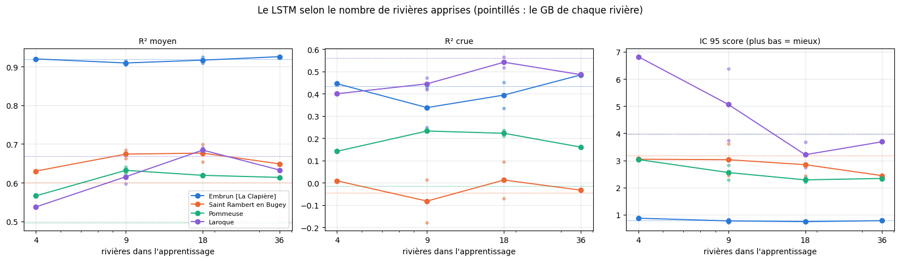

# 5.07 — Combien de rivières faut-il au LSTM ? Et un ensemble de 3 réseaux

**1. La courbe du nombre de rivières.** Le LSTM multi-stations du notebook 5.04, à l'identique (choix de l'époque sur la validation sans poids),
appris sur **4, 9 et 18 rivières** parmi les 36 (deux tirages au hasard pour 9 et 18), et sur les 36 (le réseau du notebook 5.04). Les notes
portent sur un **panel de 4 rivières présentes dans tous les tirages** : La Clapière (Durance, neige), l'Albarine (karst), Pommeuse (Grand-Morin,
plaine), Laroque (Hérault, méditerranéenne). Le tirage à 4 rivières est le panel lui-même.

**2. Un ensemble de 3 réseaux.** Le LSTM 36 rivières refait avec deux autres graines (2 et 3) ; l'ensemble = la moyenne des 3 réseaux (graines
1, 2, 3), pour la prévision officielle comme pour chaque scénario ; noté sur les 36 rivières face au réseau seul et au GB de chaque rivière.

Mêmes données (celles du notebook 5.04), mêmes réglages, même notation en conditions réelles (passé de service, prévision officielle de l'époque,
IC réglés sur la calibration avec les 50 scénarios et notés sur le test), mêmes heures et seuils de crue que le GB de chaque rivière.

## 1. La courbe du nombre de rivières

Chaque tirage a son dossier (`data/cache/lstm_courbe/<tirage>/`) : ses échelles, son réseau, ses prévisions sur le panel.

    reprise après 28 époques

    4 rivières : 28 époques (meilleure 13), 2 s

    reprise après 46 époques

    9 rivières (tirage 1) : 46 époques (meilleure 31), 3 s

    reprise après 31 époques

    9 rivières (tirage 2) : 31 époques (meilleure 16), 3 s

    reprise après 47 époques

    18 rivières (tirage 1) : 47 époques (meilleure 32), 6 s

    reprise après 45 époques

    18 rivières (tirage 2) : 45 époques (meilleure 30), 6 s

### Les notes du panel

Pour chaque rivière du panel, les heures communes à tous les tirages et au GB de la rivière (notebook 5.04).

<table border="1" class="dataframe">
  <thead>
    <tr style="text-align: right;">
      <th></th>
      <th></th>
      <th>R² J+1</th>
      <th>R² J+3</th>
      <th>R² J+5</th>
      <th>R² moyen</th>
      <th>R² crue</th>
      <th>R² montée</th>
      <th>biais pic %</th>
      <th>IC 95 couverture</th>
      <th>IC 95 score</th>
    </tr>
    <tr>
      <th>station</th>
      <th>modèle</th>
      <th></th>
      <th></th>
      <th></th>
      <th></th>
      <th></th>
      <th></th>
      <th></th>
      <th></th>
      <th></th>
    </tr>
  </thead>
  <tbody>
    <tr>
      <th rowspan="7" valign="top">Embrun [La Clapière]</th>
      <th>GB de la rivière</th>
      <td>0.974</td>
      <td>0.909</td>
      <td>0.883</td>
      <td>0.920</td>
      <td>0.433</td>
      <td>0.757</td>
      <td>1.600</td>
      <td>0.933</td>
      <td>0.782</td>
    </tr>
    <tr>
      <th>4 rivières</th>
      <td>0.972</td>
      <td>0.913</td>
      <td>0.876</td>
      <td>0.920</td>
      <td>0.445</td>
      <td>0.725</td>
      <td>-4.693</td>
      <td>0.922</td>
      <td>0.869</td>
    </tr>
    <tr>
      <th>9 rivières (tirage 1)</th>
      <td>0.974</td>
      <td>0.893</td>
      <td>0.849</td>
      <td>0.904</td>
      <td>0.250</td>
      <td>0.653</td>
      <td>-4.440</td>
      <td>0.928</td>
      <td>0.715</td>
    </tr>
    <tr>
      <th>9 rivières (tirage 2)</th>
      <td>0.973</td>
      <td>0.910</td>
      <td>0.864</td>
      <td>0.915</td>
      <td>0.425</td>
      <td>0.719</td>
      <td>-5.462</td>
      <td>0.943</td>
      <td>0.825</td>
    </tr>
    <tr>
      <th>18 rivières (tirage 1)</th>
      <td>0.972</td>
      <td>0.903</td>
      <td>0.854</td>
      <td>0.909</td>
      <td>0.335</td>
      <td>0.688</td>
      <td>-7.759</td>
      <td>0.948</td>
      <td>0.759</td>
    </tr>
    <tr>
      <th>18 rivières (tirage 2)</th>
      <td>0.975</td>
      <td>0.918</td>
      <td>0.884</td>
      <td>0.925</td>
      <td>0.452</td>
      <td>0.731</td>
      <td>-6.698</td>
      <td>0.911</td>
      <td>0.726</td>
    </tr>
    <tr>
      <th>36 rivières</th>
      <td>0.976</td>
      <td>0.920</td>
      <td>0.883</td>
      <td>0.926</td>
      <td>0.484</td>
      <td>0.732</td>
      <td>-6.165</td>
      <td>0.925</td>
      <td>0.779</td>
    </tr>
    <tr>
      <th rowspan="7" valign="top">Saint Rambert en Bugey</th>
      <th>GB de la rivière</th>
      <td>0.827</td>
      <td>0.551</td>
      <td>0.446</td>
      <td>0.601</td>
      <td>-0.045</td>
      <td>0.217</td>
      <td>-4.313</td>
      <td>0.841</td>
      <td>3.187</td>
    </tr>
    <tr>
      <th>4 rivières</th>
      <td>0.840</td>
      <td>0.592</td>
      <td>0.456</td>
      <td>0.630</td>
      <td>0.009</td>
      <td>0.269</td>
      <td>-4.775</td>
      <td>0.806</td>
      <td>3.042</td>
    </tr>
    <tr>
      <th>9 rivières (tirage 1)</th>
      <td>0.841</td>
      <td>0.635</td>
      <td>0.513</td>
      <td>0.663</td>
      <td>-0.178</td>
      <td>0.141</td>
      <td>-9.972</td>
      <td>0.886</td>
      <td>2.447</td>
    </tr>
    <tr>
      <th>9 rivières (tirage 2)</th>
      <td>0.866</td>
      <td>0.659</td>
      <td>0.515</td>
      <td>0.685</td>
      <td>0.013</td>
      <td>0.267</td>
      <td>-9.239</td>
      <td>0.737</td>
      <td>3.604</td>
    </tr>
    <tr>
      <th>18 rivières (tirage 1)</th>
      <td>0.847</td>
      <td>0.674</td>
      <td>0.546</td>
      <td>0.699</td>
      <td>0.094</td>
      <td>0.325</td>
      <td>-8.829</td>
      <td>0.755</td>
      <td>3.261</td>
    </tr>
    <tr>
      <th>18 rivières (tirage 2)</th>
      <td>0.851</td>
      <td>0.604</td>
      <td>0.492</td>
      <td>0.654</td>
      <td>-0.070</td>
      <td>0.187</td>
      <td>-10.806</td>
      <td>0.884</td>
      <td>2.422</td>
    </tr>
    <tr>
      <th>36 rivières</th>
      <td>0.831</td>
      <td>0.603</td>
      <td>0.496</td>
      <td>0.649</td>
      <td>-0.033</td>
      <td>0.234</td>
      <td>0.144</td>
      <td>0.854</td>
      <td>2.439</td>
    </tr>
    <tr>
      <th rowspan="7" valign="top">Pommeuse</th>
      <th>GB de la rivière</th>
      <td>0.738</td>
      <td>0.452</td>
      <td>0.365</td>
      <td>0.497</td>
      <td>-0.014</td>
      <td>0.194</td>
      <td>-1.729</td>
      <td>0.982</td>
      <td>3.975</td>
    </tr>
    <tr>
      <th>4 rivières</th>
      <td>0.857</td>
      <td>0.533</td>
      <td>0.376</td>
      <td>0.566</td>
      <td>0.141</td>
      <td>0.292</td>
      <td>-11.047</td>
      <td>0.977</td>
      <td>3.031</td>
    </tr>
    <tr>
      <th>9 rivières (tirage 1)</th>
      <td>0.860</td>
      <td>0.618</td>
      <td>0.491</td>
      <td>0.641</td>
      <td>0.231</td>
      <td>0.348</td>
      <td>-14.245</td>
      <td>0.993</td>
      <td>2.285</td>
    </tr>
    <tr>
      <th>9 rivières (tirage 2)</th>
      <td>0.876</td>
      <td>0.588</td>
      <td>0.459</td>
      <td>0.623</td>
      <td>0.234</td>
      <td>0.358</td>
      <td>-7.557</td>
      <td>0.899</td>
      <td>2.819</td>
    </tr>
    <tr>
      <th>18 rivières (tirage 1)</th>
      <td>0.864</td>
      <td>0.584</td>
      <td>0.470</td>
      <td>0.622</td>
      <td>0.235</td>
      <td>0.356</td>
      <td>2.364</td>
      <td>0.990</td>
      <td>2.195</td>
    </tr>
    <tr>
      <th>18 rivières (tirage 2)</th>
      <td>0.875</td>
      <td>0.587</td>
      <td>0.425</td>
      <td>0.616</td>
      <td>0.210</td>
      <td>0.344</td>
      <td>-8.111</td>
      <td>0.995</td>
      <td>2.368</td>
    </tr>
    <tr>
      <th>36 rivières</th>
      <td>0.871</td>
      <td>0.583</td>
      <td>0.449</td>
      <td>0.614</td>
      <td>0.160</td>
      <td>0.284</td>
      <td>-16.692</td>
      <td>0.987</td>
      <td>2.335</td>
    </tr>
    <tr>
      <th rowspan="7" valign="top">Laroque</th>
      <th>GB de la rivière</th>
      <td>0.815</td>
      <td>0.665</td>
      <td>0.557</td>
      <td>0.669</td>
      <td>0.561</td>
      <td>0.570</td>
      <td>34.573</td>
      <td>0.777</td>
      <td>3.960</td>
    </tr>
    <tr>
      <th>4 rivières</th>
      <td>0.779</td>
      <td>0.547</td>
      <td>0.312</td>
      <td>0.537</td>
      <td>0.400</td>
      <td>0.444</td>
      <td>29.489</td>
      <td>0.622</td>
      <td>6.822</td>
    </tr>
    <tr>
      <th>9 rivières (tirage 1)</th>
      <td>0.821</td>
      <td>0.635</td>
      <td>0.513</td>
      <td>0.634</td>
      <td>0.471</td>
      <td>0.477</td>
      <td>29.527</td>
      <td>0.702</td>
      <td>3.741</td>
    </tr>
    <tr>
      <th>9 rivières (tirage 2)</th>
      <td>0.785</td>
      <td>0.613</td>
      <td>0.446</td>
      <td>0.597</td>
      <td>0.418</td>
      <td>0.445</td>
      <td>28.105</td>
      <td>0.560</td>
      <td>6.385</td>
    </tr>
    <tr>
      <th>18 rivières (tirage 1)</th>
      <td>0.848</td>
      <td>0.657</td>
      <td>0.561</td>
      <td>0.678</td>
      <td>0.517</td>
      <td>0.544</td>
      <td>18.300</td>
      <td>0.715</td>
      <td>3.667</td>
    </tr>
    <tr>
      <th>18 rivières (tirage 2)</th>
      <td>0.854</td>
      <td>0.676</td>
      <td>0.565</td>
      <td>0.691</td>
      <td>0.566</td>
      <td>0.571</td>
      <td>17.233</td>
      <td>0.793</td>
      <td>2.751</td>
    </tr>
    <tr>
      <th>36 rivières</th>
      <td>0.806</td>
      <td>0.632</td>
      <td>0.521</td>
      <td>0.633</td>
      <td>0.485</td>
      <td>0.502</td>
      <td>26.523</td>
      <td>0.717</td>
      <td>3.686</td>
    </tr>
  </tbody>
</table>

    

    

## 2. Un ensemble de 3 réseaux sur les 36 rivières

Les graines 2 et 3 (`data/cache/lstm_multi_graines/`), notées sur les 36 rivières ; l'ensemble est la moyenne des réseaux 1 (notebook 5.04), 2 et 3.

    reprise après 53 époques

    graine 2 : 53 époques (meilleure 38), 11 s

    reprise après 44 époques

    graine 3 : 44 époques (meilleure 29), 11 s

    36 rivières

<table border="1" class="dataframe">
  <thead>
    <tr style="text-align: right;">
      <th></th>
      <th>R² J+1</th>
      <th>R² J+3</th>
      <th>R² J+5</th>
      <th>R² moyen</th>
      <th>R² crue</th>
      <th>R² montée</th>
      <th>biais pic %</th>
      <th>IC 95 couverture</th>
      <th>IC 95 score</th>
    </tr>
  </thead>
  <tbody>
    <tr>
      <th>GB de la rivière (médiane)</th>
      <td>0.840</td>
      <td>0.620</td>
      <td>0.506</td>
      <td>0.646</td>
      <td>0.119</td>
      <td>0.418</td>
      <td>1.237</td>
      <td>0.881</td>
      <td>2.474</td>
    </tr>
    <tr>
      <th>LSTM 36, graine 1 (médiane)</th>
      <td>0.871</td>
      <td>0.672</td>
      <td>0.529</td>
      <td>0.684</td>
      <td>0.157</td>
      <td>0.418</td>
      <td>-2.915</td>
      <td>0.879</td>
      <td>2.235</td>
    </tr>
    <tr>
      <th>LSTM 36, graine 2 (médiane)</th>
      <td>0.886</td>
      <td>0.666</td>
      <td>0.542</td>
      <td>0.676</td>
      <td>0.154</td>
      <td>0.436</td>
      <td>-4.521</td>
      <td>0.875</td>
      <td>2.168</td>
    </tr>
    <tr>
      <th>LSTM 36, graine 3 (médiane)</th>
      <td>0.895</td>
      <td>0.675</td>
      <td>0.526</td>
      <td>0.686</td>
      <td>0.152</td>
      <td>0.425</td>
      <td>-3.532</td>
      <td>0.861</td>
      <td>2.337</td>
    </tr>
    <tr>
      <th>LSTM 36, ensemble de 3 (médiane)</th>
      <td>0.898</td>
      <td>0.690</td>
      <td>0.559</td>
      <td>0.714</td>
      <td>0.199</td>
      <td>0.449</td>
      <td>-5.629</td>
      <td>0.889</td>
      <td>2.102</td>
    </tr>
    <tr>
      <th>LSTM 36, ensemble de 3 mieux que LSTM 36, graine 1</th>
      <td>33.000</td>
      <td>34.000</td>
      <td>33.000</td>
      <td>35.000</td>
      <td>29.000</td>
      <td>33.000</td>
      <td>11.000</td>
      <td>20.000</td>
      <td>30.000</td>
    </tr>
    <tr>
      <th>LSTM 36, ensemble de 3 mieux que GB de la rivière</th>
      <td>33.000</td>
      <td>31.000</td>
      <td>30.000</td>
      <td>33.000</td>
      <td>28.000</td>
      <td>27.000</td>
      <td>14.000</td>
      <td>25.000</td>
      <td>34.000</td>
    </tr>
  </tbody>
</table>

