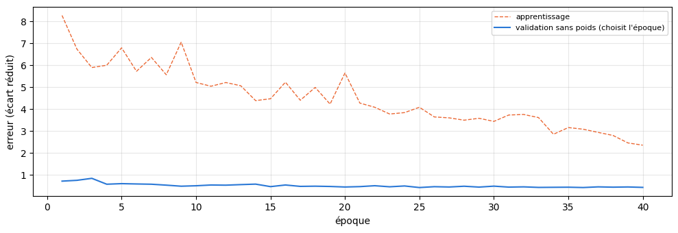
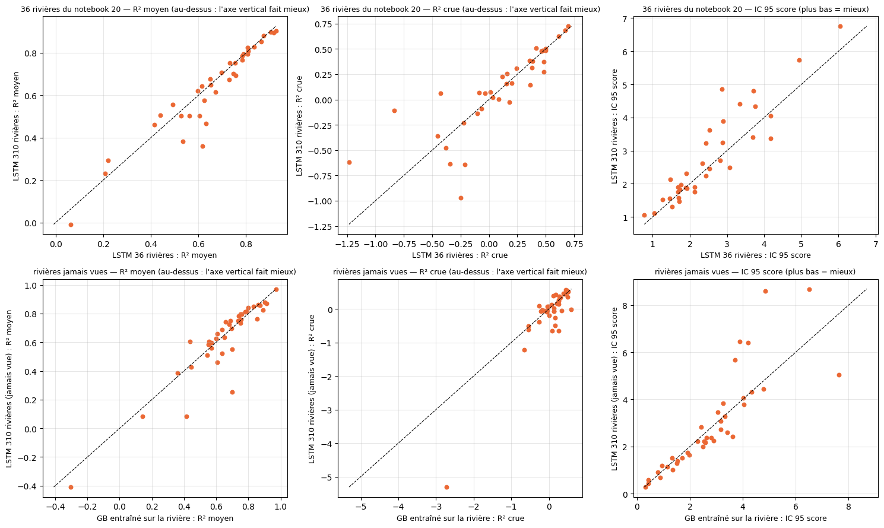

# 5.08 — Un LSTM appris sur 310 rivières, testé sur des rivières jamais vues

Suite du notebook 5.04 (36 rivières) et de la courbe du notebook 5.07 : le même LSTM multi-stations, appris sur **beaucoup plus de rivières**.

**Le choix des rivières** : les 36 du notebook 5.04, plus 459 stations françaises (dans les deux pavés de scénarios, débits depuis 2012 au
moins, régulation BasinATLAS ≤ 2 %, 50 à 20 000 km², une station par petit bassin, sans les éclusées déjà repérées) **rangées par diversité de
leurs attributs BasinATLAS** : chacune est, au moment où on la prend, la plus différente de toutes celles déjà prises (altitude, pente, neige,
pluie, température, karst, forêt, nappe, aridité, argile, sable, surface ; liste et attributs dans `data/cache/lstm_500/`). Puis le même
contrôle des débits qu'au notebook 5.04 (éclusées, trous).

**Rivières jamais vues** : une rivière gardée sur huit parmi les nouvelles (dans l'ordre de diversité) est mise de côté ; le réseau ne l'apprend
pas. Ses deux échelles propres (débit habituel, dispersion des écarts) viennent de son passé, comme pour une mise en service (notebook 5.05).

**Le réseau** : celui du notebook 5.04, à l'identique (90 jours de passé, mémoire de 128, attributs, choix de l'époque sur la validation sans
poids), avec un seizième des instants par époque (au lieu d'un huitième : il y a dix fois plus d'instants) et au plus 3 h d'apprentissage.

**Comparé**, en conditions réelles (passé de service, prévision officielle de l'époque, IC réglés sur la calibration avec les 50 scénarios et
notés sur le test) : sur les 36 rivières du notebook 5.04, au GB de chaque rivière, au LSTM 36 rivières (et à l'ensemble de 3 du notebook 5.07
s'il existe) ; sur les rivières jamais vues, au GB par défaut **entraîné sur la rivière elle-même**.

## Les rivières : contrôle des débits et partage

    314 nouvelles stations gardées sur 424 ; apprentissage : 310 rivières (dont les 36 du notebook 20) ; jamais vues : 40

    gardee
    False    110
    True     314
    dtype: int64

## L'apprentissage

    données de 350 rivières en 12 s

    8695375 instants d'apprentissage (7390921 pour apprendre, 1304454 de validation), 15 attributs

    reprise après 11 époques

    époque 12 · apprentissage 5.2152 · validation 3.1998 (sans poids 0.5252) · 84 s

    époque 13 · apprentissage 5.0676 · validation 3.1303 (sans poids 0.5506) · 83 s

    époque 14 · apprentissage 4.3878 · validation 3.1796 (sans poids 0.5727) · 84 s

    époque 15 · apprentissage 4.4733 · validation 3.5412 (sans poids 0.4586) · 86 s

    époque 16 · apprentissage 5.2296 · validation 3.1867 (sans poids 0.5332) · 84 s

    époque 17 · apprentissage 4.4052 · validation 3.2294 (sans poids 0.4699) · 85 s

    époque 18 · apprentissage 4.9919 · validation 3.2777 (sans poids 0.4786) · 86 s

    époque 19 · apprentissage 4.2291 · validation 3.2353 (sans poids 0.4660) · 81 s

    époque 20 · apprentissage 5.6517 · validation 3.3366 (sans poids 0.4415) · 79 s

    époque 21 · apprentissage 4.2751 · validation 3.2265 (sans poids 0.4592) · 79 s

    époque 22 · apprentissage 4.0846 · validation 3.3100 (sans poids 0.4995) · 85 s

    époque 23 · apprentissage 3.7764 · validation 3.3471 (sans poids 0.4512) · 84 s

    époque 24 · apprentissage 3.8409 · validation 3.1034 (sans poids 0.4887) · 83 s

    époque 25 · apprentissage 4.0838 · validation 3.2965 (sans poids 0.4165) · 82 s

    époque 26 · apprentissage 3.6427 · validation 3.2820 (sans poids 0.4559) · 83 s

    époque 27 · apprentissage 3.6000 · validation 3.2737 (sans poids 0.4417) · 84 s

    époque 28 · apprentissage 3.4943 · validation 3.3798 (sans poids 0.4762) · 84 s

    époque 29 · apprentissage 3.5810 · validation 3.3459 (sans poids 0.4372) · 83 s

    époque 30 · apprentissage 3.4389 · validation 3.2265 (sans poids 0.4801) · 81 s

    époque 31 · apprentissage 3.7306 · validation 3.2688 (sans poids 0.4367) · 80 s

    époque 32 · apprentissage 3.7554 · validation 3.2480 (sans poids 0.4481) · 80 s

    époque 33 · apprentissage 3.6126 · validation 3.1952 (sans poids 0.4227) · 80 s

    époque 34 · apprentissage 2.8512 · validation 3.2289 (sans poids 0.4276) · 79 s

    époque 35 · apprentissage 3.1569 · validation 3.2894 (sans poids 0.4320) · 79 s

    époque 36 · apprentissage 3.0818 · validation 3.3261 (sans poids 0.4172) · 80 s

    époque 37 · apprentissage 2.9368 · validation 3.2666 (sans poids 0.4477) · 80 s

    époque 38 · apprentissage 2.7969 · validation 3.2244 (sans poids 0.4338) · 80 s

    époque 39 · apprentissage 2.4555 · validation 3.2097 (sans poids 0.4432) · 79 s

    époque 40 · apprentissage 2.3519 · validation 3.2887 (sans poids 0.4237) · 79 s

    

    

    40 époques en 54 min ; meilleure : époque 25

## Les prévisions en conditions réelles

    76 rivières prévues en 1677 s

## Les notes

Chaque rivière est notée aux heures communes à tous ses modèles ; R² et crues sur calibration + test ; IC réglés sur la calibration, notés sur
le test (score rapporté au débit moyen : plus bas = mieux).

### Sur les 36 rivières du notebook 5.04

    36 rivières

<table border="1" class="dataframe">
  <thead>
    <tr style="text-align: right;">
      <th></th>
      <th>R² J+1</th>
      <th>R² J+3</th>
      <th>R² J+5</th>
      <th>R² moyen</th>
      <th>R² crue</th>
      <th>R² montée</th>
      <th>biais pic %</th>
      <th>IC 95 couverture</th>
      <th>IC 95 score</th>
    </tr>
  </thead>
  <tbody>
    <tr>
      <th>GB de la rivière (médiane)</th>
      <td>0.840</td>
      <td>0.620</td>
      <td>0.506</td>
      <td>0.646</td>
      <td>0.119</td>
      <td>0.418</td>
      <td>1.237</td>
      <td>0.881</td>
      <td>2.474</td>
    </tr>
    <tr>
      <th>LSTM 36 rivières (médiane)</th>
      <td>0.871</td>
      <td>0.672</td>
      <td>0.529</td>
      <td>0.684</td>
      <td>0.157</td>
      <td>0.418</td>
      <td>-2.915</td>
      <td>0.879</td>
      <td>2.235</td>
    </tr>
    <tr>
      <th>LSTM 36 rivières, ensemble de 3 (médiane)</th>
      <td>0.898</td>
      <td>0.690</td>
      <td>0.559</td>
      <td>0.714</td>
      <td>0.199</td>
      <td>0.449</td>
      <td>-5.629</td>
      <td>0.889</td>
      <td>2.102</td>
    </tr>
    <tr>
      <th>LSTM 310 rivières (médiane)</th>
      <td>0.893</td>
      <td>0.627</td>
      <td>0.525</td>
      <td>0.675</td>
      <td>0.152</td>
      <td>0.416</td>
      <td>-0.997</td>
      <td>0.849</td>
      <td>2.273</td>
    </tr>
    <tr>
      <th>LSTM 310 rivières mieux que LSTM 36 rivières</th>
      <td>17.000</td>
      <td>12.000</td>
      <td>14.000</td>
      <td>14.000</td>
      <td>19.000</td>
      <td>28.000</td>
      <td>19.000</td>
      <td>7.000</td>
      <td>14.000</td>
    </tr>
    <tr>
      <th>LSTM 310 rivières mieux que GB de la rivière</th>
      <td>23.000</td>
      <td>21.000</td>
      <td>24.000</td>
      <td>24.000</td>
      <td>21.000</td>
      <td>24.000</td>
      <td>20.000</td>
      <td>9.000</td>
      <td>24.000</td>
    </tr>
  </tbody>
</table>

<table border="1" class="dataframe">
  <thead>
    <tr>
      <th></th>
      <th colspan="4" halign="left">R² moyen</th>
      <th colspan="4" halign="left">R² crue</th>
      <th colspan="4" halign="left">IC 95 score</th>
    </tr>
    <tr>
      <th>modèle</th>
      <th>GB de la rivière</th>
      <th>LSTM 36 rivières</th>
      <th>LSTM 310 rivières</th>
      <th>LSTM 36 rivières, ensemble de 3</th>
      <th>GB de la rivière</th>
      <th>LSTM 36 rivières</th>
      <th>LSTM 310 rivières</th>
      <th>LSTM 36 rivières, ensemble de 3</th>
      <th>GB de la rivière</th>
      <th>LSTM 36 rivières</th>
      <th>LSTM 310 rivières</th>
      <th>LSTM 36 rivières, ensemble de 3</th>
    </tr>
    <tr>
      <th>station</th>
      <th></th>
      <th></th>
      <th></th>
      <th></th>
      <th></th>
      <th></th>
      <th></th>
      <th></th>
      <th></th>
      <th></th>
      <th></th>
      <th></th>
    </tr>
  </thead>
  <tbody>
    <tr>
      <th>Saint Rambert en Bugey</th>
      <td>0.601</td>
      <td>0.649</td>
      <td>0.676</td>
      <td>0.692</td>
      <td>-0.045</td>
      <td>-0.033</td>
      <td>0.064</td>
      <td>0.002</td>
      <td>3.187</td>
      <td>2.439</td>
      <td>3.221</td>
      <td>2.384</td>
    </tr>
    <tr>
      <th>Millau [HE]</th>
      <td>0.641</td>
      <td>0.732</td>
      <td>0.753</td>
      <td>0.743</td>
      <td>0.597</td>
      <td>0.698</td>
      <td>0.725</td>
      <td>0.712</td>
      <td>4.450</td>
      <td>4.176</td>
      <td>3.370</td>
      <td>4.153</td>
    </tr>
    <tr>
      <th>Pontgibaud</th>
      <td>0.750</td>
      <td>0.785</td>
      <td>0.766</td>
      <td>0.813</td>
      <td>0.364</td>
      <td>0.381</td>
      <td>0.316</td>
      <td>0.400</td>
      <td>2.001</td>
      <td>1.892</td>
      <td>1.878</td>
      <td>1.828</td>
    </tr>
    <tr>
      <th>Bourg de sirod</th>
      <td>0.621</td>
      <td>0.673</td>
      <td>0.615</td>
      <td>0.685</td>
      <td>-0.134</td>
      <td>-0.086</td>
      <td>0.069</td>
      <td>-0.113</td>
      <td>3.368</td>
      <td>2.521</td>
      <td>3.614</td>
      <td>2.474</td>
    </tr>
    <tr>
      <th>Dingy-St-Clair</th>
      <td>0.398</td>
      <td>0.414</td>
      <td>0.460</td>
      <td>0.464</td>
      <td>-0.498</td>
      <td>-0.835</td>
      <td>-0.111</td>
      <td>-0.663</td>
      <td>3.903</td>
      <td>3.069</td>
      <td>2.487</td>
      <td>2.715</td>
    </tr>
    <tr>
      <th>Perigueux</th>
      <td>0.800</td>
      <td>0.810</td>
      <td>0.807</td>
      <td>0.828</td>
      <td>0.479</td>
      <td>0.473</td>
      <td>0.484</td>
      <td>0.521</td>
      <td>2.242</td>
      <td>2.435</td>
      <td>2.240</td>
      <td>2.287</td>
    </tr>
    <tr>
      <th>Pont-de-Labeaume</th>
      <td>0.500</td>
      <td>0.535</td>
      <td>0.383</td>
      <td>0.555</td>
      <td>0.362</td>
      <td>0.365</td>
      <td>0.147</td>
      <td>0.380</td>
      <td>3.869</td>
      <td>3.338</td>
      <td>4.408</td>
      <td>2.957</td>
    </tr>
    <tr>
      <th>Coudes</th>
      <td>0.684</td>
      <td>0.728</td>
      <td>0.673</td>
      <td>0.737</td>
      <td>0.159</td>
      <td>0.178</td>
      <td>-0.029</td>
      <td>0.172</td>
      <td>1.859</td>
      <td>1.684</td>
      <td>1.764</td>
      <td>1.564</td>
    </tr>
    <tr>
      <th>Osses</th>
      <td>0.471</td>
      <td>0.528</td>
      <td>0.502</td>
      <td>0.555</td>
      <td>-0.428</td>
      <td>-0.454</td>
      <td>-0.359</td>
      <td>-0.381</td>
      <td>2.423</td>
      <td>2.532</td>
      <td>2.453</td>
      <td>2.230</td>
    </tr>
    <tr>
      <th>Escos</th>
      <td>0.554</td>
      <td>0.439</td>
      <td>0.505</td>
      <td>0.479</td>
      <td>-0.378</td>
      <td>-1.233</td>
      <td>-0.617</td>
      <td>-0.993</td>
      <td>1.970</td>
      <td>2.127</td>
      <td>1.762</td>
      <td>1.884</td>
    </tr>
    <tr>
      <th>Montignac</th>
      <td>0.849</td>
      <td>0.874</td>
      <td>0.880</td>
      <td>0.884</td>
      <td>0.503</td>
      <td>0.614</td>
      <td>0.623</td>
      <td>0.629</td>
      <td>1.727</td>
      <td>1.458</td>
      <td>1.561</td>
      <td>1.468</td>
    </tr>
    <tr>
      <th>Epinal</th>
      <td>0.824</td>
      <td>0.806</td>
      <td>0.826</td>
      <td>0.846</td>
      <td>-0.307</td>
      <td>-0.344</td>
      <td>-0.637</td>
      <td>-0.127</td>
      <td>1.424</td>
      <td>1.525</td>
      <td>1.308</td>
      <td>1.224</td>
    </tr>
    <tr>
      <th>Syam</th>
      <td>0.493</td>
      <td>0.561</td>
      <td>0.504</td>
      <td>0.584</td>
      <td>-0.408</td>
      <td>-0.224</td>
      <td>-0.232</td>
      <td>-0.282</td>
      <td>4.754</td>
      <td>3.718</td>
      <td>4.795</td>
      <td>3.507</td>
    </tr>
    <tr>
      <th>Cocurès</th>
      <td>0.602</td>
      <td>0.653</td>
      <td>0.648</td>
      <td>0.668</td>
      <td>0.414</td>
      <td>0.463</td>
      <td>0.481</td>
      <td>0.477</td>
      <td>3.315</td>
      <td>2.874</td>
      <td>3.238</td>
      <td>2.269</td>
    </tr>
    <tr>
      <th>Vuillafans</th>
      <td>0.723</td>
      <td>0.747</td>
      <td>0.703</td>
      <td>0.773</td>
      <td>-0.083</td>
      <td>-0.065</td>
      <td>-0.088</td>
      <td>-0.079</td>
      <td>1.837</td>
      <td>1.474</td>
      <td>2.126</td>
      <td>1.318</td>
    </tr>
    <tr>
      <th>Chadrac [Pont du Monteil]</th>
      <td>0.234</td>
      <td>0.219</td>
      <td>0.293</td>
      <td>0.297</td>
      <td>0.049</td>
      <td>0.011</td>
      <td>0.076</td>
      <td>0.084</td>
      <td>4.106</td>
      <td>3.761</td>
      <td>4.331</td>
      <td>3.093</td>
    </tr>
    <tr>
      <th>Figeac</th>
      <td>0.791</td>
      <td>0.754</td>
      <td>0.752</td>
      <td>0.793</td>
      <td>0.443</td>
      <td>0.359</td>
      <td>0.387</td>
      <td>0.443</td>
      <td>2.232</td>
      <td>1.730</td>
      <td>1.828</td>
      <td>1.777</td>
    </tr>
    <tr>
      <th>Laroque</th>
      <td>0.669</td>
      <td>0.633</td>
      <td>0.465</td>
      <td>0.668</td>
      <td>0.561</td>
      <td>0.485</td>
      <td>0.275</td>
      <td>0.519</td>
      <td>3.960</td>
      <td>3.686</td>
      <td>3.408</td>
      <td>3.011</td>
    </tr>
    <tr>
      <th>Lechâtelet</th>
      <td>0.879</td>
      <td>0.916</td>
      <td>0.894</td>
      <td>0.921</td>
      <td>0.380</td>
      <td>0.501</td>
      <td>0.486</td>
      <td>0.556</td>
      <td>1.166</td>
      <td>1.051</td>
      <td>1.102</td>
      <td>0.913</td>
    </tr>
    <tr>
      <th>Goudet</th>
      <td>0.204</td>
      <td>0.208</td>
      <td>0.232</td>
      <td>0.220</td>
      <td>0.141</td>
      <td>0.153</td>
      <td>0.157</td>
      <td>0.158</td>
      <td>11.820</td>
      <td>6.049</td>
      <td>6.757</td>
      <td>6.481</td>
    </tr>
    <tr>
      <th>Pommeuse</th>
      <td>0.497</td>
      <td>0.614</td>
      <td>0.644</td>
      <td>0.645</td>
      <td>-0.014</td>
      <td>0.160</td>
      <td>0.254</td>
      <td>0.226</td>
      <td>3.975</td>
      <td>2.335</td>
      <td>2.620</td>
      <td>2.214</td>
    </tr>
    <tr>
      <th>Allèves [La Charniaz]</th>
      <td>0.472</td>
      <td>0.493</td>
      <td>0.557</td>
      <td>0.521</td>
      <td>-0.214</td>
      <td>-0.425</td>
      <td>0.062</td>
      <td>-0.282</td>
      <td>3.571</td>
      <td>2.815</td>
      <td>2.706</td>
      <td>2.665</td>
    </tr>
    <tr>
      <th>Rosureux</th>
      <td>0.652</td>
      <td>0.696</td>
      <td>0.709</td>
      <td>0.735</td>
      <td>-0.360</td>
      <td>-0.380</td>
      <td>-0.478</td>
      <td>-0.260</td>
      <td>4.558</td>
      <td>2.861</td>
      <td>4.854</td>
      <td>3.076</td>
    </tr>
    <tr>
      <th>Soueix-Rogalle</th>
      <td>0.529</td>
      <td>0.617</td>
      <td>0.359</td>
      <td>0.657</td>
      <td>-0.408</td>
      <td>-0.248</td>
      <td>-0.973</td>
      <td>-0.299</td>
      <td>1.730</td>
      <td>1.261</td>
      <td>1.519</td>
      <td>1.247</td>
    </tr>
    <tr>
      <th>Eymoutiers</th>
      <td>0.786</td>
      <td>0.864</td>
      <td>0.854</td>
      <td>0.881</td>
      <td>0.462</td>
      <td>0.671</td>
      <td>0.687</td>
      <td>0.717</td>
      <td>2.949</td>
      <td>1.705</td>
      <td>1.578</td>
      <td>1.487</td>
    </tr>
    <tr>
      <th>La Prugne</th>
      <td>0.760</td>
      <td>0.806</td>
      <td>0.794</td>
      <td>0.815</td>
      <td>0.286</td>
      <td>0.414</td>
      <td>0.509</td>
      <td>0.418</td>
      <td>2.362</td>
      <td>2.135</td>
      <td>1.900</td>
      <td>1.991</td>
    </tr>
    <tr>
      <th>Morez</th>
      <td>0.503</td>
      <td>0.604</td>
      <td>0.503</td>
      <td>0.601</td>
      <td>0.006</td>
      <td>0.083</td>
      <td>0.001</td>
      <td>0.053</td>
      <td>4.207</td>
      <td>2.900</td>
      <td>3.891</td>
      <td>2.802</td>
    </tr>
    <tr>
      <th>Couilly-Pont-aux-Dames [Station ultrason]</th>
      <td>0.490</td>
      <td>0.598</td>
      <td>0.620</td>
      <td>0.650</td>
      <td>-0.014</td>
      <td>0.115</td>
      <td>0.225</td>
      <td>0.239</td>
      <td>4.812</td>
      <td>4.179</td>
      <td>4.042</td>
      <td>3.634</td>
    </tr>
    <tr>
      <th>Aspet</th>
      <td>0.432</td>
      <td>0.624</td>
      <td>0.575</td>
      <td>0.658</td>
      <td>0.227</td>
      <td>0.245</td>
      <td>0.307</td>
      <td>0.333</td>
      <td>2.524</td>
      <td>1.923</td>
      <td>1.866</td>
      <td>1.858</td>
    </tr>
    <tr>
      <th>Sauvessanges</th>
      <td>0.730</td>
      <td>0.756</td>
      <td>0.692</td>
      <td>0.777</td>
      <td>0.035</td>
      <td>-0.213</td>
      <td>-0.640</td>
      <td>0.017</td>
      <td>2.169</td>
      <td>1.686</td>
      <td>1.901</td>
      <td>1.558</td>
    </tr>
    <tr>
      <th>Rive-de-Gier</th>
      <td>0.085</td>
      <td>0.063</td>
      <td>-0.008</td>
      <td>0.123</td>
      <td>0.017</td>
      <td>-0.103</td>
      <td>-0.136</td>
      <td>-0.028</td>
      <td>7.382</td>
      <td>4.941</td>
      <td>5.730</td>
      <td>4.232</td>
    </tr>
    <tr>
      <th>Joursac</th>
      <td>0.757</td>
      <td>0.784</td>
      <td>0.787</td>
      <td>0.821</td>
      <td>0.488</td>
      <td>0.499</td>
      <td>0.503</td>
      <td>0.551</td>
      <td>2.085</td>
      <td>1.761</td>
      <td>1.972</td>
      <td>1.672</td>
    </tr>
    <tr>
      <th>Le Lauzet-Ubaye [Roche-Rousse]</th>
      <td>0.885</td>
      <td>0.903</td>
      <td>0.897</td>
      <td>0.918</td>
      <td>0.289</td>
      <td>0.382</td>
      <td>0.382</td>
      <td>0.474</td>
      <td>1.306</td>
      <td>1.713</td>
      <td>1.461</td>
      <td>1.774</td>
    </tr>
    <tr>
      <th>Embrun [La Clapière]</th>
      <td>0.920</td>
      <td>0.926</td>
      <td>0.903</td>
      <td>0.928</td>
      <td>0.433</td>
      <td>0.484</td>
      <td>0.372</td>
      <td>0.473</td>
      <td>0.782</td>
      <td>0.779</td>
      <td>1.056</td>
      <td>0.746</td>
    </tr>
    <tr>
      <th>Val-des-Prés</th>
      <td>0.865</td>
      <td>0.834</td>
      <td>0.827</td>
      <td>0.838</td>
      <td>0.151</td>
      <td>0.033</td>
      <td>0.023</td>
      <td>0.082</td>
      <td>1.057</td>
      <td>1.049</td>
      <td>1.105</td>
      <td>0.998</td>
    </tr>
    <tr>
      <th>Goumois</th>
      <td>0.761</td>
      <td>0.788</td>
      <td>0.794</td>
      <td>0.802</td>
      <td>0.097</td>
      <td>0.202</td>
      <td>0.160</td>
      <td>0.265</td>
      <td>2.243</td>
      <td>1.912</td>
      <td>2.305</td>
      <td>1.991</td>
    </tr>
  </tbody>
</table>

### Sur les rivières jamais vues

Le LSTM ne les a jamais apprises ; le GB par défaut, lui, est entraîné sur chacune (recette de mise en service, poids ×4 sur les montées).

    40 rivières jamais vues

<table border="1" class="dataframe">
  <thead>
    <tr style="text-align: right;">
      <th></th>
      <th>R² J+1</th>
      <th>R² J+3</th>
      <th>R² J+5</th>
      <th>R² moyen</th>
      <th>R² crue</th>
      <th>R² montée</th>
      <th>biais pic %</th>
      <th>IC 95 couverture</th>
      <th>IC 95 score</th>
    </tr>
  </thead>
  <tbody>
    <tr>
      <th>GB entraîné sur la rivière (médiane)</th>
      <td>0.886</td>
      <td>0.683</td>
      <td>0.548</td>
      <td>0.691</td>
      <td>0.148</td>
      <td>0.479</td>
      <td>1.617</td>
      <td>0.909</td>
      <td>2.612</td>
    </tr>
    <tr>
      <th>LSTM 310 rivières (jamais vue) (médiane)</th>
      <td>0.891</td>
      <td>0.687</td>
      <td>0.600</td>
      <td>0.711</td>
      <td>0.045</td>
      <td>0.473</td>
      <td>1.151</td>
      <td>0.824</td>
      <td>2.313</td>
    </tr>
    <tr>
      <th>LSTM 310 rivières (jamais vue) mieux que GB entraîné sur la rivière</th>
      <td>20.000</td>
      <td>22.000</td>
      <td>23.000</td>
      <td>22.000</td>
      <td>18.000</td>
      <td>24.000</td>
      <td>22.000</td>
      <td>3.000</td>
      <td>26.000</td>
    </tr>
  </tbody>
</table>

<table border="1" class="dataframe">
  <thead>
    <tr>
      <th></th>
      <th></th>
      <th colspan="2" halign="left">R² moyen</th>
      <th colspan="2" halign="left">R² crue</th>
      <th colspan="2" halign="left">IC 95 score</th>
    </tr>
    <tr>
      <th></th>
      <th>modèle</th>
      <th>GB entraîné sur la rivière</th>
      <th>LSTM 310 rivières (jamais vue)</th>
      <th>GB entraîné sur la rivière</th>
      <th>LSTM 310 rivières (jamais vue)</th>
      <th>GB entraîné sur la rivière</th>
      <th>LSTM 310 rivières (jamais vue)</th>
    </tr>
    <tr>
      <th>station</th>
      <th>rivière</th>
      <th></th>
      <th></th>
      <th></th>
      <th></th>
      <th></th>
      <th></th>
    </tr>
  </thead>
  <tbody>
    <tr>
      <th>St-Cyr-sous-Dourdan</th>
      <th>Remarde</th>
      <td>0.437</td>
      <td>0.605</td>
      <td>0.109</td>
      <td>0.391</td>
      <td>3.628</td>
      <td>2.436</td>
    </tr>
    <tr>
      <th>St-Pée-sur-Nivelle [Pont de Cherchebruit]</th>
      <th>Nivelle</th>
      <td>0.143</td>
      <td>0.083</td>
      <td>-0.544</td>
      <td>-0.503</td>
      <td>3.715</td>
      <td>5.684</td>
    </tr>
    <tr>
      <th>Aicirits [St-Palais]</th>
      <th>Bidouze</th>
      <td>-0.304</td>
      <td>-0.409</td>
      <td>-0.650</td>
      <td>-1.220</td>
      <td>6.507</td>
      <td>8.683</td>
    </tr>
    <tr>
      <th>Vic-le-Fesc</th>
      <th>Vidourle</th>
      <td>0.415</td>
      <td>0.083</td>
      <td>0.344</td>
      <td>-0.057</td>
      <td>7.626</td>
      <td>5.042</td>
    </tr>
    <tr>
      <th>Cheveuges</th>
      <th>Bar</th>
      <td>0.901</td>
      <td>0.876</td>
      <td>-2.716</td>
      <td>-5.310</td>
      <td>1.501</td>
      <td>1.281</td>
    </tr>
    <tr>
      <th>Chalaines</th>
      <th>Meuse</th>
      <td>0.600</td>
      <td>0.626</td>
      <td>0.263</td>
      <td>0.258</td>
      <td>1.722</td>
      <td>1.526</td>
    </tr>
    <tr>
      <th>Ecouviez</th>
      <th>Ton</th>
      <td>0.569</td>
      <td>0.599</td>
      <td>-0.009</td>
      <td>0.074</td>
      <td>1.355</td>
      <td>1.016</td>
    </tr>
    <tr>
      <th>Belval</th>
      <th>Sormonne</th>
      <td>0.658</td>
      <td>0.743</td>
      <td>-0.255</td>
      <td>0.088</td>
      <td>2.889</td>
      <td>2.256</td>
    </tr>
    <tr>
      <th>Ray-sur-Saône</th>
      <th>Saône</th>
      <td>0.752</td>
      <td>0.734</td>
      <td>0.075</td>
      <td>0.119</td>
      <td>1.159</td>
      <td>1.131</td>
    </tr>
    <tr>
      <th>Lunéville [Vezouze]</th>
      <th>Vezouze</th>
      <td>0.443</td>
      <td>0.428</td>
      <td>-0.260</td>
      <td>-0.382</td>
      <td>3.269</td>
      <td>3.838</td>
    </tr>
    <tr>
      <th>Pierrepont</th>
      <th>Crusnes</th>
      <td>0.855</td>
      <td>0.761</td>
      <td>0.082</td>
      <td>-0.647</td>
      <td>0.940</td>
      <td>1.201</td>
    </tr>
    <tr>
      <th>Fleurey-les-Faverney</th>
      <th>Lanterne</th>
      <td>0.790</td>
      <td>0.816</td>
      <td>-0.209</td>
      <td>-0.062</td>
      <td>1.531</td>
      <td>1.381</td>
    </tr>
    <tr>
      <th>Vic-sur-Cère [Comblat-le-Pont]</th>
      <th>Cère</th>
      <td>0.699</td>
      <td>0.251</td>
      <td>0.264</td>
      <td>-0.645</td>
      <td>3.414</td>
      <td>2.593</td>
    </tr>
    <tr>
      <th>Ostheim</th>
      <th>Fecht</th>
      <td>0.779</td>
      <td>0.813</td>
      <td>0.135</td>
      <td>-0.075</td>
      <td>1.976</td>
      <td>1.634</td>
    </tr>
    <tr>
      <th>Jarny-Labry</th>
      <th>Orne</th>
      <td>0.636</td>
      <td>0.688</td>
      <td>-0.043</td>
      <td>-0.058</td>
      <td>4.336</td>
      <td>4.320</td>
    </tr>
    <tr>
      <th>Ners</th>
      <th>Gardon</th>
      <td>0.636</td>
      <td>0.521</td>
      <td>0.496</td>
      <td>0.352</td>
      <td>4.043</td>
      <td>3.788</td>
    </tr>
    <tr>
      <th>Nomeny [crues]</th>
      <th>Seille</th>
      <td>0.757</td>
      <td>0.794</td>
      <td>0.125</td>
      <td>0.020</td>
      <td>2.560</td>
      <td>2.196</td>
    </tr>
    <tr>
      <th>Kogenheim</th>
      <th>Ill</th>
      <td>0.911</td>
      <td>0.869</td>
      <td>0.594</td>
      <td>-0.022</td>
      <td>0.797</td>
      <td>0.908</td>
    </tr>
    <tr>
      <th>Brantome</th>
      <th>Dronne</th>
      <td>0.755</td>
      <td>0.760</td>
      <td>0.477</td>
      <td>0.547</td>
      <td>2.297</td>
      <td>2.219</td>
    </tr>
    <tr>
      <th>St-Germain-Laval</th>
      <th>Aix</th>
      <td>0.605</td>
      <td>0.460</td>
      <td>-0.052</td>
      <td>-0.092</td>
      <td>4.029</td>
      <td>4.067</td>
    </tr>
    <tr>
      <th>Monclus</th>
      <th>Cèze</th>
      <td>0.358</td>
      <td>0.387</td>
      <td>-0.035</td>
      <td>0.070</td>
      <td>4.841</td>
      <td>8.594</td>
    </tr>
    <tr>
      <th>Corgnac</th>
      <th>Isle</th>
      <td>0.734</td>
      <td>0.751</td>
      <td>0.386</td>
      <td>0.470</td>
      <td>2.533</td>
      <td>2.216</td>
    </tr>
    <tr>
      <th>Ballancourt [Station ultrason]</th>
      <th>Essonne</th>
      <td>0.891</td>
      <td>0.826</td>
      <td>0.161</td>
      <td>-0.489</td>
      <td>0.426</td>
      <td>0.586</td>
    </tr>
    <tr>
      <th>Kaysersberg [Rue de la Râperie]</th>
      <th>Weiss</th>
      <td>0.686</td>
      <td>0.749</td>
      <td>-0.540</td>
      <td>-0.623</td>
      <td>1.916</td>
      <td>1.746</td>
    </tr>
    <tr>
      <th>Pont-sur-Vanne</th>
      <th>Vanne</th>
      <td>0.971</td>
      <td>0.969</td>
      <td>0.261</td>
      <td>0.141</td>
      <td>0.323</td>
      <td>0.284</td>
    </tr>
    <tr>
      <th>St-Bonnet-de-Montauroux</th>
      <th>Chapeauroux</th>
      <td>0.680</td>
      <td>0.725</td>
      <td>0.271</td>
      <td>0.369</td>
      <td>2.632</td>
      <td>2.388</td>
    </tr>
    <tr>
      <th>St-Jean-de-Côle</th>
      <th>Côle</th>
      <td>0.696</td>
      <td>0.697</td>
      <td>0.418</td>
      <td>0.451</td>
      <td>3.179</td>
      <td>3.069</td>
    </tr>
    <tr>
      <th>Neufchâteau [crues]</th>
      <th>Meuse</th>
      <td>0.607</td>
      <td>0.660</td>
      <td>0.130</td>
      <td>-0.064</td>
      <td>4.190</td>
      <td>6.400</td>
    </tr>
    <tr>
      <th>Scaër [Stang Boudilin]</th>
      <th>Isole</th>
      <td>0.697</td>
      <td>0.549</td>
      <td>0.167</td>
      <td>-0.266</td>
      <td>2.429</td>
      <td>2.829</td>
    </tr>
    <tr>
      <th>Montigny</th>
      <th>Chiers</th>
      <td>0.552</td>
      <td>0.583</td>
      <td>-0.186</td>
      <td>-0.029</td>
      <td>2.592</td>
      <td>2.162</td>
    </tr>
    <tr>
      <th>Réveillon</th>
      <th>Huisne</th>
      <td>0.571</td>
      <td>0.558</td>
      <td>0.255</td>
      <td>0.228</td>
      <td>3.052</td>
      <td>3.448</td>
    </tr>
    <tr>
      <th>Pulligny</th>
      <th>Madon</th>
      <td>0.544</td>
      <td>0.508</td>
      <td>0.005</td>
      <td>-0.198</td>
      <td>3.880</td>
      <td>6.460</td>
    </tr>
    <tr>
      <th>Condren</th>
      <th>Oise</th>
      <td>0.861</td>
      <td>0.862</td>
      <td>0.179</td>
      <td>0.425</td>
      <td>1.333</td>
      <td>1.527</td>
    </tr>
    <tr>
      <th>Beauvais</th>
      <th>Thérain</th>
      <td>0.799</td>
      <td>0.841</td>
      <td>0.443</td>
      <td>0.570</td>
      <td>0.873</td>
      <td>0.684</td>
    </tr>
    <tr>
      <th>Ambert</th>
      <th>Dore</th>
      <td>0.738</td>
      <td>0.783</td>
      <td>0.207</td>
      <td>0.155</td>
      <td>2.817</td>
      <td>2.370</td>
    </tr>
    <tr>
      <th>Cesson-Sévigné [Pont Briant]</th>
      <th>Vilaine</th>
      <td>0.831</td>
      <td>0.848</td>
      <td>0.498</td>
      <td>0.489</td>
      <td>2.490</td>
      <td>1.991</td>
    </tr>
    <tr>
      <th>La Bouëxière [Le Drugeon]</th>
      <th>Chevré</th>
      <td>0.651</td>
      <td>0.633</td>
      <td>0.308</td>
      <td>0.334</td>
      <td>4.787</td>
      <td>4.437</td>
    </tr>
    <tr>
      <th>Filstroff</th>
      <th>Nieds</th>
      <td>0.555</td>
      <td>0.607</td>
      <td>-0.128</td>
      <td>-0.053</td>
      <td>3.336</td>
      <td>3.279</td>
    </tr>
    <tr>
      <th>Guigneville-sur-Essonne [La Mothe]</th>
      <th>Essonne</th>
      <td>0.871</td>
      <td>0.859</td>
      <td>0.511</td>
      <td>0.514</td>
      <td>0.433</td>
      <td>0.436</td>
    </tr>
    <tr>
      <th>Châtelais</th>
      <th>Oudon</th>
      <td>0.751</td>
      <td>0.795</td>
      <td>0.463</td>
      <td>0.539</td>
      <td>3.174</td>
      <td>2.725</td>
    </tr>
  </tbody>
</table>

    

    

