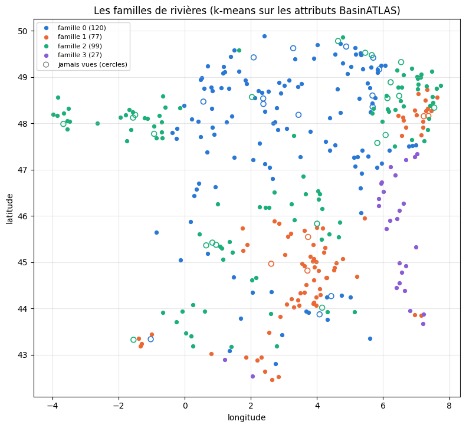
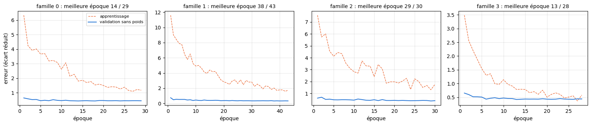
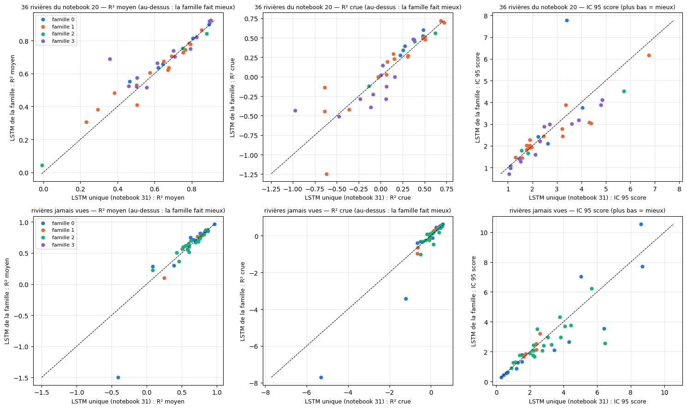

# 5.10 — Un LSTM par famille d'attributs

**L'idée** : au lieu d'un seul LSTM pour 310 rivières très différentes (notebook 5.08), entraîner **un LSTM par famille** de rivières qui se ressemblent par leurs attributs BasinATLAS (les 4 familles du notebook 3.4), et voir si ces spécialistes font mieux que le généraliste. Les familles sont recalculées ci-dessous, à l'identique.

## Les rivières et leurs 4 familles (comme au notebook 3.4)

    314 nouvelles stations gardées sur 424 ; apprentissage : 310 rivières (dont les 36 du notebook 20) ; jamais vues : 40

    gardee
    False    110
    True     314
    dtype: int64

    323 rivières classées (310 du notebook 31 + 13 de kayak), 40 jamais vues
    composantes gardées : m = 5 (92% de la variance) ; part de chaque composante : [52.1 19.   9.1  7.4  4.7] %

<table border="1" class="dataframe">
  <thead>
    <tr style="text-align: right;">
      <th></th>
      <th>axe 1</th>
      <th>axe 2</th>
      <th>axe 3</th>
      <th>axe 4</th>
      <th>axe 5</th>
    </tr>
  </thead>
  <tbody>
    <tr>
      <th>altitude</th>
      <td>-0.37</td>
      <td>-0.08</td>
      <td>-0.03</td>
      <td>-0.08</td>
      <td>-0.06</td>
    </tr>
    <tr>
      <th>pente</th>
      <td>-0.35</td>
      <td>-0.06</td>
      <td>-0.36</td>
      <td>-0.18</td>
      <td>0.15</td>
    </tr>
    <tr>
      <th>neige</th>
      <td>-0.37</td>
      <td>-0.12</td>
      <td>0.18</td>
      <td>0.09</td>
      <td>-0.21</td>
    </tr>
    <tr>
      <th>pluie</th>
      <td>-0.31</td>
      <td>-0.26</td>
      <td>0.18</td>
      <td>0.08</td>
      <td>0.24</td>
    </tr>
    <tr>
      <th>température</th>
      <td>0.33</td>
      <td>0.14</td>
      <td>-0.32</td>
      <td>-0.11</td>
      <td>0.23</td>
    </tr>
    <tr>
      <th>karst</th>
      <td>0.10</td>
      <td>-0.46</td>
      <td>-0.25</td>
      <td>-0.10</td>
      <td>-0.78</td>
    </tr>
    <tr>
      <th>forêt</th>
      <td>-0.29</td>
      <td>0.14</td>
      <td>-0.46</td>
      <td>-0.19</td>
      <td>-0.05</td>
    </tr>
    <tr>
      <th>nappe</th>
      <td>-0.35</td>
      <td>0.03</td>
      <td>-0.35</td>
      <td>-0.18</td>
      <td>0.16</td>
    </tr>
    <tr>
      <th>aridité</th>
      <td>-0.33</td>
      <td>-0.25</td>
      <td>0.34</td>
      <td>0.12</td>
      <td>0.11</td>
    </tr>
    <tr>
      <th>argile</th>
      <td>0.20</td>
      <td>-0.51</td>
      <td>-0.25</td>
      <td>0.06</td>
      <td>0.30</td>
    </tr>
    <tr>
      <th>sable</th>
      <td>-0.15</td>
      <td>0.56</td>
      <td>0.11</td>
      <td>-0.12</td>
      <td>-0.28</td>
    </tr>
    <tr>
      <th>surface (log)</th>
      <td>0.11</td>
      <td>-0.16</td>
      <td>0.35</td>
      <td>-0.91</td>
      <td>0.08</td>
    </tr>
  </tbody>
</table>

    silhouette (taille des familles) : {3: '0.372 [211, 85, 27]', 4: '0.277 [120, 77, 99, 27]', 5: '0.303 [49, 103, 97, 53, 21]', 6: '0.318 [98, 38, 105, 8, 52, 22]'}

<table border="1" class="dataframe">
  <thead>
    <tr style="text-align: right;">
      <th></th>
      <th>rivières</th>
      <th>jamais vues rangées ici</th>
      <th>altitude</th>
      <th>pente</th>
      <th>neige</th>
      <th>pluie</th>
      <th>température</th>
      <th>karst</th>
      <th>forêt</th>
      <th>nappe</th>
      <th>aridité</th>
      <th>argile</th>
      <th>sable</th>
      <th>surface (km²)</th>
    </tr>
  </thead>
  <tbody>
    <tr>
      <th>0</th>
      <td>120</td>
      <td>14</td>
      <td>266.0</td>
      <td>32.8</td>
      <td>6.4</td>
      <td>769.1</td>
      <td>102.3</td>
      <td>86.2</td>
      <td>16.3</td>
      <td>186.1</td>
      <td>93.2</td>
      <td>21.6</td>
      <td>40.6</td>
      <td>867.6</td>
    </tr>
    <tr>
      <th>1</th>
      <td>77</td>
      <td>5</td>
      <td>797.7</td>
      <td>118.0</td>
      <td>15.0</td>
      <td>882.5</td>
      <td>88.1</td>
      <td>23.2</td>
      <td>78.9</td>
      <td>488.5</td>
      <td>110.8</td>
      <td>15.8</td>
      <td>48.7</td>
      <td>348.3</td>
    </tr>
    <tr>
      <th>2</th>
      <td>99</td>
      <td>21</td>
      <td>299.1</td>
      <td>41.6</td>
      <td>6.9</td>
      <td>820.1</td>
      <td>102.7</td>
      <td>3.3</td>
      <td>22.8</td>
      <td>232.9</td>
      <td>100.6</td>
      <td>19.2</td>
      <td>44.2</td>
      <td>485.6</td>
    </tr>
    <tr>
      <th>3</th>
      <td>27</td>
      <td>0</td>
      <td>1432.2</td>
      <td>178.3</td>
      <td>31.8</td>
      <td>1284.6</td>
      <td>54.6</td>
      <td>67.5</td>
      <td>65.9</td>
      <td>598.2</td>
      <td>205.6</td>
      <td>19.5</td>
      <td>41.4</td>
      <td>413.7</td>
    </tr>
  </tbody>
</table>

    famille 0 : Isle à Perigueux ; Hérault à Laroque ; Saône à Lechâtelet ; Grand-Morin à Pommeuse ; Grand-Morin à Couilly-Pont-aux-Dames [Station ultrason] ; Vis à St-Laurent-le-minier [Pont de la mine]
    famille 1 : Albarine à Saint Rambert en Bugey ; Tarn à Millau [HE] ; Sioule à Pontgibaud ; Ardèche à Pont-de-Labeaume ; Allier à Coudes ; Nive à Osses ; Gave d'Oloron à Escos ; Moselle à Epinal ; Tarn à Cocurès ; Loire à Chadrac [Pont du Monteil] ; Loire à Goudet ; Vienne à Eymoutiers ; Sioulet à La Prugne ; Ger à Aspet ; Ance du Nord à Sauvessanges ; Alagnon à Joursac ; Tarn à Montbrun [Pont de Montbrun] ; Glueyre à Gluiras [Tisonèche] ; Eyrieux à Pont de Chervil ; Dourbie à Dourbies [Le Mazet] ; Ardèche à Meyras [BARUTEL] ; Gardon d'Anduze à Anduze
    famille 2 : Vézère à Montignac ; Célé à Figeac ; Gier à Rive-de-Gier
    famille 3 : Ain à Bourg de sirod ; Fier à Dingy-St-Clair ; Saine à Syam ; Loue à Vuillafans ; Chéran à Allèves [La Charniaz] ; Dessoubre à Rosureux ; Salat à Soueix-Rogalle ; Bienne à Morez ; Ubaye à Le Lauzet-Ubaye [Roche-Rousse] ; Durance à Embrun [La Clapière] ; Durance à Val-des-Prés ; Doubs à Goumois ; Ubaye à Barcelonette ; Durance à L'Argentière-la-Bessée ; Arc à Bessans ; Vésubie à Utelle [Pont du Cros]

    

    

    23978

## Un LSTM par famille

Le réseau, les entrées et les réglages du notebook 5.08 à l'identique (90 jours de passé, mémoire de 128, attributs à chaque pas, une heure sur
quatre, choix de l'époque sur la validation sans poids). Les échelles (météo, attributs) sont calculées sur les 323 rivières classées et
partagées par les quatre réseaux ; chaque rivière garde ses deux échelles propres (débit habituel, dispersion des écarts).

Deux réglages suivent la taille de la famille : la part des instants tirée à chaque époque est de 19 / (nombre de rivières) — soit, comme aux
notebooks 5.04 et 5.08, l'équivalent d'environ cinq rivières complètes par époque — et chaque réseau a au plus 50 minutes d'apprentissage.

    données de 363 rivières en 13 s

    famille 0 : 120 rivières, 3338119 instants, 16% tirés par époque

    reprise après 29 époques

    famille 0 : 29 époques en 20 s

    famille 1 : 77 rivières, 2137087 instants, 25% tirés par époque

    reprise après 43 époques

    famille 1 : 43 époques en 12 s

    famille 2 : 99 rivières, 2750404 instants, 19% tirés par époque

    reprise après 30 époques

    famille 2 : 30 époques en 15 s

    famille 3 : 27 rivières, 677747 instants, 70% tirés par époque

    époque 1 · apprentissage 3.4817 · validation 3.0946 (sans poids 0.6558) · 64 s

    époque 2 · apprentissage 2.5606 · validation 2.7036 (sans poids 0.6021) · 64 s

    époque 3 · apprentissage 2.1994 · validation 3.3585 (sans poids 0.5225) · 64 s

    époque 4 · apprentissage 1.8712 · validation 3.2093 (sans poids 0.5212) · 64 s

    époque 5 · apprentissage 1.5449 · validation 3.0840 (sans poids 0.5117) · 64 s

    époque 6 · apprentissage 1.3013 · validation 3.1698 (sans poids 0.4361) · 65 s

    époque 7 · apprentissage 1.3569 · validation 3.1702 (sans poids 0.4683) · 64 s

    époque 8 · apprentissage 0.9961 · validation 2.9660 (sans poids 0.4875) · 64 s

    époque 9 · apprentissage 0.9732 · validation 3.4077 (sans poids 0.4552) · 64 s

    époque 10 · apprentissage 1.1420 · validation 3.4026 (sans poids 0.4765) · 64 s

    époque 11 · apprentissage 0.9753 · validation 3.0342 (sans poids 0.4590) · 64 s

    époque 12 · apprentissage 0.9121 · validation 3.0443 (sans poids 0.4571) · 64 s

    époque 13 · apprentissage 0.7865 · validation 3.2983 (sans poids 0.4246) · 63 s

    époque 14 · apprentissage 0.7957 · validation 3.4055 (sans poids 0.4330) · 64 s

    époque 15 · apprentissage 0.7860 · validation 3.3475 (sans poids 0.4396) · 64 s

    époque 16 · apprentissage 0.6688 · validation 3.3552 (sans poids 0.4369) · 64 s

    époque 17 · apprentissage 0.7092 · validation 3.2997 (sans poids 0.4385) · 64 s

    époque 18 · apprentissage 0.6120 · validation 3.3666 (sans poids 0.4361) · 64 s

    époque 19 · apprentissage 0.7622 · validation 3.4677 (sans poids 0.4496) · 64 s

    époque 20 · apprentissage 0.5084 · validation 3.4005 (sans poids 0.4354) · 64 s

    époque 21 · apprentissage 0.6085 · validation 3.3905 (sans poids 0.4320) · 64 s

    époque 22 · apprentissage 0.6633 · validation 3.3639 (sans poids 0.4355) · 64 s

    époque 23 · apprentissage 0.6095 · validation 3.4302 (sans poids 0.4557) · 64 s

    époque 24 · apprentissage 0.4749 · validation 3.3600 (sans poids 0.4393) · 64 s

    époque 25 · apprentissage 0.5135 · validation 3.4525 (sans poids 0.4344) · 64 s

    époque 26 · apprentissage 0.5566 · validation 3.3702 (sans poids 0.4296) · 64 s

    époque 27 · apprentissage 0.3705 · validation 3.4431 (sans poids 0.4457) · 64 s

    époque 28 · apprentissage 0.5843 · validation 3.3788 (sans poids 0.4428) · 64 s

    famille 3 : 28 époques en 1797 s

    

    

    Bessans : pas de prévision — AttributeError 'NaTType' object has no attribute 'normalize'

    88 rivières prévues en 1203 s

## Les notes

Chaque rivière est notée aux heures communes à tous ses modèles ; R² et crues sur calibration + test ; IC réglés sur la calibration, notés sur
le test (score rapporté au débit moyen : plus bas = mieux). **Un seul tirage par réseau** : le notebook 5.07 a montré qu'un tirage bouge beaucoup
rivière par rivière ; ce sont les médianes et les nombres de rivières où un modèle fait mieux qui comptent.

### Sur les 36 rivières du notebook 5.04

Toutes apprises à la fois par le LSTM de leur famille et par le LSTM unique du notebook 5.08.

    36 rivières

<table border="1" class="dataframe">
  <thead>
    <tr style="text-align: right;">
      <th></th>
      <th>R² J+1</th>
      <th>R² J+3</th>
      <th>R² J+5</th>
      <th>R² moyen</th>
      <th>R² crue</th>
      <th>R² montée</th>
      <th>biais pic %</th>
      <th>IC 95 couverture</th>
      <th>IC 95 score</th>
    </tr>
  </thead>
  <tbody>
    <tr>
      <th>GB de la rivière (médiane)</th>
      <td>0.840</td>
      <td>0.620</td>
      <td>0.506</td>
      <td>0.646</td>
      <td>0.119</td>
      <td>0.418</td>
      <td>1.237</td>
      <td>0.881</td>
      <td>2.474</td>
    </tr>
    <tr>
      <th>LSTM 36 rivières (médiane)</th>
      <td>0.871</td>
      <td>0.672</td>
      <td>0.529</td>
      <td>0.684</td>
      <td>0.157</td>
      <td>0.418</td>
      <td>-2.915</td>
      <td>0.879</td>
      <td>2.235</td>
    </tr>
    <tr>
      <th>LSTM 36 rivières, ensemble de 3 (médiane)</th>
      <td>0.898</td>
      <td>0.690</td>
      <td>0.559</td>
      <td>0.714</td>
      <td>0.199</td>
      <td>0.449</td>
      <td>-5.629</td>
      <td>0.889</td>
      <td>2.102</td>
    </tr>
    <tr>
      <th>LSTM unique (notebook 31) (médiane)</th>
      <td>0.893</td>
      <td>0.627</td>
      <td>0.525</td>
      <td>0.675</td>
      <td>0.152</td>
      <td>0.416</td>
      <td>-0.997</td>
      <td>0.848</td>
      <td>2.273</td>
    </tr>
    <tr>
      <th>LSTM de la famille (médiane)</th>
      <td>0.891</td>
      <td>0.666</td>
      <td>0.529</td>
      <td>0.681</td>
      <td>0.211</td>
      <td>0.413</td>
      <td>1.005</td>
      <td>0.872</td>
      <td>2.239</td>
    </tr>
    <tr>
      <th>LSTM de la famille mieux que LSTM unique (notebook 31)</th>
      <td>21.000</td>
      <td>23.000</td>
      <td>23.000</td>
      <td>23.000</td>
      <td>21.000</td>
      <td>12.000</td>
      <td>14.000</td>
      <td>21.000</td>
      <td>23.000</td>
    </tr>
    <tr>
      <th>LSTM de la famille mieux que GB de la rivière</th>
      <td>26.000</td>
      <td>24.000</td>
      <td>23.000</td>
      <td>24.000</td>
      <td>22.000</td>
      <td>20.000</td>
      <td>17.000</td>
      <td>16.000</td>
      <td>27.000</td>
    </tr>
    <tr>
      <th>LSTM de la famille mieux que LSTM 36 rivières, ensemble de 3</th>
      <td>6.000</td>
      <td>6.000</td>
      <td>9.000</td>
      <td>6.000</td>
      <td>15.000</td>
      <td>12.000</td>
      <td>19.000</td>
      <td>10.000</td>
      <td>8.000</td>
    </tr>
  </tbody>
</table>

<table border="1" class="dataframe">
  <thead>
    <tr style="text-align: right;">
      <th></th>
      <th></th>
      <th>rivières</th>
      <th>R² J+1</th>
      <th>R² J+3</th>
      <th>R² J+5</th>
      <th>R² moyen</th>
      <th>R² crue</th>
      <th>R² montée</th>
      <th>biais pic %</th>
      <th>IC 95 couverture</th>
      <th>IC 95 score</th>
    </tr>
  </thead>
  <tbody>
    <tr>
      <th rowspan="5" valign="top">0</th>
      <th>GB de la rivière</th>
      <td>5</td>
      <td>0.815</td>
      <td>0.665</td>
      <td>0.557</td>
      <td>0.669</td>
      <td>0.380</td>
      <td>0.570</td>
      <td>0.264</td>
      <td>0.884</td>
      <td>3.960</td>
    </tr>
    <tr>
      <th>LSTM 36 rivières</th>
      <td>5</td>
      <td>0.872</td>
      <td>0.632</td>
      <td>0.521</td>
      <td>0.633</td>
      <td>0.473</td>
      <td>0.502</td>
      <td>-6.381</td>
      <td>0.857</td>
      <td>2.435</td>
    </tr>
    <tr>
      <th>LSTM 36 rivières, ensemble de 3</th>
      <td>5</td>
      <td>0.902</td>
      <td>0.658</td>
      <td>0.563</td>
      <td>0.668</td>
      <td>0.519</td>
      <td>0.542</td>
      <td>-6.563</td>
      <td>0.886</td>
      <td>2.287</td>
    </tr>
    <tr>
      <th>LSTM unique (notebook 31)</th>
      <td>5</td>
      <td>0.895</td>
      <td>0.614</td>
      <td>0.480</td>
      <td>0.644</td>
      <td>0.275</td>
      <td>0.500</td>
      <td>-3.660</td>
      <td>0.867</td>
      <td>2.620</td>
    </tr>
    <tr>
      <th>LSTM de la famille</th>
      <td>5</td>
      <td>0.895</td>
      <td>0.620</td>
      <td>0.514</td>
      <td>0.657</td>
      <td>0.396</td>
      <td>0.493</td>
      <td>3.769</td>
      <td>0.838</td>
      <td>2.424</td>
    </tr>
    <tr>
      <th rowspan="5" valign="top">1</th>
      <th>GB de la rivière</th>
      <td>16</td>
      <td>0.834</td>
      <td>0.592</td>
      <td>0.505</td>
      <td>0.621</td>
      <td>0.193</td>
      <td>0.442</td>
      <td>7.446</td>
      <td>0.908</td>
      <td>2.474</td>
    </tr>
    <tr>
      <th>LSTM 36 rivières</th>
      <td>16</td>
      <td>0.865</td>
      <td>0.655</td>
      <td>0.542</td>
      <td>0.691</td>
      <td>0.211</td>
      <td>0.438</td>
      <td>0.972</td>
      <td>0.877</td>
      <td>2.131</td>
    </tr>
    <tr>
      <th>LSTM 36 rivières, ensemble de 3</th>
      <td>16</td>
      <td>0.881</td>
      <td>0.677</td>
      <td>0.580</td>
      <td>0.715</td>
      <td>0.253</td>
      <td>0.466</td>
      <td>-0.988</td>
      <td>0.892</td>
      <td>1.937</td>
    </tr>
    <tr>
      <th>LSTM unique (notebook 31)</th>
      <td>16</td>
      <td>0.856</td>
      <td>0.625</td>
      <td>0.531</td>
      <td>0.675</td>
      <td>0.152</td>
      <td>0.388</td>
      <td>5.135</td>
      <td>0.867</td>
      <td>1.936</td>
    </tr>
    <tr>
      <th>LSTM de la famille</th>
      <td>16</td>
      <td>0.846</td>
      <td>0.616</td>
      <td>0.528</td>
      <td>0.654</td>
      <td>0.244</td>
      <td>0.427</td>
      <td>3.726</td>
      <td>0.886</td>
      <td>2.146</td>
    </tr>
    <tr>
      <th rowspan="5" valign="top">2</th>
      <th>GB de la rivière</th>
      <td>3</td>
      <td>0.891</td>
      <td>0.804</td>
      <td>0.691</td>
      <td>0.791</td>
      <td>0.443</td>
      <td>0.604</td>
      <td>-0.444</td>
      <td>0.838</td>
      <td>2.232</td>
    </tr>
    <tr>
      <th>LSTM 36 rivières</th>
      <td>3</td>
      <td>0.901</td>
      <td>0.750</td>
      <td>0.603</td>
      <td>0.754</td>
      <td>0.359</td>
      <td>0.506</td>
      <td>2.335</td>
      <td>0.847</td>
      <td>1.730</td>
    </tr>
    <tr>
      <th>LSTM 36 rivières, ensemble de 3</th>
      <td>3</td>
      <td>0.921</td>
      <td>0.790</td>
      <td>0.648</td>
      <td>0.793</td>
      <td>0.443</td>
      <td>0.562</td>
      <td>-1.791</td>
      <td>0.850</td>
      <td>1.777</td>
    </tr>
    <tr>
      <th>LSTM unique (notebook 31)</th>
      <td>3</td>
      <td>0.904</td>
      <td>0.714</td>
      <td>0.646</td>
      <td>0.752</td>
      <td>0.387</td>
      <td>0.551</td>
      <td>3.236</td>
      <td>0.819</td>
      <td>1.828</td>
    </tr>
    <tr>
      <th>LSTM de la famille</th>
      <td>3</td>
      <td>0.892</td>
      <td>0.683</td>
      <td>0.711</td>
      <td>0.752</td>
      <td>0.454</td>
      <td>0.517</td>
      <td>12.933</td>
      <td>0.862</td>
      <td>1.786</td>
    </tr>
    <tr>
      <th rowspan="5" valign="top">3</th>
      <th>GB de la rivière</th>
      <td>12</td>
      <td>0.867</td>
      <td>0.611</td>
      <td>0.465</td>
      <td>0.637</td>
      <td>-0.109</td>
      <td>0.250</td>
      <td>-2.809</td>
      <td>0.862</td>
      <td>2.806</td>
    </tr>
    <tr>
      <th>LSTM 36 rivières</th>
      <td>12</td>
      <td>0.877</td>
      <td>0.672</td>
      <td>0.521</td>
      <td>0.684</td>
      <td>-0.075</td>
      <td>0.286</td>
      <td>-7.807</td>
      <td>0.896</td>
      <td>2.216</td>
    </tr>
    <tr>
      <th>LSTM 36 rivières, ensemble de 3</th>
      <td>12</td>
      <td>0.903</td>
      <td>0.705</td>
      <td>0.529</td>
      <td>0.710</td>
      <td>-0.096</td>
      <td>0.269</td>
      <td>-11.095</td>
      <td>0.893</td>
      <td>2.232</td>
    </tr>
    <tr>
      <th>LSTM unique (notebook 31)</th>
      <td>12</td>
      <td>0.872</td>
      <td>0.637</td>
      <td>0.489</td>
      <td>0.659</td>
      <td>0.012</td>
      <td>0.361</td>
      <td>-4.132</td>
      <td>0.819</td>
      <td>2.397</td>
    </tr>
    <tr>
      <th>LSTM de la famille</th>
      <td>12</td>
      <td>0.889</td>
      <td>0.685</td>
      <td>0.529</td>
      <td>0.697</td>
      <td>-0.176</td>
      <td>0.267</td>
      <td>-12.911</td>
      <td>0.878</td>
      <td>2.545</td>
    </tr>
  </tbody>
</table>

<table border="1" class="dataframe">
  <thead>
    <tr>
      <th></th>
      <th></th>
      <th colspan="5" halign="left">R² moyen</th>
      <th colspan="5" halign="left">R² crue</th>
      <th colspan="5" halign="left">IC 95 score</th>
    </tr>
    <tr>
      <th></th>
      <th>modèle</th>
      <th>GB de la rivière</th>
      <th>LSTM 36 rivières</th>
      <th>LSTM 36 rivières, ensemble de 3</th>
      <th>LSTM unique (notebook 31)</th>
      <th>LSTM de la famille</th>
      <th>GB de la rivière</th>
      <th>LSTM 36 rivières</th>
      <th>LSTM 36 rivières, ensemble de 3</th>
      <th>LSTM unique (notebook 31)</th>
      <th>LSTM de la famille</th>
      <th>GB de la rivière</th>
      <th>LSTM 36 rivières</th>
      <th>LSTM 36 rivières, ensemble de 3</th>
      <th>LSTM unique (notebook 31)</th>
      <th>LSTM de la famille</th>
    </tr>
    <tr>
      <th>famille</th>
      <th>station</th>
      <th></th>
      <th></th>
      <th></th>
      <th></th>
      <th></th>
      <th></th>
      <th></th>
      <th></th>
      <th></th>
      <th></th>
      <th></th>
      <th></th>
      <th></th>
      <th></th>
      <th></th>
    </tr>
  </thead>
  <tbody>
    <tr>
      <th rowspan="16" valign="top">1</th>
      <th>Saint Rambert en Bugey</th>
      <td>0.601</td>
      <td>0.649</td>
      <td>0.692</td>
      <td>0.676</td>
      <td>0.635</td>
      <td>-0.045</td>
      <td>-0.033</td>
      <td>0.002</td>
      <td>0.064</td>
      <td>0.030</td>
      <td>3.187</td>
      <td>2.439</td>
      <td>2.384</td>
      <td>3.221</td>
      <td>2.772</td>
    </tr>
    <tr>
      <th>Millau [HE]</th>
      <td>0.641</td>
      <td>0.732</td>
      <td>0.743</td>
      <td>0.753</td>
      <td>0.728</td>
      <td>0.597</td>
      <td>0.698</td>
      <td>0.712</td>
      <td>0.725</td>
      <td>0.694</td>
      <td>4.450</td>
      <td>4.176</td>
      <td>4.153</td>
      <td>3.370</td>
      <td>3.880</td>
    </tr>
    <tr>
      <th>Pontgibaud</th>
      <td>0.750</td>
      <td>0.785</td>
      <td>0.813</td>
      <td>0.766</td>
      <td>0.744</td>
      <td>0.364</td>
      <td>0.381</td>
      <td>0.400</td>
      <td>0.316</td>
      <td>0.269</td>
      <td>2.001</td>
      <td>1.892</td>
      <td>1.828</td>
      <td>1.878</td>
      <td>1.925</td>
    </tr>
    <tr>
      <th>Pont-de-Labeaume</th>
      <td>0.500</td>
      <td>0.535</td>
      <td>0.555</td>
      <td>0.383</td>
      <td>0.484</td>
      <td>0.362</td>
      <td>0.365</td>
      <td>0.380</td>
      <td>0.147</td>
      <td>0.296</td>
      <td>3.869</td>
      <td>3.338</td>
      <td>2.957</td>
      <td>4.408</td>
      <td>3.035</td>
    </tr>
    <tr>
      <th>Coudes</th>
      <td>0.684</td>
      <td>0.728</td>
      <td>0.737</td>
      <td>0.673</td>
      <td>0.622</td>
      <td>0.159</td>
      <td>0.178</td>
      <td>0.172</td>
      <td>-0.029</td>
      <td>-0.001</td>
      <td>1.859</td>
      <td>1.684</td>
      <td>1.564</td>
      <td>1.764</td>
      <td>1.838</td>
    </tr>
    <tr>
      <th>Osses</th>
      <td>0.471</td>
      <td>0.528</td>
      <td>0.555</td>
      <td>0.502</td>
      <td>0.530</td>
      <td>-0.428</td>
      <td>-0.454</td>
      <td>-0.381</td>
      <td>-0.359</td>
      <td>-0.420</td>
      <td>2.423</td>
      <td>2.532</td>
      <td>2.230</td>
      <td>2.453</td>
      <td>2.444</td>
    </tr>
    <tr>
      <th>Escos</th>
      <td>0.554</td>
      <td>0.439</td>
      <td>0.479</td>
      <td>0.505</td>
      <td>0.410</td>
      <td>-0.378</td>
      <td>-1.233</td>
      <td>-0.993</td>
      <td>-0.617</td>
      <td>-1.245</td>
      <td>1.970</td>
      <td>2.127</td>
      <td>1.884</td>
      <td>1.762</td>
      <td>2.024</td>
    </tr>
    <tr>
      <th>Epinal</th>
      <td>0.824</td>
      <td>0.806</td>
      <td>0.846</td>
      <td>0.826</td>
      <td>0.820</td>
      <td>-0.307</td>
      <td>-0.344</td>
      <td>-0.127</td>
      <td>-0.637</td>
      <td>-0.443</td>
      <td>1.424</td>
      <td>1.525</td>
      <td>1.224</td>
      <td>1.308</td>
      <td>1.463</td>
    </tr>
    <tr>
      <th>Cocurès</th>
      <td>0.602</td>
      <td>0.653</td>
      <td>0.668</td>
      <td>0.648</td>
      <td>0.674</td>
      <td>0.414</td>
      <td>0.463</td>
      <td>0.477</td>
      <td>0.481</td>
      <td>0.496</td>
      <td>3.315</td>
      <td>2.874</td>
      <td>2.269</td>
      <td>3.238</td>
      <td>2.451</td>
    </tr>
    <tr>
      <th>Chadrac [Pont du Monteil]</th>
      <td>0.234</td>
      <td>0.219</td>
      <td>0.297</td>
      <td>0.293</td>
      <td>0.383</td>
      <td>0.049</td>
      <td>0.011</td>
      <td>0.084</td>
      <td>0.076</td>
      <td>0.193</td>
      <td>4.106</td>
      <td>3.761</td>
      <td>3.093</td>
      <td>4.332</td>
      <td>3.087</td>
    </tr>
    <tr>
      <th>Goudet</th>
      <td>0.204</td>
      <td>0.208</td>
      <td>0.220</td>
      <td>0.232</td>
      <td>0.305</td>
      <td>0.141</td>
      <td>0.153</td>
      <td>0.158</td>
      <td>0.157</td>
      <td>0.228</td>
      <td>11.820</td>
      <td>6.049</td>
      <td>6.481</td>
      <td>6.757</td>
      <td>6.162</td>
    </tr>
    <tr>
      <th>Eymoutiers</th>
      <td>0.786</td>
      <td>0.864</td>
      <td>0.881</td>
      <td>0.854</td>
      <td>0.866</td>
      <td>0.462</td>
      <td>0.671</td>
      <td>0.717</td>
      <td>0.687</td>
      <td>0.719</td>
      <td>2.949</td>
      <td>1.705</td>
      <td>1.487</td>
      <td>1.578</td>
      <td>1.459</td>
    </tr>
    <tr>
      <th>La Prugne</th>
      <td>0.760</td>
      <td>0.806</td>
      <td>0.815</td>
      <td>0.794</td>
      <td>0.778</td>
      <td>0.286</td>
      <td>0.414</td>
      <td>0.418</td>
      <td>0.509</td>
      <td>0.476</td>
      <td>2.362</td>
      <td>2.135</td>
      <td>1.991</td>
      <td>1.900</td>
      <td>2.012</td>
    </tr>
    <tr>
      <th>Aspet</th>
      <td>0.432</td>
      <td>0.624</td>
      <td>0.658</td>
      <td>0.575</td>
      <td>0.606</td>
      <td>0.227</td>
      <td>0.245</td>
      <td>0.333</td>
      <td>0.307</td>
      <td>0.260</td>
      <td>2.524</td>
      <td>1.923</td>
      <td>1.858</td>
      <td>1.866</td>
      <td>1.993</td>
    </tr>
    <tr>
      <th>Sauvessanges</th>
      <td>0.730</td>
      <td>0.756</td>
      <td>0.777</td>
      <td>0.692</td>
      <td>0.707</td>
      <td>0.035</td>
      <td>-0.213</td>
      <td>0.017</td>
      <td>-0.640</td>
      <td>-0.140</td>
      <td>2.169</td>
      <td>1.686</td>
      <td>1.558</td>
      <td>1.901</td>
      <td>2.268</td>
    </tr>
    <tr>
      <th>Joursac</th>
      <td>0.757</td>
      <td>0.784</td>
      <td>0.821</td>
      <td>0.787</td>
      <td>0.784</td>
      <td>0.488</td>
      <td>0.499</td>
      <td>0.551</td>
      <td>0.503</td>
      <td>0.514</td>
      <td>2.085</td>
      <td>1.761</td>
      <td>1.672</td>
      <td>1.972</td>
      <td>1.930</td>
    </tr>
    <tr>
      <th rowspan="12" valign="top">3</th>
      <th>Bourg de sirod</th>
      <td>0.621</td>
      <td>0.673</td>
      <td>0.685</td>
      <td>0.615</td>
      <td>0.664</td>
      <td>-0.134</td>
      <td>-0.086</td>
      <td>-0.113</td>
      <td>0.069</td>
      <td>-0.128</td>
      <td>3.368</td>
      <td>2.521</td>
      <td>2.474</td>
      <td>3.614</td>
      <td>3.014</td>
    </tr>
    <tr>
      <th>Dingy-St-Clair</th>
      <td>0.398</td>
      <td>0.414</td>
      <td>0.464</td>
      <td>0.460</td>
      <td>0.525</td>
      <td>-0.498</td>
      <td>-0.835</td>
      <td>-0.663</td>
      <td>-0.111</td>
      <td>-0.392</td>
      <td>3.903</td>
      <td>3.069</td>
      <td>2.715</td>
      <td>2.488</td>
      <td>2.880</td>
    </tr>
    <tr>
      <th>Syam</th>
      <td>0.493</td>
      <td>0.561</td>
      <td>0.584</td>
      <td>0.504</td>
      <td>0.574</td>
      <td>-0.408</td>
      <td>-0.224</td>
      <td>-0.282</td>
      <td>-0.232</td>
      <td>-0.287</td>
      <td>4.754</td>
      <td>3.718</td>
      <td>3.507</td>
      <td>4.795</td>
      <td>3.873</td>
    </tr>
    <tr>
      <th>Vuillafans</th>
      <td>0.723</td>
      <td>0.747</td>
      <td>0.773</td>
      <td>0.703</td>
      <td>0.739</td>
      <td>-0.083</td>
      <td>-0.065</td>
      <td>-0.079</td>
      <td>-0.088</td>
      <td>-0.224</td>
      <td>1.837</td>
      <td>1.474</td>
      <td>1.318</td>
      <td>2.126</td>
      <td>1.600</td>
    </tr>
    <tr>
      <th>Allèves [La Charniaz]</th>
      <td>0.472</td>
      <td>0.493</td>
      <td>0.521</td>
      <td>0.557</td>
      <td>0.517</td>
      <td>-0.214</td>
      <td>-0.425</td>
      <td>-0.282</td>
      <td>0.062</td>
      <td>-0.288</td>
      <td>3.571</td>
      <td>2.815</td>
      <td>2.665</td>
      <td>2.706</td>
      <td>2.997</td>
    </tr>
    <tr>
      <th>Rosureux</th>
      <td>0.652</td>
      <td>0.696</td>
      <td>0.735</td>
      <td>0.709</td>
      <td>0.704</td>
      <td>-0.360</td>
      <td>-0.380</td>
      <td>-0.260</td>
      <td>-0.478</td>
      <td>-0.508</td>
      <td>4.558</td>
      <td>2.861</td>
      <td>3.076</td>
      <td>4.854</td>
      <td>4.107</td>
    </tr>
    <tr>
      <th>Soueix-Rogalle</th>
      <td>0.529</td>
      <td>0.617</td>
      <td>0.657</td>
      <td>0.359</td>
      <td>0.689</td>
      <td>-0.408</td>
      <td>-0.248</td>
      <td>-0.299</td>
      <td>-0.973</td>
      <td>-0.434</td>
      <td>1.730</td>
      <td>1.261</td>
      <td>1.247</td>
      <td>1.519</td>
      <td>1.274</td>
    </tr>
    <tr>
      <th>Morez</th>
      <td>0.503</td>
      <td>0.604</td>
      <td>0.601</td>
      <td>0.503</td>
      <td>0.520</td>
      <td>0.006</td>
      <td>0.083</td>
      <td>0.053</td>
      <td>0.001</td>
      <td>0.023</td>
      <td>4.207</td>
      <td>2.900</td>
      <td>2.802</td>
      <td>3.891</td>
      <td>3.187</td>
    </tr>
    <tr>
      <th>Le Lauzet-Ubaye [Roche-Rousse]</th>
      <td>0.885</td>
      <td>0.903</td>
      <td>0.918</td>
      <td>0.897</td>
      <td>0.917</td>
      <td>0.289</td>
      <td>0.382</td>
      <td>0.474</td>
      <td>0.382</td>
      <td>0.477</td>
      <td>1.306</td>
      <td>1.713</td>
      <td>1.774</td>
      <td>1.461</td>
      <td>1.403</td>
    </tr>
    <tr>
      <th>Embrun [La Clapière]</th>
      <td>0.920</td>
      <td>0.926</td>
      <td>0.928</td>
      <td>0.903</td>
      <td>0.924</td>
      <td>0.433</td>
      <td>0.484</td>
      <td>0.473</td>
      <td>0.372</td>
      <td>0.484</td>
      <td>0.782</td>
      <td>0.779</td>
      <td>0.746</td>
      <td>1.056</td>
      <td>0.718</td>
    </tr>
    <tr>
      <th>Val-des-Prés</th>
      <td>0.865</td>
      <td>0.834</td>
      <td>0.838</td>
      <td>0.827</td>
      <td>0.824</td>
      <td>0.151</td>
      <td>0.033</td>
      <td>0.082</td>
      <td>0.023</td>
      <td>0.148</td>
      <td>1.057</td>
      <td>1.049</td>
      <td>0.998</td>
      <td>1.106</td>
      <td>1.069</td>
    </tr>
    <tr>
      <th>Goumois</th>
      <td>0.761</td>
      <td>0.788</td>
      <td>0.802</td>
      <td>0.794</td>
      <td>0.749</td>
      <td>0.097</td>
      <td>0.202</td>
      <td>0.265</td>
      <td>0.160</td>
      <td>-0.001</td>
      <td>2.243</td>
      <td>1.912</td>
      <td>1.991</td>
      <td>2.306</td>
      <td>2.209</td>
    </tr>
    <tr>
      <th rowspan="5" valign="top">0</th>
      <th>Perigueux</th>
      <td>0.800</td>
      <td>0.810</td>
      <td>0.828</td>
      <td>0.807</td>
      <td>0.816</td>
      <td>0.479</td>
      <td>0.473</td>
      <td>0.521</td>
      <td>0.484</td>
      <td>0.527</td>
      <td>2.242</td>
      <td>2.435</td>
      <td>2.287</td>
      <td>2.240</td>
      <td>2.424</td>
    </tr>
    <tr>
      <th>Laroque</th>
      <td>0.669</td>
      <td>0.633</td>
      <td>0.668</td>
      <td>0.465</td>
      <td>0.553</td>
      <td>0.561</td>
      <td>0.485</td>
      <td>0.519</td>
      <td>0.275</td>
      <td>0.396</td>
      <td>3.960</td>
      <td>3.686</td>
      <td>3.011</td>
      <td>3.408</td>
      <td>7.775</td>
    </tr>
    <tr>
      <th>Lechâtelet</th>
      <td>0.879</td>
      <td>0.916</td>
      <td>0.921</td>
      <td>0.894</td>
      <td>0.898</td>
      <td>0.380</td>
      <td>0.501</td>
      <td>0.556</td>
      <td>0.486</td>
      <td>0.603</td>
      <td>1.166</td>
      <td>1.051</td>
      <td>0.913</td>
      <td>1.102</td>
      <td>0.983</td>
    </tr>
    <tr>
      <th>Pommeuse</th>
      <td>0.497</td>
      <td>0.614</td>
      <td>0.645</td>
      <td>0.644</td>
      <td>0.657</td>
      <td>-0.014</td>
      <td>0.160</td>
      <td>0.226</td>
      <td>0.254</td>
      <td>0.342</td>
      <td>3.975</td>
      <td>2.335</td>
      <td>2.214</td>
      <td>2.620</td>
      <td>2.105</td>
    </tr>
    <tr>
      <th>Couilly-Pont-aux-Dames [Station ultrason]</th>
      <td>0.490</td>
      <td>0.598</td>
      <td>0.650</td>
      <td>0.620</td>
      <td>0.637</td>
      <td>-0.014</td>
      <td>0.115</td>
      <td>0.239</td>
      <td>0.225</td>
      <td>0.273</td>
      <td>4.812</td>
      <td>4.179</td>
      <td>3.634</td>
      <td>4.042</td>
      <td>3.752</td>
    </tr>
    <tr>
      <th rowspan="3" valign="top">2</th>
      <th>Montignac</th>
      <td>0.849</td>
      <td>0.874</td>
      <td>0.884</td>
      <td>0.880</td>
      <td>0.843</td>
      <td>0.503</td>
      <td>0.614</td>
      <td>0.629</td>
      <td>0.623</td>
      <td>0.558</td>
      <td>1.727</td>
      <td>1.458</td>
      <td>1.468</td>
      <td>1.561</td>
      <td>1.786</td>
    </tr>
    <tr>
      <th>Figeac</th>
      <td>0.791</td>
      <td>0.754</td>
      <td>0.793</td>
      <td>0.752</td>
      <td>0.752</td>
      <td>0.443</td>
      <td>0.359</td>
      <td>0.443</td>
      <td>0.387</td>
      <td>0.454</td>
      <td>2.232</td>
      <td>1.730</td>
      <td>1.777</td>
      <td>1.828</td>
      <td>1.667</td>
    </tr>
    <tr>
      <th>Rive-de-Gier</th>
      <td>0.085</td>
      <td>0.063</td>
      <td>0.123</td>
      <td>-0.008</td>
      <td>0.042</td>
      <td>0.017</td>
      <td>-0.103</td>
      <td>-0.028</td>
      <td>-0.136</td>
      <td>-0.121</td>
      <td>7.382</td>
      <td>4.941</td>
      <td>4.232</td>
      <td>5.729</td>
      <td>4.514</td>
    </tr>
  </tbody>
</table>

### Sur les 40 rivières jamais vues

Ni le LSTM de leur famille (la plus proche d'après leurs attributs) ni le LSTM unique ne les ont apprises ; le GB par défaut, lui, est entraîné
sur chacune.

    40 rivières jamais vues

<table border="1" class="dataframe">
  <thead>
    <tr style="text-align: right;">
      <th></th>
      <th>R² J+1</th>
      <th>R² J+3</th>
      <th>R² J+5</th>
      <th>R² moyen</th>
      <th>R² crue</th>
      <th>R² montée</th>
      <th>biais pic %</th>
      <th>IC 95 couverture</th>
      <th>IC 95 score</th>
    </tr>
  </thead>
  <tbody>
    <tr>
      <th>GB entraîné sur la rivière (médiane)</th>
      <td>0.886</td>
      <td>0.683</td>
      <td>0.548</td>
      <td>0.691</td>
      <td>0.148</td>
      <td>0.479</td>
      <td>1.617</td>
      <td>0.909</td>
      <td>2.612</td>
    </tr>
    <tr>
      <th>LSTM unique (notebook 31) (médiane)</th>
      <td>0.891</td>
      <td>0.687</td>
      <td>0.600</td>
      <td>0.711</td>
      <td>0.045</td>
      <td>0.473</td>
      <td>1.151</td>
      <td>0.824</td>
      <td>2.313</td>
    </tr>
    <tr>
      <th>LSTM de la famille (médiane)</th>
      <td>0.896</td>
      <td>0.708</td>
      <td>0.567</td>
      <td>0.719</td>
      <td>0.088</td>
      <td>0.467</td>
      <td>0.783</td>
      <td>0.887</td>
      <td>2.094</td>
    </tr>
    <tr>
      <th>LSTM de la famille mieux que GB entraîné sur la rivière</th>
      <td>19.000</td>
      <td>23.000</td>
      <td>26.000</td>
      <td>22.000</td>
      <td>21.000</td>
      <td>20.000</td>
      <td>19.000</td>
      <td>13.000</td>
      <td>30.000</td>
    </tr>
    <tr>
      <th>LSTM de la famille mieux que LSTM unique (notebook 31)</th>
      <td>19.000</td>
      <td>22.000</td>
      <td>25.000</td>
      <td>23.000</td>
      <td>23.000</td>
      <td>19.000</td>
      <td>17.000</td>
      <td>26.000</td>
      <td>25.000</td>
    </tr>
  </tbody>
</table>

<table border="1" class="dataframe">
  <thead>
    <tr style="text-align: right;">
      <th></th>
      <th></th>
      <th>rivières</th>
      <th>R² J+1</th>
      <th>R² J+3</th>
      <th>R² J+5</th>
      <th>R² moyen</th>
      <th>R² crue</th>
      <th>R² montée</th>
      <th>biais pic %</th>
      <th>IC 95 couverture</th>
      <th>IC 95 score</th>
    </tr>
  </thead>
  <tbody>
    <tr>
      <th rowspan="3" valign="top">0</th>
      <th>GB entraîné sur la rivière</th>
      <td>14</td>
      <td>0.921</td>
      <td>0.693</td>
      <td>0.585</td>
      <td>0.717</td>
      <td>0.170</td>
      <td>0.533</td>
      <td>7.265</td>
      <td>0.929</td>
      <td>1.611</td>
    </tr>
    <tr>
      <th>LSTM unique (notebook 31)</th>
      <td>14</td>
      <td>0.926</td>
      <td>0.687</td>
      <td>0.630</td>
      <td>0.725</td>
      <td>0.007</td>
      <td>0.517</td>
      <td>1.151</td>
      <td>0.852</td>
      <td>1.526</td>
    </tr>
    <tr>
      <th>LSTM de la famille</th>
      <td>14</td>
      <td>0.924</td>
      <td>0.787</td>
      <td>0.668</td>
      <td>0.786</td>
      <td>0.023</td>
      <td>0.514</td>
      <td>0.795</td>
      <td>0.942</td>
      <td>1.570</td>
    </tr>
    <tr>
      <th rowspan="3" valign="top">1</th>
      <th>GB entraîné sur la rivière</th>
      <td>5</td>
      <td>0.885</td>
      <td>0.698</td>
      <td>0.553</td>
      <td>0.699</td>
      <td>0.207</td>
      <td>0.427</td>
      <td>-1.137</td>
      <td>0.895</td>
      <td>2.632</td>
    </tr>
    <tr>
      <th>LSTM unique (notebook 31)</th>
      <td>5</td>
      <td>0.896</td>
      <td>0.752</td>
      <td>0.609</td>
      <td>0.749</td>
      <td>-0.075</td>
      <td>0.439</td>
      <td>-6.746</td>
      <td>0.754</td>
      <td>2.370</td>
    </tr>
    <tr>
      <th>LSTM de la famille</th>
      <td>5</td>
      <td>0.900</td>
      <td>0.757</td>
      <td>0.638</td>
      <td>0.767</td>
      <td>-0.251</td>
      <td>0.392</td>
      <td>-2.445</td>
      <td>0.791</td>
      <td>2.134</td>
    </tr>
    <tr>
      <th rowspan="3" valign="top">2</th>
      <th>GB entraîné sur la rivière</th>
      <td>21</td>
      <td>0.859</td>
      <td>0.661</td>
      <td>0.548</td>
      <td>0.658</td>
      <td>0.109</td>
      <td>0.457</td>
      <td>0.985</td>
      <td>0.911</td>
      <td>2.889</td>
    </tr>
    <tr>
      <th>LSTM unique (notebook 31)</th>
      <td>21</td>
      <td>0.879</td>
      <td>0.617</td>
      <td>0.516</td>
      <td>0.633</td>
      <td>0.074</td>
      <td>0.445</td>
      <td>4.957</td>
      <td>0.819</td>
      <td>2.436</td>
    </tr>
    <tr>
      <th>LSTM de la famille</th>
      <td>21</td>
      <td>0.879</td>
      <td>0.647</td>
      <td>0.552</td>
      <td>0.667</td>
      <td>0.102</td>
      <td>0.465</td>
      <td>0.953</td>
      <td>0.895</td>
      <td>2.403</td>
    </tr>
  </tbody>
</table>

<table border="1" class="dataframe">
  <thead>
    <tr>
      <th></th>
      <th></th>
      <th></th>
      <th colspan="3" halign="left">R² moyen</th>
      <th colspan="3" halign="left">R² crue</th>
      <th colspan="3" halign="left">IC 95 score</th>
    </tr>
    <tr>
      <th></th>
      <th></th>
      <th>modèle</th>
      <th>GB entraîné sur la rivière</th>
      <th>LSTM unique (notebook 31)</th>
      <th>LSTM de la famille</th>
      <th>GB entraîné sur la rivière</th>
      <th>LSTM unique (notebook 31)</th>
      <th>LSTM de la famille</th>
      <th>GB entraîné sur la rivière</th>
      <th>LSTM unique (notebook 31)</th>
      <th>LSTM de la famille</th>
    </tr>
    <tr>
      <th>famille</th>
      <th>station</th>
      <th>rivière</th>
      <th></th>
      <th></th>
      <th></th>
      <th></th>
      <th></th>
      <th></th>
      <th></th>
      <th></th>
      <th></th>
    </tr>
  </thead>
  <tbody>
    <tr>
      <th rowspan="21" valign="top">2</th>
      <th>St-Cyr-sous-Dourdan</th>
      <th>Remarde</th>
      <td>0.437</td>
      <td>0.605</td>
      <td>0.511</td>
      <td>0.109</td>
      <td>0.391</td>
      <td>0.185</td>
      <td>3.628</td>
      <td>2.436</td>
      <td>3.522</td>
    </tr>
    <tr>
      <th>St-Pée-sur-Nivelle [Pont de Cherchebruit]</th>
      <th>Nivelle</th>
      <td>0.143</td>
      <td>0.083</td>
      <td>0.229</td>
      <td>-0.544</td>
      <td>-0.503</td>
      <td>-1.022</td>
      <td>3.715</td>
      <td>5.684</td>
      <td>6.223</td>
    </tr>
    <tr>
      <th>Ecouviez</th>
      <th>Ton</th>
      <td>0.569</td>
      <td>0.599</td>
      <td>0.652</td>
      <td>-0.009</td>
      <td>0.074</td>
      <td>0.123</td>
      <td>1.355</td>
      <td>1.016</td>
      <td>1.274</td>
    </tr>
    <tr>
      <th>Belval</th>
      <th>Sormonne</th>
      <td>0.658</td>
      <td>0.743</td>
      <td>0.752</td>
      <td>-0.255</td>
      <td>0.088</td>
      <td>0.187</td>
      <td>2.889</td>
      <td>2.256</td>
      <td>1.660</td>
    </tr>
    <tr>
      <th>Ray-sur-Saône</th>
      <th>Saône</th>
      <td>0.752</td>
      <td>0.734</td>
      <td>0.685</td>
      <td>0.075</td>
      <td>0.119</td>
      <td>-0.465</td>
      <td>1.159</td>
      <td>1.131</td>
      <td>1.305</td>
    </tr>
    <tr>
      <th>Lunéville [Vezouze]</th>
      <th>Vezouze</th>
      <td>0.443</td>
      <td>0.428</td>
      <td>0.504</td>
      <td>-0.260</td>
      <td>-0.382</td>
      <td>-0.321</td>
      <td>3.269</td>
      <td>3.838</td>
      <td>2.951</td>
    </tr>
    <tr>
      <th>Fleurey-les-Faverney</th>
      <th>Lanterne</th>
      <td>0.790</td>
      <td>0.816</td>
      <td>0.803</td>
      <td>-0.209</td>
      <td>-0.062</td>
      <td>-0.149</td>
      <td>1.531</td>
      <td>1.381</td>
      <td>1.751</td>
    </tr>
    <tr>
      <th>Ners</th>
      <th>Gardon</th>
      <td>0.636</td>
      <td>0.521</td>
      <td>0.595</td>
      <td>0.496</td>
      <td>0.352</td>
      <td>0.397</td>
      <td>4.043</td>
      <td>3.788</td>
      <td>4.307</td>
    </tr>
    <tr>
      <th>Nomeny [crues]</th>
      <th>Seille</th>
      <td>0.757</td>
      <td>0.794</td>
      <td>0.800</td>
      <td>0.125</td>
      <td>0.020</td>
      <td>0.102</td>
      <td>2.560</td>
      <td>2.196</td>
      <td>1.769</td>
    </tr>
    <tr>
      <th>Kogenheim</th>
      <th>Ill</th>
      <td>0.911</td>
      <td>0.869</td>
      <td>0.876</td>
      <td>0.594</td>
      <td>-0.022</td>
      <td>0.094</td>
      <td>0.797</td>
      <td>0.908</td>
      <td>0.887</td>
    </tr>
    <tr>
      <th>Brantome</th>
      <th>Dronne</th>
      <td>0.755</td>
      <td>0.760</td>
      <td>0.743</td>
      <td>0.477</td>
      <td>0.547</td>
      <td>0.531</td>
      <td>2.297</td>
      <td>2.219</td>
      <td>2.074</td>
    </tr>
    <tr>
      <th>St-Germain-Laval</th>
      <th>Aix</th>
      <td>0.605</td>
      <td>0.460</td>
      <td>0.367</td>
      <td>-0.052</td>
      <td>-0.092</td>
      <td>-0.200</td>
      <td>4.029</td>
      <td>4.067</td>
      <td>3.698</td>
    </tr>
    <tr>
      <th>Corgnac</th>
      <th>Isle</th>
      <td>0.734</td>
      <td>0.751</td>
      <td>0.727</td>
      <td>0.386</td>
      <td>0.470</td>
      <td>0.420</td>
      <td>2.533</td>
      <td>2.216</td>
      <td>2.436</td>
    </tr>
    <tr>
      <th>St-Jean-de-Côle</th>
      <th>Côle</th>
      <td>0.696</td>
      <td>0.697</td>
      <td>0.667</td>
      <td>0.418</td>
      <td>0.451</td>
      <td>0.422</td>
      <td>3.179</td>
      <td>3.069</td>
      <td>2.960</td>
    </tr>
    <tr>
      <th>Scaër [Stang Boudilin]</th>
      <th>Isole</th>
      <td>0.697</td>
      <td>0.549</td>
      <td>0.614</td>
      <td>0.167</td>
      <td>-0.266</td>
      <td>-0.232</td>
      <td>2.429</td>
      <td>2.829</td>
      <td>2.403</td>
    </tr>
    <tr>
      <th>Montigny</th>
      <th>Chiers</th>
      <td>0.552</td>
      <td>0.583</td>
      <td>0.554</td>
      <td>-0.186</td>
      <td>-0.029</td>
      <td>0.070</td>
      <td>2.592</td>
      <td>2.161</td>
      <td>2.060</td>
    </tr>
    <tr>
      <th>Pulligny</th>
      <th>Madon</th>
      <td>0.544</td>
      <td>0.508</td>
      <td>0.568</td>
      <td>0.005</td>
      <td>-0.198</td>
      <td>0.070</td>
      <td>3.880</td>
      <td>6.460</td>
      <td>2.570</td>
    </tr>
    <tr>
      <th>Cesson-Sévigné [Pont Briant]</th>
      <th>Vilaine</th>
      <td>0.831</td>
      <td>0.848</td>
      <td>0.862</td>
      <td>0.498</td>
      <td>0.489</td>
      <td>0.545</td>
      <td>2.490</td>
      <td>1.991</td>
      <td>1.898</td>
    </tr>
    <tr>
      <th>La Bouëxière [Le Drugeon]</th>
      <th>Chevré</th>
      <td>0.651</td>
      <td>0.633</td>
      <td>0.699</td>
      <td>0.308</td>
      <td>0.334</td>
      <td>0.372</td>
      <td>4.787</td>
      <td>4.437</td>
      <td>3.757</td>
    </tr>
    <tr>
      <th>Filstroff</th>
      <th>Nieds</th>
      <td>0.555</td>
      <td>0.607</td>
      <td>0.600</td>
      <td>-0.128</td>
      <td>-0.053</td>
      <td>-0.021</td>
      <td>3.336</td>
      <td>3.279</td>
      <td>2.468</td>
    </tr>
    <tr>
      <th>Châtelais</th>
      <th>Oudon</th>
      <td>0.751</td>
      <td>0.795</td>
      <td>0.800</td>
      <td>0.463</td>
      <td>0.539</td>
      <td>0.522</td>
      <td>3.174</td>
      <td>2.725</td>
      <td>2.082</td>
    </tr>
    <tr>
      <th rowspan="14" valign="top">0</th>
      <th>Aicirits [St-Palais]</th>
      <th>Bidouze</th>
      <td>-0.304</td>
      <td>-0.409</td>
      <td>-1.498</td>
      <td>-0.650</td>
      <td>-1.220</td>
      <td>-3.435</td>
      <td>6.507</td>
      <td>8.683</td>
      <td>7.699</td>
    </tr>
    <tr>
      <th>Vic-le-Fesc</th>
      <th>Vidourle</th>
      <td>0.415</td>
      <td>0.083</td>
      <td>0.281</td>
      <td>0.344</td>
      <td>-0.057</td>
      <td>0.081</td>
      <td>7.626</td>
      <td>5.042</td>
      <td>7.020</td>
    </tr>
    <tr>
      <th>Cheveuges</th>
      <th>Bar</th>
      <td>0.901</td>
      <td>0.876</td>
      <td>0.854</td>
      <td>-2.716</td>
      <td>-5.310</td>
      <td>-7.706</td>
      <td>1.501</td>
      <td>1.281</td>
      <td>1.274</td>
    </tr>
    <tr>
      <th>Chalaines</th>
      <th>Meuse</th>
      <td>0.600</td>
      <td>0.626</td>
      <td>0.750</td>
      <td>0.263</td>
      <td>0.258</td>
      <td>0.458</td>
      <td>1.722</td>
      <td>1.526</td>
      <td>1.334</td>
    </tr>
    <tr>
      <th>Pierrepont</th>
      <th>Crusnes</th>
      <td>0.855</td>
      <td>0.761</td>
      <td>0.821</td>
      <td>0.082</td>
      <td>-0.647</td>
      <td>-0.402</td>
      <td>0.940</td>
      <td>1.201</td>
      <td>0.851</td>
    </tr>
    <tr>
      <th>Jarny-Labry</th>
      <th>Orne</th>
      <td>0.636</td>
      <td>0.688</td>
      <td>0.705</td>
      <td>-0.043</td>
      <td>-0.058</td>
      <td>-0.036</td>
      <td>4.336</td>
      <td>4.320</td>
      <td>2.653</td>
    </tr>
    <tr>
      <th>Monclus</th>
      <th>Cèze</th>
      <td>0.358</td>
      <td>0.387</td>
      <td>0.303</td>
      <td>-0.035</td>
      <td>0.070</td>
      <td>-0.113</td>
      <td>4.841</td>
      <td>8.593</td>
      <td>10.562</td>
    </tr>
    <tr>
      <th>Ballancourt [Station ultrason]</th>
      <th>Essonne</th>
      <td>0.891</td>
      <td>0.826</td>
      <td>0.842</td>
      <td>0.161</td>
      <td>-0.489</td>
      <td>-0.319</td>
      <td>0.426</td>
      <td>0.586</td>
      <td>0.571</td>
    </tr>
    <tr>
      <th>Pont-sur-Vanne</th>
      <th>Vanne</th>
      <td>0.971</td>
      <td>0.969</td>
      <td>0.968</td>
      <td>0.261</td>
      <td>0.141</td>
      <td>0.240</td>
      <td>0.323</td>
      <td>0.284</td>
      <td>0.279</td>
    </tr>
    <tr>
      <th>Neufchâteau [crues]</th>
      <th>Meuse</th>
      <td>0.607</td>
      <td>0.660</td>
      <td>0.712</td>
      <td>0.130</td>
      <td>-0.064</td>
      <td>-0.081</td>
      <td>4.190</td>
      <td>6.401</td>
      <td>3.551</td>
    </tr>
    <tr>
      <th>Réveillon</th>
      <th>Huisne</th>
      <td>0.571</td>
      <td>0.558</td>
      <td>0.619</td>
      <td>0.255</td>
      <td>0.228</td>
      <td>0.332</td>
      <td>3.052</td>
      <td>3.447</td>
      <td>2.106</td>
    </tr>
    <tr>
      <th>Condren</th>
      <th>Oise</th>
      <td>0.861</td>
      <td>0.862</td>
      <td>0.853</td>
      <td>0.179</td>
      <td>0.425</td>
      <td>0.542</td>
      <td>1.333</td>
      <td>1.527</td>
      <td>1.806</td>
    </tr>
    <tr>
      <th>Beauvais</th>
      <th>Thérain</th>
      <td>0.799</td>
      <td>0.841</td>
      <td>0.867</td>
      <td>0.443</td>
      <td>0.570</td>
      <td>0.644</td>
      <td>0.873</td>
      <td>0.684</td>
      <td>0.623</td>
    </tr>
    <tr>
      <th>Guigneville-sur-Essonne [La Mothe]</th>
      <th>Essonne</th>
      <td>0.871</td>
      <td>0.859</td>
      <td>0.866</td>
      <td>0.511</td>
      <td>0.514</td>
      <td>0.513</td>
      <td>0.433</td>
      <td>0.436</td>
      <td>0.440</td>
    </tr>
    <tr>
      <th rowspan="5" valign="top">1</th>
      <th>Vic-sur-Cère [Comblat-le-Pont]</th>
      <th>Cère</th>
      <td>0.699</td>
      <td>0.251</td>
      <td>0.099</td>
      <td>0.264</td>
      <td>-0.645</td>
      <td>-0.975</td>
      <td>3.414</td>
      <td>2.593</td>
      <td>3.203</td>
    </tr>
    <tr>
      <th>Ostheim</th>
      <th>Fecht</th>
      <td>0.779</td>
      <td>0.813</td>
      <td>0.793</td>
      <td>0.135</td>
      <td>-0.075</td>
      <td>-0.251</td>
      <td>1.976</td>
      <td>1.634</td>
      <td>1.668</td>
    </tr>
    <tr>
      <th>Kaysersberg [Rue de la Râperie]</th>
      <th>Weiss</th>
      <td>0.686</td>
      <td>0.749</td>
      <td>0.758</td>
      <td>-0.540</td>
      <td>-0.623</td>
      <td>-0.645</td>
      <td>1.916</td>
      <td>1.747</td>
      <td>1.843</td>
    </tr>
    <tr>
      <th>St-Bonnet-de-Montauroux</th>
      <th>Chapeauroux</th>
      <td>0.680</td>
      <td>0.725</td>
      <td>0.767</td>
      <td>0.271</td>
      <td>0.369</td>
      <td>0.467</td>
      <td>2.632</td>
      <td>2.388</td>
      <td>2.134</td>
    </tr>
    <tr>
      <th>Ambert</th>
      <th>Dore</th>
      <td>0.738</td>
      <td>0.783</td>
      <td>0.783</td>
      <td>0.207</td>
      <td>0.155</td>
      <td>0.270</td>
      <td>2.817</td>
      <td>2.370</td>
      <td>2.543</td>
    </tr>
  </tbody>
</table>

### Les rivières du kayak

Apprises par le LSTM de leur famille (pas par le LSTM unique, qui ne les connaît pas) ; comparées au GB par défaut de chacune.

    Montbrun [Pont de Montbrun] : pas de GB — ValueError Found array with 0 sample(s) (shape=(0, 48)) while a minimum of 1 is required by HistGradientBoostingRegressor.

<table border="1" class="dataframe">
  <thead>
    <tr style="text-align: right;">
      <th></th>
      <th></th>
      <th></th>
      <th>R² J+1</th>
      <th>R² J+3</th>
      <th>R² J+5</th>
      <th>R² moyen</th>
      <th>R² crue</th>
      <th>R² montée</th>
      <th>biais pic %</th>
      <th>IC 95 couverture</th>
      <th>IC 95 score</th>
    </tr>
    <tr>
      <th>famille</th>
      <th>station</th>
      <th>modèle</th>
      <th></th>
      <th></th>
      <th></th>
      <th></th>
      <th></th>
      <th></th>
      <th></th>
      <th></th>
      <th></th>
    </tr>
  </thead>
  <tbody>
    <tr>
      <th rowspan="2" valign="top">0</th>
      <th rowspan="2" valign="top">Vis à St-Laurent-le-minier [Pont de la mine]</th>
      <th>GB de la rivière</th>
      <td>0.627</td>
      <td>0.512</td>
      <td>0.322</td>
      <td>0.481</td>
      <td>0.348</td>
      <td>0.368</td>
      <td>33.488</td>
      <td>0.911</td>
      <td>3.716</td>
    </tr>
    <tr>
      <th>LSTM de la famille</th>
      <td>0.065</td>
      <td>-0.389</td>
      <td>-0.823</td>
      <td>-0.431</td>
      <td>-0.917</td>
      <td>-0.761</td>
      <td>67.997</td>
      <td>0.572</td>
      <td>6.380</td>
    </tr>
    <tr>
      <th rowspan="14" valign="top">1</th>
      <th rowspan="2" valign="top">Ardèche à Meyras [BARUTEL]</th>
      <th>GB de la rivière</th>
      <td>0.637</td>
      <td>0.465</td>
      <td>0.076</td>
      <td>0.397</td>
      <td>0.378</td>
      <td>0.353</td>
      <td>81.794</td>
      <td>0.853</td>
      <td>6.131</td>
    </tr>
    <tr>
      <th>LSTM de la famille</th>
      <td>0.679</td>
      <td>0.373</td>
      <td>-0.061</td>
      <td>0.338</td>
      <td>0.229</td>
      <td>0.264</td>
      <td>97.367</td>
      <td>0.881</td>
      <td>3.008</td>
    </tr>
    <tr>
      <th rowspan="2" valign="top">Aude à Quillan [Pont RD118]</th>
      <th>GB de la rivière</th>
      <td>0.862</td>
      <td>0.564</td>
      <td>0.427</td>
      <td>0.617</td>
      <td>-0.724</td>
      <td>0.023</td>
      <td>8.252</td>
      <td>0.951</td>
      <td>2.461</td>
    </tr>
    <tr>
      <th>LSTM de la famille</th>
      <td>0.793</td>
      <td>0.534</td>
      <td>0.248</td>
      <td>0.520</td>
      <td>-1.135</td>
      <td>-0.202</td>
      <td>12.202</td>
      <td>0.959</td>
      <td>2.763</td>
    </tr>
    <tr>
      <th rowspan="2" valign="top">Chassezac à Gravières</th>
      <th>GB de la rivière</th>
      <td>0.609</td>
      <td>0.214</td>
      <td>0.082</td>
      <td>0.278</td>
      <td>0.226</td>
      <td>0.211</td>
      <td>210.696</td>
      <td>0.928</td>
      <td>9.624</td>
    </tr>
    <tr>
      <th>LSTM de la famille</th>
      <td>0.758</td>
      <td>0.408</td>
      <td>0.064</td>
      <td>0.438</td>
      <td>0.380</td>
      <td>0.377</td>
      <td>162.918</td>
      <td>0.893</td>
      <td>5.953</td>
    </tr>
    <tr>
      <th rowspan="2" valign="top">Dourbie à Dourbies [Le Mazet]</th>
      <th>GB de la rivière</th>
      <td>0.824</td>
      <td>0.637</td>
      <td>0.589</td>
      <td>0.678</td>
      <td>0.524</td>
      <td>0.565</td>
      <td>38.989</td>
      <td>0.805</td>
      <td>4.175</td>
    </tr>
    <tr>
      <th>LSTM de la famille</th>
      <td>0.878</td>
      <td>0.682</td>
      <td>0.671</td>
      <td>0.737</td>
      <td>0.602</td>
      <td>0.703</td>
      <td>23.911</td>
      <td>0.725</td>
      <td>3.242</td>
    </tr>
    <tr>
      <th rowspan="2" valign="top">Eyrieux à Pont de Chervil</th>
      <th>GB de la rivière</th>
      <td>0.382</td>
      <td>-0.633</td>
      <td>-1.755</td>
      <td>-0.708</td>
      <td>-0.708</td>
      <td>-1.530</td>
      <td>-13.404</td>
      <td>0.980</td>
      <td>1.427</td>
    </tr>
    <tr>
      <th>LSTM de la famille</th>
      <td>0.739</td>
      <td>0.230</td>
      <td>-0.255</td>
      <td>0.200</td>
      <td>0.200</td>
      <td>-0.508</td>
      <td>12.572</td>
      <td>0.960</td>
      <td>1.157</td>
    </tr>
    <tr>
      <th rowspan="2" valign="top">Gardon d'Anduze à Anduze</th>
      <th>GB de la rivière</th>
      <td>0.740</td>
      <td>0.596</td>
      <td>0.480</td>
      <td>0.603</td>
      <td>0.522</td>
      <td>0.452</td>
      <td>22.470</td>
      <td>0.928</td>
      <td>2.408</td>
    </tr>
    <tr>
      <th>LSTM de la famille</th>
      <td>0.793</td>
      <td>0.600</td>
      <td>0.562</td>
      <td>0.637</td>
      <td>0.556</td>
      <td>0.495</td>
      <td>15.640</td>
      <td>0.918</td>
      <td>2.377</td>
    </tr>
    <tr>
      <th rowspan="2" valign="top">Glueyre à Gluiras [Tisonèche]</th>
      <th>GB de la rivière</th>
      <td>0.746</td>
      <td>0.513</td>
      <td>0.284</td>
      <td>0.505</td>
      <td>0.075</td>
      <td>0.221</td>
      <td>22.174</td>
      <td>0.833</td>
      <td>4.595</td>
    </tr>
    <tr>
      <th>LSTM de la famille</th>
      <td>0.802</td>
      <td>0.549</td>
      <td>0.327</td>
      <td>0.551</td>
      <td>-0.016</td>
      <td>0.245</td>
      <td>31.103</td>
      <td>0.722</td>
      <td>2.925</td>
    </tr>
    <tr>
      <th rowspan="6" valign="top">3</th>
      <th rowspan="2" valign="top">Durance à L'Argentière-la-Bessée</th>
      <th>GB de la rivière</th>
      <td>0.921</td>
      <td>0.826</td>
      <td>0.783</td>
      <td>0.837</td>
      <td>-0.100</td>
      <td>0.570</td>
      <td>-8.184</td>
      <td>0.921</td>
      <td>1.221</td>
    </tr>
    <tr>
      <th>LSTM de la famille</th>
      <td>0.958</td>
      <td>0.887</td>
      <td>0.833</td>
      <td>0.891</td>
      <td>0.341</td>
      <td>0.678</td>
      <td>-6.577</td>
      <td>0.930</td>
      <td>0.889</td>
    </tr>
    <tr>
      <th rowspan="2" valign="top">Ubaye à Barcelonette</th>
      <th>GB de la rivière</th>
      <td>0.932</td>
      <td>0.815</td>
      <td>0.783</td>
      <td>0.839</td>
      <td>0.246</td>
      <td>0.558</td>
      <td>-6.592</td>
      <td>0.940</td>
      <td>1.405</td>
    </tr>
    <tr>
      <th>LSTM de la famille</th>
      <td>0.969</td>
      <td>0.872</td>
      <td>0.813</td>
      <td>0.883</td>
      <td>0.452</td>
      <td>0.657</td>
      <td>-11.647</td>
      <td>0.939</td>
      <td>0.998</td>
    </tr>
    <tr>
      <th rowspan="2" valign="top">Vésubie à Utelle [Pont du Cros]</th>
      <th>GB de la rivière</th>
      <td>0.251</td>
      <td>-1.034</td>
      <td>-2.014</td>
      <td>-0.950</td>
      <td>-1.183</td>
      <td>-0.437</td>
      <td>31.032</td>
      <td>0.863</td>
      <td>3.117</td>
    </tr>
    <tr>
      <th>LSTM de la famille</th>
      <td>-1.487</td>
      <td>-1.834</td>
      <td>-3.258</td>
      <td>-2.202</td>
      <td>-3.504</td>
      <td>-1.173</td>
      <td>36.124</td>
      <td>0.959</td>
      <td>5.221</td>
    </tr>
  </tbody>
</table>

    

    

