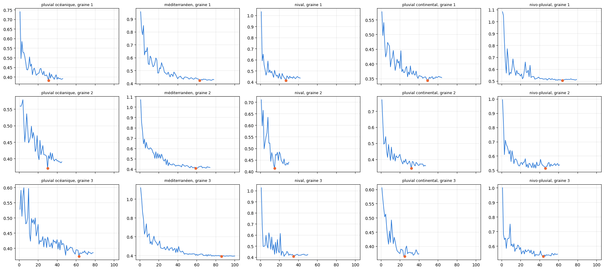
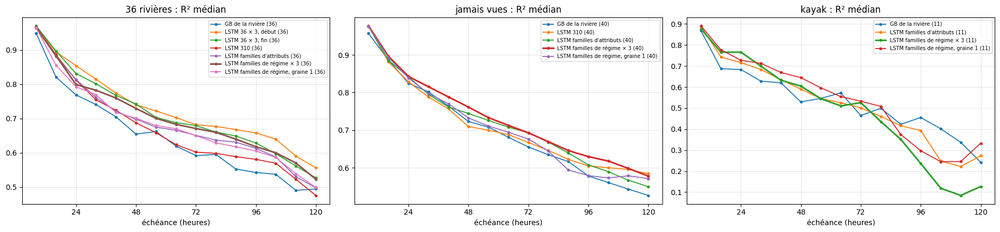

# 5.11 — Un LSTM par famille de régime, entraîné sur Kaggle

**Les familles** : la forme du régime de Pardé (D3bis, notebooks 3.8 et 3.9) range les rivières en 5 familles : pluvial océanique (maximum en
février), pluvial continental (décembre, le Jura), méditerranéen (crues d'automne), nivo-pluvial de moyenne montagne et nival pur (mai).
Rivières : les 853 du notebook 3.6 et les 36 habituelles (rangées au centre le plus proche si elles n'étaient pas parmi les 853), **sans les 40
jamais vues** du notebook 5.08, gardées pour la comparaison ; chaque rivière jamais vue est notée avec les réseaux de sa famille.

**Les réseaux** : le LSTM des notebooks 5.08 à 6.1 à l'identique (90 jours de passé, mémoire de 128, attributs à chaque pas, une heure sur
quatre), **validation au début de l'historique** (notebook 6.1), 3 graines par famille (la prévision d'une famille = la moyenne de ses 3
réseaux), une part tirée par époque de 19 / (nombre de rivières de la famille), au plus 1 h par réseau ; entraînés sur les deux cartes
T4 de Kaggle (précision : voir le notebook 6.2). Prévisions et notes sur le Mac, en conditions réelles, comme aux notebooks 5.08 à 6.1.

**Les comparaisons** :

| modèle | appris sur | validation | réseaux |
|---|---|---|---|
| GB de la rivière | la rivière seule | — | 1 |
| LSTM 36 × 3, début (notebook 6.1) | les 36 | au début | 3 |
| LSTM 36 × 3, fin (notebooks 5.04 et 5.07) | les 36 | à la fin | 3 |
| LSTM 310 (notebook 5.08) | 310 rivières | à la fin | 1 |
| LSTM familles d'attributs (notebook 5.10) | sa famille d'attributs (4 familles) | à la fin | 1 |
| **LSTM familles de régime × 3** | sa famille de régime | au début | 3 |
| LSTM familles de régime, graine 1 | sa famille de régime | au début | 1 |

Les modèles à 1 réseau se comparent à « familles de régime, graine 1 » ; ceux à 3 réseaux à « familles de régime × 3 ».

    {0: 'pluvial océanique', 1: 'méditerranéen', 2: 'nival', 3: 'pluvial continental', 4: 'nivo-pluvial'}

## Les apprentissages

    

    

<table border="1" class="dataframe">
  <thead>
    <tr style="text-align: right;">
      <th></th>
      <th>famille</th>
      <th>graine</th>
      <th>époques</th>
      <th>gardée</th>
      <th>s par époque</th>
      <th>minutes</th>
    </tr>
  </thead>
  <tbody>
    <tr>
      <th>0</th>
      <td>pluvial océanique</td>
      <td>1</td>
      <td>46</td>
      <td>31</td>
      <td>13.9</td>
      <td>10.6</td>
    </tr>
    <tr>
      <th>1</th>
      <td>pluvial océanique</td>
      <td>2</td>
      <td>45</td>
      <td>30</td>
      <td>14.1</td>
      <td>10.6</td>
    </tr>
    <tr>
      <th>2</th>
      <td>pluvial océanique</td>
      <td>3</td>
      <td>78</td>
      <td>63</td>
      <td>14.2</td>
      <td>18.4</td>
    </tr>
    <tr>
      <th>3</th>
      <td>méditerranéen</td>
      <td>1</td>
      <td>78</td>
      <td>63</td>
      <td>9.9</td>
      <td>12.9</td>
    </tr>
    <tr>
      <th>4</th>
      <td>méditerranéen</td>
      <td>2</td>
      <td>74</td>
      <td>59</td>
      <td>10.0</td>
      <td>12.3</td>
    </tr>
    <tr>
      <th>5</th>
      <td>méditerranéen</td>
      <td>3</td>
      <td>100</td>
      <td>86</td>
      <td>9.7</td>
      <td>16.2</td>
    </tr>
    <tr>
      <th>6</th>
      <td>nival</td>
      <td>1</td>
      <td>42</td>
      <td>27</td>
      <td>8.5</td>
      <td>6.0</td>
    </tr>
    <tr>
      <th>7</th>
      <td>nival</td>
      <td>2</td>
      <td>30</td>
      <td>15</td>
      <td>8.8</td>
      <td>4.4</td>
    </tr>
    <tr>
      <th>8</th>
      <td>nival</td>
      <td>3</td>
      <td>50</td>
      <td>35</td>
      <td>8.7</td>
      <td>7.3</td>
    </tr>
    <tr>
      <th>9</th>
      <td>pluvial continental</td>
      <td>1</td>
      <td>64</td>
      <td>49</td>
      <td>11.1</td>
      <td>11.8</td>
    </tr>
    <tr>
      <th>10</th>
      <td>pluvial continental</td>
      <td>2</td>
      <td>47</td>
      <td>32</td>
      <td>11.1</td>
      <td>8.7</td>
    </tr>
    <tr>
      <th>11</th>
      <td>pluvial continental</td>
      <td>3</td>
      <td>40</td>
      <td>25</td>
      <td>11.1</td>
      <td>7.4</td>
    </tr>
    <tr>
      <th>12</th>
      <td>nivo-pluvial</td>
      <td>1</td>
      <td>79</td>
      <td>64</td>
      <td>8.9</td>
      <td>11.7</td>
    </tr>
    <tr>
      <th>13</th>
      <td>nivo-pluvial</td>
      <td>2</td>
      <td>61</td>
      <td>46</td>
      <td>8.9</td>
      <td>9.0</td>
    </tr>
    <tr>
      <th>14</th>
      <td>nivo-pluvial</td>
      <td>3</td>
      <td>59</td>
      <td>44</td>
      <td>9.0</td>
      <td>8.9</td>
    </tr>
  </tbody>
</table>

## Les notes

Chaque rivière est notée aux heures communes à tous ses modèles ; R² et crues sur calibration + test ; IC réglés sur la calibration, notés sur le test (score rapporté au débit moyen : plus bas = mieux) ; « mieux que » : nombre de rivières où le premier modèle fait mieux.

    groupe                             36 rivières  jamais vues  kayak
    modèle                                                            
    GB de la rivière                            36           40     11
    LSTM 310                                    36           40      0
    LSTM 36 × 3, début                          36            0      0
    LSTM 36 × 3, fin                            36            0      0
    LSTM familles d'attributs                   36           40     11
    LSTM familles de régime × 3                 36           40     11
    LSTM familles de régime, graine 1           36           40     11

### Sur les 36 rivières habituelles

    36 rivières

<table border="1" class="dataframe">
  <thead>
    <tr style="text-align: right;">
      <th></th>
      <th>R² J+1</th>
      <th>R² J+3</th>
      <th>R² J+5</th>
      <th>R² moyen</th>
      <th>R² crue</th>
      <th>R² montée</th>
      <th>biais pic %</th>
      <th>IC 95 couverture</th>
      <th>IC 95 score</th>
    </tr>
  </thead>
  <tbody>
    <tr>
      <th>GB de la rivière (médiane)</th>
      <td>0.840</td>
      <td>0.620</td>
      <td>0.506</td>
      <td>0.646</td>
      <td>0.119</td>
      <td>0.418</td>
      <td>1.237</td>
      <td>0.881</td>
      <td>2.474</td>
    </tr>
    <tr>
      <th>LSTM 36 × 3, fin (médiane)</th>
      <td>0.898</td>
      <td>0.690</td>
      <td>0.559</td>
      <td>0.714</td>
      <td>0.199</td>
      <td>0.449</td>
      <td>-5.629</td>
      <td>0.889</td>
      <td>2.102</td>
    </tr>
    <tr>
      <th>LSTM 36 × 3, début (médiane)</th>
      <td>0.906</td>
      <td>0.701</td>
      <td>0.588</td>
      <td>0.736</td>
      <td>0.175</td>
      <td>0.459</td>
      <td>-4.854</td>
      <td>0.889</td>
      <td>1.927</td>
    </tr>
    <tr>
      <th>LSTM 310 (médiane)</th>
      <td>0.893</td>
      <td>0.627</td>
      <td>0.525</td>
      <td>0.675</td>
      <td>0.152</td>
      <td>0.416</td>
      <td>-0.997</td>
      <td>0.848</td>
      <td>2.273</td>
    </tr>
    <tr>
      <th>LSTM familles d'attributs (médiane)</th>
      <td>0.891</td>
      <td>0.666</td>
      <td>0.529</td>
      <td>0.681</td>
      <td>0.211</td>
      <td>0.413</td>
      <td>1.005</td>
      <td>0.872</td>
      <td>2.239</td>
    </tr>
    <tr>
      <th>LSTM familles de régime, graine 1 (médiane)</th>
      <td>0.863</td>
      <td>0.670</td>
      <td>0.537</td>
      <td>0.677</td>
      <td>0.146</td>
      <td>0.426</td>
      <td>-0.461</td>
      <td>0.876</td>
      <td>2.080</td>
    </tr>
    <tr>
      <th>LSTM familles de régime × 3 (médiane)</th>
      <td>0.884</td>
      <td>0.682</td>
      <td>0.570</td>
      <td>0.708</td>
      <td>0.207</td>
      <td>0.474</td>
      <td>-2.779</td>
      <td>0.888</td>
      <td>1.920</td>
    </tr>
    <tr>
      <th>LSTM familles de régime × 3 mieux que LSTM 36 × 3, début</th>
      <td>8.000</td>
      <td>15.000</td>
      <td>19.000</td>
      <td>16.000</td>
      <td>26.000</td>
      <td>27.000</td>
      <td>23.000</td>
      <td>16.000</td>
      <td>12.000</td>
    </tr>
    <tr>
      <th>LSTM familles de régime × 3 mieux que LSTM 36 × 3, fin</th>
      <td>12.000</td>
      <td>16.000</td>
      <td>24.000</td>
      <td>16.000</td>
      <td>24.000</td>
      <td>23.000</td>
      <td>23.000</td>
      <td>16.000</td>
      <td>21.000</td>
    </tr>
    <tr>
      <th>LSTM familles de régime × 3 mieux que GB de la rivière</th>
      <td>28.000</td>
      <td>31.000</td>
      <td>28.000</td>
      <td>31.000</td>
      <td>27.000</td>
      <td>27.000</td>
      <td>18.000</td>
      <td>21.000</td>
      <td>34.000</td>
    </tr>
    <tr>
      <th>LSTM familles de régime, graine 1 mieux que LSTM 310</th>
      <td>19.000</td>
      <td>23.000</td>
      <td>25.000</td>
      <td>22.000</td>
      <td>21.000</td>
      <td>15.000</td>
      <td>16.000</td>
      <td>24.000</td>
      <td>24.000</td>
    </tr>
    <tr>
      <th>LSTM familles de régime, graine 1 mieux que LSTM familles d'attributs</th>
      <td>16.000</td>
      <td>19.000</td>
      <td>18.000</td>
      <td>20.000</td>
      <td>19.000</td>
      <td>18.000</td>
      <td>19.000</td>
      <td>22.000</td>
      <td>21.000</td>
    </tr>
  </tbody>
</table>

<table border="1" class="dataframe">
  <thead>
    <tr>
      <th></th>
      <th colspan="7" halign="left">R² moyen</th>
      <th colspan="7" halign="left">R² crue</th>
      <th colspan="7" halign="left">IC 95 score</th>
    </tr>
    <tr>
      <th>modèle</th>
      <th>GB de la rivière</th>
      <th>LSTM 36 × 3, début</th>
      <th>LSTM 36 × 3, fin</th>
      <th>LSTM 310</th>
      <th>LSTM familles d'attributs</th>
      <th>LSTM familles de régime × 3</th>
      <th>LSTM familles de régime, graine 1</th>
      <th>GB de la rivière</th>
      <th>LSTM 36 × 3, début</th>
      <th>LSTM 36 × 3, fin</th>
      <th>LSTM 310</th>
      <th>LSTM familles d'attributs</th>
      <th>LSTM familles de régime × 3</th>
      <th>LSTM familles de régime, graine 1</th>
      <th>GB de la rivière</th>
      <th>LSTM 36 × 3, début</th>
      <th>LSTM 36 × 3, fin</th>
      <th>LSTM 310</th>
      <th>LSTM familles d'attributs</th>
      <th>LSTM familles de régime × 3</th>
      <th>LSTM familles de régime, graine 1</th>
    </tr>
    <tr>
      <th>famille</th>
      <th></th>
      <th></th>
      <th></th>
      <th></th>
      <th></th>
      <th></th>
      <th></th>
      <th></th>
      <th></th>
      <th></th>
      <th></th>
      <th></th>
      <th></th>
      <th></th>
      <th></th>
      <th></th>
      <th></th>
      <th></th>
      <th></th>
      <th></th>
      <th></th>
    </tr>
  </thead>
  <tbody>
    <tr>
      <th>pluvial continental</th>
      <td>0.723</td>
      <td>0.775</td>
      <td>0.773</td>
      <td>0.709</td>
      <td>0.739</td>
      <td>0.731</td>
      <td>0.720</td>
      <td>-0.083</td>
      <td>-0.107</td>
      <td>-0.079</td>
      <td>0.064</td>
      <td>-0.128</td>
      <td>0.012</td>
      <td>-0.062</td>
      <td>2.243</td>
      <td>1.860</td>
      <td>1.991</td>
      <td>2.306</td>
      <td>2.209</td>
      <td>1.850</td>
      <td>2.068</td>
    </tr>
    <tr>
      <th>nivo-pluvial</th>
      <td>0.513</td>
      <td>0.605</td>
      <td>0.589</td>
      <td>0.566</td>
      <td>0.565</td>
      <td>0.565</td>
      <td>0.536</td>
      <td>0.026</td>
      <td>-0.030</td>
      <td>-0.006</td>
      <td>-0.070</td>
      <td>-0.130</td>
      <td>-0.004</td>
      <td>-0.067</td>
      <td>3.048</td>
      <td>2.283</td>
      <td>2.274</td>
      <td>2.194</td>
      <td>2.574</td>
      <td>2.193</td>
      <td>2.334</td>
    </tr>
    <tr>
      <th>pluvial océanique</th>
      <td>0.786</td>
      <td>0.819</td>
      <td>0.815</td>
      <td>0.794</td>
      <td>0.778</td>
      <td>0.830</td>
      <td>0.814</td>
      <td>0.443</td>
      <td>0.498</td>
      <td>0.443</td>
      <td>0.484</td>
      <td>0.476</td>
      <td>0.529</td>
      <td>0.446</td>
      <td>2.362</td>
      <td>1.774</td>
      <td>1.991</td>
      <td>1.900</td>
      <td>2.012</td>
      <td>1.873</td>
      <td>2.048</td>
    </tr>
    <tr>
      <th>méditerranéen</th>
      <td>0.501</td>
      <td>0.564</td>
      <td>0.578</td>
      <td>0.424</td>
      <td>0.502</td>
      <td>0.505</td>
      <td>0.449</td>
      <td>0.251</td>
      <td>0.216</td>
      <td>0.269</td>
      <td>0.152</td>
      <td>0.262</td>
      <td>0.250</td>
      <td>0.214</td>
      <td>4.033</td>
      <td>2.876</td>
      <td>2.984</td>
      <td>4.111</td>
      <td>3.137</td>
      <td>3.091</td>
      <td>3.282</td>
    </tr>
    <tr>
      <th>nival</th>
      <td>0.875</td>
      <td>0.872</td>
      <td>0.878</td>
      <td>0.862</td>
      <td>0.870</td>
      <td>0.874</td>
      <td>0.853</td>
      <td>0.220</td>
      <td>0.192</td>
      <td>0.277</td>
      <td>0.198</td>
      <td>0.313</td>
      <td>0.236</td>
      <td>0.084</td>
      <td>1.181</td>
      <td>1.156</td>
      <td>1.122</td>
      <td>1.283</td>
      <td>1.171</td>
      <td>1.250</td>
      <td>1.337</td>
    </tr>
  </tbody>
</table>

<table border="1" class="dataframe">
  <thead>
    <tr>
      <th></th>
      <th></th>
      <th colspan="7" halign="left">R² moyen</th>
      <th colspan="7" halign="left">R² crue</th>
    </tr>
    <tr>
      <th></th>
      <th>modèle</th>
      <th>GB de la rivière</th>
      <th>LSTM 36 × 3, début</th>
      <th>LSTM 36 × 3, fin</th>
      <th>LSTM 310</th>
      <th>LSTM familles d'attributs</th>
      <th>LSTM familles de régime × 3</th>
      <th>LSTM familles de régime, graine 1</th>
      <th>GB de la rivière</th>
      <th>LSTM 36 × 3, début</th>
      <th>LSTM 36 × 3, fin</th>
      <th>LSTM 310</th>
      <th>LSTM familles d'attributs</th>
      <th>LSTM familles de régime × 3</th>
      <th>LSTM familles de régime, graine 1</th>
    </tr>
    <tr>
      <th>famille</th>
      <th>station</th>
      <th></th>
      <th></th>
      <th></th>
      <th></th>
      <th></th>
      <th></th>
      <th></th>
      <th></th>
      <th></th>
      <th></th>
      <th></th>
      <th></th>
      <th></th>
      <th></th>
    </tr>
  </thead>
  <tbody>
    <tr>
      <th rowspan="11" valign="top">pluvial continental</th>
      <th>Albarine à Saint Rambert en Bugey</th>
      <td>0.601</td>
      <td>0.730</td>
      <td>0.692</td>
      <td>0.676</td>
      <td>0.635</td>
      <td>0.711</td>
      <td>0.703</td>
      <td>-0.045</td>
      <td>0.060</td>
      <td>0.002</td>
      <td>0.064</td>
      <td>0.030</td>
      <td>0.072</td>
      <td>-0.015</td>
    </tr>
    <tr>
      <th>Sioule à Pontgibaud</th>
      <td>0.750</td>
      <td>0.803</td>
      <td>0.813</td>
      <td>0.766</td>
      <td>0.744</td>
      <td>0.801</td>
      <td>0.804</td>
      <td>0.364</td>
      <td>0.383</td>
      <td>0.400</td>
      <td>0.316</td>
      <td>0.269</td>
      <td>0.444</td>
      <td>0.464</td>
    </tr>
    <tr>
      <th>Ain à Bourg de sirod</th>
      <td>0.621</td>
      <td>0.684</td>
      <td>0.685</td>
      <td>0.615</td>
      <td>0.664</td>
      <td>0.680</td>
      <td>0.672</td>
      <td>-0.134</td>
      <td>-0.117</td>
      <td>-0.113</td>
      <td>0.069</td>
      <td>-0.128</td>
      <td>0.012</td>
      <td>-0.062</td>
    </tr>
    <tr>
      <th>Nive à Osses</th>
      <td>0.471</td>
      <td>0.521</td>
      <td>0.555</td>
      <td>0.502</td>
      <td>0.530</td>
      <td>0.484</td>
      <td>0.456</td>
      <td>-0.428</td>
      <td>-0.485</td>
      <td>-0.381</td>
      <td>-0.359</td>
      <td>-0.420</td>
      <td>-0.413</td>
      <td>-0.700</td>
    </tr>
    <tr>
      <th>Moselle à Epinal</th>
      <td>0.824</td>
      <td>0.843</td>
      <td>0.846</td>
      <td>0.826</td>
      <td>0.820</td>
      <td>0.854</td>
      <td>0.828</td>
      <td>-0.307</td>
      <td>-0.135</td>
      <td>-0.127</td>
      <td>-0.637</td>
      <td>-0.443</td>
      <td>-0.318</td>
      <td>-0.551</td>
    </tr>
    <tr>
      <th>Saine à Syam</th>
      <td>0.493</td>
      <td>0.576</td>
      <td>0.584</td>
      <td>0.504</td>
      <td>0.574</td>
      <td>0.557</td>
      <td>0.555</td>
      <td>-0.408</td>
      <td>-0.320</td>
      <td>-0.282</td>
      <td>-0.232</td>
      <td>-0.287</td>
      <td>-0.283</td>
      <td>-0.355</td>
    </tr>
    <tr>
      <th>Loue à Vuillafans</th>
      <td>0.723</td>
      <td>0.775</td>
      <td>0.773</td>
      <td>0.703</td>
      <td>0.739</td>
      <td>0.731</td>
      <td>0.720</td>
      <td>-0.083</td>
      <td>-0.107</td>
      <td>-0.079</td>
      <td>-0.088</td>
      <td>-0.224</td>
      <td>-0.071</td>
      <td>-0.169</td>
    </tr>
    <tr>
      <th>Saône à Lechâtelet</th>
      <td>0.879</td>
      <td>0.920</td>
      <td>0.921</td>
      <td>0.894</td>
      <td>0.898</td>
      <td>0.920</td>
      <td>0.917</td>
      <td>0.380</td>
      <td>0.497</td>
      <td>0.556</td>
      <td>0.486</td>
      <td>0.603</td>
      <td>0.628</td>
      <td>0.553</td>
    </tr>
    <tr>
      <th>Dessoubre à Rosureux</th>
      <td>0.652</td>
      <td>0.749</td>
      <td>0.735</td>
      <td>0.709</td>
      <td>0.704</td>
      <td>0.709</td>
      <td>0.711</td>
      <td>-0.360</td>
      <td>-0.362</td>
      <td>-0.260</td>
      <td>-0.478</td>
      <td>-0.508</td>
      <td>-0.412</td>
      <td>-0.400</td>
    </tr>
    <tr>
      <th>Alagnon à Joursac</th>
      <td>0.757</td>
      <td>0.823</td>
      <td>0.821</td>
      <td>0.787</td>
      <td>0.784</td>
      <td>0.743</td>
      <td>0.792</td>
      <td>0.488</td>
      <td>0.565</td>
      <td>0.551</td>
      <td>0.503</td>
      <td>0.514</td>
      <td>0.558</td>
      <td>0.561</td>
    </tr>
    <tr>
      <th>Doubs à Goumois</th>
      <td>0.761</td>
      <td>0.798</td>
      <td>0.802</td>
      <td>0.794</td>
      <td>0.749</td>
      <td>0.811</td>
      <td>0.797</td>
      <td>0.097</td>
      <td>0.111</td>
      <td>0.265</td>
      <td>0.160</td>
      <td>-0.001</td>
      <td>0.214</td>
      <td>0.150</td>
    </tr>
    <tr>
      <th rowspan="8" valign="top">nivo-pluvial</th>
      <th>Tarn à Millau [HE]</th>
      <td>0.641</td>
      <td>0.774</td>
      <td>0.743</td>
      <td>0.753</td>
      <td>0.728</td>
      <td>0.761</td>
      <td>0.721</td>
      <td>0.597</td>
      <td>0.747</td>
      <td>0.712</td>
      <td>0.725</td>
      <td>0.694</td>
      <td>0.735</td>
      <td>0.690</td>
    </tr>
    <tr>
      <th>Fier à Dingy-St-Clair</th>
      <td>0.398</td>
      <td>0.507</td>
      <td>0.464</td>
      <td>0.460</td>
      <td>0.525</td>
      <td>0.537</td>
      <td>0.508</td>
      <td>-0.498</td>
      <td>-0.531</td>
      <td>-0.663</td>
      <td>-0.111</td>
      <td>-0.392</td>
      <td>-0.240</td>
      <td>-0.275</td>
    </tr>
    <tr>
      <th>Allier à Coudes</th>
      <td>0.684</td>
      <td>0.743</td>
      <td>0.737</td>
      <td>0.673</td>
      <td>0.622</td>
      <td>0.708</td>
      <td>0.629</td>
      <td>0.159</td>
      <td>0.225</td>
      <td>0.172</td>
      <td>-0.029</td>
      <td>-0.001</td>
      <td>0.142</td>
      <td>0.055</td>
    </tr>
    <tr>
      <th>Gave d'Oloron à Escos</th>
      <td>0.554</td>
      <td>0.470</td>
      <td>0.479</td>
      <td>0.505</td>
      <td>0.410</td>
      <td>0.467</td>
      <td>0.441</td>
      <td>-0.378</td>
      <td>-0.980</td>
      <td>-0.993</td>
      <td>-0.617</td>
      <td>-1.245</td>
      <td>-0.748</td>
      <td>-0.676</td>
    </tr>
    <tr>
      <th>Chéran à Allèves [La Charniaz]</th>
      <td>0.472</td>
      <td>0.576</td>
      <td>0.521</td>
      <td>0.557</td>
      <td>0.517</td>
      <td>0.593</td>
      <td>0.556</td>
      <td>-0.214</td>
      <td>-0.199</td>
      <td>-0.282</td>
      <td>0.062</td>
      <td>-0.288</td>
      <td>0.048</td>
      <td>-0.042</td>
    </tr>
    <tr>
      <th>Ger à Aspet</th>
      <td>0.432</td>
      <td>0.635</td>
      <td>0.658</td>
      <td>0.575</td>
      <td>0.606</td>
      <td>0.531</td>
      <td>0.516</td>
      <td>0.227</td>
      <td>0.322</td>
      <td>0.333</td>
      <td>0.307</td>
      <td>0.260</td>
      <td>0.337</td>
      <td>0.320</td>
    </tr>
    <tr>
      <th>Ance du Nord à Sauvessanges</th>
      <td>0.730</td>
      <td>0.818</td>
      <td>0.777</td>
      <td>0.692</td>
      <td>0.707</td>
      <td>0.727</td>
      <td>0.682</td>
      <td>0.035</td>
      <td>0.048</td>
      <td>0.017</td>
      <td>-0.640</td>
      <td>-0.140</td>
      <td>-0.420</td>
      <td>-0.610</td>
    </tr>
    <tr>
      <th>Gier à Rive-de-Gier</th>
      <td>0.085</td>
      <td>0.057</td>
      <td>0.123</td>
      <td>-0.008</td>
      <td>0.042</td>
      <td>0.108</td>
      <td>0.072</td>
      <td>0.017</td>
      <td>-0.108</td>
      <td>-0.028</td>
      <td>-0.136</td>
      <td>-0.121</td>
      <td>-0.056</td>
      <td>-0.092</td>
    </tr>
    <tr>
      <th rowspan="7" valign="top">pluvial océanique</th>
      <th>Isle à Perigueux</th>
      <td>0.800</td>
      <td>0.819</td>
      <td>0.828</td>
      <td>0.807</td>
      <td>0.816</td>
      <td>0.840</td>
      <td>0.828</td>
      <td>0.479</td>
      <td>0.498</td>
      <td>0.521</td>
      <td>0.484</td>
      <td>0.527</td>
      <td>0.584</td>
      <td>0.569</td>
    </tr>
    <tr>
      <th>Vézère à Montignac</th>
      <td>0.849</td>
      <td>0.879</td>
      <td>0.884</td>
      <td>0.880</td>
      <td>0.843</td>
      <td>0.876</td>
      <td>0.859</td>
      <td>0.503</td>
      <td>0.602</td>
      <td>0.629</td>
      <td>0.623</td>
      <td>0.558</td>
      <td>0.650</td>
      <td>0.629</td>
    </tr>
    <tr>
      <th>Célé à Figeac</th>
      <td>0.791</td>
      <td>0.807</td>
      <td>0.793</td>
      <td>0.752</td>
      <td>0.752</td>
      <td>0.811</td>
      <td>0.782</td>
      <td>0.443</td>
      <td>0.502</td>
      <td>0.443</td>
      <td>0.387</td>
      <td>0.454</td>
      <td>0.502</td>
      <td>0.405</td>
    </tr>
    <tr>
      <th>Grand-Morin à Pommeuse</th>
      <td>0.497</td>
      <td>0.685</td>
      <td>0.645</td>
      <td>0.644</td>
      <td>0.657</td>
      <td>0.651</td>
      <td>0.632</td>
      <td>-0.014</td>
      <td>0.330</td>
      <td>0.226</td>
      <td>0.254</td>
      <td>0.342</td>
      <td>0.286</td>
      <td>0.259</td>
    </tr>
    <tr>
      <th>Vienne à Eymoutiers</th>
      <td>0.786</td>
      <td>0.885</td>
      <td>0.881</td>
      <td>0.854</td>
      <td>0.866</td>
      <td>0.891</td>
      <td>0.881</td>
      <td>0.462</td>
      <td>0.726</td>
      <td>0.717</td>
      <td>0.687</td>
      <td>0.719</td>
      <td>0.778</td>
      <td>0.764</td>
    </tr>
    <tr>
      <th>Sioulet à La Prugne</th>
      <td>0.760</td>
      <td>0.822</td>
      <td>0.815</td>
      <td>0.794</td>
      <td>0.778</td>
      <td>0.830</td>
      <td>0.814</td>
      <td>0.286</td>
      <td>0.389</td>
      <td>0.418</td>
      <td>0.509</td>
      <td>0.476</td>
      <td>0.529</td>
      <td>0.446</td>
    </tr>
    <tr>
      <th>Grand-Morin à Couilly-Pont-aux-Dames [Station ultrason]</th>
      <td>0.490</td>
      <td>0.700</td>
      <td>0.650</td>
      <td>0.620</td>
      <td>0.637</td>
      <td>0.625</td>
      <td>0.577</td>
      <td>-0.014</td>
      <td>0.388</td>
      <td>0.239</td>
      <td>0.225</td>
      <td>0.273</td>
      <td>0.258</td>
      <td>0.178</td>
    </tr>
    <tr>
      <th rowspan="6" valign="top">méditerranéen</th>
      <th>Ardèche à Pont-de-Labeaume</th>
      <td>0.500</td>
      <td>0.549</td>
      <td>0.555</td>
      <td>0.383</td>
      <td>0.484</td>
      <td>0.514</td>
      <td>0.491</td>
      <td>0.362</td>
      <td>0.307</td>
      <td>0.380</td>
      <td>0.147</td>
      <td>0.296</td>
      <td>0.300</td>
      <td>0.285</td>
    </tr>
    <tr>
      <th>Tarn à Cocurès</th>
      <td>0.602</td>
      <td>0.671</td>
      <td>0.668</td>
      <td>0.648</td>
      <td>0.674</td>
      <td>0.684</td>
      <td>0.672</td>
      <td>0.414</td>
      <td>0.483</td>
      <td>0.477</td>
      <td>0.481</td>
      <td>0.496</td>
      <td>0.508</td>
      <td>0.510</td>
    </tr>
    <tr>
      <th>Loire à Chadrac [Pont du Monteil]</th>
      <td>0.234</td>
      <td>0.303</td>
      <td>0.297</td>
      <td>0.293</td>
      <td>0.383</td>
      <td>0.321</td>
      <td>0.249</td>
      <td>0.049</td>
      <td>0.071</td>
      <td>0.084</td>
      <td>0.076</td>
      <td>0.193</td>
      <td>0.107</td>
      <td>0.028</td>
    </tr>
    <tr>
      <th>Hérault à Laroque</th>
      <td>0.669</td>
      <td>0.697</td>
      <td>0.668</td>
      <td>0.465</td>
      <td>0.553</td>
      <td>0.704</td>
      <td>0.670</td>
      <td>0.561</td>
      <td>0.565</td>
      <td>0.519</td>
      <td>0.275</td>
      <td>0.396</td>
      <td>0.584</td>
      <td>0.542</td>
    </tr>
    <tr>
      <th>Loire à Goudet</th>
      <td>0.204</td>
      <td>0.217</td>
      <td>0.220</td>
      <td>0.232</td>
      <td>0.305</td>
      <td>0.280</td>
      <td>0.211</td>
      <td>0.141</td>
      <td>0.125</td>
      <td>0.158</td>
      <td>0.157</td>
      <td>0.228</td>
      <td>0.200</td>
      <td>0.143</td>
    </tr>
    <tr>
      <th>Bienne à Morez</th>
      <td>0.503</td>
      <td>0.580</td>
      <td>0.601</td>
      <td>0.503</td>
      <td>0.520</td>
      <td>0.496</td>
      <td>0.407</td>
      <td>0.006</td>
      <td>-0.011</td>
      <td>0.053</td>
      <td>0.001</td>
      <td>0.023</td>
      <td>0.101</td>
      <td>0.129</td>
    </tr>
    <tr>
      <th rowspan="4" valign="top">nival</th>
      <th>Salat à Soueix-Rogalle</th>
      <td>0.529</td>
      <td>0.688</td>
      <td>0.657</td>
      <td>0.359</td>
      <td>0.689</td>
      <td>0.637</td>
      <td>0.568</td>
      <td>-0.408</td>
      <td>-0.471</td>
      <td>-0.299</td>
      <td>-0.973</td>
      <td>-0.434</td>
      <td>-0.415</td>
      <td>-0.591</td>
    </tr>
    <tr>
      <th>Ubaye à Le Lauzet-Ubaye [Roche-Rousse]</th>
      <td>0.885</td>
      <td>0.912</td>
      <td>0.918</td>
      <td>0.897</td>
      <td>0.917</td>
      <td>0.918</td>
      <td>0.914</td>
      <td>0.289</td>
      <td>0.416</td>
      <td>0.474</td>
      <td>0.382</td>
      <td>0.477</td>
      <td>0.471</td>
      <td>0.464</td>
    </tr>
    <tr>
      <th>Durance à Embrun [La Clapière]</th>
      <td>0.920</td>
      <td>0.935</td>
      <td>0.928</td>
      <td>0.903</td>
      <td>0.924</td>
      <td>0.937</td>
      <td>0.929</td>
      <td>0.433</td>
      <td>0.536</td>
      <td>0.473</td>
      <td>0.372</td>
      <td>0.484</td>
      <td>0.558</td>
      <td>0.523</td>
    </tr>
    <tr>
      <th>Durance à Val-des-Prés</th>
      <td>0.865</td>
      <td>0.832</td>
      <td>0.838</td>
      <td>0.827</td>
      <td>0.824</td>
      <td>0.830</td>
      <td>0.791</td>
      <td>0.151</td>
      <td>-0.031</td>
      <td>0.082</td>
      <td>0.023</td>
      <td>0.148</td>
      <td>0.001</td>
      <td>-0.297</td>
    </tr>
  </tbody>
</table>

### Sur les 40 rivières jamais vues

    40 rivières

<table border="1" class="dataframe">
  <thead>
    <tr style="text-align: right;">
      <th></th>
      <th>R² J+1</th>
      <th>R² J+3</th>
      <th>R² J+5</th>
      <th>R² moyen</th>
      <th>R² crue</th>
      <th>R² montée</th>
      <th>biais pic %</th>
      <th>IC 95 couverture</th>
      <th>IC 95 score</th>
    </tr>
  </thead>
  <tbody>
    <tr>
      <th>GB de la rivière (médiane)</th>
      <td>0.886</td>
      <td>0.683</td>
      <td>0.548</td>
      <td>0.691</td>
      <td>0.148</td>
      <td>0.479</td>
      <td>1.617</td>
      <td>0.909</td>
      <td>2.612</td>
    </tr>
    <tr>
      <th>LSTM 310 (médiane)</th>
      <td>0.891</td>
      <td>0.687</td>
      <td>0.600</td>
      <td>0.711</td>
      <td>0.045</td>
      <td>0.473</td>
      <td>1.151</td>
      <td>0.824</td>
      <td>2.313</td>
    </tr>
    <tr>
      <th>LSTM familles d'attributs (médiane)</th>
      <td>0.896</td>
      <td>0.708</td>
      <td>0.567</td>
      <td>0.719</td>
      <td>0.088</td>
      <td>0.467</td>
      <td>0.783</td>
      <td>0.887</td>
      <td>2.094</td>
    </tr>
    <tr>
      <th>LSTM familles de régime, graine 1 (médiane)</th>
      <td>0.902</td>
      <td>0.694</td>
      <td>0.574</td>
      <td>0.700</td>
      <td>0.004</td>
      <td>0.472</td>
      <td>2.458</td>
      <td>0.858</td>
      <td>2.347</td>
    </tr>
    <tr>
      <th>LSTM familles de régime × 3 (médiane)</th>
      <td>0.905</td>
      <td>0.713</td>
      <td>0.597</td>
      <td>0.731</td>
      <td>0.109</td>
      <td>0.501</td>
      <td>0.716</td>
      <td>0.884</td>
      <td>2.117</td>
    </tr>
    <tr>
      <th>LSTM familles de régime × 3 mieux que GB de la rivière</th>
      <td>22.000</td>
      <td>26.000</td>
      <td>31.000</td>
      <td>27.000</td>
      <td>21.000</td>
      <td>26.000</td>
      <td>25.000</td>
      <td>15.000</td>
      <td>32.000</td>
    </tr>
    <tr>
      <th>LSTM familles de régime, graine 1 mieux que LSTM 310</th>
      <td>17.000</td>
      <td>19.000</td>
      <td>21.000</td>
      <td>20.000</td>
      <td>16.000</td>
      <td>15.000</td>
      <td>26.000</td>
      <td>20.000</td>
      <td>31.000</td>
    </tr>
    <tr>
      <th>LSTM familles de régime, graine 1 mieux que LSTM familles d'attributs</th>
      <td>23.000</td>
      <td>18.000</td>
      <td>18.000</td>
      <td>17.000</td>
      <td>18.000</td>
      <td>21.000</td>
      <td>17.000</td>
      <td>16.000</td>
      <td>24.000</td>
    </tr>
    <tr>
      <th>LSTM familles de régime × 3 mieux que LSTM familles de régime, graine 1</th>
      <td>36.000</td>
      <td>35.000</td>
      <td>32.000</td>
      <td>36.000</td>
      <td>30.000</td>
      <td>31.000</td>
      <td>28.000</td>
      <td>29.000</td>
      <td>34.000</td>
    </tr>
  </tbody>
</table>

<table border="1" class="dataframe">
  <thead>
    <tr>
      <th></th>
      <th colspan="5" halign="left">R² moyen</th>
      <th colspan="5" halign="left">R² crue</th>
      <th colspan="5" halign="left">IC 95 score</th>
    </tr>
    <tr>
      <th>modèle</th>
      <th>GB de la rivière</th>
      <th>LSTM 310</th>
      <th>LSTM familles d'attributs</th>
      <th>LSTM familles de régime × 3</th>
      <th>LSTM familles de régime, graine 1</th>
      <th>GB de la rivière</th>
      <th>LSTM 310</th>
      <th>LSTM familles d'attributs</th>
      <th>LSTM familles de régime × 3</th>
      <th>LSTM familles de régime, graine 1</th>
      <th>GB de la rivière</th>
      <th>LSTM 310</th>
      <th>LSTM familles d'attributs</th>
      <th>LSTM familles de régime × 3</th>
      <th>LSTM familles de régime, graine 1</th>
    </tr>
    <tr>
      <th>famille</th>
      <th></th>
      <th></th>
      <th></th>
      <th></th>
      <th></th>
      <th></th>
      <th></th>
      <th></th>
      <th></th>
      <th></th>
      <th></th>
      <th></th>
      <th></th>
      <th></th>
      <th></th>
    </tr>
  </thead>
  <tbody>
    <tr>
      <th>pluvial océanique</th>
      <td>0.734</td>
      <td>0.751</td>
      <td>0.743</td>
      <td>0.765</td>
      <td>0.760</td>
      <td>0.135</td>
      <td>0.228</td>
      <td>0.185</td>
      <td>0.243</td>
      <td>0.228</td>
      <td>2.533</td>
      <td>2.196</td>
      <td>2.060</td>
      <td>1.949</td>
      <td>2.098</td>
    </tr>
    <tr>
      <th>pluvial continental</th>
      <td>0.606</td>
      <td>0.616</td>
      <td>0.650</td>
      <td>0.619</td>
      <td>0.586</td>
      <td>-0.024</td>
      <td>-0.063</td>
      <td>-0.115</td>
      <td>-0.059</td>
      <td>-0.126</td>
      <td>3.113</td>
      <td>3.054</td>
      <td>2.436</td>
      <td>2.622</td>
      <td>2.931</td>
    </tr>
    <tr>
      <th>méditerranéen</th>
      <td>0.526</td>
      <td>0.319</td>
      <td>0.292</td>
      <td>0.506</td>
      <td>0.382</td>
      <td>0.304</td>
      <td>0.007</td>
      <td>-0.016</td>
      <td>0.241</td>
      <td>0.036</td>
      <td>4.442</td>
      <td>4.415</td>
      <td>5.664</td>
      <td>3.511</td>
      <td>4.202</td>
    </tr>
    <tr>
      <th>nivo-pluvial</th>
      <td>0.871</td>
      <td>0.826</td>
      <td>0.842</td>
      <td>0.856</td>
      <td>0.828</td>
      <td>0.261</td>
      <td>0.155</td>
      <td>0.270</td>
      <td>0.061</td>
      <td>-0.045</td>
      <td>0.433</td>
      <td>0.586</td>
      <td>0.571</td>
      <td>0.493</td>
      <td>0.520</td>
    </tr>
  </tbody>
</table>

<table border="1" class="dataframe">
  <thead>
    <tr>
      <th></th>
      <th></th>
      <th colspan="5" halign="left">R² moyen</th>
      <th colspan="5" halign="left">R² crue</th>
    </tr>
    <tr>
      <th></th>
      <th>modèle</th>
      <th>GB de la rivière</th>
      <th>LSTM 310</th>
      <th>LSTM familles d'attributs</th>
      <th>LSTM familles de régime × 3</th>
      <th>LSTM familles de régime, graine 1</th>
      <th>GB de la rivière</th>
      <th>LSTM 310</th>
      <th>LSTM familles d'attributs</th>
      <th>LSTM familles de régime × 3</th>
      <th>LSTM familles de régime, graine 1</th>
    </tr>
    <tr>
      <th>famille</th>
      <th>station</th>
      <th></th>
      <th></th>
      <th></th>
      <th></th>
      <th></th>
      <th></th>
      <th></th>
      <th></th>
      <th></th>
      <th></th>
    </tr>
  </thead>
  <tbody>
    <tr>
      <th rowspan="19" valign="top">pluvial océanique</th>
      <th>Remarde à St-Cyr-sous-Dourdan</th>
      <td>0.437</td>
      <td>0.605</td>
      <td>0.511</td>
      <td>0.579</td>
      <td>0.565</td>
      <td>0.109</td>
      <td>0.391</td>
      <td>0.185</td>
      <td>0.333</td>
      <td>0.329</td>
    </tr>
    <tr>
      <th>Bar à Cheveuges</th>
      <td>0.901</td>
      <td>0.876</td>
      <td>0.854</td>
      <td>0.884</td>
      <td>0.882</td>
      <td>-2.716</td>
      <td>-5.310</td>
      <td>-7.706</td>
      <td>-6.029</td>
      <td>-5.400</td>
    </tr>
    <tr>
      <th>Ton à Ecouviez</th>
      <td>0.569</td>
      <td>0.599</td>
      <td>0.652</td>
      <td>0.686</td>
      <td>0.646</td>
      <td>-0.009</td>
      <td>0.074</td>
      <td>0.123</td>
      <td>0.307</td>
      <td>0.228</td>
    </tr>
    <tr>
      <th>Vezouze à Lunéville [Vezouze]</th>
      <td>0.443</td>
      <td>0.428</td>
      <td>0.504</td>
      <td>0.334</td>
      <td>0.279</td>
      <td>-0.260</td>
      <td>-0.382</td>
      <td>-0.321</td>
      <td>-0.765</td>
      <td>-0.931</td>
    </tr>
    <tr>
      <th>Crusnes à Pierrepont</th>
      <td>0.855</td>
      <td>0.761</td>
      <td>0.821</td>
      <td>0.865</td>
      <td>0.851</td>
      <td>0.082</td>
      <td>-0.647</td>
      <td>-0.402</td>
      <td>-0.060</td>
      <td>-0.126</td>
    </tr>
    <tr>
      <th>Fecht à Ostheim</th>
      <td>0.779</td>
      <td>0.813</td>
      <td>0.793</td>
      <td>0.802</td>
      <td>0.789</td>
      <td>0.135</td>
      <td>-0.075</td>
      <td>-0.251</td>
      <td>0.132</td>
      <td>0.144</td>
    </tr>
    <tr>
      <th>Orne à Jarny-Labry</th>
      <td>0.636</td>
      <td>0.688</td>
      <td>0.705</td>
      <td>0.736</td>
      <td>0.704</td>
      <td>-0.043</td>
      <td>-0.058</td>
      <td>-0.036</td>
      <td>0.111</td>
      <td>0.028</td>
    </tr>
    <tr>
      <th>Seille à Nomeny [crues]</th>
      <td>0.757</td>
      <td>0.794</td>
      <td>0.800</td>
      <td>0.823</td>
      <td>0.783</td>
      <td>0.125</td>
      <td>0.020</td>
      <td>0.102</td>
      <td>0.237</td>
      <td>-0.021</td>
    </tr>
    <tr>
      <th>Dronne à Brantome</th>
      <td>0.755</td>
      <td>0.760</td>
      <td>0.743</td>
      <td>0.765</td>
      <td>0.760</td>
      <td>0.477</td>
      <td>0.547</td>
      <td>0.531</td>
      <td>0.567</td>
      <td>0.576</td>
    </tr>
    <tr>
      <th>Isle à Corgnac</th>
      <td>0.734</td>
      <td>0.751</td>
      <td>0.727</td>
      <td>0.775</td>
      <td>0.767</td>
      <td>0.386</td>
      <td>0.470</td>
      <td>0.420</td>
      <td>0.481</td>
      <td>0.470</td>
    </tr>
    <tr>
      <th>Weiss à Kaysersberg [Rue de la Râperie]</th>
      <td>0.686</td>
      <td>0.749</td>
      <td>0.758</td>
      <td>0.695</td>
      <td>0.675</td>
      <td>-0.540</td>
      <td>-0.623</td>
      <td>-0.645</td>
      <td>-0.592</td>
      <td>-0.565</td>
    </tr>
    <tr>
      <th>Côle à St-Jean-de-Côle</th>
      <td>0.696</td>
      <td>0.697</td>
      <td>0.667</td>
      <td>0.727</td>
      <td>0.696</td>
      <td>0.418</td>
      <td>0.451</td>
      <td>0.422</td>
      <td>0.525</td>
      <td>0.482</td>
    </tr>
    <tr>
      <th>Chiers à Montigny</th>
      <td>0.552</td>
      <td>0.583</td>
      <td>0.554</td>
      <td>0.598</td>
      <td>0.604</td>
      <td>-0.186</td>
      <td>-0.029</td>
      <td>0.070</td>
      <td>-0.013</td>
      <td>-0.062</td>
    </tr>
    <tr>
      <th>Huisne à Réveillon</th>
      <td>0.571</td>
      <td>0.558</td>
      <td>0.619</td>
      <td>0.568</td>
      <td>0.528</td>
      <td>0.255</td>
      <td>0.228</td>
      <td>0.332</td>
      <td>0.225</td>
      <td>0.139</td>
    </tr>
    <tr>
      <th>Oise à Condren</th>
      <td>0.861</td>
      <td>0.862</td>
      <td>0.853</td>
      <td>0.886</td>
      <td>0.878</td>
      <td>0.179</td>
      <td>0.425</td>
      <td>0.542</td>
      <td>0.537</td>
      <td>0.439</td>
    </tr>
    <tr>
      <th>Thérain à Beauvais</th>
      <td>0.799</td>
      <td>0.841</td>
      <td>0.867</td>
      <td>0.863</td>
      <td>0.846</td>
      <td>0.443</td>
      <td>0.570</td>
      <td>0.644</td>
      <td>0.641</td>
      <td>0.593</td>
    </tr>
    <tr>
      <th>Vilaine à Cesson-Sévigné [Pont Briant]</th>
      <td>0.831</td>
      <td>0.848</td>
      <td>0.862</td>
      <td>0.865</td>
      <td>0.858</td>
      <td>0.498</td>
      <td>0.489</td>
      <td>0.545</td>
      <td>0.581</td>
      <td>0.567</td>
    </tr>
    <tr>
      <th>Chevré à La Bouëxière [Le Drugeon]</th>
      <td>0.651</td>
      <td>0.633</td>
      <td>0.699</td>
      <td>0.642</td>
      <td>0.630</td>
      <td>0.308</td>
      <td>0.334</td>
      <td>0.372</td>
      <td>0.243</td>
      <td>0.241</td>
    </tr>
    <tr>
      <th>Oudon à Châtelais</th>
      <td>0.751</td>
      <td>0.795</td>
      <td>0.800</td>
      <td>0.815</td>
      <td>0.791</td>
      <td>0.463</td>
      <td>0.539</td>
      <td>0.522</td>
      <td>0.571</td>
      <td>0.515</td>
    </tr>
    <tr>
      <th rowspan="12" valign="top">pluvial continental</th>
      <th>Nivelle à St-Pée-sur-Nivelle [Pont de Cherchebruit]</th>
      <td>0.143</td>
      <td>0.083</td>
      <td>0.229</td>
      <td>0.427</td>
      <td>0.485</td>
      <td>-0.544</td>
      <td>-0.503</td>
      <td>-1.022</td>
      <td>-0.062</td>
      <td>-0.133</td>
    </tr>
    <tr>
      <th>Bidouze à Aicirits [St-Palais]</th>
      <td>-0.304</td>
      <td>-0.409</td>
      <td>-1.498</td>
      <td>-0.401</td>
      <td>-0.555</td>
      <td>-0.650</td>
      <td>-1.220</td>
      <td>-3.435</td>
      <td>-1.656</td>
      <td>-1.586</td>
    </tr>
    <tr>
      <th>Meuse à Chalaines</th>
      <td>0.600</td>
      <td>0.626</td>
      <td>0.750</td>
      <td>0.664</td>
      <td>0.644</td>
      <td>0.263</td>
      <td>0.258</td>
      <td>0.458</td>
      <td>0.107</td>
      <td>0.067</td>
    </tr>
    <tr>
      <th>Sormonne à Belval</th>
      <td>0.658</td>
      <td>0.743</td>
      <td>0.752</td>
      <td>0.774</td>
      <td>0.769</td>
      <td>-0.255</td>
      <td>0.088</td>
      <td>0.187</td>
      <td>0.142</td>
      <td>0.150</td>
    </tr>
    <tr>
      <th>Saône à Ray-sur-Saône</th>
      <td>0.752</td>
      <td>0.734</td>
      <td>0.685</td>
      <td>0.796</td>
      <td>0.793</td>
      <td>0.075</td>
      <td>0.119</td>
      <td>-0.465</td>
      <td>0.054</td>
      <td>-0.030</td>
    </tr>
    <tr>
      <th>Lanterne à Fleurey-les-Faverney</th>
      <td>0.790</td>
      <td>0.816</td>
      <td>0.803</td>
      <td>0.840</td>
      <td>0.824</td>
      <td>-0.209</td>
      <td>-0.062</td>
      <td>-0.149</td>
      <td>-0.057</td>
      <td>-0.152</td>
    </tr>
    <tr>
      <th>Ill à Kogenheim</th>
      <td>0.911</td>
      <td>0.869</td>
      <td>0.876</td>
      <td>0.887</td>
      <td>0.892</td>
      <td>0.594</td>
      <td>-0.022</td>
      <td>0.094</td>
      <td>0.149</td>
      <td>0.177</td>
    </tr>
    <tr>
      <th>Aix à St-Germain-Laval</th>
      <td>0.605</td>
      <td>0.460</td>
      <td>0.367</td>
      <td>0.443</td>
      <td>0.423</td>
      <td>-0.052</td>
      <td>-0.092</td>
      <td>-0.200</td>
      <td>-0.127</td>
      <td>-0.102</td>
    </tr>
    <tr>
      <th>Meuse à Neufchâteau [crues]</th>
      <td>0.607</td>
      <td>0.660</td>
      <td>0.712</td>
      <td>0.656</td>
      <td>0.615</td>
      <td>0.130</td>
      <td>-0.064</td>
      <td>-0.081</td>
      <td>-0.233</td>
      <td>-0.285</td>
    </tr>
    <tr>
      <th>Isole à Scaër [Stang Boudilin]</th>
      <td>0.697</td>
      <td>0.549</td>
      <td>0.614</td>
      <td>0.582</td>
      <td>0.557</td>
      <td>0.167</td>
      <td>-0.266</td>
      <td>-0.232</td>
      <td>-0.256</td>
      <td>-0.393</td>
    </tr>
    <tr>
      <th>Madon à Pulligny</th>
      <td>0.544</td>
      <td>0.508</td>
      <td>0.568</td>
      <td>0.449</td>
      <td>0.429</td>
      <td>0.005</td>
      <td>-0.198</td>
      <td>0.070</td>
      <td>-0.436</td>
      <td>-0.291</td>
    </tr>
    <tr>
      <th>Nieds à Filstroff</th>
      <td>0.555</td>
      <td>0.607</td>
      <td>0.600</td>
      <td>0.574</td>
      <td>0.510</td>
      <td>-0.128</td>
      <td>-0.053</td>
      <td>-0.021</td>
      <td>-0.053</td>
      <td>-0.120</td>
    </tr>
    <tr>
      <th rowspan="4" valign="top">méditerranéen</th>
      <th>Vidourle à Vic-le-Fesc</th>
      <td>0.415</td>
      <td>0.083</td>
      <td>0.281</td>
      <td>0.584</td>
      <td>0.540</td>
      <td>0.344</td>
      <td>-0.057</td>
      <td>0.081</td>
      <td>0.467</td>
      <td>0.400</td>
    </tr>
    <tr>
      <th>Cère à Vic-sur-Cère [Comblat-le-Pont]</th>
      <td>0.699</td>
      <td>0.251</td>
      <td>0.099</td>
      <td>0.075</td>
      <td>-0.670</td>
      <td>0.264</td>
      <td>-0.645</td>
      <td>-0.975</td>
      <td>-0.451</td>
      <td>-1.759</td>
    </tr>
    <tr>
      <th>Gardon à Ners</th>
      <td>0.636</td>
      <td>0.521</td>
      <td>0.595</td>
      <td>0.702</td>
      <td>0.694</td>
      <td>0.496</td>
      <td>0.352</td>
      <td>0.397</td>
      <td>0.567</td>
      <td>0.555</td>
    </tr>
    <tr>
      <th>Cèze à Monclus</th>
      <td>0.358</td>
      <td>0.387</td>
      <td>0.303</td>
      <td>0.428</td>
      <td>0.223</td>
      <td>-0.035</td>
      <td>0.070</td>
      <td>-0.113</td>
      <td>0.015</td>
      <td>-0.327</td>
    </tr>
    <tr>
      <th rowspan="5" valign="top">nivo-pluvial</th>
      <th>Essonne à Ballancourt [Station ultrason]</th>
      <td>0.891</td>
      <td>0.826</td>
      <td>0.842</td>
      <td>0.856</td>
      <td>0.833</td>
      <td>0.161</td>
      <td>-0.489</td>
      <td>-0.319</td>
      <td>-0.266</td>
      <td>-0.601</td>
    </tr>
    <tr>
      <th>Vanne à Pont-sur-Vanne</th>
      <td>0.971</td>
      <td>0.969</td>
      <td>0.968</td>
      <td>0.968</td>
      <td>0.964</td>
      <td>0.261</td>
      <td>0.141</td>
      <td>0.240</td>
      <td>0.061</td>
      <td>-0.045</td>
    </tr>
    <tr>
      <th>Chapeauroux à St-Bonnet-de-Montauroux</th>
      <td>0.680</td>
      <td>0.725</td>
      <td>0.767</td>
      <td>0.737</td>
      <td>0.739</td>
      <td>0.271</td>
      <td>0.369</td>
      <td>0.467</td>
      <td>0.390</td>
      <td>0.394</td>
    </tr>
    <tr>
      <th>Dore à Ambert</th>
      <td>0.738</td>
      <td>0.783</td>
      <td>0.783</td>
      <td>0.762</td>
      <td>0.729</td>
      <td>0.207</td>
      <td>0.155</td>
      <td>0.270</td>
      <td>0.032</td>
      <td>-0.149</td>
    </tr>
    <tr>
      <th>Essonne à Guigneville-sur-Essonne [La Mothe]</th>
      <td>0.871</td>
      <td>0.859</td>
      <td>0.866</td>
      <td>0.856</td>
      <td>0.828</td>
      <td>0.511</td>
      <td>0.514</td>
      <td>0.513</td>
      <td>0.520</td>
      <td>0.450</td>
    </tr>
  </tbody>
</table>

### Sur les rivières de kayak

    11 rivières

<table border="1" class="dataframe">
  <thead>
    <tr style="text-align: right;">
      <th></th>
      <th>R² J+1</th>
      <th>R² J+3</th>
      <th>R² J+5</th>
      <th>R² moyen</th>
      <th>R² crue</th>
      <th>R² montée</th>
      <th>biais pic %</th>
      <th>IC 95 couverture</th>
      <th>IC 95 score</th>
    </tr>
  </thead>
  <tbody>
    <tr>
      <th>GB de la rivière (médiane)</th>
      <td>0.740</td>
      <td>0.513</td>
      <td>0.322</td>
      <td>0.505</td>
      <td>0.226</td>
      <td>0.353</td>
      <td>22.470</td>
      <td>0.921</td>
      <td>3.117</td>
    </tr>
    <tr>
      <th>LSTM familles d'attributs (médiane)</th>
      <td>0.793</td>
      <td>0.534</td>
      <td>0.248</td>
      <td>0.520</td>
      <td>0.229</td>
      <td>0.264</td>
      <td>23.911</td>
      <td>0.918</td>
      <td>2.925</td>
    </tr>
    <tr>
      <th>LSTM familles de régime, graine 1 (médiane)</th>
      <td>0.807</td>
      <td>0.561</td>
      <td>0.275</td>
      <td>0.553</td>
      <td>0.262</td>
      <td>0.263</td>
      <td>12.432</td>
      <td>0.934</td>
      <td>3.266</td>
    </tr>
    <tr>
      <th>LSTM familles de régime × 3 (médiane)</th>
      <td>0.799</td>
      <td>0.526</td>
      <td>0.102</td>
      <td>0.473</td>
      <td>0.337</td>
      <td>0.298</td>
      <td>13.789</td>
      <td>0.913</td>
      <td>2.920</td>
    </tr>
    <tr>
      <th>LSTM familles de régime × 3 mieux que GB de la rivière</th>
      <td>8.000</td>
      <td>9.000</td>
      <td>7.000</td>
      <td>9.000</td>
      <td>7.000</td>
      <td>8.000</td>
      <td>8.000</td>
      <td>4.000</td>
      <td>8.000</td>
    </tr>
    <tr>
      <th>LSTM familles de régime, graine 1 mieux que LSTM familles d'attributs</th>
      <td>7.000</td>
      <td>8.000</td>
      <td>10.000</td>
      <td>9.000</td>
      <td>9.000</td>
      <td>9.000</td>
      <td>6.000</td>
      <td>6.000</td>
      <td>4.000</td>
    </tr>
  </tbody>
</table>

<table border="1" class="dataframe">
  <thead>
    <tr>
      <th></th>
      <th colspan="4" halign="left">R² moyen</th>
      <th colspan="4" halign="left">R² crue</th>
      <th colspan="4" halign="left">IC 95 score</th>
    </tr>
    <tr>
      <th>modèle</th>
      <th>GB de la rivière</th>
      <th>LSTM familles d'attributs</th>
      <th>LSTM familles de régime × 3</th>
      <th>LSTM familles de régime, graine 1</th>
      <th>GB de la rivière</th>
      <th>LSTM familles d'attributs</th>
      <th>LSTM familles de régime × 3</th>
      <th>LSTM familles de régime, graine 1</th>
      <th>GB de la rivière</th>
      <th>LSTM familles d'attributs</th>
      <th>LSTM familles de régime × 3</th>
      <th>LSTM familles de régime, graine 1</th>
    </tr>
    <tr>
      <th>famille</th>
      <th></th>
      <th></th>
      <th></th>
      <th></th>
      <th></th>
      <th></th>
      <th></th>
      <th></th>
      <th></th>
      <th></th>
      <th></th>
      <th></th>
    </tr>
  </thead>
  <tbody>
    <tr>
      <th>méditerranéen</th>
      <td>0.451</td>
      <td>0.494</td>
      <td>0.533</td>
      <td>0.487</td>
      <td>0.302</td>
      <td>0.305</td>
      <td>0.363</td>
      <td>0.287</td>
      <td>4.385</td>
      <td>2.967</td>
      <td>2.995</td>
      <td>3.319</td>
    </tr>
    <tr>
      <th>nival</th>
      <td>0.837</td>
      <td>0.883</td>
      <td>0.876</td>
      <td>0.879</td>
      <td>-0.100</td>
      <td>0.341</td>
      <td>0.406</td>
      <td>0.395</td>
      <td>1.405</td>
      <td>0.998</td>
      <td>1.028</td>
      <td>1.041</td>
    </tr>
    <tr>
      <th>pluvial continental</th>
      <td>0.481</td>
      <td>-0.431</td>
      <td>0.138</td>
      <td>-0.075</td>
      <td>0.348</td>
      <td>-0.917</td>
      <td>-0.175</td>
      <td>-0.485</td>
      <td>3.716</td>
      <td>6.380</td>
      <td>8.031</td>
      <td>7.847</td>
    </tr>
    <tr>
      <th>nivo-pluvial</th>
      <td>0.617</td>
      <td>0.520</td>
      <td>0.473</td>
      <td>0.553</td>
      <td>-0.724</td>
      <td>-1.135</td>
      <td>-1.577</td>
      <td>-1.007</td>
      <td>2.461</td>
      <td>2.763</td>
      <td>2.701</td>
      <td>2.602</td>
    </tr>
  </tbody>
</table>

<table border="1" class="dataframe">
  <thead>
    <tr>
      <th></th>
      <th></th>
      <th colspan="4" halign="left">R² moyen</th>
      <th colspan="4" halign="left">R² crue</th>
    </tr>
    <tr>
      <th></th>
      <th>modèle</th>
      <th>GB de la rivière</th>
      <th>LSTM familles d'attributs</th>
      <th>LSTM familles de régime × 3</th>
      <th>LSTM familles de régime, graine 1</th>
      <th>GB de la rivière</th>
      <th>LSTM familles d'attributs</th>
      <th>LSTM familles de régime × 3</th>
      <th>LSTM familles de régime, graine 1</th>
    </tr>
    <tr>
      <th>famille</th>
      <th>station</th>
      <th></th>
      <th></th>
      <th></th>
      <th></th>
      <th></th>
      <th></th>
      <th></th>
      <th></th>
    </tr>
  </thead>
  <tbody>
    <tr>
      <th rowspan="6" valign="top">méditerranéen</th>
      <th>Glueyre à Gluiras [Tisonèche]</th>
      <td>0.505</td>
      <td>0.551</td>
      <td>0.633</td>
      <td>0.589</td>
      <td>0.075</td>
      <td>-0.016</td>
      <td>0.122</td>
      <td>0.024</td>
    </tr>
    <tr>
      <th>Eyrieux à Pont de Chervil</th>
      <td>-0.708</td>
      <td>0.200</td>
      <td>0.389</td>
      <td>0.262</td>
      <td>-0.708</td>
      <td>0.200</td>
      <td>0.389</td>
      <td>0.262</td>
    </tr>
    <tr>
      <th>Dourbie à Dourbies [Le Mazet]</th>
      <td>0.678</td>
      <td>0.737</td>
      <td>0.785</td>
      <td>0.785</td>
      <td>0.524</td>
      <td>0.602</td>
      <td>0.680</td>
      <td>0.679</td>
    </tr>
    <tr>
      <th>Ardèche à Meyras [BARUTEL]</th>
      <td>0.397</td>
      <td>0.338</td>
      <td>0.434</td>
      <td>0.386</td>
      <td>0.378</td>
      <td>0.229</td>
      <td>0.337</td>
      <td>0.311</td>
    </tr>
    <tr>
      <th>Gardon d'Anduze à Anduze</th>
      <td>0.603</td>
      <td>0.637</td>
      <td>0.675</td>
      <td>0.649</td>
      <td>0.522</td>
      <td>0.556</td>
      <td>0.606</td>
      <td>0.572</td>
    </tr>
    <tr>
      <th>Chassezac à Gravières</th>
      <td>0.278</td>
      <td>0.438</td>
      <td>0.329</td>
      <td>0.313</td>
      <td>0.226</td>
      <td>0.380</td>
      <td>0.264</td>
      <td>0.244</td>
    </tr>
    <tr>
      <th rowspan="3" valign="top">nival</th>
      <th>Ubaye à Barcelonette</th>
      <td>0.839</td>
      <td>0.883</td>
      <td>0.876</td>
      <td>0.879</td>
      <td>0.246</td>
      <td>0.452</td>
      <td>0.406</td>
      <td>0.433</td>
    </tr>
    <tr>
      <th>Durance à L'Argentière-la-Bessée</th>
      <td>0.837</td>
      <td>0.891</td>
      <td>0.906</td>
      <td>0.897</td>
      <td>-0.100</td>
      <td>0.341</td>
      <td>0.411</td>
      <td>0.395</td>
    </tr>
    <tr>
      <th>Vésubie à Utelle [Pont du Cros]</th>
      <td>-0.950</td>
      <td>-2.202</td>
      <td>-0.851</td>
      <td>-1.267</td>
      <td>-1.183</td>
      <td>-3.504</td>
      <td>-1.627</td>
      <td>-2.252</td>
    </tr>
    <tr>
      <th>pluvial continental</th>
      <th>Vis à St-Laurent-le-minier [Pont de la mine]</th>
      <td>0.481</td>
      <td>-0.431</td>
      <td>0.138</td>
      <td>-0.075</td>
      <td>0.348</td>
      <td>-0.917</td>
      <td>-0.175</td>
      <td>-0.485</td>
    </tr>
    <tr>
      <th>nivo-pluvial</th>
      <th>Aude à Quillan [Pont RD118]</th>
      <td>0.617</td>
      <td>0.520</td>
      <td>0.473</td>
      <td>0.553</td>
      <td>-0.724</td>
      <td>-1.135</td>
      <td>-1.577</td>
      <td>-1.007</td>
    </tr>
  </tbody>
</table>

    

    

