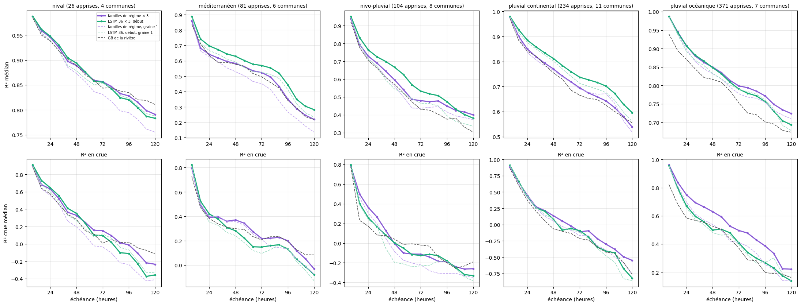
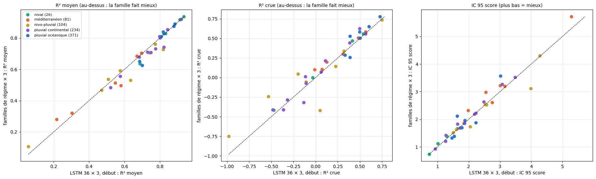
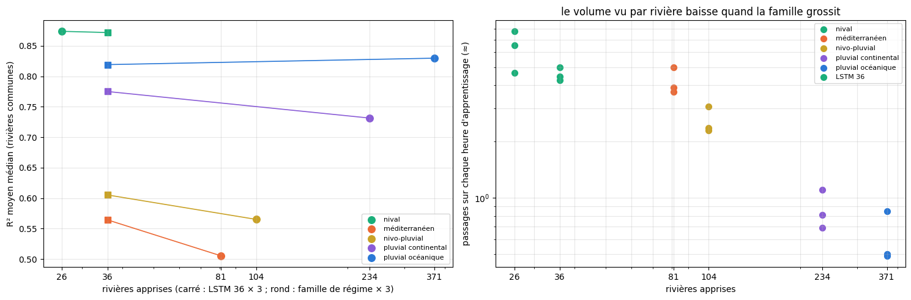

# 5.12 — Les familles de régime face au LSTM 36, famille par famille

Pour chaque famille de régime (notebook 5.11), on ne garde que **les rivières apprises par les deux modèles** : celles des 36 habituelles qui sont
dans la famille. On compare, rivière par rivière et échéance par échéance :

- **familles de régime × 3** : les 3 réseaux de la famille (apprise sur toutes ses rivières), validation au début ;
- **LSTM 36 × 3, début** : les 3 réseaux appris sur les 36 rivières (notebook 6.1), validation au début ;
- et, pour les deux, la graine 1 seule ; le GB de la rivière en repère.

Les deux ensembles ont le même réseau, la même validation et 3 graines chacun ; ce qui change : **les rivières apprises** (la famille, de 26
à 371 rivières, ou les 36) — et la précision du calcul (demi-précision sur Kaggle pour les familles, 32 bits sur le Mac pour le 36 ×
3 ; écart négligeable au notebook 6.2).

**Le budget d'apprentissage** : une époque tire une part 19 / N des instants d'une famille de N rivières, et l'apprentissage s'arrête après 15
époques sans progrès ; le nombre d'exemples vus est donc à peu près le même pour toutes les familles : une grosse famille voit chacune
de ses rivières bien moins souvent. La dernière partie le chiffre.

    {0: 'pluvial océanique', 1: 'méditerranéen', 2: 'nival', 3: 'pluvial continental', 4: 'nivo-pluvial'}

    36 rivières communes ; {'nival': 26, 'méditerranéen': 81, 'nivo-pluvial': 104, 'pluvial continental': 234, 'pluvial océanique': 371}

## Le tableau par famille

Médianes sur les rivières communes ; « × 3 mieux » = nombre de rivières où les familles de régime × 3 font mieux que le LSTM 36 × 3.

<table border="1" class="dataframe">
  <thead>
    <tr style="text-align: right;">
      <th>famille</th>
      <th>nival</th>
      <th>méditerranéen</th>
      <th>nivo-pluvial</th>
      <th>pluvial continental</th>
      <th>pluvial océanique</th>
    </tr>
  </thead>
  <tbody>
    <tr>
      <th>rivières apprises par la famille</th>
      <td>26.000</td>
      <td>81.000</td>
      <td>104.000</td>
      <td>234.000</td>
      <td>371.000</td>
    </tr>
    <tr>
      <th>rivières communes</th>
      <td>4.000</td>
      <td>6.000</td>
      <td>8.000</td>
      <td>11.000</td>
      <td>7.000</td>
    </tr>
    <tr>
      <th>R² J+1 — régime × 3</th>
      <td>0.964</td>
      <td>0.726</td>
      <td>0.815</td>
      <td>0.910</td>
      <td>0.947</td>
    </tr>
    <tr>
      <th>R² J+1 — 36 × 3</th>
      <td>0.966</td>
      <td>0.776</td>
      <td>0.848</td>
      <td>0.930</td>
      <td>0.946</td>
    </tr>
    <tr>
      <th>R² J+5 — régime × 3</th>
      <td>0.802</td>
      <td>0.248</td>
      <td>0.413</td>
      <td>0.580</td>
      <td>0.736</td>
    </tr>
    <tr>
      <th>R² J+5 — 36 × 3</th>
      <td>0.792</td>
      <td>0.308</td>
      <td>0.405</td>
      <td>0.633</td>
      <td>0.706</td>
    </tr>
    <tr>
      <th>R² moyen — régime × 3</th>
      <td>0.874</td>
      <td>0.505</td>
      <td>0.565</td>
      <td>0.731</td>
      <td>0.830</td>
    </tr>
    <tr>
      <th>R² moyen — 36 × 3</th>
      <td>0.872</td>
      <td>0.564</td>
      <td>0.605</td>
      <td>0.775</td>
      <td>0.819</td>
    </tr>
    <tr>
      <th>R² crue — régime × 3</th>
      <td>0.236</td>
      <td>0.250</td>
      <td>-0.004</td>
      <td>0.012</td>
      <td>0.529</td>
    </tr>
    <tr>
      <th>R² crue — 36 × 3</th>
      <td>0.192</td>
      <td>0.216</td>
      <td>-0.030</td>
      <td>-0.107</td>
      <td>0.498</td>
    </tr>
    <tr>
      <th>IC 95 score — régime × 3</th>
      <td>1.250</td>
      <td>3.091</td>
      <td>2.193</td>
      <td>1.850</td>
      <td>1.873</td>
    </tr>
    <tr>
      <th>IC 95 score — 36 × 3</th>
      <td>1.156</td>
      <td>2.876</td>
      <td>2.283</td>
      <td>1.860</td>
      <td>1.774</td>
    </tr>
    <tr>
      <th>× 3 mieux (R² moyen)</th>
      <td>2.000</td>
      <td>4.000</td>
      <td>3.000</td>
      <td>3.000</td>
      <td>4.000</td>
    </tr>
    <tr>
      <th>× 3 mieux (R² crue)</th>
      <td>4.000</td>
      <td>5.000</td>
      <td>5.000</td>
      <td>8.000</td>
      <td>4.000</td>
    </tr>
  </tbody>
</table>

## Les courbes par famille

En haut : R² médian selon l'échéance ; en bas : R² en crue. Titre : rivières apprises par la famille, rivières communes.

    

    

## Rivière par rivière

    

    

<table border="1" class="dataframe">
  <thead>
    <tr>
      <th></th>
      <th></th>
      <th colspan="5" halign="left">R² crue</th>
      <th colspan="5" halign="left">R² moyen</th>
    </tr>
    <tr>
      <th></th>
      <th>modèle</th>
      <th>GB de la rivière</th>
      <th>LSTM 36 × 3, début</th>
      <th>LSTM 36, début, graine 1</th>
      <th>familles de régime × 3</th>
      <th>familles de régime, graine 1</th>
      <th>GB de la rivière</th>
      <th>LSTM 36 × 3, début</th>
      <th>LSTM 36, début, graine 1</th>
      <th>familles de régime × 3</th>
      <th>familles de régime, graine 1</th>
    </tr>
    <tr>
      <th>famille</th>
      <th>station</th>
      <th></th>
      <th></th>
      <th></th>
      <th></th>
      <th></th>
      <th></th>
      <th></th>
      <th></th>
      <th></th>
      <th></th>
    </tr>
  </thead>
  <tbody>
    <tr>
      <th rowspan="6" valign="top">méditerranéen</th>
      <th>Ardèche à Pont-de-Labeaume</th>
      <td>0.362</td>
      <td>0.307</td>
      <td>0.261</td>
      <td>0.300</td>
      <td>0.285</td>
      <td>0.500</td>
      <td>0.549</td>
      <td>0.515</td>
      <td>0.514</td>
      <td>0.491</td>
    </tr>
    <tr>
      <th>Bienne à Morez</th>
      <td>0.006</td>
      <td>-0.011</td>
      <td>-0.017</td>
      <td>0.101</td>
      <td>0.129</td>
      <td>0.503</td>
      <td>0.580</td>
      <td>0.544</td>
      <td>0.496</td>
      <td>0.407</td>
    </tr>
    <tr>
      <th>Hérault à Laroque</th>
      <td>0.561</td>
      <td>0.565</td>
      <td>0.525</td>
      <td>0.584</td>
      <td>0.542</td>
      <td>0.669</td>
      <td>0.697</td>
      <td>0.670</td>
      <td>0.704</td>
      <td>0.670</td>
    </tr>
    <tr>
      <th>Loire à Chadrac [Pont du Monteil]</th>
      <td>0.049</td>
      <td>0.071</td>
      <td>-0.008</td>
      <td>0.107</td>
      <td>0.028</td>
      <td>0.234</td>
      <td>0.303</td>
      <td>0.242</td>
      <td>0.321</td>
      <td>0.249</td>
    </tr>
    <tr>
      <th>Loire à Goudet</th>
      <td>0.141</td>
      <td>0.125</td>
      <td>0.113</td>
      <td>0.200</td>
      <td>0.143</td>
      <td>0.204</td>
      <td>0.217</td>
      <td>0.205</td>
      <td>0.280</td>
      <td>0.211</td>
    </tr>
    <tr>
      <th>Tarn à Cocurès</th>
      <td>0.414</td>
      <td>0.483</td>
      <td>0.445</td>
      <td>0.508</td>
      <td>0.510</td>
      <td>0.602</td>
      <td>0.671</td>
      <td>0.643</td>
      <td>0.684</td>
      <td>0.672</td>
    </tr>
    <tr>
      <th rowspan="4" valign="top">nival</th>
      <th>Durance à Embrun [La Clapière]</th>
      <td>0.433</td>
      <td>0.536</td>
      <td>0.537</td>
      <td>0.558</td>
      <td>0.523</td>
      <td>0.920</td>
      <td>0.935</td>
      <td>0.934</td>
      <td>0.937</td>
      <td>0.929</td>
    </tr>
    <tr>
      <th>Durance à Val-des-Prés</th>
      <td>0.151</td>
      <td>-0.031</td>
      <td>0.009</td>
      <td>0.001</td>
      <td>-0.297</td>
      <td>0.865</td>
      <td>0.832</td>
      <td>0.834</td>
      <td>0.830</td>
      <td>0.791</td>
    </tr>
    <tr>
      <th>Salat à Soueix-Rogalle</th>
      <td>-0.408</td>
      <td>-0.471</td>
      <td>-0.542</td>
      <td>-0.415</td>
      <td>-0.591</td>
      <td>0.529</td>
      <td>0.688</td>
      <td>0.659</td>
      <td>0.637</td>
      <td>0.568</td>
    </tr>
    <tr>
      <th>Ubaye à Le Lauzet-Ubaye [Roche-Rousse]</th>
      <td>0.289</td>
      <td>0.416</td>
      <td>0.355</td>
      <td>0.471</td>
      <td>0.464</td>
      <td>0.885</td>
      <td>0.912</td>
      <td>0.902</td>
      <td>0.918</td>
      <td>0.914</td>
    </tr>
    <tr>
      <th rowspan="8" valign="top">nivo-pluvial</th>
      <th>Allier à Coudes</th>
      <td>0.159</td>
      <td>0.225</td>
      <td>0.051</td>
      <td>0.142</td>
      <td>0.055</td>
      <td>0.684</td>
      <td>0.743</td>
      <td>0.625</td>
      <td>0.708</td>
      <td>0.629</td>
    </tr>
    <tr>
      <th>Ance du Nord à Sauvessanges</th>
      <td>0.035</td>
      <td>0.048</td>
      <td>0.037</td>
      <td>-0.420</td>
      <td>-0.610</td>
      <td>0.730</td>
      <td>0.818</td>
      <td>0.814</td>
      <td>0.727</td>
      <td>0.682</td>
    </tr>
    <tr>
      <th>Chéran à Allèves [La Charniaz]</th>
      <td>-0.214</td>
      <td>-0.199</td>
      <td>-0.175</td>
      <td>0.048</td>
      <td>-0.042</td>
      <td>0.472</td>
      <td>0.576</td>
      <td>0.551</td>
      <td>0.593</td>
      <td>0.556</td>
    </tr>
    <tr>
      <th>Fier à Dingy-St-Clair</th>
      <td>-0.498</td>
      <td>-0.531</td>
      <td>-0.569</td>
      <td>-0.240</td>
      <td>-0.275</td>
      <td>0.398</td>
      <td>0.507</td>
      <td>0.469</td>
      <td>0.537</td>
      <td>0.508</td>
    </tr>
    <tr>
      <th>Gave d'Oloron à Escos</th>
      <td>-0.378</td>
      <td>-0.980</td>
      <td>-1.071</td>
      <td>-0.748</td>
      <td>-0.676</td>
      <td>0.554</td>
      <td>0.470</td>
      <td>0.453</td>
      <td>0.467</td>
      <td>0.441</td>
    </tr>
    <tr>
      <th>Ger à Aspet</th>
      <td>0.227</td>
      <td>0.322</td>
      <td>0.290</td>
      <td>0.337</td>
      <td>0.320</td>
      <td>0.432</td>
      <td>0.635</td>
      <td>0.527</td>
      <td>0.531</td>
      <td>0.516</td>
    </tr>
    <tr>
      <th>Gier à Rive-de-Gier</th>
      <td>0.017</td>
      <td>-0.108</td>
      <td>-0.134</td>
      <td>-0.056</td>
      <td>-0.092</td>
      <td>0.085</td>
      <td>0.057</td>
      <td>0.024</td>
      <td>0.108</td>
      <td>0.072</td>
    </tr>
    <tr>
      <th>Tarn à Millau [HE]</th>
      <td>0.597</td>
      <td>0.747</td>
      <td>0.734</td>
      <td>0.735</td>
      <td>0.690</td>
      <td>0.641</td>
      <td>0.774</td>
      <td>0.761</td>
      <td>0.761</td>
      <td>0.721</td>
    </tr>
    <tr>
      <th rowspan="11" valign="top">pluvial continental</th>
      <th>Ain à Bourg de sirod</th>
      <td>-0.134</td>
      <td>-0.117</td>
      <td>-0.134</td>
      <td>0.012</td>
      <td>-0.062</td>
      <td>0.621</td>
      <td>0.684</td>
      <td>0.665</td>
      <td>0.680</td>
      <td>0.672</td>
    </tr>
    <tr>
      <th>Alagnon à Joursac</th>
      <td>0.488</td>
      <td>0.565</td>
      <td>0.508</td>
      <td>0.558</td>
      <td>0.561</td>
      <td>0.757</td>
      <td>0.823</td>
      <td>0.807</td>
      <td>0.743</td>
      <td>0.792</td>
    </tr>
    <tr>
      <th>Albarine à Saint Rambert en Bugey</th>
      <td>-0.045</td>
      <td>0.060</td>
      <td>0.015</td>
      <td>0.072</td>
      <td>-0.015</td>
      <td>0.601</td>
      <td>0.730</td>
      <td>0.700</td>
      <td>0.711</td>
      <td>0.703</td>
    </tr>
    <tr>
      <th>Dessoubre à Rosureux</th>
      <td>-0.360</td>
      <td>-0.362</td>
      <td>-0.323</td>
      <td>-0.412</td>
      <td>-0.400</td>
      <td>0.652</td>
      <td>0.749</td>
      <td>0.735</td>
      <td>0.709</td>
      <td>0.711</td>
    </tr>
    <tr>
      <th>Doubs à Goumois</th>
      <td>0.097</td>
      <td>0.111</td>
      <td>0.022</td>
      <td>0.214</td>
      <td>0.150</td>
      <td>0.761</td>
      <td>0.798</td>
      <td>0.783</td>
      <td>0.811</td>
      <td>0.797</td>
    </tr>
    <tr>
      <th>Loue à Vuillafans</th>
      <td>-0.083</td>
      <td>-0.107</td>
      <td>-0.133</td>
      <td>-0.071</td>
      <td>-0.169</td>
      <td>0.723</td>
      <td>0.775</td>
      <td>0.757</td>
      <td>0.731</td>
      <td>0.720</td>
    </tr>
    <tr>
      <th>Moselle à Epinal</th>
      <td>-0.307</td>
      <td>-0.135</td>
      <td>-0.211</td>
      <td>-0.318</td>
      <td>-0.551</td>
      <td>0.824</td>
      <td>0.843</td>
      <td>0.828</td>
      <td>0.854</td>
      <td>0.828</td>
    </tr>
    <tr>
      <th>Nive à Osses</th>
      <td>-0.428</td>
      <td>-0.485</td>
      <td>-0.693</td>
      <td>-0.413</td>
      <td>-0.700</td>
      <td>0.471</td>
      <td>0.521</td>
      <td>0.475</td>
      <td>0.484</td>
      <td>0.456</td>
    </tr>
    <tr>
      <th>Saine à Syam</th>
      <td>-0.408</td>
      <td>-0.320</td>
      <td>-0.349</td>
      <td>-0.283</td>
      <td>-0.355</td>
      <td>0.493</td>
      <td>0.576</td>
      <td>0.547</td>
      <td>0.557</td>
      <td>0.555</td>
    </tr>
    <tr>
      <th>Saône à Lechâtelet</th>
      <td>0.380</td>
      <td>0.497</td>
      <td>0.480</td>
      <td>0.628</td>
      <td>0.553</td>
      <td>0.879</td>
      <td>0.920</td>
      <td>0.911</td>
      <td>0.920</td>
      <td>0.917</td>
    </tr>
    <tr>
      <th>Sioule à Pontgibaud</th>
      <td>0.364</td>
      <td>0.383</td>
      <td>0.390</td>
      <td>0.444</td>
      <td>0.464</td>
      <td>0.750</td>
      <td>0.803</td>
      <td>0.786</td>
      <td>0.801</td>
      <td>0.804</td>
    </tr>
    <tr>
      <th rowspan="7" valign="top">pluvial océanique</th>
      <th>Célé à Figeac</th>
      <td>0.443</td>
      <td>0.502</td>
      <td>0.475</td>
      <td>0.502</td>
      <td>0.405</td>
      <td>0.791</td>
      <td>0.807</td>
      <td>0.800</td>
      <td>0.811</td>
      <td>0.782</td>
    </tr>
    <tr>
      <th>Grand-Morin à Couilly-Pont-aux-Dames [Station ultrason]</th>
      <td>-0.014</td>
      <td>0.388</td>
      <td>0.420</td>
      <td>0.258</td>
      <td>0.178</td>
      <td>0.490</td>
      <td>0.700</td>
      <td>0.681</td>
      <td>0.625</td>
      <td>0.577</td>
    </tr>
    <tr>
      <th>Grand-Morin à Pommeuse</th>
      <td>-0.014</td>
      <td>0.330</td>
      <td>0.318</td>
      <td>0.286</td>
      <td>0.259</td>
      <td>0.497</td>
      <td>0.685</td>
      <td>0.669</td>
      <td>0.651</td>
      <td>0.632</td>
    </tr>
    <tr>
      <th>Isle à Perigueux</th>
      <td>0.479</td>
      <td>0.498</td>
      <td>0.471</td>
      <td>0.584</td>
      <td>0.569</td>
      <td>0.800</td>
      <td>0.819</td>
      <td>0.803</td>
      <td>0.840</td>
      <td>0.828</td>
    </tr>
    <tr>
      <th>Sioulet à La Prugne</th>
      <td>0.286</td>
      <td>0.389</td>
      <td>0.401</td>
      <td>0.529</td>
      <td>0.446</td>
      <td>0.760</td>
      <td>0.822</td>
      <td>0.820</td>
      <td>0.830</td>
      <td>0.814</td>
    </tr>
    <tr>
      <th>Vienne à Eymoutiers</th>
      <td>0.462</td>
      <td>0.726</td>
      <td>0.729</td>
      <td>0.778</td>
      <td>0.764</td>
      <td>0.786</td>
      <td>0.885</td>
      <td>0.881</td>
      <td>0.891</td>
      <td>0.881</td>
    </tr>
    <tr>
      <th>Vézère à Montignac</th>
      <td>0.503</td>
      <td>0.602</td>
      <td>0.600</td>
      <td>0.650</td>
      <td>0.629</td>
      <td>0.849</td>
      <td>0.879</td>
      <td>0.872</td>
      <td>0.876</td>
      <td>0.859</td>
    </tr>
  </tbody>
</table>

## La taille de la famille et le budget d'apprentissage

À gauche : pour chaque famille, le R² moyen médian de ses rivières communes avec les deux modèles, placé au nombre de rivières apprises
(trait : même famille). À droite : combien de fois, en moyenne, chaque instant d'apprentissage d'une rivière a été vu (nombre d'époques ×
part tirée par époque × instants gardés ÷ instants de la rivière), pour les 3 graines de chaque famille et pour le LSTM 36.

    

    

<table border="1" class="dataframe">
  <thead>
    <tr style="text-align: right;">
      <th></th>
      <th>rivières</th>
      <th>passages</th>
    </tr>
    <tr>
      <th>modèle</th>
      <th></th>
      <th></th>
    </tr>
  </thead>
  <tbody>
    <tr>
      <th>nival</th>
      <td>26</td>
      <td>6.32</td>
    </tr>
    <tr>
      <th>méditerranéen</th>
      <td>81</td>
      <td>4.19</td>
    </tr>
    <tr>
      <th>nivo-pluvial</th>
      <td>104</td>
      <td>2.58</td>
    </tr>
    <tr>
      <th>pluvial continental</th>
      <td>234</td>
      <td>0.87</td>
    </tr>
    <tr>
      <th>pluvial océanique</th>
      <td>371</td>
      <td>0.61</td>
    </tr>
    <tr>
      <th>LSTM 36</th>
      <td>36</td>
      <td>4.57</td>
    </tr>
  </tbody>
</table>

