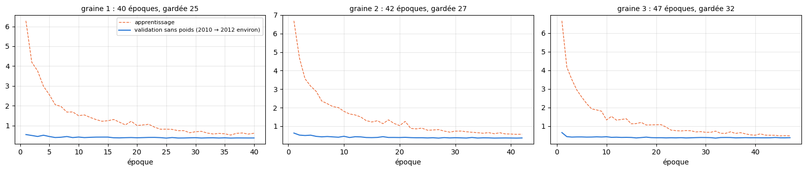
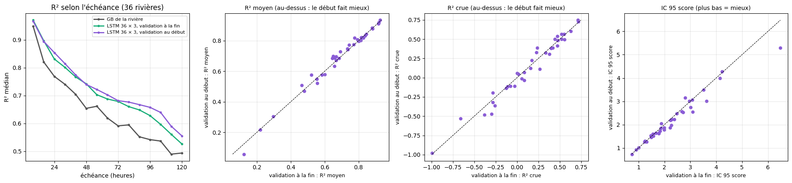
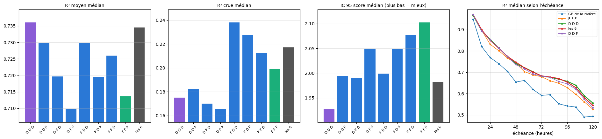

# 6.1 — La place de la validation : au début de l'historique

Où mettre la validation qui choisit l'époque d'un LSTM : à la fin de l'historique d'apprentissage, ou au début (partie 1) ? Et mélanger les deux places dans un ensemble (partie 2).

## Partie 1 — La validation au début de l'historique : le LSTM 36 × 3 refait

Tous les LSTM multi-rivières (notebooks 5.04 à 5.10) choisissent leur époque sur une validation faite des **15 % les plus récents** de
l'historique d'apprentissage de chaque rivière (à peu près mi-2022 → mars 2024) : le réseau apprend donc sur 2010 → mi-2022, avec deux ans
de trou avant la calibration et le test. Ici la validation est faite des **15 % les plus anciens** (à peu près 2010 → 2012) et le réseau
apprend sur 2012 → mars 2024, collé à la calibration et au test.

**Une seule chose change** par rapport à l'ensemble de 3 du notebook 5.07 : la place de la validation. Mêmes 36 rivières, mêmes données,
même réseau, mêmes graines (1, 2, 3), même choix de l'époque (validation sans poids), même notation en conditions réelles (passé de service,
prévision officielle de l'époque, IC réglés sur la calibration avec les 50 scénarios et notés sur le test, heures et seuils de crue du GB de
chaque rivière).

Les prévisions d'un réseau sont faites sur le processeur pendant que le réseau suivant apprend sur la carte graphique.

### Les trois apprentissages

    4111818 instants (3495063 pour apprendre, 616755 de validation, les plus anciens)

    époque 1 · apprentissage 6.2796 · validation 5.7106 (sans poids 0.5435) · 71 s

    époque 2 · apprentissage 4.1954 · validation 5.9429 (sans poids 0.4977) · 71 s

    époque 3 · apprentissage 3.7546 · validation 5.5428 (sans poids 0.4476) · 71 s

    époque 4 · apprentissage 2.9813 · validation 5.3803 (sans poids 0.5100) · 71 s

    époque 5 · apprentissage 2.5570 · validation 5.7177 (sans poids 0.4459) · 71 s

    époque 6 · apprentissage 2.0538 · validation 5.9904 (sans poids 0.3948) · 71 s

    époque 7 · apprentissage 1.9602 · validation 5.6437 (sans poids 0.4089) · 71 s

    époque 8 · apprentissage 1.6791 · validation 5.9541 (sans poids 0.4446) · 71 s

    époque 9 · apprentissage 1.6852 · validation 5.7881 (sans poids 0.3920) · 71 s

    époque 10 · apprentissage 1.4974 · validation 5.9785 (sans poids 0.4185) · 71 s

    époque 11 · apprentissage 1.5342 · validation 5.7649 (sans poids 0.3914) · 71 s

    époque 12 · apprentissage 1.4069 · validation 5.8981 (sans poids 0.4056) · 71 s

    époque 13 · apprentissage 1.2990 · validation 5.8636 (sans poids 0.4145) · 71 s

    époque 14 · apprentissage 1.2160 · validation 6.0136 (sans poids 0.4156) · 71 s

    époque 15 · apprentissage 1.2399 · validation 6.0792 (sans poids 0.4164) · 71 s

    époque 16 · apprentissage 1.3048 · validation 6.0130 (sans poids 0.3816) · 71 s

    époque 17 · apprentissage 1.1681 · validation 6.0832 (sans poids 0.3772) · 71 s

    époque 18 · apprentissage 1.0309 · validation 6.2564 (sans poids 0.3865) · 71 s

    époque 19 · apprentissage 1.2143 · validation 6.0873 (sans poids 0.3932) · 71 s

    époque 20 · apprentissage 1.0002 · validation 5.9851 (sans poids 0.3813) · 71 s

    époque 21 · apprentissage 1.0285 · validation 6.3643 (sans poids 0.3898) · 71 s

    époque 22 · apprentissage 1.0622 · validation 6.3800 (sans poids 0.3990) · 71 s

    époque 23 · apprentissage 0.9161 · validation 6.3233 (sans poids 0.4004) · 71 s

    époque 24 · apprentissage 0.8130 · validation 6.2795 (sans poids 0.3884) · 71 s

    époque 25 · apprentissage 0.8173 · validation 5.8765 (sans poids 0.3654) · 71 s

    époque 26 · apprentissage 0.8041 · validation 6.0513 (sans poids 0.3927) · 72 s

    époque 27 · apprentissage 0.7409 · validation 6.1150 (sans poids 0.3695) · 71 s

    époque 28 · apprentissage 0.7425 · validation 6.0809 (sans poids 0.3712) · 72 s

    époque 29 · apprentissage 0.6364 · validation 6.1437 (sans poids 0.3789) · 72 s

    époque 30 · apprentissage 0.6864 · validation 6.0350 (sans poids 0.3843) · 71 s

    époque 31 · apprentissage 0.7062 · validation 6.2124 (sans poids 0.3696) · 71 s

    époque 32 · apprentissage 0.6212 · validation 6.1323 (sans poids 0.3773) · 72 s

    époque 33 · apprentissage 0.5720 · validation 6.2155 (sans poids 0.3804) · 72 s

    époque 34 · apprentissage 0.6008 · validation 6.0926 (sans poids 0.3703) · 72 s

    époque 35 · apprentissage 0.5835 · validation 6.0643 (sans poids 0.3794) · 72 s

    époque 36 · apprentissage 0.5177 · validation 6.0036 (sans poids 0.3668) · 72 s

    époque 37 · apprentissage 0.6057 · validation 5.9571 (sans poids 0.3740) · 72 s

    époque 38 · apprentissage 0.6233 · validation 6.0213 (sans poids 0.3730) · 72 s

    époque 39 · apprentissage 0.5676 · validation 6.0481 (sans poids 0.3714) · 72 s

    époque 40 · apprentissage 0.6078 · validation 6.0337 (sans poids 0.3719) · 72 s

    graine 1 : 40 époques (meilleure 25), 2863 s

    époque 1 · apprentissage 6.6865 · validation 6.0223 (sans poids 0.6305) · 73 s

    époque 2 · apprentissage 4.6799 · validation 5.5805 (sans poids 0.5198) · 73 s

    époque 3 · apprentissage 3.5610 · validation 5.5045 (sans poids 0.4978) · 73 s

    époque 4 · apprentissage 3.1655 · validation 5.7697 (sans poids 0.5162) · 74 s

    époque 5 · apprentissage 2.8837 · validation 5.4311 (sans poids 0.4518) · 73 s

    époque 6 · apprentissage 2.3613 · validation 6.0809 (sans poids 0.4259) · 72 s

    époque 7 · apprentissage 2.2144 · validation 5.7191 (sans poids 0.4435) · 74 s

    époque 8 · apprentissage 2.0588 · validation 5.7471 (sans poids 0.4237) · 74 s

    époque 9 · apprentissage 2.0060 · validation 6.0604 (sans poids 0.4053) · 73 s

    époque 10 · apprentissage 1.8025 · validation 6.2887 (sans poids 0.4558) · 72 s

    époque 11 · apprentissage 1.6605 · validation 6.0601 (sans poids 0.3894) · 73 s

    époque 12 · apprentissage 1.6080 · validation 6.2791 (sans poids 0.4314) · 72 s

    époque 13 · apprentissage 1.4995 · validation 6.3153 (sans poids 0.4233) · 73 s

    époque 14 · apprentissage 1.3011 · validation 6.2732 (sans poids 0.3900) · 74 s

    époque 15 · apprentissage 1.2268 · validation 6.2385 (sans poids 0.3844) · 72 s

    époque 16 · apprentissage 1.2960 · validation 6.1422 (sans poids 0.3944) · 72 s

    époque 17 · apprentissage 1.1381 · validation 6.1413 (sans poids 0.4347) · 72 s

    époque 18 · apprentissage 1.3422 · validation 6.7645 (sans poids 0.3923) · 72 s

    époque 19 · apprentissage 1.1506 · validation 6.4959 (sans poids 0.3929) · 72 s

    époque 20 · apprentissage 1.0322 · validation 5.9242 (sans poids 0.3887) · 71 s

    époque 21 · apprentissage 1.2585 · validation 6.1796 (sans poids 0.3994) · 72 s

    époque 22 · apprentissage 0.8818 · validation 6.5375 (sans poids 0.3833) · 72 s

    époque 23 · apprentissage 0.8547 · validation 6.4910 (sans poids 0.3758) · 74 s

    époque 24 · apprentissage 0.8959 · validation 6.3822 (sans poids 0.3768) · 72 s

    époque 25 · apprentissage 0.7845 · validation 6.4376 (sans poids 0.3672) · 72 s

    époque 26 · apprentissage 0.7947 · validation 6.4449 (sans poids 0.3764) · 72 s

    époque 27 · apprentissage 0.8169 · validation 6.3458 (sans poids 0.3581) · 72 s

    époque 28 · apprentissage 0.7381 · validation 6.4759 (sans poids 0.3837) · 72 s

    époque 29 · apprentissage 0.6789 · validation 6.1188 (sans poids 0.3681) · 72 s

    époque 30 · apprentissage 0.7342 · validation 6.3939 (sans poids 0.3765) · 143 s

    époque 31 · apprentissage 0.7385 · validation 6.3595 (sans poids 0.3707) · 477 s

    époque 32 · apprentissage 0.6997 · validation 6.3641 (sans poids 0.3615) · 470 s

    époque 33 · apprentissage 0.6734 · validation 6.5116 (sans poids 0.3908) · 468 s

    époque 34 · apprentissage 0.6488 · validation 6.4221 (sans poids 0.3617) · 1671 s

    époque 35 · apprentissage 0.6210 · validation 6.4120 (sans poids 0.3726) · 72 s

    époque 36 · apprentissage 0.6514 · validation 6.3705 (sans poids 0.3700) · 71 s

    époque 37 · apprentissage 0.5949 · validation 6.4363 (sans poids 0.3593) · 72 s

    époque 38 · apprentissage 0.6470 · validation 6.4059 (sans poids 0.3633) · 72 s

    époque 39 · apprentissage 0.5828 · validation 6.2982 (sans poids 0.3660) · 72 s

    époque 40 · apprentissage 0.5777 · validation 6.4435 (sans poids 0.3628) · 70 s

    époque 41 · apprentissage 0.5609 · validation 6.4445 (sans poids 0.3583) · 71 s

    époque 42 · apprentissage 0.5678 · validation 6.4987 (sans poids 0.3655) · 71 s

    graine 2 : 42 époques (meilleure 27), 5913 s

    époque 1 · apprentissage 6.6552 · validation 5.3407 (sans poids 0.6530) · 76 s

    époque 2 · apprentissage 4.1659 · validation 5.3212 (sans poids 0.4347) · 73 s

    époque 3 · apprentissage 3.5076 · validation 5.7997 (sans poids 0.4115) · 132 s

    époque 4 · apprentissage 2.9444 · validation 5.5453 (sans poids 0.4193) · 76 s

    époque 5 · apprentissage 2.5595 · validation 5.1761 (sans poids 0.4192) · 73 s

    époque 6 · apprentissage 2.2081 · validation 5.6487 (sans poids 0.4106) · 74 s

    époque 7 · apprentissage 1.9249 · validation 5.5019 (sans poids 0.4136) · 74 s

    époque 8 · apprentissage 1.8714 · validation 5.9532 (sans poids 0.4247) · 75 s

    époque 9 · apprentissage 1.8005 · validation 6.1237 (sans poids 0.4158) · 79 s

    époque 10 · apprentissage 1.3312 · validation 5.7775 (sans poids 0.4290) · 75 s

    époque 11 · apprentissage 1.5255 · validation 6.3207 (sans poids 0.3978) · 75 s

    époque 12 · apprentissage 1.3226 · validation 6.5037 (sans poids 0.4050) · 76 s

    époque 13 · apprentissage 1.3589 · validation 6.7349 (sans poids 0.3929) · 79 s

    époque 14 · apprentissage 1.3941 · validation 6.3296 (sans poids 0.3974) · 74 s

    époque 15 · apprentissage 1.1232 · validation 6.4099 (sans poids 0.3913) · 74 s

    époque 16 · apprentissage 1.1382 · validation 6.1876 (sans poids 0.3660) · 74 s

    époque 17 · apprentissage 1.1992 · validation 6.4217 (sans poids 0.3861) · 73 s

    époque 18 · apprentissage 1.0604 · validation 6.6126 (sans poids 0.4091) · 76 s

    époque 19 · apprentissage 1.0651 · validation 6.5938 (sans poids 0.3822) · 75 s

    époque 20 · apprentissage 1.0725 · validation 6.1790 (sans poids 0.3753) · 73 s

    époque 21 · apprentissage 1.0784 · validation 6.3403 (sans poids 0.3766) · 74 s

    époque 22 · apprentissage 0.9487 · validation 6.7334 (sans poids 0.3684) · 75 s

    époque 23 · apprentissage 0.7863 · validation 6.3924 (sans poids 0.3748) · 75 s

    époque 24 · apprentissage 0.7567 · validation 6.9275 (sans poids 0.3699) · 73 s

    époque 25 · apprentissage 0.7386 · validation 6.4054 (sans poids 0.3797) · 73 s

    époque 26 · apprentissage 0.7631 · validation 6.5351 (sans poids 0.3659) · 73 s

    époque 27 · apprentissage 0.7526 · validation 6.5488 (sans poids 0.3729) · 72 s

    époque 28 · apprentissage 0.6866 · validation 6.9377 (sans poids 0.3822) · 72 s

    époque 29 · apprentissage 0.7038 · validation 6.6351 (sans poids 0.3885) · 72 s

    époque 30 · apprentissage 0.6691 · validation 6.5228 (sans poids 0.3865) · 72 s

    époque 31 · apprentissage 0.6691 · validation 6.6496 (sans poids 0.3810) · 72 s

    époque 32 · apprentissage 0.7307 · validation 6.6676 (sans poids 0.3570) · 74 s

    époque 33 · apprentissage 0.6135 · validation 6.7343 (sans poids 0.3870) · 73 s

    époque 34 · apprentissage 0.6113 · validation 6.8254 (sans poids 0.3895) · 73 s

    époque 35 · apprentissage 0.6940 · validation 6.6084 (sans poids 0.3877) · 74 s

    époque 36 · apprentissage 0.6090 · validation 6.5464 (sans poids 0.3695) · 73 s

    époque 37 · apprentissage 0.6486 · validation 6.8019 (sans poids 0.3737) · 75 s

    époque 38 · apprentissage 0.5867 · validation 6.9110 (sans poids 0.3810) · 75 s

    époque 39 · apprentissage 0.5306 · validation 6.9316 (sans poids 0.3739) · 72 s

    époque 40 · apprentissage 0.5142 · validation 6.8006 (sans poids 0.3764) · 72 s

    époque 41 · apprentissage 0.5847 · validation 6.8284 (sans poids 0.3729) · 71 s

    époque 42 · apprentissage 0.5181 · validation 6.8328 (sans poids 0.3723) · 72 s

    époque 43 · apprentissage 0.5116 · validation 6.7023 (sans poids 0.3730) · 72 s

    époque 44 · apprentissage 0.5075 · validation 6.7951 (sans poids 0.3893) · 72 s

    époque 45 · apprentissage 0.4749 · validation 6.7920 (sans poids 0.3730) · 73 s

    époque 46 · apprentissage 0.4859 · validation 6.7985 (sans poids 0.3721) · 73 s

    époque 47 · apprentissage 0.4786 · validation 6.8560 (sans poids 0.3792) · 72 s

    graine 3 : 47 époques (meilleure 32), 3544 s

    prévisions de la graine 1 : 1735 s

    prévisions de la graine 2 : 1803 s

    prévisions de la graine 3 : 1415 s

    

    

### Les notes

Chaque rivière est notée aux heures communes à tous ses modèles ; R² et crues sur calibration + test ; IC réglés sur la calibration, notés sur le test (score rapporté au débit moyen : plus bas = mieux). « mieux que » : nombre de rivières (sur 36) où le premier modèle fait mieux.

    36 rivières

<table border="1" class="dataframe">
  <thead>
    <tr style="text-align: right;">
      <th></th>
      <th>R² J+1</th>
      <th>R² J+3</th>
      <th>R² J+5</th>
      <th>R² moyen</th>
      <th>R² crue</th>
      <th>R² montée</th>
      <th>biais pic %</th>
      <th>IC 95 couverture</th>
      <th>IC 95 score</th>
    </tr>
  </thead>
  <tbody>
    <tr>
      <th>GB de la rivière (médiane)</th>
      <td>0.840</td>
      <td>0.620</td>
      <td>0.506</td>
      <td>0.646</td>
      <td>0.119</td>
      <td>0.418</td>
      <td>1.237</td>
      <td>0.881</td>
      <td>2.474</td>
    </tr>
    <tr>
      <th>LSTM 36 × 3, validation à la fin (médiane)</th>
      <td>0.898</td>
      <td>0.690</td>
      <td>0.559</td>
      <td>0.714</td>
      <td>0.199</td>
      <td>0.449</td>
      <td>-5.629</td>
      <td>0.889</td>
      <td>2.102</td>
    </tr>
    <tr>
      <th>LSTM 36 × 3, validation au début (médiane)</th>
      <td>0.906</td>
      <td>0.701</td>
      <td>0.588</td>
      <td>0.736</td>
      <td>0.175</td>
      <td>0.459</td>
      <td>-4.854</td>
      <td>0.889</td>
      <td>1.927</td>
    </tr>
    <tr>
      <th>graine 1, validation à la fin (médiane)</th>
      <td>0.871</td>
      <td>0.672</td>
      <td>0.529</td>
      <td>0.684</td>
      <td>0.157</td>
      <td>0.418</td>
      <td>-2.915</td>
      <td>0.879</td>
      <td>2.235</td>
    </tr>
    <tr>
      <th>graine 1, validation au début (médiane)</th>
      <td>0.898</td>
      <td>0.667</td>
      <td>0.567</td>
      <td>0.690</td>
      <td>0.082</td>
      <td>0.424</td>
      <td>-2.611</td>
      <td>0.884</td>
      <td>2.118</td>
    </tr>
    <tr>
      <th>graine 2, validation à la fin (médiane)</th>
      <td>0.886</td>
      <td>0.666</td>
      <td>0.542</td>
      <td>0.676</td>
      <td>0.154</td>
      <td>0.436</td>
      <td>-4.521</td>
      <td>0.875</td>
      <td>2.168</td>
    </tr>
    <tr>
      <th>graine 2, validation au début (médiane)</th>
      <td>0.893</td>
      <td>0.704</td>
      <td>0.568</td>
      <td>0.725</td>
      <td>0.134</td>
      <td>0.448</td>
      <td>-3.299</td>
      <td>0.865</td>
      <td>2.147</td>
    </tr>
    <tr>
      <th>graine 3, validation à la fin (médiane)</th>
      <td>0.895</td>
      <td>0.675</td>
      <td>0.526</td>
      <td>0.686</td>
      <td>0.152</td>
      <td>0.425</td>
      <td>-3.532</td>
      <td>0.861</td>
      <td>2.337</td>
    </tr>
    <tr>
      <th>graine 3, validation au début (médiane)</th>
      <td>0.895</td>
      <td>0.696</td>
      <td>0.578</td>
      <td>0.714</td>
      <td>0.187</td>
      <td>0.413</td>
      <td>-5.228</td>
      <td>0.887</td>
      <td>2.055</td>
    </tr>
    <tr>
      <th>LSTM 36 × 3, validation au début mieux que LSTM 36 × 3, validation à la fin</th>
      <td>21.000</td>
      <td>18.000</td>
      <td>22.000</td>
      <td>19.000</td>
      <td>15.000</td>
      <td>18.000</td>
      <td>12.000</td>
      <td>20.000</td>
      <td>25.000</td>
    </tr>
    <tr>
      <th>LSTM 36 × 3, validation au début mieux que GB de la rivière</th>
      <td>34.000</td>
      <td>31.000</td>
      <td>32.000</td>
      <td>33.000</td>
      <td>25.000</td>
      <td>25.000</td>
      <td>13.000</td>
      <td>24.000</td>
      <td>34.000</td>
    </tr>
    <tr>
      <th>graine 1, validation au début mieux que graine 1, validation à la fin</th>
      <td>23.000</td>
      <td>21.000</td>
      <td>21.000</td>
      <td>20.000</td>
      <td>17.000</td>
      <td>21.000</td>
      <td>11.000</td>
      <td>14.000</td>
      <td>23.000</td>
    </tr>
    <tr>
      <th>graine 2, validation au début mieux que graine 2, validation à la fin</th>
      <td>21.000</td>
      <td>21.000</td>
      <td>24.000</td>
      <td>18.000</td>
      <td>18.000</td>
      <td>23.000</td>
      <td>16.000</td>
      <td>15.000</td>
      <td>19.000</td>
    </tr>
    <tr>
      <th>graine 3, validation au début mieux que graine 3, validation à la fin</th>
      <td>17.000</td>
      <td>20.000</td>
      <td>21.000</td>
      <td>21.000</td>
      <td>16.000</td>
      <td>12.000</td>
      <td>13.000</td>
      <td>25.000</td>
      <td>26.000</td>
    </tr>
  </tbody>
</table>

<table border="1" class="dataframe">
  <thead>
    <tr>
      <th></th>
      <th colspan="3" halign="left">R² moyen</th>
      <th colspan="3" halign="left">R² crue</th>
      <th colspan="3" halign="left">IC 95 score</th>
    </tr>
    <tr>
      <th>modèle</th>
      <th>GB de la rivière</th>
      <th>LSTM 36 × 3, validation à la fin</th>
      <th>LSTM 36 × 3, validation au début</th>
      <th>GB de la rivière</th>
      <th>LSTM 36 × 3, validation à la fin</th>
      <th>LSTM 36 × 3, validation au début</th>
      <th>GB de la rivière</th>
      <th>LSTM 36 × 3, validation à la fin</th>
      <th>LSTM 36 × 3, validation au début</th>
    </tr>
    <tr>
      <th>station</th>
      <th></th>
      <th></th>
      <th></th>
      <th></th>
      <th></th>
      <th></th>
      <th></th>
      <th></th>
      <th></th>
    </tr>
  </thead>
  <tbody>
    <tr>
      <th>Saint Rambert en Bugey</th>
      <td>0.601</td>
      <td>0.692</td>
      <td>0.730</td>
      <td>-0.045</td>
      <td>0.002</td>
      <td>0.060</td>
      <td>3.187</td>
      <td>2.384</td>
      <td>2.224</td>
    </tr>
    <tr>
      <th>Millau [HE]</th>
      <td>0.641</td>
      <td>0.743</td>
      <td>0.774</td>
      <td>0.597</td>
      <td>0.712</td>
      <td>0.747</td>
      <td>4.450</td>
      <td>4.153</td>
      <td>3.983</td>
    </tr>
    <tr>
      <th>Pontgibaud</th>
      <td>0.750</td>
      <td>0.813</td>
      <td>0.803</td>
      <td>0.364</td>
      <td>0.400</td>
      <td>0.383</td>
      <td>2.001</td>
      <td>1.828</td>
      <td>1.724</td>
    </tr>
    <tr>
      <th>Bourg de sirod</th>
      <td>0.621</td>
      <td>0.685</td>
      <td>0.684</td>
      <td>-0.134</td>
      <td>-0.113</td>
      <td>-0.117</td>
      <td>3.368</td>
      <td>2.474</td>
      <td>2.484</td>
    </tr>
    <tr>
      <th>Dingy-St-Clair</th>
      <td>0.398</td>
      <td>0.464</td>
      <td>0.507</td>
      <td>-0.498</td>
      <td>-0.663</td>
      <td>-0.531</td>
      <td>3.903</td>
      <td>2.715</td>
      <td>2.522</td>
    </tr>
    <tr>
      <th>Perigueux</th>
      <td>0.800</td>
      <td>0.828</td>
      <td>0.819</td>
      <td>0.479</td>
      <td>0.521</td>
      <td>0.498</td>
      <td>2.242</td>
      <td>2.287</td>
      <td>2.224</td>
    </tr>
    <tr>
      <th>Pont-de-Labeaume</th>
      <td>0.500</td>
      <td>0.555</td>
      <td>0.549</td>
      <td>0.362</td>
      <td>0.380</td>
      <td>0.307</td>
      <td>3.869</td>
      <td>2.957</td>
      <td>3.002</td>
    </tr>
    <tr>
      <th>Coudes</th>
      <td>0.684</td>
      <td>0.737</td>
      <td>0.743</td>
      <td>0.159</td>
      <td>0.172</td>
      <td>0.225</td>
      <td>1.859</td>
      <td>1.564</td>
      <td>1.503</td>
    </tr>
    <tr>
      <th>Osses</th>
      <td>0.471</td>
      <td>0.555</td>
      <td>0.521</td>
      <td>-0.428</td>
      <td>-0.381</td>
      <td>-0.485</td>
      <td>2.423</td>
      <td>2.230</td>
      <td>2.184</td>
    </tr>
    <tr>
      <th>Escos</th>
      <td>0.554</td>
      <td>0.479</td>
      <td>0.470</td>
      <td>-0.378</td>
      <td>-0.993</td>
      <td>-0.980</td>
      <td>1.970</td>
      <td>1.884</td>
      <td>2.044</td>
    </tr>
    <tr>
      <th>Montignac</th>
      <td>0.849</td>
      <td>0.884</td>
      <td>0.879</td>
      <td>0.503</td>
      <td>0.629</td>
      <td>0.602</td>
      <td>1.727</td>
      <td>1.468</td>
      <td>1.534</td>
    </tr>
    <tr>
      <th>Epinal</th>
      <td>0.824</td>
      <td>0.846</td>
      <td>0.843</td>
      <td>-0.307</td>
      <td>-0.127</td>
      <td>-0.135</td>
      <td>1.424</td>
      <td>1.224</td>
      <td>1.260</td>
    </tr>
    <tr>
      <th>Syam</th>
      <td>0.493</td>
      <td>0.584</td>
      <td>0.576</td>
      <td>-0.408</td>
      <td>-0.282</td>
      <td>-0.320</td>
      <td>4.754</td>
      <td>3.507</td>
      <td>3.483</td>
    </tr>
    <tr>
      <th>Cocurès</th>
      <td>0.602</td>
      <td>0.668</td>
      <td>0.671</td>
      <td>0.414</td>
      <td>0.477</td>
      <td>0.483</td>
      <td>3.315</td>
      <td>2.269</td>
      <td>1.979</td>
    </tr>
    <tr>
      <th>Vuillafans</th>
      <td>0.723</td>
      <td>0.773</td>
      <td>0.775</td>
      <td>-0.083</td>
      <td>-0.079</td>
      <td>-0.107</td>
      <td>1.837</td>
      <td>1.318</td>
      <td>1.266</td>
    </tr>
    <tr>
      <th>Chadrac [Pont du Monteil]</th>
      <td>0.234</td>
      <td>0.297</td>
      <td>0.303</td>
      <td>0.049</td>
      <td>0.084</td>
      <td>0.071</td>
      <td>4.106</td>
      <td>3.093</td>
      <td>2.541</td>
    </tr>
    <tr>
      <th>Figeac</th>
      <td>0.791</td>
      <td>0.793</td>
      <td>0.807</td>
      <td>0.443</td>
      <td>0.443</td>
      <td>0.502</td>
      <td>2.232</td>
      <td>1.777</td>
      <td>1.627</td>
    </tr>
    <tr>
      <th>Laroque</th>
      <td>0.669</td>
      <td>0.668</td>
      <td>0.697</td>
      <td>0.561</td>
      <td>0.519</td>
      <td>0.565</td>
      <td>3.960</td>
      <td>3.011</td>
      <td>2.749</td>
    </tr>
    <tr>
      <th>Lechâtelet</th>
      <td>0.879</td>
      <td>0.921</td>
      <td>0.920</td>
      <td>0.380</td>
      <td>0.556</td>
      <td>0.497</td>
      <td>1.166</td>
      <td>0.913</td>
      <td>0.921</td>
    </tr>
    <tr>
      <th>Goudet</th>
      <td>0.204</td>
      <td>0.220</td>
      <td>0.217</td>
      <td>0.141</td>
      <td>0.158</td>
      <td>0.125</td>
      <td>11.820</td>
      <td>6.481</td>
      <td>5.286</td>
    </tr>
    <tr>
      <th>Pommeuse</th>
      <td>0.497</td>
      <td>0.645</td>
      <td>0.685</td>
      <td>-0.014</td>
      <td>0.226</td>
      <td>0.330</td>
      <td>3.975</td>
      <td>2.214</td>
      <td>1.875</td>
    </tr>
    <tr>
      <th>Allèves [La Charniaz]</th>
      <td>0.472</td>
      <td>0.521</td>
      <td>0.576</td>
      <td>-0.214</td>
      <td>-0.282</td>
      <td>-0.199</td>
      <td>3.571</td>
      <td>2.665</td>
      <td>2.565</td>
    </tr>
    <tr>
      <th>Rosureux</th>
      <td>0.652</td>
      <td>0.735</td>
      <td>0.749</td>
      <td>-0.360</td>
      <td>-0.260</td>
      <td>-0.362</td>
      <td>4.558</td>
      <td>3.076</td>
      <td>3.071</td>
    </tr>
    <tr>
      <th>Soueix-Rogalle</th>
      <td>0.529</td>
      <td>0.657</td>
      <td>0.688</td>
      <td>-0.408</td>
      <td>-0.299</td>
      <td>-0.471</td>
      <td>1.730</td>
      <td>1.247</td>
      <td>1.301</td>
    </tr>
    <tr>
      <th>Eymoutiers</th>
      <td>0.786</td>
      <td>0.881</td>
      <td>0.885</td>
      <td>0.462</td>
      <td>0.717</td>
      <td>0.726</td>
      <td>2.949</td>
      <td>1.487</td>
      <td>1.458</td>
    </tr>
    <tr>
      <th>La Prugne</th>
      <td>0.760</td>
      <td>0.815</td>
      <td>0.822</td>
      <td>0.286</td>
      <td>0.418</td>
      <td>0.389</td>
      <td>2.362</td>
      <td>1.991</td>
      <td>1.774</td>
    </tr>
    <tr>
      <th>Morez</th>
      <td>0.503</td>
      <td>0.601</td>
      <td>0.580</td>
      <td>0.006</td>
      <td>0.053</td>
      <td>-0.011</td>
      <td>4.207</td>
      <td>2.802</td>
      <td>3.148</td>
    </tr>
    <tr>
      <th>Couilly-Pont-aux-Dames [Station ultrason]</th>
      <td>0.490</td>
      <td>0.650</td>
      <td>0.700</td>
      <td>-0.014</td>
      <td>0.239</td>
      <td>0.388</td>
      <td>4.812</td>
      <td>3.634</td>
      <td>3.019</td>
    </tr>
    <tr>
      <th>Aspet</th>
      <td>0.432</td>
      <td>0.658</td>
      <td>0.635</td>
      <td>0.227</td>
      <td>0.333</td>
      <td>0.322</td>
      <td>2.524</td>
      <td>1.858</td>
      <td>1.844</td>
    </tr>
    <tr>
      <th>Sauvessanges</th>
      <td>0.730</td>
      <td>0.777</td>
      <td>0.818</td>
      <td>0.035</td>
      <td>0.017</td>
      <td>0.048</td>
      <td>2.169</td>
      <td>1.558</td>
      <td>1.603</td>
    </tr>
    <tr>
      <th>Rive-de-Gier</th>
      <td>0.085</td>
      <td>0.123</td>
      <td>0.057</td>
      <td>0.017</td>
      <td>-0.028</td>
      <td>-0.108</td>
      <td>7.382</td>
      <td>4.232</td>
      <td>4.271</td>
    </tr>
    <tr>
      <th>Joursac</th>
      <td>0.757</td>
      <td>0.821</td>
      <td>0.823</td>
      <td>0.488</td>
      <td>0.551</td>
      <td>0.565</td>
      <td>2.085</td>
      <td>1.672</td>
      <td>1.638</td>
    </tr>
    <tr>
      <th>Le Lauzet-Ubaye [Roche-Rousse]</th>
      <td>0.885</td>
      <td>0.918</td>
      <td>0.912</td>
      <td>0.289</td>
      <td>0.474</td>
      <td>0.416</td>
      <td>1.306</td>
      <td>1.774</td>
      <td>1.632</td>
    </tr>
    <tr>
      <th>Embrun [La Clapière]</th>
      <td>0.920</td>
      <td>0.928</td>
      <td>0.935</td>
      <td>0.433</td>
      <td>0.473</td>
      <td>0.536</td>
      <td>0.782</td>
      <td>0.746</td>
      <td>0.734</td>
    </tr>
    <tr>
      <th>Val-des-Prés</th>
      <td>0.865</td>
      <td>0.838</td>
      <td>0.832</td>
      <td>0.151</td>
      <td>0.082</td>
      <td>-0.031</td>
      <td>1.057</td>
      <td>0.998</td>
      <td>1.010</td>
    </tr>
    <tr>
      <th>Goumois</th>
      <td>0.761</td>
      <td>0.802</td>
      <td>0.798</td>
      <td>0.097</td>
      <td>0.265</td>
      <td>0.111</td>
      <td>2.243</td>
      <td>1.991</td>
      <td>1.860</td>
    </tr>
  </tbody>
</table>

    

    

## Partie 2 — Mélanger les places de la validation dans l'ensemble

Au la première partie, mettre la validation au début de l'historique (2010 → 2012 environ) plutôt qu'à la fin (mi-2022 → mars 2024) améliore
l'ensemble de 3 LSTM 36 en moyenne et aux longues échéances, mais le fait reculer en crue : les crues des premières années ne sont plus
apprises. Rien n'oblige à mettre la validation au même endroit pour tous les réseaux d'un ensemble : un réseau « validation à la fin »
apprend les premières années, un réseau « validation au début » apprend les dernières ; ensemble, ils ont appris toutes les années, et des
réseaux qui se trompent différemment font une meilleure moyenne.

**Aucun entraînement** : on a déjà les prévisions des 6 réseaux (graines 1, 2, 3, chacune avec la validation à la fin — notebooks 5.04 et 5.07 —
et au début — la première partie). On note :

- les **8 ensembles de 3** : pour chaque graine, sa version début (D) ou fin (F) ; « D D F » = graines 1 et 2 au début, graine 3 à la fin.
  Tous ont 3 réseaux, la comparaison est juste ;
- l'**ensemble des 6 réseaux**.

Même notation qu'à la première partie (conditions réelles, heures communes à tous les modèles de la rivière, IC réglés sur la calibration et notés
sur le test). Les rivières sont notées en parallèle sur les cœurs du processeur.

    36 rivières ; 9 ensembles : ['D D D', 'D D F', 'D F D', 'D F F', 'F D D', 'F D F', 'F F D', 'F F F', 'les 6']

### Les notes

    36 rivières notées en 126 s

<table border="1" class="dataframe">
  <thead>
    <tr style="text-align: right;">
      <th></th>
      <th>R² J+1</th>
      <th>R² J+3</th>
      <th>R² J+5</th>
      <th>R² moyen</th>
      <th>R² crue</th>
      <th>R² montée</th>
      <th>biais pic %</th>
      <th>IC 95 couverture</th>
      <th>IC 95 score</th>
    </tr>
  </thead>
  <tbody>
    <tr>
      <th>GB de la rivière (médiane)</th>
      <td>0.840</td>
      <td>0.620</td>
      <td>0.506</td>
      <td>0.646</td>
      <td>0.119</td>
      <td>0.418</td>
      <td>1.237</td>
      <td>0.881</td>
      <td>2.474</td>
    </tr>
    <tr>
      <th>D D D (médiane)</th>
      <td>0.906</td>
      <td>0.701</td>
      <td>0.588</td>
      <td>0.736</td>
      <td>0.175</td>
      <td>0.459</td>
      <td>-4.854</td>
      <td>0.889</td>
      <td>1.927</td>
    </tr>
    <tr>
      <th>D D F (médiane)</th>
      <td>0.905</td>
      <td>0.694</td>
      <td>0.570</td>
      <td>0.730</td>
      <td>0.183</td>
      <td>0.477</td>
      <td>-4.099</td>
      <td>0.882</td>
      <td>1.994</td>
    </tr>
    <tr>
      <th>D F D (médiane)</th>
      <td>0.904</td>
      <td>0.690</td>
      <td>0.591</td>
      <td>0.720</td>
      <td>0.170</td>
      <td>0.452</td>
      <td>-5.070</td>
      <td>0.896</td>
      <td>1.990</td>
    </tr>
    <tr>
      <th>D F F (médiane)</th>
      <td>0.904</td>
      <td>0.680</td>
      <td>0.568</td>
      <td>0.710</td>
      <td>0.165</td>
      <td>0.476</td>
      <td>-5.330</td>
      <td>0.891</td>
      <td>2.049</td>
    </tr>
    <tr>
      <th>F D D (médiane)</th>
      <td>0.896</td>
      <td>0.710</td>
      <td>0.576</td>
      <td>0.730</td>
      <td>0.238</td>
      <td>0.457</td>
      <td>-6.198</td>
      <td>0.886</td>
      <td>1.999</td>
    </tr>
    <tr>
      <th>F D F (médiane)</th>
      <td>0.897</td>
      <td>0.708</td>
      <td>0.556</td>
      <td>0.720</td>
      <td>0.228</td>
      <td>0.461</td>
      <td>-5.399</td>
      <td>0.873</td>
      <td>2.049</td>
    </tr>
    <tr>
      <th>F F D (médiane)</th>
      <td>0.897</td>
      <td>0.694</td>
      <td>0.577</td>
      <td>0.726</td>
      <td>0.213</td>
      <td>0.467</td>
      <td>-5.597</td>
      <td>0.901</td>
      <td>2.078</td>
    </tr>
    <tr>
      <th>F F F (médiane)</th>
      <td>0.898</td>
      <td>0.690</td>
      <td>0.559</td>
      <td>0.714</td>
      <td>0.199</td>
      <td>0.449</td>
      <td>-5.629</td>
      <td>0.889</td>
      <td>2.102</td>
    </tr>
    <tr>
      <th>les 6 (médiane)</th>
      <td>0.903</td>
      <td>0.702</td>
      <td>0.580</td>
      <td>0.735</td>
      <td>0.217</td>
      <td>0.478</td>
      <td>-5.765</td>
      <td>0.897</td>
      <td>1.982</td>
    </tr>
    <tr>
      <th>D D F mieux que D D D</th>
      <td>23.000</td>
      <td>18.000</td>
      <td>16.000</td>
      <td>18.000</td>
      <td>24.000</td>
      <td>26.000</td>
      <td>21.000</td>
      <td>8.000</td>
      <td>10.000</td>
    </tr>
    <tr>
      <th>D F D mieux que D D D</th>
      <td>20.000</td>
      <td>18.000</td>
      <td>19.000</td>
      <td>22.000</td>
      <td>21.000</td>
      <td>15.000</td>
      <td>17.000</td>
      <td>19.000</td>
      <td>16.000</td>
    </tr>
    <tr>
      <th>D F F mieux que D D D</th>
      <td>18.000</td>
      <td>21.000</td>
      <td>16.000</td>
      <td>19.000</td>
      <td>23.000</td>
      <td>21.000</td>
      <td>21.000</td>
      <td>12.000</td>
      <td>12.000</td>
    </tr>
    <tr>
      <th>F D D mieux que D D D</th>
      <td>18.000</td>
      <td>21.000</td>
      <td>17.000</td>
      <td>18.000</td>
      <td>18.000</td>
      <td>16.000</td>
      <td>22.000</td>
      <td>21.000</td>
      <td>14.000</td>
    </tr>
    <tr>
      <th>F D F mieux que D D D</th>
      <td>16.000</td>
      <td>20.000</td>
      <td>13.000</td>
      <td>16.000</td>
      <td>21.000</td>
      <td>19.000</td>
      <td>27.000</td>
      <td>12.000</td>
      <td>11.000</td>
    </tr>
    <tr>
      <th>F F D mieux que D D D</th>
      <td>13.000</td>
      <td>17.000</td>
      <td>18.000</td>
      <td>18.000</td>
      <td>18.000</td>
      <td>19.000</td>
      <td>22.000</td>
      <td>21.000</td>
      <td>13.000</td>
    </tr>
    <tr>
      <th>F F F mieux que D D D</th>
      <td>15.000</td>
      <td>18.000</td>
      <td>14.000</td>
      <td>17.000</td>
      <td>21.000</td>
      <td>18.000</td>
      <td>24.000</td>
      <td>16.000</td>
      <td>11.000</td>
    </tr>
    <tr>
      <th>les 6 mieux que D D D</th>
      <td>28.000</td>
      <td>26.000</td>
      <td>20.000</td>
      <td>24.000</td>
      <td>25.000</td>
      <td>24.000</td>
      <td>23.000</td>
      <td>22.000</td>
      <td>20.000</td>
    </tr>
  </tbody>
</table>

    

    

