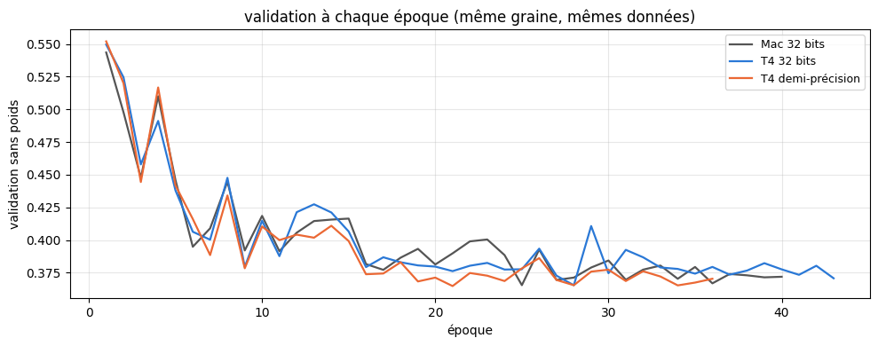
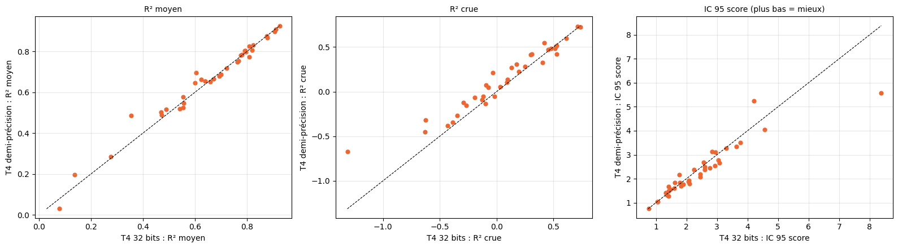

# 6.2 — Kaggle et la demi-précision : vitesse et qualité

Les cartes graphiques NVIDIA de Kaggle (Tesla T4) ont des circuits qui multiplient beaucoup plus vite des nombres à 16 bits (environ 3 chiffres
significatifs) que des nombres à 32 bits (environ 7 chiffres). En **précision mixte**, les multiplications du réseau se font en 16 bits, les
poids et les sommes restent en 32 bits, et les petits gradients sont agrandis avant le calcul pour ne pas s'annuler (`torch.autocast`,
`GradScaler`).

**L'essai** : la graine 1 du LSTM 36 rivières avec la validation au début (notebook 6.1), trois fois, avec exactement les mêmes données,
fonctions et réglages :

| | où | calcul |
|---|---|---|
| Mac 32 bits | carte graphique du Mac (notebook 6.1) | 32 bits |
| T4 32 bits | une T4 de Kaggle | 32 bits |
| T4 demi-précision | une T4 de Kaggle | précision mixte |

**Règle fixée avant de voir les notes** : la demi-précision devient le réglage par défaut si elle va au moins 1,5 fois plus vite que la T4 en
32 bits et si son R² moyen médian sur les 36 rivières reste à moins de 0,01 de celui de la T4 en 32 bits (l'écart d'une graine à l'autre
est plus grand). Prévisions en conditions réelles, comme au notebook 6.1.

## La vitesse et l'apprentissage

<table border="1" class="dataframe">
  <thead>
    <tr style="text-align: right;">
      <th></th>
      <th>époques</th>
      <th>secondes par époque (médiane)</th>
      <th>durée totale (min)</th>
      <th>époque gardée</th>
      <th>meilleure validation sans poids</th>
      <th>vitesse / T4 32 bits</th>
    </tr>
  </thead>
  <tbody>
    <tr>
      <th>Mac 32 bits</th>
      <td>40.0</td>
      <td>71.310</td>
      <td>47.590</td>
      <td>25.0</td>
      <td>0.365</td>
      <td>0.648</td>
    </tr>
    <tr>
      <th>T4 32 bits</th>
      <td>43.0</td>
      <td>46.210</td>
      <td>33.088</td>
      <td>28.0</td>
      <td>0.365</td>
      <td>1.000</td>
    </tr>
    <tr>
      <th>T4 demi-précision</th>
      <td>36.0</td>
      <td>16.423</td>
      <td>9.744</td>
      <td>21.0</td>
      <td>0.365</td>
      <td>2.814</td>
    </tr>
  </tbody>
</table>

    

    

## Les notes sur les 36 rivières

<table border="1" class="dataframe">
  <thead>
    <tr style="text-align: right;">
      <th></th>
      <th>R² J+1</th>
      <th>R² J+3</th>
      <th>R² J+5</th>
      <th>R² moyen</th>
      <th>R² crue</th>
      <th>R² montée</th>
      <th>biais pic %</th>
      <th>IC 95 couverture</th>
      <th>IC 95 score</th>
    </tr>
  </thead>
  <tbody>
    <tr>
      <th>GB de la rivière (médiane)</th>
      <td>0.840</td>
      <td>0.620</td>
      <td>0.506</td>
      <td>0.646</td>
      <td>0.119</td>
      <td>0.418</td>
      <td>1.237</td>
      <td>0.881</td>
      <td>2.474</td>
    </tr>
    <tr>
      <th>Mac 32 bits (médiane)</th>
      <td>0.898</td>
      <td>0.667</td>
      <td>0.567</td>
      <td>0.690</td>
      <td>0.082</td>
      <td>0.424</td>
      <td>-2.611</td>
      <td>0.884</td>
      <td>2.118</td>
    </tr>
    <tr>
      <th>T4 32 bits (médiane)</th>
      <td>0.887</td>
      <td>0.676</td>
      <td>0.543</td>
      <td>0.697</td>
      <td>0.095</td>
      <td>0.370</td>
      <td>-5.001</td>
      <td>0.876</td>
      <td>2.177</td>
    </tr>
    <tr>
      <th>T4 demi-précision (médiane)</th>
      <td>0.894</td>
      <td>0.690</td>
      <td>0.533</td>
      <td>0.692</td>
      <td>0.176</td>
      <td>0.458</td>
      <td>-2.089</td>
      <td>0.891</td>
      <td>2.126</td>
    </tr>
    <tr>
      <th>T4 demi-précision mieux que T4 32 bits</th>
      <td>19.000</td>
      <td>22.000</td>
      <td>15.000</td>
      <td>20.000</td>
      <td>27.000</td>
      <td>27.000</td>
      <td>26.000</td>
      <td>18.000</td>
      <td>23.000</td>
    </tr>
    <tr>
      <th>T4 demi-précision mieux que Mac 32 bits</th>
      <td>20.000</td>
      <td>19.000</td>
      <td>11.000</td>
      <td>14.000</td>
      <td>21.000</td>
      <td>19.000</td>
      <td>26.000</td>
      <td>24.000</td>
      <td>18.000</td>
    </tr>
    <tr>
      <th>T4 32 bits mieux que Mac 32 bits</th>
      <td>18.000</td>
      <td>19.000</td>
      <td>14.000</td>
      <td>17.000</td>
      <td>14.000</td>
      <td>10.000</td>
      <td>23.000</td>
      <td>24.000</td>
      <td>16.000</td>
    </tr>
  </tbody>
</table>

    vitesse : × 2.81 ; écart de R² moyen médian (demi − 32 bits) : -0.0052 → la demi-précision devient le réglage par défaut

    

    

