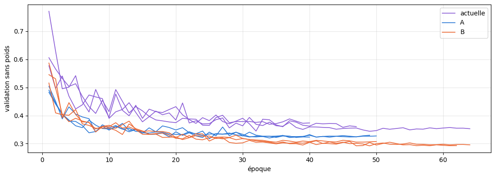
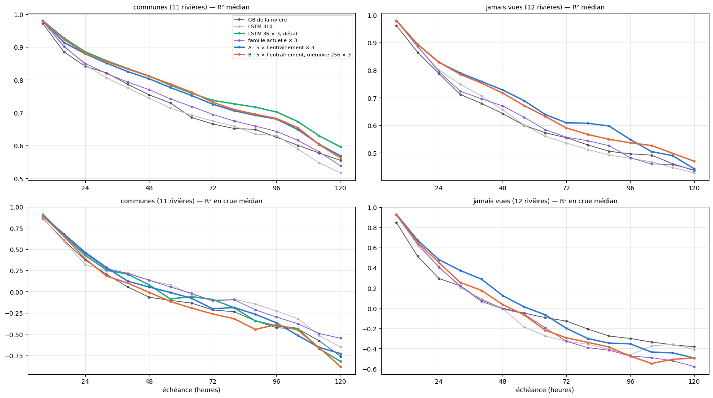

# 6.3 — Pluvial continental : plus d'entraînement ou plus de mémoire ?

Au notebook 5.12, la famille **pluvial continental** (234 rivières apprises) perd nettement face au LSTM 36 × 3 sur ses 11 rivières communes (R²
moyen 0,731 contre 0,775), et chacune de ses rivières n'a été vue qu'environ 0,9 fois pendant l'apprentissage (4,6 fois pour le LSTM 36).
Deux nouvelles versions de cette famille, 3 graines chacune, sur Kaggle (demi-précision), même validation au début, mêmes données :

| version | part tirée par époque | mémoire | ce qu'on teste |
|---|---|---|---|
| actuelle (notebook 5.11) | 19 / 234 | 128 | — |
| **A** | 5 × 19 / 234 | 128 | le volume d'entraînement |
| **B** | 5 × 19 / 234 | **256** | le volume d'entraînement et la capacité |

**Lecture** : si A rattrape le LSTM 36 × 3, c'était le volume ; si seul B le rattrape, c'est la capacité ; si aucun, c'est la diversité des
rivières apprises (le LSTM 36 apprend tous les régimes).

Notes en conditions réelles, comme aux notebooks 5.11 et 5.12, sur les 11 rivières communes, et sur les rivières jamais vues de la famille.

    {0: 'pluvial océanique', 1: 'méditerranéen', 2: 'nival', 3: 'pluvial continental', 4: 'nivo-pluvial'}

## Les apprentissages

<table border="1" class="dataframe">
  <thead>
    <tr style="text-align: right;">
      <th></th>
      <th>version</th>
      <th>graine</th>
      <th>époques</th>
      <th>gardée</th>
      <th>s par époque</th>
      <th>minutes</th>
      <th>meilleure validation sans poids</th>
      <th>passages sur chaque heure (≈)</th>
    </tr>
  </thead>
  <tbody>
    <tr>
      <th>0</th>
      <td>actuelle</td>
      <td>1</td>
      <td>64</td>
      <td>49</td>
      <td>11.062</td>
      <td>11.815</td>
      <td>0.344</td>
      <td>1.104</td>
    </tr>
    <tr>
      <th>1</th>
      <td>actuelle</td>
      <td>2</td>
      <td>47</td>
      <td>32</td>
      <td>11.067</td>
      <td>8.690</td>
      <td>0.345</td>
      <td>0.811</td>
    </tr>
    <tr>
      <th>2</th>
      <td>actuelle</td>
      <td>3</td>
      <td>40</td>
      <td>25</td>
      <td>11.107</td>
      <td>7.440</td>
      <td>0.365</td>
      <td>0.690</td>
    </tr>
    <tr>
      <th>3</th>
      <td>A</td>
      <td>1</td>
      <td>40</td>
      <td>25</td>
      <td>45.721</td>
      <td>30.489</td>
      <td>0.317</td>
      <td>3.451</td>
    </tr>
    <tr>
      <th>4</th>
      <td>A</td>
      <td>2</td>
      <td>49</td>
      <td>34</td>
      <td>45.183</td>
      <td>37.010</td>
      <td>0.320</td>
      <td>4.227</td>
    </tr>
    <tr>
      <th>5</th>
      <td>A</td>
      <td>3</td>
      <td>50</td>
      <td>35</td>
      <td>44.439</td>
      <td>37.027</td>
      <td>0.322</td>
      <td>4.314</td>
    </tr>
    <tr>
      <th>6</th>
      <td>B</td>
      <td>1</td>
      <td>64</td>
      <td>49</td>
      <td>123.032</td>
      <td>131.161</td>
      <td>0.292</td>
      <td>5.521</td>
    </tr>
    <tr>
      <th>7</th>
      <td>B</td>
      <td>2</td>
      <td>62</td>
      <td>47</td>
      <td>124.411</td>
      <td>128.216</td>
      <td>0.292</td>
      <td>5.349</td>
    </tr>
    <tr>
      <th>8</th>
      <td>B</td>
      <td>3</td>
      <td>50</td>
      <td>35</td>
      <td>122.198</td>
      <td>101.826</td>
      <td>0.305</td>
      <td>4.314</td>
    </tr>
  </tbody>
</table>

    

    

    groupe                                   communes  jamais vues  kayak
    modèle                                                               
    A : 5 × l'entraînement × 3                     11           12      1
    B : 5 × l'entraînement, mémoire 256 × 3        11           12      1
    GB de la rivière                               11           12      1
    LSTM 310                                       11           12      0
    LSTM 36 × 3, début                             11            0      0
    famille actuelle × 3                           11           12      1

## Les notes

Médianes ; « mieux que » : nombre de rivières où le premier modèle fait mieux.

    communes : 11 rivières

<table border="1" class="dataframe">
  <thead>
    <tr style="text-align: right;">
      <th></th>
      <th>R² J+1</th>
      <th>R² J+3</th>
      <th>R² J+5</th>
      <th>R² moyen</th>
      <th>R² crue</th>
      <th>R² montée</th>
      <th>biais pic %</th>
      <th>IC 95 couverture</th>
      <th>IC 95 score</th>
    </tr>
  </thead>
  <tbody>
    <tr>
      <th>GB de la rivière (médiane)</th>
      <td>0.893</td>
      <td>0.693</td>
      <td>0.577</td>
      <td>0.723</td>
      <td>-0.083</td>
      <td>0.392</td>
      <td>-1.651</td>
      <td>0.892</td>
      <td>2.243</td>
    </tr>
    <tr>
      <th>LSTM 310 (médiane)</th>
      <td>0.908</td>
      <td>0.694</td>
      <td>0.549</td>
      <td>0.709</td>
      <td>0.064</td>
      <td>0.412</td>
      <td>-3.660</td>
      <td>0.825</td>
      <td>2.306</td>
    </tr>
    <tr>
      <th>LSTM 36 × 3, début (médiane)</th>
      <td>0.930</td>
      <td>0.760</td>
      <td>0.633</td>
      <td>0.775</td>
      <td>-0.107</td>
      <td>0.371</td>
      <td>-8.059</td>
      <td>0.901</td>
      <td>1.860</td>
    </tr>
    <tr>
      <th>famille actuelle × 3 (médiane)</th>
      <td>0.910</td>
      <td>0.718</td>
      <td>0.580</td>
      <td>0.731</td>
      <td>0.012</td>
      <td>0.398</td>
      <td>-3.769</td>
      <td>0.867</td>
      <td>1.850</td>
    </tr>
    <tr>
      <th>A : 5 × l'entraînement × 3 (médiane)</th>
      <td>0.916</td>
      <td>0.751</td>
      <td>0.607</td>
      <td>0.761</td>
      <td>-0.025</td>
      <td>0.386</td>
      <td>-5.691</td>
      <td>0.908</td>
      <td>1.820</td>
    </tr>
    <tr>
      <th>B : 5 × l'entraînement, mémoire 256 × 3 (médiane)</th>
      <td>0.921</td>
      <td>0.760</td>
      <td>0.606</td>
      <td>0.766</td>
      <td>-0.187</td>
      <td>0.326</td>
      <td>-8.287</td>
      <td>0.916</td>
      <td>1.935</td>
    </tr>
    <tr>
      <th>A : 5 × l'entraînement × 3 mieux que LSTM 36 × 3, début</th>
      <td>6.000</td>
      <td>7.000</td>
      <td>5.000</td>
      <td>5.000</td>
      <td>6.000</td>
      <td>6.000</td>
      <td>8.000</td>
      <td>6.000</td>
      <td>10.000</td>
    </tr>
    <tr>
      <th>B : 5 × l'entraînement, mémoire 256 × 3 mieux que LSTM 36 × 3, début</th>
      <td>6.000</td>
      <td>7.000</td>
      <td>5.000</td>
      <td>6.000</td>
      <td>2.000</td>
      <td>2.000</td>
      <td>5.000</td>
      <td>6.000</td>
      <td>9.000</td>
    </tr>
    <tr>
      <th>A : 5 × l'entraînement × 3 mieux que famille actuelle × 3</th>
      <td>10.000</td>
      <td>10.000</td>
      <td>6.000</td>
      <td>10.000</td>
      <td>2.000</td>
      <td>4.000</td>
      <td>3.000</td>
      <td>10.000</td>
      <td>10.000</td>
    </tr>
    <tr>
      <th>B : 5 × l'entraînement, mémoire 256 × 3 mieux que famille actuelle × 3</th>
      <td>11.000</td>
      <td>11.000</td>
      <td>6.000</td>
      <td>10.000</td>
      <td>2.000</td>
      <td>3.000</td>
      <td>3.000</td>
      <td>11.000</td>
      <td>9.000</td>
    </tr>
    <tr>
      <th>B : 5 × l'entraînement, mémoire 256 × 3 mieux que A : 5 × l'entraînement × 3</th>
      <td>7.000</td>
      <td>7.000</td>
      <td>5.000</td>
      <td>7.000</td>
      <td>3.000</td>
      <td>3.000</td>
      <td>4.000</td>
      <td>6.000</td>
      <td>5.000</td>
    </tr>
  </tbody>
</table>

<table border="1" class="dataframe">
  <thead>
    <tr style="text-align: right;">
      <th>modèle</th>
      <th>GB de la rivière</th>
      <th>LSTM 310</th>
      <th>LSTM 36 × 3, début</th>
      <th>famille actuelle × 3</th>
      <th>A : 5 × l'entraînement × 3</th>
      <th>B : 5 × l'entraînement, mémoire 256 × 3</th>
    </tr>
    <tr>
      <th>station</th>
      <th></th>
      <th></th>
      <th></th>
      <th></th>
      <th></th>
      <th></th>
    </tr>
  </thead>
  <tbody>
    <tr>
      <th>Ain à Bourg de sirod</th>
      <td>0.621</td>
      <td>0.615</td>
      <td>0.684</td>
      <td>0.680</td>
      <td>0.697</td>
      <td>0.672</td>
    </tr>
    <tr>
      <th>Alagnon à Joursac</th>
      <td>0.757</td>
      <td>0.787</td>
      <td>0.823</td>
      <td>0.743</td>
      <td>0.800</td>
      <td>0.815</td>
    </tr>
    <tr>
      <th>Albarine à Saint Rambert en Bugey</th>
      <td>0.601</td>
      <td>0.676</td>
      <td>0.730</td>
      <td>0.711</td>
      <td>0.715</td>
      <td>0.717</td>
    </tr>
    <tr>
      <th>Dessoubre à Rosureux</th>
      <td>0.652</td>
      <td>0.709</td>
      <td>0.749</td>
      <td>0.709</td>
      <td>0.722</td>
      <td>0.738</td>
    </tr>
    <tr>
      <th>Doubs à Goumois</th>
      <td>0.761</td>
      <td>0.794</td>
      <td>0.798</td>
      <td>0.811</td>
      <td>0.815</td>
      <td>0.815</td>
    </tr>
    <tr>
      <th>Loue à Vuillafans</th>
      <td>0.723</td>
      <td>0.703</td>
      <td>0.775</td>
      <td>0.731</td>
      <td>0.761</td>
      <td>0.766</td>
    </tr>
    <tr>
      <th>Moselle à Epinal</th>
      <td>0.824</td>
      <td>0.826</td>
      <td>0.843</td>
      <td>0.854</td>
      <td>0.841</td>
      <td>0.855</td>
    </tr>
    <tr>
      <th>Nive à Osses</th>
      <td>0.471</td>
      <td>0.502</td>
      <td>0.521</td>
      <td>0.484</td>
      <td>0.562</td>
      <td>0.535</td>
    </tr>
    <tr>
      <th>Saine à Syam</th>
      <td>0.493</td>
      <td>0.504</td>
      <td>0.576</td>
      <td>0.557</td>
      <td>0.575</td>
      <td>0.582</td>
    </tr>
    <tr>
      <th>Saône à Lechâtelet</th>
      <td>0.879</td>
      <td>0.894</td>
      <td>0.920</td>
      <td>0.920</td>
      <td>0.929</td>
      <td>0.924</td>
    </tr>
    <tr>
      <th>Sioule à Pontgibaud</th>
      <td>0.750</td>
      <td>0.766</td>
      <td>0.803</td>
      <td>0.801</td>
      <td>0.822</td>
      <td>0.814</td>
    </tr>
  </tbody>
</table>

    jamais vues : 12 rivières

<table border="1" class="dataframe">
  <thead>
    <tr style="text-align: right;">
      <th></th>
      <th>R² J+1</th>
      <th>R² J+3</th>
      <th>R² J+5</th>
      <th>R² moyen</th>
      <th>R² crue</th>
      <th>R² montée</th>
      <th>biais pic %</th>
      <th>IC 95 couverture</th>
      <th>IC 95 score</th>
    </tr>
  </thead>
  <tbody>
    <tr>
      <th>GB de la rivière (médiane)</th>
      <td>0.871</td>
      <td>0.570</td>
      <td>0.463</td>
      <td>0.606</td>
      <td>-0.024</td>
      <td>0.317</td>
      <td>1.732</td>
      <td>0.910</td>
      <td>3.113</td>
    </tr>
    <tr>
      <th>LSTM 310 (médiane)</th>
      <td>0.888</td>
      <td>0.561</td>
      <td>0.447</td>
      <td>0.616</td>
      <td>-0.063</td>
      <td>0.378</td>
      <td>2.901</td>
      <td>0.780</td>
      <td>3.054</td>
    </tr>
    <tr>
      <th>famille actuelle × 3 (médiane)</th>
      <td>0.888</td>
      <td>0.590</td>
      <td>0.459</td>
      <td>0.619</td>
      <td>-0.059</td>
      <td>0.340</td>
      <td>-1.022</td>
      <td>0.911</td>
      <td>2.622</td>
    </tr>
    <tr>
      <th>A : 5 × l'entraînement × 3 (médiane)</th>
      <td>0.895</td>
      <td>0.646</td>
      <td>0.487</td>
      <td>0.675</td>
      <td>-0.003</td>
      <td>0.345</td>
      <td>-6.597</td>
      <td>0.908</td>
      <td>2.345</td>
    </tr>
    <tr>
      <th>B : 5 × l'entraînement, mémoire 256 × 3 (médiane)</th>
      <td>0.898</td>
      <td>0.634</td>
      <td>0.498</td>
      <td>0.656</td>
      <td>-0.061</td>
      <td>0.315</td>
      <td>-7.235</td>
      <td>0.932</td>
      <td>2.330</td>
    </tr>
    <tr>
      <th>A : 5 × l'entraînement × 3 mieux que famille actuelle × 3</th>
      <td>9.000</td>
      <td>11.000</td>
      <td>10.000</td>
      <td>11.000</td>
      <td>9.000</td>
      <td>7.000</td>
      <td>5.000</td>
      <td>6.000</td>
      <td>7.000</td>
    </tr>
    <tr>
      <th>B : 5 × l'entraînement, mémoire 256 × 3 mieux que famille actuelle × 3</th>
      <td>9.000</td>
      <td>8.000</td>
      <td>9.000</td>
      <td>9.000</td>
      <td>6.000</td>
      <td>6.000</td>
      <td>3.000</td>
      <td>8.000</td>
      <td>7.000</td>
    </tr>
    <tr>
      <th>B : 5 × l'entraînement, mémoire 256 × 3 mieux que A : 5 × l'entraînement × 3</th>
      <td>7.000</td>
      <td>7.000</td>
      <td>6.000</td>
      <td>6.000</td>
      <td>6.000</td>
      <td>5.000</td>
      <td>5.000</td>
      <td>10.000</td>
      <td>9.000</td>
    </tr>
    <tr>
      <th>B : 5 × l'entraînement, mémoire 256 × 3 mieux que LSTM 310</th>
      <td>8.000</td>
      <td>10.000</td>
      <td>11.000</td>
      <td>11.000</td>
      <td>7.000</td>
      <td>6.000</td>
      <td>5.000</td>
      <td>9.000</td>
      <td>10.000</td>
    </tr>
    <tr>
      <th>B : 5 × l'entraînement, mémoire 256 × 3 mieux que GB de la rivière</th>
      <td>9.000</td>
      <td>9.000</td>
      <td>8.000</td>
      <td>9.000</td>
      <td>4.000</td>
      <td>5.000</td>
      <td>6.000</td>
      <td>6.000</td>
      <td>9.000</td>
    </tr>
  </tbody>
</table>

<table border="1" class="dataframe">
  <thead>
    <tr style="text-align: right;">
      <th>modèle</th>
      <th>GB de la rivière</th>
      <th>LSTM 310</th>
      <th>famille actuelle × 3</th>
      <th>A : 5 × l'entraînement × 3</th>
      <th>B : 5 × l'entraînement, mémoire 256 × 3</th>
    </tr>
    <tr>
      <th>station</th>
      <th></th>
      <th></th>
      <th></th>
      <th></th>
      <th></th>
    </tr>
  </thead>
  <tbody>
    <tr>
      <th>Aix à St-Germain-Laval</th>
      <td>0.605</td>
      <td>0.460</td>
      <td>0.443</td>
      <td>0.455</td>
      <td>0.431</td>
    </tr>
    <tr>
      <th>Bidouze à Aicirits [St-Palais]</th>
      <td>-0.304</td>
      <td>-0.409</td>
      <td>-0.401</td>
      <td>-0.181</td>
      <td>-0.087</td>
    </tr>
    <tr>
      <th>Ill à Kogenheim</th>
      <td>0.911</td>
      <td>0.869</td>
      <td>0.887</td>
      <td>0.885</td>
      <td>0.887</td>
    </tr>
    <tr>
      <th>Isole à Scaër [Stang Boudilin]</th>
      <td>0.697</td>
      <td>0.549</td>
      <td>0.582</td>
      <td>0.669</td>
      <td>0.669</td>
    </tr>
    <tr>
      <th>Lanterne à Fleurey-les-Faverney</th>
      <td>0.790</td>
      <td>0.816</td>
      <td>0.840</td>
      <td>0.862</td>
      <td>0.844</td>
    </tr>
    <tr>
      <th>Madon à Pulligny</th>
      <td>0.544</td>
      <td>0.508</td>
      <td>0.449</td>
      <td>0.588</td>
      <td>0.608</td>
    </tr>
    <tr>
      <th>Meuse à Chalaines</th>
      <td>0.600</td>
      <td>0.626</td>
      <td>0.664</td>
      <td>0.688</td>
      <td>0.644</td>
    </tr>
    <tr>
      <th>Meuse à Neufchâteau [crues]</th>
      <td>0.607</td>
      <td>0.660</td>
      <td>0.656</td>
      <td>0.681</td>
      <td>0.702</td>
    </tr>
    <tr>
      <th>Nieds à Filstroff</th>
      <td>0.555</td>
      <td>0.607</td>
      <td>0.574</td>
      <td>0.597</td>
      <td>0.615</td>
    </tr>
    <tr>
      <th>Nivelle à St-Pée-sur-Nivelle [Pont de Cherchebruit]</th>
      <td>0.143</td>
      <td>0.083</td>
      <td>0.427</td>
      <td>0.467</td>
      <td>0.518</td>
    </tr>
    <tr>
      <th>Saône à Ray-sur-Saône</th>
      <td>0.752</td>
      <td>0.734</td>
      <td>0.796</td>
      <td>0.826</td>
      <td>0.794</td>
    </tr>
    <tr>
      <th>Sormonne à Belval</th>
      <td>0.658</td>
      <td>0.743</td>
      <td>0.774</td>
      <td>0.801</td>
      <td>0.781</td>
    </tr>
  </tbody>
</table>

## Les courbes

    

    

