# 7.1 — Les courbes du bilan

Aucun nouvel entraînement : toutes les prévisions viennent des caches des notebooks 5.04, 5.07, 5.08 et 5.10 (conditions réelles : passé de service,
prévision officielle de l'époque, 50 scénarios). Chaque rivière est notée aux heures communes à tous ses modèles ; R² et crues sur
calibration + test ; intervalles réglés sur la calibration et notés sur le test.

**Les modèles**

| nom | appris sur | notebook |
|---|---|---|
| GB | la rivière seule (GB par défaut ou en service) | 20, 31, 33 |
| LSTM 36 | les 36 rivières du notebook 5.04 | 20 |
| LSTM 36 × 3 | moyenne de trois LSTM 36 (graines 1, 2, 3) | 30 |
| LSTM 310 | 310 rivières | 31 |
| LSTM famille | les rivières de sa famille (k-means sur BasinATLAS : 120, 77, 99 ou 27 rivières) | 33 |

**Les rivières** : les 36 du notebook 5.04 (apprises par tous les LSTM), les 40 jamais vues du notebook 5.08 (apprises par aucun LSTM ; le GB,
lui, est entraîné sur chacune), et les rivières de kayak ajoutées au notebook 5.10 (apprises par le LSTM de leur famille seulement).

## Les prévisions de chaque rivière

## Les notes, échéance par échéance

Pour chaque rivière et chaque modèle : R² et R² en crue (heures au-dessus du seuil de crue du GB) aux 15 échéances, couverture et score de
l'intervalle à 95 % aux 15 échéances (score rapporté au débit moyen : plus bas = mieux), et le biais moyen sur les pics.

    modèle       GB  LSTM 36  LSTM 36 × 3  LSTM 310  LSTM famille
    groupe                                                       
    36 rivières  36       36           36        36            36
    jamais vues  40        0            0        40            40
    kayak        11        0            0         0            11

## 1. Le R² selon l'échéance

Médiane sur les rivières, de 8 h à 5 jours. À gauche les 36 rivières apprises par tous ; à droite les 40 rivières qu'aucun LSTM n'a vues.

    
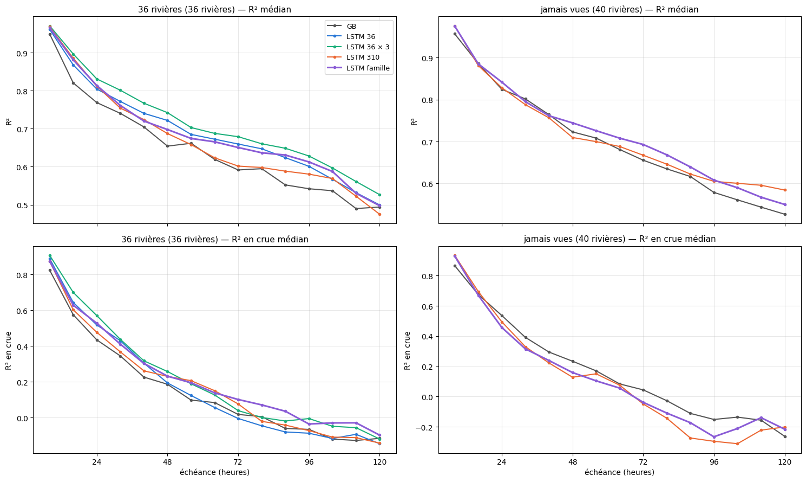
    

## 2. Les intervalles à 95 % selon l'échéance

Couverture (la part des heures où le débit observé tombe dans l'intervalle ; visée : 95 %) et score de l'intervalle (largeur + pénalité
quand le débit sort, rapporté au débit moyen : plus bas = mieux).

    
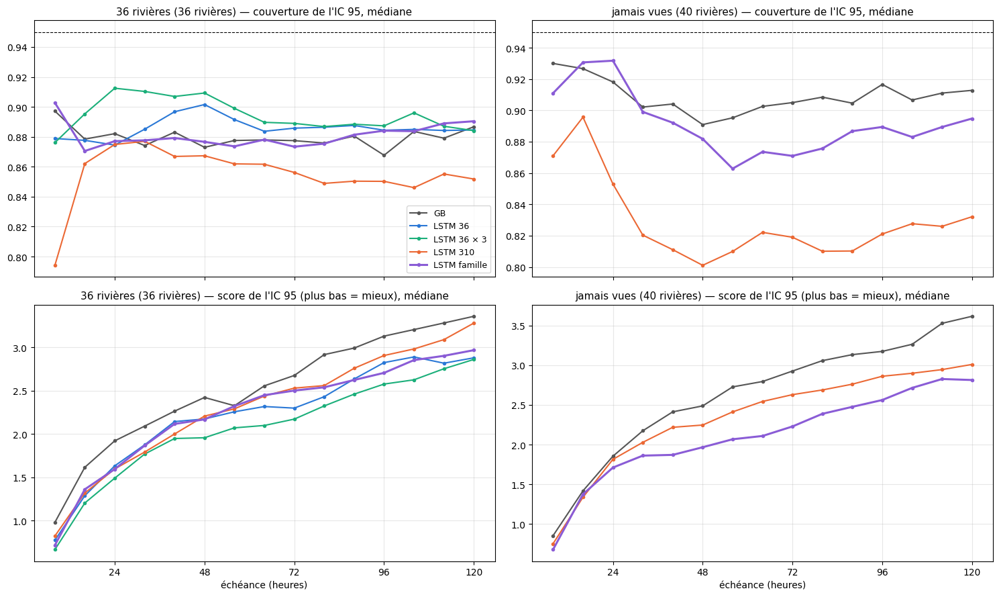
    

## 3. Famille par famille

R² médian selon l'échéance, pour les rivières de chaque famille. En haut les rivières apprises (parmi les 36), en bas les jamais vues
(aucune rivière jamais vue n'est tombée dans la famille 3).

    
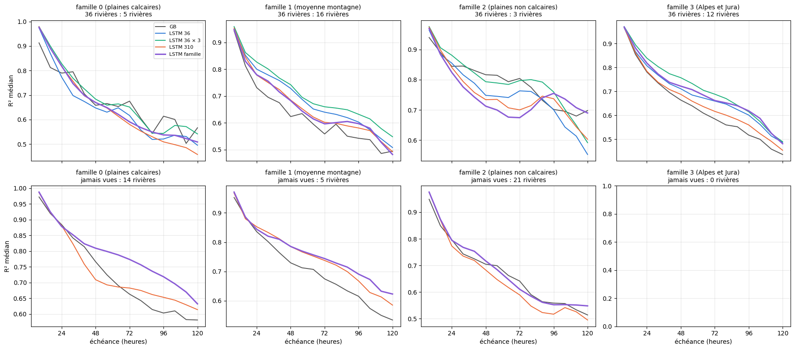
    

## 4. La distribution sur les rivières

Courbes cumulées : pour chaque valeur, la part des rivières qui font moins bien (R²) ou mieux (score d'IC). Une courbe plus à droite (R²) ou
plus à gauche (score) est meilleure sur l'ensemble des rivières, pas seulement en médiane.

    
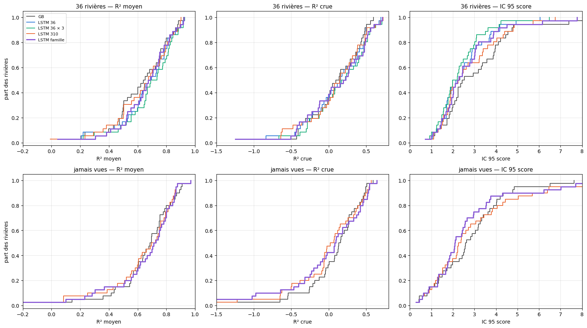
    

## 5. Le nombre de rivières apprises

Sur les quatre rivières de contrôle du notebook 5.07 (La Clapière, l'Albarine, le Grand-Morin à Pommeuse, l'Hérault à Laroque) : la note
selon le nombre de rivières apprises par le LSTM (deux tirages à 9 et 18), le LSTM 36 × 3 (étoile, placé à 36) et le LSTM de la famille
(losange, placé à la taille de sa famille). Trait gris : le GB de la rivière.

    
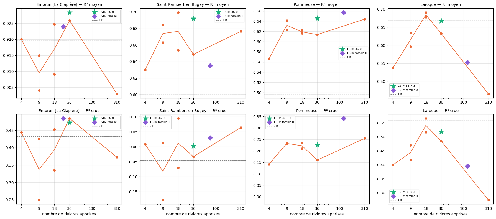
    

## 6. Les hydrogrammes de la plus grosse crue du test

Pour quelques rivières : le débit observé et les prévisions à 24 h et à 72 h d'échéance, sur les dix jours autour du plus gros débit de la
période de test. Bande violette : 10 à 90 % des 50 scénarios du LSTM de la famille.

    
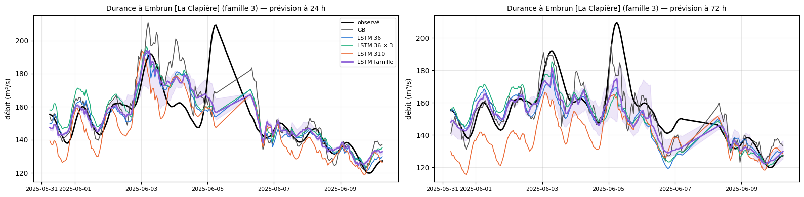
    

    
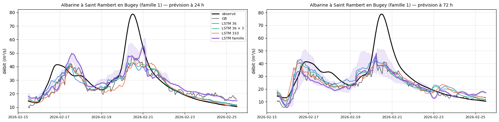
    

    
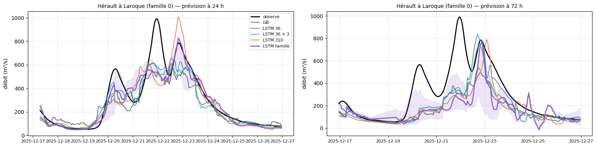
    

    
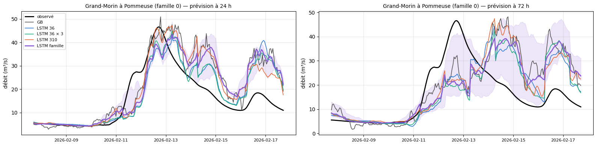
    

    
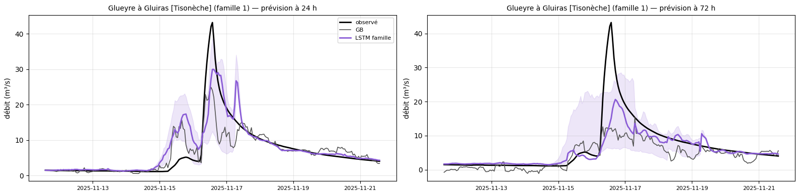
    

    
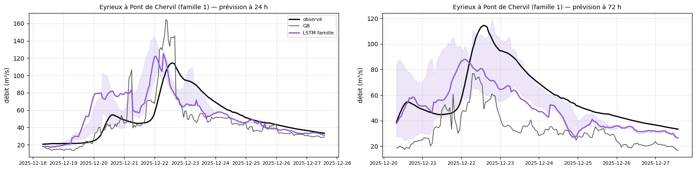
    

    
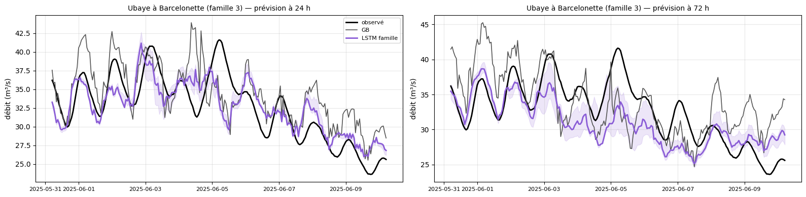
    

    
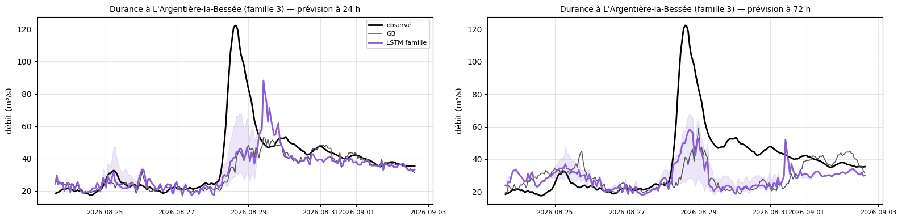
    

    
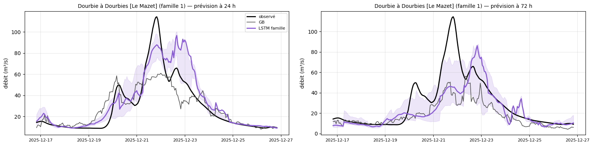
    

    
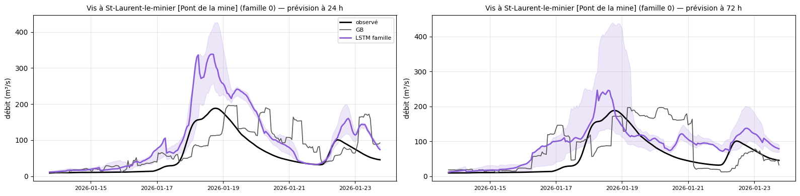
    

## 7. Les courbes d'apprentissage

Erreur de validation sans poids (celle qui choisit l'époque) à chaque époque, pour chaque réseau. Les échelles diffèrent d'un réseau à
l'autre (rivières différentes) : c'est la forme qui compte. Point : l'époque gardée.

    
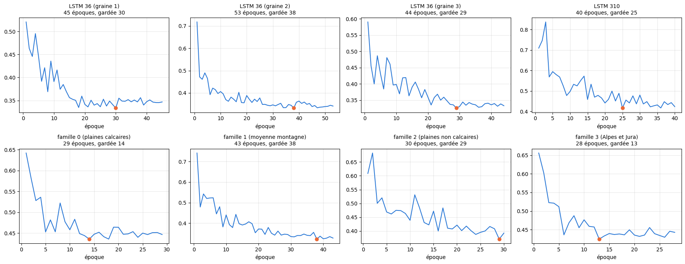
    

## 8. La note selon les caractéristiques du bassin

R² moyen du LSTM 310 et du LSTM de la famille, rivière par rivière (36 + jamais vues), selon l'altitude moyenne, la part de l'année avec de
la neige, la part de karst et la surface du bassin.

    
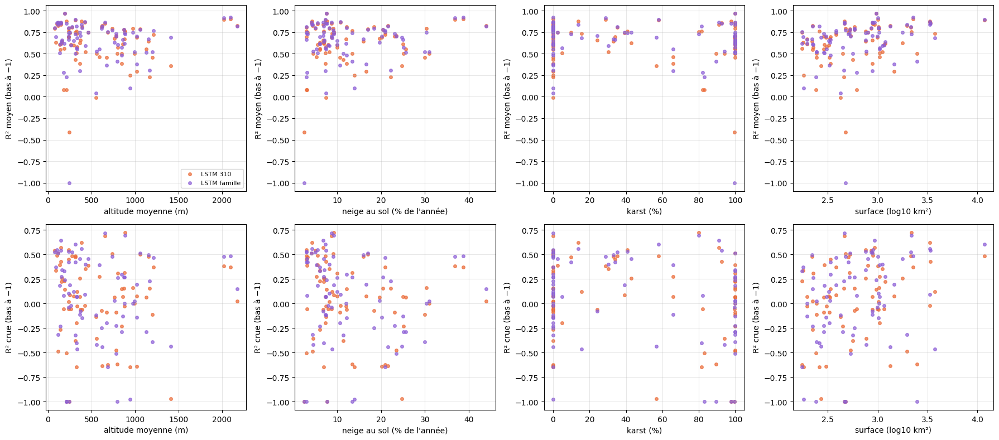
    

